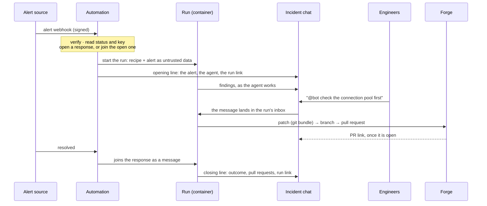

<h1 align="center">
  <a href="https://ryph.ai">
    <picture>
      <source media="(prefers-color-scheme: dark)" srcset="docs/assets/readme/ryph-logo-dark.svg">
      
    </picture>
  </a>
</h1>

  <a href="https://ryph.ai">Homepage</a> ·
  <a href="https://ryph.ai/docs/">Docs</a> ·
  <a href="https://ryph.ai/docs/getting-started/">Getting started</a>

> [!NOTE]
> Ryph is under active and heavy development. Breaking changes are possible before v1; see
> [Releases & versioning](CONTRIBUTING.md#releases--versioning).

Ryph is a complete, batteries-included agent orchestrator for teams that's easy to deploy and put
into action straight away.

## Deploy an incident response bot

An alert fires on your IRM, and an [automation](https://ryph.ai/docs/automations/) within Ryph
immediately spins up a secure sandbox for your responder bot within your infra. The sandbox
[ships with a warm build cache and dependencies pre-installed](https://ryph.ai/docs/environments/),
so your bot can get to work right away.

The bot starts reading telemetry directly from your observability stack,
[securely through the Tool Proxy](https://ryph.ai/docs/tool-proxy/), and diagnoses the problem. It
[remembers details from past incidents](https://ryph.ai/docs/semantic-memory/) that help it pinpoint
the root cause.

It [joins your teams existing incident chat](https://ryph.ai/docs/chat/), and reports what it finds.
People in this chat can mention it to ask follow-up questions or steer it.

Once the root cause is clear, the bot builds a fix, runs your repo's checks, submits a hotfix pull
request that [opens with all CI checks already green](https://ryph.ai/docs/checks/), and sends the
link to your chat. Ryph's [forge safeguards](https://ryph.ai/docs/secure-forge-interactions/)
prevent the bot from accidentally making a bad push, or even sidestepping a code review.

An engineer reviews the hotfix, merges and deploys. The bot is automatically notified of the PR
being merged, and starts watching telemetry for the deploy landing.

Eventually, the alert resolves, the bot reports all green, and closes out.

<a href="https://ryph.ai/docs/incident-response/">
  <picture>
    <source media="(prefers-color-scheme: dark)" srcset="docs/assets/readme/card-incident-response-dark.png">
    
  </picture>
</a>

## Give your teammates a secure helper bot that can reason from code, and ship fixes

With the [Chat integration](https://ryph.ai/docs/chat/), allow your teammates to ask a self-hosted
agent right from where your team already communicates - Slack, Discord, Telegram, or Zulip. For each
new agent run, Ryph provisions a secure sandbox,
[with dependencies already pre-installed](https://ryph.ai/docs/environments/).

The bot gets specific repos checked out, can reason from their code, and answer questions. If you
want, give it access to specific tables and fields from your database through the
[Tool Proxy](https://ryph.ai/docs/tool-proxy/), so it can perform data analysis for non-technical
teammates. For long-form reports, the bot creates an [Artifact](https://ryph.ai/docs/artifacts/) and
posts the link back in the chat - all self-hosted on your own infra.

When asked to fix a visual glitch in the frontend, the bot can be steered by screenshots people post
in the chat. It goes to fix the glitch, verifies it in its
[in-sandbox browser](https://ryph.ai/docs/browser/), ships a fix PR for an engineer to review, and
reports back in the chat with a screenshot of the fixed UI. Ryph's
[forge safeguards](https://ryph.ai/docs/secure-forge-interactions/) prevent the bot from
accidentally making a bad push, or even sidestepping a code review.

<a href="https://ryph.ai/docs/team-agent/">
  <picture>
    <source media="(prefers-color-scheme: dark)" srcset="docs/assets/readme/card-team-agent-dark.png">
    
  </picture>
</a>

---

Ryph is the self-hosted platform that does all this and more: coding agents that run in secure
containers, started by an alert, a task in the UI, a `/ryph` comment on a pull request, a mention in
chat or a schedule, whose work leaves as a pull request, with every step on record.

## Deploy it

Ryph ships as [a single binary](https://ryph.ai/docs/try-locally/) for trying it out on your laptop,
in [Docker Compose](https://ryph.ai/docs/docker-compose/) for teams, or as a
[Helm Chart](https://ryph.ai/docs/kubernetes/) for teams that require autoscaling with Kubernetes.

For smaller teams and sporadic agent use, [Docker Compose](https://ryph.ai/docs/docker-compose/) is
the quickest way to get started.

For heavier use, especially when also using [Ryph Checks](https://ryph.ai/docs/checks/), the
[Kubernetes deployment mode](https://ryph.ai/docs/kubernetes/) unlocks automatic resource scaling.
New agent sandboxes and check pods are placed within your cluster by k8s, and in combination with
autoscaling solutions such as
[GKE Autopilot](https://docs.cloud.google.com/kubernetes-engine/docs/concepts/autopilot-overview),
the cluster automatically provisions and removes nodes according to short-term resource needs.

[Read more about deployment options in our docs](https://ryph.ai/docs/deployment/)

## Get started

- **With your coding agent.** Tell Claude Code, Codex or Cursor: _read
  `https://raw.githubusercontent.com/ryph-hq/ryph/main/docs/guides/setup-with-an-agent.md` and set
  me up._ It installs the binary, answers the setup questions with you, starts it, and hands you the
  two steps only you can do.
- **By hand.** [docs/guides/quickstart.md](docs/guides/quickstart.md): install, setup, first run,
  first automation.
- **For a team.** [deploy/README.md](deploy/README.md) compares the binary, Compose and the Helm
  chart, and says which to pick.

## A response, end to end

ryph calls a handled alert a **response**: a run that stays open, bound to one conversation, while
later alerts about the same thing join it as messages.

- **Automations** take the webhook, verify it, and read what it says: Grafana, Alertmanager, Grafana
  IRM, PagerDuty, Sentry, incident.io, Datadog, Opsgenie, or your own mapping
  ([`@ryph/automations`](packages/automations/README.md)).
- **Chat** is where the response lives: a Slack thread, a Zulip topic or a Telegram group, and the
  people in it steer the run by mentioning the bot ([`@ryph/chat`](packages/chat/README.md)).
- **The run** is one container with one agent, holding only credentials minted for it; it reaches
  models and tools through ryph's proxies and never sees a real key
  ([`@ryph/runner`](packages/runner/README.md),
  [`@ryph/model-proxy`](packages/model-proxy/README.md),
  [`@ryph/mcp-gateway`](packages/mcp-gateway/README.md)).
- **Memory** gives it the runbooks and gotchas earlier runs left behind
  ([`@ryph/memory`](packages/memory/README.md)).
- **The forge** turns a patch into a branch and a pull request, after a person approves it in ryph
  or at once where a repo allows that ([`@ryph/forge`](packages/forge/README.md)).
- **The guide** tells the whole story on one stack and gives the checklist for yours:
  [docs/guides/incident-response.md](docs/guides/incident-response.md).

## Fit it to your team

<!-- The alerting row's source of truth is packages/app/src/lib/automations/presets.ts. -->

|                      |                                                                                                            |
| -------------------- | ---------------------------------------------------------------------------------------------------------- |
| **Alerting**         | Grafana, Alertmanager, Grafana IRM, PagerDuty, Sentry, incident.io, Datadog, Opsgenie, or a custom mapping |
| **Chat**             | Slack, Zulip, Telegram                                                                                     |
| **Forge**            | GitHub (as you, or as an App), GitLab, Radicle, or a directory on this machine                             |
| **Models**           | Anthropic, OpenAI, a ChatGPT plan, or any OpenAI-compatible endpoint                                       |
| **Tools for agents** | any MCP server, hosted by ryph or remote; Grafana, Sentry, Datadog and PagerDuty are in the catalogue      |

The checklist that walks a team through its own combination, with a coding agent doing the parts it
can:
[fit it into your operational context](docs/guides/incident-response.md#fit-it-into-your-operational-context).

## What else it does

- **Tasks from the UI**, on one repo or a workspace of several.
- **`/ryph` on a pull request, merge request or issue** starts a run on it
  ([forge](packages/forge/README.md)).
- **A mention in chat** starts a run in that thread.
- **Schedules**: a cron expression as a trigger, same recipe.
- **Previews** of a run's dev server in your browser ([previews](packages/previews/README.md)).
- **Checks** a repo declares in `.ryph/checks.yml`, run on ryph and reported to the forge
  ([checks](packages/orchestrator/docs/checks.md)).
- **Skills** and **MCP servers** for agents, with a policy per agent
  ([skills](packages/orchestrator/docs/skills.md), [mcp-gateway](packages/mcp-gateway/README.md)).
- **`ryph mcp`**: the deployment as MCP tools for the agent on _your_ machine
  ([the binary's README](packages/ryph/README.md#a-deployment-as-mcp-tools)).

## How it works

[docs/system-flow.md](docs/system-flow.md) has the cast of players, the happy path in one picture,
and the walk through every step with the doc that owns it. The workspace, one package per role:

| Package                                                    | Role                                                                                        |
| ---------------------------------------------------------- | ------------------------------------------------------------------------------------------- |
| [`packages/ryph`](packages/ryph/README.md)                 | `@ryph/cli`, the shipped `ryph` binary: one process, embedded Postgres, the UI inside       |
| [`packages/host`](packages/host/README.md)                 | `@ryph/host`, the single-process composition root the binary hands off to                   |
| [`packages/orchestrator`](packages/orchestrator/README.md) | `@ryph/orchestrator`, the control plane: agents, tasks, runs, patches, responses            |
| [`packages/runner`](packages/runner/README.md)             | `@ryph/runner`, the process inside a run's container                                        |
| [`packages/model-proxy`](packages/model-proxy/README.md)   | `@ryph/model-proxy`, the model-access data plane; real keys never enter a container         |
| [`packages/mcp-gateway`](packages/mcp-gateway/README.md)   | `@ryph/mcp-gateway`, the tool-access data plane                                             |
| [`packages/pi-mcp`](packages/pi-mcp/README.md)             | `@ryph/pi-mcp`, the pi extension that connects a run to the gateway                         |
| [`packages/forge`](packages/forge/README.md)               | `@ryph/forge`, the boundary toward GitHub, GitLab, Radicle and local repos                  |
| [`packages/radicle`](packages/radicle/README.md)           | `@ryph/radicle`, the Radicle node and bridge                                                |
| [`packages/automations`](packages/automations/README.md)   | `@ryph/automations`, webhooks and schedules that start runs                                 |
| [`packages/webhooks`](packages/webhooks/README.md)         | `@ryph/webhooks`, the mailroom library every webhook arrives through                        |
| [`packages/chat`](packages/chat/README.md)                 | `@ryph/chat`, Telegram, Zulip and Slack                                                     |
| [`packages/app`](packages/app/README.md)                   | `@ryph/app`, the web UI, a thin BFF                                                         |
| [`packages/auth`](packages/auth/README.md)                 | `@ryph/auth`, the token contract                                                            |
| [`packages/historian`](packages/historian/README.md)       | `@ryph/historian`, the permanent record of every run                                        |
| [`packages/memory`](packages/memory/README.md)             | `@ryph/memory`, what agents remember across runs                                            |
| [`packages/browser`](packages/browser/README.md)           | `@ryph/browser`, the Chromium sidecar a run may drive                                       |
| [`packages/web`](packages/web/README.md)                   | `@ryph/web`, the agent's read-only web search and fetch                                     |
| [`packages/previews`](packages/previews/README.md)         | `@ryph/previews`, dev-server previews on hosted deployments                                 |
| [`packages/tunnel`](packages/tunnel/README.md)             | `@ryph/tunnel`, many connections over one WebSocket                                         |
| [`packages/launcher`](packages/launcher/README.md)         | `@ryph/launcher`, the docker seam runs and hosted servers start through                     |
| [`packages/logger`](packages/logger/README.md)             | `@ryph/logger`, the shared logger                                                           |
| [`packages/sealed`](packages/sealed/README.md)             | `@ryph/sealed`, the shared credential kit                                                   |
| [`packages/service`](packages/service/README.md)           | `@ryph/service`, what every service's `main.ts` shares                                      |
| [`packages/db`](packages/db/README.md)                     | `@ryph/db`, the database kit and its test harness                                           |
| [`packages/shared`](packages/shared/README.md)             | `@ryph/shared`, small things more than one package needs                                    |
| [`packages/process`](packages/process)                     | `@ryph/process`, running a program on `node:child_process`, in the shape `Deno.Command` had |
| [`packages/devstack`](packages/devstack/README.md)         | `./dev`, the local dev-stack controller                                                     |
| [`packages/playground`](packages/playground/README.md)     | a seeded ryph for UI work, no containers needed                                             |
| [`packages/fake-gitlab`](packages/fake-gitlab/README.md)   | an in-memory GitLab for tests and the playground                                            |

[`images/`](images/README.md) builds one image per service plus the agent images.
[`deploy/`](deploy/README.md) holds Compose and the Helm chart.

## Developing ryph

[CONTRIBUTING.md](CONTRIBUTING.md): the toolchain, the commands, how the repo runs on itself, and
how designs are written down.

[MIT](LICENSE).
