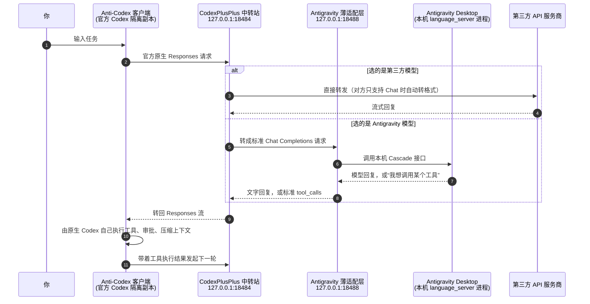

# Anti-Codex

<div align="center">


### 与原版双开共存的官方 Codex Desktop 隔离副本（Isolated Official Codex）

[](#四环境要求与前置条件)
[](#二核心架构三层锁定设计)
[](#二核心架构三层锁定设计)
[](#必看提示使用-antigravity-模型时必须开着-antigravity)
[](#许可与声明)

**简体中文说明** · **[English Documentation (README_EN.md)](README_EN.md)** · **[架构文档](docs/THREE_LAYER_ARCHITECTURE.md)** · **[Windows 运行指南](docs/WINDOWS.md)**

</div>

---

**Anti-Codex** 是一份与原版完全隔离、互不干扰的官方 Codex Desktop 副本（`isolated` `official Codex`）。它 **100% 保留官方 Codex 的原生界面、交互体验与底层代理引擎（`Codex` 独占规划、`tools`、终端命令、审批、重试与 `compaction`）**，仅替换模型提供方接入层——让你在不触碰原版官方客户端任何文件、账号令牌和历史记录的前提下，自由直连第三方 API，或直接复用本机 **Antigravity Desktop** 的模型与额度。

> [!IMPORTANT]
> ### 必看提示：使用 Antigravity 模型时，必须全程开着 Antigravity！
> - **走 Antigravity 路线时（必开）**：使用期间 **本机必须已经启动并登录 Antigravity Desktop 客户端（保持后台或最小化运行即可，切勿退出关闭）**。因为 Anti-Codex 是通过本机已开启的 Antigravity Desktop（`Cascade` 本地服务）来读取模型列表并复用账号额度的；一旦把 Antigravity 关掉，模型列表刷新和对话请求都会立即报错中断。
> - **走普通第三方 API 直连时（无需开启）**：如果你在「管理」面板切换到了自己的第三方 API Key，流量由 `CodexPlusPlus` 直接发往目标服务商（ordinary `third-party` traffic `bypasses` `Antigravity`），此时不需要安装或打开 Antigravity。

---

## 一、一眼看懂：它和原版有什么区别？

<div align="center">
<table>
  <thead>
    <tr>
      <th align="center" width="240">原版官方 Codex Desktop</th>
      <th align="center" width="240">Anti-Codex 隔离副本</th>
      <th align="left">双开隔离效果</th>
    </tr>
  </thead>
  <tbody>
    <tr>
      <td align="center">
        <br/>
        <sub><b>原版蓝色图标</b> · <code>ChatGPT.exe</code></sub>
      </td>
      <td align="center">
        <br/>
        <sub><b>专属粉色图标</b> · <code>Anti-Codex.exe</code></sub>
      </td>
      <td>
        <ul>
          <li><b>零侵入共存</b>：独立进程名、独立任务栏/托盘粉色图标、独立数据目录，可与原版同时打开。</li>
          <li><b>原版毫发无损</b>：绝不修改原版安装目录、<code>%USERPROFILE%\.codex</code> 登录态与聊天记录。</li>
          <li><b>原生手感不变</b>：保留全部原生菜单、代码审查、终端执行与多模态看图能力。</li>
        </ul>
      </td>
    </tr>
  </tbody>
</table>
</div>

### 为什么做 Anti-Codex？

| 核心痛点 / 目标 | Anti-Codex 的做法 |
| :--- | :--- |
| **不想污染原版官方客户端** | 受控复制官方宿主，打最小品牌与路径隔离补丁，配置与状态全部落在独立目录。 |
| **不想用残血套壳代理** | 不重写任务控制器；文件读写、命令执行、工具调用（`tools`）、权限审批、上下文压缩（`compaction`）全由官方原生 `Codex` 负责。 |
| **想复用本机 Antigravity 的模型和额度** | 开着 **Antigravity Desktop** 即可通过极薄适配层（`thin` `Chat`-to-`Cascade` adapter）在原生 Codex 界面里直接选 Gemini / Claude 等模型干活。 |
| **想随时切普通第三方 API** | 内置中文 **「管理」** 面板，支持配置和测试标准 Responses / Chat Completions 第三方接口，直连不绕路。 |
| **官方客户端更新频繁怕坏** | 一键同步新版本：先在候选目录打补丁、做哈希重签与门禁自检，全绿才切换激活，并自动留好一键回滚点。 |

---

## 二、核心架构（三层锁定设计）

<div align="center">
  
</div>

项目基石是 **[三层架构](docs/THREE_LAYER_ARCHITECTURE.md)**（详见 **[自适应协议栈说明](docs/ADAPTIVE_ONE_API_STACK.md)**），严格不在三层之外增加第四层任务控制器：

1. **第一层：官方 Codex 隔离壳（Isolated Official Codex Shell）**
   - 从本机官方 Codex 安全复制并注入最小隔离补丁（独立 `Anti-Codex.exe`、独立 AppUserModelId、粉色桌面与托盘图标、独立配置桥接与左下角中文 **「管理」** 入口）。
   - 官方原生 `Codex` 独占任务规划、`tools`、终端命令、审批、错误重试、`compaction` 与完成判断。
2. **第二层：CodexPlusPlus 通用接入层（General Provider Layer）**
   - 采用固定校验版本的上游组件 `CodexPlusPlus` 统一处理 Responses / Chat 协议桥接与分流。
   - **第三方直连绕过适配层**：ordinary `third-party` traffic `bypasses` `Antigravity`，直接发往目标 API 服务商。
3. **第三层：Antigravity 薄适配层（Thin Antigravity Adapter）**
   - 仅在选中 Antigravity 模型时启用，作为极薄适配层（`thin` adapter）把标准 `Chat` Completions 请求映射到本机运行中的 Antigravity Desktop `Cascade` 接口，只负责模型推理消息收发，绝不接管工具或篡改命令。

> [!NOTE]
> **安全与授权红线**：原版 Codex 的文件与登录态保持零改动；对于 `connector-backed app tools`，本地复制的元数据不代表已获授权，未完成真实授权前保持不可调用，绝不伪造授权状态。

---

## 三、工作原理：它到底是怎么跑起来的？

一句话：**Anti-Codex 让官方 Codex 客户端以为自己在连一个普通的 OpenAI 接口，实际上这个“接口”是本机上的一个中转站，它再按你选的模型，把请求转给第三方 API 或本机的 Antigravity。** 干活的大脑（规划、调工具、执行命令）始终是官方 Codex 自己，中转站只负责“传话”。

### 一次请求的完整路径



### 每一步具体在做什么

| 环节 | 具体做法 |
| :--- | :--- |
| **① 复制出一个隔离客户端** | 安装脚本把微软商店里的官方 Codex 整个复制到 `%LOCALAPPDATA%\Anti-Codex\codex-patched-app`，原版目录只读不改。复制后把 `ChatGPT.exe` 改名为 `Anti-Codex.exe`、换上粉色图标，并给界面包（`app.asar`）打几处最小补丁（品牌名、「管理」入口等），再重新计算完整性校验值，保证 Electron 能正常加载。 |
| **② 数据彻底分家** | 启动时给它单独指定 Codex 数据目录（`%APPDATA%\anticodex`）和单独的 Electron 缓存目录，所以登录状态、聊天记录、配置都和原版互不相通。 |
| **③ 把“模型接口”指向本机中转站** | 隔离客户端的模型接口地址被设成 `http://127.0.0.1:18484/v1`，也就是本机运行的 `CodexPlusPlus`。客户端发出的仍是官方原生格式的请求，它自己感觉不到差别。 |
| **④ 按模型分流** | `CodexPlusPlus` 看你在模型菜单里选了谁。选第三方模型，就直连你在「管理」里填的 API（ordinary third-party traffic bypasses Antigravity）。选 Antigravity 模型，就转成标准 Chat Completions 格式，交给本机 `18488` 端口的薄适配层。路由对不上时直接报错，不会偷偷换模型。 |
| **⑤ 薄适配层接上 Antigravity** | 适配层在本机找到 Antigravity Desktop 正在运行的 `language_server` 后台进程，从它的启动参数里读出本地端口和一次性 CSRF 令牌，再用这个令牌调用 Antigravity 的本地 Cascade 接口：读模型列表、读账号状态、发起对话、取回回复、取消请求。用的是你自己已登录账号的额度。 |
| **⑥ 工具调用仍然交给原生 Codex** | Codex 能用的工具（执行命令、改文件等）会通过一个临时的本机 MCP 服务（随机端口加随机密钥路径）提供给 Antigravity 模型看。模型想调工具时，适配层把它翻译成标准的 `tool_calls` 回给 Codex，**由 Codex 按自己的审批和权限规则真正去执行**，结果再原路送回模型。Antigravity 一侧从不直接执行命令。 |
| **⑦ 跟随官方更新** | 官方 Codex 更新后，同步程序先在 `update-candidate` 候选目录里重新复制、打补丁、校验，全部通过才替换当前版本，旧版本留在 `rollback-host` 作为回滚点。 |

### 为什么用 Antigravity 模型时必须开着 Antigravity？

因为第 ⑤ 步要连的是 **Antigravity Desktop 在你电脑上跑着的后台进程**。端口和令牌都是这个进程启动时临时生成的，Antigravity 一关，进程就没了，模型列表读不到，对话也发不出去。日常对话只用到这个进程的本地端口和令牌，Anti-Codex 不直接连 Antigravity 的云端服务。只有你主动使用「管理」里的账号切换功能时，才会把 Antigravity 的登录凭据用 Windows 自带加密（仅当前用户可解密）保存在本机。普通第三方 API 走的是第 ④ 步的直连分支，用不到这个进程，所以不需要开 Antigravity。

---

## 四、环境要求与前置条件

| 类别 | 具体要求 |
| :--- | :--- |
| **操作系统与宿主** | Windows 10 / 11（x64），本机已安装官方 **Codex Desktop**（Microsoft Store / WindowsApps 版本）。 |
| **基础运行环境** | 已安装 **Node.js**（确保 `node.exe` 在系统 `PATH` 中可用）及 Windows PowerShell 5.1。 |
| **路线 A：使用普通第三方 API** | 准备好对应服务商的 API Base URL、模型名与 API Key（此路线无需安装或开启 Antigravity）。 |
| **路线 B：使用 Antigravity 模型** | 本机已安装、已登录 **Antigravity Desktop**，且 **使用期间必须一直开着 Antigravity 客户端**（网络可正常访问其服务）。 |

---

## 五、快速安装与日常使用

### 第 1 步：一键安装

克隆或下载本仓库后，在仓库根目录直接双击运行：

```text
install-windows.bat
```

<details>
<summary>也可以在 PowerShell 中命令行安装（点击展开）</summary>

```powershell
powershell -ExecutionPolicy Bypass -File .\scripts\install-anticodex.ps1
```

安装完成后会自动生成：
- 隔离宿主与运行组件（`%LOCALAPPDATA%\Anti-Codex`）
- 桌面快捷方式 **Anti-Codex**（粉色图标）与 `开始菜单 > Anti-Codex` 程序组

</details>

### 第 2 步：启动软件（先确认前置条件！）

1. **如果你要用 Antigravity 模型**：**请先打开本机的 Antigravity Desktop 并确认处于已登录状态**，让它在后台保持运行。
2. 双击桌面粉色图标 **Anti-Codex**（或从 `开始菜单 > Anti-Codex > Anti-Codex` 启动）。
   - 启动器会自动拉起本地守护路由与客户端窗口；若已在运行，再次点击快捷方式会直接唤醒现有窗口，不会重复多开。

### 第 3 步：切换模型、多模态输入与配置第三方 API

- **打开「管理」面板**：点击 Anti-Codex 左下角个人菜单里的中文 **「管理」**，或打开 `开始菜单 > Anti-Codex > Manage Anti-Codex`。
- **选用 Antigravity 模型**：保持 **Antigravity Desktop 开启**，在「管理」中刷新状态/模型目录，随后直接在原生聊天输入框底部的模型菜单里选择所需模型与思考档位。
- **选用普通第三方 API**：在「管理」面板点击 **「配置第三方 API」** -> 选择协议（Chat Completions / Responses） -> 填入 URL、模型名和 Key -> 点击 **「测试连通」** 通过后点击 **「保存并切换」**。切换回 Antigravity 只需点击 **「恢复 Antigravity」**。
- **严格防串台（Fail-Closed）**：当前路由或上游不可用时（例如忘了开 Antigravity），会直接给出明确报错提示，绝不会偷偷切去别的模型消耗意外额度。

<div align="center">
  <br/>
  <sub>原生多模态图片输入与视觉冒烟验证素材（<code>assets/vision-smoke.png</code>），完整支持拖入图片识图与界面审查</sub>
</div>

### 第 4 步：官方 Codex 更新后如何同步升级？

每当微软商店里的原版官方 Codex Desktop 自动更新后，只需点一下：

```text
开始菜单 > Anti-Codex > Sync Anti-Codex with Codex
```

同步程序会在后台安全复制新版宿主、重打隔离补丁与粉色图标、校验全部完整性哈希；只有全部门禁检查通过后才会替换当前版本，失败则原样不动。

### 第 5 步：遇到问题一键回滚

如果想随时退回上一版已验证的宿主，直接运行：

```text
开始菜单 > Anti-Codex > Rollback Anti-Codex
```

---

## 六、常见问题排查（FAQ）

1. **问：为什么点发送或刷新模型时提示连接失败 / Antigravity 未就绪？**
   - **答**：90% 是因为 **Antigravity Desktop 没开，或者退出了登录**。请先打开 Antigravity Desktop 确认已登录并保持窗口/后台常驻，再回 Anti-Codex 的「管理」里点一次刷新即可。
2. **问：我能同时开着原版蓝色 Codex 和粉色 Anti-Codex 吗？**
   - **答**：完全可以。两者的可执行文件、运行端口、Electron 缓存和配置目录彻底隔离，互不抢占。
3. **问：用普通第三方 API Key 时，还需要开着 Antigravity 吗？**
   - **答**：不需要。普通第三方 API 由 `CodexPlusPlus` 直接请求外部接口，不经过 Antigravity。

---

## 七、开发者命令与目录索引

<details>
<summary><b>常用排障与自检命令（点击展开）</b></summary>

在仓库根目录打开 PowerShell 即可执行：

```powershell
# 1. 只读检查官方 Codex 是否有新版本待同步
powershell -NoProfile -ExecutionPolicy Bypass -File .\scripts\check-anticodex-update.ps1 -NoPersist

# 2. 修复桌面/开始菜单粉色快捷方式与计划任务
powershell -NoProfile -ExecutionPolicy Bypass -File .\scripts\repair-anticodex-shortcuts.ps1

# 3. 运行安装态快速无流量总检（自动确保运行，零 Token 消耗）
powershell -NoProfile -ExecutionPolicy Bypass -File .\scripts\test-anticodex-installed-overall.ps1 -EnsureRunning -NoTraffic -Fast

# 4. 运行源码预检与契约测试（并发限制为 2）
powershell -NoProfile -ExecutionPolicy Bypass -File .\scripts\test-anticodex-source-preflight.ps1
node --test --test-concurrency=2 translator/tests/*.test.mjs
```

</details>

### 本机隔离目录（不触碰 `%USERPROFILE%\.codex`）

| 用途 | 路径 |
| :--- | :--- |
| **安装与隔离宿主目录** | `%LOCALAPPDATA%\Anti-Codex` |
| **独立配置与运行状态** | `%APPDATA%\anticodex` |
| **自动体检与验收报告** | `%APPDATA%\anticodex\reports` |

### 仓库文档导航

- **English Documentation**：[README_EN.md](README_EN.md)
- **Windows 安装与运行详解**：[docs/WINDOWS.md](docs/WINDOWS.md)
- **三层锁定架构规范**：[docs/THREE_LAYER_ARCHITECTURE.md](docs/THREE_LAYER_ARCHITECTURE.md)
- **自适应协议栈与路由边界**：[docs/ADAPTIVE_ONE_API_STACK.md](docs/ADAPTIVE_ONE_API_STACK.md)
- **1.0 验收完成清单**：[COMPLETION_CHECKLIST.md](COMPLETION_CHECKLIST.md)
- **日常跟随升级与维护手册**：[MAINTENANCE.md](MAINTENANCE.md)
- **已知限制说明**：[KNOWN_LIMITATIONS.md](KNOWN_LIMITATIONS.md)
- **历史兼容命名清理台账**：[docs/LEGACY_REMOVAL_MANIFEST.md](docs/LEGACY_REMOVAL_MANIFEST.md)
- **开源许可与第三方声明**：[LICENSE](LICENSE) · [THIRD_PARTY_NOTICES.md](THIRD_PARTY_NOTICES.md)

---

## 许可与声明

- **项目代码**：采用 [非商业许可](LICENSE)，允许个人、学习、研究等非商业用途使用、修改和分享，禁止商用。
- **CodexPlusPlus 组件**：来自上游 [BigPizzaV3/CodexPlusPlus](https://github.com/BigPizzaV3/CodexPlusPlus)，沿用其 AGPL-3.0 许可，补丁单独存放在 `third_party/codexplusplus`。
- **其他第三方代码**：见 [THIRD_PARTY_NOTICES.md](THIRD_PARTY_NOTICES.md)。
- 本项目是个人工具，与 OpenAI、Antigravity 官方均无关联。连接 Antigravity 用的是其本机客户端的内部接口，Antigravity 升级后接口可能变化，导致暂时不可用。请自行遵守各服务的使用条款。

---

## English Quick Summary

**Anti-Codex** is a guarded, `isolated` copy of the `official Codex` Desktop app for Windows (`Anti-Codex.exe` with a distinct pink icon). It keeps 100% of the native `Codex` UI, `tools`, terminal execution, approvals, retries, and `compaction`, swapping only the model provider layer:
- **Important when using Antigravity models**: You **MUST keep Antigravity Desktop open and signed in** the entire time you use Antigravity models, because the `thin` `Chat`-to-`Cascade` adapter bridges through your live local Antigravity Desktop service.
- **Ordinary third-party APIs**: Handled directly by `CodexPlusPlus` (ordinary `third-party` traffic `bypasses` `Antigravity` completely — Antigravity does not need to be running).

Read the full illustrated English guide in **[README_EN.md](README_EN.md)**.