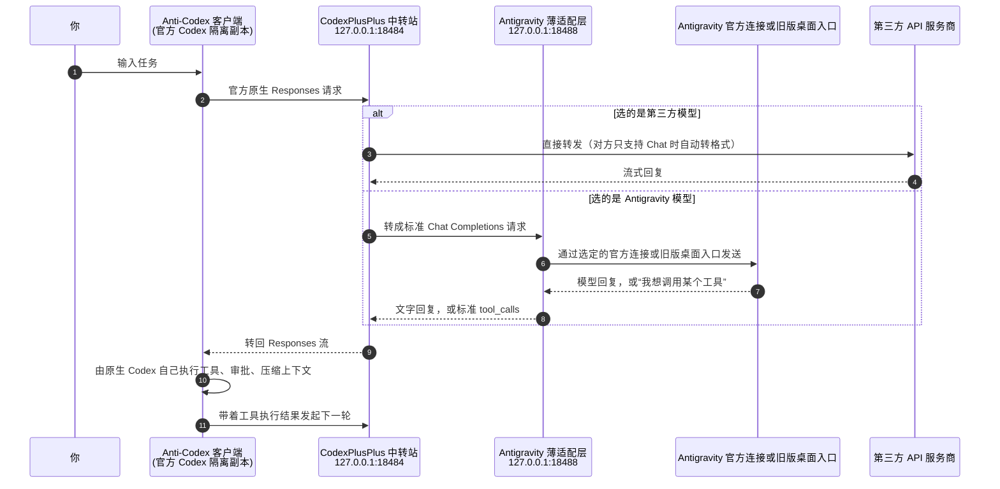

# Anti-Codex

<div align="center">


### 与原版双开共存的官方 Codex Desktop 隔离副本（Isolated Official Codex）

[](#四环境要求与前置条件)
[](#二核心架构三层锁定设计)
[](#二核心架构三层锁定设计)
[](#antigravity-有两条明确路由)
[](#许可与声明)

**简体中文说明** · **[English Documentation (README_EN.md)](README_EN.md)** · **[架构文档](docs/THREE_LAYER_ARCHITECTURE.md)** · **[Windows 运行指南](docs/WINDOWS.md)**

</div>

---

**Anti-Codex** 是一份与原版完全隔离、互不干扰的官方 Codex Desktop 副本（`isolated` `official Codex`）。它 **100% 保留官方 Codex 的原生界面、交互体验与底层代理引擎（`Codex` 独占规划、`tools`、终端命令、审批、重试与 `compaction`）**，仅替换模型提供方接入层——让你在不触碰原版官方客户端任何文件、账号令牌和历史记录的前提下，自由直连第三方 API，或使用本机已登录的 Antigravity 账号。

> [!IMPORTANT]
> ### Antigravity 有两条明确路由
> - **官方 ACP（agy）**：在原生 Codex 聊天输入框里使用本机已登录的 `agy` Google 账号。模型菜单只显示 `agy models` 返回且 Anti-Codex 目录能识别的型号/档位；缺少的型号不会手工补入或静默替换。
> - **旧版 Desktop Cascade**：作为独立兼容入口保留；选用它时必须保持 Antigravity Desktop 已登录并运行。
> - **官方 ACP 不承诺可关闭 Desktop**：除非你已在自己的安装上确认可关，否则使用 Antigravity 模型时先保持 Desktop 开启。
> - **普通第三方 API 直连**：在「管理」配置 URL 与 API Key 后自动发现可用模型，无需手填模型名；流量由 `CodexPlusPlus` 直接发往目标服务商，不经过 Antigravity。

---

## 一、一眼看懂：它和原版有什么区别？

<div align="center">
<table>
  <thead>
    <tr>
      <th align="center" width="240">原版官方 Codex Desktop</th>
      <th align="center" width="240">Anti-Codex 隔离副本</th>
      <th align="left">双开隔离效果</th>
    </tr>
  </thead>
  <tbody>
    <tr>
      <td align="center">
        <br/>
        <sub><b>原版蓝色图标</b> · <code>ChatGPT.exe</code></sub>
      </td>
      <td align="center">
        <br/>
        <sub><b>专属粉色图标</b> · <code>Anti-Codex.exe</code></sub>
      </td>
      <td>
        <ul>
          <li><b>零侵入共存</b>：独立进程名、独立任务栏/托盘粉色图标、独立数据目录，可与原版同时打开。</li>
          <li><b>原版毫发无损</b>：绝不修改原版安装目录、<code>%USERPROFILE%\.codex</code> 登录态与聊天记录。</li>
          <li><b>原生手感不变</b>：保留全部原生菜单、代码审查、终端执行与多模态看图能力。</li>
        </ul>
      </td>
    </tr>
  </tbody>
</table>
</div>

### 为什么做 Anti-Codex？

| 核心痛点 / 目标 | Anti-Codex 的做法 |
| :--- | :--- |
| **不想污染原版官方客户端** | 受控复制官方宿主，打最小品牌与路径隔离补丁，配置与状态全部落在独立目录。 |
| **不想用残血套壳代理** | 不重写任务控制器；文件读写、命令执行、工具调用（`tools`）、权限审批、上下文压缩（`compaction`）全由官方原生 `Codex` 负责。 |
| **想复用本机 Antigravity 的模型和额度** | 在原生 Codex 输入框使用官方 ACP（`agy`）路由，或单独选择兼容旧版 Desktop Cascade 的入口；官方模型以实际可用目录为准。 |
| **想随时切普通第三方 API** | 内置中文 **「管理」** 面板，支持配置和测试标准 Responses / Chat Completions 第三方接口，直连不绕路。 |
| **官方客户端更新频繁怕坏** | 一键同步新版本：先在候选目录打补丁、做哈希重签与门禁自检，全绿才切换激活，并自动留好一键回滚点。 |

---

## 二、核心架构（三层锁定设计）

<div align="center">
  
</div>

> 图中 Antigravity 支路以旧版 Desktop Cascade 为示例；当前还提供官方 ACP（`agy`）入口。两条路由都从原生 Codex 输入框发起，模型按各自实际可用目录展示。

项目基石是 **[三层架构](docs/THREE_LAYER_ARCHITECTURE.md)**（详见 **[自适应协议栈说明](docs/ADAPTIVE_ONE_API_STACK.md)**），严格不在三层之外增加第四层任务控制器：

1. **第一层：官方 Codex 隔离壳（Isolated Official Codex Shell）**
   - 从本机官方 Codex 安全复制并注入最小隔离补丁（独立 `Anti-Codex.exe`、独立 AppUserModelId、粉色桌面与托盘图标、独立配置桥接与左下角中文 **「管理」** 入口）。
   - 官方原生 `Codex` 独占任务规划、`tools`、终端命令、审批、错误重试、`compaction` 与完成判断。
2. **第二层：CodexPlusPlus 通用接入层（General Provider Layer）**
   - 采用固定校验版本的上游组件 `CodexPlusPlus` 统一处理 Responses / Chat 协议桥接与分流。
   - **第三方直连绕过适配层**：ordinary `third-party` traffic `bypasses` `Antigravity`，直接发往目标 API 服务商。
3. **第三层：Antigravity 薄适配层（Thin Antigravity Adapter）**
   - 仅在选中 Antigravity 模型时启用。可走官方 ACP（本机已登录的 `agy`）或兼容旧版 Desktop Cascade；两者都只负责模型消息，工具审批与执行仍归原生 Codex。

> [!NOTE]
> **安全与授权红线**：原版 Codex 的文件与登录态保持零改动；对于 `connector-backed app tools`，本地复制的元数据不代表已获授权，未完成真实授权前保持不可调用，绝不伪造授权状态。

---

## 三、工作原理：它到底是怎么跑起来的？

一句话：**Anti-Codex 让官方 Codex 客户端以为自己在连一个普通的 OpenAI 接口，实际上这个“接口”是本机上的一个中转站，它再按你选的模型，把请求转给第三方 API 或本机的 Antigravity。** 干活的大脑（规划、调工具、执行命令）始终是官方 Codex 自己，中转站只负责“传话”。

### 一次请求的完整路径



### 每一步具体在做什么

| 环节 | 具体做法 |
| :--- | :--- |
| **① 复制出一个隔离客户端** | 安装脚本把微软商店里的官方 Codex 整个复制到 `%LOCALAPPDATA%\Anti-Codex\codex-patched-app`，原版目录只读不改。复制后把 `ChatGPT.exe` 改名为 `Anti-Codex.exe`、换上粉色图标，并给界面包（`app.asar`）打几处最小补丁（品牌名、「管理」入口等），再重新计算完整性校验值，保证 Electron 能正常加载。 |
| **② 数据彻底分家** | 启动时给它单独指定 Codex 数据目录（`%APPDATA%\anticodex`）和单独的 Electron 缓存目录，所以登录状态、聊天记录、配置都和原版互不相通。 |
| **③ 把“模型接口”指向本机中转站** | 隔离客户端的模型接口地址被设成 `http://127.0.0.1:18484/v1`，也就是本机运行的 `CodexPlusPlus`。客户端发出的仍是官方原生格式的请求，它自己感觉不到差别。 |
| **④ 按模型分流** | `CodexPlusPlus` 看你在模型菜单里选了谁。选第三方模型，就直连「管理」里配置的 API；选 Antigravity 模型，两种入口都经过本机适配层，再交给官方连接或旧版 Desktop Cascade。路由对不上时直接报错，不会偷偷换模型。 |
| **⑤ Antigravity 推理入口** | 官方 ACP 通过 `agy acp` 使用正常的 Google 登录与模型目录，在 Codex 原生输入框里收发对话。兼容的旧版 Desktop Cascade 入口仍连接本机 Desktop 服务。两条路由都使用同一用户选择的 Antigravity 账号，不接管 Codex 工具或任务控制。 |
| **⑥ 工具调用仍然交给原生 Codex** | 读文件、改文件、执行命令都沿用 Codex 的审批和权限。等待工具时，官方连接保持打开，结果回到同一个聊天。 |
| **⑦ 跟随官方更新** | 官方 Codex 更新后，同步程序先在 `update-candidate` 候选目录里重新复制、打补丁、校验，全部通过才替换当前版本，旧版本留在 `rollback-host` 作为回滚点。 |

### 哪条 Antigravity 路由需要保持 Desktop 开启？

旧版 Desktop Cascade 入口依赖本机已运行的 Antigravity Desktop；关闭客户端会使该入口无法推理。官方 ACP 则使用本机已登录的 `agy`，模型目录取自 `agy models` 与 Anti-Codex 的实际目录映射。当前不承诺官方 ACP 在关闭 Desktop 后仍可用；确认自己的账号和安装支持前，请保持 Desktop 开启。普通第三方 API 直连，不需要安装或打开 Antigravity。

---

## 四、环境要求与前置条件

| 类别 | 具体要求 |
| :--- | :--- |
| **操作系统与宿主** | Windows 10 / 11（x64），本机已安装官方 **Codex Desktop**（Microsoft Store / WindowsApps 版本）。 |
| **基础运行环境** | 已安装 **Node.js**（确保 `node.exe` 在系统 `PATH` 中可用）及 Windows PowerShell 5.1。 |
| **路线 A：使用普通第三方 API** | 准备对应服务商的 API Base URL 与 API Key；管理页会自动发现可用模型，无需手填模型名。 |
| **路线 B：官方 ACP（agy）** | 安装 `agy` 并完成 Google 登录；菜单只显示 `agy models` 与 Anti-Codex 目录实际提供的型号/档位。 |
| **路线 C：旧版 Desktop Cascade** | 本机已安装并登录 Antigravity Desktop，且使用期间保持客户端运行。 |

---

## 五、快速安装与日常使用

### 第 1 步：一键安装

克隆或下载本仓库后，在仓库根目录直接双击运行：

```text
install-windows.bat
```

<details>
<summary>也可以在 PowerShell 中命令行安装（点击展开）</summary>

```powershell
powershell -ExecutionPolicy Bypass -File .\scripts\install-anticodex.ps1
```

安装完成后会自动生成：
- 隔离宿主与运行组件（`%LOCALAPPDATA%\Anti-Codex`）
- 桌面快捷方式 **Anti-Codex**（粉色图标）与 `开始菜单 > Anti-Codex` 程序组

</details>

### 第 2 步：启动软件（先确认前置条件！）

1. **如果你要用官方 ACP 模型**：确认 `agy` 已安装并使用目标 Google 账号登录。选择旧版 Desktop Cascade 时，再确认 Antigravity Desktop 已登录并保持运行。官方 ACP 目前也不保证能在 Desktop 关闭后使用。
2. 双击桌面粉色图标 **Anti-Codex**（或从 `开始菜单 > Anti-Codex > Anti-Codex` 启动）。
   - 启动器会自动拉起本地守护路由与客户端窗口；若已在运行，再次点击快捷方式会直接唤醒现有窗口，不会重复多开。

### 第 3 步：切换模型、多模态输入与配置第三方 API

- **打开「管理」面板**：点击 Anti-Codex 左下角个人菜单里的中文 **「管理」**，或打开 `开始菜单 > Anti-Codex > Manage Anti-Codex`。
- **选用官方 ACP 模型**：在管理页刷新实际可用目录，然后直接在原生聊天输入框底部的模型菜单中选择。列表受 `agy models` 返回值和 Anti-Codex 目录映射限制，不提供的型号不会显示。
- **选用旧版 Desktop Cascade**：保持 Antigravity Desktop 开启，并从模型菜单中选择对应的兼容入口。
- **选用普通第三方 API**：在「管理」面板选择协议并填写 URL 与 API Key；模型名自动发现，无需手动输入。测试连通后保存并切换。
- **严格防串台（Fail-Closed）**：当前路由、选定模型或上游不可用时直接报错，不会偷偷切去别的模型消耗意外额度。

<div align="center">
  <br/>
  <sub>原生多模态图片输入与视觉冒烟验证素材（<code>assets/vision-smoke.png</code>），完整支持拖入图片识图与界面审查</sub>
</div>

### 第 4 步：官方 Codex 更新后如何同步升级？

每当微软商店里的原版官方 Codex Desktop 自动更新后，只需点一下：

```text
开始菜单 > Anti-Codex > Sync Anti-Codex with Codex
```

同步程序会在后台安全复制新版宿主、重打隔离补丁与粉色图标、校验全部完整性哈希；只有全部门禁检查通过后才会替换当前版本，失败则原样不动。

### 第 5 步：遇到问题一键回滚

如果想随时退回上一版已验证的宿主，直接运行：

```text
开始菜单 > Anti-Codex > Rollback Anti-Codex
```

---

## 六、常见问题排查（FAQ）

1. **问：为什么点发送或刷新模型时提示 Antigravity 模型不可用？**
   - **答**：先确认所选入口：官方 ACP 需要已登录的 `agy` 且目标型号出现在可用目录中；旧版 Desktop Cascade 需要 Antigravity Desktop 已登录并运行。刷新目录后，缺失的型号不会自动替换。
2. **问：我能同时开着原版蓝色 Codex 和粉色 Anti-Codex 吗？**
   - **答**：完全可以。两者的可执行文件、运行端口、Electron 缓存和配置目录彻底隔离，互不抢占。
3. **问：用普通第三方 API Key 时，还需要开着 Antigravity 吗？**
   - **答**：不需要。普通第三方 API 由 `CodexPlusPlus` 直接请求外部接口，不经过 Antigravity。

---

## 七、开发者命令与目录索引

<details>
<summary><b>常用排障与自检命令（点击展开）</b></summary>

在仓库根目录打开 PowerShell 即可执行：

```powershell
# 1. 只读检查官方 Codex 是否有新版本待同步
powershell -NoProfile -ExecutionPolicy Bypass -File .\scripts\check-anticodex-update.ps1 -NoPersist

# 2. 修复桌面/开始菜单粉色快捷方式与计划任务
powershell -NoProfile -ExecutionPolicy Bypass -File .\scripts\repair-anticodex-shortcuts.ps1

# 3. 运行安装态快速无流量总检（自动确保运行，零 Token 消耗）
powershell -NoProfile -ExecutionPolicy Bypass -File .\scripts\test-anticodex-installed-overall.ps1 -EnsureRunning -NoTraffic -Fast

# 4. 运行源码预检与契约测试（并发限制为 2）
powershell -NoProfile -ExecutionPolicy Bypass -File .\scripts\test-anticodex-source-preflight.ps1
node --test --test-concurrency=2 translator/tests/*.test.mjs
```

</details>

### 本机隔离目录（不触碰 `%USERPROFILE%\.codex`）

| 用途 | 路径 |
| :--- | :--- |
| **安装与隔离宿主目录** | `%LOCALAPPDATA%\Anti-Codex` |
| **独立配置与运行状态** | `%APPDATA%\anticodex` |
| **自动体检与验收报告** | `%APPDATA%\anticodex\reports` |

### 仓库文档导航

- **English Documentation**：[README_EN.md](README_EN.md)
- **Windows 安装与运行详解**：[docs/WINDOWS.md](docs/WINDOWS.md)
- **三层锁定架构规范**：[docs/THREE_LAYER_ARCHITECTURE.md](docs/THREE_LAYER_ARCHITECTURE.md)
- **自适应协议栈与路由边界**：[docs/ADAPTIVE_ONE_API_STACK.md](docs/ADAPTIVE_ONE_API_STACK.md)
- **1.0 验收完成清单**：[COMPLETION_CHECKLIST.md](COMPLETION_CHECKLIST.md)
- **日常跟随升级与维护手册**：[MAINTENANCE.md](MAINTENANCE.md)
- **已知限制说明**：[KNOWN_LIMITATIONS.md](KNOWN_LIMITATIONS.md)
- **历史兼容命名清理台账**：[docs/LEGACY_REMOVAL_MANIFEST.md](docs/LEGACY_REMOVAL_MANIFEST.md)
- **开源许可与第三方声明**：[LICENSE](LICENSE) · [THIRD_PARTY_NOTICES.md](THIRD_PARTY_NOTICES.md)

---

## 许可与声明

- **项目代码**：采用 [非商业许可](LICENSE)，允许个人、学习、研究等非商业用途使用、修改和分享，禁止商用。
- **CodexPlusPlus 组件**：来自上游 [BigPizzaV3/CodexPlusPlus](https://github.com/BigPizzaV3/CodexPlusPlus)，沿用其 AGPL-3.0 许可，补丁单独存放在 `third_party/codexplusplus`。
- **其他第三方代码**：见 [THIRD_PARTY_NOTICES.md](THIRD_PARTY_NOTICES.md)。
- 本项目是个人工具，与 OpenAI、Antigravity 官方均无关联。旧版兼容入口使用 Antigravity Desktop 的本地 Cascade 服务；官方入口使用 `agy acp`。两种接口与模型目录都可能随 Antigravity 更新而变化，请自行遵守各服务的使用条款。

---

## English Quick Summary

**Anti-Codex** is a guarded, `isolated` copy of the `official Codex` Desktop app for Windows (`Anti-Codex.exe` with a distinct pink icon). It keeps 100% of the native `Codex` UI, `tools`, terminal execution, approvals, retries, and `compaction`, swapping only the model provider layer:
- **Antigravity models** — Choose **Antigravity 官方** to use the signed-in Antigravity CLI. The legacy thin Chat-to-Cascade adapter requires the running Desktop app.
- **Ordinary third-party APIs**: Handled directly by `CodexPlusPlus` (ordinary `third-party` traffic `bypasses` `Antigravity` completely — Antigravity does not need to be running).

Read the full illustrated English guide in **[README_EN.md](README_EN.md)**.
