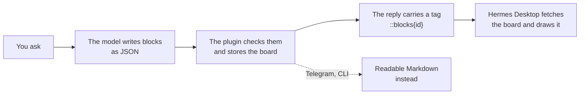

<p align="center">
  <picture>
    <source media="(prefers-color-scheme: dark)" srcset="assets/banner-dark.svg">
    
  </picture>
</p>

<p align="center">
  <a href="LICENSE"></a>
  
  
  
  <a href="https://github.com/sagarmainkar/hermes-genui/actions"></a>
</p>

**Ask "How's the market?" and get a chart, not a paragraph.** Hermes GenUI lets your Hermes agent answer with
**real, interactive UI** inside Hermes Desktop chat replies: charts, tables, day-by-day plans, photo strips, calculators
with live charts, forms, checklists that remember your ticks, and step-by-step explainers.

https://github.com/user-attachments/assets/5b274da9-b756-4bb6-be72-9a5427fadc0d

A one-minute demo with sound: a Yosemite trip plan, a stock comparison, an explainer and a 401(k) what-if.
**[▶ Also on YouTube](https://youtu.be/jknqytZrXAw)**

---

## ✨ What it looks like

| | |
|:---:|:---:|
|  |  |
| **"Compare NVDA, AAPL and MSFT over the past year"** | **"Plan a 4-day Yosemite trip for two in May, around $2,000"** |
|  |  |
| **"Explain how transformers work"** | **"I put 6% in my 401(k). What if I raise it to 10%?"** |

The model decides **what** to show. The plugin decides **how** it looks, so every answer comes out in one
consistent, accessible design that follows your light or dark theme and your language's number format
(4.21B, 4,21 Mrd., ₹18.4L).

## 🧱 The blocks

| Family | Blocks |
|---|---|
| 📈 **Charts** | line (with gain/loss colouring), columns, horizontal bars, donut, pie, stacked, area, combo, heatmap, all with hover cards and keyboard support |
| 🔢 **Numbers** | KPI cards with trend lines, single stats, progress toward a goal, streaks |
| 📋 **Tables and lists** | sortable tables with mini bars, ranked lists with icons or photos |
| 🗓️ **Plans** | timelines (day by day, timed stops), checklists whose ticks are saved |
| 🖼️ **Media** | photo strips with credits, cover tiles, flash cards |
| 🎛️ **Interactive** | calculators with sliders and live charts, forms that ask before a big answer, buttons that ask the next question |
| 🧠 **Explainers** | flow diagrams whose boxes show what's inside them as you step through, simulations you play over time (with sliders), and stacks you can turn in 3D |
| 🧩 **Layout** | columns, grids, tabs, foldable sections, rows, headings, callouts, sources |

Plus **recipes**: ready-made plans the model follows for common asks. They cover trip planning, comparisons,
what-ifs, stock dashboards, dashboards, reports, learning, explainers and trackers. A **recipe builder** lets you
save your own.

## 💬 What you can ask

**Pretty much anything.** There's no fixed set of screens: the model builds each answer from the blocks above to
fit the question, so something nobody planned for still comes back as a report, a dashboard or a walkthrough. For
bigger asks it may show a short form first to check the details.

**Bring your own data.** The blocks aren't tied to this plugin's data tools. Whatever your agent can reach (your own
tools, MCP servers, files, web search) can feed a board: ask it to fetch the data and show it, and the model lays it
out with the same components.

> [!TIP]
> **Use a capable model.** A good board means planning a layout and writing valid structured data in one go. Tested
> so far:
> - **DeepSeek V4.1 Flash** (Ollama Cloud): works great.
> - **Qwen3.6 35B-A3B** (local, MLX 4-bit): works well.
> - **Gemma 4 26B-A4B** (local): fine for small boards, but big ones sometimes come back as text instead of a drawing.
>
> Each model lays out its answers its own way; the plugin keeps the look the same. If boards come out thin or keep
> failing their checks, try a stronger model.

| | Try asking |
|---|---|
| 📈 **Markets** | *How's the S&P 500 doing this year?* · *Compare NVDA, AAPL and MSFT over the past year* · *Build a dashboard comparing Tesla, Ford and GM, with a tab each* · *How's the NIFTY doing this year?* |
| 💰 **Money** | *Mortgage on a $450,000 home, let me play with the rate* · *What will $500 a month be worth in 20 years?* · *I put 6% in my 401(k). What if I raise it to 10%?* · *EMI on a ₹40 lakh home loan* |
| ✈️ **Trips and plans** | *Plan a 4-day Yosemite trip for two in May* · *Show me Kyoto* · *A packing checklist for Iceland in June* · *Plan a 5-day Kerala trip for a family of four* |
| 📊 **Reports** | *Write a report on the electric vehicle market* · *Top 10 companies by market cap* · *Where does my $4,000 a month go?* |
| 🧠 **Learn and explain** | *Explain how transformers work* · *How does a card payment go through?* · *Explain how compound interest grows my money* · *Make me flash cards on photosynthesis* |
| 🔌 **Your own data** | *Read sales.csv and build me a dashboard* · *Use the GitHub tools to chart my open issues by label* · *Pull today's tickets from the helpdesk MCP and rank them by urgency* |
| 🔁 **Track** | *Track my 30-day walking streak* · *A checklist for moving house* (ticks are saved) |
| 🛠️ **Your own** | *Make this a recipe so you always build my weekly review this way* (the recipe builder saves it) |

Buttons under each board ask the obvious next question, such as *Make it $1,500*, *Add a day in Sequoia* or *More
technical*, so you can keep going without typing.

## 🚀 Install

You need [Hermes Agent](https://github.com/NousResearch/hermes-agent) 0.22.5 or later with Hermes Desktop.

```bash
hermes plugins install sagarmainkar/hermes-genui --enable   # add -p <profile> for a profile other than default
hermes config set tools.tool_search.enabled off             # keeps the plugin's tools in view (why: below)
hermes gateway restart                                       # loads the plugin's tools and data routes
```

Prefer clicking? In Hermes Desktop, open **Capabilities → Plugins → Install from Git** and enter
`sagarmainkar/hermes-genui`, then run the second and third lines above.

> [!IMPORTANT]
> **Why turn off tool search?** Hermes's default (`auto`) hides plugin tools behind a search bridge, where the model
> has to write each board as escaped text inside another call. Big boards often break there: you'll see red
> "Unnamed call" rows before the board appears. With tool search off, every tool in that profile is offered on each
> message, so a profile with many MCP servers uses more tokens. A separate profile just for hermes-genui avoids that.

Then turn on the drawing half in Hermes Desktop:

1. Open **Capabilities → Plugins**.
2. Pick the **profile** you installed into at the top of the page. The list is per profile.
3. Open **hermes-genui** and switch **Desktop** on.

**Hermes on one machine, Desktop on another?** (say a Mac mini at home and a laptop that connects to it) Run the
commands above on the machine that runs Hermes. Then, on each computer whose Desktop connects to it, use **Install from
Git** with `sagarmainkar/hermes-genui` and switch **Desktop** on. The drawing half lives in each Desktop app, not on
the server.

**Using Hermes in a browser (the Webapp, `hermes webapp`)?** It draws boards too, but each browser keeps its own
plugin switches, and the plugin starts off. So switch **Desktop** on again in the Webapp's **Capabilities → Plugins**,
once in every browser and device you use, even if it's already on in the Desktop app.

> [!WARNING]
> **Safari, and every browser on iPhone or iPad (Chrome included):** Hermes's Capabilities page crashes there with
> *"workspace failed to render: Can't find variable: requestIdleCallback"*, so you can't reach the switch. It's a
> Hermes bug ([hermes-agent#148538](https://github.com/NousResearch/hermes-agent/issues/148538)). Until it's fixed,
> turn the plugin on another way:
>
> - **Mac Safari:** open the Webapp, press **⌥⌘C** for the Console (turn on *Show
>   features for web developers* in Safari's Advanced settings first), paste this line and press Return:
>
>   ```js
>   localStorage.setItem('hermes.desktop.pluginDecisions.v2', JSON.stringify({...JSON.parse(localStorage.getItem('hermes.desktop.pluginDecisions.v2') || '{}'), 'hermes-genui': true})); location.reload()
>   ```
>
> - **iPhone or iPad:** bookmark any page, edit the bookmark and replace its address with the line below, then open
>   the Webapp and tap the bookmark once:
>
>   ```
>   javascript:localStorage.setItem('hermes.desktop.pluginDecisions.v2',JSON.stringify({...JSON.parse(localStorage.getItem('hermes.desktop.pluginDecisions.v2')||'{}'),'hermes-genui':true}));location.reload()
>   ```
>
> It saves the same setting the switch saves and leaves your other plugins as they are.

Start a new chat and try:

> *Compare NVDA, AAPL and MSFT over the past year* · *Plan a 4-day Yosemite trip for two* · *Explain how transformers
> work* · *Mortgage on a $450,000 home, let me play with the rate* · *How's the NIFTY doing this year?*

### 🔑 Optional keys, for more and better photos

Photos work with **no keys at all**, from Wikimedia Commons, Openverse and the pictures on pages your own web search
finds. Each key below adds one more source. Add them under **Settings → Plugins → hermes-genui** in Hermes Desktop;
they're stored by Hermes, never by the plugin.

| Key | Adds | Get one |
|---|---|---|
| `UNSPLASH_ACCESS_KEY` | Unsplash photos (only the *Access Key*; the secret key is never used) | [unsplash.com/developers](https://unsplash.com/developers) |
| `PEXELS_API_KEY` | Pexels photos | [pexels.com/api](https://www.pexels.com/api/) |
| `TAVILY_API_KEY` | Tavily image search | [tavily.com](https://tavily.com) |

## 🔍 How it works



- **The model** learns the blocks from the `show_blocks` tool's description, and gets a short drawing rule in its
  system prompt.
- **Tools fetch real data:** `market_history` for prices, `find_photos` for photos. So numbers and pictures come from
  sources, not memory.
- **Every block is validated** before it's stored, and the model gets exact errors to fix. Desktop's readers also
  skip anything malformed, so a bad block never breaks the rest of the board.
- **Outside Desktop** (Telegram, the CLI and other chat apps), the same board is sent as readable Markdown.
- **The Webapp** (`hermes webapp`) is Hermes Desktop in a browser. It loads the same drawing half, so boards draw
  there once its **Desktop** switch is on.
- **One surface falls through both paths:** the Hermes **dashboard** (`hermes dashboard`) is served as a *local*
  session, so it reports `local` — the same value Hermes Desktop reports. The drawing rule therefore still applies,
  `show_blocks` is still offered, and the text fallback is skipped for the same reason — yet that surface has no
  block renderer, so the tag arrives literally.

## 🔒 Privacy, network and security

**What leaves your machine** (only when the model calls the tool that needs it):

| When | Who is contacted |
|---|---|
| Market prices | Yahoo Finance (`query1.finance.yahoo.com`) |
| Photos | Wikimedia Commons and Openverse APIs; Unsplash, Pexels or Tavily only if you added their keys; your configured web search; up to 256 KB of the top result pages (read only to their `</head>`) for their preview pictures; each photo host, briefly, to check the picture loads |

**What stays local:**
- Boards are saved as JSON in your profile, under `plugin-data/hermes-genui/`, with checklist ticks next to them.
- There's no telemetry and no account.

**What the plugin adds to the model's context:**
- a short drawing rule in the system prompt (under 1,500 characters);
- the `show_blocks` tool description (the block catalog);
- a one-line reminder next to messages that ask for something visual. This is added only in Desktop.

**Safety by design:**
- **The model never sends code.** It sends data only: no HTML, scripts or SVG. Every block is drawn by the plugin's
  own components.
- **Photos are fetched over https only, from public addresses only.**
  - DNS is pinned against rebinding.
  - Each redirect is checked again, up to 3.
  - Size and time limits apply.
- **Buttons can't send** slash commands, shell lines or `@file` references.
- **Calculator formulas** are read by a small parser with no `eval` and with operation budgets.
- **Board size, depth, text length and counts are all capped.**

Found a security issue? Please see [SECURITY.md](SECURITY.md).

## 🛠️ Troubleshooting

| You see | Do this |
|---|---|
| The plugin isn't in **Capabilities → Plugins** | Switch the profile selector at the top to the profile you installed it in. |
| "Couldn't load this block" | Run `hermes gateway restart` after installing or updating. |
| A board arrives as text | You're outside Hermes Desktop (Telegram, the CLI), which is by design. In Desktop, check the plugin's **Desktop** switch. |
| A literal `::blocks{id="…"}` line, in the Webapp | The plugin is off in this browser. Switch **Desktop** on in **Capabilities → Plugins**; each browser keeps its own switches. |
| "workspace failed to render: Can't find variable: requestIdleCallback", in Safari or on iPhone/iPad | A Hermes bug ([hermes-agent#148538](https://github.com/NousResearch/hermes-agent/issues/148538)) breaks the Capabilities page there. Turn the plugin on with the workaround under Install. |
| A literal `::blocks{id="…"}` line, in the Hermes dashboard | The dashboard draws nothing and reports itself as `local`, like Desktop, so the Markdown fallback is skipped too. Open the chat in Hermes Desktop or the Webapp, or ask for a Markdown table. |
| Red "Unnamed call" rows, or `tool_call 'calls' is not valid JSON` | Tool search is on. Run `hermes config set tools.tool_search.enabled off` (add `-p <profile>`), then start a new chat. |
| The model built an HTML widget instead | Start a new chat, or ask "draw it with blocks". Tool search being on can also cause this; see Install. |
| Few or slow photos | Add a photo key above. A source that fails is skipped automatically and retried after 10 minutes. |

## 🤝 Contributing

New recipes, fixes and new blocks are all welcome. See [CONTRIBUTING.md](CONTRIBUTING.md) for:
- the layout;
- how to add a recipe, a data tool or a block type;
- the checks every pull request must pass.

New block types start as an issue first. Each one costs space in the model's guide on every message, so we agree on
the design before the code.

## 💛 Credits

Built by [Sagar Mainkar](https://github.com/sagarmainkar), with Claude as a pair programmer. Made for the
[Hermes Agent](https://github.com/NousResearch/hermes-agent) community.

Sagar also makes **[Odie](https://github.com/sagarmainkar/odie)**, an open-source (MIT) personal assistant that lives
on your Mac and talks to you on your phone, with this kind of UI built in.

Released under the [MIT licence](LICENSE).
