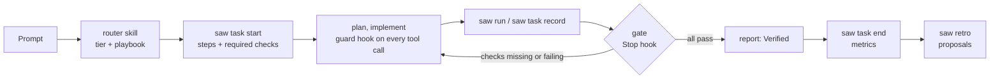

<p align="center"></p>

<p align="center">
  <a href="https://github.com/sam-ash-cy/sams-agentic-workflow/releases"></a>
  <a href="LICENSE"></a>
  
  
</p>

# sams-agentic-workflow

**Make your coding agent prove it's done.** A Claude Code plugin that sizes every task by risk, blocks "done" until real checks pass, and enforces your guardrails with hooks, not polite instructions.

<p align="center"></p>

## Install in 30 seconds

Needs [bun](https://bun.sh) 1.3+ and [Claude Code](https://claude.com/claude-code). In Claude Code:

```
/plugin marketplace add sam-ash-cy/sams-agentic-workflow
/plugin install sams-agentic-workflow@sams-agentic-workflow
/workflow-setup
```

`/workflow-setup` walks you through global and project setup; `/workflow-setup full` lists every setting to turn on or off. Prefer the terminal, or want one prompt that does it all? See [docs/STARTUP.md](docs/STARTUP.md).

## Why it's different

Coding agents treat a typo and a payment migration the same way, say "done" before anything ran, and follow your rules only while they remember them. saw fixes that:

- **Effort matches risk.** A trivial fix runs the tests and stops. A critical change gets grilling, a plan, reviews and a threat model.
- **"Done" means verified.** A Stop hook reads the recorded check results, not the agent's summary, and blocks until they pass.
- **Guardrails that hold.** Pushes, deletes, deploys, secrets and new dependencies are checked by a hook before they run. A cloned repo's config can tighten them but never loosen them.
- **Cheaper sessions.** Token budgets per tier, quiet check output, compact and handoff nudges, and a model picked per agent role.
- **It learns.** Every task's outcome is logged; `saw retro` turns checks that keep failing into concrete fix proposals.

## Core features

| | What you get |
|---|---|
| **Router** | every task gets a tier (trivial → critical) and a playbook (feature, debug, design, …) with its own steps |
| **Gate** | "done" is blocked until that tier's checks (tests, lint, reviews) are recorded as passing |
| **Guard** | every shell command and edit is checked against your safety and autonomy rules first |
| **Reviews** | code, security, architecture and UI review agents, plus an advisor consult, on standard+ work |
| **Test-first** | code edits can wait for a failing test |
| **Token control** | per-tier budgets, cost shown above the prompt, auto-compact and handoff to a fresh session |
| **Sessions** | branch guard, a worktree per complex task, and `saw split` to run plan stages in parallel |
| **Metrics + retro** | per-task outcomes, a dashboard, and proposals from repeated failures |
| **Autopilot** | an approved queue worked through headlessly, one session and PR per item |

**45+ features and 9 mods, every one switchable globally, per project, or just for you.** See the [full feature list](docs/FEATURES.md).

## Configure it your way

Four layers, later ones win: built-in defaults → global (`~/.saw/config.toml`) → project (`workflow.toml`, committed) → local (`workflow.local.toml`, yours only).

```bash
saw config set features.tdd false --scope global      # all your projects
saw config set features.brag true                     # this repo, for the team
saw explain features.tdd                              # who set it, and why
saw profile apply solo                                # or team, strict, autopilot
```

Or ask in plain words: the `saw-settings` skill grills you briefly and writes the right layer.

## How it works

The `router` skill picks the tier and playbook, and `saw task start` prints the steps and required checks. The agent runs them with `saw run` and records reviews with `saw task record`. The gate and guard hooks enforce the rest.



## Docs

- [STARTUP.md](docs/STARTUP.md): setup with an agent or by hand, updating, release channels, uninstalling
- Upgrading from 1.0.1: hard `routing.mode` and `verify.mode` are new and opt-in, and checks with no command no longer pass; see [Upgrading to 1.0.2](docs/STARTUP.md#upgrading-to-102-hard-enforcement-is-opt-in) for how to turn them on
- [FEATURES.md](docs/FEATURES.md): every feature and mod, its default, and the key that controls it
- [COMMANDS.md](docs/COMMANDS.md): every command, setting and recipe
- [CHANGELOG.md](CHANGELOG.md)

## Trail (strongly recommended)

[Trail](https://www.npmjs.com/package/@trailhq/trail-code) builds a code map of the repo, so the agent finds code with ranked lookups and file skeletons instead of reading whole files. It cuts tokens noticeably on anything beyond a small repo. saw doesn't bundle it.

```bash
bun add -g @trailhq/trail-code          # or: npm install -g @trailhq/trail-code --ignore-scripts
trail init --agents claude              # in each repo
saw config set features.trail true --scope local
```

`features.trail` only adds "trail ask/skeleton before reading code" to each task's steps, so install Trail first. Without it, `saw outline <file>` gives signatures with line numbers.

## Third-party skills

saw doesn't copy these into the repo. They are pinned by commit in `deps.lock.toml` and keep their own licences:
- [mattpocock/skills](https://github.com/mattpocock/skills) (MIT), installed as a companion plugin
- [unslop](https://github.com/heydamir/unslop) by Damir Sokolovsky (CC BY 4.0), optional UI polish (`features.unslop`)
- [brag](https://github.com/latent-spaces/brag) by Shunit Haviv Hakimi (MIT), optional launch videos (`features.brag`). Its bundled music is CC BY 4.0 by [Sascha Ende](https://ende.app): credit him wherever you publish a video made with it.
- [ECC](https://github.com/affaan-m/ECC) by Affaan Mustafa (MIT), optional plugin (`features.ecc`). saw recommends turning off its duplicate hooks; see [optional extras](docs/COMMANDS.md#optional-extras).

Tests: `bun run test`. Licence: [MIT](LICENSE).
