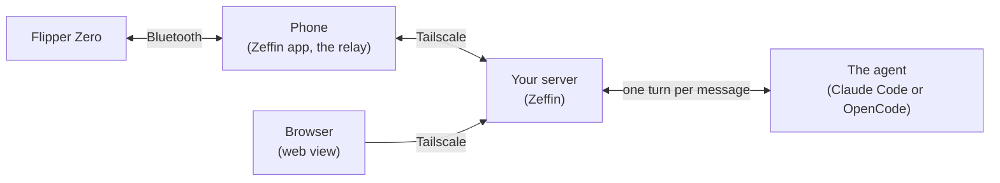

# Zeffin

[](LICENSE)
[](https://github.com/samartined/zeffin/releases/latest)

**Let an AI agent drive your Flipper Zero, from anywhere, with your Android phone as the bridge.**


Zeffin runs an agent on a Linux server of your own and gives it the Flipper Zero as a tool: it sees the screen, presses the buttons, reads and writes files and opens apps. You talk to it from the Zeffin app on your phone, watch the Flipper's screen live and pause the agent at any moment.


## How it works



The phone forwards the Flipper's link to your server, which gives the agent the Flipper's tools and serves the app and a web view. Everything travels inside your tailnet; only what the agent sends to its model leaves it.

## What it does

- **Talk to the agent from your phone:** conversations with models, effort and permission modes, attachments (photos, files, the Flipper's screen), permission cards and notifications. Or from a terminal on the server, with `zf chat`.
- **The agent drives the Flipper like a person with a remote:** it looks at the screen, presses keys, looks again, so it reaches any app or menu. It also has tools for files, apps and any RPC request, and knows the firmware and its apps.
- **You stay in control:** the Flipper's screen live in the app and in a web view, every action of the agent as it happens and in an audit log, **Pause** (the agent can only read) and **Stop**.
- **Drive it yourself:** the app's remote, which pauses the agent while you use it.
- **Two agents, chosen per conversation:** Claude Code or OpenCode.
- **In English and Spanish,** following the phone's language.

## What you can ask it

- "Describe what the Flipper's screen shows."
- "Open my saved living-room remote and press Power."
- "List my infrared files and tell me which one is the newest."

The agent uses the Flipper without asking, so pause it (the read-only mode) when you are not watching.

## Screens


Every screen of the app, in all its states, is in the design system: [docs/design/](docs/design/README.md).

## Quick start

1. **On your Linux server,** as your own user, with Tailscale connected:

   ```bash
   git clone https://github.com/samartined/zeffin.git ~/projects/zeffin
   ~/projects/zeffin/install.sh
   ```

   It checks what it needs, installs the server and its service, sets up the agents it finds (install [Claude Code or OpenCode](docs/guide/use-the-agent.md) first) and ends showing a pairing QR code. It never uses `sudo` and never prints a token; run it again at any time.

2. **On the phone:** install the APK from this repository's *Releases* (Zeffin is not on Google Play, so Android asks you to allow the install), connect Tailscale to the same tailnet, and in the app go to Settings, Server, **Pair with QR code**. Scan the code and confirm on the server the six-digit number the phone shows ([Pair the app](docs/guide/pair-the-app.md)).

3. **Connect the Flipper:** pair it in Android's Bluetooth settings, choose it in Settings, Relay, **Device**, and turn the relay on.

4. **Talk to the agent:** open Conversations, **New conversation**, and ask it, for example, to describe the Flipper's screen ([Use the agent](docs/guide/use-the-agent.md)).

## What you need

| | |
|---|---|
| **Flipper Zero** | The official firmware, or a fork that keeps its RPC over Bluetooth |
| **Android phone** | Android 14 or later |
| **A Linux server that stays on** | Python 3.11 or later with `venv`, `git` and systemd |
| **Tailscale** | On the server and the phone, in the same tailnet |
| **An agent** | Claude Code or OpenCode (with Node.js and `npm`): see below |

## The agents

| | Claude Code | OpenCode |
|---|---|---|
| **What it needs** | A Claude login: a Claude subscription, or another login Claude Code takes, such as an API key | Nothing for OpenCode Zen's free models; a free NVIDIA account for NVIDIA NIM's free tier; or any provider you sign in |
| **What it costs** | Your subscription, or what your login bills | Nothing on the free providers; a paid provider bills its own account |
| **Your data** | Anthropic's terms for your account | **Free providers keep what they receive to improve their models,** the Flipper's data included; others, their own terms |

The free options: Claude Code with a subscription you already have, and OpenCode on Zen's free models or NIM's free tier, with no payment method. A model that bills per use says **Paid** in the app. Each conversation keeps the agent it was created with ([Use the agent](docs/guide/use-the-agent.md#what-each-agent-uses)).

## Security, in short

- **A private network only.** The server listens on its Tailscale address and on loopback, and refuses any other peer before reading anything. The app sends nothing outside Tailscale's tunnel.
- **A pinned key.** The server has its own key; the app pins it when you pair, and checks it in every TLS 1.3 handshake before it sends anything.
- **Pairing you confirm.** The QR code holds no token, and the tokens leave the server only after you confirm the number the phone shows.
- **Untrusted data stays data.** What comes from the Flipper reaches the agent marked as untrusted, never as instructions.
- **What it does not stop:** nothing technically stops an active agent from making the Flipper transmit. **Pause is the read-only mode;** pause it when you are not watching.

More in [Security](docs/guide/security.md), and the full model in [docs/security.md](docs/security.md).

## Responsible use

The Flipper Zero can transmit: Sub-GHz radio, infrared, NFC and RFID emulation, and BadUSB keystrokes. Through Zeffin, the agent can make it do so.

- Use it only with devices and systems you own, or that you have permission to test.
- Follow your local laws on radio transmission.
- Pause the agent (the read-only mode) whenever you are not watching it.

## Documentation

- **[The user's guide](docs/guide/README.md):** what Zeffin needs, [installing the server](docs/guide/install-the-server.md), [pairing the app](docs/guide/pair-the-app.md), [using the agent](docs/guide/use-the-agent.md), [the Flipper tools](docs/guide/flipper-tools.md), [the remote](docs/guide/the-remote.md), [Pause and Stop](docs/guide/pause-and-stop.md), [security](docs/guide/security.md), [updating](docs/guide/updating.md), [the `zf` command](docs/guide/zf-command.md), [troubleshooting](docs/guide/troubleshooting.md) and the [FAQ](docs/guide/faq.md).
- **[The documentation index](docs/README.md):** the reference, for whoever builds or reviews Zeffin: the architecture, the security model, the Android app, the protocols and the design.
- **Contributing:** [CONTRIBUTING.md](CONTRIBUTING.md), with the checks and how to build. **Reporting a vulnerability:** [SECURITY.md](SECURITY.md).
- **Questions:** ask in [Discussions](https://github.com/samartined/zeffin/discussions/categories/q-a), under Q&A. [Issues](https://github.com/samartined/zeffin/issues) are for bugs and feature requests.

## License

Copyright (C) 2026 Edgar Espinosa Martín (@samartined). Zeffin is free software under the GNU Affero General Public License, version 3 or later (AGPL-3.0-or-later): see [LICENSE](LICENSE). Third-party components are listed in [THIRD_PARTY_NOTICES.md](THIRD_PARTY_NOTICES.md) (server) and [android/licenses/THIRD_PARTY_NOTICES.md](android/licenses/THIRD_PARTY_NOTICES.md) (app).

## Trademarks

Every product name in this repository belongs to its owner. Zeffin is not affiliated with, endorsed by or sponsored by any of them: Flipper Devices Inc., Anthropic, the authors of OpenCode, NVIDIA or Tailscale. Flipper Zero is a trademark of Flipper Devices Inc.
