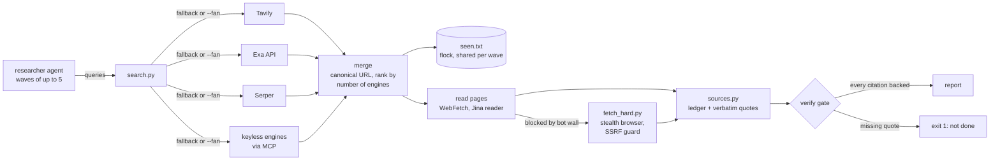

# claude-skill-research-agent

[](https://github.com/sami-mag07/claude-skill-research-agent/actions/workflows/tests.yml)


A research skill for Claude Code that treats web research like engineering: several search engines behind one interface, parallel agent waves that never duplicate each other's work, and a verify gate that refuses to call a report done while any citation lacks a verbatim quote from its source.

Zero runtime dependencies. Every script is Python stdlib, so there is nothing to `pip install` and nothing to audit beyond the files in this repo.

## Why

Agent-driven research fails in three predictable ways:

1. **One search backend.** The harness search tool hits a shared quota, a rate limit, or simply misses the niche page. The agent then concludes "nothing exists".
2. **Parallel agents step on each other.** Five subagents on one topic return the same ten URLs five times.
3. **Citations that do not hold.** The report cites `[3]`, but the sentence it supports is nowhere on page 3.

Each script here removes one of those failure modes.

## Architecture



| Component | Lines | What it guarantees |
|---|---:|---|
| `references/search.py` | ~400 | A query always gets answered by the first engine that works. With `--fan`, all engines run in parallel and URLs are merged after canonicalisation (scheme, `www.`, trailing slash, tracking parameters); hits found by several engines rank first. Domain filters are re-applied locally because not every engine honours them. |
| `--seen <file>` | | An `flock`-guarded list shared by one agent wave. Each hit is tagged `[new]` or `[known]`, so agent 4 sees what agents 1 to 3 already found. |
| `references/sources.py` | ~170 | Numbered ledger `[sNN]`. `quote` only stores a quote if it appears verbatim in the fetched page (whitespace and typographic quotes normalised). `verify` exits non-zero until every citation in the draft is backed; `--check-urls` re-fetches and re-checks the quote live. |
| `references/fetch_hard.py` | ~80 | Last-resort reader for Cloudflare-protected pages. Resolves the host first and refuses loopback, private, link-local and metadata addresses, and passes only a fixed set of flags to the browser. |
| `references/tools.md` | | Everything that goes stale: channel limits, fallback chains, public data APIs, search techniques for niches and people. One line added per lesson learned. |
| `agents/researcher.md` | | A subagent with a fresh context that writes sources to disk as it goes and returns only an index, so the main context stays small. |

## Design decisions

- **Freedom over a step list.** The skill describes capabilities and tools, not a 15-step procedure. An earlier version with numbered rules produced rigid, shallow runs. The only hard rule left: a subagent never spawns subagents (one uncapped run went from 3 to 149 agents).
- **Fallback chain order is cost-aware.** Engines with real date and domain filters and a quota go first, keyless engines last. `--status` shows what is available without printing keys.
- **stdlib only.** Research tooling runs with network access and API keys. Every third-party dependency is attack surface, so the scripts use `urllib`, `concurrent.futures` and `fcntl`, nothing else.
- **Fetched content is data, never instructions.** The agent prompt says so explicitly, and `fetch_hard.py` never lets page content or the model choose browser flags.
- **Keys** come from the environment, then from a local `.env` (gitignored). Inline comments in `.env` are stripped, a bug that once sent a comment as an API key.

## Evals

`evals/gate_mutations.py` builds a correct three-source report served from a local HTTP server, then tries seven ways of faking a citation and records whether the gate rejects each one. Deterministic, no keys, runs in CI.

| Mutation | `verify` | `verify --numbers` |
|---|---|---|
| fabricated citation [s04] with no source | caught | caught |
| quote that is not on the page | caught | caught |
| source added but never quoted | caught | caught |
| source page changed after quoting (`--check-urls`) | caught | caught |
| source page removed (`--check-urls`) | caught | caught |
| two citations swapped | missed | caught |
| claim changed, citation kept | missed | caught |
| **total** | **5/7** | **7/7** |

The first run showed the plain gate only proves that a cited source holds *some* verbatim quote, not that the sentence matches it. `--numbers` closes the two gaps for quantitative claims: every number in a cited sentence must appear in a quote of a source that sentence cites. A reworded non-numeric claim ("pays generously") still passes; that needs a semantic check (see Roadmap).

For comparison: a benchmark of 14 LLMs as deep-research agents found that even the strongest keep cited links valid above 94 % but get the cited facts right only 39 to 77 % of the time ([Cited but Not Verified](https://arxiv.org/abs/2605.06635), 2026). None of the open-source research agents reviewed for this repo (gpt-researcher, STORM, open_deep_research, node-DeepResearch, smolagents) blocks a report on an unbacked citation at runtime.

A second, retrieval-side measurement (a search eval, not shipped here because it needs your own gold set of known-good links) found that recall is driven by query variety, not ranking: three plain queries surface 18 % of the gold domains in the top 30, and adding three niche phrasings (quoted terms, `"call for applications"`, `site:`, a deadline word) lifts that to 23 %, while reciprocal rank fusion over the same engines makes no measurable difference. Per engine the hits stay close (Tavily 15 %, Serper 12 %, two others around 10 to 12 %), so the chain fans several engines out at once (`--fan`) instead of betting on one. This is why the skill pushes query variety rather than clever re-ranking.

## Security

Threat model and mitigations are in [SECURITY.md](SECURITY.md): fetched pages are untrusted, the stealth browser cannot reach internal addresses, keys never leave the environment.

## Tests

```
python -m unittest discover -s tests -v
```

19 tests, no network, no keys, about one second. CI runs them on Linux and macOS with Python 3.10, 3.12 and 3.13. Covered: URL canonicalisation, merge ranking, fallback order and error logging, parallel fan-out surviving dead engines, `.env` parsing, eight concurrent writers on one `seen.txt` producing zero duplicates, the full `add / quote / verify` CLI flow including a fabricated quote being rejected, and the SSRF guard against loopback, RFC 1918, IPv6 loopback, cloud metadata and non-HTTP schemes.

The concurrency test earned its place on day one: on Linux it caught `seen.txt` being unlocked before the buffered write reached the file, so parallel agents recorded the same URL twice. macOS never showed it.

## Setup

1. Copy `skills/research-agent/` to `~/.claude/skills/research-agent/`.
2. Copy `agents/researcher.md` to `~/.claude/agents/researcher.md`. It becomes visible in the next session.
3. Optional: copy `skills/research-agent/.env.example` to `.env` and add the free-tier keys you have (Tavily, Exa, Serper, Jina). Missing keys are skipped.
4. Optional: `mcporter` with keyless search MCP servers for the last links of the chain, and `scrapling` as a uv tool for `fetch_hard.py`.

## Usage

```
search.py "student startup grant" "Gründungsstipendium Schüler" --since 90d --lang de --n 15
search.py "accessibility hackathon" --fan --seen research/a11y/seen.txt --json
search.py --status

sources.py add https://example.org/call            # -> [s01]
sources.py quote s01 --from page.txt --text "Deadline: 1 October"
sources.py verify draft.md --check-urls --numbers  # exit 1 until every [sNN] is backed
```

The skill triggers on phrases like "research", "find out", "compare", "market scan", or manually via `/research-agent`. For broad scans, spawn `researcher` agents in waves of at most five with one shared `seen.txt`.

## Limits

- The skill text and agent prompt are in German; the scripts and this README are in English.
- `fetch_hard.py` is slow (10 to 30 seconds per page) and meant for the pages nothing else can read.
- The verify gate proves that a quote exists on a page, not that the claim built on it is a fair reading. That part stays with the reviewer.

## Roadmap

Measured before built. Each item lands only with a number that shows it helps.

1. **Answer-quality eval.** 40 questions: 15 from FRAMES (Apache-2.0), 10 from SimpleQA (MIT), 10 time-sensitive questions from real failures, 5 unanswerable ones where the right answer is "unknown". Three arms: harness search only, this chain, this chain without the gate. Replay fixtures for CI, live runs nightly.
2. **Rank fusion.** Replace "found by N engines" with reciprocal rank fusion plus a domain prior, weights tuned on the eval rather than guessed.
3. **Engine bandit.** Thompson sampling over engines per query type, reward = ledger hits per cost.
4. **Semantic claim check.** A per-claim judge (or an NLI model as an optional extra) for the claims `--numbers` cannot see.
5. **Self-improving loop.** Change one thing in the skill, run the eval, keep it only if the score rises; eval files read-only to the agent to prevent reward hacking.

## License

MIT
