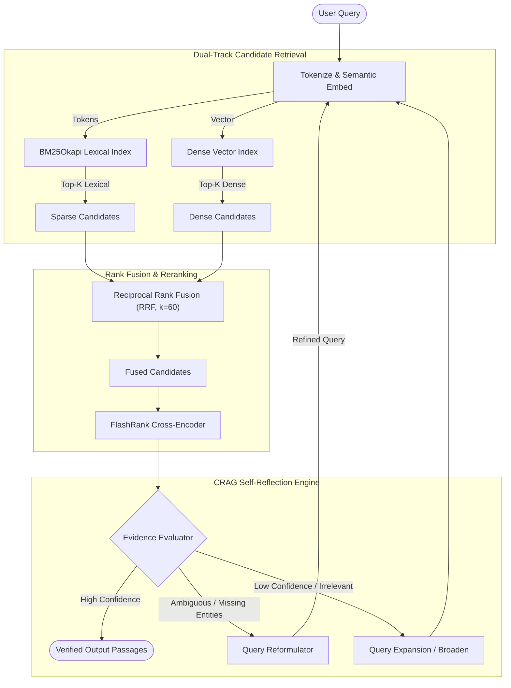

# CRAG Hybrid Retriever (`crag-hybrid-retriever`)

[](https://github.com/samimhamza/crag-hybrid-retriever/actions/workflows/ci.yml)
[](https://python.org)
[](https://opensource.org/licenses/MIT)
[](https://github.com/astral-sh/ruff)
[](https://mypy-lang.org/)
[-purple.svg)](#architecture)

> **A production-grade, domain-agnostic Python library combining Dense Vector Search, Okapi BM25 Lexical Retrieval, Reciprocal Rank Fusion (RRF), Cross-Encoder Reranking, and Self-Reflective Corrective RAG (CRAG) loops.**

---

## 📌 Origin & R&D Motivation

Originally engineered as the core retrieval and evidence verification backbone for an ongoing **Master's Thesis in Artificial Intelligence** (investigating Multi-Objective Decision Support and multi-hop statutory/technical verification), this engine has been decoupled and open-sourced as an independent, domain-agnostic utility.

Standard RAG architectures often suffer from two failure modes:
1. **Semantic Drift & Vocabulary Mismatch:** Dense embeddings capture conceptual semantic similarity but frequently miss exact technical terms, statutory codes, or numerical thresholds.
2. **Passive Generation Hallucination:** Naive single-pass retrievers forward borderline or irrelevant passages directly to language models without grading confidence or checking entity coverage.

`crag-hybrid-retriever` solves both challenges by fusing sparse lexical precision with dense representation, followed by an ONNX-accelerated cross-attention reranker and an iterative **CRAG (Corrective RAG)** feedback loop.

---

## 🚀 Key Architectural Features

- **Dual-Track Hybrid Retrieval:** Combines sparse Okapi BM25 (exact token & code matching) with dense cosine semantic search.
- **Reciprocal Rank Fusion (RRF):** Fuses disparate scoring spaces into an optimal rank distribution using rank-reciprocal scoring ($k_{rrf}=60$) without manual weight calibration.
- **Cross-Encoder Neural Reranking:** Integrates lightweight ONNX-accelerated cross-attention via [FlashRank](https://github.com/PrithivirajDamodaran/FlashRank) (supports multilingual `ms-marco-MultiBERT-L-12` and fast `ms-marco-MiniLM-L-12-v2`).
- **Self-Reflective CRAG Loop:** Evaluates candidate evidence sufficiency (`CORRECT`, `AMBIGUOUS`, `INCORRECT`), identifies missing entity constraints, and executes query reformulation up to $N$ iterations.
- **Standard IR Evaluation Suite:** Built-in calculation of Precision@K, Recall@K, Mean Reciprocal Rank (MRR), and Normalized Discounted Cumulative Gain (NDCG@K).
- **Zero-Bloat & Type-Safe:** Fully typed with Pydantic v2 and Python typing protocols; works out-of-the-box in memory with zero cloud lock-in.

---

## 📐 System Architecture



---

## 📦 Installation & Fast Setup (`uv` or `pip`)

### Option A: Ultra-Fast Setup with `uv` (Recommended)

This repository includes a deterministic `uv.lock` for lightning-fast virtual environment creation:

```bash
git clone https://github.com/samimhamza/crag-hybrid-retriever.git
cd crag-hybrid-retriever

# Sync dependencies and create .venv in under 2 seconds
uv sync --extra dev

# Run unit tests immediately with zero manual activation
uv run pytest -v

# Run the interactive hybrid demo
uv run python examples/quickstart_hybrid.py
```

### Option B: Standard `pip`

```bash
# Minimal installation
pip install crag-hybrid-retriever

# With neural cross-encoders and dev tools
pip install -e ".[dev]"
```

---

## ⚡ 60-Second Quickstart

### 1. Simple Hybrid Retrieval (Dense + BM25 + RRF)

```python
from crag_retriever import (
    Chunk,
    HybridRetriever,
    InMemoryDenseRetriever,
    BM25Retriever,
    FlashRankReranker,
)

# 1. Prepare your documents / chunks
passages = [
    "Vector search captures high-level conceptual similarities across documents.",
    "BM25Okapi computes term-frequency inverse document frequency for exact keywords.",
    "Reciprocal Rank Fusion (RRF) harmonizes diverse search results without score tuning.",
]
chunks = [Chunk(document_id=f"doc-{i}", content=text) for i, text in enumerate(passages)]

# 2. Initialize and index the hybrid engine
retriever = HybridRetriever(
    dense_retriever=InMemoryDenseRetriever(),
    lexical_retriever=BM25Retriever(),
    reranker=FlashRankReranker(),
    k_rrf=60,
)
retriever.index_chunks(chunks)

# 3. Retrieve Top-K Reranked Passages
results = retriever.search("How does reciprocal rank fusion merge rankings?", final_k=2)

for r in results:
    print(f"Rank {r.rank} (Score: {r.score:.4f}): {r.content}")
```

---

### 2. Corrective RAG (CRAG) Self-Reflection Loop

```python
from crag_retriever import CorrectiveRetriever, HybridRetriever, Chunk

# Initialize CRAG with custom confidence thresholds
hybrid = HybridRetriever()
hybrid.index_chunks(chunks)

crag = CorrectiveRetriever(
    hybrid_retriever=hybrid,
    upper_threshold=0.65,  # Accept evidence if confidence >= 0.65
    lower_threshold=0.35,  # Trigger query rewrite if 0.35 <= confidence < 0.65
    max_iterations=3,
)

results, feedback, query_history = crag.retrieve_with_crag("BM25 TF-IDF scoring algorithm", top_k=2)

print("CRAG Action:", feedback.action.value)
print("Confidence:", feedback.confidence_score)
print("Query Evolution:", " -> ".join(query_history))
```

---

## 📊 Evaluation & Benchmarking

The built-in evaluation suite allows benchmarking retrieval quality against standard IR metrics:

```python
from crag_retriever import RetrievalEvaluator

# Evaluate retrieved candidates against ground-truth relevant chunk IDs
ground_truth = {"doc-1", "doc-2"}
metrics = RetrievalEvaluator.evaluate(results, ground_truth_ids=ground_truth, k=5)

print(f"Precision@5: {metrics.precision_at_k:.4f}")
print(f"Recall@5:    {metrics.recall_at_k:.4f}")
print(f"MRR:         {metrics.mrr:.4f}")
print(f"NDCG@5:      {metrics.ndcg_at_k:.4f}")
```

---

## 🛠️ Testing & Quality Assurance

Run the complete test suite with `uv` or `pytest`:

```bash
# Using uv (no virtualenv activation required)
uv run pytest -v

# Or using standard pytest
pytest -v
```

Linting and strict type checking:
```bash
uv run ruff check .
uv run mypy src
```

---

## 📜 Citation & Research Credit

If you use `crag-hybrid-retriever` in your research or applications, please cite:

```bibtex
@software{crag_hybrid_retriever_2026,
  author = {Ahmad Samim Hamza},
  title = {crag-hybrid-retriever: Corrective RAG & Hybrid Retrieval Engine},
  year = {2026},
  url = {https://github.com/samimhamza/crag-hybrid-retriever}
}
```

---

## 📄 License

Distributed under the [MIT License](LICENSE).
