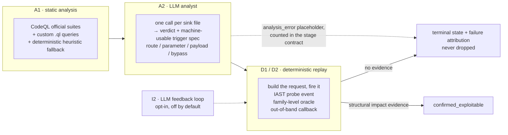

<div align="center">

# SAVR

**S**can · **A**nalyze · **V**erify · **R**eplay

An automated white-box vulnerability scanning and verification pipeline: static analysis
produces candidate findings, and a local LLM returns a verdict plus a machine-usable trigger spec;
deterministic replay fires that spec at a running target, and a finding counts as confirmed
only on structured impact evidence. The LLM never touches the target; everything downstream
is deterministic, replayable and auditable.

[](https://github.com/sanjio3/SAVR/actions/workflows/ci.yml)
[](LICENSE)
[](pyproject.toml)
[](probe-java/)
[](https://github.com/sanjio3/SAVR/releases/latest)

[Releases](https://github.com/sanjio3/SAVR/releases) · [Issues](https://github.com/sanjio3/SAVR/issues) ·
[Security advisories](https://github.com/sanjio3/SAVR/security/advisories)

English | [中文](README_zh.md)

</div>

---

## How a scan works



- A1 runs CodeQL official suites plus custom queries for shapes the official queries do not
  model (`prepareCall`, Spring `JdbcTemplate`, weak hash algorithms), with a deterministic
  heuristic fallback so a failed CodeQL build never silently produces an empty report.
- A2 makes one LLM call per sink file and returns both a verdict and a machine-usable trigger
  spec, JSON-validated with one repair round. A file that fails is recorded as an
  `analysis_error` placeholder and counted in the stage contract; it is never dropped, because
  a dropped file is indistinguishable from a clean file in the final report.
- D1/D2 replay the specs. Confirmation requires structured impact evidence: a probe event at
  the sink, a family oracle (SQL boolean pairs, path traversal file signatures, expression
  evaluation, reflection), or an out-of-band callback. "Reached the sink" and "the model says
  it is harmful" are each insufficient on their own.
- Unconfirmed candidates keep a terminal state and a failure attribution, so a missed
  vulnerability can be told apart from a target that was down, an endpoint that 404s, or a
  payload that never arrived.
- Deterministic retries are always on. I2, an LLM feedback loop that re-judges based on
  replay diffs, is opt-in (`SAST_AI_CLOSED_LOOP=1`) and off by default.

---

## Requirements

- Python 3.12 or newer.
- Node.js 20 or newer, for the frontend.
- JDK 11 or newer and Maven, to build the IAST probe (it is built, not shipped).
- CodeQL CLI, for the static analysis stage. `uv run python scripts/fetch_tools.py --dest tools
  --only codeql` downloads the bundle into `tools/codeql/`; alternatively set `CODEQL_BIN` or put
  `codeql` on `PATH`. The bundle is about 1GB and is not vendored.
- A running HTTP target with the bundled IAST java agent attached. Target applications, JDKs,
  Tomcat and third-party binaries are not vendored; you supply your own.
- An LLM endpoint. Any OpenAI-compatible local server works; the defaults point at Ollama.

Windows is the primary development platform. Linux and macOS should work but are untested.

The control panel UI is currently Chinese-only. This README and the generated API schema are
in English.

---

## Install

```bash
git clone https://github.com/sanjio3/SAVR.git && cd SAVR
uv sync --frozen --group dev
cp .env.example .env
uv run python scripts/fetch_tools.py --dest tools --only codeql
ollama pull qwen3:8b
```

Edit `.env` for your host, ports and probe token. **SAVR does not load `.env`
automatically** — pass it to uv with `--env-file .env` as shown below, or export
the same keys in your shell. Start the backend with:

```bash
uv run --env-file .env python -m src.cli.service_server
```

`uv.lock` pins every dependency and `pyproject.toml` is the canonical declaration. The repository
root is the import root, so no package installation step is needed. `uv run` is the supported
entry point for every command in this document; a virtualenv on `PATH` works as well.

The backend listens on `127.0.0.1:8000`. The frontend runs separately:
`cd frontend && npm ci && npm run dev`, listening on `127.0.0.1:5173`.
On Windows, `scripts/dev_all.ps1` starts both; `scripts/dev_backend.ps1` and
`scripts/dev_frontend.ps1` start them individually.

The backend serves its own API reference: while it is running, `http://127.0.0.1:8000/docs` is
the interactive documentation and `http://127.0.0.1:8000/openapi.json` is the
machine-readable schema.

---

## First run

### Build the probe

The IAST probe is built, not shipped; its source lives in `probe-java/`. It needs JDK 11 and
Maven:

```bash
mvn -B -DskipTests -f probe-java/pom.xml clean package
jar cf probe-java/target/sec-probe-bootstrap.jar -C probe-java/target/classes com/rasp/probe/TaintHub.class
```

The first command produces `sec-probe.jar` (the probe); the second produces
`sec-probe-bootstrap.jar`, which holds only `TaintHub` and must be on `-Xbootclasspath/a` so the
probe can see that class before the JDK class loaders start. **Run both commands — Maven does
not create the bootstrap jar.** Stop the target JVM before rebuilding, or the jar is locked.

Attach it like this (the flags come from `scripts/launch/launch_java_quote.py`):

```bash
java -Xbootclasspath/a:probe-java/target/sec-probe-bootstrap.jar \
     -javaagent:probe-java/target/sec-probe.jar \
     -Dsec.server.url=http://127.0.0.1:8000 \
     -Dsec.agent.id=<agent-id> \
     -Dsec.app.name=<app-name> \
     -Dsec.agent.token=<the probe_token stored in the database> \
     -Dsec.app.packages=<your business package prefix, e.g. com.example> \
     -Dsec.network.timeout.ms=5000 \
     -jar your-target.jar
```

Four things must be right:

- `-Dsec.app.packages` takes the **real business package prefix**. A wrong value raises no error;
  you simply get zero instrumentation and zero events. This is the most common cause of "the
  scan finished and found nothing".
- `-Dsec.server.url` must use `127.0.0.1`, not `localhost`. On some hosts the latter resolves to
  `::1` while the backend listens on IPv4 only.
- `-Dsec.agent.token` must equal `iast_sessions.probe_token` in the database. On a mismatch the
  ingest endpoint still answers HTTP 200 with `accepted=0`, which looks like success.
- The probe must be attached **before** the JVM starts; runtime attach is not supported.

Verify the attachment before scanning; only `ready=true` means it is wired up:

```bash
uv run python tools/probe_preflight.py --workspace-id <id> --http
```

It checks that the session row exists, the heartbeat is fresh, and an `X-Agent-Token` handshake
was accepted with a non-empty `session_id`. It writes no events and does not refresh the
heartbeat, so it cannot make a dead session look alive.

### Attach the probe to your own target

No target source is vendored here and no target is special-cased. You attach the probe to your
own application with the flags above. `scripts/launch/launch_java_quote.py` is the minimal
complete example: it starts a Spring Boot app, resolves the probe jars, reads the token from the
database and assembles the JVM arguments. Adapt it to your own start command.

`scripts/launch/launch_stack.py` starts SAVR itself (backend plus frontend watchdog), not a
target.

Two environment variables are useful: `SAST_AI_PROBE_JAR` overrides the probe jar path, and
`SAST_AI_TOOLS_DIR` points at the directory `scripts/fetch_tools.py` populated.

### Submit a scan

Create a workspace that points at your target source, either in the UI
(Workspaces → New) or with `POST /api/workspaces` carrying `name` and
`target_path`. Attach the probe as shown above, then submit a task. A dry run
prints the payload without writing anything:

```bash
uv run --env-file .env python scripts/submit_scan_task.py --name my-first-scan --dry-run
```

Drop `--dry-run` to submit. If the workspace is not the default one, pass
`--workspace-id <id>`. The runner that executes a submitted task is also
available for debugging:

```bash
uv run --env-file .env python -m src.cli.scan_task_runner --task-id <id> --target /path/to/target/src \
  --output-dir output/run1 --no-sca
```

`--shard-file <path>` is optional: point it at a JSON shard manifest to narrow the scan to the
entry points listed there. Omit it to scan everything; the manifest format is documented in the
loader in `src/core/scan_scope.py`.

Before pointing a run at an external target, check that the probe session and token actually
match. When they do not, the ingest endpoint answers HTTP 200 with `accepted=0`, which is easy
to misread as success:

```bash
uv run python tools/probe_preflight.py --workspace-id <id> --http
```

`ready=true` means the session row exists, the heartbeat is fresh, and a handshake carrying
`X-Agent-Token` was accepted with a non-empty `session_id` and no `errors`. The check writes no
events and does not refresh the heartbeat, so it cannot make a dead session look alive.

---

## Configuration

Configuration is environment-first. `.env.example` lists the core runtime keys with their
defaults; model hyperparameters live in `config/model_capabilities.yaml`.

To choose a model:

1. `cp config/config.example.yaml config.yaml`. The copy is gitignored because it may hold
   credentials.
2. Set `api.provider` and `api.model` to one of the sections in that file: `ollama` (default, no
   key required), `qwen`, `doubao`, `minimax`, `deepseek`, `openai-compatible`, `claude`, or
   `anthropic-compatible`.
3. Fill that section. The local `ollama` section needs `base_url` and `model`; cloud sections
   need `base_url`, `api_key` and `model`. Any value may be written as `"${ENV_VAR}"` so the
   secret stays in the environment.

Environment variables keep the `SAST_AI_` prefix from the project's earlier name. That prefix
is part of the run contract and is kept for backwards compatibility.

### Where the data lives

The SQLite database is `SAST_AI_DB_PATH` (default `data/app.db`). The schema is created on
first start and migrated in place afterwards, with applied versions recorded in the
`schema_migrations` table. Stop the backend and copy that single file to back up a scan.

---

## Repository layout

```
SAVR/
├── src/                     # backend
│   ├── api/                 # FastAPI app, HTTP routers, auth
│   ├── agents/              # A1 static, A2 LLM analyst, D2 executor
│   ├── pipeline/            # a1 / a2 / d2 stage contracts
│   ├── application/         # use-case services: replay, retest, findings
│   ├── iast/                # probe ingest, coverage, oracles
│   ├── core/                # shared primitives: config, families, hashes, prompts
│   ├── infrastructure/      # SQLite repositories and schema migrations
│   ├── benchmark/           # evaluation, SARIF export, report management
│   ├── prompts/             # prompt templates and the prompt registry
│   ├── config/              # rule and dataset configuration loaded at runtime
│   └── cli/                 # service server, scan task runner, benchmark CLI
├── probe-java/              # the IAST/RASP agent (Java, ByteBuddy) — built, not shipped
├── frontend/                # Vue 3 + Vite control panel
├── tools/                   # release hygiene, CI gate, probe preflight, CodeQL queries
├── scripts/                 # entry points: fetch_tools, submit_scan_task, launch/
├── config/                  # committed, credential-free configuration
└── .github/workflows/       # CI: static / frontend required checks
```

### Where to start

- Change how a finding is confirmed: `src/application/d1_service.py` (replay) and
  `src/agents/d2_facade.py` (evidence arbitration).
- Change what the LLM is asked to produce: `src/prompts/registry.yaml` and
  `src/core/prompt_registry.py`.
- Add or rename a vulnerability family: `config/families.yaml` and `src/core/family_map.py`.
- Add a probe event source: `src/iast/service.py` for ingest, `probe-java/` for the agent.
- Change static analysis: `src/agents/a1_codeql_adapter.py` and the queries under
  `tools/codeql-queries/`.
- Change the HTTP surface: `src/api/routers/` for routes, `src/api/app.py` for wiring.

---

## Reporting issues

Run these two checks before filing; they resolve a large share of reports:

1. `uv run python tools/probe_preflight.py --workspace-id <id> --http` — if this is not `ready=true`,
   events are being dropped at ingest and every replay will look like a miss.
2. `uv run --frozen python tools/ci_gate.py` — confirms the failure is not a local environment problem.

When you open an issue, include:

- What you expected and what happened, in one or two sentences.
- The model and provider (`qwen3:8b` via Ollama, or the endpoint you used), the target
  application and how its probe is attached, and the `run_env` keys you set.
- The task's terminal `verification_status` and `failure_attribution` for the spec in question,
  plus `stage_results.a2.contract` if the LLM stage is involved. These three fields explain most
  misses without needing source access.
- Relevant log lines, not full logs.

Reports of particular value:

- A real-world target that exposes a false confirmation.
- A detected defect that cannot be confirmed, with the spec terminal state attached.
- A reproducible divergence between two runs of the same target.

Do not open a public issue for a vulnerability in this project. Use GitHub's private
vulnerability reporting (Security → Report a vulnerability) instead.

---

## License

Apache License 2.0. The full text is in [LICENSE](LICENSE); attribution notices for third-party
components are in [NOTICE](NOTICE).

The licence permits use, modification and redistribution, including within closed-source
products, provided that copyright and licence notices are retained, modifications are stated,
and the project name or contributors' names are not used to endorse derived work. It includes
an express patent grant from contributors.

The permissive choice is deliberate: the tool is intended to be embedded in existing security
pipelines rather than used standalone.
