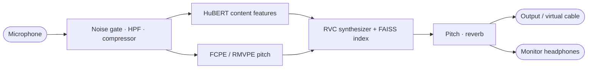

<div align="center">

<a href="https://satiricalguru.github.io/RVC-Voicechanger/">
  
</a>

# RVC Voicechanger

### Speak as *anyone*. Live.

Turn your microphone into any RVC voice model in real time, on your own Mac or PC.<br/>
Free, open source, and private: your voice never leaves your computer.

<p>
  <a href="https://github.com/satiricalguru/RVC-Voicechanger/releases/latest"></a>
  <a href="https://github.com/satiricalguru/RVC-Voicechanger/releases"></a>
  
  <a href="https://github.com/satiricalguru/RVC-Voicechanger/stargazers"></a>
  <a href="LICENSE"></a>
</p>

**[Website](https://satiricalguru.github.io/RVC-Voicechanger/)** ·
**[Download](#️-download)** ·
**[Find voices](#-find-more-voices-on-hugging-face)** ·
**[Build from source](#️-build-from-source)** ·
**[FAQ](#-faq)**

<br/>

<a href="https://satiricalguru.github.io/RVC-Voicechanger/">
  
</a>

<sub>Each voice on the website plays a real sample rendered by the app's real-time engine. <a href="https://satiricalguru.github.io/RVC-Voicechanger/">Try it live →</a></sub>

</div>

---

## ⬇️ Download

<div align="center">

| Platform | Installer | Requires |
|:--|:--|:--|
| **macOS · Apple Silicon** | [`RVC-Voicechanger-1.1.1-mac-arm64.dmg`](https://github.com/satiricalguru/RVC-Voicechanger/releases/download/v1.1.1/RVC-Voicechanger-1.1.1-mac-arm64.dmg) | macOS 14 Sonoma+ |
| **macOS · Intel** | [`RVC-Voicechanger-1.1.1-mac-x64.dmg`](https://github.com/satiricalguru/RVC-Voicechanger/releases/download/v1.1.1/RVC-Voicechanger-1.1.1-mac-x64.dmg) | macOS 13 Ventura+ |
| **Windows 10 / 11** | [`RVC-Voicechanger-1.1.1-win-x64.exe`](https://github.com/satiricalguru/RVC-Voicechanger/releases/download/v1.1.1/RVC-Voicechanger-1.1.1-win-x64.exe) | 64-bit |

</div>

The installer includes everything, Python and PyTorch included. On first launch the app downloads about **1.3 GB** of voice and pitch models. Verify your download against [`SHA256SUMS.txt`](https://github.com/satiricalguru/RVC-Voicechanger/releases/latest).

> [!NOTE]
> Builds aren't notarized or signed with a paid certificate yet.
> **macOS:** open the app once, then go to **System Settings → Privacy & Security → Open Anyway**.
> **Windows:** when SmartScreen appears, click **More info → Run anyway**.

---

## ✨ Why RVC Voicechanger

- 🎙️ **Real-time AI voices**: load any RVC v1/v2 `.pth` model with its `.index` and talk through it live, with a default 256 ms chunk.
- 🔒 **Private by design**: conversion, effects and models all run locally. No account, no subscription, no uploads.
- 🎛️ **A full effects rack**: noise gate, compressor, pitch shift and reverb from Spotify's Pedalboard, or pick *Original* to pass your clean mic straight through.
- 🧩 **Bring any voice**: import models from Hugging Face, Applio or any RVC trainer. Models open in PyTorch's safe mode, so a file can't run hidden code.
- 🔊 **Routing that works with everything**: separate input, output and monitor devices for Discord, OBS and games.
- 🌗 **Polished on both platforms**: light and dark themes in English, 日本語 and 简体中文, with a soundboard built in.

---

## 🖥️ The app

<table>
  <tr>
    <td width="50%"></td>
    <td width="50%"></td>
  </tr>
  <tr>
    <td align="center"><b>Voicebox</b><br/><sub>Browse, favourite and switch voices while you talk.</sub></td>
    <td align="center"><b>VoiceLab</b><br/><sub>Inspect a model and choose DSP or full AI conversion.</sub></td>
  </tr>
  <tr>
    <td width="50%"></td>
    <td width="50%"></td>
  </tr>
  <tr>
    <td align="center"><b>Soundboard</b><br/><sub>Upload clips and fire them on top of your voice.</sub></td>
    <td align="center"><b>Settings</b><br/><sub>Devices, sample rate, buffer size, language and theme.</sub></td>
  </tr>
</table>

---

## 🌐 The website

The [download page](https://satiricalguru.github.io/RVC-Voicechanger/) is a single HTML file (`site/index.html`) with a Three.js voice orb, GSAP and Lenis scroll choreography, real converted voice samples, live GitHub release data and OS detection.

<div align="center">
  
  <br/><sub>The pinned “How it works” scene walks through the real signal chain as you scroll.</sub>
</div>

<br/>

<table>
  <tr>
    <td width="50%"></td>
    <td width="50%"></td>
  </tr>
  <tr>
    <td width="50%"></td>
    <td width="50%"></td>
  </tr>
  <tr>
    <td width="50%"></td>
    <td width="50%"></td>
  </tr>
</table>

<details>
<summary><b>Mobile layout</b></summary>
<br/>
<div align="center"></div>
</details>

---

## 🤗 Find more voices on Hugging Face

The app ships with five voices (Jett, Satoru Gojo, Haruka, Hikari and Donald Trump). Thousands more community RVC models live on Hugging Face.

| Resource | What you'll find |
|:--|:--|
| [**Models tagged `rvc`**](https://huggingface.co/models?other=rvc) | The full Hugging Face catalogue of RVC voice models |
| [**Search “rvc”**](https://huggingface.co/models?search=rvc) | Broader search, including repos that aren't tagged |
| [**QuickWick/Music-AI-Voices**](https://huggingface.co/QuickWick/Music-AI-Voices) | A large community collection of character and artist voices |
| [**juuxn/RVCModels**](https://huggingface.co/juuxn/RVCModels) | Another community RVC model collection |
| [**IAHispano/Applio**](https://huggingface.co/IAHispano/Applio) · [Space](https://huggingface.co/spaces/IAHispano/Applio) | Applio resources and a hosted trainer to make your own voice |
| [**lj1995/VoiceConversionWebUI**](https://huggingface.co/lj1995/VoiceConversionWebUI) | The [HuBERT](https://huggingface.co/lj1995/VoiceConversionWebUI/blob/main/hubert_base.pt) and [RMVPE](https://huggingface.co/lj1995/VoiceConversionWebUI/blob/main/rmvpe.onnx) base models the app downloads on first launch |

**To add a voice:** download the model's `.pth` (and its `.index`, if it has one), then click **Import RVC Model** in the app. Imported voices are stored in `~/.aivoicechanger/models/custom`.

> [!IMPORTANT]
> Community models of real people and characters are for creative use. Don't use them to impersonate anyone without their consent, and check each model's licence.

---

## 🔌 Use it in Discord, OBS or games

1. Install a virtual audio cable: [BlackHole](https://existential.audio/blackhole/) on macOS or [VB-CABLE](https://vb-audio.com/Cable/) on Windows.
2. In RVC Voicechanger, set **Output device** to the cable.
3. In Discord, OBS or your game, choose the cable as your **microphone**.
4. Optional: turn on **Hear Myself** and pick your headphones as the monitor device.

---

## ⚙️ How it works



| Layer | Stack |
|:--|:--|
| Desktop shell | Electron 33 with a sandboxed, context-isolated renderer |
| Interface | Next.js 16, React, Tailwind CSS, shadcn/ui |
| Backend | FastAPI and WebSockets on `127.0.0.1`, reachable only from the app itself |
| Audio | sounddevice (PortAudio), Spotify Pedalboard, NumPy |
| AI | PyTorch, HuBERT (transformers), torchfcpe / RMVPE (ONNX Runtime), FAISS |
| Packaging | electron-builder plus a bundled, relocatable CPython built with `uv` |

---

## 🛠️ Build from source

**Prerequisites:** Node.js 20+, pnpm, Python 3.10–3.12, and [uv](https://docs.astral.sh/uv/) for packaging.

```bash
git clone https://github.com/satiricalguru/RVC-Voicechanger.git
cd RVC-Voicechanger

python3 -m venv .venv && source .venv/bin/activate   # Windows: .venv\Scripts\activate
pip install -r requirements.txt

pnpm --dir ui install
npm install

npm start          # builds the UI, then opens the app
```

After the first build, `npm run dev` opens the app without rebuilding the UI. In development, models live in `./models`; packaged builds use `~/.aivoicechanger/models`, so they survive updates.

<details>
<summary><b>Package installers</b></summary>

```bash
pnpm --dir ui build
node scripts/bundle-python.mjs     # self-contained Python runtime in ./build/python
npx electron-builder --mac         # or: --win
```

Pushing a `v*` tag runs [`.github/workflows/release.yml`](.github/workflows/release.yml), which builds macOS (Apple Silicon and Intel) and Windows installers and publishes them with SHA-256 checksums.
</details>

<details>
<summary><b>Edit the website</b></summary>

```bash
node scripts/build-site.mjs        # site/index.html → docs/ (GitHub Pages)
python3 -m http.server 4173 -d docs
```
</details>

<details>
<summary><b>Project layout</b></summary>

```
.
├── app/backend/          FastAPI engine, models manager, RVC pipeline
├── app/frontend/         Built Next.js UI (generated)
├── electron/             Main process, preload bridge, first-run downloader
├── ui/                   Next.js / React source
├── scripts/              Python bundler, electron-builder hook, site builder
├── site/  ·  docs/       Landing page source and its GitHub Pages build
├── assets/               App icons, screenshots and README media
└── .github/workflows/    Release pipeline
```
</details>

---

## ❓ FAQ

<details>
<summary><b>What hardware do I need?</b></summary>

Conversion runs on the CPU. Apple Silicon Macs and recent desktop CPUs keep up at the default 256 ms chunk. On slower machines, raise the chunk size in Settings or use the DSP voice mode. The Windows release is CPU-only to keep the download small; running from source with a CUDA build of PyTorch uses your NVIDIA GPU automatically.
</details>

<details>
<summary><b>What pitch should I use?</b></summary>

Each bundled voice comes with a default pitch shift for a typical male voice: +12 semitones for the female voices and 0 for male ones. If you have a higher voice, lower the shift on the Pitch slider until it sounds natural.
</details>

<details>
<summary><b>Where are my models and settings stored?</b></summary>

In `~/.aivoicechanger/` (Windows: `%USERPROFILE%\.aivoicechanger\`): `models/` for voices, images and soundboard clips, `assets/` for the base models, and `config.json` for settings.
</details>

<details>
<summary><b>macOS says the app is damaged</b></summary>

Use **System Settings → Privacy & Security → Open Anyway**. If it still refuses, clear the quarantine flag:

```bash
xattr -dr com.apple.quarantine "/Applications/RVC Voicechanger.app"
```
</details>

---

## 🗺️ Roadmap

- [x] Windows installer and native Intel Mac build
- [x] Hardened local backend and safe model loading
- [x] Animated download site with real voice samples
- [ ] Notarized macOS and signed Windows builds
- [ ] Optional CUDA build for NVIDIA GPUs on Windows
- [ ] In-app browser for Hugging Face voice models
- [ ] Auto-update

---

## 🤝 Contributing

Issues and pull requests are welcome. Please [open an issue](https://github.com/satiricalguru/RVC-Voicechanger/issues) describing the bug or idea first, include your OS and app version, and keep pull requests focused.

## 👥 Credits

- **Jatin Pandey** ([@satiricalguru](https://github.com/satiricalguru)): project lead, core developer and UI designer.
- Built on the open-source work of [IAHispano/Applio](https://github.com/IAHispano/Applio), which provided the foundation for the RVC inference code.

<a href="https://github.com/IAHispano/Applio/graphs/contributors">
  
</a>

## 📄 License

[MIT](LICENSE) © 2026 Jatin Pandey

---

<div align="center">
  <sub>If RVC Voicechanger made you sound like someone else, <a href="https://github.com/satiricalguru/RVC-Voicechanger/stargazers">give it a ⭐</a>.</sub>
  <br/><br/>
  <a href="#rvc-voicechanger">Back to top ↑</a>
</div>
