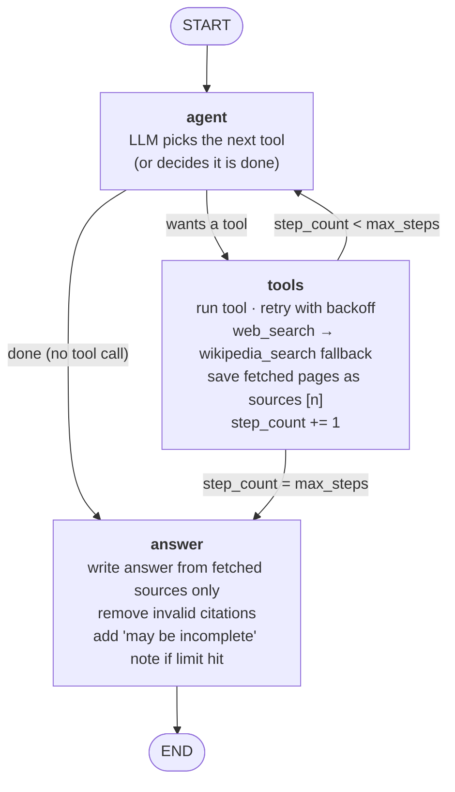

# Cited Research Agent

An AI agent that answers a research question by **searching the web, reading pages, and citing its sources**.
Every claim in the answer has a numbered citation like `[1]`, and every number points to a page the agent actually downloaded.

Built for the AgenticX *AI Agents & Automation* internship, Brief 1: Tool-Using Research Agent.

```bash
python -m agent "What are the health effects of intermittent fasting?"
```

See [Example runs](#example-runs) for real output.

## What it does

1. You ask a question.
2. The LLM (Google Gemini) **chooses tools** one step at a time:

   | Tool | What it does | Can it be cited? |
   |---|---|---|
   | `web_search` | Searches the web with DuckDuckGo (`ddgs` package, no API key) | No, it only returns snippets |
   | `wikipedia_search` | Searches Wikipedia (free MediaWiki API, no key). Also the automatic backup for `web_search` | No, it only returns snippets |
   | `fetch_page` | Downloads a URL and extracts the clean main text | **Yes**, the page becomes source `[n]` |
   | `summarise_page` | Downloads a URL and has the LLM summarise it for a focus topic | **Yes**, the page becomes source `[n]` |

3. When it has enough evidence, or hits the **step limit (8 tool calls)**, it writes the answer using **only** the downloaded pages.
4. A plain-Python check deletes any citation number that isn't a downloaded page, so made-up citations cannot survive.
5. Every step is logged (tool, input, success/failure, attempts, fallback) and each run is saved as JSON in `runs/` for later evaluation.

## How it works (LangGraph)

The agent is a small **state machine**. The state is a dictionary that every node reads and updates:
`question`, `messages`, `sources`, `step_count`, `max_steps`, `tool_log`, `errors`, `usage`, `limit_reached`, `answer`.



## Setup

You need Python 3.11+ and a free Google Gemini API key.

```bash
# 1. Create a virtual environment and install dependencies
python3 -m venv .venv
source .venv/bin/activate
pip install -r requirements.txt

# 2. Add your API key (get one free at https://aistudio.google.com/apikey)
cp .env.example .env
#    then open .env and replace "your-key-here" with your key

# 3. Ask a question
python -m agent "What are the health effects of intermittent fasting?"
```

Options:

```bash
python -m agent "question" --max-steps 5   # change the step limit
python -m agent "question" --json          # print the full result as JSON
python -m agent "question" --quiet         # hide the step-by-step log
```

The model is set with `GEMINI_MODEL` in `.env` (default `gemini-3.5-flash-lite`: fast and free. `gemini-2.5-flash` is no longer offered to new API keys, and `gemini-3.8-flash` was often overloaded with `503 high demand` errors during testing).

### Use it from Python (for the evaluation harness)

```python
from agent import run_agent

result = run_agent("Is coffee good for you?", max_steps=8)
result["answer"]        # the cited answer
result["sources"]       # [{id, url, title, tool, cited}], only pages that were fetched
result["steps"]         # number of tool calls used
result["tool_calls"]    # one log entry per tool call (see below)
result["errors"]        # every failed attempt, including retries
result["token_usage"]   # {input_tokens, output_tokens, total_tokens, llm_calls}
result["limit_reached"], result["citation_check"], result["duration_s"]
```

`run_agent` **never raises**. If something goes badly wrong, the problem is reported in `errors` and `answer`.

Each `tool_calls` entry has this shape (values are illustrative):

```json
{"step": 1, "tool": "web_search", "input": {"query": "intermittent fasting"},
 "success": true, "attempts": 3, "error": null,
 "search_tool_used": "wikipedia_search",
 "fallback_reason": "web_search failed after 2 retries (search failed: No results found.) -> fell back to wikipedia_search",
 "source_id": null, "duration_s": 4.1}
```

### Bonus: web API

```bash
uvicorn agent.api:app --reload
curl -X POST localhost:8000/ask -H 'Content-Type: application/json' \
     -d '{"question": "Is coffee good for you?"}'
# -> {"answer": "...", "sources": [...], "steps": [...]}
```

## How failures are handled

The rule is **never crash**: every failure becomes a message the LLM can react to, plus a log entry.

| What goes wrong | What the agent does |
|---|---|
| **Any tool fails** (exception or empty result) | Retries **once** after 1 second. If it fails again, the LLM gets `ERROR: fetch_page failed after 2 attempt(s): HTTP 404. Try a different URL...` and picks another source. |
| **DuckDuckGo blocks us** (HTTP 202 bot challenge) or returns nothing | `ddgs` runs with `backend="auto"`, so it tries other engines first. `web_search` gets **2 retries with backoff** (wait 1s, then 2s). |
| **`web_search` still fails after its retries** | Automatically runs **`wikipedia_search`** with the same query, inside the same step. The log records `search_tool_used: "wikipedia_search"` and `fallback_reason: "web_search failed after 2 retries (...) -> fell back to wikipedia_search"`. |
| **Both searches fail** | The LLM is told both failed and to try a simpler query. If no page is ever fetched, the answer says honestly *"I couldn't find and download any sources..."* with **no citations**. |
| **Page timeout** (15 s), **404/500**, **403/429 blocked**, **PDF/non-HTML**, **cookie wall / almost no text** | `fetch_page` raises a clear `ToolError` (`timed out`, `HTTP 404`, `blocked by the site (HTTP 403)`, `unsupported content type`, `page is empty or blocked`), and the retry rule above applies. |
| **LLM tries to stop with fewer than 2 fetched pages** (seen in real runs: once with 0 pages after a 403, and twice with only 1 page) | If steps are left, it gets **one** reminder to fetch more pages from different reliable sites. Sent only once, so it can't cause a loop, and the step limit still applies. |
| **Same URL requested twice** | Not downloaded again. The LLM is told `Already fetched as source [n]`. |
| **LLM asks for an unknown tool or sends bad arguments** | Logged as a failed step. The agent carries on. |
| **Gemini API fails** (rate limit, network) | Research stops and the agent answers from whatever it has already fetched. If the final answer call fails, it lists the fetched sources instead. |
| **Endless loop** | Hard limit of `max_steps` tool calls (default 8), counted in the state. Extra calls are skipped, the graph goes to `answer`, and the answer ends with *"Note: I stopped after the 8-tool-call limit, so this answer may be incomplete."* LangGraph's `recursion_limit` is a second safety net. |
| **LLM invents a citation** like `[7]` | `citations.py` deletes every `[n]` that isn't a fetched source and records it in `citation_check.removed_ids`. Search snippets are never sources. |

Reliability check (5 live queries, 18 Nov 2026, one attempt each, no retries): `web_search` succeeded 4/5 and `wikipedia_search` 5/5.
The failed `web_search` query succeeded on its 3rd attempt when run with retries.

## Example runs

Three real runs from 18 Nov 2026 with `gemini-3.5-flash-lite`, pasted exactly as printed. The step log goes to stderr and the answer to stdout.

Every citation points to a page the agent actually downloaded (`removed_invalid: []` in each log).
Each answer ends up citing a single source, mostly because many reputable sites block the fetcher (HTTP 403) and the lite model spends steps re-searching. See *Known limitations*.

### Example 1: What are the health effects of intermittent fasting?

**What it shows:**

- The agent searched twice, then tried to stop with **0 sources**, so it got the one-time reminder.
- Johns Hopkins blocked the fetcher (**HTTP 403**). It retried once, then picked another site.
- A `web_search` needed **3 attempts** (2 retries with backoff) before DuckDuckGo answered.
- A guessed NIA URL returned **HTTP 404**. It was retried once, then given up.
- Result: 1 fetched source (National Institute on Aging), all citations valid, 7 of 8 tool calls used.

```text
$ python -m agent "What are the health effects of intermittent fasting?"

Research from animal and human studies indicates that intermittent fasting offers a wide variety of health benefits [1]. These improvements apply to several health conditions, including obesity, diabetes, cardiovascular disease, cancers, and neurological disorders [1]. Additionally, intermittent fasting can lead to enhanced mental and physical performance, along with broad-spectrum disease resistance [1].

While intermittent fasting often leads to reduced calorie consumption, weight loss is not the primary driver of these health benefits [1]. Instead, the key mechanism is metabolic switching, where fasting causes the body to shift its energy source from stored liver glucose to ketones stored in fat [1]. 

The increase of ketones in the bloodstream acts as a potent signaling mechanism that triggers cellular pathways to influence health and aging [1]. This process enhances the body’s defense against metabolic and oxidative stress while removing or repairing damaged molecules [1]. Consequently, these adaptive responses carry over into non-fasting periods to suppress inflammation, improve glucose regulation, and increase stress resistance [1]. 

However, the sources do not provide clear evidence regarding long-term health effects or lifespan impacts in humans, as human trials have mostly involved relatively short-term interventions [1].

Sources:
  [1] Research on intermittent fasting shows health benefits | National Institute on Aging - https://www.nia.nih.gov/news/research-intermittent-fasting-shows-health-benefits

(tool calls: 7/8, errors: 6, tokens: 34767, log: runs/20261118-194839.json)
```

<details><summary>Step-by-step log</summary>

```text
[log] {"step": 1, "tool": "web_search", "input": {"query": "health effects of intermittent fasting health benefits side effects studies"}, "success": true, "attempts": 1, "error": null, "search_tool_used": "web_search", "fallback_reason": null, "source_id": null, "duration_s": 1.75}
[log] {"step": 2, "tool": "web_search", "input": {"query": "Johns Hopkins intermittent fasting benefits side effects"}, "success": true, "attempts": 1, "error": null, "search_tool_used": "web_search", "fallback_reason": null, "source_id": null, "duration_s": 2.4}
[log] {"event": "nudge", "reason": "tried to stop with 0 source(s)"}
[log] {"step": 3, "tool": "fetch_page", "input": {"url": "https://www.hopkinsmedicine.org/health/expert-qa/intermittent-fasting-what-is-it-and-how-does-it-work"}, "success": false, "attempts": 2, "error": "blocked by the site (HTTP 403)", "search_tool_used": null, "fallback_reason": null, "source_id": null, "duration_s": 1.12}
[log] {"step": 4, "tool": "web_search", "input": {"query": "site:nia.nih.gov intermittent fasting research benefits"}, "success": true, "attempts": 3, "error": null, "search_tool_used": "web_search", "fallback_reason": null, "source_id": null, "duration_s": 8.23}
[log] {"step": 5, "tool": "fetch_page", "input": {"url": "https://www.nia.nih.gov/news/research-intermittent-fasting-shows-health-benefits"}, "success": true, "attempts": 1, "error": null, "search_tool_used": null, "fallback_reason": null, "source_id": 1, "duration_s": 0.46}
[log] {"step": 6, "tool": "web_search", "input": {"query": "site:nejm.org \"Effects of Intermittent Fasting on Health, Aging, and Disease\""}, "success": true, "attempts": 1, "error": null, "search_tool_used": "web_search", "fallback_reason": null, "source_id": null, "duration_s": 1.32}
[log] {"step": 7, "tool": "fetch_page", "input": {"url": "https://www.nia.nih.gov/news/can-fasting-reduce-disease-risk-and-slow-aging-in-people"}, "success": false, "attempts": 2, "error": "HTTP 404", "search_tool_used": null, "fallback_reason": null, "source_id": null, "duration_s": 2.52}
[log] {"event": "answer", "cited": [1], "removed_invalid": []}
```

</details>

### Example 2: Do microplastics harm human health?

**What it shows:**

- ScienceDirect blocked the fetcher (**HTTP 403**), and an NIEHS link was a **PDF** (`unsupported content type`). Both failed cleanly.
- The reminder fired when the agent tried to stop with **1 source**.
- The agent hit the **8-tool-call limit**, stopped, answered with what it had, and added the *may be incomplete* note.
- The answer says plainly what its one source does *not* cover instead of making things up.

```text
$ python -m agent "Do microplastics harm human health?"

There is increasing evidence regarding the consumption and inhalation of micro- and nano-plastics, which has become a central topic in public health discussions [1]. 

Health risks are present at all stages of the plastic lifecycle, including production, use, recycling, disposal, and legacy plastics found in the environment [1]. Furthermore, there are specific concerns regarding exposure to hazardous chemicals that are utilized to impart particular properties to plastics [1]. 

The provided sources do not explicitly detail the exact physiological mechanisms or specific medical conditions caused by microplastics, but they note that the World Health Organization aims to address known and predicted health risks and exposures associated with plastic polymers, additives, chemicals, microplastics, and nanoplastics across the entire lifecycle of plastics [1].

Note: I stopped after the 8-tool-call limit, so this answer may be incomplete.

Sources:
  [1] Plastics and health initiative - https://www.who.int/initiatives/plastics-and-health-initiative

(tool calls: 8/8, errors: 6, tokens: 25155, log: runs/20261118-194922.json)
```

<details><summary>Step-by-step log</summary>

```text
[log] {"step": 1, "tool": "web_search", "input": {"query": "microplastics human health effects current scientific consensus WHO NIH"}, "success": true, "attempts": 2, "error": null, "search_tool_used": "web_search", "fallback_reason": null, "source_id": null, "duration_s": 4.67}
[log] {"step": 2, "tool": "web_search", "input": {"query": "NIH NIEHS microplastics health effects"}, "success": true, "attempts": 1, "error": null, "search_tool_used": "web_search", "fallback_reason": null, "source_id": null, "duration_s": 1.12}
[log] {"step": 3, "tool": "web_search", "input": {"query": "WHO microplastics health risk assessment summary"}, "success": true, "attempts": 1, "error": null, "search_tool_used": "web_search", "fallback_reason": null, "source_id": null, "duration_s": 2.28}
[log] {"step": 4, "tool": "fetch_page", "input": {"url": "https://www.who.int/initiatives/plastics-and-health-initiative"}, "success": true, "attempts": 1, "error": null, "search_tool_used": null, "fallback_reason": null, "source_id": 1, "duration_s": 0.86}
[log] {"event": "nudge", "reason": "tried to stop with 1 source(s)"}
[log] {"step": 5, "tool": "fetch_page", "input": {"url": "https://www.sciencedirect.com/science/article/pii/S2213343725035031"}, "success": false, "attempts": 2, "error": "blocked by the site (HTTP 403)", "search_tool_used": null, "fallback_reason": null, "source_id": null, "duration_s": 1.28}
[log] {"step": 6, "tool": "web_search", "input": {"query": "NIEHS microplastics health impact site:niehs.nih.gov"}, "success": true, "attempts": 1, "error": null, "search_tool_used": "web_search", "fallback_reason": null, "source_id": null, "duration_s": 11.66}
[log] {"step": 7, "tool": "fetch_page", "input": {"url": "https://www.niehs.nih.gov/sites/default/files/2025-08/LOMP_pod_script_clean_FINAL_08082025_508.pdf"}, "success": false, "attempts": 2, "error": "unsupported content type: application/pdf", "search_tool_used": null, "fallback_reason": null, "source_id": null, "duration_s": 1.55}
[log] {"step": 8, "tool": "web_search", "input": {"query": "microplastics human health site:nih.gov"}, "success": true, "attempts": 2, "error": null, "search_tool_used": "web_search", "fallback_reason": null, "source_id": null, "duration_s": 4.67}
[log] {"event": "answer", "cited": [1], "removed_invalid": []}
```

</details>

### Example 3: How does creatine supplementation affect brain function and memory?

**What it shows:**

- Run with a deliberately small `--max-steps 3` to show the step limit.
- It fetched a 2024 systematic review and meta-analysis from PubMed Central, and was reminded to fetch a second source.
- It used its last step on a search, hit the **3-tool-call limit**, and answered with the *may be incomplete* note.

```text
$ python -m agent "How does creatine supplementation affect brain function and memory?" --max-steps 3

Creatine monohydrate supplementation plays a critical role in the energy metabolism of brain cells by converting into phosphocreatine to facilitate adenosine triphosphate (ATP) regeneration [1]. 

Regarding brain function and memory, research indicates the following effects:
* **Memory:** Creatine supplementation demonstrates significant positive effects on memory, backed by a moderate level of evidence certainty [1].
* **Attention and Processing Speed:** Supplementation shows significant improvements in attention time and information processing speed, though the certainty of evidence for these domains is low [1].
* **Overall and Executive Function:** Current studies do not find significant improvements in overall cognitive function or executive function [1].

Subgroup analyses indicate that creatine supplementation yields greater benefits for individuals with specific diseases, females, and those between the ages of 18 and 60 [1]. Additionally, there are no significant differences between short-term (<4 weeks) and long-term (≥4 weeks) interventions for enhancing cognitive function [1].

Note: I stopped after the 3-tool-call limit, so this answer may be incomplete.

Sources:
  [1] The effects of creatine supplementation on cognitive function in adults: a systematic review and meta-analysis - PMC - https://pmc.ncbi.nlm.nih.gov/articles/PMC11275561/

(tool calls: 3/3, errors: 0, tokens: 9517, log: runs/20261118-194949.json)
```

<details><summary>Step-by-step log</summary>

```text
[log] {"step": 1, "tool": "web_search", "input": {"query": "creatine supplementation brain function memory health benefits"}, "success": true, "attempts": 1, "error": null, "search_tool_used": "web_search", "fallback_reason": null, "source_id": null, "duration_s": 1.6}
[log] {"step": 2, "tool": "fetch_page", "input": {"url": "https://pmc.ncbi.nlm.nih.gov/articles/PMC11275561/"}, "success": true, "attempts": 1, "error": null, "search_tool_used": null, "fallback_reason": null, "source_id": 1, "duration_s": 0.31}
[log] {"event": "nudge", "reason": "tried to stop with 1 source(s)"}
[log] {"step": 3, "tool": "web_search", "input": {"query": "creatine brain health mechanism memory study"}, "success": true, "attempts": 1, "error": null, "search_tool_used": "web_search", "fallback_reason": null, "source_id": null, "duration_s": 11.36}
[log] {"event": "answer", "cited": [1], "removed_invalid": []}
```

</details>

## Known limitations

- **Few sources per answer.** Many reputable sites (Johns Hopkins, ScienceDirect, journals) return HTTP 403 to scripts, and PDFs aren't read. In the example runs the agent usually ended up with one usable page.
- **The model matters.** `gemini-3.5-flash-lite` is fast and free but sometimes repeats searches instead of fetching. A stronger model (`GEMINI_MODEL` in `.env`) plans better when it isn't overloaded.
- **Citations are checked, claims are not.** The code guarantees every `[n]` is a fetched page. Whether the sentence really matches that page is left to the LLM, and is what the evaluation harness should measure.

## Tests

```bash
python -m pytest -v
```

The tests use a **fake LLM** that follows a script, plus **fake tools**, so they need **no internet and no API key**. They cover:

- **Step limit:** an LLM that wants to search forever is stopped at `max_steps`, and the answer says it may be incomplete. Parallel tool calls also count toward the limit.
- **Citations:** made-up citations are removed, and only fetched URLs (never search hits or failed pages) appear as sources.
- **Tool failures:** retry-then-succeed, 404 then move on, unexpected exceptions, unknown tools, bad arguments, and Gemini being down.
- **Search fallback:** `web_search` fails, so `wikipedia_search` is used. When both fail, the agent gives an honest answer with no citations.
- **Reminder:** an agent that tries to stop with fewer than 2 sources is reminded once, and only once.
- **Real `fetch_page` / `wikipedia_search` code** with the network mocked: text cleaning, 404, 403, timeout, PDF, empty page, Wikipedia parsing.
- **The `/ask` API endpoint.**

## Project structure

```
agent/
  __main__.py   CLI: python -m agent "question"
  graph.py      LangGraph state, nodes, routing, run_agent()
  tools.py      web_search, wikipedia_search, fetch_page, summarise_page
  citations.py  removes citations that don't point to fetched pages
  config.py     settings (.env, model name, limits, timeouts, retries)
  api.py        bonus FastAPI POST /ask
tests/
  conftest.py   fake LLM and fake tools
  test_agent.py the tests
```
