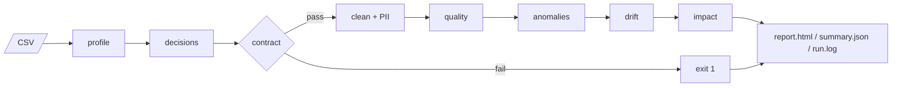

# Data Gatekeeper — Automated Data Cleaning & Validation System

[](https://github.com/satkynovilgiz/data-gatekeeper/actions/workflows/tests.yml)
[](https://www.python.org/downloads/)
[](LICENSE)

**Data Gatekeeper checks a CSV before anyone uses it:** it profiles it, checks it against a contract, cleans it with
every change logged, lists the values only a person can judge, finds unusual rows and drift, measures whether cleaning
helps a model, and writes one HTML page a non-technical reader can open.
CadetX AI Engineering & Data Science internship project, 12 sprints, v2.0.0 ([`docs/sprint_plan.md`](docs/sprint_plan.md)).

### The demo, in one command
```bash
make demo          # Docker image (if installed) -> download Bank + Adult (checksums) -> pipeline on both -> 2 reports
make demo-full     # the same, plus the impact study (about an hour)
```


### Key results (real numbers, each from its sprint report)
| Sprint | Question | Answer |
|---|---|---|
| [8](docs/sprint-08.md) | Does cleaning help a model on Bank Marketing? | No ROC-AUC gain (LogReg −0.0002, HGB +0.0001, CIs include 0); LogReg PR-AUC +0.0197 |
| [9](docs/sprint-09.md) | Can unseen `999` codes fool the cleaner? | Yes, until fixed: HGB with 20% mixed corruption 0.6368 → 0.7508 |
| [10](docs/sprint-10.md) | Does the fix hold, and on a second, messier dataset? | Sentinels by frequency: 0.8498 → 0.9141. On UCI Adult cleaning **hurt** (LogReg −0.0093, HGB −0.0053) |
| [11](docs/sprint-11.md) | Can a person's decisions undo that? Is it fair? | HGB gap −0.0053 → −0.0002 with 3 confirmed decisions; LogReg TPR gap women vs men 0.1055 → 0.1467 |
| [12](docs/sprint-12.md) | Should skewed columns get a power transform? | Decided by a rule written first: scale only (Adult LogReg gap closed; Bank LogReg PR-AUC −0.0191) |

### How it fits together

Entry points: `gatekeeper.py` (CLI), `gatekeeper run --config pipeline.yaml`, the FastAPI app, Docker.
Details: [`docs/architecture.md`](docs/architecture.md) · presentation: [`docs/final_presentation.md`](docs/final_presentation.md)
· demo video script: [`docs/demo_script.md`](docs/demo_script.md).

---

```
raw.csv ──► Module 1: Profile ──► Module 2: Clean ──► Module 3: Validate ──► Module 4: Automate
            profiling_report.json   cleaned_data.csv    validation_report.json   CLI + Docker
                                    + transform (ML-ready)
                                    + PII masking
                                    + REST API
```

| Module | Status | Output |
|---|---|---|
| 1. Profiling & Metadata Intelligence | ✅ **complete** (v1.2, Sprint 3): CLI + API + JSON Schema, disguised missing, quality score, cleaning suggestions | `profiling_report.json` + charts |
| 2. Cleaning & Transformation | ✅ **complete** (Sprint 6): core cleaning pipeline · ML imputation + evaluation · outliers · fuzzy duplicates · ML transformation (fit on train only) · PII detection + masking · REST API — summary: [`docs/module2_summary.md`](docs/module2_summary.md) | `cleaned_data.csv`, `cleaning_log.json`, `schema.json`, `train/test_transformed.csv` + `.joblib`, `masked_data.csv` + `pii_report.json` |
| 3. AI Validation & Anomaly Detection | ✅ **complete** (Sprint 9): data contracts · drift (PSI + KS) · explained anomalies · impact on a model · one report with a JSON Schema — slides: [`docs/module3_presentation.md`](docs/module3_presentation.md) | `validation_report.json`, `<name>_impact.json`, `run_<time>/summary.json` |
| 4. Integration, CLI & Docker | 🔄 pipeline, Docker and CI already work (`gatekeeper run`); left: HTML report, `POST /run`, final demo | `gatekeeper run --config pipeline.yaml` |

## Quick start

```bash
python -m venv .venv
source .venv/bin/activate          # Windows: .venv\Scripts\activate
pip install -r requirements.txt

python scripts/download_bank_marketing.py    # real finance dataset (UCI Bank Marketing, 41k rows)
python run_profiling.py --input data/raw/bank_marketing.csv --output results/bank   # ~3.5 s
python run_profiling.py --input data/raw/bank_marketing.csv --output results/quick --sample 5000
python run_cleaning.py --input data/raw/bank_marketing.csv \
       --profile results/bank/profiling_report.json --output results/bank   # Module 2
python run_cleaning.py --input data/raw/hr_employees_messy.csv --output results/hr \
       --evaluate-imputers                    # + compare median / knn / regression / iterative
pytest -q                                     # run the tests
```

### Shortcuts (Makefile)
| Command | Does |
|---|---|
| `make install` | install `requirements.txt` |
| `make test` | run all tests (`pytest -q`) |
| `make lint` | check the code with ruff |
| `make profile-sample` | profile the 1,000-row sample → `results/sample/` |
| `make api` | run the API on http://127.0.0.1:8000 (`/docs` to try it) |

No internet? Use the committed 1,000-row sample `data/raw/bank_marketing_sample.csv`,
or the synthetic HR data (`python scripts/make_sample_data.py`). Dataset details: [`docs/dataset.md`](docs/dataset.md).

### API (Sprint 6: profile, clean, transform, mask PII)
```bash
make api                                   # = uvicorn src.api.app:app --reload
export GATEKEEPER_PII_SALT=$(openssl rand -hex 32)   # set before `make api` to allow hashing
```
```bash
curl http://127.0.0.1:8000/health
curl -F "file=@data/raw/bank_marketing_sample.csv" http://127.0.0.1:8000/profile -o profiling_report.json
# clean: JSON log + quality before/after, or download the cleaned CSV
curl -F "file=@data/raw/hr_employees_messy.csv" "http://127.0.0.1:8000/clean?imputer=median"
curl -OJ -F "file=@data/raw/hr_employees_messy.csv" "http://127.0.0.1:8000/clean?output=csv"
# transform a CLEANED file for ML (fitted on the train rows only)
curl -F "file=@results/bank/cleaned_data.csv" "http://127.0.0.1:8000/transform?target=y"
# find + protect personal data; choose actions per column
curl -F "file=@data/raw/customers_pii.csv" "http://127.0.0.1:8000/mask-pii"
curl -OJ -F "file=@data/raw/customers_pii.csv" \
     "http://127.0.0.1:8000/mask-pii?output=csv&action=email=mask&action=full_name=mask"
```
Rules: `.csv` only, ≤ 20 MB, ≤ 200,000 rows → otherwise a clear `400` / `413` / `422`.
The upload is parsed in memory and not saved; unexpected errors give a plain `500` without a stack
trace. `/mask-pii` answers `503` when hashing is needed but no salt is set on the server.
(The Sprint 2 command `uvicorn src.api.profiling_api:app` still works.)

The report format is a JSON Schema: [`docs/profiling_report.schema.json`](docs/profiling_report.schema.json).

CLI output:
```
results/bank/
├── profiling_report.json     # stats, issues, quality_score, cleaning_suggestions
└── charts/
    ├── missing_heatmap.png
    ├── correlation_heatmap.png
    ├── outlier_distribution.png
    ├── hist_<column>.png     # one per numeric column
    └── bar_<column>.png      # one per categorical column (top 10)
```

### Module 1 results on Bank Marketing (41,188 rows × 21 columns)
| | |
|---|---|
| Empty cells (what pandas sees) | 0.0% |
| **Disguised missing** (`unknown`, `pdays = 999`) | **52,391 cells → true missing 6.06%** in 7 columns |
| Duplicate rows | 12 |
| PII columns | none (anonymised data) |
| Issues | 13 (2 high, 11 medium) → 13 cleaning suggestions |
| **Quality score** | **98.48 / 100** (completeness 93.94, uniqueness 99.97, validity 100, consistency 100) |
| Run time | 2.5 s profiling, 3.5 s with charts |

Details: [`docs/module1_profiling.md`](docs/module1_profiling.md) · slides: [`docs/module1_presentation.md`](docs/module1_presentation.md)

### Module 2 results (Sprints 4–5: cleaning pipeline + ML cleaning)
```bash
python run_cleaning.py --input data/raw/hr_employees_messy.csv --output results/hr   # profiles first
python run_cleaning.py --input ... --imputer knn --outliers cap --fuzzy-threshold 90 --evaluate-imputers
```
Writes `cleaned_data.csv`, `cleaning_log.json` (every change with before → after examples),
`schema.json` (expected type, range, format per column, for Module 3) and, with `--evaluate-imputers`,
`imputer_evaluation.json` + `.png`. The raw file is never changed.

| | Bank Marketing (41,188 × 21) | HR messy sample (523 × 10) |
|---|---|---|
| Rows | 41,188 → 41,176 (12 exact duplicates) | 523 → 508 (15 exact duplicates) |
| Fixed | 4,121 `unknown` → NaN → imputed; `default = unknown` (8,597) **kept as a category**; `pdays 999` → `previously_contacted` | 19 category variants, 52 dates → ISO, 15 `"five"`, 15 bad emails, 10 `age = 230` |
| Fuzzy duplicates | skipped (no name column) | **8 pairs** flagged (8/8 planted, 0 false) |
| Outliers (flagged, values kept) | IQR 6,283 cells · Isolation Forest 412 rows · both 226 | IQR 7 cells · Isolation Forest 6 rows · both 5 (salary 9,999,999) |
| Values imputed (iterative) | 4,120 | 89 |
| **Quality score** | **98.48 → 98.91 (+0.43)** | **88.87 → 99.87 (+11.00)** |
| Run time (whole CLI) | 59 s with iterative (cleaning 49 s) · 13 s with `--imputer median` · 77 s with `--evaluate-imputers` | 4.2 s with `--evaluate-imputers` |

**Imputer evaluation** (hide 10% of known values, refill, compare). Bank Marketing, 9,000 hidden cells:

| | median / mode | knn | regression | **iterative** (default) |
|---|---|---|---|---|
| numeric error, mean NRMSE ↓ | 1.063 | 0.563 | 0.561 | **0.478** |
| categorical accuracy ↑ | 51.8% | 62.4% | 67.2% | **67.5%** |
| time (5,000 rows) | 0.02 s | 3.2 s | 2.0 s | 9.2 s |


Details, step order, the `pdays` and `unknown` decisions, how each ML method works:
[`docs/module2_cleaning.md`](docs/module2_cleaning.md) · [`docs/sprint4_summary.md`](docs/sprint4_summary.md) · [`docs/sprint5_summary.md`](docs/sprint5_summary.md)

### Module 2 results, Sprint 6 (transformation + PII + API)
```bash
python run_transform.py --input results/bank/cleaned_data.csv --target y \
       --output results/bank/transform --bins age=18,30,45,60,100
GATEKEEPER_PII_SALT=... python run_masking.py --input data/raw/customers_pii.csv --output results/customers
```
**Quality score fix.** Flag columns added by cleaning (`*_outlier`, `is_anomaly`, `possible_duplicate`,
`previously_contacted`) no longer count toward the score; they are reported apart.
Bank 98.48 → **98.60** (was 98.91), HR 88.87 → **99.83** (was 99.87).

| Transform | Bank Marketing | HR sample |
|---|---|---|
| Train / test (fit on train only) | 32,940 / 8,236, stratified on `y` | 406 / 102 |
| Columns in → model columns out | 26 → 63 | 9 → 16 |
| Encoding | one-hot (`default_unknown` kept), ordinal `education` | one-hot `department` |
| Skewed → Yeo-Johnson | duration 3.19 → 0.17, campaign 4.89 → 0.37, nr.employed −1.04 → −0.34 | salary 8.87 → 1.16 |
| Dropped (with reason) | `pdays` (96% empty), target `y` | ID, name, email, phone, `hire_date` |

| PII | fake customers (300 rows) | HR | Bank |
|---|---|---|---|
| Columns found | 9 / 9 (email, phone, SSN, card + Luhn, IP, name, street, zip, DOB) | 3 | 0 |
| Default action | hash: name, email · mask: phone · drop: SSN, card, street · generalize: DOB → age band, zip → `660**`, IP → `/24` | hash, hash, mask | – |


All personal data in `data/raw/customers_pii.csv` is **fake**, taken from ranges reserved for examples
(`@example.com`, `555-01xx` phones, SSN areas 000/666, payment test cards, TEST-NET IPs).
Summary for the presentation: [`docs/module2_summary.md`](docs/module2_summary.md) · [`docs/sprint6_summary.md`](docs/sprint6_summary.md)

## Data contracts & drift (Sprint 7)
A contract (`contracts/<name>.yaml`) says what a dataset must look like; `drift` measures how far
new data moved from a reference (PSI + KS). Exit codes: 0 pass, 1 fail (error rule / major drift), 2 bad input.
```bash
python gatekeeper.py contract init data/demo/bank_reference.csv --name bank_marketing   # draft, then edit
python gatekeeper.py validate new.csv --contract contracts/bank_marketing.yaml          # -> reports/new_contract.json
python gatekeeper.py drift data/demo/bank_reference.csv new.csv --contract contracts/bank_marketing.yaml
docker build -t data-gatekeeper .
docker run --rm -v "$PWD:/work" -w /work data-gatekeeper validate new.csv --contract contracts/bank_marketing.yaml
```
Demo (Bank Marketing, seed 42): the clean 30% split passes 97/97 rules with 21/21 columns stable; the
shifted file fails 2 rules and shows major drift on exactly `duration` (PSI 8.26), `contact` (0.58) and
`age` (0.31). Example with every rule: [`contracts/example.yaml`](contracts/example.yaml). Details: [`docs/sprint-07.md`](docs/sprint-07.md)

## Does cleaning help? (impact, Sprint 8)
`gatekeeper impact` trains the same models on the same 5 stratified folds (seed 42) after three
preparations: **A** raw (median/mode + one-hot), **B** the full gatekeeper (cleaning steps, train-only
dedupe, iterative imputer, Sprint 6 transform), **C** = B with a median imputer. Everything that learns
is fitted on the train rows of each fold only (a test spies on every `fit()`).
```bash
python gatekeeper.py impact data/raw/bank_marketing.csv --target y          # ~9 min, + robustness
python gatekeeper.py impact data.csv --target y --no-robustness --sample 5000   # quick look
```
Bank Marketing, honest result: **no ROC-AUC gain** for either model (LogReg B−A −0.0002, 95% CI
[−0.0020, +0.0016]; HistGradientBoosting +0.0001 [−0.0004, +0.0006]). LogReg gets a better PR-AUC
(+0.0197 [+0.0108, +0.0285]) and Brier score, equally with C, so not from the imputer. On dirty test
data B holds up much better against missing values and decimal-comma numbers, but **loses** to A for
HistGradientBoosting when unrecognised `999` sentinels are mixed in (the imputer learns from them).
Tables, chart and the diagnosis: [`docs/sprint-08.md`](docs/sprint-08.md).

## One-command pipeline (Sprint 8)
```bash
python gatekeeper.py run --config pipeline.yaml                 # profile -> validate -> clean ->
python gatekeeper.py run --config pipeline.yaml --skip impact   #   mask_pii -> quality -> drift -> impact
docker run --rm -v "$PWD:/work" -w /work data-gatekeeper run --config pipeline.yaml --skip impact
```
Steps run in that order (any subset). A failed error rule in the contract stops the run (exit 1);
drift stops it only with `gate: true`; a bad config or a crashing step gives exit 2. Every run writes
`reports/run_<UTC time>/summary.json` + `summary.md` next to each step's own files.
Example config: [`pipeline.yaml`](pipeline.yaml) · CI fixture: [`tests/fixtures/pipeline_ci.yaml`](tests/fixtures/pipeline_ci.yaml).

## Validation report (Sprint 9)
One file per dataset answers "can we use it?": the **contract** (pass / fail), **drift** against a reference
(when given) and **anomalies** (when asked), in `reports/<dataset>_validation_report.json`
(format: [`docs/validation_report.schema.json`](docs/validation_report.schema.json)).
```bash
python gatekeeper.py validate new.csv --contract contracts/bank_marketing.yaml \
       --reference data/demo/bank_reference.csv --anomalies --exclude y
curl -F file=@new.csv -F contract=@contracts/bank_marketing.yaml -F reference=@data/demo/bank_reference.csv \
     "http://127.0.0.1:8000/validate?anomalies=true&exclude=y"
```
Exit codes stay 0 pass / 1 data failed / 2 bad input. Drift and anomalies are information only, unless you set
`--fail-on-anomaly-share 0.05` (more than 5% of rows flagged → exit 1). Also: `POST /drift`, `POST /anomalies`.
On new rows the cleaner now turns values outside the train range and unseen sentinels (999, −1 …) into missing
before imputing (step 8b). That fixed the Sprint 8 weakness: HistGradientBoosting with 20% corruption went from
0.6368 to 0.7508 ROC-AUC. Details: [`docs/sprint-09.md`](docs/sprint-09.md).

## Anomaly detection (Sprint 9)
```bash
python gatekeeper.py anomalies data/raw/bank_marketing.csv --method all --top 10 --exclude y
```
Five methods score every row: **robust z** (|x − median| / 1.4826·MAD), **IQR** distance and an
**Isolation Forest** (seed 42, contamination 1%), plus (Sprint 10) **`zscore_mixture`** for multi-bump columns and
**`iforest_with_categories`**. The top rows come with the 3 columns that made them odd (value,
median, robust z; leave-one-column-out for the forest). The label, IDs and PII are never used or printed.
Honest evaluation on 412 planted anomalies in Bank Marketing (settings fixed before the first run): the forest ranks
best overall (ROC-AUC 0.8374), robust z is the most precise on single extremes (precision@k 0.2117), and every method
has low precision because the real file has many natural outliers and a bimodal `euribor3m`.

## Second dataset: UCI Adult (Sprint 10)
```bash
python scripts/download_adult.py --split        # official zip, SHA-256 checked -> data/raw/adult.csv
python gatekeeper.py run --config pipeline_adult.yaml --skip impact
python gatekeeper.py impact data/raw/adult.csv --target income     # ~35 min (iterative imputer)
```
**Honest result: on Adult the gatekeeper makes models worse** (ROC-AUC B − A: LogReg −0.0093, HGB −0.0053, CIs exclude 0),
while its quality score goes up (99.74 → 100.00). The ablation shows why: `capital-gain = 99999` is a top code, and all
244 of those rows earn `>50K`, so treating it as a sentinel erases signal. And `?` is informative (9.47% `>50K` vs 24.81%).
Keeping both closes the gap for HistGradientBoosting. On dirty incoming data the gatekeeper is still far more robust
(LogReg with 20% mixed corruption: −0.0644 vs −0.3070 raw). Sentinels are now judged by frequency
(Bank, HGB, 20% sentinels: 0.8498 → 0.9141), and the new `zscore_mixture` anomaly method lifts precision@k from
0.10 to 0.59. Details: [`docs/sprint-10.md`](docs/sprint-10.md), dataset: [`docs/dataset.md`](docs/dataset.md).

## Decisions for a person (Sprint 11)
Some values only a person can judge: is `capital-gain = 99999` a "no value" code or a real (capped) amount?
Is `workclass = ?` just missing, or does "no answer" mean something? The gatekeeper now **lists** them with evidence
instead of deciding alone:
```bash
python gatekeeper.py decisions data/raw/adult.csv --target income --write draft.yaml
```
| column | value | rows | `>50K` in these rows vs the rest | today | recommended |
|---|---|---|---|---|---|
| capital-gain | 99999 | 244 | 100.00% vs 23.55% | treat as missing | **keep as value** |
| workclass | ? | 2,799 | 9.47% vs 24.81% | impute | **keep as category** |
| occupation | ? | 2,809 | 9.43% vs 24.81% | impute | **keep as category** |

A person confirms them in a `decisions:` block (contract or config, e.g.
[`contracts/adult_decisions.yaml`](contracts/adult_decisions.yaml)). The cleaner obeys it, and the cleaning log says who
decided (default or config). On Adult this removed the damage Sprint 10 found for HistGradientBoosting
(ROC-AUC B − A −0.0053 → −0.0002, no clear difference). It is not an independent test, because the decisions were
informed by Sprint 10's ablation. On Bank the detector lists only `pdays = 999` (kept as the Sprint 4 special code) and
`default = unknown` (already a category). A first fairness measurement on Adult and the details are in
[`docs/sprint-11.md`](docs/sprint-11.md).

## HTML report (Sprint 11)
Every `gatekeeper run` writes `report.html` (and `run.log`) into its run folder: one self-contained page (no external
requests, prints well, no personal data) with the status in plain words, the steps, contract results, what cleaning
changed and who decided, the decisions for a person, quality before/after (with the warning that a higher score is not
a better model), the most unusual rows with reasons, drift, and the impact headline.
```bash
python gatekeeper.py run --config pipeline_adult.yaml --skip impact     # -> reports/run_<time>/report.html
python gatekeeper.py report reports/run_<time>                          # rebuild the page
curl -F file=@data.csv -F config=@config.json "http://127.0.0.1:8000/run?output=html" > report.html
```
`POST /run` takes a CSV plus a small JSON config (`{"steps": ["profile", {"validate": {"contract": "example"}},
"clean", "quality", "anomalies"]}`). The same upload limits apply, it has a 120-second time limit, and it does not run
`drift` or `impact` (they need server files or take minutes). It returns the summary and a link to the page.


## Project structure

```
data-gatekeeper/
├── data/raw/                 # input datasets (keep large files out of git — use DVC / Git LFS)
├── docs/                     # sprint plan, dataset, module docs, JSON schema
├── scripts/                  # dataset download, sample data (HR + fake PII customers), charts
├── src/
│   ├── api/
│   │   ├── app.py            #   FastAPI: /health /profile /clean /transform /mask-pii /validate /drift /anomalies /run
│   │   └── profiling_api.py  #   old Sprint 2 entry point (imports app.py)
│   ├── profiling/            # Module 1
│   │   ├── semantic.py       #   type + meaning detection (email, phone, card, IP, DOB, id, PII)
│   │   ├── profiler.py       #   profile_file / profile_dataset + rule engine -> report dict
│   │   ├── suggestions.py    #   issues -> cleaning suggestions (hand-off to Module 2)
│   │   └── visualize.py      #   backend charts (PNG)
│   ├── quality/
│   │   └── score.py          #   data quality score 0-100 (shared by Module 1 and 2)
│   ├── cleaning/             # Module 2
│   │   ├── schema.py         #   infer_schema: expected type / range / format per column -> schema.json
│   │   ├── cleaner.py        #   12 cleaning steps + cleaning_log.json + quality before/after
│   │   ├── imputers.py       #   median / knn / regression / iterative (MICE) imputation
│   │   ├── evaluation.py     #   imputer evaluation: hide 10%, refill, RMSE / MAE / accuracy + chart
│   │   ├── outliers.py       #   IQR (per column) + Isolation Forest (per row)
│   │   └── fuzzy.py          #   fuzzy duplicates with rapidfuzz
│   ├── transform/            # Module 2, Sprint 6
│   │   ├── plan.py           #   per column: encoding / power transform / scaler + the reason
│   │   └── pipeline.py       #   ColumnTransformer fitted on train only, joblib save / load
│   ├── privacy/              # Module 2, Sprint 6
│   │   ├── detect.py         #   PII by column name + content (regex, Luhn), confidence
│   │   └── mask.py           #   mask / salted hash / drop / generalize + PII report
│   ├── validation/           # Module 3: contract.py, drift.py, anomaly.py, report.py (validation_report.json)
│   ├── impact/               # Sprint 8: impact.py (A/B/C CV), corruption.py, report.py
│   └── pipeline/             # run.py (gatekeeper run --config), html.py (report.html, Sprint 11)
├── tests/                    # pytest
├── run_profiling.py          # Module 1 CLI
├── run_cleaning.py           # Module 2 CLI: clean
├── run_transform.py          # Module 2 CLI: encode + scale for ML
├── run_masking.py            # Module 2 CLI: find + protect PII
├── gatekeeper.py             # contract init / validate / drift / impact / run
├── pipeline.yaml             # example one-command pipeline for bank_marketing.csv
└── requirements.txt
```

## Workflow
- Work on a **branch per sprint/feature** → small commits → **pull request** → review → merge to `main`.
- Weekly meeting + rotating Scrum Master (see `docs/team.md`).
- Each module gets its own short presentation / doc in `docs/`.
