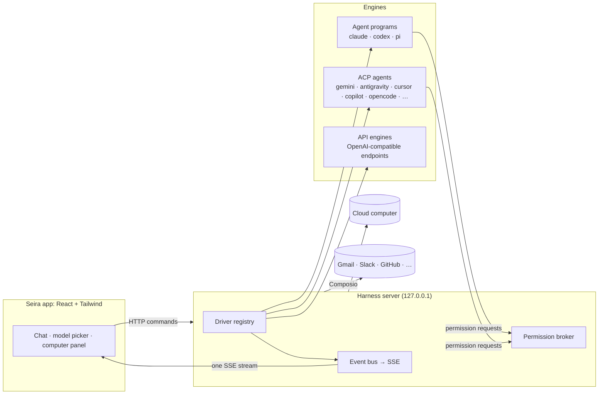

<div align="center">


<br>
<br>

<picture>
  <source media="(prefers-color-scheme: dark)" srcset="docs/assets/brand/seira-wordmark-reversed.svg">
  
</picture>

<h3>Your own team of AI agents in one chat app.</h3>

<p>Seira is a free, open source desktop app for Windows and Linux. It runs Claude Code, Codex, Gemini, and more than 25 other AI agents as a team of bots in one chat.</p>

Give each bot a job. Watch it work. Approve the steps that matter.<br>
Seira runs on your computer and uses the AI plans that you already have.

<p>
  <a href="https://github.com/seira-bot/seira/releases/latest"></a>
  <a href="https://www.npmjs.com/package/@seira-bot/seira"></a>
  <a href="LICENSE"></a>
  
  
</p>

<p>
  <a href="https://seira.bot"><b>Website</b></a> ·
  <a href="https://docs.seira.bot"><b>Docs</b></a> ·
  <a href="https://play.google.com/store/apps/details?id=bot.seira.companion"><b>Android app</b></a> ·
  <a href="#quick-start"><b>Quick start</b></a> ·
  <a href="#features"><b>Features</b></a> ·
  <a href="#engines"><b>Engines</b></a> ·
  <a href="#how-it-works"><b>How it works</b></a> ·
  <a href="#documentation"><b>Documentation</b></a> ·
  <a href="#faq"><b>FAQ</b></a> ·
  <a href="#contributing"><b>Contributing</b></a>
</p>

</div>

> [!NOTE]
> Seira is in early development.
> Download it for Windows or Linux from the [latest release](https://github.com/seira-bot/seira/releases/latest),
> run the server with [`npx @seira-bot/seira`](#run-it-on-a-server), or [build it from source](#build-from-source).
> The [Seira Android app](https://play.google.com/store/apps/details?id=bot.seira.companion) on Google Play pairs your phone with Seira on your computer.

## Why Seira

<table>
  <tr>
    <td width="50%" valign="top">
      <h4>Bring your own agents</h4>
      Bots run on the agent programs on your computer: Claude Code, Codex, Gemini, Cursor, GitHub Copilot, and many more.
      They use the sign-in and the plan that you already have. There is no new account and no proxy in the middle.
    </td>
    <td width="50%" valign="top">
      <h4>Ready on the first start</h4>
      No AI on your computer yet? Seira installs OpenCode and its free models as a backup,
      so you can chat before you connect a paid plan.
    </td>
  </tr>
  <tr>
    <td width="50%" valign="top">
      <h4>Agents with hands</h4>
      A bot can use a cloud Linux desktop, an isolated local VM, or your own computer after you opt in.
      With your own Composio key, it can also use more than 500 apps.
    </td>
    <td width="50%" valign="top">
      <h4>Local first, you stay in control</h4>
      One small harness server on <code>127.0.0.1</code> owns every agent process. Transcripts and keys stay on your computer.
      Shell commands, file edits, and questions show as cards that you allow or deny.
    </td>
  </tr>
</table>

## Features

| Feature | What you get |
|---|---|
| **A model for each bot** | Pick the engine and the model of each bot from one model picker. Change the model in the middle of a conversation. |
| **A character for each bot** | Each new bot gets its own character. Pick a different look from the cast at any time. |
| **A computer for each bot** | Open the Computer panel to start the cloud desktop of a bot. Watch a live preview, or take over in your browser. |
| **Approval cards** | A permission broker turns each risky action into a card: Allow, Deny, or answer in the chat. |
| **Connected apps** | Add your Composio key, then connect Gmail, Slack, GitHub, Notion, Linear, and hundreds more. Every bot can use them. |
| **Channels** | Keep Work, Personal, and each project apart. Each channel has its own transcript, instructions, work folder, and bot roster. |
| **Triggers** | Tell a bot "every weekday at 9, summarize my inbox". Schedules and webhooks start bots while you do other work. |
| **Voice** | Listen to replies, or call a bot. Voices come from ElevenLabs, Fish Audio, xAI, built-in Mac voices, or a local Chatterbox server. |
| **Teams** | Install a full team from one Markdown file. Share a bot or a department as a folder. |
| **Run it anywhere** | Use the desktop app, or run the same server on a VPS or a home server and open it from your browser or phone. |
| **MCP server** | Control your bots from Claude Desktop, Cursor, or another MCP client. See [docs/mcp-server.md](docs/mcp-server.md). |
| **Scripts and CI** | Start a team from the command line, wait for the result, and export what it made. See [docs/headless-cli.md](docs/headless-cli.md). |

## Engines

Seira has more than 30 engines. Install an agent program and sign in, or add an API key.
The model picker shows each engine that is ready.

| Kind | Engines |
|---|---|
| Agent programs | Claude Code, Codex, pi |
| Agent programs over ACP | Gemini, Google Antigravity, Grok, Cursor, GitHub Copilot, OpenCode, Qwen, Kimi, Droid, Cline, Kiro, Devin, Hermes, DeepSeek, Mistral (Vibe), Command Code, OMP |
| API and plan engines | Grok, Mistral, Groq, Cerebras, MiniMax, Greenference, ModelGo, Meta Muse, Muse Code, and any OpenAI-compatible endpoint |

To add an ACP program or an endpoint that is not in this list, see [docs/custom-engines.md](docs/custom-engines.md).
To use a custom build of an agent program, set it in **Settings → AI → Providers**.

## Meet Seira

Seira is the face of the project: a small companion bot that floats next to your chats.
The face lives on a black visor screen, so Seira can blink, smile, wink, and think while your agents work.

<p align="center">
  
</p>

<details>
<summary><b>Brand assets:</b> turnaround, colors, and logo files</summary>
<br>
<p align="center">
  
</p>

| Color | Hex | Use |
|---|---|---|
| Ink | `#0E1116` | Head and wordmark on light backgrounds |
| Signal red | `#E11D48` | Eyes, and the dot in seira.bot |
| Mist | `#E9ECEF` | Head on dark backgrounds |

The 3D logo, the wordmark, the lockups for light and dark backgrounds, and the avatar are in [`docs/assets/brand/`](docs/assets/brand/).

</details>

## How it works

Seira runs as two processes.
The app sends typed commands over HTTP and reads one event stream (SSE).
The harness server owns every agent process.
It changes the protocol of each engine into one event stream, and logs each thread as NDJSON.



<details>
<summary><b>Code map:</b> where each layer lives</summary>
<br>

| Layer | Path | What it does |
|---|---|---|
| Drivers | [`server/drivers/`](server/drivers/) | One driver for each engine. ACP agents are in [`server/drivers/acp/`](server/drivers/acp/). An unknown driver shows as "unavailable" and does not stop the other bots. |
| Harness | [`server/harness/`](server/harness/) | The registry that turns configs into live bots, and the event bus that every client reads. |
| API | [`server/index.ts`](server/index.ts) | Bots, turns, approvals, models, computers, connectors, and config over HTTP and SSE. |
| Voice | [`server/tts/`](server/tts/) | Speech for replies and calls. Cloud keys stay on the harness server. |
| App | [`src/`](src/) | The chat app. One store from the server, one reducer, and no transport in the client. |
| Desktop | [`electron/`](electron/) | The shells for macOS, Windows, and Linux, with the harness server inside. |

</details>

## Quick start

Download the app from the [latest release](https://github.com/seira-bot/seira/releases/latest):

- **Windows 10 or later:** `Seira-setup.exe`. If Windows warns you, select **More info**, then **Run anyway**.
- **Ubuntu 24.04 x64:** `Seira-<version>-amd64.deb`. Install it, then open Seira from the app menu:

  ```sh
  sudo apt install ./Seira-*-amd64.deb
  ```

- **Other Linux x64:** `Seira-<version>-x86_64.AppImage`. Make it executable, then open it:

  ```sh
  chmod +x Seira-*-x86_64.AppImage
  ./Seira-*-x86_64.AppImage
  ```

  On Ubuntu 24.04 the AppImage does not open, because the system blocks the sandbox it needs. Use the Debian package there.
  If it says `No suitable fusermount binary found`, install your distribution's `fuse3` package.

The app updates itself. Each release also has a `SHA256SUMS` file for each system, to check your download.
There is no macOS download yet. On macOS, run the server with Node, or build Seira from source.

### Android phone

Install [Seira: AI bot companion](https://play.google.com/store/apps/details?id=bot.seira.companion) from Google Play.
It pairs with Seira on your computer. On the phone, you read your bots, answer approvals, and send tasks.
Your bots, keys, and chats stay on the computer.

### Run it on a server

The npm package [`@seira-bot/seira`](https://www.npmjs.com/package/@seira-bot/seira) is the same server without the desktop shell.
It needs Node.js 24 or later.

```sh
npx @seira-bot/seira setup              # once: AI access and a default model
npx @seira-bot/seira serve --tailscale  # or --lan, --domain, --public-url
```

The server prints a pairing link. Open it in your browser or on your phone.
[docs/self-hosting.md](docs/self-hosting.md) explains each way to reach the server, and the Docker image.

### Build from source

You need:

- macOS, Windows, or Ubuntu 24.04 x64.
- Node.js 24 or later, and pnpm 10.
  To get pnpm, run `corepack enable`.
  On Windows, run it in a terminal opened as administrator, or install pnpm with `npm install -g pnpm@10.33.0`.
- An engine is optional. If no engine is ready, Seira installs OpenCode with free models at the first start.
  For your own plans, install and sign in to [`claude`](https://claude.com/claude-code), [`codex`](https://github.com/openai/codex), or [another engine](#engines).

Run each `dev` command in its own terminal:

```sh
git clone https://github.com/seira-bot/seira.git && cd seira
pnpm install

pnpm dev:server    # harness server on 127.0.0.1:8799
pnpm dev           # app on http://127.0.0.1:5199
pnpm dev:desktop   # Electron shell; keep the two commands above running
```

On Windows, a run from source shows **Seira (dev)** on the taskbar.
Its pin opens Seira only while `pnpm dev:server` and `pnpm dev` run.
The Start menu entry and a pin that always opens Seira come from the installer.

### Optional keys

Local chat works without these keys.
To turn on an integration, paste its key in **App Settings** (the gear at the bottom of the sidebar).

| Key | What it turns on | Where to get it |
|---|---|---|
| Composio project key (`ak_…`) | Gmail, GitHub, Slack, Notion, and other apps for your bots | [docs/composio.md](docs/composio.md) |
| Boat API key | An isolated remote Linux computer with a desktop and a terminal for each bot | [Boat API keys](https://docs.boat.dev/api-keys) |
| ElevenLabs key | Spoken replies and calls | [ElevenLabs API keys](https://elevenlabs.io/app/settings/api-keys) |
| Fish Audio key | Spoken replies and calls with Fish Audio voices | [Fish Audio API keys](https://fish.audio/app/api-keys/) |

Composio and Boat are third-party services with their own accounts and terms.
Boat is a paid service after its trial, and a cloud computer can cost money.

### Check and build

```sh
pnpm typecheck       # app and server
pnpm test            # unit, driver, API, and desktop tests
pnpm build           # typecheck and production build
pnpm check:electron  # syntax check of the Electron files
```

### Package the desktop app

```sh
pnpm package:mac     # macOS: DMG and ZIP (needs Swift and Xcode tools)
pnpm package:win     # Windows: installer and ZIP
pnpm package:linux   # Linux x64: AppImage, Debian package, snap, and the verified Cua runtime
```

[docs/linux-desktop.md](docs/linux-desktop.md) covers the snap, and the Flatpak build in [`packaging/flatpak/`](packaging/flatpak/).
[docs/releasing.md](docs/releasing.md) explains how a release is made.

<details>
<summary>Desktop support for each system</summary>
<br>

| Capability | macOS | Windows x64 | Ubuntu 24.04 Xorg | Ubuntu 24.04 Wayland |
|---|---|---|---|---|
| Packaged app, harness server inside, local engines | Supported | Supported | Beta | Beta |
| Composio and Boat cloud computers | Supported | Supported | Beta | Beta |
| Preview of the local screen | Supported | Not available | Beta | Beta |
| Bot control of this computer | Supported | Supported | Beta, after you opt in | Off for safety |
| Dictation on the device | Supported | Not available | Planned | Planned |
| Dictation and calls through Fish Audio | Not used | Supported | Supported | Supported |

See [docs/linux-desktop.md](docs/linux-desktop.md) and [docs/computer-use-integration.md](docs/computer-use-integration.md).

</details>

## Privacy

A Seira build sends no analytics.
The code can send them, but only to a PostHog project whose key you give when you build the app.
They are anonymous and never include keys, names, addresses, or conversations.
[docs/analytics.md](docs/analytics.md) lists each event and each property.

> [!IMPORTANT]
> This repository has no analytics key.
> A build made without `VITE_SEIRA_POSTHOG_TOKEN` has no analytics switch in Settings and sends nothing.
> A build made with a key sends analytics until you turn off **Usage analytics** in **Settings → General → Privacy**.

## Documentation

The full documentation is at [docs.seira.bot](https://docs.seira.bot).
It covers installation, engines, approvals, self-hosting, and the phone app.
These guides are in this repository:

| Topic | Guide |
|---|---|
| Your own engines (ACP programs, OpenAI-compatible endpoints) | [docs/custom-engines.md](docs/custom-engines.md) |
| OpenCode and its free models | [docs/opencode-go.md](docs/opencode-go.md) |
| Your own MCP tool servers | [docs/custom-mcp-servers.md](docs/custom-mcp-servers.md) |
| Self-hosting on a server | [docs/self-hosting.md](docs/self-hosting.md), [docs/deploy-vps.md](docs/deploy-vps.md) |
| Command line and CI | [docs/headless-cli.md](docs/headless-cli.md) |
| Linux desktop, Snap, and Flatpak | [docs/linux-desktop.md](docs/linux-desktop.md) |
| Voice | [docs/voice-mode.md](docs/voice-mode.md) |
| Team sharing | [docs/team-sharing.md](docs/team-sharing.md) |
| Routing with a decision model | [docs/decision-model.md](docs/decision-model.md) |
| Feature switches | [docs/feature-flags.md](docs/feature-flags.md) |
| Other model providers | [apps/docs/…/model-providers.mdx](apps/docs/content/docs/providers/model-providers.mdx) |

## FAQ

<details>
<summary><b>What is Seira?</b></summary>
<br>
Seira is a free, open source desktop app for Windows and Linux. It runs Claude Code, Codex, Gemini, and more than 25 other AI agents as a team of bots in one chat. Give each bot a job, watch it work, and approve the steps that matter.
</details>

<details>
<summary><b>Is Seira free?</b></summary>
<br>
Yes. Seira is free and open source under the Apache License 2.0. Your AI plans, and any paid service that you add, keep their own prices.
</details>

<details>
<summary><b>Do I need a new AI account or an API key?</b></summary>
<br>
No. Bots use the AI tools that you already have, with your own sign-in. You can also add an API key for an engine that uses one.
</details>

<details>
<summary><b>Which AI agents does Seira support?</b></summary>
<br>
Seira has more than 30 engines. They include Claude Code, Codex, Gemini, Grok, Cursor, GitHub Copilot, and OpenCode. You can add your own ACP program or OpenAI-compatible endpoint. See <a href="#engines">Engines</a>.
</details>

<details>
<summary><b>Where do my chats and files go?</b></summary>
<br>
Chats and files stay on your computer. A bot sends your message to the AI service that it uses. A bot uses your computer only after you turn it on. Commands and file edits show as cards that you allow or deny.
</details>

<details>
<summary><b>Is there a phone app?</b></summary>
<br>
Yes. <a href="https://play.google.com/store/apps/details?id=bot.seira.companion">Seira: AI bot companion</a> is on Google Play. It pairs with Seira on your computer. On the phone, you read your bots, answer approvals, and send tasks. The computer keeps the bots, keys, and chats.
</details>

## Contributing

Issues and pull requests are welcome.
[CONTRIBUTING.md](CONTRIBUTING.md) explains how a change lands, the [code guide](docs/contributing.md) holds the code rules,
and [DESIGN.md](DESIGN.md) holds the design rules.

The driver contract in [`server/contracts.ts`](server/contracts.ts) is small.
To add an engine, add one file in [`server/drivers/`](server/drivers/) and register it with one line in [`server/drivers/builtIn.ts`](server/drivers/builtIn.ts).

Do not post a security problem in public. Report it through [private vulnerability reporting](https://github.com/seira-bot/seira/security/advisories/new).
[SECURITY.md](SECURITY.md) gives the details.

## License

- The code is under the [Apache License 2.0](LICENSE).
  [NOTICE](NOTICE) names the projects that Seira uses code from, with their authors and licenses.
  [LICENSING.md](LICENSING.md) gives the details.
- Bundled third-party parts keep their own licenses. See [`third_party/`](third_party/).
- The Apache License does not give rights to the Seira name, logo, or mascot (section 6).

Seira is an independent project. It is not affiliated with or endorsed by Anthropic, OpenAI, Google, or xAI.
Claude, Codex, Gemini, Grok, and the other engine names are trademarks of their owners.

---

<div align="center">
<sub><a href="#readme">Back to top ↑</a></sub>
</div>
