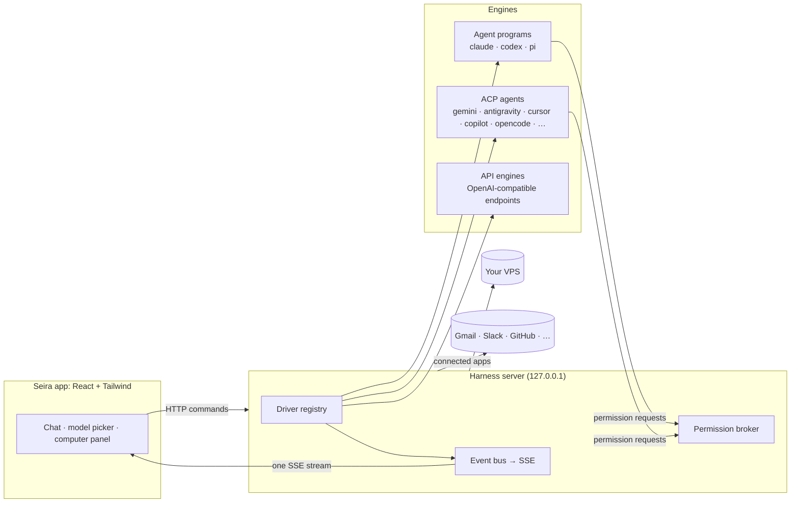

<div align="center">


<br>
<br>

<picture>
  <source media="(prefers-color-scheme: dark)" srcset="docs/assets/brand/seira-wordmark-reversed.svg">
  
</picture>

<h3>Your own team of AI agents in one chat app.</h3>

<p>Seira is a free, open source desktop app for Windows and Linux.<br>
It runs more than 20 AI agents, such as Claude Code, Codex, and Gemini, as a team of bots in one chat.<br>
Give each bot a job. Watch it work. Approve the steps that matter.</p>

<p>
  <a href="https://github.com/seira-bot/seira/releases/latest"></a>
  <a href="https://github.com/seira-bot/seira/releases"></a>
  <a href="https://www.npmjs.com/package/@seira-bot/seira"></a>
  <a href="https://www.npmjs.com/package/@seira-bot/seira"></a>
  <br>
  <a href="https://github.com/seira-bot/seira/actions/workflows/ci.yml?query=branch%3Amain"></a>
  <a href="https://github.com/seira-bot/seira/actions/workflows/github-code-scanning/codeql"></a>
  <a href="https://github.com/seira-bot/seira/pkgs/container/seira"></a>
  <a href="LICENSE"></a>
  <br>
  <a href="https://discord.gg/wAAgETJpFS"></a>
  <a href="https://whatsapp.com/channel/0029VbEEDHAAojYjWCQr2c1G"></a>
  <a href="https://github.com/seira-bot/seira"></a>
  <a href="https://github.com/seira-bot/seira/commits/main"></a>
</p>

<p>
  <a href="#install"><b>Download</b></a> ·
  <a href="https://docs.seira.bot"><b>Docs</b></a> ·
  <a href="https://seira.bot"><b>Website</b></a> ·
  <a href="https://discord.gg/wAAgETJpFS"><b>Discord</b></a> ·
  <a href="https://play.google.com/store/apps/details?id=bot.seira.companion"><b>Android app</b></a>
</p>

</div>

<p align="center">
  
</p>

> [!NOTE]
> Seira is in early development. New releases come out often, and the app updates itself.

## Quick start

1. **Get Seira.** [Download it](#install) for Windows or Linux, then open it.
2. **Connect an AI that you already use.** Select **Sign in with Claude**, or connect Codex, Gemini, or [another engine](#engines).
   No AI yet? Seira installs OpenCode with its free models, so you can chat at once.
3. **Give a bot a job.** Watch it work. Each risky step shows as a card that you allow or deny.

## Why Seira

<table>
  <tr>
    <td width="50%" valign="top">
      <h4>Bring your own agents</h4>
      Bots run on the agent programs on your computer: Claude Code, Codex, Gemini, Cursor, GitHub Copilot, and more.
      They use the sign-in and the plan that you already have. There is no new account and no proxy in the middle.
    </td>
    <td width="50%" valign="top">
      <h4>A team, not one chat</h4>
      Each bot has its own name, instructions, model, and folder.
      A Chief of Staff adds specialists and sets up teams. Bots hand work to each other and talk in group chats.
    </td>
  </tr>
  <tr>
    <td width="50%" valign="top">
      <h4>Agents with hands</h4>
      A bot can use a browser, a private desktop on your computer, a cloud desktop on your own server, or your computer itself after you allow it.
      It can also use Gmail, Slack, GitHub, Notion, and hundreds of other apps.
    </td>
    <td width="50%" valign="top">
      <h4>Local first, you stay in control</h4>
      One small harness server on <code>127.0.0.1</code> owns every agent process. Chats and keys stay on your computer.
      Shell commands, file edits, and questions show as cards that you allow or deny.
    </td>
  </tr>
</table>

## Install

| System | Download | How to install |
|---|---|---|
| **Windows** 10 or later, x64 | [`Seira-setup.exe`](https://github.com/seira-bot/seira/releases/latest/download/Seira-setup.exe) | Open the file. If Windows warns you, select **More info**, then **Run anyway**. |
| **Ubuntu 24.04**, x64 | [`Seira-amd64.deb`](https://github.com/seira-bot/seira/releases/latest/download/Seira-amd64.deb) | `sudo apt install ./Seira-amd64.deb` |
| **Other Linux**, x64 | [`Seira.AppImage`](https://github.com/seira-bot/seira/releases/latest/download/Seira.AppImage) | `chmod +x Seira.AppImage`, then open it. |
| **Linux with Flatpak**, x64 | [`seira.flatpakref`](https://flatpak.seira.bot/seira.flatpakref) | `flatpak install --user https://flatpak.seira.bot/seira.flatpakref` |
| **macOS** | No download yet | [Run the server](#run-it-on-a-server) with Node and open it in your browser, or [build the app from source](#build-from-source). |
| **A server** (VPS or home server) | [`@seira-bot/seira`](https://www.npmjs.com/package/@seira-bot/seira) on npm | `npx @seira-bot/seira setup`. See [Run it on a server](#run-it-on-a-server). |

The app updates itself. The Flatpak gets updates from `flatpak update`.

<details>
<summary><b>Linux notes</b> and download checks</summary>
<br>

- The AppImage does not open on Ubuntu 24.04, because the system blocks the sandbox that it needs. Use the Debian package there.
- If the AppImage says `No suitable fusermount binary found`, install the `fuse3` package of your distribution.
- The Flatpak runs engines that you install on the host. Bot control of this computer is off in the Flatpak.
- Each release has a `SHA256SUMS` file for each system. Use it to check your download.

[docs/linux-desktop.md](docs/linux-desktop.md) gives the details for each Linux package.

</details>

### Android phone

<a href="https://play.google.com/store/apps/details?id=bot.seira.companion"></a>

The Seira Android app pairs with Seira on your computer.
On the phone, you read your bots, answer approvals, and send tasks.
Your bots, keys, and chats stay on the computer. The phone keeps no copy of them.

### Run it on a server

The npm package [`@seira-bot/seira`](https://www.npmjs.com/package/@seira-bot/seira) is the same server without the desktop shell.
It needs Node.js 24 or later.

```sh
npx @seira-bot/seira setup              # once: AI access and a default model
npx @seira-bot/seira serve --tailscale  # or --lan, --domain, --public-url
```

The server prints a pairing link. Open it in your browser or on your phone.
The server is also a Docker image: `ghcr.io/seira-bot/seira`.
[docs/self-hosting.md](docs/self-hosting.md) explains each way to reach the server, and the Docker setup.

## Features

<table>
  <tr>
    <td width="50%" valign="top">
      
      <br><b>Ready on the first start.</b> Sign in with an AI that you already use, or start with free models.
    </td>
    <td width="50%" valign="top">
      
      <br><b>Approval cards.</b> A bot asks before a risky step. Allow it, deny it, or answer in the chat.
    </td>
  </tr>
  <tr>
    <td width="50%" valign="top">
      
      <br><b>Connected apps.</b> Connect Gmail, Slack, GitHub, Notion, and hundreds more. Add your own MCP servers.
    </td>
    <td width="50%" valign="top">
      
      <br><b>Automations.</b> Start bots on a schedule, on an app event, or on a webhook call.
    </td>
  </tr>
</table>

| Feature | What you get |
|---|---|
| **A model for each bot** | Pick the engine and the model of each bot from one model picker. Mix engines in one team. |
| **A computer for each bot** | In the **Computer** tab, choose where a bot works: the built-in browser, a private desktop on your computer, a cloud desktop on your own server, or your computer itself. |
| **Board and Inbox** | The Board shows all bot work in To do, Working, Needs you, and Done. Bots leave news for you in the Inbox. |
| **Group chats and handoffs** | Put bots and people in one chat. A bot can hand work to another bot, or run parts of one job in parallel. |
| **Workflows** | Save the steps that bots take in order on a canvas. A routine starts the workflow. |
| **Memory and skills** | A bot remembers between tasks. A skill (a `SKILL.md` file) tells a bot how to do one kind of work. |
| **Voice** | Listen to replies, or call a bot. Voices come from ElevenLabs, Fish Audio, OpenAI, Gemini, xAI, and others, or from a local Chatterbox server. |
| **Your phone** | Pair the Android app. Answer approvals and send tasks from anywhere. |

<details>
<summary><b>More features</b></summary>
<br>

| Feature | What you get |
|---|---|
| **Move from another AI** | Bring the persona, memories, skills, and chats of ChatGPT, Claude.ai, Claude Code, Hermes, or OpenClaw into Seira. |
| **Teams as files** | Install a full team from one Markdown file. Share a bot or a department as a folder. See [docs/team-sharing.md](docs/team-sharing.md). |
| **Folder access** | Choose which folders a bot or a department may use, and whether each is read-only. |
| **People and access** | Invite people by email or by domain. Keep a member to chosen departments. |
| **Glance** | See which bots work, need you, or finished, outside the Seira window. Answer an approval from there. |
| **Backups** | Export a full backup of chats, bots, and settings, and import it again. |
| **MCP server** | Control your bots from Claude Desktop, Cursor, or another MCP client. See [docs/mcp-server.md](docs/mcp-server.md). |
| **Scripts and CI** | Start a team from the command line, wait for the result, and export what it made. See [docs/headless-cli.md](docs/headless-cli.md). |

</details>

## Engines

Seira has more than 30 engines. Install an agent program and sign in, or add an API key.
The model picker shows each engine that is ready.

| Kind | Engines |
|---|---|
| Agent programs | Claude Code, Codex, pi, Muse Code |
| Agent programs over ACP | Gemini, Google Antigravity, Grok, Cursor, GitHub Copilot, OpenCode, Qwen, Kimi, Droid, Cline, Kiro, Devin, Hermes, DeepSeek Harness, Mistral (Vibe), Command Code, OMP |
| API engines | Grok, Mistral, Groq, Cerebras, MiniMax, Greenference, ModelGo, Meta Muse |
| Your own | Any ACP program, and any OpenAI-compatible endpoint, such as OpenRouter, Ollama, LM Studio, or llama.cpp |

To add your own engine, see [docs/custom-engines.md](docs/custom-engines.md).
To use a custom build of an agent program, set it in **Settings → AI → Providers**.

## How it works

Seira runs as two processes.
The app sends typed commands over HTTP and reads one event stream (SSE).
The harness server owns every agent process.
It changes the protocol of each engine into one event stream, and logs each thread as NDJSON.



<details>
<summary><b>Code map:</b> where each layer lives</summary>
<br>

| Layer | Path | What it does |
|---|---|---|
| Drivers | [`server/drivers/`](server/drivers/) | One driver for each engine. ACP agents are in [`server/drivers/acp/`](server/drivers/acp/). An unknown driver shows as "unavailable" and does not stop the other bots. |
| Harness | [`server/harness/`](server/harness/) | The registry that turns configs into live bots, and the event bus that every client reads. |
| API | [`server/index.ts`](server/index.ts) | Bots, turns, approvals, models, computers, connectors, and config over HTTP and SSE. |
| Voice | [`server/tts/`](server/tts/) | Speech for replies and calls. Cloud keys stay on the harness server. |
| App | [`src/`](src/) | The chat app. One store from the server, one reducer, and no transport in the client. |
| Desktop | [`electron/`](electron/) | The shells for Windows, Linux, and macOS, with the harness server inside. |

</details>

## Privacy

- Chats, files, and keys stay on your computer. A bot sends your message to the AI service that it uses.
- A Seira build sends no usage analytics unless the builder adds an analytics key. This repository has no key.
  A build with a key sends anonymous analytics until you turn off **Usage analytics** in **Settings → General → Privacy**.
  [docs/analytics.md](docs/analytics.md) lists each event.
- The desktop app sends a crash report when it stops working. A report never contains your messages, files, or names.
  To stop it, turn off **Send crash reports** in **Settings → General → Privacy**. [docs/crash-reports.md](docs/crash-reports.md) lists each field.

## Documentation

The full documentation is at [docs.seira.bot](https://docs.seira.bot).

| Topic | Guide |
|---|---|
| First steps | [Installation](https://docs.seira.bot/docs/getting-started/installation), [Quick tour](https://docs.seira.bot/docs/getting-started/quick-tour), [Your first bot](https://docs.seira.bot/docs/getting-started/first-bot) |
| Bots, chats, and approvals | [Chat and teams](https://docs.seira.bot/docs/features/chat-and-teams), [Approvals](https://docs.seira.bot/docs/features/approvals-and-inspector), [Automation](https://docs.seira.bot/docs/features/automation) |
| Computers and apps | [Computers](https://docs.seira.bot/docs/computers), [Connected apps](https://docs.seira.bot/docs/connected-apps) |
| Voice and memory | [Voice and memory](https://docs.seira.bot/docs/features/voice-and-memory) |
| Phone | [Android app](https://docs.seira.bot/docs/mobile/android-app) |
| Self-hosting | [Self-hosting](https://docs.seira.bot/docs/self-hosting), [docs/self-hosting.md](docs/self-hosting.md), [docs/deploy-vps.md](docs/deploy-vps.md) |

<details>
<summary><b>Guides in this repository</b></summary>
<br>

| Topic | Guide |
|---|---|
| Your own engines (ACP programs, OpenAI-compatible endpoints) | [docs/custom-engines.md](docs/custom-engines.md) |
| OpenCode and its free models | [docs/opencode-go.md](docs/opencode-go.md) |
| Your own MCP tool servers | [docs/custom-mcp-servers.md](docs/custom-mcp-servers.md) |
| Connected apps and Composio | [docs/composio.md](docs/composio.md) |
| Your own VPS as a cloud computer | [docs/byo-vps.md](docs/byo-vps.md) |
| Command line and CI | [docs/headless-cli.md](docs/headless-cli.md) |
| MCP server | [docs/mcp-server.md](docs/mcp-server.md) |
| Linux desktop, Snap, and Flatpak | [docs/linux-desktop.md](docs/linux-desktop.md) |
| Team sharing | [docs/team-sharing.md](docs/team-sharing.md) |
| Routing with a decision model | [docs/decision-model.md](docs/decision-model.md) |
| Feature switches | [docs/feature-flags.md](docs/feature-flags.md) |
| Environment variables | [docs/environment-variables.md](docs/environment-variables.md) |

</details>

## FAQ

<details>
<summary><b>Is Seira free?</b></summary>
<br>
Yes. Seira is free and open source under the Apache License 2.0. Your AI plans, and any paid service that you add, keep their own prices.
</details>

<details>
<summary><b>Do I need a new AI account or an API key?</b></summary>
<br>
No. Bots use the AI tools that you already have, with your own sign-in. You can also add an API key for an engine that uses one.
</details>

<details>
<summary><b>Which AI agents does Seira support?</b></summary>
<br>
Seira has more than 30 engines. They include Claude Code, Codex, Gemini, Grok, Cursor, GitHub Copilot, and OpenCode. You can add your own ACP program or OpenAI-compatible endpoint. See <a href="#engines">Engines</a>.
</details>

<details>
<summary><b>Is there a macOS app?</b></summary>
<br>
There is no macOS download yet. The code builds for macOS, so you can <a href="#build-from-source">build the app from source</a>. You can also <a href="#run-it-on-a-server">run the server</a> with Node and open Seira in your browser.
</details>

<details>
<summary><b>Do I need a Composio account to connect apps?</b></summary>
<br>
No. The desktop app and the npm server connect apps for you. Your own Composio key is optional. A build from source needs your own key. See <a href="docs/composio.md">docs/composio.md</a>.
</details>

<details>
<summary><b>Where do my chats and files go?</b></summary>
<br>
Chats and files stay on your computer. A bot sends your message to the AI service that it uses. A bot uses your computer only after you allow it. Commands and file edits show as cards that you allow or deny.
</details>

## Contributing

Issues and pull requests are welcome.
Ask questions and meet other users on the [Seira Discord server](https://discord.gg/wAAgETJpFS).
Follow the [Seira channel on WhatsApp](https://whatsapp.com/channel/0029VbEEDHAAojYjWCQr2c1G) for new releases and tips.

- [CONTRIBUTING.md](CONTRIBUTING.md) explains how a change lands.
- The [code guide](docs/contributing.md) holds the code rules, and [DESIGN.md](DESIGN.md) holds the design rules.
- The driver contract in [`server/contracts.ts`](server/contracts.ts) is small.
  To add an engine, add one file in [`server/drivers/`](server/drivers/) and register it with one line in [`server/drivers/builtIn.ts`](server/drivers/builtIn.ts).
- Do not post a security problem in public. Report it through [private vulnerability reporting](https://github.com/seira-bot/seira/security/advisories/new). [SECURITY.md](SECURITY.md) gives the details.

### Build from source

You need:

- Windows, Ubuntu 24.04 x64, or macOS.
- Node.js 24 or later, and pnpm 10. To get pnpm, run `corepack enable`.
  On Windows, run it in a terminal opened as administrator, or install pnpm with `npm install -g pnpm@10.33.0`.
- An engine is optional. If no engine is ready, Seira installs OpenCode with free models at the first start.

Run each `dev` command in its own terminal:

```sh
git clone https://github.com/seira-bot/seira.git && cd seira
pnpm install

pnpm dev:server    # harness server on 127.0.0.1:8799
pnpm dev           # app on http://127.0.0.1:5199
pnpm dev:desktop   # Electron shell; keep the two commands above running
```

A build from source has no shared key for connected apps.
To connect apps, add your own Composio key in **Settings → AI → Other services**. See [docs/composio.md](docs/composio.md).

<details>
<summary><b>Check, test, and package</b></summary>
<br>

```sh
pnpm typecheck       # app and server
pnpm test            # unit, driver, API, and desktop tests
pnpm build           # typecheck and production build
pnpm check:electron  # syntax check of the Electron files

pnpm package:win     # Windows: installer and ZIP
pnpm package:linux   # Linux x64: AppImage, Debian package, snap, and the verified Cua runtime
pnpm package:mac     # macOS: DMG and ZIP (needs Swift and Xcode tools)
```

[docs/linux-desktop.md](docs/linux-desktop.md) covers the snap, and the Flatpak build in [`packaging/flatpak/`](packaging/flatpak/).
[docs/releasing.md](docs/releasing.md) explains how a release is made.
On Windows, a run from source shows **Seira (dev)** on the taskbar. The installer gives the Start menu entry.

</details>

<details>
<summary><b>Desktop support for each system</b></summary>
<br>

| Capability | Windows x64 | Ubuntu 24.04 Xorg | Ubuntu 24.04 Wayland | macOS (from source) |
|---|---|---|---|---|
| Packaged app, harness server inside, local engines | Supported | Beta | Beta | Builds, no release |
| Your own VPS as a cloud computer, connected apps | Supported | Beta | Beta | Supported |
| Preview of the local screen | Not available | Beta | Beta | Supported |
| Bot control of this computer | Supported | Beta, after you opt in | Off for safety | Supported |
| Dictation on the device | Not available | Planned | Planned | Supported |
| Dictation and calls through Fish Audio | Supported | Supported | Supported | Not used |

See [docs/linux-desktop.md](docs/linux-desktop.md) and [docs/computer-use-integration.md](docs/computer-use-integration.md).

</details>

## Meet Seira

Seira is the face of the project: a small companion bot that floats next to your chats.
The face lives on a black visor screen, so Seira can blink, smile, wink, and think while your agents work.

<p align="center">
  
</p>

<details>
<summary><b>Brand assets:</b> turnaround, colors, and logo files</summary>
<br>
<p align="center">
  
</p>

| Color | Hex | Use |
|---|---|---|
| Ink | `#0E1116` | Head and wordmark on light backgrounds |
| Signal red | `#E11D48` | Eyes, and the dot in seira.bot |
| Mist | `#E9ECEF` | Head on dark backgrounds |

The 3D logo, the wordmark, the lockups for light and dark backgrounds, and the avatar are in [`docs/assets/brand/`](docs/assets/brand/).

</details>

## License

- The code is under the [Apache License 2.0](LICENSE).
  [NOTICE](NOTICE) names the projects that Seira uses code from, with their authors and licenses.
  [LICENSING.md](LICENSING.md) gives the details.
- Bundled third-party parts keep their own licenses. See [`third_party/`](third_party/).
- The Apache License does not give rights to the Seira name, logo, or mascot (section 6).

Seira is an independent project. It is not affiliated with or endorsed by Anthropic, OpenAI, Google, or xAI.
Claude, Codex, Gemini, Grok, and the other engine names are trademarks of their owners.

---

<div align="center">
<sub><a href="#readme">Back to top ↑</a></sub>
</div>
