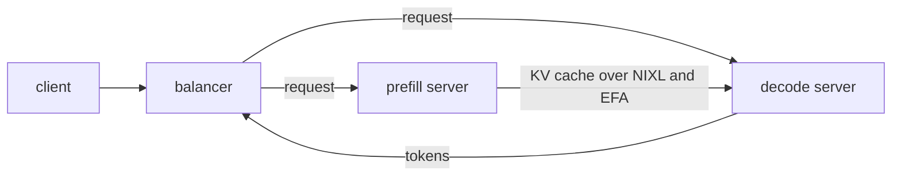
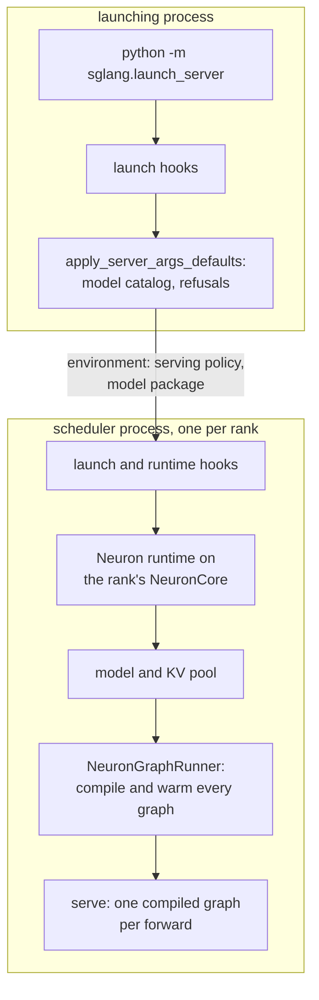

# sglang-neuron

sglang-neuron is an SGLang platform plugin for AWS Trainium. It serves large language models (LLMs) and diffusion
models on NeuronCores through SGLang's own launcher, scheduler and APIs. SGLang itself stays unmodified: it finds the
plugin through the platform and plugin entry points in `pyproject.toml`, and you select it with `SGLANG_PLATFORM=neuron`.

The plugin supplies what SGLang needs to run on NeuronCores: the device, the attention backend, the KV pools and
allocator, the graph runner and the models. It runs on TorchNeuron (`torch-neuronx`) and is pinned to upstream SGLang
at commit `43881a7`.

This release is a public preview. The LLMs run on Trn3 instances, and the diffusion models on trn2.48xlarge.
Features, APIs and supported models can change in later releases.

## Highlights

- Every LLM runs on one asynchronous [runtime](docs/design/runtime.md): SGLang's scheduler with its overlap schedule,
  and a graph runner that compiles every prefill and decode shape at startup, so the server never compiles while it
  serves.
- Aggregated serving, and [disaggregated](docs/design/disaggregated-inference.md) prefill and decode servers that move
  the KV cache over NIXL and EFA.
- Giga-kernel decodes for GPT-OSS-120B and GLM-5.2 on Trainium3, which run every layer of a decode step in one kernel
  call, and a whole-model megakernel for Qwen3.5-397B-A17B on every role.
- Kimi-K3 served disaggregated across three Trainium3 nodes, one prefill node and a decode over two nodes, with prompts
  up to 1M tokens.
- Diffusion models (FLUX.1-dev, MiniMax-H3, Wan2.2 A14B, FLUX.3-Action, LingBot-World-V2) on SGLang Diffusion.

## Supported models

### LLMs

| Architecture | Checkpoint | Parallelism | Serving | Notes |
|---|---|---|---|---|
| `GptOssForCausalLM` | `openai/gpt-oss-120b` | Aggregated TP8 EP8; disaggregated with a TP4 EP2 prefill and a DP-attention, giga-kernel or two-stage pipelined decode | aggregated, disaggregated | MXFP4 experts, FP8 KV cache ([GPT-OSS](docs/model-recipes/gpt-oss.md), [Pipeline parallelism](docs/design/pipeline-parallelism.md)) |
| `Qwen3ForCausalLM` | `Qwen/Qwen3-0.6B`, `Qwen/Qwen3-8B` | TP4; Qwen3-8B also TP8 aggregated | aggregated, disaggregated | [Qwen3](docs/model-recipes/qwen3.md) |
| `Qwen3MoeForCausalLM` | `Qwen/Qwen3-30B-A3B` | TP4 EP4 | aggregated, disaggregated | [Qwen3-MoE](docs/model-recipes/qwen3-moe.md) |
| `Glm4ForCausalLM` | `zai-org/GLM-4-9B-0414` | TP4 | aggregated, disaggregated | [GLM-4](docs/model-recipes/glm-4.md) |
| `DeepseekV2ForCausalLM` | `deepseek-ai/DeepSeek-V2-Lite` | TP4 | aggregated, disaggregated | MLA over a paged MLA KV pool ([DeepSeek-V2](docs/model-recipes/deepseek-v2.md)) |
| `GlmMoeDsaForCausalLM` | `amd/GLM-5.2-MXFP4` | Prefill of four pipeline stages at TP32 or sixteen at TP8; giga-kernel decode at TP128 with 32 slots of 128k or 1M positions | disaggregated (1P1D) | MLA with DeepSeek sparse attention; async MTP speculative decoding; requires the Neuron SDK 2.33.0 packages ([GLM-5.2](docs/model-recipes/glm52.md)) |
| `KimiK3ForConditionalGeneration` | `moonshotai/Kimi-K3` | Prefill PP8 x TP16 x DCP16 on one node; decode over two nodes, 8 DP-attention groups of attention TP32, EP256, DCP32 | disaggregated | MXFP4 experts (`compressed-tensors`), FP8 KV cache; DSPARK speculative decoding; the kimi-prompt prefix cache on the prefill ([Kimi-K3](docs/model-recipes/kimi-k3.md)) |
| `Qwen3_5MoeForCausalLM` | Qwen3.5-397B-A17B, a text-only view of its FP8 checkpoint | TP128 as eight DP-attention replicas of attention TP16, EP128, one rank per physical core; the PD decode can split each replica's KV over its 16 ranks (`SGLANG_NEURON_QWEN35_KV_CP=16`) | aggregated, disaggregated (1P1D) | Gated DeltaNet and gated attention layers; a whole-model megakernel (`--enable-nvidia-megakernel`) over a per-rank weight pack with MXFP8 experts; the chunk-keyed prefix cache; greedy sampling ([Qwen3.5 radix](docs/model-recipes/qwen35-radix.md), [Qwen3.5 PD](docs/model-recipes/qwen35-pd.md)) |

The recipes give each model's launch flags, layouts and measured results. [examples/](examples/README.md) has a folder
of launch scripts with the validated flags for each model but Qwen3-MoE, with the commands to start it in the container
image and to check its accuracy with GSM8K.

### Diffusion models

These run on SGLang Diffusion (`sglang.multimodal_gen`) through the plugin's SGLang Diffusion platform, not on the LLM
runtime. In the container image each recipe's "In the container image" section gives the `sglang generate` or
`sglang serve` command, and [examples/wan22](examples/wan22/) runs Wan2.2 text to video.

| Pipeline | Checkpoint | Parallelism | Hardware | Notes |
|---|---|---|---|---|
| `FluxPipeline` (text-to-image) | `black-forest-labs/FLUX.1-dev` | TP8 x CP8 (64 logical cores) | trn2.48xlarge | [FLUX.1-dev](docs/model-recipes/flux1-dev.md) |
| `MiniMaxH3ModularPipeline` (text and keyframes to video and audio) | `MiniMaxAI/MiniMax-H3` | TP8 x CP8 (64 logical cores) | trn2.48xlarge | [MiniMax-H3](docs/model-recipes/minimax-h3.md) |
| `WanPipeline` (text-to-video), `WanImageToVideoPipeline` (image-to-video) | `Wan-AI/Wan2.2-T2V-A14B-Diffusers`, `Wan-AI/Wan2.2-I2V-A14B-Diffusers` | TP4 x CP8 x CFG2 (64 logical cores) | trn2.48xlarge | BF16, 81 frames at 480 x 832, 720 x 1280 and 1072 x 1920, gated by SSIM against reference goldens ([Wan2.2 A14B](docs/model-recipes/wan22.md)) |
| `Flux3ActionPipeline` (robot actions from camera frames, state and an instruction) | `black-forest-labs/flux-3-action-droid` | `sd` and `gd` at TP4 and TP4 x CP2, `base` at TP4 x CFG2 (4 or 8 logical cores) | trn2.48xlarge | BF16, served over SGLang's OpenPI WebSocket and HTTP action API ([FLUX.3-Action](docs/model-recipes/flux3-action.md)) |
| `LingBotWorldCausalDMDPipeline` (real-time image-to-world) | `robbyant/lingbot-world-v2-14b-causal-fast-diffusers` | DiT TP8 x CP8 at LNC 1 (64 cores) + 16 cores for UMT5 and the VAE | trn2.48xlarge | BF16 at 480 x 832 over `/v1/realtime_video/generate` ([LingBot-World-V2](docs/model-recipes/lingbot-world-v2.md)) |

## Requirements

- A Trn3 instance for the LLMs, or a trn2.48xlarge for the diffusion models, with the Neuron driver
  `aws-neuronx-dkms` 2.31.7.0 or later, and Docker Engine for the container image.
- Neuron SDK 2.33.0. [The validated release](docs/getting-started/setup-guide.md#the-validated-release) lists each
  package version.
- For disaggregated serving: EFA between the nodes.
- To build from source: Python 3.11 or later, SGLang at commit `43881a7` (the plugin stops the launch on any other
  revision) and, for disaggregated serving, NIXL 1.5.0 with the patches in `patches/nixl`. The container image has all
  three.

## Installation

Use the published container image, or build the environment from source.

### Container image

Neuron publishes the plugin's image in the Amazon ECR Public Gallery as
[pytorch-inference-sglang-neuron](https://gallery.ecr.aws/neuron/pytorch-inference-sglang-neuron):

```bash
docker pull public.ecr.aws/neuron/pytorch-inference-sglang-neuron:v0.1.0-neuron-py314-sdk-2.33.0-ubuntu26.04
```

The image has SGLang, the plugin, the Neuron SDK and the patched NIXL installed, and this repository's docs, examples
and plugin sources under `/opt/sglang-neuron`. The [Quickstart](#quickstart) runs a model in it;
[examples/README.md](examples/README.md#start-the-image) starts the container on one node and on a prefill/decode
pair, and the [container guide](docs/guides/container.md) explains each `docker run` option. To build the image
yourself from a checkout, run `docker/build.sh` ([docker/README.md](docker/README.md#build)).

### From source

The plugin runs in the Neuron SDK 2.33.0 PyTorch container, which ships `torch` and `torch-neuronx`. Pull it by digest,
because a tag can be moved:

```bash
docker run --rm -it --privileged --network host --shm-size=16g -v /path/to/work:/work \
  public.ecr.aws/neuron/torch-neuronx@sha256:b4648437b8c7dbfa2acde18301a4bb4ae9658da5a412da75c59693ed4fd308ec \
  /bin/bash
```

Inside the container, clone the plugin and SGLang under `/work`, check out the pinned SGLang commit, and run the setup
script from the plugin's checkout:

```bash
git clone https://github.com/sgl-project/sglang-neuron /work/sglang-neuron
git clone https://github.com/sgl-project/sglang /work/sglang
git -C /work/sglang checkout 43881a7
cd /work/sglang-neuron
NEURON_RT_VISIBLE_CORES=0 scripts/setup_sglang_main_env.sh /work/venv /work/sglang
export PYTHONPATH=/work/sglang/python
```

The script builds a venv over the container's `torch` and `torch-neuronx`, installs SGLang's runtime dependencies and
the plugin, and checks the result. It runs on one NeuronCore because importing `torch` loads `torch-neuronx`, which
claims NeuronCores. It refuses a directory that already exists, so to run it again, remove `/work/venv` or pass another
path. The [setup guide](docs/getting-started/setup-guide.md) explains why SGLang runs from a source checkout and how to
install on a node without PyPI access. In that environment a server launches with the venv's Python and
`SGLANG_PLATFORM=neuron`, for example:

```bash
SGLANG_PLATFORM=neuron PYTHONPATH=/work/sglang/python /work/venv/bin/python -m sglang.launch_server \
  --model-path Qwen/Qwen3-8B --tp-size 4 --context-length 4096 --chunked-prefill-size 2048 \
  --max-running-requests 64 --max-total-tokens 266240 --mem-fraction-static 0.6
```

## Quickstart

On a Trainium instance with Docker and the Neuron driver installed (`ls /dev/neuron*` lists the devices), pull the
image and serve Qwen3-8B on four NeuronCores. The [container guide](docs/guides/container.md) explains each
`docker run` option. In bash (the commands rely on bash splitting `$DEVICES` into separate arguments):

```bash
IMAGE=public.ecr.aws/neuron/pytorch-inference-sglang-neuron:v0.1.0-neuron-py314-sdk-2.33.0-ubuntu26.04
MODELS=/path/to/models                    # holds Qwen3-8B, mounted at /models
CACHE=/path/to/cache                      # the compile cache: the first start compiles, later starts reuse it
docker pull $IMAGE
docker run --rm -v $MODELS:/models $IMAGE hf download Qwen/Qwen3-8B --local-dir /models/Qwen3-8B
DEVICES=$(for d in /dev/neuron*; do printf -- '--device %s ' "$d"; done)

docker run -d --name qwen3 --init --ipc=host --cap-add SYS_NICE -p 127.0.0.1:30000:30000 $DEVICES \
  -v $MODELS:/models:ro -v $CACHE:/cache \
  -e TORCH_NEURONX_NEFF_CACHE_DIR=/cache/neff -e TORCH_NEURONX_HLO_CACHE_DIR=/cache/hlo \
  -e NKI_COMPILE_CACHE_URL=/cache/nki \
  $IMAGE python3 -m sglang.launch_server --model-path /models/Qwen3-8B --tp-size 4 \
  --context-length 4096 --chunked-prefill-size 2048 --max-running-requests 64 --max-total-tokens 266240 \
  --mem-fraction-static 0.6 --host 0.0.0.0 --port 30000

# wait until the server answers /health (the first start on a new cache compiles the model's programs)
until curl -sf http://127.0.0.1:30000/health; do
  [ "$(docker inspect -f '{{.State.Running}}' qwen3)" = true ] || { echo "exited: docker logs qwen3"; break; }
  sleep 10; done

curl -s http://127.0.0.1:30000/v1/chat/completions -H 'Content-Type: application/json' -d '{
  "model": "/models/Qwen3-8B", "temperature": 0, "max_tokens": 64,
  "chat_template_kwargs": {"enable_thinking": false},
  "messages": [{"role": "user", "content": "What is 17 * 23? Answer with the number."}]}'

docker stop -t 120 qwen3 && docker rm qwen3
```

The answer is `17 * 23 = 391`. Each example also has a GSM8K script that checks the server's accuracy
([checking accuracy](docs/guides/container.md#5-check-accuracy)). To serve another model, or to split prefill and
decode over two nodes, start from its [example](examples/).

By default the graphs sample greedily on the device, so each request must set `temperature` 0 or `top_k` 1. The server
refuses any other request, including one that sets no temperature. To serve sampled requests, launch with
`SGLANG_NEURON_SAMPLER=temperature` or `topk_topp`.

## Features

### Disaggregated serving



A prefill server and one or more decode servers each run on their own NeuronCores. The balancer sends every request to
one prefill server and one decode server. The prefill computes the prompt's KV cache and sends it to the decode server,
which generates the answer. Because prefill and decode never share a device, a decode server only runs decode steps.
[Disaggregated inference](docs/design/disaggregated-inference.md) has the design.

### Prefix cache

SGLang's radix cache is on by default on every server that prefills. It keys 128-token KV pages, and a hit's logits are
close to a cold prefill's but not bit-identical. Two other backends are available:

- `--radix-cache-backend neuron-chunk` keys whole `--chunked-prefill-size` chunks, so a hit's prefill and first token
  are bit-identical to a cold run's. A prompt of one chunk or less never hits, which is why the page-keyed tree stays
  the default. GLM-5.2 refuses it. Qwen3.5 and Kimi-K3 keep their recurrent state only at chunk ends, so they refuse
  the page-keyed tree and serve this one instead.
- `--radix-cache-backend kimi-prompt`, on the Kimi-K3 PD prefill, keeps the end of each finished prompt, so the next
  turn hits at the exact end of the turn before ([Kimi-K3](docs/model-recipes/kimi-k3.md#the-kimi-prompt-cache)).

[Prefix (radix) cache](docs/design/runtime.md#prefix-radix-cache) covers the trade-offs, and
[The decode radix cache](docs/design/disaggregated-inference.md#the-decode-radix-cache) covers a PD decode with
`--disaggregation-decode-enable-radix-cache`. HiCache can keep evicted prefixes in host memory
(`--enable-hierarchical-cache`, see the [features guide](docs/guides/features-guide.md)) and in another node's DRAM
([HiCache remote DRAM tier](docs/guides/hicache-remote-dram.md)).

### Parallelism and speculative decoding

Pipeline parallelism runs on GPT-OSS servers, the GLM-5.2 PD prefill and the Kimi-K3 PD prefill
([Pipeline parallelism](docs/design/pipeline-parallelism.md)). Speculative decoding runs on the GLM-5.2 decode
(`NEURON_MTP`) and the Kimi-K3 decode (DSPARK). Each server runs on one node, except the Kimi-K3 decode, which
spans two. [Parallelism](docs/design/parallelism.md) covers TP, EP, data parallelism (`--dp-size`), DP attention
and context parallelism.

### What a launch refuses

The plugin refuses what its runtime does not serve and names the setting at fault. It refuses:

- an architecture that is not in the model catalog (`sglang_neuron/models/catalog.py`);
- a KV cache dtype that the model's graphs do not serve;
- a page size other than 128 tokens (the GLM-5.2 prefill takes 1,024 or 256, and Qwen3.5 takes 256, 512, 1,024 or
  2,048);
- pipeline parallelism or speculative decoding on a model other than the ones above;
- a server over more than one node, except the Kimi-K3 decode;
- LoRA, `--enable-mixed-chunk`, embedding servers and SGLang's weight-update endpoints.

The full list is in [the runtime doc](docs/design/runtime.md#what-a-launch-refuses), and
[feature and model compatibility](docs/guides/feature-model-compatibility.md) lists which features each model serves.

## How a launch runs



With `SGLANG_PLATFORM=neuron`, the plugin installs its launch hooks before SGLang parses the arguments. The platform's
`apply_server_args_defaults` then looks the checkpoint's architecture up in the model catalog, refuses what the model or
the runtime cannot serve, and exports the serving policy to every process the launch starts. Each scheduler starts the
Neuron runtime on its rank's NeuronCore, builds the model and its KV pool on the device, and builds `NeuronGraphRunner`,
which compiles and warms every graph before the server takes a request. From then on every forward runs one compiled
graph: one request's prefill chunk, or a decode batch.

Where SGLang's behaviour has to change and no platform method reaches it, the plugin hooks the function through
SGLang's hook registry. Each hook that skips, replaces or rewrites an SGLang function first checks that function's
source against `43881a7`, so a different SGLang revision stops the launch instead of running under a stale hook. Most
of these hooks are in `sglang_neuron/sglang_patches/`, and they are intended to go upstream to SGLang.
[What the plugin relies on in SGLang](docs/getting-started/setup-guide.md#what-the-plugin-relies-on-in-sglang) lists
them, and [the runtime doc](docs/design/runtime.md) has the design, including
[the program-switch fence](docs/design/runtime.md#the-program-switch-fence).

## Documentation

Start at the [documentation index](docs/index.md). It links the getting-started guides, the
[model recipes](docs/model-recipes/index.md), the [design notes](docs/design/index.md), the
[guides](docs/guides/index.md) and [onboarding a new model](docs/model-dev/onboarding-models.md).

## Updating the SGLang pin

Because each hook checks its SGLang function's source, a launch on a newer SGLang revision fails at startup until each
hooked function is re-validated. After re-validating the pinned modules against another SGLang revision,
`python tools/pin_upstream_sources.py --write` rewrites `sglang_neuron/sglang_patches/upstream_pins.json`, and
`--check` reports every pin that differs from the SGLang on `PYTHONPATH`.

## Contributing

Contributions are welcome. To report a bug or request a feature, open an
[issue](https://github.com/sgl-project/sglang-neuron/issues) with the model, the launch flags and the error or log
output. To propose a change, open a pull request that describes what it changes and why, and check a model it
touches with its example's GSM8K script ([examples](examples/README.md)) before you submit it. Keep each pull request
to one change, so that it can be reviewed and reverted on its own.

For the general workflow of contributing to SGLang projects (forking, branching and opening a pull request), see the
[SGLang contribution guide](https://docs.sglang.io/docs/developer_guide/contribution_guide.md). Its pre-commit and test
instructions are for the SGLang repository.

## License

Apache-2.0. See [LICENSE](LICENSE).
