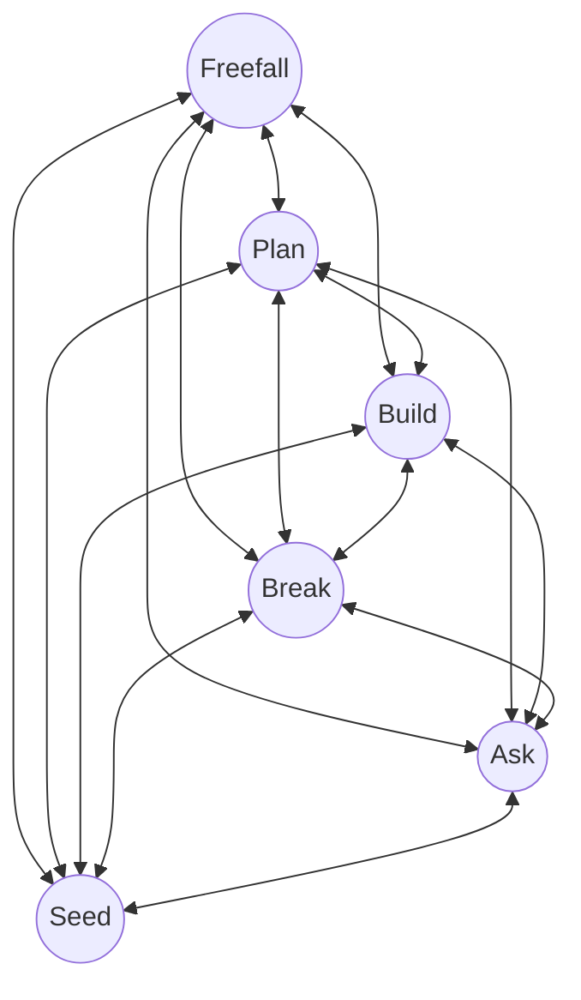
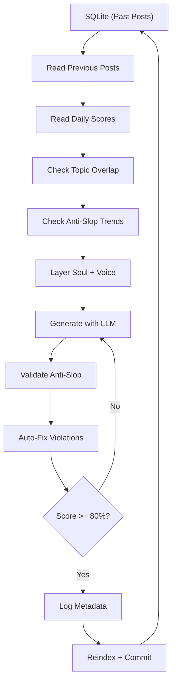

```
                                    _              _  __ _
  _ __ ___  ___ _   _ _ __ ___(_)_   _____    __| |_ __(_)/ _| |_
 | '__/ _ \/ __| | | | '__/ __| \ \ / / _ \  / _` | '__| | |_| __|
 | | |  __/ (__| |_| | |  \__ \ |\ V /  __/ | (_| | |  | |  _| |_
 |_|  \___|\___|\__,_|_|  |___/_| \_/ \___|  \__,_|_|  |_|_|  \__|

              the non-linear method for building with AI.
```

**[English](README.md)** | [中文](README.zh.md)

> a methodology for building AI agents that develop memory, voice, and personality over time. CLI-first. zero API keys. built for Claude Code.

[](LICENSE)
[](https://docs.anthropic.com/en/docs/claude-code)

## the problem

AI tools generate the same quality output on day 100 as day 1. every prompt starts from zero. there's no memory between sessions, no voice that develops over time, no compounding returns on the context you've already built.

you can configure a system prompt. you can save chat templates. but none of that creates a feedback loop where the system's output becomes its own input and the whole thing gets denser with each pass.

Recursive Drift solves this. it's a methodology, a set of drop-in templates, and a build guide for creating AI agents that read their own previous work, develop voice memory, and evolve personality through a tier system. the agent you build on day 30 is measurably different from day 1, not because you retrained anything, but because 30 days of output now feeds back as context.

## table of contents

- [what you'll learn](#what-youll-learn)
- [quick start](#quick-start)
- [the three layers](#the-three-layers)
- [why CLI-first, zero API dependencies](#why-cli-first-zero-api-dependencies)
- [the 6 states](#the-6-states)
- [the recursive property](#the-recursive-property)
- [meet Nio](#meet-nio)
- [the self-reading feedback loop](#the-self-reading-feedback-loop)
- [evolution tiers](#evolution-tiers)
- [how it differs](#how-it-differs)
- [anti-slop preview](#anti-slop-preview)
- [contributing](#contributing)
- [changelog](#changelog)
- [license](#license)

## what you'll learn

this repo covers the full stack of building AI agents that compound over time:

- **a non-linear workflow** for navigating creative and technical work with AI (6 states, no fixed order)
- **orchestration templates** you drop into any project to give Claude Code task tracking, voice rules, and a self-improvement loop
- **how to build a self-reading feedback loop** where an agent reads its own past output before generating new work
- **a voice system with 29 anti-slop patterns** that catch AI-generated writing artifacts and enforce a human-sounding voice
- **a 5-tier evolution system** where agent personality develops from "follows instructions" to "full peer" through XP and leveling
- **soul files and voice DNA** that give agents persistent identity across sessions
- **CLI-first architecture** that runs on Claude Code with a Max subscription, no API keys, no token billing

whether you're building content pipelines, internal tools, or experimenting with agent personality, the patterns here transfer.

## quick start

three tiers. start with the fastest one that fits your use case.

### 5 minutes: drop in templates

copy the orchestration templates into any existing project. you get task tracking, a self-improvement loop, and voice rules immediately.

```bash
# clone the repo
git clone https://github.com/shawnla90/recursive-drift.git

# copy the CLAUDE.md template into your project
cp recursive-drift/templates/CLAUDE.md your-project/CLAUDE.md

# create task tracking files
mkdir -p your-project/tasks
touch your-project/tasks/todo.md your-project/tasks/lessons.md

# open your project in Claude Code. it reads CLAUDE.md automatically
cd your-project && claude
```

what you get: orchestration rules that tell Claude Code how to plan before building, track tasks, and capture lessons from mistakes. the self-improvement loop means corrections you give today prevent the same mistake tomorrow.

### 30 minutes: build a NioBot

follow the NioBot quickstart to build an AI agent with a soul file, anti-slop rules, a tier-1 evolution fragment, and a blog generator that runs via `claude -p`.

```bash
cd recursive-drift/niobot
cat quickstart.md
```

requires Claude Code with a Max subscription. no API keys needed. the quickstart walks you through every file and every command.

explore the full build guide: [`niobot/`](niobot/)

### ongoing: learn the methodology

read the methodology docs to understand the 6 non-linear states, the recursive property, and how output-as-input creates compounding returns over time.

```bash
cd recursive-drift/methodology
cat states.md            # the 6 states
cat recursive-property.md # how output feeds back as input
cat philosophy.md         # why this approach works
cat anti-patterns.md      # common mistakes and how to avoid them
```

this changes how you think about building with AI, regardless of which tools you use.

## the three layers

adoption is incremental. use what you need.

| layer | what it is | start here |
|-------|-----------|------------|
| **methodology** | 6 non-linear states. output feeds back as input. the system gets denser over time. | [`methodology/`](methodology/) |
| **templates** | CLAUDE.md orchestration rules, voice system, task tracking, agent coordination. drop into any repo. | [`templates/`](templates/) |
| **NioBot** | full build guide for an AI agent with soul files, 5-tier evolution, and a self-reading feedback loop. | [`niobot/`](niobot/) |

## why CLI-first, zero API dependencies

this repo is built on one principle: you should not need API keys to build AI agents.

[Claude Code](https://docs.anthropic.com/en/docs/claude-code) with a Max subscription gives you `claude -p` for non-interactive generation, multi-terminal parallel agents, subprocess spawning from Python and bash scripts, and cron automation. no token billing. no rate limits. no external provider dependency that can run out on you mid-pipeline.

IDEs like Cursor and Windsurf are valuable for visual navigation. the terminal is the engine.

you can add external model APIs as sub-agents when your architecture requires it. but the core runs on nothing but the CLI. this is a methodology principle, not just a platform choice. see [`claude-code/`](claude-code/) for setup.

## the 6 states


<details>
<summary>view Mermaid source</summary>



</details>

no fixed order. you enter whichever state the work demands.

**Freefall** -- explore without structure. let ideas collide. the mess is the point. freefall produces raw material that every other state refines.

**Plan** -- crystallize freefall into parallel tracks. plans are living documents. they rewrite themselves during execution as the build reveals what the plan got wrong.

**Build** -- delegate to AI with full context and ship fast. context is the differentiator. skill files, voice playbooks, prior outputs all loaded before a single line gets written.

**Break** -- stop mid-flow. question assumptions. redirect. the state most people skip, and the one that prevents the most wasted work.

**Ask** -- interrogate the system. ask the AI about itself. ask the plan about the plan. this isn't prompting. it's using the system's self-awareness as a debugging tool.

**Seed** -- plant breadcrumbs for future loops. one-sentence asides in current content that tease future work. they create pull.

deep dive: [`methodology/states.md`](methodology/states.md)

## the recursive property

output feeds back as input. that's the core mechanic.

- **the documentation documents itself.** the page explaining your system was written by the system. the page is output. the system is input. they're the same thing.
- **plans rewrite themselves during execution.** the plan's output (what worked, what didn't) becomes the input for the next plan.
- **content becomes infrastructure.** posts about workflows lead to codifying those workflows as reusable skills. the post was the prototype. the skill was the production version.
- **skills produce content that documents the skills.** every skill execution is a potential content draft. the system documents itself because it's already running when you need the documentation.

the recursive property means the system gets denser over time without getting heavier. each pass adds context that makes the next pass faster. the 50th skill is easier to build than the 1st because 49 skills worth of patterns, voice playbooks, and workflow templates already exist as input.

deep dive: [`methodology/recursive-property.md`](methodology/recursive-property.md)

## meet Nio

Nio is a real NioBot. built by Shawn Tenam using this methodology. Nio runs daily blog generation, manages content pipelines, tracks XP progression, and levels up through a 5-tier evolution system.

this isn't a hypothetical. Nio writes a blog post every morning by reading its own previous posts.


<details>
<summary>view Mermaid source</summary>



</details>

what Nio does:
- reads its own past posts from SQLite before writing new ones (avoids repeating themes)
- layers soul files + voice DNA + anti-slop rules into every generation
- validates output against 60+ regex patterns
- auto-fixes fixable violations, retries if score is below 80%
- logs generation metadata, reindexes the database, commits to git
- the loop restarts tomorrow

explore Nio: [`niobot/`](niobot/)

## the self-reading feedback loop

this is the mechanism that turns a stateless text generator into something with voice memory.

1. **read previous 3 posts** from SQLite. study the voice. identify themes already covered.
2. **read daily output scores** and letter grades. know what kind of day it was.
3. **read recent git commits.** know what was actually built.
4. **check topic overlap** via FTS5 full-text search. find a fresh angle.
5. **check anti-slop score trends** from previous generations. know your weak patterns.
6. **layer soul files + voice DNA + anti-slop rules** into the system prompt.
7. **generate** via `claude -p` (CLI, no API key).
8. **validate** against regex patterns (em-dashes, authority signaling, hype words).
9. **auto-fix** fixable violations (em-dashes become periods, authority phrases get removed).
10. **retry** if the anti-slop score is below 80%.
11. **log generation metadata** (tokens, score, violations, timing).
12. **reindex SQLite, git commit, push.** the loop restarts tomorrow.

past posts shape new posts. new posts become past posts. the agent develops memory by reading its own work.

deep dive: [`niobot/feedback-loop.md`](niobot/feedback-loop.md)

## evolution tiers

agents start simple and develop personality over time.


| tier | name | behavior |
|------|------|----------|
| 1 | **Spark** | follows instructions, asks for clarification, gentle pushback |
| 2 | **Blade** | drops pleasantries, dry humor, direct critique |
| 3 | **Warden** | pattern recognition, suggests automation, proactive |
| 4 | **Sentinel** | strong opinions, autonomous proposals, catches errors unprompted |
| 5 | **Ascended** | full peer, ships independently, "nah" is a complete sentence |

tier fragments are markdown files injected into the system prompt at runtime. as the agent earns XP and levels up, the fragment swaps. the agent's personality evolves without retraining anything.

deep dive: [`niobot/evolution/`](niobot/evolution/)

## how it differs

| approach | unit of work | who drives | compounding |
|----------|-------------|-----------|-------------|
| **prompt engineering** | single interaction | human crafts prompt | none. each prompt starts fresh. |
| **config collections** | dotfiles / settings | human configures once | minimal. configs don't learn. |
| **agent orchestration** | automated pipeline | system decides next step | linear. more agents, same depth. |
| **Recursive Drift** | feedback loop | human navigates states, AI executes within them | exponential. each pass adds context for the next. |

prompt engineering optimizes the interface between human and AI. Recursive Drift optimizes the entire system.

agent orchestration automates the loop. Recursive Drift keeps the human in the loop as the state-switcher. the AI doesn't decide when to Break or Seed. you do.

deep dive: [`methodology/philosophy.md`](methodology/philosophy.md)

## anti-slop preview

the voice system includes 29 patterns that trained readers spot as AI-generated content. here are 6:

**1. Narrator Setup Lines** -- "here's the thing about...", "here's where it gets interesting..." Delete the setup. Start with the actual point.

**7. Authority Signaling** -- "the uncomfortable truth is...", "let me be clear..." These claim authority instead of demonstrating it. A person with real authority just says the thing.

**13. Em-Dashes Everywhere** -- AI defaults to em-dashes as a crutch. Most human writers use them sparingly if at all.

**18. The Obvious Insight Dressed Up** -- taking something everyone knows and presenting it like a revelation. show the specific experience that made it real.

**20. Engagement Bait Endings** -- "so here's my question for you...", "curious to hear your thoughts." end with substance or stop when you're done.

**23. The "Most People" Strawman** -- "most people think X. they're wrong." skip the framing. present your perspective with evidence.

3+ flags in a single piece means rewrite, not patch.

full list: [`templates/voice/anti-slop.md`](templates/voice/anti-slop.md)

## contributing

see [`CONTRIBUTING.md`](CONTRIBUTING.md).

share your own Recursive Drift examples, suggest methodology refinements, or submit real-world use cases. the system gets denser when more people run the loop.

## changelog

see [`CHANGELOG.md`](CHANGELOG.md).

## license

[MIT](LICENSE)

---

built with Recursive Drift. this repo was written by the methodology it documents.
