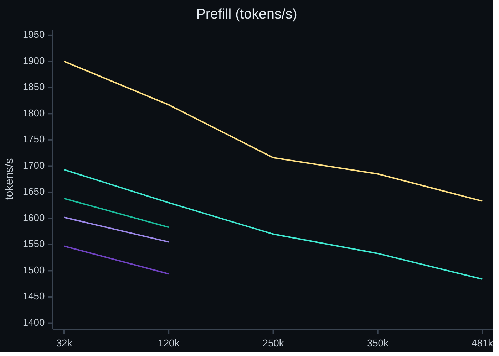
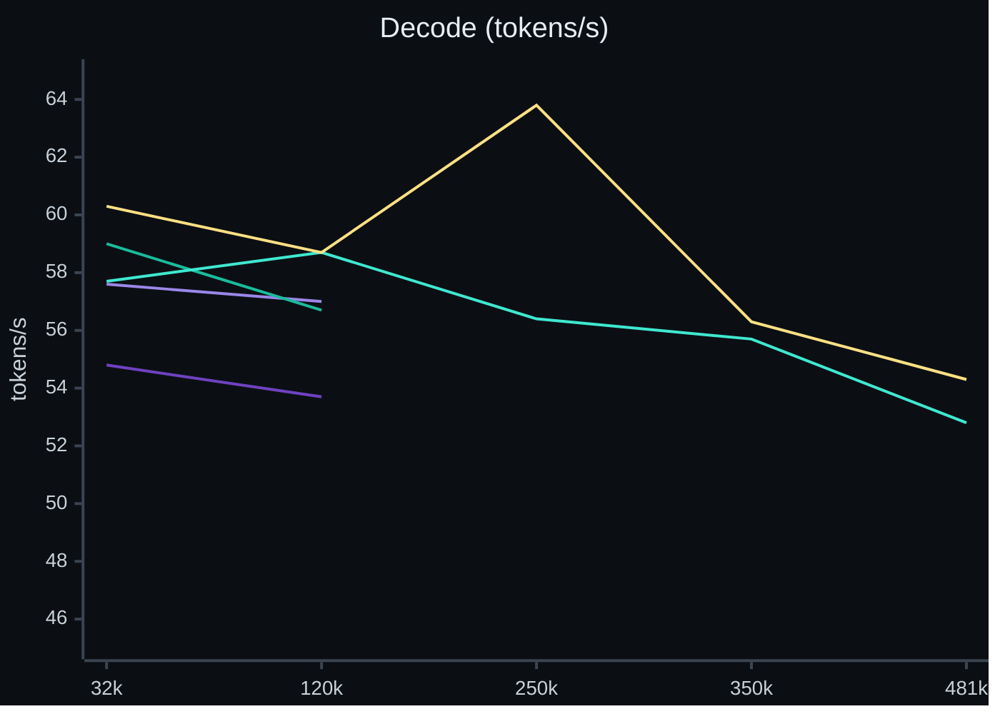

<p align="center"></p>

<p align="center">
  <a href="LICENSE"></a>
  
  <a href="https://huggingface.co/wemoh/Qwen3.8-Flash-Next-strixw"></a>
</p>

<h2 align="center">Over 50 tokens/s at half a million tokens of context.<br>On one mini PC.</h2>

<p align="center">
A ~180B-parameter model, a 512k context window, and decode speed that doesn't fall off as the conversation grows -<br>
measured in real agentic coding sessions, not a synthetic benchmark.
</p>

|  | on one AMD Strix Halo, 128 GB |
|---|---|
| **Decode, real agent use** | **~52-56 tokens/s (median), flat from 0 to 490k context** |
| **Context** | **512k tokens** |
| **Prefill** | **~1,460 tokens/s** over a real 461k-token conversation |
| **Agent tasks** | **19 / 19** on terminal-bench-mini's core suite |

Speed by release as the context grows:






Each release measured the same way: one request at a time through the server, a fresh prompt at each length. Releases
before v0.4.0 were measured at 32k and 120k only; v0.4.0's 250k-481k points are single runs, v0.5.0's are medians of
two. The axes start near the data so the differences are visible.

> [!TIP]
> **Curious how a mini PC runs a 180B-parameter model this fast?** No background needed:
> [How strixite got fast](docs/how-it-got-fast.md) explains it in five simple ideas - smaller handwriting, guessing
> ahead, and not reading the same book twice - then goes as deep as you want to follow.

## What it is

strixite is an LLM inference engine I wrote from scratch in HIP for exactly one chip and one model:

- **AMD Strix Halo** (Ryzen AI MAX+ 395 / Radeon 8060S, gfx1151) - the whole model on the iGPU, in unified memory
- **Qwen3.8-Flash-Next** - a 512-expert MoE with Gated DeltaNet linear attention, sparse attention and a
  51B-parameter n-gram table streamed from SSD, in ~66 GiB of 4/8-bit weights
  ([what quant is this?](docs/weights.md))

No llama.cpp, no ggml, no vendor libraries underneath. Every kernel is hand-written and checked against a CPU
reference derived from the model's spec.

## Features

- **OpenAI-compatible server** - chat completions with streaming, tool calls, reasoning and structured output
  ([what it accepts](docs/server.md))
- **Images** - PNG, JPEG, WebP, GIF, BMP and TGA in chat requests, from a separate ~0.9 GB file in the weights repo
  ([images](docs/images.md))
- **Multi-token prediction** - the model's own draft head, up to 7 tokens checked per step
- **Thinking that ends** - a request can cap its reasoning with its own budget, and a nudge steps in when the
  model's thinking goes in circles ([thinking](docs/server.md#thinking))
- **Prompt cache in RAM and on disk** - long agent conversations resume instead of being re-read every turn
- **Conversations at once** - two by default, more for shallower contexts; their decode steps share one forward,
  and a slot's memory grows with its conversation
  ([memory](docs/memory.md#slots-conversations-at-once))
- **512k context** with YaRN, an 8-bit KV cache (about half the memory of 16-bit), and attention that stays fast at
  depth

## Quick start

**Don't want to build it?** A container image has the server and its ROCm runtime ready to run on any Linux
distribution with podman or docker: [Run strixite in a container](docs/container.md). The steps below build it from
source.

You need an AMD Strix Halo machine with 128 GB of memory running Linux, and a fast NVMe drive with ~120 GB free for
the weights, plus room for the prompt cache (capped at 128 GiB, and it never leaves less than 32 GiB free).

> [!NOTE]
> **Not a dedicated, headless Strix Halo and want to try strixite anyway?** The defaults assume the machine runs
> nothing else - that's where it's fastest. Sharing it with a desktop or another model works with a couple of
> settings changed: [Memory](docs/memory.md) has the recipes.

**1. Let the GPU use the memory.** Strix Halo's GPU allocates from system memory (GTT). The default limit is far
below what the model needs, so raise it with kernel parameters - these are mine, with the BIOS's dedicated VRAM set
to its minimum (512 MB):

```
amdgpu.gttsize=126976 ttm.pages_limit=32505856 amd_iommu=off
```

Add them to your bootloader's kernel command line (on Fedora: `sudo grubby --update-kernel=ALL --args="..."`) and
reboot. `cat /sys/class/drm/card*/device/mem_info_gtt_total` should then report ~124 GiB.

**2. Install the toolchain.** strixite builds with AMD's TheRock ROCm for gfx1151, tested with the 10.1.0 GA tarball,
`therock-dist-linux-gfx1151-10.1.0` (HIP 7.16) - AMD publishes it at
https://stable.repo.amd.com/rocm/core/tarball/therock-dist-linux-gfx1151-10.1.0.tar.gz. Extract it anywhere; the build looks in
`~/tools/therock-tarball/install` unless you say otherwise (step 3). You also need CMake 3.28+, Ninja and a GCC C++
standard library - your distribution's `g++` / `gcc-c++` package (GCC 13 to 16 work; I use Linuxbrew's gcc-15 on
Fedora 43, which the build finds on its own).

**3. Build.**

```sh
git clone https://github.com/shawnshekari/strixite && cd strixite
cmake --preset strix && cmake --build --preset strix
```

If TheRock is somewhere else, say where on the first line: `cmake --preset strix -DSTRIX_ROCM_ROOT=/path/to/install`
(or `export STRIX_ROCM_ROOT=/path/to/install`). To build against a GCC other than the one clang picks, add
`-DSTRIX_GCC_INSTALL_DIR=/usr/lib/gcc/x86_64-pc-linux-gnu/15` (the directory `g++-15 -print-libgcc-file-name` prints a
file in). The build directory remembers its first configure: after changing either, `rm -rf build/strix` first.

**4. Download the weights** (~115 GiB) and check them - or, if you already have the original Qwen3.8-Flash-Next
checkpoint, [make them yourself in ~15 minutes](docs/tools.md#already-have-the-original-model-make-the-weights-yourself):

```sh
hf download wemoh/Qwen3.8-Flash-Next-strixw --local-dir ~/models/strix-infer
(cd ~/models/strix-infer && sha256sum -c sha256.txt)
```

The server looks for the weights, tokenizer and n-gram table in `~/models/strix-infer`. Downloaded somewhere else?
Set `STRIX_MODELS_DIR` to that directory (e.g. `export STRIX_MODELS_DIR=/data/models/strixw`), and every default path
follows it - including the prompt cache's directory.

**5. Run the server.** It loads in ~30 s and serves an OpenAI-compatible API on port 5300:

```sh
build/strix/strix_server --config deploy/strix-server.conf
```

The built-in defaults are the values in `deploy/strix-server.conf` - the file adds the reason behind each one, and is
the place to change them; a flag overrides a single setting: `--capacity 262144` sets the context in tokens. The
defaults assume the machine is dedicated to strixite. If it's also your desktop or runs another model, see
[Memory](docs/memory.md): the server checks at startup that it has room, and tells you what to change if it doesn't.

**6. Try it:**

```sh
curl -s localhost:5300/v1/chat/completions -H 'Content-Type: application/json' \
  -d '{"messages":[{"role":"user","content":"Hello!"}]}'
```

Point any OpenAI-compatible client at `http://<your-machine>:5300/v1`, model `qwen3.8-flash-next`.

> [!IMPORTANT]
> The server has no authentication and listens on all interfaces (`host = 0.0.0.0` in `deploy/strix-server.conf`).
> Run it on a trusted network, or set `host = 127.0.0.1`.

Every setting, with the reason behind its value, is in `deploy/strix-server.conf`; `strix_server --help` lists them
all. `deploy/strix-server.service` runs it as a systemd user unit (adjust the paths to your checkout).

## Build your own

strixite started as "how hard can it be?" It turned out an engine that holds its own against a closed-source one -
faster at decode, on its home turf - is within reach of one person, with a good model, a good coding assistant, and a
lot of patience. I hope it encourages you to grab your favorite LLM and framework and build something from scratch.

**New to GPU programming?** Start with [Your first kernel](tutorial/first-kernel/README.md): one small, real piece of
the model, written the way every kernel here was - test first, break it on purpose, time it - then a fusion that
passed every test and still starved the GPU, found with a profiler trace. Every step starts in plain words.

## Platform

strixite runs on **Linux with an AMD Strix Halo (gfx1151) and 128 GB of memory**, tested on Fedora 43. It's built
and tested by one person on one machine, so that's the only setup I can promise works; Windows and macOS aren't
supported, and I don't plan to add them. I can't take on ports to other platforms here, but forks are very welcome.

## Roadmap

What I'm working on, what's next, and what isn't planned: [Roadmap](docs/roadmap.md). Priorities, in order:
stability, quality, performance. Feature requests are welcome as issues.

## Contributing

Pull requests and issues are welcome. See [CONTRIBUTING.md](CONTRIBUTING.md) for how they land.

## License

[AGPL-3.0](LICENSE). The model weights are separate and under the Qwen Community License 1.0.

## Support

strixite is free, and donations are never expected - but they are appreciated. Whatever comes in goes straight into
equipment that speeds up development and testing. [Buy me a coffee](https://buymeacoffee.com/wemo).
