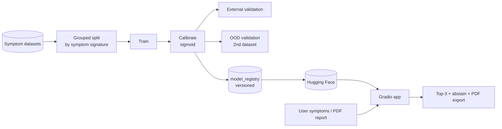

<div align="center">


# 🩺 SecureHealthIoT — Disease Prediction

### Leakage-aware, calibrated symptom-to-disease prediction with OOD validation and a clinician-ready app

   

[](LICENSE)    

[](https://codespaces.new/shiroonigami23-ui/SecureHealthIoT?quickstart=1) [](https://github.com/shiroonigami23-ui/SecureHealthIoT/archive/refs/heads/main.zip)

[**🚀 Live Demo**](https://huggingface.co/spaces/ShiroOnigami23/securehealthiot-disease-app) · [**Overview**](#-overview) · [**Features**](#-features) · [**Architecture**](#-architecture) · [**Getting Started**](#-getting-started) · [**Roadmap**](#-roadmap)

</div>

---

## 📖 Overview

**SecureHealthIoT** predicts likely diseases from symptoms — but with the reliability features that toy notebooks skip.
Splits are **grouped by symptom signature** so near-duplicate rows can't leak between train and test, there is a separate
**external validation** split, a true **out-of-domain** check on an independent second dataset, and probabilities are
**calibrated** (`CalibratedClassifierCV`, sigmoid). Every trained model is versioned in a registry and published to
Hugging Face along with the dataset and a Gradio Space.

The app supports a quick symptom checker with **top-3 predictions and an abstain threshold**, and a report-assisted mode
that extracts symptoms from uploaded `.txt/.csv/.pdf` reports, then exports a **clinician-facing PDF**.

### ✨ Highlights

- **Leakage-aware** grouped splits + `overlap_signature_*` leakage report
- **Calibrated** probabilities and an **abstain/reject** option
- **OOD validation** on `kaushil268/disease-prediction-using-machine-learning`
- **Live** — [model](https://huggingface.co/ShiroOnigami23/securehealthiot-disease-model) · [dataset](https://huggingface.co/datasets/ShiroOnigami23/securehealthiot-disease-dataset) · [Space](https://huggingface.co/spaces/ShiroOnigami23/securehealthiot-disease-app)

## 🧩 Features

| Feature | What it does |
|---|---|
| **Symptom predictor** | Multi-select symptoms → top-3 diseases, confidence band, precautions |
| **Abstain mode** | Refuses to guess below a configurable confidence threshold |
| **Report-assisted analysis** | Upload TXT/CSV/PDF reports; symptoms extracted and combined |
| **Image diagnostics** | Optional image upload with quality checks |
| **PDF export** | Clinician-facing report generated with ReportLab |
| **Training pipeline** | `disease_ml/` — data, features, train, inference with versioned registry |
| **Kaggle GPU training** | `kaggle_kernel/` + scripts to launch, wait and pull outputs |
| **HF publishing** | Scripts to upload model, dataset and publish the Space |

## 🛠 Tech Stack

| Layer | Technology |
|---|---|
| ML | scikit-learn (calibrated classifiers) |
| App | Gradio, pypdf, ReportLab, Pillow |
| Infra | Kaggle kernels, Hugging Face Hub & Spaces, Docker |

## 🏗 Architecture

Training produces a versioned, calibrated model; the Gradio app loads it for symptom and report-assisted inference.



➡️ Full design notes, data flow and design decisions: **[docs/ARCHITECTURE.md](docs/ARCHITECTURE.md)**

## 📁 Project Structure

```text
SecureHealthIoT/
├── disease_ml/      # config, data, features, train, inference
├── app.py           # Gradio app
├── kaggle_kernel/   # GPU training kernel
├── scripts/         # Kaggle auth/train/wait, HF upload, Space publish, dataset profiling
├── Dockerfile
└── requirements.txt
```

## 🚀 Getting Started

### Prerequisites

- Python 3.10+

### 1. Get the code

Pick whichever method suits you:

| Method | Command |
|---|---|
| **HTTPS** | `git clone https://github.com/shiroonigami23-ui/SecureHealthIoT.git` |
| **SSH** | `git clone git@github.com:shiroonigami23-ui/SecureHealthIoT.git` |
| **GitHub CLI** | `gh repo clone shiroonigami23-ui/SecureHealthIoT` |
| **ZIP** | [Download](https://github.com/shiroonigami23-ui/SecureHealthIoT/archive/refs/heads/main.zip) and extract |
| **Codespaces** | [Open in browser](https://codespaces.new/shiroonigami23-ui/SecureHealthIoT?quickstart=1) — zero local setup, dev container preconfigured |

> 🔑 **Using SSH for the first time?** Generate a key with `ssh-keygen -t ed25519 -C "you@example.com"`, add the `.pub` contents at **GitHub → Settings → SSH and GPG keys**, then test with `ssh -T git@github.com`.

### 2. Install & set up

```bash
cd SecureHealthIoT
pip install -r requirements.txt
```

### 3. Run

```bash
python -m disease_ml.train --note "reliability_pass_v2"     # train + registry entry
python -m disease_ml.train --disable-ood-validation          # skip OOD check
python app.py                                               # http://localhost:7860
```

### 🐳 Docker (optional)

```bash
docker build -t securehealthiot . && docker run -p 7860:7860 securehealthiot
```

## 🎮 Usage

> ⚠️ **Medical disclaimer:** this is a research/education tool, not a diagnostic device. Always consult a qualified clinician.

## 🗺 Roadmap

**v2 — Reliability pass (done)**

- [x] Grouped splits, external + OOD validation
- [x] Calibration, abstain mode, versioned registry
- [x] Report-assisted mode and PDF export
- [x] HF model, dataset and Space

**v2.1 — Explainability**

- [ ] Per-prediction symptom contributions (SHAP)
- [ ] Reliability diagram and ECE in the metrics report
- [ ] Multilingual symptom input (Hindi/English)

**v3 — IoT**

- [ ] Ingest wearable vitals (heart-rate, SpO₂, temperature) over MQTT
- [ ] Encrypted, consent-based data pipeline (the "Secure" in SecureHealthIoT)
- [ ] Clinician dashboard for monitored patients

➡️ Detailed plan, milestones and long-term vision: **[docs/ROADMAP.md](docs/ROADMAP.md)**

## 🤝 Contributing

Contributions, issues and feature requests are welcome!

1. Fork the repository
2. Create a feature branch: `git checkout -b feature/amazing-feature`
3. Commit your changes: `git commit -m "feat: add amazing feature"`
4. Push the branch: `git push origin feature/amazing-feature`
5. Open a Pull Request against `main`

Check the [issues page](https://github.com/shiroonigami23-ui/SecureHealthIoT/issues) and the [roadmap](docs/ROADMAP.md) for ideas on where to help.

## 📜 Changelog

See [CHANGELOG.md](CHANGELOG.md) for the release history.

## 📄 License

Distributed under the **MIT** license. See [LICENSE](LICENSE) for details.

## 👤 Author

**Aryan Singh Chandel** (Shiro)

[](https://github.com/shiroonigami23-ui)

<div align="center">

⭐ **If you find this project useful, consider giving it a star!** ⭐

</div>
