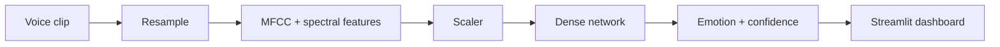

<div align="center">


# 🎙️ Speech Emotion Recognition Engine

### Deep-learning engine that hears emotion in voice — MFCC features, balanced data, 91.6 % validation accuracy

    

[](LICENSE)    

[](https://codespaces.new/shiroonigami23-ui/emotion-voice-app?quickstart=1) [](https://github.com/shiroonigami23-ui/emotion-voice-app/archive/refs/heads/main.zip)

[**Overview**](#-overview) · [**Features**](#-features) · [**Architecture**](#-architecture) · [**Getting Started**](#-getting-started) · [**Roadmap**](#-roadmap)

</div>

---

## 📸 Preview

<p align="center"></p>

## 📖 Overview

A professional **speech emotion recognition** system. Audio is resampled and converted into **MFCC** and related spectral features with **Librosa**, then classified by a **dense neural network** trained on a **perfectly balanced dataset (496 samples per class)**. It reaches **91.6 % validation accuracy** with sub-100 ms inference and ships with a **Streamlit** scientific dashboard that shows how the AI "sees" sound and its thinking process.

### ✨ Highlights

- **91.6 %** validation accuracy
- **Balanced** training data — 496 samples per class
- **< 100 ms** inference
- **Explainable dashboard** — spectral views and model reasoning

## 🧩 Features

| Feature | What it does |
|---|---|
| **Feature extraction** | MFCC + spectral features with Librosa / Resampy |
| **DNN classifier** | TensorFlow 2.15 / Keras 3 |
| **Dashboard** | Streamlit app with visual explanations |
| **Reports** | Architecture, features and summary docs in `Documentation/` |
| **Evaluation** | Confusion matrix, classification report, training curves |

## 🛠 Tech Stack

| Layer | Technology |
|---|---|
| Audio | Librosa, Resampy |
| Model | TensorFlow, Keras |
| Prep | scikit-learn, joblib |
| UI | Streamlit |

## 🏗 Architecture




➡️ Full design notes, data flow and design decisions: **[docs/ARCHITECTURE.md](docs/ARCHITECTURE.md)**

## 📁 Project Structure

```text
emotion-voice-app/
├── app.py
├── Documentation/{technical,features,summary}.md
├── visuals/
└── requirements.txt · packages.txt
```

## 🚀 Getting Started

### 1. Get the code

Pick whichever method suits you:

| Method | Command |
|---|---|
| **HTTPS** | `git clone https://github.com/shiroonigami23-ui/emotion-voice-app.git` |
| **SSH** | `git clone git@github.com:shiroonigami23-ui/emotion-voice-app.git` |
| **GitHub CLI** | `gh repo clone shiroonigami23-ui/emotion-voice-app` |
| **ZIP** | [Download](https://github.com/shiroonigami23-ui/emotion-voice-app/archive/refs/heads/main.zip) and extract |
| **Codespaces** | [Open in browser](https://codespaces.new/shiroonigami23-ui/emotion-voice-app?quickstart=1) — zero local setup, dev container preconfigured |

> 🔑 **Using SSH for the first time?** Generate a key with `ssh-keygen -t ed25519 -C "you@example.com"`, add the `.pub` contents at **GitHub → Settings → SSH and GPG keys**, then test with `ssh -T git@github.com`.

### 2. Install & set up

```bash
cd emotion-voice-app
pip install -r requirements.txt
```

### 3. Run

```bash
streamlit run app.py
```
See [technical.md](Documentation/technical.md), [features.md](Documentation/features.md) and [summary.md](Documentation/summary.md).

## 🗺 Roadmap

**v1 (done)**

- [x] Balanced dataset, DNN, 91.6 % accuracy
- [x] Streamlit dashboard and reports

**v1.1**

- [ ] CNN/transformer on spectrograms (wav2vec2 baseline)
- [ ] Live microphone mode
- [ ] Cross-dataset testing (CREMA-D, TESS)

**v2.0**

- [ ] Merged into the multimodal app
- [ ] On-device model for Android

➡️ Detailed plan, milestones and long-term vision: **[docs/ROADMAP.md](docs/ROADMAP.md)**

## 🤝 Contributing

Contributions, issues and feature requests are welcome!

1. Fork the repository
2. Create a feature branch: `git checkout -b feature/amazing-feature`
3. Commit your changes: `git commit -m "feat: add amazing feature"`
4. Push the branch: `git push origin feature/amazing-feature`
5. Open a Pull Request against `main`

Check the [issues page](https://github.com/shiroonigami23-ui/emotion-voice-app/issues) and the [roadmap](docs/ROADMAP.md) for ideas on where to help.

## 📜 Changelog

See [CHANGELOG.md](CHANGELOG.md) for the release history.

## 📄 License

Distributed under the **MIT** license. See [LICENSE](LICENSE) for details.

## 👤 Author

**Aryan Singh Chandel** (Shiro)

[](https://github.com/shiroonigami23-ui)

<div align="center">

⭐ **If you find this project useful, consider giving it a star!** ⭐

</div>
