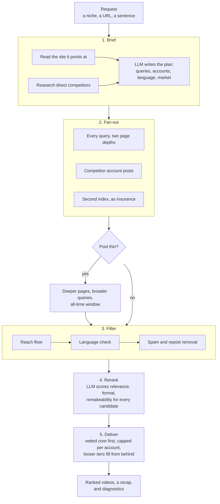

# short-form-searcher

Find proven viral short-form videos for any product or niche.

Describe what you sell, or paste your URL. You get back a ranked list of TikTok or Douyin videos that travelled far beyond their creator's audience, filtered for relevance to your product and tagged by format, so you know what is worth remaking. Switch modes and you get long-running Meta video ads instead: the creatives advertisers keep paying for.

This is the search engine behind the video search tool at [nouvelhq.com](https://www.nouvelhq.com), extracted into a standalone TypeScript library and CLI.

```bash
sfs "calorie tracking app demos"
```

```text
20 videos for Calorie tracking app demos
I searched for calorie tracking app demos and pulled posts straight from two
competitor accounts. Most of these are screen recordings and UGC reviews.

 1  @creator_one  1.9M views, 412x followers, relevance 9/10, product demo
    what I eat in a day but I actually log it
    https://www.tiktok.com/@creator_one/video/...
 2  @creator_two  640K views, 96x followers, relevance 8/10, ugc testimonial
    I tracked my food for 30 days and this is what changed
    https://www.tiktok.com/@creator_two/video/...
 ...

41.2s, source scraptik, provider spend at most $1.30 over 13 calls
```

The output above is illustrative. Handles and numbers are placeholders.

## Why this exists

Searching TikTok for a niche gives you whatever is popular near your keywords. That is not the same as videos worth copying. A useful reference video has to clear four bars at once:

1. **It travelled.** Views far beyond the creator's own following, not views a big account gets by default.
2. **It is about your category.** Not the broad industry your product sits in.
3. **You could make it.** A phone and a person, not a celebrity or a brand mascot.
4. **It is the kind of video you asked for.** A product demo is not a hook breakdown, even on the same topic.

short-form-searcher scores all four. An LLM plans the search from your request, the pipeline fans out across several queries and competitor accounts, and a second LLM pass judges every candidate before anything is delivered. Deterministic guards (a reach floor, a language check, spam and repost removal) hold even when the model is down.

## Quick start

You need Node 20 or later and an [Apify](https://apify.com) API token. Two more keys are strongly recommended.

```bash
npm install -g github:shutiancheng/short-form-searcher

export APIFY_API_KEY=...      # TikTok data and the Meta Ad Library (required)
export EXA_API_KEY=...        # reads websites, finds competitors (recommended)
export GEMINI_API_KEY=...     # or another model backend, see below (recommended)

sfs doctor                    # shows what your keys enable, makes no network calls
sfs "calorie tracking app demos"
```

The CLI also reads a `.env` file in the current directory. Copy [`.env.example`](.env.example) to get started.

To work from a clone instead:

```bash
git clone https://github.com/shutiancheng/short-form-searcher.git
cd short-form-searcher
npm install          # installs and builds
npm link             # puts `sfs` on your PATH
```

More ways to ask:

```bash
sfs https://example.com                                   # a bare URL is a complete request
sfs "UGC ads for skincare serums" --mode conversions      # ads that keep running
sfs "ads that promote Acme" --count 10                    # a named brand
sfs "meal prep for busy parents" --html report.html       # a shareable page
sfs "护肤品测评" --region CN                                # Douyin, needs TIKHUB_API_KEY
sfs "calorie tracking app demos" --json > round1.json
sfs "calorie tracking app demos" --exclude round1.json    # find more, skipping round one
```

See [docs/cli.md](docs/cli.md) for every flag.

## Use it as a library

```bash
npm install github:shutiancheng/short-form-searcher
```

```ts
import { searchShortForm } from 'short-form-searcher'

const result = await searchShortForm({ query: 'calorie tracking app demos' })

if (result.ok) {
  console.log(result.label, result.summary)
  for (const video of result.reels) {
    console.log(video.playCount, video.url, video.relevance?.archetype)
  }
} else {
  console.error(result.error, result.message)
}
```

`searchShortForm` reads its keys from the environment by default. Expected outcomes (no results, a provider outage, a missing key) come back as `{ ok: false }` with a message fit to show a person. It only throws for programmer errors.

Everything is injectable: pass your own model backend, your own data providers, a cache, a spend ceiling. See [docs/api.md](docs/api.md) and the runnable files in [examples/](examples).

## How it works



Each stage is a plain function you can call on its own. The reasoning behind each one, including the failures that shaped it, is in [docs/architecture.md](docs/architecture.md). How results are scored and ordered is in [docs/ranking.md](docs/ranking.md).

## Two modes

| | `views` (default) | `conversions` |
| --- | --- | --- |
| Question | What format travelled? | What creative sells? |
| Source | Organic TikTok or Douyin videos | Meta Ad Library video ads |
| Proof | Views divided by followers | Days an advertiser has kept paying |
| Floor | 100,000 views, configurable | Running at least 14 days |
| Ordered by | Outlier multiple, then reach | Longevity, variants, call to action |

These are two questions with two sources of evidence, not two sort orders over one pool. Organic engagement cannot tell you what sells, and an ad has no public view count.

## What you need

| Key | Used for | Required? |
| --- | --- | --- |
| `APIFY_API_KEY` | TikTok search and account reads, the Meta Ad Library | Yes, for anything outside mainland China |
| `EXA_API_KEY` | Reading the site in a request, finding competitors, resolving brand handles | Recommended. Without it a bare URL cannot be understood |
| One model backend | The brief, the relevance rerank, the recap | Recommended. Without one the search runs on keywords and traction only |
| `TIKHUB_API_KEY` | Douyin search | Only for mainland China |

Model backends, any one of which is enough:

| Backend | Environment | Default model |
| --- | --- | --- |
| Gemini, API key | `GEMINI_API_KEY` | `gemini-3.1-flash-lite` |
| Gemini, Vertex AI | `GOOGLE_CREDENTIALS` (service account JSON or a path to it) | `gemini-3.1-flash-lite` |
| Claude | `ANTHROPIC_API_KEY`, plus `npm install @anthropic-ai/sdk` | `claude-opus-5-5` |
| OpenAI, or anything compatible | `OPENAI_API_KEY`, optional `OPENAI_BASE_URL` | `gpt-5.4-nano` |

If several are configured they form a fallback chain. Full details in [docs/configuration.md](docs/configuration.md).

## What it costs

The package is free. The data providers are not, and you pay them directly.

Every provider call reserves its maximum possible charge against a per-search ceiling before the request is sent (default $10, set with `--max-spend` or `maxSpendUsd`). The number reported after a search is that ceiling, an upper bound on the bill and never the bill itself.

- A healthy TikTok search makes about 13 Apify actor runs, each capped at $0.10. A thin niche triggers more waves.
- A conversions search is one ad library run capped at $0.55.
- A Douyin search of 10 videos reserved $0.47 across 51 TikHub requests when measured.

What you are actually charged depends on each provider's current pricing, so check your provider console after your first search. See [docs/providers.md](docs/providers.md).

## What is in the box

- **Brief**: turns a sentence or a URL into queries, competitor accounts, a language and a market.
- **Providers**: TikTok through two independent indexes, Douyin, and the Meta Ad Library, behind one interface you can implement yourself.
- **Ranking**: reach floor, outlier multiple, spam and repost filters, LLM relevance bands, format tagging, per-account caps, first-row variety.
- **Recap**: a short honest summary computed from what was actually delivered.
- **CLI**: table, JSON and HTML output, a file cache, and "find more" paging.
- **Safety rails**: a spend ceiling, a time budget, SSRF-safe URL handling, and graceful degradation when a model or provider is down.

What is not here: the web app, accounts and billing, and the video analysis that turns a result into a shot-by-shot remake plan. Those stay in the hosted product.

## Limitations

- **It depends on third-party data providers.** Their actors and endpoints change shape and price without notice. Field readers are defensive, but a provider change can still thin your results.
- **Relevance is judged from captions and handles**, not from watching the video. Format tags are a strong signal and not a certainty.
- **Video file URLs expire.** `playUrl` is signed and lives for hours or days. Permalinks, stats and verdicts are durable.
- **Follower counts are sometimes missing.** A video with no follower count gets no outlier multiple. One is never estimated.
- **Search takes 30 to 75 seconds.** It is a batch pipeline, not autocomplete.

## Responsible use

This tool reads publicly available posts through third-party data providers. You are responsible for how you use it:

- Follow the terms of the platforms and providers you access, and the laws that apply to you.
- Results contain public creator data. Handle it accordingly and do not use it to target individuals.
- The point is to study formats and make your own. Do not re-upload other people's videos.

## Documentation

| Document | What it covers |
| --- | --- |
| [docs/architecture.md](docs/architecture.md) | The pipeline stage by stage, and why each stage is the way it is |
| [docs/ranking.md](docs/ranking.md) | Every score, band, cap and ordering rule |
| [docs/providers.md](docs/providers.md) | Each data provider, the spend guard, writing your own provider |
| [docs/configuration.md](docs/configuration.md) | Environment variables, model backends, search options |
| [docs/api.md](docs/api.md) | The library reference |
| [docs/cli.md](docs/cli.md) | The command line reference |
| [CONTRIBUTING.md](CONTRIBUTING.md) | Development setup and how to send a change |

## License

[MIT](LICENSE). Built by [Nouvel](https://www.nouvelhq.com).
