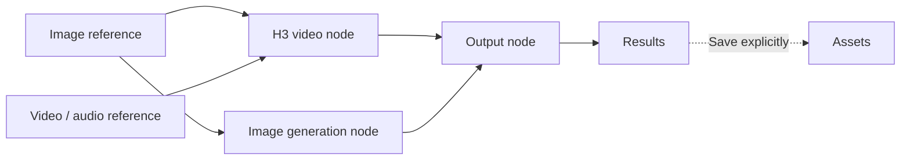
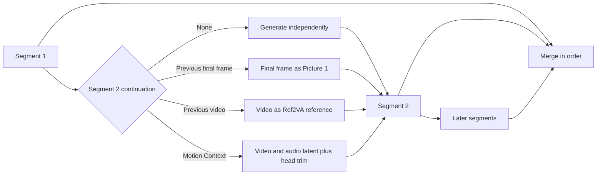

# MiniMax H3 Video Studio

<p align="center">
  English · <a href="README.zh-CN.md">简体中文</a> · <a href="README.ja.md">日本語</a>
</p>

<p align="center">
  <a href="https://github.com/siyuan-liu31/minimax-h3-video-studio/stargazers"></a>
  <a href="https://github.com/siyuan-liu31/minimax-h3-video-studio/releases/latest"></a>
  
  
</p>

<p align="center">
  <strong>Video, images, and audio — create in the studio or direct an Agent</strong>
</p>

<p align="center">
  H3 video · Local + API images · Voice conversion + lyric rewriting · Visual studio + h3ctl CLI
</p>

<p align="center">
  <a href="#start-in-three-steps">Start in three steps</a> ·
  <a href="docs/installation.md">Installation guide</a> ·
  <a href="docs/h3-prompt-guide.md">H3 prompt guide</a> ·
  <a href="docs/long-video.md">Long video guide</a> ·
  <a href="docs/releasing.md">Release policy</a>
</p>

MiniMax H3 Video Studio brings video generation, image creation, voice conversion, and lyric rewriting into one self-hosted workspace.

## Features at a glance

| Category | What you can do |
| --- | --- |
| **Video** | Generate video with native audio from text, keyframes, or image/video/audio references; remake source footage, replace a performer, and assemble longer videos with segmented generation and continuation. |
| **Images** | Generate and edit images with local Z-Image Turbo, Qwen-Image 2.1, and FLUX.2 Klein profiles, or connect **GPT Image, Nano Banana, OpenRouter, and compatible image APIs**. Reuse image results as video references. |
| **Audio** | Edit spoken lines while retaining voice and total duration, replacing only the changed span; record or upload audio; convert speech and singing voices; separate vocals and accompaniment; transcribe and correct lyrics; re-sing new Mandarin lyrics phrase by phrase over the original backing; preview, export stems, and adjust the vocal/backing mix. Whole-song recreation is also available as an experimental mode. |
| **Media and projects** | Trim clips, extract frames or audio, replace video soundtracks, and organize reusable assets and results with folders, search, pinning, and durable task history. |

## Visual interface, CLI, or Agent conversation

Use the **browser studio** to compose node workflows, manage references, review video timelines, edit lyrics, and audition results. Use the **`h3ctl` CLI** to run the same backend from a terminal, script, or an Agent with shell access. Both use the same server-side assets, tasks, and results.

**Describe the task to your Agent in chat**, for example:

- “Use this character image to generate a video, then save the finished clip to Assets.”
- “Replace the centered dancer in this video with this character, keeping the source soundtrack.”
- “Convert this song to the reference voice and export the dry vocal and accompaniment.”
- “Transcribe this song, replace the lyrics with my revised version, and let me hear the first phrase.”

The Agent can call `h3ctl` to upload inputs, submit work, inspect progress, wait or resume, and download results. Versioned operations and JSON/JSONL receipts make those steps composable without clicking through the UI. See the [CLI guide](docs/cli.md) and [bundled workflow Skills](#go-cli-for-agent-automation).

## Project highlights

- **Build a complete creative workflow:** image references, H3 video, voice work, media edits, and reusable assets live in one project workspace.
- **Choose where generation runs:** use local or remote ComfyUI models, configure separate audio runtimes, or call an external image service without a local GPU.
- **Write naturally for H3:** the canvas formats ordinary descriptions into the matching official structure, preserves complete official prompts, and shows the exact submitted text.
- **Keep control of longer jobs:** persisted task IDs, reconnectable waiting, cancellation, and segment-level reruns support work across browser and CLI sessions. Sampling continuation is available for explicitly supported H3 Base profiles.

Features depend on the configured models, runtimes, and provider access. External API credentials stay on the Studio server; prompts and connected references are sent to the service you select.

> MiniMax H3 Video Studio is an independent community project. It is not affiliated with or endorsed by MiniMax or ComfyUI.

> Earlier screenshots use demo media approved by the user for public display; the Qwen-Image 2.1 and voice-panel screenshots use a clean demo workspace with no user media. The repository does not include original media, model weights, or generated video files.

<p align="center">
  
</p>



## Generated result preview

This lightweight animation is a five-second excerpt, beginning at the first usable frame, from a 9:16, 15.08-second video with audio generated by MiniMax H3 Video Studio. Only the silent animation is public; the complete generated file is not included in the repository.

[](docs/assets/readme/generated-video-preview.gif?raw=1)

[Animation not visible? Open the original GIF directly.](docs/assets/readme/generated-video-preview.gif?raw=1)

> If MiniMax H3 Video Studio helps your workflow, please consider giving the repository a Star. It helps more ComfyUI and AI-video creators discover the project.

## Core capabilities

### Node canvas

- Compose image, video, and audio references with H3 video, image generation, and output nodes on one canvas.
- Type `@` to reference media from the current node. Connections and the explicit mode together determine the workflow that actually runs.
- Image edits, video clips, and extracted frames create new result nodes instead of entering the asset library automatically. Save them to Assets from the node context menu only when you want to reuse them.
- Drag local images, videos, and audio onto the canvas. Media already inside a node is never mistaken for a local upload.
- Restore canvas, asset, and task state after a refresh, and preview or download results.

### Seven video creation modes

<p align="center">
  
</p>

| Mode | Purpose | Input constraint |
| --- | --- | --- |
| `Auto` | Select a workflow from node connections | Best for quick composition |
| `T2V` | Text to video | Text prompt only |
| `I2V` | Single-image to video | One starting image |
| `FL2V` | First-and-last-frame to video | One or two endpoint images |
| `R2V` | Multimodal reference to video | Up to 9 images, 3 videos, and 3 audio files; 12 files combined |
| `V2V` | Source video remake | Exactly one source video selected explicitly |
| `RV2V` | Source video plus multimodal references | Source video and additional references are bound separately |

H3 video supports 16:9, 9:16, and 24 FPS. Duration follows the actual `17k+5` frame grid: 124–362 frames, or about 5.17–15.08 seconds. Sampling can use either a Turbo LoRA or an official base profile. The interface shows the resolved model, sampler, step count, LoRA, and scheduler parameters; a workflow preview is never presented as evidence that a job actually ran.

### Multi-model image generation and editing

<p align="center">
  
</p>

<p align="center">
  
</p>

| Model / service | Supported operation | How it connects |
| --- | --- | --- |
| Z-Image Turbo BF16 | Text to image; experimental single-image latent img2img | Local / remote ComfyUI |
| Z-Image Turbo + community LoRA | Separate text-to-image and latent img2img profiles | Local / remote ComfyUI |
| Qwen-Image 2.1 BF16 | Text to image; one to ten ordered reference images for instruction editing | Local / remote ComfyUI |
| FLUX.2 Klein 9B | Text to image; up to four ordered image references | Local / remote ComfyUI |
| Anything V5 | Checkpoint text to image / image to image | Local / remote ComfyUI |
| GPT Image / OpenAI Images-compatible services | Text to image and reference-image editing, as supported by the configured model | External API |
| Nano Banana / Gemini | Text to image and reference-image editing | External Gemini API |
| OpenRouter | Image API or image-output Chat Completions with a configurable model ID | External API |

Configure external models in **Image APIs** in the left rail, then select them in an image node. Retired local profiles remain readable for historical jobs but are not offered for new generation. Live capabilities determine which configured models can be selected.

Image generation supports 1K/2K and 16:9, 9:16, 3:4, and 1:1. Qwen-Image 2.1 uses its native 2K presets, default 40 steps / CFG 1, and one BF16 Profile for text-to-image and instruction editing. Describe multi-image relationships with `<image1>`, `<image2>` (or “图1”, “图2”); references are bound in slot order. Its weights use the [Qwen Research License](https://github.com/QwenLM/Qwen-Image-2.1/blob/main/LICENSE): non-commercial research/evaluation only unless separately licensed. The unreleased Z-Image-Edit capability remains visibly unavailable and is not misrepresented by latent img2img. See [Image Workflows](docs/image-workflows.md) for licenses and exact workflow contracts.

Measured Qwen-Image 2.1 example on an RTX 5090 with full BF16 weights: 2048 × 2048 at 40 steps completed in 75 seconds for text-to-image and 120 seconds for instruction editing. The same staged gateway also completed CLI generation and editing. These are example runs, not performance guarantees.

### Audio: voice conversion, lyric rewriting, and song covers

<p align="center">
  
</p>

The Audio workspace accepts uploaded files, existing audio assets, and browser microphone recordings. Choose the engine for the task:

| Engine | What it does |
| --- | --- |
| **Vevo2 FM-only** | Convert speech or unaccompanied vocals toward a reference timbre. |
| **YingMusic-SVC** | Separate song vocals, convert their timbre, and remix with the accompaniment; optionally retain stems and choose echo/reverb before generation. |
| **YingMusic-Singer-Plus** | Align corrected Mandarin lyrics phrase by phrase, sing the replacement lyrics over the original backing, and use the original singer or a separate reference voice. |
| **SoulX** | An alternative Mandarin lyric-rewriting pipeline with melody conditioning, editable original lyrics, and first-segment preview. |
| **ACE-Step XL-SFT** | Experimental whole-song cover/recreation; melody, backing, and vocal delivery may change. |

- Transcribe lyrics, correct the original text, and keep source-specific lyric drafts before generating replacement vocals. Phrase rewriting requires original and new lyrics to have matching line counts.
- Preview the first phrase/segment for supported rewriting engines, compare source and result, and generate the full song when ready.
- Preview, download, and save available mix, dry-vocal, accompaniment, or remixed tracks to Assets. For tasks retaining stems and supporting remix, adjust vocal/backing levels without another model generation.
- Local GPU generation shares the exclusive queue with H3 video and local image models. External image API jobs run independently. Task history, cancellation, and saved results are available through both UI and CLI.

Lyric recognition and synthesized singing can still contain errors; preview before generating the full result. [Phrase rewriting](docs/lyrics-rewrite.md), [SoulX](docs/soulx-rewrite.md), and [audio CLI commands](docs/cli.md#voice-conversion) document the input and runtime requirements.

```bash
# Convert a song to a reference voice and retain the separated tracks.
h3ctl voice convert ./song.wav --reference ./voice-reference.wav --engine yingmusic \
  --steps 75 --cfg 0.9 --seed 42 --keep-stems --to ./cover.wav

# Re-sing revised Mandarin lyrics over the original backing; preview first.
h3ctl voice rewrite ./song.wav --engine yingsinger \
  --original-lyrics-file ./original.txt --lyrics-file ./new.txt \
  --preview --to ./preview.wav

# Export a retained stem from a completed task.
h3ctl voice download TASK_ID --track dry_vocal --to ./dry-vocal.wav
```

In an existing completed YingMusic task, the preview and download endpoints returned byte-identical WAV content for each of the three retained tracks. Generated media and user audio remain outside the repository.

### Long video: segmented generation and continuation

The Long Video workspace places existing footage and pending generated segments on one timeline. You can preview, split, adjust in/out points, create empty segments, and run selected segments or their dependency order.

<p align="center">
  
</p>

Each pending segment can run independently, continue from the previous segment's final frame, use the previous video as a Ref2VA reference, or carry the prior H3 video/audio latent through Motion Context. Continuation settings, aspect ratio, effective duration, sampling profile, LoRA strength, step count, and seed are saved with the project.

<p align="center">
  
</p>



- Each segment supports about 5.17–15.08 seconds. Failed segments can be rerun; upstream changes invalidate dependent downstream segments so they can be recalculated.
- When a finished 362-frame segment becomes the next segment's video reference, only a system-derived 15-second reference copy is trimmed. The final merge still uses the complete segment.
- Motion Context supports both Base and Turbo LoRA Profiles, preserves the requested Profile-bounded step count, and automatically removes reused head frames before concatenation. Adjacent latent-linked segments must keep the same output dimensions.
- The top-level Replication Workshop accepts a source with no fixed duration cap, a brief, preservation choices, replacement targets, and optional image references. It analyzes scenes, compiles legal H3 segments no longer than 15.08 seconds, then merges and trims the result to the exact source duration. Short sources are padded privately for H3 and trimmed back to the source frame count. Upload size, project JSON capacity, and storage remain subject to server configuration.
- `h3ctl video migrate-character` replaces one explicitly identified performer across a source video of arbitrary practical length. It plans exact 24 FPS windows, carries video/audio latent state through Motion Context, increases the final supported overlap to backfill the terminal window before using any unavoidable padding, and applies `copy-source`, `reference-source`, `generate`, or `mute` audio policy.
- FFmpeg performs an auditable hard-cut merge. MiniMax H3 Video Studio does not claim automatic seamless audio/video transitions.
- Run the full pipeline with `h3ctl video compose`, or use the atomic project/trim/concat commands separately. See [Long Video](docs/long-video.md) and [Motion Context composition](docs/motion-context-long-video.md) for the complete contracts.

### Asset and result management

- Reuse image, video, and audio assets across canvases, with search, folders, pinning, multi-select, and bulk deletion.
- Deleting a folder removes only the folder. Its assets and child folders move to the parent automatically, so media is not deleted by mistake.
- Browse generated and derived editing results together, with pinning, mixed multi-select, select-all for the current view, bulk deletion, preview, and download.
- Identical content is reused by SHA-256 and collapsed in the interface, reducing duplicate uploads and storage.

### Go CLI for Agent automation

`h3ctl` exposes stable atomic commands for asset transfer, image/video generation, voice conversion, resumable waiting, media derivation, long-video projects, and character migration. Agents can use its strict Draft 2020-12 operation contracts and structured JSON/JSONL receipts without driving the browser. The same jobs and media remain available in the frontend. Local files, remote asset locators, and reusable direct/SSH contexts let an Agent work with a changing rented-machine address. A separate loopback-only `douyin parse|download|serve` utility never opens the H3 SSH context. See the [Go CLI guide](docs/cli.md) for the full command and safety contract.

```bash
h3ctl video compose --spec trilogy.json --to final.mp4 --timeout 0
h3ctl video replicate --source source.mp4 --brief "keep motion; replace presenter and product" \
  --reference presenter.png --to replicated.mp4
h3ctl video migrate-character --source performance.mp4 --character hero.png \
  --source-subject "the centered dancer" --steps 4 --to migrated.mp4
h3ctl generate image --profile qwen-image-2.1-bf16 \
  --prompt 'A blue ceramic teapot on a white table' --width 2048 --height 2048 \
  --steps 40 --cfg 1 --seed 42 --wait --download ./teapot.png
h3ctl generate image --profile qwen-image-2.1-bf16 \
  --ref ./subject.png --ref ./palette.png \
  --prompt 'Preserve <image1> subject and apply <image2> colors' \
  --width 2048 --height 2048 --wait --download ./edited.png
```

> Branding compatibility: the CLI remains `h3ctl`. Existing `H3_STUDIO_*` environment variables, `h3-studio` data paths, API contracts, and persisted browser keys remain unchanged.

The repository also bundles four local Skills: [`H3 Prompt Compiler`](skills/h3-ref2va-prompt-compiler/SKILL.md), [`Character Dialogue Video`](skills/h3-character-dialogue-video/SKILL.md), [`Dance Replication`](skills/h3-dance-replication/SKILL.md), and [`Character Migration`](skills/h3-character-migration/SKILL.md).

## Start in three steps

> [!IMPORTANT]
> The one-command script installs the locked Node dependencies, builds the frontend, and starts the services. It does not install Python, Node.js, FFmpeg, ComfyUI, custom nodes, or models at the system level. On a new machine, read the [complete installation and operation guide](docs/installation.md) first.

Requirements:

- Node.js `>=22.13`
- Python `>=3.11`
- npm, `ffmpeg`, and `ffprobe`
- For local image / H3 video generation: a reachable ComfyUI instance with the selected profiles' nodes and models
- For external image generation: a configured provider API key; no local GPU is required
- For audio: the corresponding configured engine runtime and weights; see [phrase rewriting](docs/lyrics-rewrite.md) and [SoulX setup](docs/soulx-rewrite.md)
- Optional: `scenedetect>=0.6.4,<0.8`; smart scene splitting falls back to FFmpeg when it is unavailable

From the project root:

1. Copy the configuration and verify the ComfyUI URL, data directories, and model filenames. Loopback and SSH-tunnel use needs no API key; leave both key fields empty unless you intentionally enable authentication for a public deployment.

   ```bash
   cp .env.example .env.local
   # Edit .env.local in your editor
   ```

2. Install the locked Node dependencies and create a production build.

   ```bash
   python3 scripts/h3studio.py install
   ```

3. Check dependencies and ComfyUI, then start the API and production frontend.

   ```bash
   python3 scripts/h3studio.py doctor --check-comfy
   python3 scripts/h3studio.py start
   ```

Open `http://127.0.0.1:3013`. `start` supervises both frontend and backend processes; if either exits, it stops the other. Press `Ctrl-C` to shut down both cleanly.

### Management commands

```bash
# Inspect only; never changes the system
python3 scripts/h3studio.py doctor

# Show the install or start commands without running them
python3 scripts/h3studio.py install --dry-run
python3 scripts/h3studio.py start --dry-run

# Custom ports; all three must be different
python3 scripts/h3studio.py start --port 3013 --internal-port 3014 --api-port 6020
```

`doctor` checks Python, Node.js, npm, FFmpeg/FFprobe, project files, frontend dependencies/build output, and API-key wiring. `--check-comfy` also checks ComfyUI's `/system_stats`. It does not download dependencies and cannot prove that every profile has all required nodes and models. After startup, use `/api/capabilities` and the availability messages in the interface as the source of truth. Equivalent npm commands are `npm run doctor`, `npm run install:studio`, and `npm run start:studio`.

## Local development

```bash
npm ci
cp .env.example .env.local

# Terminal A: API
set -a && source .env.local && set +a
python3 -m server

# Terminal B: frontend; /api proxies to port 6020
set -a && source .env.local && set +a
npm run dev -- --host 127.0.0.1 --port 3013
```

If the API key is enabled, put the same value only in the server's `H3_STUDIO_API_KEY` and the frontend proxy process's `H3_STUDIO_PROXY_API_KEY`. The key is never included in the browser bundle.

## AutoDL / remote access

By default, the API, internal frontend, and public entry point listen only on loopback. After starting the services on the remote machine, create an SSH tunnel locally:

```bash
# Remote machine
python3 scripts/h3studio.py start

# Local machine: forward only the same-origin frontend entry point
ssh -N -L 16020:127.0.0.1:3013 -p <PORT> <SSH_USER>@<HOST>
```

Open `http://127.0.0.1:16020`. Do not expose `0.0.0.0` merely to avoid using a tunnel. If public access is necessary, configure a firewall, TLS reverse proxy, and strong API key. Never commit models, assets, generated results, API keys, or SSH passwords to Git.

## Key configuration

Use [`.env.example`](.env.example) as the baseline. `h3studio.py` automatically loads `.env.local` from the project root, or you can select a file with `--env-file <path>`. Existing process environment variables take precedence.

| Variable | Purpose |
| --- | --- |
| `COMFY_URL` | ComfyUI HTTP address |
| `H3_STUDIO_HOST` / `H3_STUDIO_PORT` | Python API bind address and port; defaults to `127.0.0.1:6020` |
| `H3_STUDIO_WEB_HOST` / `PORT` / `H3_STUDIO_INTERNAL_WEB_PORT` | Public frontend address, public port, and internal port |
| `H3_STUDIO_DATA_ROOT` | Asset and task metadata directory; use a data volume on remote machines |
| `H3_STUDIO_COMFY_INPUT` / `H3_STUDIO_COMFY_OUTPUT` | ComfyUI input and output directories |
| `H3_STUDIO_*_MODEL` / `H3_STUDIO_*_LORA` | Filenames used by model profiles |
| `H3_STUDIO_API_KEY` / `H3_STUDIO_PROXY_API_KEY` | Optional matching key for public deployments; leave both empty for loopback/SSH use |
| `H3_STUDIO_COMFY_IDLE_FREE_SECONDS` | Seconds before calling `/free` after the global ComfyUI queue becomes idle; `0` disables it |
| `H3_STUDIO_MAX_ASSET_STORAGE_BYTES` | Asset storage limit |
| `H3_STUDIO_MAX_MOTION_CONTEXT_STORAGE_BYTES` | Durable Motion Context latent storage limit |
| `H3_STUDIO_MAX_ACTIVE_JOBS` | Active job limit |
| `H3_STUDIO_MAX_PROJECT_JSON_BYTES` | Long Video project definition limit; defaults to 32 MiB |
| `H3_STUDIO_ASSET_TTL_DAYS` | Default retention period for administrator-triggered garbage collection |

Place external profiles in `H3_STUDIO_DATA_ROOT/profiles/*.json`. A manifest may select only workflow compilers reviewed in the codebase. New types require an adapter and tests; a manifest cannot run arbitrary ComfyUI graphs, paths, or commands. See the [installation guide](docs/installation.md) for complete variables, model directories, and troubleshooting.

## Project structure

```text
app/       React node canvas and workspace UI
server/    Python standard-library API, storage, jobs, and ComfyUI workflow compilation
scripts/   Installation, startup, diagnostics, Long Video, and operations tools
skills/    Bundled H3 prompt-compilation and production Skills
docs/      Installation, architecture, model workflows, release policy, and LLM code map
tests/     Frontend build, rendering, and source-contract tests
```

Before contributing, read [AGENTS.md](AGENTS.md) and the [LLM Wiki](docs/llm-wiki.md). User-facing changes are recorded in the [Changelog](CHANGELOG.md). The LLM Wiki is the navigation entry point for the current implementation.

## Testing

```bash
npm test
```

This command runs ESLint, TypeScript checks, the production build, rendering tests, and Python unit/API/Long Video/operations tests in sequence.

## Capability boundaries

MiniMax H3 Video Studio does not present the local H3-Base 768p model as the official, unreleased Context-IR/2K pipeline. It also does not provide an alleged “official NSFW switch” or moderation bypass. Operators may configure local model policies for lawful adult content, but must reject content involving minors, non-consensual intimate material, unauthorized sexual deepfakes of real people, illegal activity, or infringement.

H3 scheduler denoising maps directly to `BasicScheduler.denoise`; it is not CFG, LoRA strength, or a proven reference-preservation weight. For exact model, node, and license information, use `/api/capabilities`, [Image Workflows](docs/image-workflows.md), and the evidence saved with each job.

## External image APIs

Open **Image APIs** in the left rail, add a connection, enter the API base URL (including its version path), model ID and key, then save. Select the resulting **API** model in an image node. The same prompt, connected references, results, downloads and asset import flow work without a local GPU.

Supported protocols are OpenAI Images (GPT Image and compatible services), Gemini generateContent (Nano Banana), OpenRouter Image API, and OpenRouter Chat Images. Presets are editable; access and supported reference counts depend on the selected model and account. Keys live only in the Studio server's private data directory, never in canvas documents or browser storage. All users with access to this Studio API can manage these shared connections. Use the existing authenticated gateway when sharing a deployment.

Requests are never automatically retried: upstream processing may already have incurred charges. Local cancellation discards late results and does not guarantee provider cancellation or a refund. Outputs must be base64 PNG/JPEG/WebP; remote image URLs are not fetched. For fixed-size older models, requested aspect ratio/resolution map to native sizes; actual dimensions appear in the result receipt.

Protocol references: [OpenAI Images](https://developers.openai.com/api/reference/resources/images/methods/generate), [Gemini image generation](https://ai.google.dev/gemini-api/docs/generate-content/image-generation), [OpenRouter Image API](https://openrouter.ai/docs/guides/overview/multimodal/image-generation).

## Automatic H3 prompt formatting

The canvas sends video prompts with `prompt_mode: "auto"`. Ordinary descriptions are organized into the official text/keyframe or full-reference structure using the actual connected media roles. Complete official prompts are preserved apart from resolving asset mentions; incomplete or conflicting templates return a precise validation error instead of being wrapped again. The preview shows the exact compiled text. This is deterministic formatting, without automatic translation or the hosted Context-IR service. Existing callers can still explicitly request `preserve_tags_only`.

## Spoken dialogue editing

The **Edit dialogue** sidebar accepts 1–30 seconds of single-speaker Mandarin speech. Confirm the transcript, enter new lines, and generate a sample-aligned splice using the existing Vevo2 and ASR models. Unchanged regions retain their original samples. Compare audio, download WAV, or save to Assets.

Start the Mac system-speech helper once with `h3ctl dialogue serve --studio-origin http://127.0.0.1:16020`. The server also needs its offline speech runtime configured. CLI/Agents can use `h3ctl dialogue edit`; other platforms can supply synthesized speech with `--tts-source`. Music, overlapping speakers, excessive text changes, and insertions without a pause may require adjustment. See [dialogue setup and API](docs/dialogue-edit.md).
