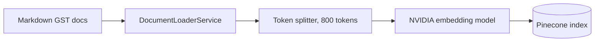
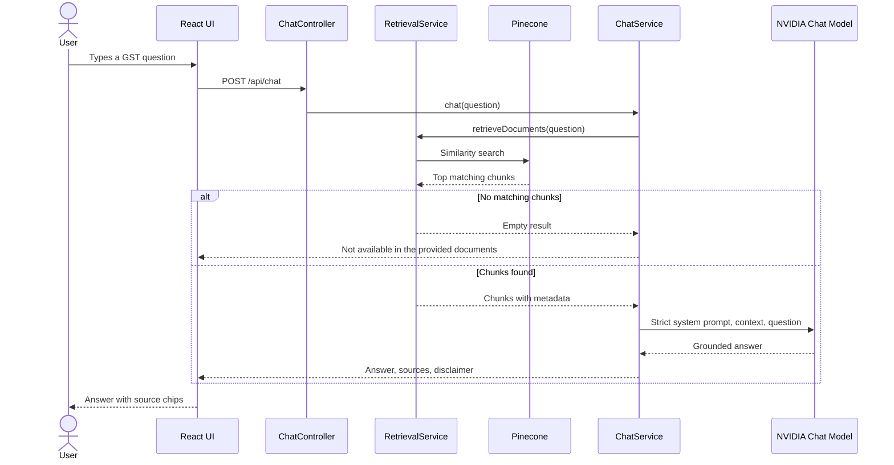
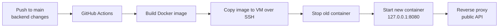

# GST Sutra

<p align="center">
  
  
  
  
  
  
  
</p>

<p align="center">
  <strong>A RAG chatbot that answers Indian GST questions for small shop owners, using only official GST documents and showing its sources.</strong>
</p>

<p align="center">
  <a href="https://gst-sutra.smitroy.com"><strong>Live Demo</strong></a> |
  <a href="https://api.gst-sutra.smitroy.com"><strong>API</strong></a> |
  <a href="#quick-start"><strong>Quick Start</strong></a> |
  <a href="#architecture"><strong>Architecture</strong></a> |
  <a href="#troubleshooting"><strong>Troubleshooting</strong></a>
</p>

> **Unofficial demo.** GST Sutra is not affiliated with the Government of India. Its answers are general information, not tax advice. Check the official sources before you act on them.

---

## Choose your path

| I want to... | Go to |
|---|---|
| See what the app does | [Overview](#overview) and the [live demo](https://gst-sutra.smitroy.com) |
| Understand how the RAG pipeline works | [Architecture](#architecture) |
| Run it on my machine | [Quick start](#quick-start) |
| Call the API directly | [API reference](#api-reference) |
| Fix a setup error | [Troubleshooting](#troubleshooting) |
| Deploy it | [Deployment](#deployment) |

---

## Overview

GST rules change often, and the official documents are long and written for tax professionals. A shop owner who wants to know the rate for packaged snacks, or whether they must register, should be able to ask a plain question and get a short answer with a reference.

GST Sutra is a focused demonstration of that idea and of building a grounded RAG system with Spring AI. The backend answers only from a Markdown knowledge base, and the React frontend presents the answers in a split-screen layout with a chat panel and a Learn GST panel.

### At a glance

| | |
|---|---|
| **Purpose** | Answer GST questions from official documents, with citations |
| **Backend** | Java 21, Spring Boot 4.1, Spring AI 2.0 |
| **Chat model** | `minimaxai/minimax-m3.1-flash` (NVIDIA-hosted, temperature 0.1) |
| **Embedding model** | `nvidia/nemotron-3-embed-1b` (2048 dimensions, cosine) |
| **Vector store** | Pinecone, index `gst-sutra-vectors`, namespace `gst-docs` |
| **Frontend** | React 19, Vite, React Router |
| **Knowledge base** | Five Markdown files in `backend/src/main/resources/docs/` |
| **Database** | None. Pinecone is the only storage. |

<details>
<summary><strong>Key features</strong></summary>

<br>

- **Grounded answers.** The model is instructed to answer only from the retrieved GST context. If the context does not contain the answer, the bot says so.
- **Source citations.** Each answer lists the file and section it was drawn from, with links to official pages where the document provides them.
- **Learn section.** Short pages on the CGST Act, IGST Act, CGST Rules, registration thresholds, the Composition Scheme, and GST rates, plus links to official news.
- **Rotating GST facts.** A ticker shows one verified fact every 10 seconds while the answer loads, with the source file named.
- **Disclaimers on every answer.** Each response reminds the user to consult a GST professional.

</details>

<details>
<summary><strong>Why RAG instead of a plain chatbot?</strong></summary>

<br>

A general-purpose model may give outdated or incorrect GST rates. Retrieval-augmented generation limits the model to a known set of documents. The app first retrieves the most relevant chunks from Pinecone, then passes only those chunks to the chat model. This keeps each answer traceable to a specific file and section.

</details>

---

## Try it

Once the app is running, these questions show the range of behavior.

| Question | Expected behavior |
|---|---|
| What is the GST rate on packaged namkeen? | Answer from `gst-rates.md` with a source chip |
| Do I need GST registration if my turnover is Rs. 25 lakh? | Answer from `registration.md`, explaining that the limit depends on the type of supply |
| What is the composition scheme? | Answer from `composition-scheme.md` |
| What fields must a tax invoice contain? | Answer from `invoicing-basics.md` |
| What is the GST rate for a spaceship? | "Not available in the provided documents" |

The last row matters. A grounded system should decline when the documents do not cover the question, rather than guess.

---

## Architecture

<details open>
<summary><strong>Ingestion flow (runs once)</strong></summary>

<br>



1. `DocumentLoaderService` reads each Markdown file and attaches the filename and headings as metadata.
2. `IngestionService` splits the documents into 800-token chunks.
3. Each chunk is embedded with the NVIDIA embedding model and stored in Pinecone.

</details>

<details open>
<summary><strong>Chat flow (runs per question)</strong></summary>

<br>



If no chunks match, the bot returns the "not available" message without calling the chat model.

</details>

<details>
<summary><strong>Component responsibilities</strong></summary>

<br>

| Class | Responsibility |
|---|---|
| `DocumentLoaderService` | Reads Markdown files and attaches metadata |
| `IngestionService` | Splits documents into chunks and stores embeddings in Pinecone |
| `RetrievalService` | Finds the chunks most similar to the question |
| `ChatService` | Builds the prompt, calls the chat model, extracts sources |
| `ChatController` | Exposes `POST /api/chat` |
| `IngestController` | Exposes `POST /api/ingest` for development |
| `GlobalExceptionHandler` | Returns clean JSON errors |
| `CorsConfig` | Allows the frontend origins |

</details>

<details>
<summary><strong>Design decisions</strong></summary>

<br>

| Decision | Reason |
|---|---|
| No relational database | The knowledge base is static Markdown, so Pinecone is the only storage needed |
| Markdown knowledge base | Easy to review, version in Git, and check against official sources |
| Token-based chunking (800 tokens) | Keeps each chunk focused on one rule or topic, which improves retrieval |
| Strict system prompt | Reduces the risk of the model answering from general knowledge |
| Source metadata on every chunk | Makes each answer traceable to a file and section |
| Retry with exponential backoff | Handles transient failures from the model provider |

</details>

<details>
<summary><strong>Project structure</strong></summary>

<br>

```
GST-Sutra/
├── backend/
│   ├── Dockerfile
│   ├── pom.xml
│   └── src/
│       ├── main/java/com/smit/GST_Sutra/
│       │   ├── config/         CORS configuration
│       │   ├── controller/     ChatController, IngestController
│       │   ├── dto/            ChatRequest, ChatResponse, SourceInfo
│       │   ├── exception/      GlobalExceptionHandler
│       │   └── service/        DocumentLoaderService, IngestionService,
│       │                       RetrievalService, ChatService
│       ├── main/resources/
│       │   ├── application.yml
│       │   └── docs/           GST knowledge base (Markdown)
│       └── test/               Unit and integration tests
├── frontend/
│   ├── src/
│   │   ├── components/         Chat, facts ticker, learn panel, footer
│   │   ├── data/               Facts, learn cards, learn content
│   │   └── api/                chatApi.js
│   └── vercel.json
└── .github/workflows/
    └── deploy-backend.yml      Build image, copy to VM, restart container
```

</details>

---

## Tech stack

| Layer | Technology |
|---|---|
| Backend | Java 21, Spring Boot 4.1, Spring Web MVC, Spring Validation, Lombok |
| AI framework | Spring AI 2.0 (OpenAI-compatible client, Markdown document reader, vector store advisor) |
| Models | NVIDIA-hosted chat and embedding models through an OpenAI-compatible API |
| Vector database | Pinecone (serverless index) |
| Frontend | React 19, Vite, React Router, react-markdown, remark-gfm |
| Deployment | Docker on Oracle Cloud VM (backend), Vercel (frontend), GitHub Actions (backend CI/CD) |

---

## Knowledge base

| File | Covers |
|---|---|
| `gst-rates.md` | Rate slabs, exempt goods, HSN lookup, rates for common shop items |
| `registration.md` | Turnover thresholds, compulsory registration, documents, timelines |
| `composition-scheme.md` | Eligibility, rates, limits, conditions |
| `filing-deadlines.md` | GSTR-1, GSTR-3B, CMP-08, GSTR-4, late fees |
| `invoicing-basics.md` | Tax invoices, Rule 46 fields, Bill of Supply |

<details>
<summary><strong>How the documents are maintained</strong></summary>

<br>

- Each file has a front matter block with its primary sources and a `last_verified` date.
- Each factual statement cites a document, section, and URL.
- Facts marked "Not verified" are excluded from the chatbot's answers.
- Check the `last_verified` date before relying on a file, because GST rules change.

</details>

---

## Quick start

<details open>
<summary><strong>Prerequisites</strong></summary>

<br>

- Java 21
- Maven (or the included `mvnw` wrapper)
- Node.js 20 or newer
- An NVIDIA API key for the chat and embedding models
- A Pinecone account

</details>

<details open>
<summary><strong>Step 1: Create the Pinecone index</strong></summary>

<br>

| Setting | Value |
|---|---|
| Name | `gst-sutra-vectors` |
| Dimension | `2048` (must match the embedding model's output) |
| Metric | `cosine` |

The app uses the namespace `gst-docs`.

</details>

<details open>
<summary><strong>Step 2: Set environment variables</strong></summary>

<br>

Create `backend/.env`, which git ignores, or set these values in your IDE run configuration:

```bash
NVIDIA_API_KEY=your_nvidia_key
PINECONE_API_KEY=your_pinecone_key
```

Never commit real keys.

</details>

<details open>
<summary><strong>Step 3: Start the backend</strong></summary>

<br>

```bash
cd backend
./mvnw spring-boot:run
```

The API runs on `http://localhost:8080`.

</details>

<details open>
<summary><strong>Step 4: Ingest the documents (once)</strong></summary>

<br>

```bash
curl -X POST http://localhost:8080/api/ingest
```

Open the Pinecone console and confirm that vectors appear in the `gst-docs` namespace. Run this once per index, because a second run stores duplicate chunks.

</details>

<details open>
<summary><strong>Step 5: Ask a question</strong></summary>

<br>

```bash
curl -X POST http://localhost:8080/api/chat \
  -H "Content-Type: application/json" \
  -d '{"question":"Do I need GST registration if my turnover is Rs. 25 lakh?"}'
```

</details>

<details open>
<summary><strong>Step 6: Start the frontend</strong></summary>

<br>

```bash
cd frontend
npm install
echo "VITE_API_URL=http://localhost:8080" > .env
npm run dev
```

Open `http://localhost:5173`. The backend allows this origin through CORS.

</details>

---

## API reference

<details open>
<summary><strong>POST /api/chat</strong></summary>

<br>

**Request**

```json
{ "question": "What is the GST rate on packaged namkeen?" }
```

**Response**

```json
{
  "answer": "...",
  "sources": [
    { "fileName": "gst-rates.md", "heading": "...", "title": "...", "url": "https://..." }
  ],
  "disclaimer": "This answer is for general information only. ..."
}
```

**Rules**

- The question cannot be blank and must be 500 characters or fewer.
- Errors return `{ "error", "message" }` with a 400 or 500 status.
- Some source fields may be empty, so clients should hide empty values.

</details>

<details>
<summary><strong>POST /api/ingest (development only)</strong></summary>

<br>

Loads the Markdown files into Pinecone. Protect or remove this endpoint before any public deployment.

</details>

---

## Configuration

Key settings in `backend/src/main/resources/application.yml`:

| Setting | Purpose |
|---|---|
| `spring.ai.openai.base-url` | NVIDIA OpenAI-compatible endpoint, including `/v1` |
| `spring.ai.openai.chat.options.model` | Chat model |
| `spring.ai.openai.embedding.options.model` | Embedding model |
| `spring.ai.openai.embedding.options.dimensions` | Must match the Pinecone index |
| `spring.ai.openai.embedding.options.extra-body` | Extra request fields, such as `input_type` and `truncate` |
| `spring.ai.vectorstore.pinecone.index-name` | Pinecone index name |
| `spring.ai.vectorstore.pinecone.namespace` | Namespace for GST chunks |
| `spring.ai.retry.*` | Retry and backoff for model calls |
| `gst.docs.location` | Location of the Markdown files |
| `gst.chunk.size` | Chunk size setting |

Model IDs and endpoints change over time. Check the current model list before you deploy.

---

## Troubleshooting

These are real issues that came up while building the project.

<details>
<summary><strong>404 from the embedding endpoint</strong></summary>

<br>

**Likely causes**

- The base URL is missing `/v1`. Use `https://integrate.api.nvidia.com/v1`.
- The embedding `model` is placed directly under `embedding:` instead of under `embedding.options:`. Spring AI then falls back to its default OpenAI model, which NVIDIA does not host.

</details>

<details>
<summary><strong>400: "dimensions must be one of ..."</strong></summary>

<br>

The embedding model accepts only specific output sizes. Set `dimensions` to a value the model supports, and create the Pinecone index with the same dimension. If you change the dimension, delete and recreate the index.

</details>

<details>
<summary><strong>400: "'input_type' parameter is required for asymmetric models"</strong></summary>

<br>

Some NVIDIA embedding models need an `input_type` field (`passage` for documents, `query` for questions). Pass it through `embedding.options.extra-body`, as shown in `application.yml`. Note that a single global value applies to both ingestion and questions.

</details>

<details>
<summary><strong>410: model has reached end of life</strong></summary>

<br>

The configured model was retired. List the current models and update the model ID:

```bash
curl https://integrate.api.nvidia.com/v1/models -H "Authorization: Bearer $NVIDIA_API_KEY"
```

</details>

<details>
<summary><strong>Pinecone dimension mismatch on ingest</strong></summary>

<br>

The index dimension must equal the embedding model's output. Check the index in the Pinecone console, and recreate it if the numbers differ.

</details>

<details>
<summary><strong>The browser blocks requests (CORS error)</strong></summary>

<br>

Add the frontend origin to `CorsConfig`, then rebuild and restart the backend.

</details>

<details>
<summary><strong>The bot says it cannot find an answer for a question that should be covered</strong></summary>

<br>

Check that ingestion completed and that vectors exist in the `gst-docs` namespace. If they do, the similarity threshold may be too strict, or the question wording may be far from the document text.

</details>

---

## Deployment

<details open>
<summary><strong>Backend: Oracle Cloud VM with Docker and GitHub Actions</strong></summary>

<br>



1. The `Dockerfile` builds a JAR with Maven and runs it on a Temurin 21 JRE.
2. The workflow (`deploy-backend.yml`) runs on pushes to `main` that change `backend/**`, or manually.
3. The container starts with `/opt/gst-sutra/backend.env` and a memory limit.
4. The container listens on `127.0.0.1:8080`, so a reverse proxy handles public traffic.

**Required GitHub secrets:** `VM_HOST`, `VM_USER`, `VM_SSH_KEY`

</details>

<details open>
<summary><strong>Frontend: Vercel</strong></summary>

<br>

1. Set the project root directory to `frontend`.
2. `vercel.json` defines the build command and SPA rewrites.
3. Set `VITE_API_URL` to the public API URL.

</details>

<details>
<summary><strong>CORS</strong></summary>

<br>

`CorsConfig` allows `http://localhost:5173` and `https://gst-sutra.smitroy.com`. Add any new frontend origin there.

</details>

---

## Testing

```bash
cd backend
./mvnw test
```

The test suite includes unit tests for retrieval and integration tests that call the live embedding and vector services. Set valid keys in the environment before you run the integration tests.

---

## FAQ

<details>
<summary><strong>Does it replace a GST professional?</strong></summary>

<br>

No. It gives general information from a small set of documents. Confirm anything important with a GST practitioner or the official portal.

</details>

<details>
<summary><strong>Where do the answers come from?</strong></summary>

<br>

Only from the five Markdown files in the backend. Each file lists its sources and a verification date.

</details>

<details>
<summary><strong>Why is there no chat history?</strong></summary>

<br>

The project is scoped to demonstrate retrieval and grounding. Each question is answered independently.

</details>

<details>
<summary><strong>Can I add more documents?</strong></summary>

<br>

Yes. Add a Markdown file to `backend/src/main/resources/docs/`, cite its sources, and re-run ingestion. Clear the namespace first so you do not store duplicates.

</details>

---

## Disclaimer

GST Sutra is an independent educational project. It is not affiliated with, endorsed by, or connected to the Government of India, the GST Council, or the GST Network. It does not provide legal or tax advice.

## Author

**Smit Roy** | [GitHub](https://github.com/smitroy4)

<p align="center">
  <a href="#gst-sutra">Back to top</a>
</p>
