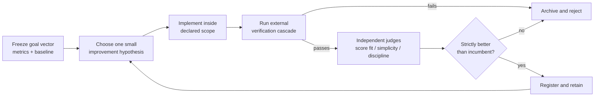

<p align="center"></p>

# ConeCode

**A desktop coding workspace for agents that improve software with evidence—not vibes.**

[简体中文](README.zh-CN.md) · English

ConeCode is an Electron, React, and TypeScript desktop workspace for AI coding agents. It combines chat, files, an editor, terminal sessions, diffs, Git worktrees, browser preview, and model configuration. Its defining capability is **bounded, evidence-driven Recursive Self-Improvement (RSI)**.

## At a glance

- **Four agent modes.** Standard for one-off tasks, Goal for long measurable deliverables, Orchestrate for conductor-plus-sub-agent work, and RSI for measured self-improvement.
- **A workspace that reads the project first.** Files, Git changes, TODOs, scripts, and test signals feed concrete task cards—conversations rarely start from an empty input box.
- **Bounded execution.** Every file edit and command is an explicit, approvable action card. A macOS Seatbelt sandbox confines command writes to the workspace.
- **Model management.** Multiple providers, favorites, recent history, per-1M-token pricing, per-model context and output-limit overrides, and a thinking-effort slider.
- **Image Studio.** Generate images from chat or a dedicated studio using your already-configured providers—no keys re-entered.
- **Extensible.** A plugin library, custom skills, MCP servers, and a phone-access mode with QR pairing and an optional tunnel.

## RSI: improve the software, keep the goal fixed

RSI mode is for a different class of work than “please implement this feature.” It lets an agent search for a better version of the open workspace against measurable outcomes: reliability, test health, latency, completion quality, or a concrete product capability.

It is not an unbounded self-modifying agent. The agent can propose and implement small improvements inside the current project, while the success criteria, safety boundaries, and evaluation commands remain anchored outside the agent's opinion.



### What makes ConeCode's RSI bounded

- **An external oracle, not self-grading.** Before an episode, the agent freezes a goal vector in `.conecode/rsi/GOAL_VECTOR.md`: 2–5 measurable metrics, exact commands, baselines, and non-goals. A candidate cannot succeed because the agent says it looks good.
- **Hard verification gate.** Type checks, targeted tests, full tests, and frozen metric commands run cheapest-first. Any failed required criterion is a hard failure; a judge cannot turn a red build green.
- **One module per episode.** Each candidate changes only one declared surface: `loop`, `tools`, `observation`, `context`, `completion`, or `product`. This keeps causality reviewable and makes rollback practical.
- **Reward with a cost for sprawl.** Passing external metrics dominate the score. Alignment, simplicity, and discipline judges only rank already-passing candidates; oversized diffs are penalized.
- **A real archive, not a memory of wins.** Accepted and rejected-but-viable variants retain lineage, metrics, verification evidence, and rationale. Strong but underexplored branches can be retried instead of blindly hill-climbing one path.
- **Slow registration.** Discovery can be fast; persistent learnings, skills, and workflow changes are registered only after the evidence gate. This limits contamination from a single lucky run.
- **Stop conditions.** RSI stops at a plateau, repeated hard failures, an unsafe proposed change, or a scope boundary. It does not spend unused budget merely to keep changing files.

### Non-negotiable limits

RSI cannot weaken approval modes, sandboxing, authentication, TLS, permissions, or tests in order to improve a score. It cannot edit outside the open workspace, silently redefine its metrics, force-push, deploy, publish, or expand its own privileges. Changes to the RSI protocol itself are user-gated.

This makes RSI a disciplined improvement loop for a project—not a claim of open-ended autonomous evolution.

## How to use RSI mode

1. Open the project and select **RSI** from the agent mode menu, or enter `/mode rsi`.
2. State an outcome that can be measured, such as “reduce typecheck errors to zero without weakening tests.”
3. Confirm the charter, metrics, commands, and non-goals before the first candidate runs.
4. Review iteration records in `.conecode/rsi/`: the goal vector, candidates, lineage, reflections, discovery trees, and `EVOLUTION_LOG.md`.
5. Keep or revert accepted workspace changes through the normal review and Git workflow.

### Agent modes

| Mode | Behavior | When to use |
|---|---|---|
| **Standard** | Default coding loop—one request, end to end. | one-off tasks and quick questions |
| **Goal** | Pursues a declared goal until external completion checks pass. | long-running, verifiable deliverables |
| **Orchestrate** | A conductor decomposes work and spawns sub-agents that research and integrate in parallel. | independent streams that later merge |
| **RSI** | The measured improvement loop described above. | when iterative, measured improvement itself is the job |

## The workspace

### Conversation and commands

- **Slash commands.** Type `/` in the input for an autocomplete palette:

  | Command | Action |
  |---|---|
  | `/help`, `/clear`, `/compact` | in-chat help, reset, context compaction |
  | `/plan`, `/review`, `/agents` | toggle plan mode, open change review, view active sub-agents |
  | `/goal`, `/mode`, `/model`, `/memory` | set a goal, switch agent mode, open the model selector, open memory |
  | `/worktree`, `/add-dir` | create a Git worktree, attach an extra directory |
  | `/init` | generates an `AGENTS.md` project brief for the open workspace |
  | `/diff`, `/commit` | summarize uncommitted changes; stage all and craft a Conventional Commit |
  | `/image`, `/imagine` | open Image Studio with the typed prompt pre-filled |

  Custom project commands live in `<workspace>/.conecode/commands/*.md`—the filename is the command, the body is a prompt template, and `$ARGUMENTS` is replaced with what you type.
- **In-place message editing.** Edit a past user message and regenerate from there; cancelling keeps the original conversation.
- **Checkpoints and rollback.** Rewind a conversation to a checkpoint and restore file changes that are revertable; already-executed commands and computer actions are reported, not silently undone.
- **Handoff.** Export the full transcript (optionally including tool calls and results) as a `.md` file with a takeover prompt, so another AI tool can continue exactly where this one stopped.

### Task flow

- **Project-aware suggestions.** “Find tasks” reads local project facts—files, Git changes, TODOs, scripts, and test signals—and proposes concrete next actions you pick and shape.
- **From idea to project.** Browse project ideas, choose a direction, and follow a guided flow that creates the project, runs verification, and attempts fixes.
- **Human-directed execution.** Finding work, starting a task, running commands, and changing the approval level are explicit actions. Opening a folder authorizes nothing.

### Models

- **Providers.** OpenAI, Anthropic, Gemini, DeepSeek, OpenRouter, and custom OpenAI-compatible endpoints, with your own credentials. A built-in **ConeCode Free** endpoint works key-free with weekly usage caps.
- **Selector.** Official-free, favorites, and recent groups; capability icons (vision, image generation, audio, function calling); per-1M-token pricing; per-model context-window and max-output overrides with a read-from-API refresh.
- **Reasoning.** A thinking-effort slider appears when the selected model supports extended reasoning, with a per-model on/off override.
- **Context meter.** Shows how much of the selected model's context the current conversation occupies; `/compact` compresses it.

### Image generation

- **Two entry points.** Ask in chat—the agent can call a native `generate_image` tool in Chat and Plan modes—or press `/image` to open the Image Studio.
- **No re-entry of credentials.** Generation reuses the providers you already configured (auto-match, ConeCode Free, or a picked provider; a custom endpoint is available for OpenAI-compatible image APIs).
- **Studio controls.** Aspect ratios (1:1, 16:9, 9:16, 4:3, 3:4), quality and color style for DALL·E 3-style models, a negative prompt for others, and ten art presets (photorealistic, anime, cyberpunk, 3D character, ink wash, oil painting, fantasy, minimalist, pixel art, hard sci-fi) that enrich the prompt locally.
- **Gallery.** Keeps the latest 40 images locally; each chat image offers copy, save, fullscreen, and a remix action that reopens the studio with the prompt.
- **Gated like everything else.** The `image-gen` plugin switch in the plugin library removes the `generate_image` tool from the model's toolset.

### Plugins, skills, and memory

- **Plugin library.** Search, enable/disable, and add market or custom plugins:

  | Plugin | What it does |
  |---|---|
  | GitHub Sync | commits and pushes the open project to a GitHub repo with one token |
  | Performance Check | inspects this app for performance defects—reports only, never touches |
  | Security Review | reviews code for vulnerabilities, whole project or changed files only |
  | TODO Scan | sweeps the repository for TODO/FIXME sorted by how stale they are |
  | Commit Message | reads the diff and writes a conventional commit message—writes only |
  | Repo Tour | newcomer map: boot chain, module list, which three files to read first |
  | AI Image Generation | in-chat image generation with gallery and studio |

- **Skills.** Install and run skills through dedicated run views; the skill editor keeps custom skills editable, and your approval mode and command sandbox still govern whatever a skill actually executes.
- **Memory.** Standalone memory panel; `/memory` opens it. Long tasks also keep goals, TODO checklists, and context compaction so work survives across sessions.

### Background runs, notifications, and remote access

- **Notifications.** Choose never, background-only, or always; approve-request notifications have their own switch, and sleep is prevented while tasks run when enabled.
- **Cost guard.** A cost lock with an episode budget caps what one autonomous stint may spend (default 0.5 USD per episode).
- **Phone access.** A QR-pairing popover connects a phone to this install: a per-install TLS certificate is generated locally, a password is required when the tunnel is public, and a cloudflared binary is optional and never committed to this repository.

## Safety model

Approval and the command sandbox are now one Security Policy island next to the model selector—open it to switch both without visiting Settings (they were moved out of Settings entirely).

| Approval mode | Behavior |
|---|---|
| **Confirm each step** (default) | every file edit and command requires confirmation; the safest level |
| **Auto-edit files** | file edits apply automatically; commands still ask |
| **Fully automatic** | edits and commands run without asking; rendered in red as an explicit risk state |

- **Sandbox.** macOS Seatbelt: commands may read the computer but write only inside the workspace and temporary directories, with a network toggle (needed to install dependencies). Each run gets an isolated scratch directory and its own policy file. Disabled—or on other platforms—commands run with full user permissions.
- **Unattended runs.** RSI and Autopilot runs temporarily override approvals to full-auto and restore the saved policy afterwards; the island shows an amber notice while the override is active, and the plugin's own switches remain independent.
- **In-chat approvals.** Command dialogs and batch file-change reviews appear in the conversation itself, scoped to the active chat.

## Run from source

Use Node.js 24 (recommended; minimum 22.12), npm, and Git.

```bash
npm ci
npm run dev
```

`npm run dev` starts Vite and Electron together. For a local production build:

```bash
npm run build
npm start
```

The repository ships no API keys, signing certificates, application data, or prebuilt installers; configure your own provider inside the app.

## Verification and packaging

```bash
npm run typecheck
npm test
npm run build
npm audit
```

Some tests start loopback servers locally. The sandbox integration tests run real processes under the real macOS sandbox once `sandbox-exec` is present, and are skipped elsewhere via a conditional `describe.skipIf`; parallel suites share an isolated test workspace.

Available packaging targets:

```bash
npm run dist        # macOS package
npm run dist:win    # Windows x64 package
npm run dist:linux  # Linux AppImage (x64)
npm run dist:all    # macOS + Windows in one run
```

Packaging requires the matching electron-builder tooling; signing and notarization need your own credentials and nothing is committed. Cloudflared is optional and not committed to this repository. Bundled tunnel support expects `resources/bin/cloudflared-darwin-arm64` on macOS Apple Silicon or `resources/bin/cloudflared-win-x64.exe` on Windows x64. Obtain binaries from the [official Cloudflare releases](https://github.com/cloudflare/cloudflared/releases), or remove the matching `extraResources` entry.

## Privacy and execution boundaries

- Conversations and settings are stored in Electron's local application-data directory. Provider credentials are currently stored in local JSON rather than an OS credential vault; protect this directory and do not share or upload it.
- Model requests may include selected project context, and optional learning memory can issue additional requests to the configured provider. The app is not fully offline; provider retention and billing policies apply.
- Default approval mode asks before edits and commands. Full-auto mode, custom skills, MCP servers, computer control, and remote access can have substantial local authority—enable them only for work and tools you trust.
- The command-write sandbox uses macOS Seatbelt. Do not assume an equivalent OS sandbox exists on other platforms or covers every feature.
- Editing a past conversation message does not undo file changes or external effects already performed.
- Remote access generates a fresh TLS key per install; browser clients do not auto-trust self-signed certificates, and an old pinned certificate needs a re-pair. Keep remote access off when not needed and treat pairing links as credentials.

## Project layout

```text
electron/             Desktop process, IPC, preview, remote and computer control
src/components/       Chat and workspace UI
  chat/               conversation surface, approval cards, image studio modal
  model/              model selector, thinking and mode switches, security policy island
  computer/ rsi/ review/ worktree/ preview/ terminal/ editor/ memory/ skills/ plugins/
  provider/           settings, provider and plugin management
  remote/             phone access popover (QR, password, tunnel)
src/stores/           Agent loop, modes, goals, models, settings, stores and tests
src/core/
  agents/             RSI reward, cascade, lineage, replay and prompt protocols
  agenda/             Project analysis and task/idea generation
  providers/          Provider adapters (OpenAI, Anthropic, Gemini, free relay, and more)
  tools/              Agent tool definitions and toolset assembly
  exec/               macOS Seatbelt sandbox and command execution
  image/              Image Studio request building and prompt presets
  browser/            Built-in browser policies
  remote/             Phone bridge, approval scope, QR
  commands.ts         Slash-command registry
src/core/storage/     Local persistence
resources/bin/        Optional bundled cloudflared binaries (not committed)
preview/              Standalone UI development examples
docs/compose/spec/    RSI design notes and product specifications
```

## Contributing

Keep changes focused, run the relevant checks, and never include credentials, pairing links, private logs, or personal project data in an issue or pull request. For security concerns, use private vulnerability reporting where available.

**License:** [MIT](LICENSE) — free to use, modify, and redistribute with the copyright notice kept.
