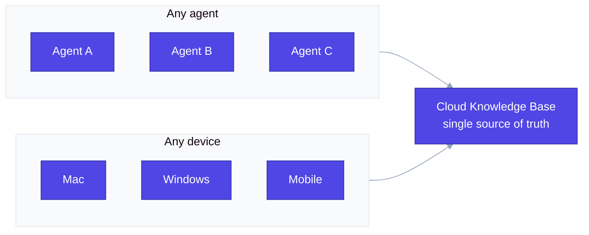
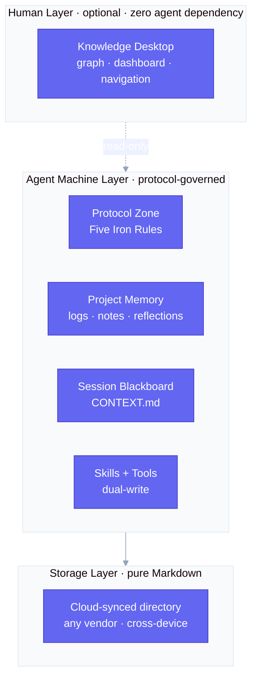
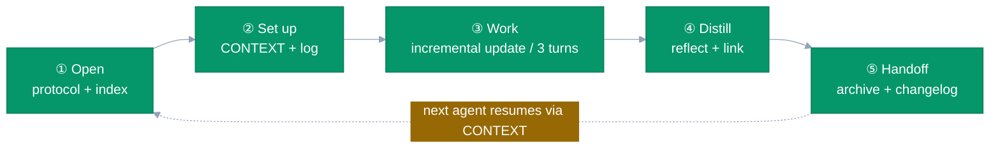

# shared-memory-vault

> **One knowledge base, shared by every agent and every device.** A memory governance engine for multi-agent cloud knowledge bases — collaborate without context loss, access from any device, consistency guaranteed.

<p align="center">
  
  
  
  
  
</p>

---

## What it does

This skill turns a plain cloud-synced Markdown directory into a **shared knowledge base for every agent and every device**, with three guarantees at its core:

### 🌐 Multi-agent collaboration

Multiple AI agents share one knowledge base through a session-blackboard convention (`CONTEXT.md`). Any agent reads a single file and resumes the work from where another left off — no context loss, no drifting or contradictory decisions.

### 📱 Cross-device sharing

The knowledge base is **pure Markdown on a cloud-synced directory** — no database, no server, no vendor lock-in. Open it from Mac, Windows, Linux, or mobile; the same knowledge base follows you everywhere.

### 🔒 Consistency guaranteed

A **single source of truth**, not per-agent copies. Conflict handling (timestamp + `.bak`) and incremental updates keep every agent and every device reading the *same* consistent state, no matter who wrote last.



> **Zero infrastructure. Zero vendor lock-in. Zero third-party dependencies** — every script uses only the Python standard library.

---

## How it works

### Architecture



- **Storage layer** — pure Markdown, a single source of truth, portable and versionable.
- **Machine layer** — agents read and write the four machine zones, governed by a protocol and nine governance actions.
- **Human layer** — an optional knowledge desktop for browsing; the agent workflow has zero dependency on it.

### Session lifecycle



Nine governance actions fire automatically across the lifecycle:

| # | Governance action | Script | Trigger |
|---|---|---|---|
| ① | Session archiving & indexing | `vault-archive.py` / `vault-index.py` | open / scheduled |
| ② | Incremental updates (replace full overwrite) | `context-update.py` | every 3 turns |
| ③ | Provenance & confidence tagging | `provenance-check.py` | on write / audit |
| ④ | Periodic reflection | `reflect.py` | milestone / scheduled |
| ⑤ | Write-after change awareness | `vault-index.py --notify` | after each overwrite |
| ⑥ | Semantic retrieval | `search.py` | on query |
| ⑦ | Cross-project memory linking (A-MEM style) | `link-memory.py` | milestone / scheduled |
| ⑧ | Forgetting-curve scoring (MemoryBank style) | `decay-score.py` | before archiving |
| ⑨ | Governance benchmark | `governance-score.py` | periodic / on demand |

---

## Quick start

```bash
# 1. Install the skill
cp -r shared-memory-vault ~/.workbuddy/skills/

# 2. Bootstrap a knowledge base skeleton in any cloud-synced directory
bash ~/.workbuddy/skills/shared-memory-vault/scripts/vault-init.sh --dir "~/MyCloud/KnowledgeBase"

# 3. Agents then follow the lifecycle SOP in SKILL.md automatically
```

The generated skeleton:

```
KnowledgeBase/
├── MOC.md                navigation home
├── dashboard.md          aggregated dashboard
├── user memory/          protocol zone (five iron rules + frontmatter spec)
├── work memory/          project memory (logs / notes / reflections)
├── context/              session blackboard (one CONTEXT.md per session) + archive + index
├── references/           knowledge assets (layered: notes / learning / work / reading)
├── _templates/           templates
└── skill&tool/           skills + tools
```

---

## Design rationale (academic grounding)

Every design choice has a reference, not an arbitrary convention:

| Design | Reference | Basis |
|---|---|---|
| Session blackboard + reflection + retrieval | [Generative Agents](https://arxiv.org/abs/2304.03442) | memory stream + reflection + weighted retrieval |
| Tiered context paging | [MemGPT](https://arxiv.org/abs/2310.08560) | OS-style virtual context |
| Incremental update decisions | [Mem0](https://arxiv.org/abs/2504.19413) | ADD/UPDATE/DELETE/NOOP pipeline |
| Cross-project memory linking | [A-MEM](https://arxiv.org/abs/2502.12110) | Zettelkasten dynamic linking |
| Forgetting-curve scoring | MemoryBank (cognitive science) | Ebbinghaus curve + importance weighting |
| Built-in governance | [Always-On Agents Survey](https://arxiv.org/abs/2606.30306) | shared-memory governance, provenance |

> Full reference list: [`references/research.md`](references/research.md).

---

## Core protocol

**Five iron rules** (non-negotiable, apply to every action):

1. Never build a private memory/knowledge base — write everything to the shared repository
2. `references/` is readable; writing requires explicit user authorization
3. External systems (collaboration platforms / online docs / email) are read-only
4. Never touch personal directories
5. Before any batch write/edit/delete (>1 item), show the detailed list and get confirmation

**Permission layering** — the machine zone (agent read/write) and the human zone (read-only by default) are strictly isolated, preventing agents from polluting the user's knowledge assets.

---

## Repository layout

```
shared-memory-vault/
├── SKILL.md              entry: governance protocol + lifecycle SOP + script cheatsheet
├── templates/            templates: protocol / CONTEXT / frontmatter / log / reflection / index
├── scripts/              automation engine (10 standard-library scripts)
└── references/           design notes + academic references
```

---

## License

[MIT License](LICENSE)

## Disclaimer

This skill contains only **mechanisms + templates + scripts + academic references**. It contains no personal, professional, or study data of any user. Users choose their own knowledge-base content and sync carrier.
