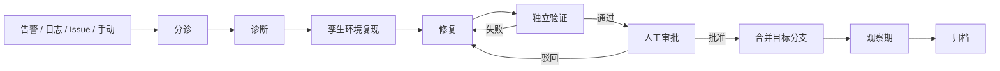

<div align="center">

<h1>TwinFix</h1>

<p><strong>在一次性隔离环境中自动诊断、复现并修复故障的 AI Agent</strong></p>

<p>从告警到可合并的修复：诊断 → 复现 → 修复 → 独立验证 → 人工批准。<br/>
Agent 不接触生产环境，也不自证通过：故障必须先用失败测试证明，修复必须通过 Agent 不可见的隐藏测试。</p>

<p>
  <a href="https://github.com/spacesky-cell/TwinFix/actions/workflows/ci.yml"></a>
  <a href="LICENSE"></a>
  
  
  
  
  
</p>

<p>
  <a href="#快速开始">快速开始</a> ·
  <a href="#核心能力">核心能力</a> ·
  <a href="#工作流程">工作流程</a> ·
  <a href="#架构">架构</a> ·
  <a href="#基准测试">基准测试</a> ·
  <a href="#开发">开发</a> ·
  <a href="README.en.md">English</a>
</p>

</div>


## 简介

TwinFix 是一个面向线上故障的 AI Agent。它从告警、错误日志、Issue 或手动提交接入，自动完成分诊（triage）、诊断、复现、修复、验证与报告，最终把一个已经在真实运行环境中验证过的修复交给人工评审和合并。

现有工具的空白：

- AI SRE 工具（如 HolmesGPT、K8sGPT）偏基础设施层，以诊断为主，不修改业务代码；
- 自动修复工具（如 Sentry Seer）能生成 PR，但改动没有在真实运行环境中验证。

TwinFix 的差异在于：修复在从目标分支构建的一次性孪生环境（twin）中执行，并由独立于修复者的流程完成验证。四条原则贯穿始终：

1. **先复现，后修复**：没有稳定的失败用例，就不修改代码；
2. **验证独立**：修复 Agent 不能判定自己是否通过；
3. **结论绑定提交**：验证结果绑定 commit SHA，代码变化后重新验证；
4. **人是最后一道门**：合并必须经过人工批准。

> 支持 Java（Maven / Gradle）、Python（pytest）、Go（go build / go test）、TypeScript / JavaScript（node --test）与 C# / .NET（dotnet build / dotnet run 测试工程）。真实项目可通过 `project.config.commands` 覆盖构建与测试命令。孪生环境默认使用 Docker Compose，也支持 Kubernetes；代码托管支持 GitHub、GitLab 与本地 git。

TwinFix 当前为 **v0.1 alpha**：核心闭环、基准测试与 CI 可复现。生产使用前，请在目标仓库和基础设施中验证适配器，并按 [`SECURITY.md`](SECURITY.md) 配置鉴权与网络边界。

## 核心能力

| 能力 | 实现 |
|---|---|
| 端到端闭环 | 4 个 LLM Agent（诊断 / 复现 / 修复 / 验证）+ 1 个确定性 Reporter；Fixer 与 Verifier 自动迭代，默认最多 3 轮 |
| 确定性编排 | LangGraph 状态机决定流程，LLM 只在节点内推理；每个状态写入 PostgreSQL checkpoint，worker 崩溃后从断点恢复 |
| 安全内置 | 所有工具经统一网关执行，按风险分级授权并记录审计；受保护路径只读；只能推送 `fix/twinfix-*` 分支；合并需要审批 |
| 独立验证 | 编排器在沙箱中独立重跑复现；扫描测试完整性；使用 Agent 不可见的隐藏测试判分 |
| 上下文工程 | 日志模板聚类、证据按需回查、历史判例注入、读取去重、探索预算、上下文压缩 |
| 代码智能 | tree-sitter 符号索引：按名称查找类 / 方法、查询引用与调用方、查看文件结构、读取 git 历史 |
| 多语言与多仓库 | 5 种语言共用同一套编排；附加仓库检出到 `_repos/<name>`，按服务映射加载，可配置为只读或可修复，支持分仓提交与合并 |
| 多入口与人机协同 | Alertmanager / Grafana 告警、Elasticsearch 错误日志扫描、GitHub / GitLab Issue、REST API；审批中心、多人审批、驳回回流、负责人指派、合并后观察期 |
| 可观测与可恢复 | 事件表与 SSE 实时推送、Run / ToolCall / Evidence 全链路留痕、Prometheus 指标、可选的 OpenTelemetry 链路追踪、超时与预算硬中断、急停开关 |

## 工作流程

1. **接入**：告警、错误日志、GitHub / GitLab Issue 或手动创建，归一化为 `Signal`
2. **分诊**：指纹去重、非 bug 过滤、定级，生成 `Incident`
3. **诊断**：查询指标、日志、链路与代码，产出根因假设、证据与置信度
4. **复现**：在孪生环境中编写失败用例，由编排器独立重跑确认
5. **修复**：在临时工作区修改代码，运行目标测试与回归测试
6. **验证**：重新部署孪生环境，确认复现用例转绿、回归通过、diff 合规
7. **评审**：人工在控制台查看报告与 diff，批准或驳回（可退回根因或补丁阶段）
8. **合并**：变基到目标分支并重新验证，合入目标分支（默认 `dev`）；进入观察期



状态转换由 `server/twinfix/domain/state_machine.py` 统一定义，LangGraph 负责在节点之间推进。

## 快速开始

### 演示模式（无需 LLM Key）

需要 Docker 与 Compose v2。演示模式使用内置模拟 Agent（stub）。

```bash
git clone https://github.com/spacesky-cell/TwinFix.git
cd TwinFix
docker compose -f deploy/compose.dev.yml up -d --build
```

打开 <http://localhost:17317>，点击 **手动创建事故**，选择一个内置场景，即可在详情页观察事故走完诊断 → 复现 → 修复 → 验证。到达 **待评审** 后点击 **确认合并**。

| 服务 | 地址 |
|---|---|
| 控制台 | http://localhost:17317 |
| API / OpenAPI | http://localhost:8000/api · http://localhost:8000/docs |
| RabbitMQ 管理台 | http://localhost:15672（`twinfix` / `twinfix`） |
| 可观测栈（可选） | `docker compose -f deploy/observability/compose.observability.yml up -d`：Prometheus :9090 · Elasticsearch :9200 · SkyWalking :12800 · Jaeger :16686（OTLP :4318） · Grafana :3000 |

### 接入真实 LLM

把 `deploy/.env.example` 复制为 `deploy/.env`，至少设置：

```dotenv
TWINFIX_AGENT_MODE=llm
TWINFIX_LLM_BASE_URL=https://your-openai-compatible-endpoint/v1
TWINFIX_LLM_API_KEY=...
TWINFIX_LLM_MODEL=...
TWINFIX_SANDBOX=docker
TWINFIX_TWIN_PROVIDER=compose
TWINFIX_TWIN_HOST=host.docker.internal
```

然后重建：

```bash
docker compose -f deploy/compose.dev.yml up -d --build
```

真实闭环还需要预填 Maven 依赖卷、分配孪生端口与资源上限；其他语言的沙箱镜像与项目语言配置见 [`docs/07-arena-eval.md`](docs/07-arena-eval.md) 与 [`docs/04-interfaces.md`](docs/04-interfaces.md)。API Key 等敏感值只放在未跟踪的 `deploy/.env` 中。

> 本地默认关闭鉴权（`TWINFIX_AUTH_DISABLED=true`），所有端口只绑定 `127.0.0.1`。对外暴露前请设置 `TWINFIX_AUTH_DISABLED=false` 和至少 32 字节的 `TWINFIX_JWT_SECRET`，并创建管理员账号：
> `docker compose -f deploy/compose.dev.yml exec twinfix-api twinfix-user create admin`。

## 架构


```
入口层   Web API / Webhooks（Alertmanager、Grafana、GitHub、GitLab、Jenkins）/ Elasticsearch 日志扫描
   ↓
分诊层   归一化 → 指纹 → 去重聚合 → 非 bug 过滤 → 定级 → Incident
   ↓
编排层   LangGraph 状态机 + RabbitMQ 逐状态派发 + Redis 单活锁 + PostgreSQL checkpoint
   ↓
Agent 层 Diagnoser / Reproducer / Fixer / Verifier / Reporter
   ↓
治理层   Tool Gateway：权限分级、审批、审计、脱敏、预算、完整性扫描
   ↓
适配层   Prometheus + Elasticsearch + SkyWalking / GitHub + GitLab + local git / Jenkins + GitLab CI / Compose / Kubernetes Twin / Docker Sandbox / 邮件 + 飞书 / LLM
   ↓
语言层   JavaProfile（Maven / Gradle）│ PythonProfile（pytest）│ GoProfile（go build / go test）│ TypeScriptProfile（node --test）│ CSharpProfile（dotnet build / dotnet run）
```

五个 Agent 按工具、权限与上下文拆分：

| Agent | 职责 | 关键约束 |
|---|---|---|
| Diagnoser | 根因假设、证据、可疑代码位置 | 只读工具 + 只读 Arthas 探针 |
| Reproducer | 产出稳定的失败用例与复现命令 | 只写测试目录，运行在沙箱中 |
| Fixer | 产出补丁 | 只能修改工作区源码，不能触碰判分测试 |
| Verifier | 复现转绿、回归、diff 审查 | 只读源码，独立于 Fixer |
| Reporter | 渲染并分发报告、回写 Issue / PR | 确定性实现，不调用 LLM |

## 基准测试

`arena/` 是 TwinFix 自带的基准测试套件（Arena）：五个故意包含缺陷的示例服务，以及 40 个故障注入用例。

| 套件 | 示例服务 | 用例 | 数量 |
|---|---|---|---|
| Java | demo-shop（Spring Boot + PostgreSQL） | C001–C024 | 24 |
| Python | demo-python（标准库） | P001–P004 | 4 |
| Go | demo-go（net/http） | G001–G004 | 4 |
| TypeScript / JavaScript | demo-ts（node:http） | T001–T004 | 4 |
| C# / .NET | demo-cs（System.Net.HttpListener） | S001–S004 | 4 |

每个修复用例包含三部分：伪装成正常功能合入的注入补丁、TwinFix 不可见的隐藏测试，以及参考修复。`twinfix-arena validate` 在 CI 中校验每个用例的缺陷确实存在、隐藏测试能够捕获、参考修复能够通过。

```bash
cd server
uv run twinfix-arena validate                         # 用例自检（不需要 TwinFix 服务）
uv run twinfix-arena validate --repeat 3              # 稳定性自检，结果不一致标记 FLAKY
uv run twinfix-arena eval --label <模型名>             # 端到端评测
uv run twinfix-arena eval --suite fast                # 6 例快速回归
uv run twinfix-arena eval --suite python              # Python 四例
uv run twinfix-arena eval --suite go                  # Go 四例（本机无 Go 时用 --go-image）
uv run twinfix-arena eval --suite typescript          # TypeScript 四例（本机无 Node 22+ 时用 --node-image）
uv run twinfix-arena eval --suite csharp              # C# 四例（本机无 .NET SDK 时用 --csharp-image）
uv run twinfix-arena gate eval/reports/<报告>.json     # 回归门禁：阈值不达标退出码非 0
uv run twinfix-arena compare a.json b.json            # 多份报告并排对比
```

评测指标：结论准确率、根因命中率（Top-1 / Top-3）、复现率、修复率、误修率、人工介入率、耗时与 token。评测方法与历史结果见 [`docs/07-arena-eval.md`](docs/07-arena-eval.md) 与 [`eval/reports/`](eval/reports/)。控制台的 **评测** 页面也可以直接发起评测任务并查看报告。

## 仓库结构

```
server/   Python 服务：api / worker / orchestrator / agents / gateway / adapters / profiles / domain / arena
web/      React 控制台（事故、审批、Arena、评测、运行、设置）
arena/    基准测试套件：demo-shop、demo-python、demo-go、demo-ts、demo-cs、孪生环境模板、40 个故障用例
deploy/   Compose、可观测栈、Jenkins 任务模板、Maven 镜像配置
eval/     评测报告（Markdown + JSON）
docs/     设计文档（01–08 + ADR）
```

## 开发

```bash
# 基础设施（仓库根目录）
docker compose -f deploy/compose.dev.yml up -d postgres redis rabbitmq

# 后端
cd server
uv sync
uv run alembic upgrade head
uv run uvicorn twinfix.api.app:create_app --factory --loop twinfix.db:selector_loop --reload  # API
uv run twinfix-worker                                                                          # worker

# 前端（另开终端，仓库根目录；/api 代理到 127.0.0.1:8000）
cd web && npm install && npm run dev
```

```bash
# 检查（与 CI 相同）
cd server && uv run ruff check . && uv run ruff format --check . && uv run mypy twinfix && uv run pytest
cd web && npm run build

# 端到端冒烟（需要完整 compose 栈）
cd server && uv run python scripts/e2e_smoke.py --scenario happy
```

## 文档

| 文档 | 内容 |
|---|---|
| [01-overview.md](docs/01-overview.md) | 目标、范围、核心流程、术语 |
| [02-architecture.md](docs/02-architecture.md) | 分层架构、模块职责、技术栈、部署形态 |
| [03-domain-model.md](docs/03-domain-model.md) | 核心实体、数据库表、事故状态机 |
| [04-interfaces.md](docs/04-interfaces.md) | 适配器 / 插件 / Agent / 对外 API 契约 |
| [05-safety.md](docs/05-safety.md) | 权限分级、工具网关、孪生隔离、防作弊 |
| [06-git-ci-flow.md](docs/06-git-ci-flow.md) | 分支策略、GitHub App / GitLab、Jenkins、合并与冲突 |
| [07-arena-eval.md](docs/07-arena-eval.md) | 基准测试、用例清单、评测方法与结果 |

版本变更见 [CHANGELOG.md](CHANGELOG.md)。

## 贡献

欢迎 Issue 与 PR。新增故障用例、重新生成 patch 等约定见 [`CONTRIBUTING.md`](CONTRIBUTING.md)。

## 许可证

[Apache License 2.0](LICENSE)。第三方组件与可选基础设施的许可证见 [`THIRD_PARTY_NOTICES.md`](THIRD_PARTY_NOTICES.md)。

安全问题请按 [`SECURITY.md`](SECURITY.md) 私下报告，不要开公开 Issue。
