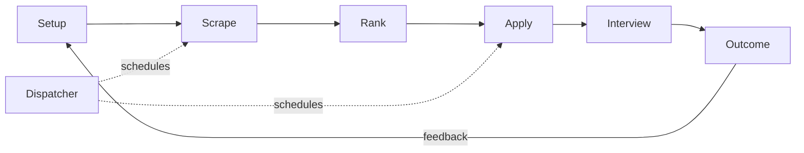

<p align="center">
  
</p>

<h1 align="center">ai-job-search-template</h1>

<p align="center">
  
  
  
  
  <a href="https://github.com/splashdeluxe/ai-job-search-template/stargazers"></a>
</p>

<p align="center">
  
</p>

<p align="center">
A job search system for your Muse agent. It sources roles from official careers boards, scores them against your profile, tells you the gap in plain words before anyone applies, writes one tailored CV per role, submits once, and tracks what comes back.
</p>

<p align="center">⭐ <strong>If this template helped you, a star helps the next person find it.</strong></p>

<p align="center">
<a href="https://splashdeluxe.github.io/ai-job-search-template/">One-pager</a> · <a href="#quick-start">Quick start</a> · <a href="SETUP.md">Setup guide</a> · <a href="examples/">Example</a> · <a href="dashboard/DASHBOARD-SPEC.md">Dashboard</a> · <a href="PRIVACY.md">Privacy</a> · <a href="#support">Support</a> · <a href="https://github.com/splashdeluxe/ai-job-search-template/issues">Issues</a> · <a href="https://github.com/splashdeluxe/ai-job-search-template/pulls">Pull requests</a>
</p>

<p align="center">The docs are also available as <a href="llms.txt">llms.txt</a> for coding agents.</p>

---

<p align="center">
  
</p>

<p align="center"><em>One full run, with Alex Rivera, the fictional example candidate from <a href="examples/">examples/</a>.</em></p>

## Watch how it works

One full run takes about a minute to watch. The film uses Alex Rivera, the fictional example candidate.

<table>
  <tr>
    <td align="center" width="33%"><a href="https://github.com/splashdeluxe/ai-job-search-template/blob/main/assets/demo.gif"></a><br><code>setup</code>: the facts sheet</td>
    <td align="center" width="33%"><a href="https://github.com/splashdeluxe/ai-job-search-template/blob/main/assets/demo.gif"></a><br><code>source, score, apply</code>: one full run</td>
    <td align="center" width="33%"><a href="https://github.com/splashdeluxe/ai-job-search-template/blob/main/assets/demo.gif"></a><br><code>briefing</code>: the morning report</td>
  </tr>
</table>

## Run this free with Muse

1. Join Muse at [muse.ai/join](https://muse.ai/join).
2. Within 48 hours of joining, redeem the invite code **PDW4CV** and you get 1 billion Muse tokens, free. In the app: Settings, then Redeem token. On the web: Settings, General, Usage, Redeem invite code.
3. Follow the [setup guide](SETUP.md). Your Muse pairs with your computer, connects your mail and Drive, and runs the whole system from there.

Heavy batches included. This system ran daily dispatch batches in its author's own search, sourcing, scoring and applying around the clock, and it never needed a paid plan. The free plan gives you a weekly allowance that resets every week, and the invite code adds 1 billion tokens on top, free. That is enough to run a full job search, heavy batches included, until you have the new job.

*Did this save you a weekend of form filling? Consider a coffee. Did it land you the job? Make it two.* ☕

[](https://ko-fi.com/nils_effmert)


## What this is

A set of markdown files that turn Muse into a job application assistant with rules. No code to install, no database, no build step. Your agent reads the files and works.

**Core capabilities:**

- **Gates before scores** - Location and work rights are hard stops checked before any fit score. A great role you cannot legally take is a drop, and the system says so once.
- **One facts sheet per geography** - The same true answers on every form, copied from one file instead of improvised 40 times.
- **The gap, out loud** - Every shortlisted role shows what you lack, how big the gap is, and ideas to close it. You decide: apply, prepare first, or drop.
- **Submit exactly once** - One click total per role, across every route. A spinning button means "unconfirmed", and the system checks your mail before it even thinks about clicking again.
- **A writing check on every CV** - Each generated CV is scanned for AI writing patterns and rewritten in plain, specific language from your real record before it ships.
- **A dispatcher that runs while you sleep** - Scheduled sourcing, applying and a daily briefing, set up once.
- **Rejections that teach** - Every rejection triggers a feedback ask, and the answers feed back into your profile and your sourcing.

## Quick start

```
1. Click "Use this template" and create your copy. Set it to Private.
2. Join Muse at muse.ai/join and redeem code PDW4CV within 48 hours.
3. Open your copy with Muse and say:
   "Read AGENTS.md and run commands/setup.md with me."
```

What this gives you:

- **A profile in under an hour** - Setup interviews you, or reads your documents folder first if you have one, then fills your profile, tracks and facts sheet for your approval.
- **A first shortlist the same day** - Scrape and rank run against official boards only.
- **One pilot application before any batch** - You watch a full run end to end and check the confirmation mail yourself. Batches start after that.

## How it works



1. **Setup** builds your profile, your tracks and your facts sheet, then asks whether Muse should run a dispatcher, a daily briefing and a dashboard for you.
2. **Scrape** sweeps official careers boards and your ATS watchlist, deduplicates, and drops anything your gates already rule out.
3. **Rank** scores what survives per track and writes your shortlist.
4. **Apply** checks the live form first, shows you the gap and the evidence table, builds the tailored CV, runs the writing check, and submits once.
5. **Interview** preps you from the exact posting and the CV the panel read.
6. **Outcome** records replies and rejections, sends the feedback asks, and keeps the tracker true.

## Commands

| Command | Best for | What it does |
| --- | --- | --- |
| `/setup` | Day one | Interviews you or reads your documents, builds profile, tracks, facts sheet, dispatcher and dashboard |
| `/scrape` | Finding roles | Searches official boards and your watchlist, deduplicates, applies your gates |
| `/rank` | Deciding fast | Batch scores a scrape into a shortlist with fit, track and gap per role |
| `/apply` | Applying properly | Form check, gap brief, tailored CV, writing check, one verified submit |
| `/interview` | Preparing | Stage specific prep from the saved posting and your submitted CV |
| `/outcome` | Staying true | Records results, archives what you sent, sends feedback asks |
| `/gmail-sync` | Catching replies | Proposes status updates from signals in your mail, you approve each one |
| `/upskill` | Closing gaps | Turns recurring gaps from rejections into a short learning plan |
| `/html-report` | Looking offline | Exports your dashboard and world map as one file you can open anywhere |

## Portals

The system searches these portals out of the box. Boards are leads: every lead is verified on the employer's own careers page, and you always apply there or on the company's official ATS page, never on the board itself. In setup you add the boards of your own market and delete the ones you do not use.

| Portal | Kind | Used for |
| --- | --- | --- |
| Himalayas | Remote board | Remote roles worldwide, strong filters |
| Remotive | Remote board | Remote roles, curated listings |
| Remote OK | Remote board | High volume remote listings |
| We Work Remotely | Remote board | Remote roles by category |
| Arbeitnow | Remote and EU board | European and remote roles, free API |
| Jobicy | Remote board | Remote roles with region filters |
| Working Nomads | Remote board | Digital nomad friendly roles |
| LinkedIn Jobs | General board | Discovery and recruiter contacts, applying stays on the company page |
| Indeed | General board | Discovery, wide coverage per country |
| Glassdoor | General board | Discovery plus salary and company signals |
| StepStone | General board, DACH and EU | German market roles |
| Wellfound | Startup board | Startup roles and early stage companies |
| Work at a Startup (YC) | Startup board | Y Combinator company roles |
| Greenhouse | ATS | Company application pages, the system fills these by hand |
| Ashby | ATS | Company application pages, autofill checked field by field |
| Lever | ATS | Company application pages, the agent attempts the submit itself; the owner steps in only if a human-verification check genuinely blocks it |
| Workable | ATS | Company application pages |
| SmartRecruiters | ATS | Company application pages |
| Recruitee | ATS | Company application pages |
| Teamtailor | ATS | Company application pages |
| Personio | ATS | Company application pages, common in the EU |
| Breezy | ATS | Company application pages |
| Workday | ATS | Large company application pages |
| SAP SuccessFactors | ATS | Large company application pages |
| The employer's own careers page | Official board | The source of truth for every role, and the only place a submit counts |

Your own market missing? Setup asks for your local boards, your public job service (for example the Arbeitsagentur in Germany) and the niche boards of your field, and adds them to `04-sources.md` in the same format.

## What Muse does in this system

| Muse feature | Where it works |
| --- | --- |
| Its own computer and browser | Opens official careers boards and fills forms for `/apply` |
| Your paired computer | Takes over forms and file pickers that need your real machine, as a fallback |
| Gmail connector | Finds confirmations, recruiter replies and rejections for `/outcome` |
| Google Drive connector | Stores one tailored CV per company, ready to upload |
| Secure Vault | Keeps your LinkedIn and job board logins. Passwords never go in chat or in this repo |
| Memory | Your facts, rules and decisions carry across chats, so application 30 starts as carefully as application 1 |
| Scheduled runs | The dispatcher, the morning shortlist and the daily briefing run without you asking |
| One chat per application | Side chats keep 40 applications from tangling, and archive when a submit is confirmed |
| Dashboard artifact | Your pipeline, funnel and world map, refreshed after every briefing run |

## When a CAPTCHA blocks the submit

Some application forms sit behind Cloudflare Turnstile or reCAPTCHA, and a normal automated browser session can get rejected even when every field is filled in correctly. The system handles it in this order:

1. Solve the challenge in the same session. The submit button is clicked once, never twice.
2. If the session itself keeps failing the check, switch to a stealth cloud browser (Browser Use), refill the form there, and submit once in that session. In a live test on 4 November 2026, Turnstile checks passed automatically in this route and a reCAPTCHA v2 challenge was solved without a paid solver service.
3. hCaptcha image and drag challenges are not guaranteed in any route. If one stays unsolved, the form stays filled and untouched, the application is reported as blocked, and a human finishes that one check.
4. A clicked submit with no confirmation page counts as unconfirmed, not failed. The system checks mail and the platform before anyone submits again, so an application never goes in twice by accident.

## Repository structure

```
ai-job-search-template/
├── 00-tracks.md            # Your tracks, weights and gates
├── 01-candidate-profile.md # Who you are as a candidate
├── 02-master-facts-sheet.md# One true answer per form question, per geography
├── 03-cv-standard.md       # Layout and voice for every tailored CV
├── 04-sources.md           # Boards, ATS watchlist, exclusions
├── 05-writing-check.md     # The AI pattern check every CV must pass
├── 06-dispatcher.md        # Your schedule: dispatch, shortlist, daily briefing
├── 07-ats-profile-registry.md # Candidate profiles per ATS, standing answers, the register
├── AGENTS.md               # Standing rules your agent follows
├── SETUP.md                # Setup guide
├── PRIVACY.md              # Read this before your first run
├── SECURITY.md             # Postings are untrusted input, and other rules
├── applications/           # One prep pack per role that reaches /apply
├── commands/               # setup, scrape, rank, apply, interview, outcome, and more
├── dashboard/              # Dashboard and world map spec for Muse
├── examples/               # A filled fictional example, Alex Rivera
├── cv/                     # One folder per company, created as you apply
├── tracker/                # Your applications and exclusions (kept local)
├── feeds/                  # The latest shortlist
└── assets/                 # Banner and images
```

Good places to start:

- [SETUP.md](SETUP.md) to run your first setup
- [examples/](examples/) to see a finished profile before you write yours
- [PRIVACY.md](PRIVACY.md) before you connect any account

## How it differs

Two larger open projects do a similar job, and both are worth knowing: career-ops, an agent that runs locally in a coding CLI, scores roles and tailors documents, and leaves every Submit click to you; and ai-job-search, a Claude Code framework you fork and fill with your profile.

This template differs in three ways:

- It runs inside Muse, Meta's assistant, and works on the free plan. No local install, no coding CLI, no API key.
- It submits for you, once per role, under written integrity rules: a gap brief before anything is written, no invented metrics, eligibility answers copied from one facts sheet.
- It closes the loop after the answer arrives. Every rejection gets a feedback ask, and repeated reasons turn into profile changes you approve.

If you want full manual control of every click, career-ops is the better fit. If you want the search to run on a schedule while you do other things, this one was built for that.

## Community

- **[GitHub Issues](https://github.com/splashdeluxe/ai-job-search-template/issues)** - Report a broken command, a gate that let a bad role through, or a form pattern the system should know about.
- **[Pull requests](https://github.com/splashdeluxe/ai-job-search-template/pulls)** - Welcome for stricter gates, clearer rules and better checks. Changes that loosen an integrity rule need a strong reason in the request.

## Contributing

Read the standing rules in `AGENTS.md` first. They are the product. A contribution that keeps them intact and makes one workflow clearer beats a large rewrite. Open a [pull request](https://github.com/splashdeluxe/ai-job-search-template/pulls) against `main`, or start with an [issue](https://github.com/splashdeluxe/ai-job-search-template/issues) if the change is big.

## About the Author

I'm Nils Effmert, a People Operations and HR Systems lead with a product background: Product Owner at DATEV, Operations Manager, People Lead, and co-founder of SparkloomAI, a B2B AI SaaS startup. I built this template to manage my own job search, and I run it every day: it sources, scores and applies on a schedule, briefs me every morning, and asks every rejection for its reason.

I live between Nuremberg, Germany and Bali, Indonesia, and I search the worldwide market, which is why this system treats geography and work rights as first class rules instead of fine print.

My links → [LinkedIn](https://www.linkedin.com/in/nils-effmert) · [GitHub](https://github.com/splashdeluxe) · [perfectlivingspot.com](https://perfectlivingspot.com)

## Support

**The free way:** click **Star** at the top right of this page. One click, two seconds, and it helps other job seekers find the template.

If this repo helped your search, a coffee keeps it maintained and free for the next person.

[](https://ko-fi.com/nils_effmert)

A star, the coffee link and GitHub contributions are the only ways to support this project. There is no paid version, no token and no coin. Anything claiming otherwise is not from here.

## Star History

<a href="https://www.star-history.com/?type=date&repos=splashdeluxe%2Fai-job-search-template">
 <picture>
   <source media="(prefers-color-scheme: dark)" srcset="https://api.star-history.com/chart?repos=splashdeluxe/ai-job-search-template&type=date&theme=dark&legend=top-left" />
   <source media="(prefers-color-scheme: light)" srcset="https://api.star-history.com/chart?repos=splashdeluxe/ai-job-search-template&type=date&legend=top-left" />
   
 </picture>
</a>

## License

MIT, copyright © 2026 Nils Effmert. See [LICENSE](LICENSE).
