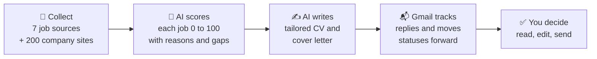

# Stellenpilot

**Every morning it finds new jobs, scores them against your CV and writes a tailored CV and cover letter for the best ones. Free, local, no account.**

[](https://pypi.org/project/stellenpilot/)
[](https://pypi.org/project/stellenpilot/)
[](https://github.com/srvskr1/stellenpilot/actions/workflows/tests.yml)
[](https://github.com/srvskr1/stellenpilot/blob/main/LICENSE)
[](https://stellenpilot.dev)
[](https://www.producthunt.com/products/stellenpilot)


<sub>All names, companies and jobs in this demo are fictional.</sub>

**New in 0.12.3:** a mock interview. Stellenpilot asks the likely questions one at a time and gives feedback built only on your own CV. Older releases are on the [releases page](https://github.com/srvskr1/stellenpilot/releases).

## Install

[](https://github.com/srvskr1/stellenpilot/releases/latest) [](https://github.com/srvskr1/stellenpilot/releases/latest)

No Python needed. First time on a Mac? [Read this first](https://github.com/srvskr1/stellenpilot/blob/main/docs/mac.md)

**Mac or Linux with Homebrew:**

```bash
brew tap srvskr1/stellenpilot
brew trust --formula srvskr1/stellenpilot/stellenpilot
brew install stellenpilot
stellenpilot serve
```

**Linux or Python 3.11+:**

```bash
pip install stellenpilot
stellenpilot serve
```

Drop your CV, say what you want, press **Download** for the built in AI and switch on the daily search. New to the terminal, or want Docker? The [install guide](https://github.com/srvskr1/stellenpilot/blob/main/INSTALL.md) goes step by step.

## Why try it

* **Private.** The built in AI runs on your computer. Your CV never leaves it.
* **Honest.** A truth guard rejects any sentence your CV does not back up, and every score comes with your real gaps.
* **Made for Germany.** 7 job boards plus about 200 company career pages, and it reads which German level an ad really needs. The app speaks English and German.
* **You stay in control.** It never applies for you and never contacts a company.

## How it works



Every day, by itself, it collects new ads and removes duplicates, scores each one against your CV, writes a CV and cover letter for the best matches (Word and PDF), and with Gmail connected moves your applications forward as replies come in. Interviews get a prep pack and a mock interview.

## More

| page | what is in it |
|---|---|
| [The AI](https://github.com/srvskr1/stellenpilot/blob/main/docs/ai.md) | what it does, the truth guard, measured results, built in AI vs Ollama vs Claude or OpenAI, speed |
| [Features](https://github.com/srvskr1/stellenpilot/blob/main/docs/features.md) | daily autopilot, company watchlist, email sync, digest, the five dashboard pages |
| [Job sources](https://github.com/srvskr1/stellenpilot/blob/main/docs/sources.md) | every source, its limits and terms, other countries |
| [Privacy and safety](https://github.com/srvskr1/stellenpilot/blob/main/docs/privacy.md) | what stays on your computer and what does not |
| [Commands](https://github.com/srvskr1/stellenpilot/blob/main/docs/commands.md) | every `stellenpilot` command and the project layout |
| [Install guide](https://github.com/srvskr1/stellenpilot/blob/main/INSTALL.md) | Windows, Mac, Linux and Docker, from zero to your first search |
| [Uninstall](https://github.com/srvskr1/stellenpilot/blob/main/docs/uninstall.md) | remove the daily search, the program and your data |

## Contributing

Issues and pull requests are welcome. Found a bug? [Open a bug report](https://github.com/srvskr1/stellenpilot/issues/new?template=bug_report.md); it is public, so leave out API keys and CV details. Read [docs/architecture.md](https://github.com/srvskr1/stellenpilot/blob/main/docs/architecture.md) first, it explains the decisions that are easy to undo by accident. New sources should use an official or clearly permitted API, follow the shape in `stellenpilot/sources/__init__.py`, and come with an offline test.

Built with an AI pair programmer, decisions are mine.

## License

MIT, see [LICENSE](https://github.com/srvskr1/stellenpilot/blob/main/LICENSE). Credits for ideas and data are in [NOTICE.md](https://github.com/srvskr1/stellenpilot/blob/main/NOTICE.md). The built in AI uses [llama.cpp](https://github.com/ggml-org/llama.cpp) (MIT) and [Qwen3.5](https://huggingface.co/Qwen) models (Apache 2.0), downloaded from their official sources.
