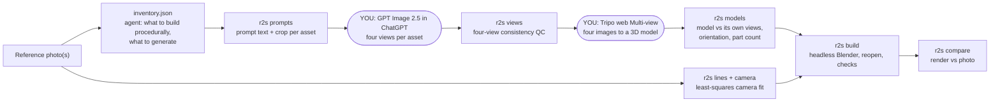

# ref2scene: reference photos → camera-matched Blender scene

[](LICENSE)


**Turn one or a few reference photos of a real place into an editable, camera-matched Blender
scene.** A coding agent ([Claude Code](https://claude.com/claude-code)) reads the photo, splits it
into procedural geometry and generated assets, and writes the exact **GPT Image 2.5 prompts for four
consistent views of each object** (front, left, right, back). You paste them into ChatGPT, upload
the four images to **Tripo's Multi-view image-to-3D** on its website, and put the downloads back in
the project. The toolkit then checks every hand-off with numbers, **fits the camera to the photo**
from vanishing lines and a scale anchor, and builds and verifies the scene in headless Blender.


*The case study: an office lobby rebuilt from one photo (Cycles). The chairs, tables, lounge
chair, tree and plants, round planter bench and timber booth are Tripo models made from GPT Image
2.5 four-view sets; the room, glazing, reception counter and the two slatted A-frames are
procedural. The wordmark on the wall was added on request; it is not in the photo. The reference
photo itself is not redistributed.*

Use it for:

- **photo → 3D scene** reconstruction of interiors in Blender, with every object editable;
- **four-view (turnaround) reference images** for multi-view image-to-3D (Tripo; the views also
  suit any front/left/right/back multi-view generator), checked for consistency before you spend a
  generation;
- **matching a Blender camera to a photo** (focal length, height, pitch, roll, lens shift) with
  residuals and uncertainties, from a script rather than a GUI;
- **quality checks for AI-generated 3D assets** before they go into a scene.

## No API keys: the toolkit writes the prompts, you run the generators

GPT Image 2.5 and Tripo are used **by hand, by design**. Nothing in this repository calls the
OpenAI or Tripo APIs or reads a key.

- `r2s prompts` writes the text to paste: one file per asset (`prompts/<id>.txt`), a crop of the
  object to attach with the photo, a two-message fallback (`<id>_front_first.txt`), and a
  `prompts/README.md` with the order of work.
- `r2s tripo` writes an upload checklist per asset: which normalised image goes in which
  Multi-view slot, which settings to use, and a block to record what you chose.
- Both outputs are checked before the next step: `r2s views` before anything goes to Tripo,
  `r2s models` before anything goes into the scene.

That keeps the generators on the plans people already have (ChatGPT, Tripo Studio on the web),
puts a person at the two steps where looking is cheap, and stops a bad view set before it costs a
3D generation. An excerpt of a generated prompt (the chair in
[`templates/project/inventory.example.json`](templates/project/inventory.example.json)):

```text
Using the attached original lobby photograph and the attached crop as the design reference,
generate FOUR SEPARATE IMAGES of the same black armless cafe chair in the crop:
1. Front view.  2. Left-side view.  3. Right-side view.  4. Back view.

Define the views by how the chair faces in the image. FRONT: it faces the camera. LEFT: its own
left side faces the camera, so its front points toward the LEFT edge of the image. RIGHT: ...
BACK: its real rear construction, never a mirrored front.
...
Make all four images the same square size, at least 1024 by 1024 pixels. Use one camera for all
four: the same distance, focal length, and height, looking down at the same slight angle of about
10 degrees ... frame for the widest view and keep that framing for the others.
...
Exclude arms, upholstery, tables, plants, room surroundings, floor geometry, people, text, labels,
borders, arrows, and dimensions.
```

The anatomy of the prompt, and why each paragraph is there, is in [`docs/PROMPTS.md`](docs/PROMPTS.md).

## How it works



| # | Stage | Who | Command | Writes | Gate (what is measured) |
|---|---|---|---|---|---|
| 0 | new | agent | `r2s new <dir> --ref photo.jpg` | `00_reference/`, `project.json`, `CLAUDE.md` | size, sha256, EXIF focal (if any) |
| 1 | inventory | **agent (vision)** | — | `inventory.json` | schema; a route + reason per element; size estimate with its basis |
| 2 | prompts | agent | `r2s prompts <dir>` | `prompts/<id>.txt`, crops | deterministic: same inventory → same prompt bytes |
| G1 | **GPT Image 2.5** | **you, in ChatGPT** | paste prompt + photo + crop | `01_asset_images/<id>/raw/` | — |
| 3 | views | agent | `r2s views <dir>` | `front/left/right/back.png`, `contact.png` | same size; same object height (one camera scale); front↔back and left↔right **mirror-silhouette IoU**; uncropped; one background; ≥3 soft warnings = FAIL |
| 4 | tripo | agent | `r2s tripo <dir>` | `prompts/tripo/<id>.md` | only accepted views get a checklist |
| G2 | **Tripo web Multi-view** | **you** | upload the 4 files by slot label | `02_models/<id>/*.zip` | — |
| 5 | models | agent | `r2s models <dir>` | `turntable.png`, manifest | silhouettes of the model vs its 4 views (8 orientation hypotheses); **thin-part count** (slats) vs `runs_min`; scale from the size estimate |
| 6 | camera | agent | `r2s lines`, `r2s camera <dir>` | `camera.json`, overlay | per-landmark residual (px); focal-length σ; non-significant yaw dropped |
| 7 | build | agent | `r2s build <dir> --check gray\|lit` | `05_output/<name>.blend`, checkpoint | **reopened** file: camera = fitted camera; Blender's projection = `camera.json`'s (<0.5 px); no missing images; **per-object box IoU** of projected geometry vs the photo |
| 8 | compare | agent | `r2s compare <dir> <png>` | overlays, region stats | region brightness ratios vs the photo; `--against` an earlier render |

Every stage is one command that writes `reports/<stage>.json` with pass/warn/fail; a FAIL is a
gate. `r2s status <dir>` prints where every asset stands and the one next action. Claude Code runs
it first in every session (the project's `CLAUDE.md` says so).

## What the checks catch

**Views, accepted.** The chair's four views agree: 0.4% height drift, left↔right mirror IoU 0.95.


**Views, rejected.** Four different arrangements of a plant, not one plant rotated: 18% height
drift, mirror IoU 0.60 / 0.55. In the hand-run session this set went to Tripo unchecked.


**Model, rejected.** The slatted A-frame came back from Tripo with 14 slats where its views have
25, so the stage routes it to procedural geometry before any scene work.


## Quick start

Requirements: [Blender](https://www.blender.org/) 5.2+, Python 3.10+, a ChatGPT account with
GPT Image 2.5, and a [Tripo](https://www.tripo3d.ai/) account (web Multi-view).

```bash
git clone https://github.com/starryark/ref2scene && cd ref2scene
pip install -r requirements.txt
python tools/r2s.py new projects/my_room --ref photo.jpg     # scaffold + CLAUDE.md for the agent
cd projects/my_room && claude                                 # Claude Code takes it from here
```

Or run the stages by hand, as in the table. The worked example is `projects/lobby/` (its specs and
reports are tracked; the photo, generated images and models are not).

## The lobby case study

The toolkit is the reproducible form of a workflow first done by hand (a ChatGPT prompt pack,
GPT Image 2.5 in ChatGPT, Tripo web, then a Claude Code session in Blender), written up in
[`docs/CASE_STUDY_LOBBY.md`](docs/CASE_STUDY_LOBBY.md). Two results, which show different things:

- **The toolkit reproduces the hand-built result.** Run on the same downloads, with the October
  scene script ported as-is and its hand-set camera, the library builder, runner, reopen-checks and
  compare render the lobby **pixel-identically** to the October deliverable (mean |Δ| 0.01/255).
- **The new-project path works on its own.** In a fresh project the fitted camera lands in Blender
  to 0.011 px, and tables placed only from their floor-contact pixels line up with the photo at box
  IoU 0.95 (the hand-placed lobby: 0.88–0.90).

| Check | Result |
|---|---|
| Prompts regenerated from `inventory.json` + template | 10/10 **byte-identical** to the final ChatGPT prompts (the slots were parsed from those prompts: this shows the template captures their structure, not that an agent's inventory yields good prompts) |
| View QC on the 11 asset folders as downloaded | 9 accepted (B01 and B03 picked automatically from folders holding 6 and 14 retries); A06 rejected (18% scale drift: four different arrangements, not one plant rotated); A06b rejected (the best four of six mix two specimens) |
| Model QC | B01 slatted screen: **14 slats in the model vs 25 in its views** → "build it procedurally" (the decision the hand session reached by eye) |
| Camera fit vs the hand fit | lens 40.94 vs 40.46 mm (f 1746 ± 111 px), height 1.400 ± 0.009 vs 1.39 m, VP u 629.5 vs 620 px; RMS 1.04 px over 43 landmarks |
| Placement from a pixel contact + fitted camera | box IoU 0.95 / 0.95 for the two tables (hand-tuned scene: 0.88–0.90) |
| Full rebuild from the Tripo zips, 1024 spp | **mean absolute difference 0.01/255** vs the Oct-26 deliverable render (max 1/255) |

## How it compares

A prior-art search (2026-10-28, four parallel searches, about 60 systems; full cited reports in
[`docs/research/`](docs/research/), summary in [`docs/PRIOR_ART.md`](docs/PRIOR_ART.md)) found no
published system that does this exact chain. The nearest neighbours:

| | Views per object | 3D generator | Camera | Checked against |
|---|---|---|---|---|
| **ref2scene** | **4 (front/left/right/back)**, QC'd before use | Tripo Multi-view (web) | least-squares fit from cited lines + scale anchor, with σ | each hand-off: views vs each other, model vs its views, reopened scene vs camera and photo boxes |
| SceneRig (arXiv 2610.28585) | 1 crop | SAM 3D | learned (MoGe-2) | silhouette/depth/DINOv2 score vs the photo |
| VIGA (arXiv 2601.11109) | 1 crop | SAM 3D, Meshy | not calibrated | agent verifier loop |
| 3D-RE-GEN (arXiv 2512.17459) | 1 (completed by Nano Banana) | Hunyuan3D 2.0 | learned (VGGT) | silhouettes, floor-plane fit |
| Tripo cookbook "Codex × Blender: Build an Interior Scene, Fast" | 1 AI reference image | Tripo | not matched to the photo | the AI references, not the photo |
| fSpy, Perspective Plotter | — | — | vanishing lines drawn by hand in a GUI; no uncertainties | — |

What is established and not claimed as new: agents writing Blender code and comparing renders,
agents calling image-to-3D, vanishing-point camera matching, floor-constrained placement.

## FAQ

### How do I turn a photo of a room into a 3D Blender scene?

Scaffold a project with `r2s new`, open Claude Code in it, and follow `r2s status`. The agent
writes the inventory and the prompts; you generate four views per object in ChatGPT and a model per
object on Tripo; the agent fits the camera, places the models and procedural geometry, and checks
the reopened `.blend` against the photo. The lobby used one photo, eleven four-view sets and
eight procedural elements.

### Does ref2scene call the OpenAI (GPT Image) or Tripo API?

No. It writes the prompt text and the upload checklists, and checks what comes back. The API facts
an adapter would need (model IDs, edit endpoint, Tripo v3 multi-view) are recorded in
[`docs/PROMPTS.md`](docs/PROMPTS.md) and [`docs/TRIPO.md`](docs/TRIPO.md), but no adapter is
included.

### Why four views per object instead of one image?

Single-image lifting has to invent the back and sides; a multi-view generator constrained by four
views of the same object does not. The four views must agree with each other, which image models do
not guarantee, so `r2s views` measures height drift and mirror-silhouette agreement and rejects sets
that are not one object rotated.

### Which way does the "left" view face for Tripo Multi-view?

LEFT is the object's own left side: its front points to the **left edge of the image**. That is how
GPT Image 2.5 drew the lobby's left views and how Tripo reads its Left slot (from an API-client
note and consistent lobby models). `r2s models` measures the orientation of every model instead of
trusting it; [`docs/TRIPO.md`](docs/TRIPO.md) has a one-time calibration with a lopsided object.

### How is the camera matched to the photo, and how is this different from fSpy?

You (or the agent) cite detected line segments by id as x/y/z directions, add a scale anchor (a
known height) and optionally ellipses of round tables; `r2s camera` fits focal length, height,
pitch, roll and lens shift by least squares and reports residuals per landmark and σ per
parameter. fSpy does the same geometry interactively, without uncertainties, and in its
one-vanishing-point mode needs the focal length from you; `r2s camera` gets it from the table
ellipses (lobby: 40.9 mm ± 6%). See [`docs/CAMERA.md`](docs/CAMERA.md).

### Can I use it without Claude Code?

Yes. Every stage is a plain command, and `AGENTS.md` and the project `CLAUDE.md` are readable by any
coding agent (Codex, Cursor, …). The only step that needs vision judgement is writing
`inventory.json`, which you can also write by hand from
[`templates/project/inventory.example.json`](templates/project/inventory.example.json).

### Can I use another image model or another image-to-3D service?

The prompts are plain text and the view checks work on any four PNGs, so other image models and
other front/left/right/back multi-view generators should slot in; only GPT Image 2.5 and Tripo
have been tested. `r2s tripo` writes Tripo-specific checklists.

### What does it not do well?

Thin repeated members (slats, mullions, balusters) do not survive image-to-3D, so the inventory
routes them to procedural geometry. It has been tested end to end on one interior photo; see
Limitations.

## Project layout

```
project.json  inventory.json  asset_manifest.json  CLAUDE.md
00_reference/        ref_01.png ...
01_asset_images/<id> raw/ (ChatGPT downloads, untouched) → front/left/right/back.png, masks/, contact.png, views.json
02_models/<id>       the Tripo zip (untouched) + extracted files, _r2s/ (renders, model.json), turntable.png
03_project/          landmarks.json camera.json params.json scene.py regions.json assets.blend
04_renders/          checkpoints/ compare/
05_output/           <name>.blend (packed)
prompts/             <id>.txt <id>_front_first.txt <id>_crop.png tripo/<id>.md
reports/             one JSON per stage, status.md
```

## Design choices

- **The agent decides; tools measure.** Judgement (what is in the photo, what "front" means,
  procedural or generated) goes into `inventory.json`. Everything after it is deterministic and
  checked with numbers, because agents' self-assessment of 3D reconstructions is close to chance
  (LEGO-Anything: 45.8% agreement with the measured score; see [`docs/PRIOR_ART.md`](docs/PRIOR_ART.md)).
- **Two human gates, no hidden API calls.** GPT Image 2.5 runs in ChatGPT and Tripo on its website.
  The toolkit prepares the inputs and checks the outputs of both.
- **Thin repeated members are procedural.** Image-to-3D merges or drops slats, mullions and
  balusters (14 of 25 survived in the lobby). The inventory marks them `thin_repetitive`.
- **"Left" is the object's own left.** The LEFT image shows the object's front pointing to the
  image's left edge. The models stage measures orientation instead of trusting it.
- **Rebuild, don't patch.** The scene is `scene.py` + `params.json`; the checked artefact is the
  saved and reopened `.blend`, never the live session. Blender runs headless in a fresh process per
  command.

## Docs

[`WORKFLOW`](docs/WORKFLOW.md) (each stage, its decisions and gates) ·
[`PROMPTS`](docs/PROMPTS.md) (prompt anatomy, v1/v2, view convention) ·
[`TRIPO`](docs/TRIPO.md) (web hand-off, settings, API facts) ·
[`CAMERA`](docs/CAMERA.md) (model, landmarks, uncertainty, several photos) ·
[`VERIFICATION`](docs/VERIFICATION.md) (every check and how its threshold was calibrated) ·
[`PRIOR_ART`](docs/PRIOR_ART.md) (what exists, what is new; full reports in `docs/research/`) ·
[`CASE_STUDY_LOBBY`](docs/CASE_STUDY_LOBBY.md) ·
[`AGENTS.md`](AGENTS.md) (rules for coding agents) ·
[Claude Code skill](.claude/skills/ref2scene/SKILL.md) ·
[`llms.txt`](llms.txt).

## Limitations

- Tested end to end on one interior photo. Multi-photo registration (shared floor points) is
  implemented in the camera solver but has not been exercised on a real second photo.
- The silhouette checks cannot see changes *inside* a silhouette (the round bench's cushions
  moved between views and still passed); `contact.png` is there for the agent's and your eyes.
- The camera's metric scale always rests on an assumption (a known height or spacing); the report
  names it. One-point perspective photos determine focal length weakly (±6% here).
- No image-level "does the render match the photo" score: stone and wood texture swamp edge and
  phase metrics, so alignment is measured per object instead.
- The regression test needs the case study's binaries (photo, downloads, models), which are not
  redistributed.

## Citation

If you use the toolkit or build on the workflow, please cite it ([`CITATION.cff`](CITATION.cff)):

```
Liu, Y. (2026). ref2scene: reference photos to a camera-matched Blender scene with GPT Image 2.5
four-view prompts, Tripo multi-view and Claude Code. https://github.com/starryark/ref2scene
```

## License

MIT. Generated images and models keep the terms of the service that made them; reference photos
keep theirs. None are committed. Not affiliated with or endorsed by Anthropic, OpenAI, Tripo /
VAST or the Blender Foundation; product names belong to their owners.
