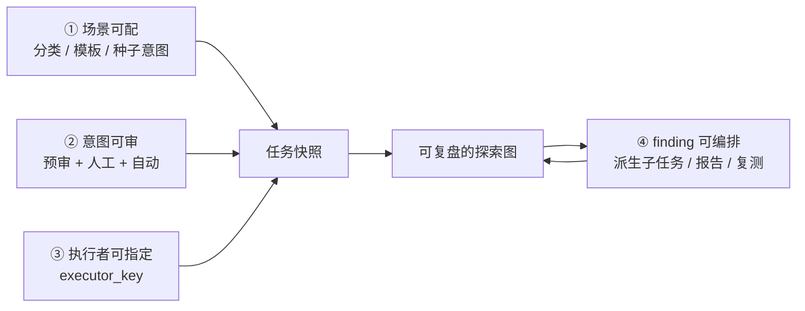
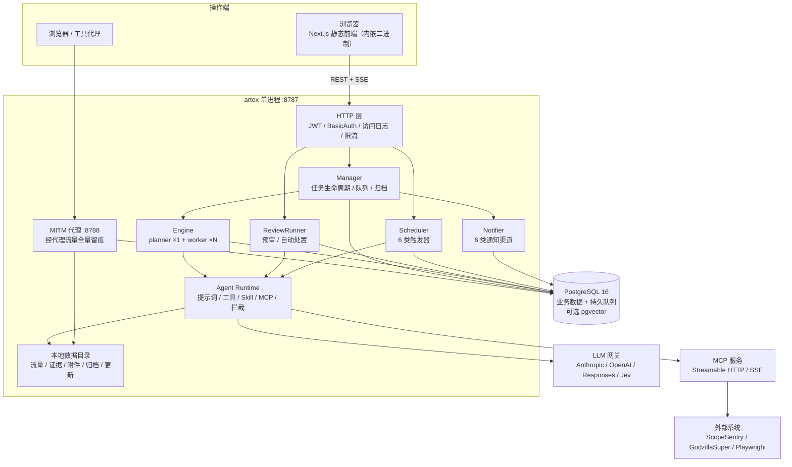
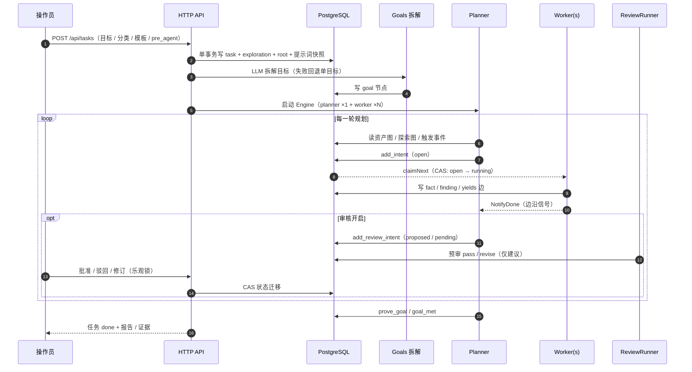
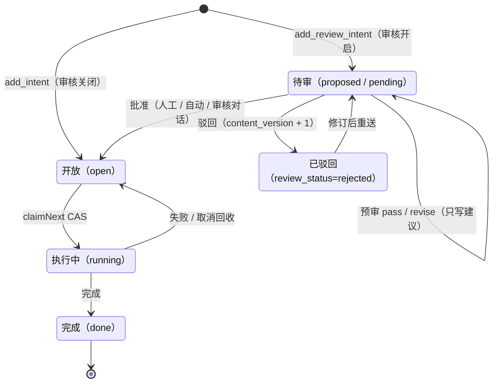
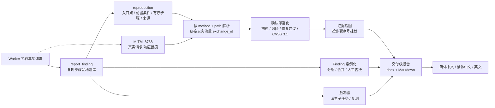
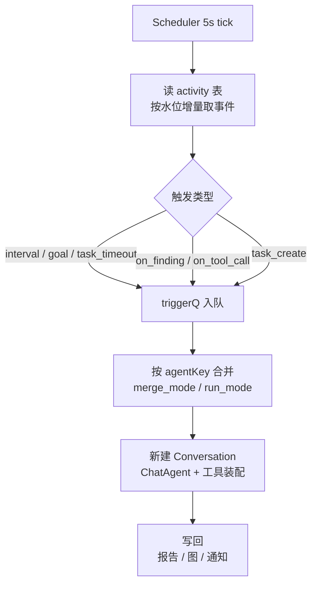

<div align="center">

# ARTEX · artex-ld

**AI 自主渗透测试平台 —— 二开增强版**

以目标与事实驱动的 planner–worker 双图引擎为核心，叠加场景编排、意图审核、
自定义执行者、漏洞交付流水线与完整运维面。

当前版本 **0.2.3** · Git Tag **v0.2.3**

[](https://github.com/steveopen1/artex-ld/releases)
[](LICENSE)
[](go.mod)
[](docker-compose.yml)
[](web/package.json)

</div>

> [!WARNING]
> **仅限合法授权、自有系统与隔离靶场。**
> 意图审核、拦截规则、ask 确认卡与人工审批都只是**辅助控制**，不能替代授权边界、目标隔离、数据保护义务与操作者判断。
> 使用本项目即表示你确认已获得对目标的书面授权，并对全部操作负责。

---

## 目录

- [1. 这是什么](#1-这是什么)
- [2. 快速开始](#2-快速开始)
- [3. 能力总览](#3-能力总览)
- [4. 二开增强点](#4-二开增强点)
- [5. 架构](#5-架构)
- [6. 核心流程](#6-核心流程)
- [7. 功能地图](#7-功能地图)
- [8. 部署与运维](#8-部署与运维)
- [9. 安全模型](#9-安全模型)
- [10. 项目结构](#10-项目结构)
- [11. 能力边界与已知限制](#11-能力边界与已知限制)
- [12. 文档](#12-文档)
- [13. 致谢与许可](#13-致谢与许可)

---

## 1. 这是什么

`artex-ld` 是一个**可自托管的 AI 自主渗透测试平台**：给一个目标，platform 自己拆目标、规划意图、
调用工具执行、记录事实、确认漏洞、沉淀证据，最后产出可交付的报告。它不是"一个聊天框套几个扫描器"，
而是一台带**全局资产图 + 任务探索图**双图状态机、可中断可审批可复盘的自主执行引擎。

本仓库是三方能力的整合与二次开发版本：

| 来源 | 版本 | 带来的能力 |
| --- | --- | --- |
| [Autumn-27/ARTEX](https://github.com/Autumn-27/ARTEX) | v0.3.15（共同基线） | 双图引擎、planner–worker、MITM 流量录制、内置工具与 Skill 体系 |
| **artex-ld 自身** | 0.1.2 → 0.2.3 | **四个可控点**：场景可配、意图可审、执行者可指定、finding 可编排 |
| [RuoJi6/ARTEX](https://github.com/RuoJi6/ARTEX) | v0.3.27 | 计划任务、Finding 案例化、任务情报/凭据、代理池、worker 池、审批裁判重试、请求重放 |
| [AntiFox-AI/antifox](https://github.com/AntiFox-AI/antifox) | v2.0 | **证据驱动交付**：复现过程落库、真实流量绑定、漏洞富化、证据截图、三语 docx 报告、两层 RAG 知识库 |

版本谱系：`ARTEX v0.3.15` 为三方共同上游基线 → `artex-ld 0.1.4` 与 `RuoJi6 v0.3.27` 三方合并 →
`artex-ld 0.2.0` 再并入 `AntiFox v2.0` 的交付能力；`0.2.1` 修复 Skill 可见性 seed、Markdown 报告头部与文档；`0.2.2` 修复发版流水线
（可选集成降级、脚本执行位、全平台资产自动产出）；`0.2.3` 修复自适应思考模型下的
压缩空正文（三段预算 1500/8192/16384 + 截断/超时重试）。合并细节与逐项验证见
[CHANGELOG](CHANGELOG.md) 与 [版本差异问题与修复方案](docs/ARTEX-版本差异问题与修复方案.md)。

### 一句话区分"上游"与"本仓库"

- **上游 ARTEX**：能自主挖，状态在双图里，人在环路上。
- **本仓库**：在"能自主挖"之上，把**任务怎么配、意图能不能执行、由谁执行、漏洞之后做什么**四个环节做成了可配置、可审批、可编排的产品能力；并把"报告"升级为**可追溯证据链交付**。

### 界面速览

### 暗色模式（Abyss 预设）

<p align="center">
  
  
</p>
<p align="center">
  
  
</p>
<p align="center">
  
  
</p>

<p align="center">
  
  
  
</p>

> 截图为演示数据（`screenshots/` 目录），不代表真实目标。

---

## 2. 快速开始

### 2.1 方式一：Release 部署包（Linux amd64，含 PostgreSQL 初始化）

```bash
mkdir artex && cd artex
wget https://github.com/steveopen1/artex-ld/releases/download/v0.2.3/artex-0.2.3-linux-amd64.deploy.tar.gz
tar xzf artex-0.2.3-linux-amd64.deploy.tar.gz
sudo bash install.sh --server artex-0.2.3-linux-amd64.deploy.tar.gz
```

`install.sh --server` 会：安装 PostgreSQL 与运行依赖 → 幂等创建 `artex` 库/账号（密码随机生成，
只写入 `/opt/artex/config.json`）→ 升级前自动 `pg_dump` 备份 → 解包到 `/opt/artex` →
保留已有 `data/`、`config.json`、`skills/`。

> **注意**：该脚本**不注册 systemd 服务、不设置开机自启**。启动/停止由你自行负责
> （`/opt/artex/start.sh` 自带守护循环，或用你自己的 systemd unit / supervisor）。
> 仅支持 apt 系发行版；其他发行版请按[部署手册](docs/ARTEX-部署手册.md)分步安装。

### 2.2 方式二：Docker Compose（从当前源码构建）

```bash
git clone https://github.com/steveopen1/artex-ld.git
cd artex-ld
chmod +x deploy.sh && ./deploy.sh
# 已构建过、只需重启：./deploy.sh --no-build
```

首次运行自动生成权限 `0600` 的 `.env`（含随机 PostgreSQL 密码），已有 `.env` 不会被覆盖。
Compose 使用 `Dockerfile.source` 从本仓库源码构建，**不会**误拉上游镜像。
`data/` 绑定挂载（含 `jwt.key`），`skills/` 绑定挂载，容器重建不丢登录态与业务数据。

### 2.3 方式三：源码构建

```bash
git clone https://github.com/steveopen1/artex-ld.git
cd artex-ld
chmod +x build.sh
./build.sh                      # 需要 Go 1.26.10+、Node.js 20.9+（CI 使用 22）、npm
export ARTEX_PG_DSN='postgres://artex:密码@127.0.0.1:5432/artex?sslmode=disable'
./dist/artex-linux-amd64/artex   # → http://localhost:8787
```

单目标构建：`./build.sh --target linux/arm64`；全平台打包：`./build.sh --release`
（linux/darwin 的 amd64/arm64 + windows/amd64）。

### 2.4 方式四：预编译二进制

Releases 提供 5 个平台的 zip，以及 linux-amd64 一键部署包：

| 产物 | 平台 | 说明 |
| --- | --- | --- |
| `artex-0.2.3-linux-amd64.deploy.tar.gz` | linux/amd64 | 服务器一键部署包（含 `install.sh`、`start.sh`、`skills/`、`config.example.json`） |
| `artex-0.2.3-linux-amd64.zip` | linux/amd64 | 免安装压缩包（`artex` + `start.sh` + `skills/` + `config.example.json`） |
| `artex-0.2.3-linux-arm64.zip` | linux/arm64 | 免安装（ARM64 服务器 / ARM64 Kali） |
| `artex-0.2.3-darwin-amd64.zip` | macOS Intel | 免安装 |
| `artex-0.2.3-darwin-arm64.zip` | macOS Apple Silicon | 免安装 |
| `artex-0.2.3-windows-amd64.zip` | Windows x64 | 含 `start.bat` |
| `SHA256SUMS` | — | 覆盖全部 zip 与 linux-amd64 部署包 |

Linux / macOS 解压后：

```bash
cp config.example.json config.json   # 填 database 连接
./start.sh                           # → http://localhost:8787
```

Windows 解压后运行 `start.bat`。跨平台产物与 CI 同源；**仅 linux/amd64 在干净 PostgreSQL 上做过
启动冒烟**，其余平台为交叉编译产物，未实机验证。需要自定义构建时用 `./build.sh --release`。

### 2.5 首次使用

1. 浏览器访问 `http://<服务器IP>:8787/setup`，设置管理员密码（用户名固定 `ARTEX`）。
2. **系统 → LLM** 配置模型。支持 Anthropic、OpenAI Chat Completions、OpenAI Responses，
   以及任意兼容 OpenAI 的私有网关；审批裁判可单独绑定 Jev / System One 协议。
3. **任务 → 新建任务**：选择任务分类与 planner 模板，填写目标与授权范围后开跑。
4. 需要抓包取证时，把浏览器/工具代理指向 `http://<服务器IP>:8788`（默认仅监听 `127.0.0.1`，
   Docker 部署在宿主机映射为 `127.0.0.1:8788`）。

### 2.6 运行时依赖

| 依赖 | 必需性 | 用途 | 缺失时的行为 |
| --- | --- | --- | --- |
| PostgreSQL 16 | **必需** | 业务数据、探索图、持久队列、审计 | 无法启动 |
| `python3` + `python-docx` | 可选 | 渲染交付级 `.docx` 报告 | docx 生成明确报错并说明缺什么；Markdown 交付包不受影响（纯 Go） |
| pgvector 扩展 | 可选 | 知识库语义检索 | 自动降级为关键词检索，不阻塞启动（`knowledge.vector_available=false`） |
| MCP 服务 | 可选 | webshell 管理、浏览器取证、资产测绘同步 | 对应场景能力不可用，其余功能正常 |

启用 pgvector（需数据库超级用户执行一次）：

```sql
CREATE EXTENSION IF NOT EXISTS vector;
```

---

## 3. 能力总览

> 下表只列**代码中真实存在且已接线**的能力，并标注依赖类型。
> 标注 `可选` 的项需要额外安装 MCP / 扩展 / Python 包；标注 `外部` 的项需要你有对应外部系统。

### 3.1 能力矩阵

| 能力域 | 关键能力 | 落地位置 | 来源 |
| --- | --- | --- | --- |
| **自主引擎** | 全局资产图 + 任务探索图双图；goal / intent / fact / finding / hint 血缘；anchor 锚点 | `agent/`、`db/` | 上游 |
| | planner ×1 + worker ×N 事件驱动；去抖唤醒、门禁、冷热图压缩、预算与截止时间 | `server/engine.go`、`agent/planner.go`、`agent/worker.go` | 上游 + 二开 |
| | 目标拆解、执行模式识别（`foothold` / `vulnerability_only`） | `agent/goals.go`、`agent/execution_mode.go` | 二开 |
| | 主 Agent 对话、旁路问题（side questions）、中途转向（steer）/ 终止 | `agent/mainagent.go`、`server/side_questions.go` | 上游 + 二开 |
| **可控点** | 场景可配：任务分类、planner/worker 模板、种子意图、建任务快照 | `server/task_categories.go`、`server/planner_templates.go`、`db/task_templates.go` | **二开** |
| | 意图可审：LLM 预审 → 人工批准/驳回/修订，乐观锁 + 自动处置开关 | `server/review.go`、`agent/tools_review.go`、`db/exploration.go` | **二开** |
| | 执行者可指定：`executor_key` 路由到自定义 agent（内网/代码审计/提权等） | `agent/customexec.go`、`server/executor_catalog.go` | **二开** |
| | finding 可编排：触发器自动派生子任务、写报告、复测 | `server/scheduler.go`、`server/conversations.go`、`server/orchestration.go` | **二开** |
| **漏洞治理** | Finding 案例化：分组、合并建议、人工否决、锚点重挂 | `db/finding_cases.go`、`server/finding_cases.go` | RuoJi6 |
| | 重复漏洞归并、统一报告随案例维护 | `db/findings_groups.go`、`server/findings_groups.go` | RuoJi6 |
| | 漏洞复测：独立复测会话，结论与原处置状态分离 | `agent/retester.go`、`db/finding_retests.go` | RuoJi6 + 二开 |
| | 任务情报与凭据整理（凭据/线索/敏感数据，带证据与置信度） | `db/intelligence.go`、`server/intelligence.go` | RuoJi6 |
| **证据交付** | 复现过程就地落库：入口点/前置条件/有序步骤/来源 | `db/finding_evidence.go`、`server/finding_evidence.go` | AntiFox |
| | 每步自动绑定当次真实 MITM 报文（method+path 定位，逐级收窄） | `server/finding_traffic.go`、`db/finding_traffic.go` | AntiFox |
| | 确认即富化：描述/风险/修复建议/CVSS 3.1，可人工编辑 | `enrich/`、`server/findings_enrich.go`、`db/finding_enrichment.go` | AntiFox |
| | 证据截图按步骤序号挂载；报告与发现页可跳原始流量 | `evidence/`、`server/finding_evidence.go` | AntiFox |
| | 交付级报告：docx（封面/目录/页码/属性表）+ Markdown；简中/繁中/英文 | `reportx/`（`pybuilder/report_builder.py`） | AntiFox |
| | 两层 RAG 知识库：全局知识 + 任务专属资料 | `knowledge/`、`agent/tools_knowledge.go` | AntiFox |
| **调度运行** | 计划任务：一次性/按周、日历窗口、运行历史、立即运行、批量操作 | `server/schedules.go`、`server/calendar_schedule.go` | RuoJi6 |
| | 任务并发上限与排队、任务级 `worker_count`（≤50）、真实运行时长 | `server/manager.go`、`db/tasks.go` | RuoJi6 |
| | 任务归档/恢复/打包（zstd tar + manifest + sha256 + 崩溃恢复） | `server/task_archive_package.go`、`db/task_archives.go` | 二开 + RuoJi6 |
| | 内网拓扑画布、分组布局、资产派发记录 | `server/task_topology_editor.go`、`db/task_topology.go` | 二开 |
| **出口与代理** | 代理池：导入/轮换/健康阈值/故障自愈；出口 IP 探测与顶栏展示 | `server/proxy_pool.go`、`server/egress_probe.go` | RuoJi6 |
| | 全局出口代理、共享 `llmhttp` 客户端 | `llmhttp/`、`server/proxy_autoresume.go` | RuoJi6 |
| **人机控制** | 拦截规则 allow / deny / **ask** + LLM 兜底裁判；审批记录全文检索 | `intercept/`、`server/intercept.go`、`db/intercept.go` | 上游 + RuoJi6 |
| | **拦截提醒可配置**：模板 `{tool}/{rule}/{reason}/{command}/{action}`，deny 也写会话流，自动附带当次真实报文 `traffic_id` | `guard/blockmessage.go`、`server/intercept_evidence.go` | 二开 |
| | 静态脚本沙箱：shell 语法树 / Python AST 静态解析，**绝不执行** | `intercept/shell_static.go`、`intercept/python_modules.go` | RuoJi6 |
| | 请求重放（Burp Repeater 式）：编辑/历史/过滤/SSRF 防护 | `server/repeater.go`、`web/.../repeater` | RuoJi6 |
| **LLM 运行时** | 多 profile、模型池、健康检查、重试/故障转移、配额识别、请求限速 | `llmpool/`、`llmrec/`、`server/llmpool.go`、`agent/provider.go` | 上游 + RuoJi6 |
| | 全量 LLM 请求记录、token 用量统计、保留策略与清理 | `llmrec/`、`db/llm_usage.go`、`server/commands.go` | 二开 + RuoJi6 |
| | DeepSeek Search API 接入 | `agent/deepseek_search.go` | RuoJi6 |
| **可观测** | 实时日志流/历史、访问日志、系统审计、系统指标 | `server/logsink.go`、`server/accesslog.go`、`db/audit.go` | 二开 + RuoJi6 |
| | 通知：钉钉/企微/飞书/Telegram/邮件/Webhook，模板、过滤、脱敏、令牌桶限流、SSRF 防护 | `notify/`、`server/notifier.go` | 二开 + RuoJi6 |
| **扩展** | 32 个内置 Skill（含新增 `api-authz` 越权双身份差分 + CWE→技能索引）；上传/zip 导入；按 agent 可见性；使用账本 | `skills/`、`db/skill_usage.go`、`server/skills_*.go` | 上游 + 二开 |
| | MCP（Streamable HTTP / 旧版 SSE）、工具发现缓存、按 agent 授权 | `mcphttp/`、`db/mcp_servers.go`、`server/mcpdiscover.go` | 上游 + 二开 |
| | 自定义工具与工具环境预置；内置工具描述/schema 可由 DB 覆盖 | `db/tool_defaults.go`、`db/tool_env_preps.go`、`agent/toolcatalog.go` | 二开 |
| | ScopeSentry 资产测绘同步（subdomain/app/service/ip） | `server/sync_scopesentry.go` | 二开 |
| **运维面** | 页面一键更新：SHA256 校验 → 冒烟 → 原子换装 → 失败自动回滚 | `selfupdate/`、`server/server.go` `/api/update/*` | 二开 |
| | 配置导出/导入（19 类业务配置，含 MCP 二进制打包与 SHA256 校验） | `start.sh export-config` / `import-config` | 二开 |
| | 管理员密码重置、Basic Auth、登录限流、首启安装 | `reset-password.sh`、`server/loginlimiter.go`、`server/basic_auth.go` | 二开 |

### 3.2 内置 Agent 角色

| Agent | 职责 | 是否内置 |
| --- | --- | --- |
| `planner` | 读态势 → 生成/修订意图 → 判定目标完成 | 内置，可换模板 |
| `worker` | 执行单条意图：调工具/LLM，写事实与漏洞 | 内置，可换模板 |
| `mainagent` | 面向操作员的任务内对话与受限操作 | 内置 |
| `goals` | 目标拆解与约束抽取 | 内置 |
| `review` / 预审 / 自动处置 | 审核意图，产出 pass/revise 或自动批准/驳回 | 内置 |
| `reporter` | 漏洞报告撰写与证据核对 | 内置（trigger 预置） |
| `vuln_dispatcher` | 从父任务派生内网渗透子任务 | 内置（trigger 预置） |
| `retester` | 漏洞复测 | 内置（可选配置） |
| `trace_cleaner` | 立足点/痕迹清理审计 | 内置（可选配置，默认关闭全局订阅） |
| 自定义 agent | 任意 `executor_key`，可绑定独立模型、模板、工具 | 用户创建 |

---

## 4. 二开增强点

### 4.1 与上游的差异

| 维度 | 上游 ARTEX | artex-ld 二开 |
| --- | --- | --- |
| 任务场景 | 固定提示词与流程 | 分类 + planner/worker 模板 + 种子意图 + **建任务时快照**（改模板不影响在建任务） |
| 意图执行 | planner 产出即执行 | `review_enabled` 下强制送审；LLM 预审 → 人工/自动处置 → 三通道 CAS 落库 |
| 执行者 | 内置 worker | `executor_key` 路由到自定义 agent；失效自动回退 worker 并告警 |
| 漏洞之后 | 记录 finding，人工写报告 | 触发器编排：派生子任务 / 复测 / 报告；案例化归并；证据链交付 |
| 交付物 | 报告页面/Markdown | 三语 `.docx`（封面/目录/页码/属性表）+ Markdown；每步可跳真实流量 |
| 运营 | 单任务运行 | 计划任务、并发队列、worker 池、代理池、通知、指标、自更新 |
| 可迁移 | 数据库备份 | `export-config` / `import-config`（19 类配置 + MCP 二进制） |

### 4.2 四个可控点（本仓库的核心二开）



**① 场景可配**
任务分类决定默认 planner 模板、worker 模板、审核开关、种子意图、默认执行器；
建任务时把这些与提示词一起快照进任务，历史任务永远按创建时的配置复现。

**② 意图可审**
`add_review_intent` 写出 `state=proposed`、`executor=review`、`review_status=pending` 的待审意图。
ReviewRunner 轮询（15s tick + 唤醒）做 LLM 预审，只写 `pass` / `revise` **建议**；
人工全审模式下预审**不会**自动放行。批准/驳回/修订全部收敛到两个 DB 函数，带 `expected_version` 乐观锁。

**③ 执行者可指定**
自定义 agent 在 `agents.executor_key` 声明身份；种子意图或送审/修订时的 `target_executor`
把意图路由给它。三层校验（存在、启用、非内置）失败时回退默认 worker，不失败整条任务。

**④ finding 可编排**
`agent_triggers` 支持 `interval` / `finding` / `goal` / `tool_call` / `task_timeout` / `task_create`
六类触发。finding 可派生子任务（带血缘子图复制）、交给报告 agent、发起复测；
`finding_agent_invocations` 保证重复触发幂等（10 分钟原子补发、返回首次会话 ID）。

### 4.3 证据驱动交付（AntiFox 合并能力）

传统扫描器报告的通病是"复现步骤靠模型补写"。本版本把证据链做成**强制可追溯**：

1. agent 挖到漏洞时必须把「入口点 / 前置条件 / 有序步骤 / 来源」写进 `findings.reproduction`，
   每步请求与响应**逐字取自真实执行**。
2. 登记时按 `method + path` 把每一步解析到当次真实录制的 MITM 报文；
   query/body/响应特征逐级收窄，匹配不到不影响上报。
3. 确认后自动富化（描述 / 风险 / 修复建议 / CVSS 3.1），可人工编辑。
4. 证据截图按步骤序号挂载，图注可编辑。
5. 报告生成时，docx 与 Markdown 都能回跳原始报文；证据版本变化会拒绝旧报告覆盖。

### 4.4 工程化增强

- **单二进制**：前端 `NEXT_EXPORT=1` 静态产物以 `embedui` 标签内嵌，部署只需一个 `artex` + 一个 PostgreSQL。
- **零外部队列**：任务队列、触发器队列、审批队列都落在 PostgreSQL，进程重启可恢复。
- **优雅降级**：无 pgvector → 关键词检索；无 python-docx → Markdown 报告；MCP 不可用 → 对应工具缺席而非启动失败。
- **幂等种子**：内置 agent、提示词、工具绑定、触发器、Skill 可见性在启动时幂等播种；UI 修改不会被重启覆盖。
- **崩溃恢复**：任务归档/恢复有阶段日志；自更新有暂存件、冒烟测试与三次启动回滚。
- **数据边界**：文件工具限制在任务目录；`.dockerignore` 排除密钥与导出包；导出配置默认不含 LLM Key。

---

## 5. 架构

### 5.1 运行时架构



**关键设计**：`artex` 是**无状态计算进程 + 有状态 PostgreSQL**。
除流量/证据/附件等大文件落本地目录外，所有运行态都在数据库里，因此可以随时重启恢复；
但也意味着当前版本**不内置多实例调度去重**，横向扩容需要额外的选主或分片设计（见[已知限制](#11-能力边界与已知限制)）。

### 5.2 模块职责

| 包 / 目录 | 职责 |
| --- | --- |
| `cmd/artex` | 进程入口：参数、自更新 bootstrap、HTTP + MITM 启动、优雅关闭 |
| `server` | HTTP 路由（当前 378 条）、认证、任务 Manager、Engine 调度、ReviewRunner、Scheduler、Notifier、归档、更新 |
| `agent` | planner / worker / mainagent / goals / 审核 / 自定义执行器；提示词、工具装配、模型 provider、上下文压缩 |
| `db` | PostgreSQL 领域模型、schema/迁移、探索图与资产图、finding/报告/知识库/调度持久化 |
| `intercept` | 拦截规则、ask 确认、LLM 裁判重试、shell/Python 静态解析沙箱、Jev 客户端 |
| `traffic` | MITM 录制、流量检索、导出、证据快照 |
| `evidence` | 证据文件落盘（fsync、原子写） |
| `report` / `reportx` | 旧报告管线 / 交付级报告（docx + Markdown，三语） |
| `knowledge` | 文档抽取、分块、embedding、检索（pgvector / 关键词降级） |
| `llmpool` / `llmrec` / `llmhttp` | 模型池与健康、请求记录与用量、共享出口 HTTP 客户端 |
| `guard` / `enrich` / `sidequestion` | 工具守卫、语义富化、旁路问题 |
| `notify` | 6 类通知渠道、模板、脱敏、签名、SSRF 防护 |
| `mcphttp` | MCP Streamable HTTP / SSE 传输 |
| `selfupdate` | 下载、SHA256 校验、冒烟、原子换装、回滚 |
| `xlog` | 日志级别与 DEBUG 热切换 |
| `web` | Next.js 16 / React 19 前端（静态导出，33 个路由页面） |
| `skills` | 32 个内置方法论 Skill（含 `api-authz`；文件系统为权威源，DB 管可见性） |

### 5.3 数据与存储

- **PostgreSQL**：当前 **84 张表**（`schema.sql` 82 张 + 运行时创建的 `llm_records` / `llm_usage`，新增 `asset_edges`），覆盖任务/探索图/资产图、finding 与案例、证据与流量绑定、
  报告模板与登记、知识库、调度、通知、LLM 记录、审计、归档、拓扑、配置与工具目录。
- **本地目录**：`data/`（流量正文、证据、附件、归档包、更新暂存、JWT key）、`skills/`。
- **升级即迁移**：每次启动幂等重跑 `db/schema.sql`（`ADD COLUMN IF NOT EXISTS` / `CREATE INDEX IF NOT EXISTS`），
  不需要手动执行迁移；跨大版本仍建议先备份。

### 5.4 HTTP API

- 统一前缀 `/api`，JWT 认证（`/api/auth/*`、`/api/health` 等少数公开）。
- 主要分组：`tasks`（69）、`exploration`（48）、`llm`（19）、`agents`（19）、`intercept`（17）、
  `settings`（14）、`knowledge`（13）、`skills`（12）、`schedules`（10）、`conversations`（10）、
  `workspace` / `traffic` / `tools` / `tool-assets` / `notify` / `assets`（各 8）、
  `reports` / `report-templates` / `task-archives` / `planner-templates` / `companies` 等。
- 事件推送：`/api/logs/stream`、`/api/update/stream` 等 SSE 端点。

---

## 6. 核心流程

### 6.1 任务全流程



**不变量**：

- 一次唤醒 ≠ 一次事件。事件本体在 `pendingTriggers`，`notify` channel 只是容量 1 的边沿信号。
- 意图状态迁移只走 `AddIntent` / `ClaimIntent` / `approveIntentAt` / `RequestRevisionAt` 等少数函数，
  不允许散落的 `UPDATE`。
- 任务终止有明确原因（完成 / 暂停 / 超时 / 取消 / 预算），并写回终态文本。

### 6.2 意图审核状态机



审核有三条处置通道，但只有两个 DB 落点：

| 通道 | 入口 | 落点 |
| --- | --- | --- |
| 机器自动处置 | ReviewRunner（`review_auto=true`） | `approveIntentAt` / `RequestRevisionAt` |
| 人工面板 | `POST /api/tasks/{id}/review/{intentID}/approve`（或 `/reject`） | 同上（带 `expected_version`） |
| 审核对话 | `POST /api/tasks/{id}/review/chat`（LLM + 人） | 同上；写工具必须过 ask 确认卡 |

### 6.3 证据驱动交付



**证据版本**：`get_finding_traffic` 返回 `version`；`update_finding_report` 必须带
`evidence_version`，生成期间证据变化会拒绝旧版本写入，避免"报告与证据对不上"。

### 6.4 触发器与调度



- 触发器按 `agent_triggers` 配置，支持水位线、运行模式、合并模式、工具名过滤。
- 触发执行是**独立会话**，没有任务运行时上下文；任务上下文只通过消息文本与显式 `task_id` 传递。
- `finding_agent_invocations` 记录每次派发，重复调用返回首次 Conversation ID。

### 6.5 运行门禁

planner 轮的门禁顺序即语义：去抖 → 任务态检查 → 审核抑制 → 无目标抑制 → 触发队列消费；
worker 领取有五道前门（并发、任务态、Frontier、CAS、预算/截止时间）。
这些门禁在 [全流程代码链文档](docs/ARTEX-二开-全流程代码链文档.md) 中有逐函数锚点与不变量说明。

---

## 7. 功能地图

### 7.1 自主推进

- 双图：全局资产图（跨任务共享）+ 每任务探索图；节点 `goal / intent / fact / finding / hint`，
  边 `derives / yields / proves / mentions` 等；anchor 把任务节点挂到全局资产。
- planner 读态势生成意图，worker 执行并写回事实/漏洞；图变化后再次规划。
- 上下文压缩：minor/major compaction、冷热图分块、`expand_digest` 按需展开。
- 执行模式：`foothold`（获取立足点后继续横向）与 `vulnerability_only`（只挖不发散）。

### 7.2 人工介入

- 主 Agent 对话：问态势、加目标、加提示、暂停/继续、终止。
- 旁路问题：不打断主任务，单独问答并回写。
- 中途转向（steer）：给正在执行的 worker 注入纠偏消息，不必杀掉重跑。
- 拦截 ask 卡：写操作进入待确认队列，可人工批准或让 LLM 裁判给建议。

### 7.3 任务与调度

- 任务分类、planner 模板、worker 模板、任务模板、种子意图、`pre_agent`。
- 计划任务：一次性/按周、时区（北京或系统）、运行历史、立即运行、暂停/恢复、批量操作、备注。
- 并发准入：全局上限 + 任务级 `worker_count`（≤50）；超限排队，空位自动启动。
- 任务备注、真实运行时长、暂停原因语义、自动标题。
- 任务归档/恢复/打包下载；工作区文件浏览与下载。

### 7.4 资产与流量

- 资产：域名/IP/站点/服务/应用，C 段归组、拓扑画布、分组布局、资产 DSL 查询、跨任务共享开关。
- **资产图谱边**：`root_domain → subdomain → ip → service → endpoint` 显式落库（`asset_edges`），
  支持递归查子树与最短路径；agent 用 `asset_neighbors(id, depth)`，前端用 `GET /api/assets/{id}/neighbors`。
- 授权范围：企业/公司 + 任务 scope，工具与资产写入受 scope 约束。
- MITM 流量：`:8788` 录制经代理的请求/响应，支持检索、回看、导出与证据快照。
- 请求重放：类 Burp Repeater，支持历史、过滤、SSRF 防护。
- ScopeSentry 同步：按项目/任务拉取资产并入库。

### 7.5 漏洞与报告

- Finding 列表/详情：严重度、类型、摘要、所属任务、关联流量、复现步骤、截图、富化。
- 案例化：同缺陷重复上报归并为案例；分组建议、合并、人工否决、锚点重挂。
- 复测：独立会话，结论与原处置状态分开保存。
- 报告：模板、出具方设置、Logo、测试人员、报告登记表；docx + Markdown；三语。
- 富化：描述、风险、修复建议、CVSS 3.1，可人工编辑。

### 7.6 情报与知识

- 任务情报：凭据、线索、敏感数据，带证据与置信度；可由凭据处理 agent 统一整理。
- 知识库两层：全局通用知识（漏洞库/0day/技巧/方法论）+ 本任务专属资料（授权书/评分规则/范围/检查项）。
- 检索：语义（需 pgvector + embedder）或关键词降级；worker/planner 可在执行前主动检索。

### 7.7 扩展体系

- **Skill**：32 个内置方法论（API 侦察、**越权双身份差分 api-authz**、指纹、SQLi/XSS/SSRF/XXE/反序列化、云与容器、内网渗透、
  代码审计、事件响应等）；支持上传 zip、按 agent 可见性、使用账本。
- **工具**：内置领域工具由 DB 目录化（描述/schema 可在 UI 覆盖，handler 不可改）；
  自定义工具、工具环境预置、按 agent 绑定。
- **MCP**：本地 stdio 与远程 HTTP/SSE；发现时缓存工具清单；按 agent 授权可见。
- **Agent**：内置角色 + 自定义 agent（独立模板、模型、工具、`executor_key`）。

### 7.8 系统与运营

- LLM：多 profile、模型池、健康、重试/故障转移、配额识别、限速、请求记录、token 统计与保留策略。
- 通知：钉钉、企微、飞书、Telegram、邮件、Webhook；实时/摘要、模板、过滤、脱敏、签名、限流、SSRF 防护。
- 可观测：日志流/历史、访问日志、审计日志、系统指标、任务活动流。
- 自更新：检查 GitHub Release → 下载 → SHA256 → 冒烟 → 暂存 → 原子换装 → 失败回滚。
- 配置迁移：`start.sh export-config` / `import-config`，19 类配置 + MCP 二进制打包校验。
- 账户：首启安装、JWT、Basic Auth、登录限流、管理员密码重置。

---

## 8. 部署与运维

### 8.1 端口与进程

| 项 | 默认值 | 说明 |
| --- | --- | --- |
| Web / API | `:8787` | `-addr` 可改；静态前端与 API 同端口 |
| MITM 代理 | `127.0.0.1:8788` | `-proxy` 可改；空字符串禁用 |
| PostgreSQL | 外部依赖 | `ARTEX_PG_DSN` 或 `config.json` |
| 数据目录 | 可执行文件同级 `data/` | `-data` 可改 |

### 8.2 关键环境变量

| 变量 | 用途 |
| --- | --- |
| `ARTEX_PG_DSN` | PostgreSQL 连接串，优先级最高 |
| `ARTEX_CONFIG` | 指定 `config.json` 路径 |
| `ARTEX_SKILL_DIR` | Skill 根目录 |
| `ARTEX_LOG_LEVEL` | `debug/info/warn/error`，UI 可热切换且优先级更高 |
| `ARTEX_DEBUG` | 等价 `ARTEX_LOG_LEVEL=debug`（兼容旧开关） |
| `ANTHROPIC_API_KEY` / `OPENAI_API_KEY` | 首次启动的 LLM 凭据（也可只在 UI 配置） |
| `ARTEX_LLM_PROVIDER` / `ARTEX_LLM_MODEL` / `ARTEX_LLM_BASE_URL` | LLM 初始配置 |
| `ARTEX_LLM_PROXY` | LLM 出口代理 |

### 8.3 升级

| 部署方式 | 升级动作 | 数据影响 |
| --- | --- | --- |
| Docker Compose | `./update.sh`（或 `deploy.sh` 重建） | `pgdata` 卷、`./data`、`./skills` 不受影响 |
| 二进制 / 部署包 | 重跑 `install.sh --server <新包>` | 自动备份数据库与旧二进制；保留 `data/`、`config.json` |
| 页面一键更新 | 系统 → 系统配置 → 版本与更新 | SHA256 校验 / 原子换装 / 失败回滚 |
| 数据库 | 重启即迁移（幂等 schema） | 跨大版本仍建议先 `pg_dump` |

### 8.4 备份与恢复

```bash
# 数据库
pg_dump -Fc -d artex -f artex-$(date +%F).dump
# 本地数据（流量正文、证据、附件、JWT key）
tar czf artex-data-$(date +%F).tar.gz -C /opt/artex data
```

`install.sh --server` 在覆盖升级前会自动备份到 `/opt/artex-backups/<时间戳>/artex.dump`。
`reset-password.sh` 支持本地与 Docker 两种模式，直接改写 `settings.auth.password_hash`。

### 8.5 常见问题

| 现象 | 排查 |
| --- | --- |
| 启动即退出 | 检查 `ARTEX_PG_DSN`、PostgreSQL 可达性；`artex` 无参数时会打印 banner 后连库 |
| docx 报告失败 | 安装 `python3` 与 `python-docx`；或改用 Markdown 交付包 |
| 知识库只有关键词结果 | 未装 pgvector 或未配置 embedder；见 `settings.knowledge.vector_available` |
| 9000/8787 端口冲突 | `./start.sh -addr :9000` |
| 更新后无法登录 | `./reset-password.sh` |
| 反向代理后 SSE 断流 | 关闭代理缓冲，保持长连接；Cookie/JWT 透传 |

---

## 9. 安全模型

本项目的安全控制是**分层辅助**，不是"开箱即安全"：

| 层 | 机制 | 边界 |
| --- | --- | --- |
| 身份 | JWT、Basic Auth、登录限流、首启安装 | 单管理员模型，无细粒度 RBAC |
| 授权 | 企业 + 任务 scope、资产写入约束 | scope 由操作员配置，不代替书面授权 |
| 执行前 | 拦截规则 allow/deny/ask、LLM 裁判、静态脚本沙箱 | 静态分析**绝不执行**脚本；ask 依赖规则覆盖度 |
| 执行中 | 人在环路审批、steer/终止、预算与截止时间 | 审批是建议性控制，LLM 可能误判 |
| 数据 | 证据 fsync 落盘、导出配置不含 LLM Key、`.dockerignore` 排除密钥 | 备份与 `data/` 仍需自行加密保护 |
| 网络 | 通知/重放等出站请求的 SSRF 防护、代理池 | 目标站点自身风险不在防护范围 |
| 审计 | 审计日志、访问日志、审批记录、LLM 请求记录 | 日志保留策略需按合规要求调整 |

**明确不做的事**：不提供"免授权扫描"、不绕过目标授权边界、不内置任何针对第三方的攻击目标。

---

## 10. 项目结构

```text
artex-ld/
├── cmd/artex/            # 进程入口
├── server/               # HTTP、Manager、Engine、Review、Scheduler、Notifier、归档、更新
├── agent/                # planner / worker / main / goals / 审核 / 自定义执行器 / 工具
├── db/                   # PostgreSQL 模型、schema、迁移、探索图/资产图、各领域持久化
├── intercept/            # 拦截规则、ask、LLM 裁判、静态沙箱、Jev
├── traffic/              # MITM 流量录制与检索
├── evidence/             # 证据文件存储
├── report/ reportx/      # 报告管线与交付级 docx/markdown
├── knowledge/            # 两层 RAG 知识库
├── llmpool/ llmrec/ llmhttp/  # 模型池、请求记录、出口客户端
├── notify/               # 6 类通知渠道
├── mcphttp/              # MCP HTTP/SSE 传输
├── selfupdate/           # 自更新
├── guard/ enrich/ sidequestion/ xlog/  # 守卫、富化、旁路问题、日志
├── web/                  # Next.js 16 前端（静态导出）
├── skills/               # 32 个内置方法论 Skill（含 api-authz）
├── docs/                 # 部署、代码链、安全、迁移、流量证据等文档
├── db/schema.sql         # 84 张表（含运行时表）+ 幂等迁移 DDL
├── ARCHITECTURE.md       # 逐文件职责树
└── CHANGELOG.md
```

---

## 11. 能力边界与已知限制

> 这一节是**有意保留**的：避免把平台能力误读为"全自动、无风险、可无人值守"。

1. **单机架构**：无 Redis / 消息队列 / 分布式锁。多实例部署会出现调度重复与任务抢占，
   当前只支持单实例；需要 HA 请自行加选主或分片。
2. **单管理员**：认证是单账号（`ARTEX`）+ JWT/Basic Auth，没有多租户与 RBAC。
   多人使用请用反向代理 + 独立实例隔离。
3. **LLM 依赖**：规划质量与模型能力强相关；长任务 token 消耗高，务必配置配额、限速和预算。
   上下文压缩是启发式的，极端情况下会丢失细节。
4. **审核不是安全边界**：预审/裁判都是 LLM，可能误判；`review_auto` 会放大误判影响。
   高敏目标建议保持人工全审。
5. **静态沙箱 ≠ 动态隔离**：脚本分析只做语法树/AST 静态解析，不执行；实际执行仍靠目标环境与操作者约束。
6. **可选依赖会降级**：无 pgvector → 关键词检索；无 python-docx → 仅 Markdown；无 MCP → 相关工具缺席。
   这些降级是有意设计，不是故障。
7. **跨平台产物只做过构建验证**：Release 提供 5 平台 zip；仅 linux/amd64 在干净 PostgreSQL 上
   做过启动冒烟，arm64 / macOS / Windows 为交叉编译产物，未实机运行。Docker 镜像发布需配置
   `ARTEX_DOCKER_IMAGE` 与 Docker Hub 凭据；未配置时流水线自动跳过 Docker 步骤，
   不影响二进制与 GitHub Release；Demo 部署同理（缺 Vercel 配置时跳过而非失败）。
8. **文档与实现可能漂移**：本 README 按当前 `master` 代码核对（84 表 / 379 路由 / 32 Skill / 33 页面）；
   具体函数级行为以代码和 [全流程代码链文档](docs/ARTEX-二开-全流程代码链文档.md) 为准。
9. **前端为静态导出**：多语言是本地 `i18n-lite` 文案表，不是完整 i18n 框架；新增语言需改前端源码。
10. **合规责任在使用者**：工具的授权范围、数据保护、报告真实性由操作者与出具方负责。

---

## 12. 文档

| 内容 | 链接 |
| --- | --- |
| 架构树与逐文件职责 | [ARCHITECTURE.md](ARCHITECTURE.md) |
| 二开全流程代码链（任务/审核/执行者/触发器/Skill/MCP） | [docs/ARTEX-二开-全流程代码链文档.md](docs/ARTEX-二开-全流程代码链文档.md) |
| 部署手册（依赖 / 离线构建 / 升级 / 反代） | [docs/ARTEX-部署手册.md](docs/ARTEX-部署手册.md) |
| 版本差异问题与修复方案 | [docs/ARTEX-版本差异问题与修复方案.md](docs/ARTEX-版本差异问题与修复方案.md) |
| 安全加固实施报告 | [docs/ARTEX-安全加固实施报告.md](docs/ARTEX-安全加固实施报告.md) |
| 漏洞多流量证据（绑定/版本/导出） | [docs/漏洞流量证据.md](docs/漏洞流量证据.md) |
| 换环境迁移方案 | [docs/ARTEX-换环境迁移方案.md](docs/ARTEX-换环境迁移方案.md) |
| 使用手册（截图） | [docs/使用手册/使用手册.md](docs/使用手册/使用手册.md) |
| 开发环境注意事项 | [docs/开发环境注意事项.md](docs/开发环境注意事项.md) |
| Jev 集成评审 | [docs/jev-integration-review.md](docs/jev-integration-review.md) |
| 更新日志 | [CHANGELOG.md](CHANGELOG.md) |

### 配套 MCP（可选）

| MCP | 用途 | 安装 |
| --- | --- | --- |
| [GodzillaSuper](https://github.com/Xaaaa-bip/GodzillaSuper) | webshell 管理 + 立足点实连验证（`shell_list` / `shell_test`），`trace_cleaner` 依赖 | Java 17+，从 Releases 下载 `gsl5.jar`：`java -jar gsl5.jar mcp 9123 127.0.0.1`，SSE `http://127.0.0.1:9123/sse` |
| [Playwright MCP](https://github.com/microsoft/playwright-mcp) | 浏览器操作、资产探测、截图取证 | `npx @playwright/mcp --headless` |
| [ScopeSentry](https://github.com/DoubleShark/ScopeSentry) | 资产测绘同步 | 按其 README 部署，HTTP 方式接入，API Key 在 ScopeSentry 侧生成 |

远程 MCP 支持 `http`（Streamable HTTP）与 `sse`（旧版）：旧版 SSE 用 `GET /sse` 建流，
再通过返回的 `/message?sessionId=...` 收发 JSON-RPC；URL 填 `/sse`，请求头按 `Authorization=Bearer <token>` 配置。

---

## 13. 致谢与许可

致谢米斯特安全团队，以及三个上游项目的作者与贡献者：

- [Autumn-27/ARTEX](https://github.com/Autumn-27/ARTEX) —— 原始架构与代码基础
- [RuoJi6/ARTEX](https://github.com/RuoJi6/ARTEX) —— 调度、治理与运行能力
- [AntiFox-AI/antifox](https://github.com/AntiFox-AI/antifox) —— 证据驱动交付与知识库

许可：[AGPL v3](LICENSE)。二次开发组件与上游第三方组件的版权及许可义务不因修改而消失；
分发衍生作品时请保留版权声明并遵循 AGPL 的源码开放要求。
