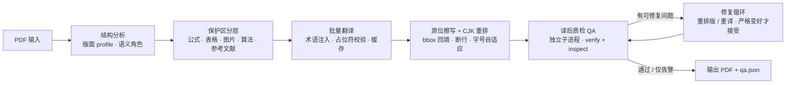

# paperex

> 本地优先的学术论文原位翻译与双语阅读器：保留公式、图表与版式，把英文 PDF 变成可左右对照阅读的中文 PDF。

[](LICENSE)
[](CHANGELOG.md)
[](backend/requirements.txt)
[](frontend/package.json)
[](frontend/src-tauri/tauri.conf.json)
[](#环境要求)


**paperex**
 把一篇英文论文的 PDF **原地**翻译成中文：只擦除可替换的文字层，公式、图表、算法、参考文献与版式保持原位，再用中文字体在原文的 bbox 里重排。翻译后的文件仍然是标准 PDF，可以批注、检索、打印；在 paperex 里则可以左英右中双栏对照阅读。

- **完全本地**：后端只监听 `127.0.0.1`，PDF 与译文不经过任何中转服务器；只有翻译文本会发送到你选择的模型服务商。
- **不破坏学术版式**：公式、表格、图内文字、算法、参考文献进入保护区，不翻译、不移动、不覆盖。
- **可验证的质量**：每次翻译产出机器可读的 `qa.json`；`strict` 模式下自动跑修复循环，严格变好才接受。
- **不绑定厂商**：DeepSeek 原生协议，以及任意 OpenAI 兼容 / Anthropic 服务。

## 目录

- [功能特性](#功能特性)
- [截图](#截图)
- [工作原理](#工作原理)
- [环境要求](#环境要求)
- [快速开始](#快速开始)
- [配置翻译服务](#配置翻译服务)
- [质量模式与 QA 报告](#质量模式与-qa-报告)
- [使用说明](#使用说明)
- [实测数据](#实测数据)
- [API 一览](#api-一览)
- [产物与缓存目录](#产物与缓存目录)
- [已知限制](#已知限制)
- [仓库结构](#仓库结构)
- [开发与测试](#开发与测试)
- [贡献](#贡献)
- [许可与致谢](#许可与致谢)

## 功能特性

| 能力 | 说明 |
| --- | --- |
| 原位重排 | 中文按原文 bbox 回填，保留分栏、缩进、行距与字号层级；不是另起一页的「双语并排」。 |
| 公式与图表保真 | 展示公式、行内公式、表格、图片、算法伪代码原位保留；行内公式以占位符跨语言搬运，杜绝模型改写公式。 |
| 结构感知 | 先做版面 profile 与语义角色分类（标题 / 小节 / 正文 / 图注 / 表格 / 公式 / 参考文献 / 页脚），不同角色不同策略。 |
| 术语库 | 内置 1066 条学术术语，翻译时注入上下文；术语变更会生成新的缓存桶，避免旧译文污染。 |
| 质量循环 | `off / fast / standard / strict` 四档质量模式；QA 在独立子进程中运行，失败不拖垮翻译主流程。 |
| QA 报告 | 每次任务输出 `qa.json`：错误 / 警告、issue code、页码、修复动作与逐轮历史；可在应用内直接打开。 |
| 翻译缓存 | 按「协议 + 地址 + 模型 + 语言 + 引擎版本 + 术语指纹」分桶的全局缓存，重跑与相似论文显著省钱省时。 |
| 取消与恢复 | 运行中可取消（`POST /api/jobs/{id}/cancel`）；任务状态持久化到 `job.json`，异常退出后可恢复。 |
| OCR 提示 | 扫描版 PDF 会得到结构化错误与处理建议；可选接入本机 Tesseract（不捆绑）。 |
| 双栏阅读 | 左原文 / 右译文同步滚动，可拖动分割线；支持缩放、翻页、深色模式。 |
| 六种强调色 | 深色 / 浅色两套模式 × 六种主题色，跟随系统或手动切换。 |
| 桌面 + 浏览器 | Tauri 2 桌面壳（原生文件对话框、无控制台）与纯浏览器运行（Vite + 本地上传）双形态。 |

## 截图

| 首页（空态） | 译文库（历史与 QA 徽标） |
| --- | --- |
|  |  |
| **进度：阶段、ETA 与取消** | **QA 报告抽屉** |
|  |  |
| **双栏阅读（深色）** | **双栏阅读（浅色）** |
|  |  |
| **设置：翻译服务** | **设置：外观主题** |
|  |  |
| **错误与排查提示** | **品牌与图标** |
|  |  |

> 截图为前端内置演示数据（`?demo=empty|home|progress|error|qa|reader`）实拍，不依赖真实后端；图中的「演示」小标签只在演示模式出现，正常运行时不会显示。

## 工作原理



1. **结构分析**：识别论文版面（ICLR / NeurIPS / ACL / Springer / Nature 等 profile），把文本块分类为 `title / heading / body / caption / equation / table / algorithm / bibliography / footer`。
2. **保护区**：展示公式、行内公式、表格单元格、图片内文字、旋转文本、页眉页脚、参考文献默认不送模型、不擦除、不改写。图注仍然翻译——表格与参考文献保留英文是有意的版式保真策略，不是漏翻。
3. **翻译**：按块打包成批次调用模型；术语库注入上下文；行内公式用哨兵占位符保护，译后按 `⟦n⟧` 原样还原；失败自动阶梯重试，命中缓存则跳过请求。
4. **写回**：只擦除可替换的文字层，保留图片、矢量线条、链接与源公式；中文按原 bbox 回填，处理断行、行首尾禁则、两端对齐、字号自适应与字体链，正文统一 1.52 行距与 0.03em 字距。
5. **QA 与修复**：QA 在隔离子进程里运行 `verify_translation_issues()`（文本对象级：漏翻、占位符泄漏、公式/图片缺失、页数、空白页）与 `page_inspector.inspect_translation()`（页面级视觉：重叠、越框、表格塌陷、字号漂移）。`standard / strict` 会把可修复问题交给修复循环（重排版或重译），每轮必须严格变好才接受，否则回滚快照。

更多实现细节见 [docs/ARCHITECTURE.md](docs/ARCHITECTURE.md) 与 [docs/QUALITY.md](docs/QUALITY.md)。

## 环境要求

| 依赖 | 版本 | 说明 |
| --- | --- | --- |
| 操作系统 | Windows 10/11（x64） | 主目标平台；macOS / Linux 可构建，未经充分测试 |
| Python | 3.12 – 3.13 | 后端服务（CI 使用 3.12） |
| Node.js | ≥ 20 | 前端构建（CI 使用 20） |
| Rust | ≥ 1.77.2（stable） | 仅桌面端需要 |
| WebView2 | Win11 自带 / Win10 需安装 | Tauri 渲染内核 |
| VS Build Tools | 2022「使用 C++ 的桌面开发」 | Rust MSVC 工具链依赖 |

```bash
python --version
node --version
cargo --version   # 仅桌面端需要：https://rustup.rs
```

## 快速开始

### 方式一：运行本地构建的桌面端（Windows）

> `launcher/paperex.exe` 是**本地构建产物**（已被 `.gitignore` 忽略），不是随仓库分发的独立安装包。它启动时会拉起本地 Python 后端，因此运行前仍需准备好 Python 环境；只复制 exe 到新机器是跑不起来的。

1. 安装 Python 3.12+，并按[方式二](#方式二从源码运行)第 1 步在 `backend/` 创建 `.venv`、装好依赖（至少执行一次）。
2. 按[构建](#构建)生成 `paperex.exe`，或使用已有构建产物；把它放到仓库的 `launcher/` 目录，保持与 `backend/` 位于同一目录树。
3. 双击 `launcher/paperex.lnk`（或 `launcher/paperex.exe`）打开。

程序行为：无控制台窗口，使用应用图标；自动拉起本地后端，健康检查通过后左栏显示 `online`；关闭窗口时后端一起退出，不残留端口占用；通过自身位置向上查找 `backend/`，因此 `launcher/` 与 `backend/` 必须在同一目录树。

首次运行未签名 exe 时，Windows SmartScreen 可能提示「Windows 已保护你的电脑」——这是本地构建/无代码签名分发的预期行为，可选择「更多信息 → 仍要运行」。

> 构建产物不入库（见 `.gitignore`）。换机器后先装好 Python 依赖并构建一次，再复制到 `launcher/`。

### 方式二：从源码运行

#### 1. 后端

```bash
cd backend
python -m venv .venv
# Windows PowerShell / CMD
.venv\Scripts\activate
# Git Bash（Windows）
source .venv/Scripts/activate
# macOS / Linux
# source .venv/bin/activate

python -m pip install -U pip
python -m pip install -r requirements.txt
```

启动（Windows 建议开启 UTF-8，避免 GBK 读取引擎 JSON 失败）：

```bash
$env:PYTHONUTF8="1"        # Git Bash: export PYTHONUTF8=1
python main.py             # 等价于 uvicorn main:app --host 127.0.0.1 --port 8756
```

自检：<http://127.0.0.1:8756/api/health> 返回 `"ok": true`；接口文档 <http://127.0.0.1:8756/docs>。后端只监听 `127.0.0.1:8756`。

#### 2. 前端（浏览器预览）

```bash
cd frontend
npm install
npm run dev        # http://127.0.0.1:1420
```

浏览器模式下选择 PDF 会走 `/api/upload`（依赖 `python-multipart`，已在 requirements 中）。

#### 3. 桌面端（开发）

```bash
cd frontend
npm run tauri:dev
```

首次会编译 Rust 依赖（数分钟），之后增量编译。

### 构建

```bash
cd frontend
npm run tauri:build -- --no-bundle
# 产物：frontend/src-tauri/target/release/paperex(.exe)
```

构建完成后把 `target/release/paperex.exe` 复制到 `launcher/` 即可双击运行。打包安装包（msi，需要 WiX）：

```bash
npm run tauri:build
```

> 不要用 `cargo build --release` 代替 `tauri build`：缺少 `custom-protocol` feature 时程序会按开发模式去连 Vite 的 1420 端口，窗口显示连接被拒绝。

## 配置翻译服务

推荐 DeepSeek；任意 OpenAI 兼容服务均可；`api.anthropic.com` 内置原生 Messages 适配。

**方式一：应用内「设置」**（保存在本机浏览器/WebView 的 `localStorage`）

| 字段 | 示例 |
| --- | --- |
| 服务地址 `base_url` | `https://api.deepseek.com/v1` |
| 模型 `model` | `deepseek-flash` |
| API Key | `sk-...`（只保存在本机） |

设置页提供「测试连接」按钮，可直接验证地址 / Key / 模型是否可用，并显示延迟与错误原因。

**方式二：后端环境变量**

```bash
# PowerShell
$env:DEEPSEEK_API_KEY="sk-..."
# Git Bash
export DEEPSEEK_API_KEY="sk-..."
```

优先级：请求体 key > `DEEPSEEK_API_KEY` > `OPENAI_API_KEY` > `PAPEREX_API_KEY` > `PAPERREFLOW_API_KEY`（旧版兼容）。

### 模型目录与协议

| 服务 | `base_url` | 模型 | 协议 |
| --- | --- | --- | --- |
| DeepSeek | `https://api.deepseek.com/v1` | `deepseek-flash`、`deepseek-v4-pro` | 原生 DeepSeek（支持 `thinking` 与 `reasoning_effort`） |
| OpenAI 兼容 | 自填（如 `https://api.openai.com/v1`、本地 vLLM / Ollama） | 任意 | OpenAI `/chat/completions` |
| Anthropic | `https://api.anthropic.com` | `claude-*` | Messages |

> `deepseek-v4*` / `deepseek-flash` 走上游原生协议（带 `thinking` 开关），其余走 OpenAI 兼容协议。应用会在 `GET /api/models` 暴露推荐模型目录，具体以当前后端返回为准。

### 质量模式

| 模式 | 行为 | 耗时 | 适用 |
| --- | --- | --- | --- |
| `off` | 不跑 QA，只翻译 | 最快 | 草稿阅读、批量粗翻 |
| `fast` | 隔离 QA 跑一次基线，只报告不修复 | 快 | 想看质量但不想等待修复 |
| `standard`（默认） | 基线 QA 一次；若存在可修复问题，再执行 **1 轮**修复候选 QA，严格变好才接受 | 中等 | 日常使用 |
| `strict` | 基线 QA 一次 + 最多 `PAPEREX_QA_MAX_PASSES`（默认 4，1–8）轮修复候选，每轮候选独立再做一次 QA；0 error 且 0 个可处理 warning 才算通过 | 最慢 | 投稿级自查、重要论文 |

> `quality_mode` 通过 `POST /api/jobs` 传入；应用设置页可切换默认值。任务详情里的 `quality_round.max = 1 + 修复轮数`：`strict` 默认 5、`standard` 2、`fast` 1、`off` 0（`skipped`）。`PAPEREX_QA_STRICT_CODES` 可把指定 issue code 降级，避免个别历史误报让 `strict` 永远无法通过。

### 后端环境变量（可选）

| 变量 | 默认值 | 说明 |
| --- | --- | --- |
| `DEEPSEEK_API_KEY` / `OPENAI_API_KEY` / `PAPEREX_API_KEY` | 空 | 未在请求体提供 key 时依次回退 |
| `PAPEREX_QA_MODE` | `standard` | 默认质量模式：`off` / `fast` / `standard` / `strict`（优先级最高） |
| `PAPEREX_POST_QA` | 未设置 | 兼容旧开关：仅当未设置 `PAPEREX_QA_MODE` 时生效；设为 `0` / `false` / `no` / `off` 等价于 `off`，其他值不覆盖默认 `standard` |
| `PAPEREX_QA_MAX_PASSES` | `4` | `strict` 最多允许的修复候选轮数（1–8，基线 QA 不计入） |
| `PAPEREX_QA_TIMEOUT` | `600` | 单次隔离 QA 子进程超时（秒），取值 30–1800 |
| `PAPEREX_QUALITY_BUDGET_S` | `1800` | 质量循环总时长预算（秒），超预算后停止发起新的修复轮，取值 60–7200 |
| `PAPEREX_QA_STRICT_CODES` | 空 | 逗号分隔的 issue code，降级为非阻断 |
| `PAPEREX_MAX_ATTEMPTS` | `3` | 任务失败后的最大尝试次数（1–8） |
| `PAPEREX_HOST` / `PAPEREX_PORT` | `127.0.0.1` / `8756` | 本地监听地址；默认仅回环，改动后需同步前端 `apiBase` |
| `PAPEREX_OCR` | `auto` | `off` / `auto` / `force`：扫描件 OCR 策略 |
| `PAPEREX_TESSDATA` | 空 | Tesseract `tessdata` 目录；设置后启用 OCR |
| `PAPEREX_MAX_BATCH_CHARS` | `2500` | 单批送模型的最大字符数 |
| `PAPEREX_RESUME_JOBS` | `1` | 启动时恢复未完成任务 |
| `PAPEREX_CACHE_DIR` | `%APPDATA%\paperex\cache\translation` | 翻译缓存目录 |
| `PAPEREX_CACHE_MAX_MB` | `500` | 缓存上限（MB），超出后按 LRU 清理 |
| `PAPEREX_DRYRUN` | 空 | `1` 时用假翻译器跑通流程（不请求真实 API，用于开发/CI） |

## 质量模式与 QA 报告

每次任务在产物目录生成 `qa.json`（也可通过 `GET /api/jobs/{id}/qa` 获取），schema 摘要：

| 字段 | 含义 |
| --- | --- |
| `schema_version` / `job_id` / `generated_at` | schema 版本、任务 ID、生成时间 |
| `qa_mode` / `status` / `passes_run` / `repair_attempted` | 质量模式；`passed / warning / failed / qa_failed`；QA 轮数；是否尝试过修复 |
| `score` / `best_score` | `[error_count, issue_count]` 字典序评分，越小越好 |
| `pass_history[]` | 每轮 `{pass, issue_count, error_count, warning_count, agent_action, agent_reason, issue_fingerprint, accepted, rolled_back, candidate_score}` |
| `issues[]` | `{page, code, message, severity, action}`；最多 500 条（`issues_truncated` 标记截断） |
| `terminology` | 术语命中、冲突与快照指纹 |
| `cache` | `{hits, misses, fallback_blocks}` |
| `timings_ms` | `{translate, qa, repair, total}` |
| `checker_errors[]` | QA 子进程/检测器自身异常（有值时通常伴随 `status=qa_failed`） |
| `quality_mode` / `report_url` | 本次任务实际生效的质量模式；报告 API 地址（`GET /api/jobs/{id}/qa`） |

如何解读：

- **error**：阻断级问题（漏翻、页数不一致、空白页、公式/图片缺失、占位符泄漏等），通常需要重跑或人工复核；
- **warning**：版面风险（`high_risk_layout`、个别文字重叠等），可接受但值得抽查；
- **action**：该 issue 对应的修复动作（`accept` / `repair_layout` / `retranslate` / `stop`），QA 抽屉中按严重度分组，点击可跳到对应页；
- **strict 通过的含义**：`0 error` 且 `0` 个可处理 warning——是自动检测层面的「干净」，不等于人工校对。

`status = qa_failed` 表示 QA 进程本身出错（超时/崩溃）。此时翻译产物仍然有效，任务不会因为 QA 失败而失败。

## 使用说明

1. 左侧栏 **新增翻译**（桌面端调起原生对话框，过滤 `.pdf`；浏览器端直接上传）。
2. 中央进度卡显示阶段（`analyzing → translating → qa → repairing → writing`）、页数与 ETA、当前质量轮次；可随时**取消**。
3. 完成后左栏原版、右栏中文版；拖动中间分割线调整宽度，双击恢复 50/50。
4. 两侧按「页码 + 页内比例」双向同步滚动；支持 `PageUp` / `PageDown` / `Home` / `End` 翻页。
5. 顶栏可缩放 50%–240%；底部状态条显示页数 / 回填块数 / 跳过块数 / 字体 / QA 结果，点击 QA 徽标可展开问题清单与 `qa.json`。
6. 左侧栏底部的太阳 / 月亮图标切换浅色与深色；**设置 → 外观主题** 里切换六种强调色。
7. 初始页即**译文库**：以列表展示历史译文（含 QA 徽标、耗时与失败原因），支持搜索；点击查看，右侧可删除（二次确认，会清理本地文件）；列表末尾是「新增翻译」。
8. 再次打开应用会自动恢复上一次的译文；顶栏 `×` 返回首页。

## 实测数据

### 测试环境

Windows 11 专业版 build 26200 x64（AMD Ryzen 7 H 260 / Radeon 780M）· Python 3.13.7 · PyMuPDF 2.1（MuPDF 1.28.6）· 翻译模型 `deepseek-flash`（DeepSeek 官方 API，`https://api.deepseek.com/v1`）· 质量模式 `standard` · 字体 LXGW WenKai GB Lite（正文）/ LXGW ZhenKai GB（标题）· 单任务串行。数据集分两组：**对象集** 5 篇用于回归与调参；**留出集** 6 篇不参与任何调参，用于独立验证泛化能力。全部任务均在全新缓存（fresh cache）下由完整流水线（后端 + 隔离 QA 子进程 + 质量循环）串行完成，表中 `翻译+排版(s)` 与 `QA(s)` 分别为后端记录的阶段耗时。QA `errors=0` 即视为通过；`warnings` 为设计内的启发式版面观察（`high_risk_layout` 等），不阻断任务；引擎不会引入 NUL 或占位符残留——对象集 5 篇输出 NUL / sentinel 泄漏均为 0，留出集中 `2611.11820v1` 的 2 个 NUL 来自源 PDF 自身的代码块文本层（非引擎写入）。

**对象集（5 篇，用于回归与调参）**

| 论文（PDF） | 页数 | 可翻译块 | 字符 | 翻译+排版(s) | QA(s) | QA errors | QA warnings（主要 code） | 结果 |
| --- | ---: | ---: | ---: | ---: | ---: | ---: | --- | --- |
| `2103.13262v1` | 11 | 91 | 33,085 | 48.7 | 20.2 | 0 | 8（high_risk_layout） | 通过 |
| `3503221.3508418` | 15 | 184 | 69,293 | 115.8 | 55.4 | 0 | 14（high_risk_layout 13、formula_changed 1） | 通过 |
| `atc23-zhai` | 16 | 161 | 74,651 | 106.6 | 36.8 | 0 | 16（high_risk_layout） | 通过 |
| `DeepSeek_V4` | 58 | 375 | 173,271 | 257.5 | 72.2 | 0 | 33（high_risk_layout 32、preserved_text_changed 1） | 通过 |
| `osdi26-jiang-yapeng` | 19 | 197 | 95,082 | 121.5 | 45.9 | 0 | 19（high_risk_layout 18、formula_changed 1） | 通过 |

**留出集（6 篇，未参与调参）**

| 论文（PDF） | 页数 | 可翻译块 | 字符 | 翻译+排版(s) | QA(s) | QA errors | QA warnings（主要 code） | 结果 |
| --- | ---: | ---: | ---: | ---: | ---: | ---: | --- | --- |
| `2611.11043v1` | 16 | 192 | 89,857 | 155.1 | 228.2 | 0 | 21（high_risk_layout） | 通过 |
| `2611.11364v1` | 19 | 206 | 83,893 | 166.2 | 59.6 | 0 | 13（high_risk_layout 12、display_formula_misaligned 1） | 通过 |
| `2611.11820v1` | 16 | 122 | 42,481 | 87.8 | 41.9 | 0 | 0 | 通过 |
| `2611.12864v1` | 55 | 325 | 115,841 | 205.1 | 354.4 | 6 | 66（high_risk_layout 57 等） | 未通过（残留见下表注） |
| `2611.12870v1` | 30 | 205 | 92,313 | 125.9 | 92.2 | 3 | 16 | 未通过（公式切段叠印） |
| `2611.12886v1` | 17 | 161 | 69,907 | 115.7 | 41.0 | 0 | 4 | 通过 |

> 实测口径：v1.1.0 最终引擎（engine fingerprint `d301bf19f672bee9`）在全新缓存、`standard` 模式下由后端完整流水线（含隔离 QA 与质量循环）串行执行；对象集 5/5 通过（QA errors 全 0），留出集 4/6 通过。`DeepSeek_V4` 修复前为 3 errors（D3 保护区误判 / D4 行内公式原子丢失 / D5 表格 QA 误报），v1.1.0 已全部修复。`high_risk_layout` 表示「公式/图表密集页值得抽查」；`formula_changed` 与 `preserved_text_changed` 为设计内 warning（展示公式以像素保留、只做墨迹级对照）。留出集两篇未通过的原因：`2611.12864v1`（彩色提示词模板/图表面板密集页）残留 p3 粗体引句漏译、p18 表格重排、p21 光栅公式与文字轻微叠印、p27 提示词模板页与 1 处图注框越界提示；`2611.12870v1` 的公式切段长段在 p14 出现 3 处行间叠印。二者均为结构检测/排版边界问题，已列入[已知限制](#已知限制)，不影响其余页面的阅读与检索。完整缺陷清单见 [CHANGELOG.md](CHANGELOG.md)。

## API 一览

后端监听 `http://127.0.0.1:8756`，完整交互式文档见 `/docs`。v1.1 在 v1.0 基础上**向后兼容**扩展。

| 方法 | 路径 | 作用 |
| --- | --- | --- |
| GET | `/api/health` | 版本、引擎、providers、质量模式、缓存统计、OCR 可用性 |
| POST | `/api/jobs` | 创建翻译任务：`{pdf_path, api_key?, base_url?, model?, quality_mode?, thinking?, reasoning_effort?, use_cache?, max_attempts?}` → `{job_id, status, created_at, source}` |
| GET | `/api/jobs/{id}` | 任务状态：`status`（`queued/running/done/error/cancelling/cancelled`）、`stage / stage_label / progress / pages_done / pages_total / eta_seconds / queue_position / quality_round{current,max,status} / qa_summary / files / timings_ms / attempt / params / result`；错误时另有 `error`（消息）、`error_code`、`retryable`、`error_detail{code,message,retryable,hint}` |
| POST | `/api/jobs/{id}/cancel` | 取消排队/运行中的任务 → `{ok, status, message}`；已到终态时返回 409，取消成功后的终态为 `cancelled`（注意：任务状态拼双 `l`，而错误码是 `canceled` 单 `l`） |
| GET | `/api/jobs/{id}/qa` | 下载 `qa.json`（未生成时 404） |
| POST | `/api/upload` | 浏览器模式上传 PDF（`multipart/form-data`） |
| GET | `/api/files/{rel}` | 沙盒内 PDF 流；`?download=1` 强制下载 |
| GET | `/api/history` | 历史译文列表（含 `qa_summary / quality_mode / elapsed_ms / pages / blocks`） |
| DELETE | `/api/history/{id}` | 删除记录并清理 `output/` 与 `cache/` |
| GET | `/api/models` | 模型目录：`{providers:[{id,label,base_url,models:[{id,label,context,thinking}]}], recommended, items, models}` |
| POST | `/api/test-connection` | 测试服务连通性：`{base_url, model, api_key?}` → `{ok, latency_ms, message, code?, retryable?}` |
| GET | `/api/terminology` | 内置术语库统计与条目：`{total, categories:[{name,count}], terms:[{en,zh,category,note}], items}` |
| GET | `/api/terminology/search?q=&limit=` | 检索术语 → `{total, query, terms:[{en,zh,category,note}], items}` |
| DELETE | `/api/cache` | 清空全局翻译缓存（可选，返回清理统计） |
| DELETE | `/api/jobs/{id}` | 兼容旧前端，等价于删除历史记录 |

错误响应统一带中文 `message` 与可执行的 `hint`（结构为 `{detail, code, message, hint, retryable, error:{...}}`），常见 `code`：`auth_failed`、`provider_unreachable`、`provider_error`、`invalid_pdf`、`encrypted_pdf`、`ocr_required`、`ocr_unavailable`、`too_large`、`no_text_layer`、`canceled`、`engine_error`、`qa_failed`、`not_found`、`invalid_request`、`interrupted`、`internal`。

## 产物与缓存目录

所有产物、源副本与缓存只写入本机用户目录：

```text
%APPDATA%\paperex\                       （macOS/Linux 为各自的用户数据目录）
├── output\<job_id>\
│   ├── source.pdf                       # 源文件副本
│   ├── <原文件名>.zh.pdf                # 翻译后的 PDF（如 2103.13262v1.zh.pdf）
│   ├── meta.json                        # 历史记录
│   ├── qa.json                          # 质检报告
│   ├── translation-cache.jsonl          # 本任务写入的缓存记录（调试用）
│   ├── .qa\                             # QA 子进程的中间结果（*.json / *.spec.json）
│   └── .snapshots\round-<n>\            # 质量循环每轮快照（translated.pdf + qa.json）
├── jobs\<job_id>\job.json               # 任务状态（崩溃恢复）
├── cache\
│   ├── translation\<bucket>.jsonl       # 全局翻译缓存（分桶）
│   └── <job_id>\...                     # 旧版本地缓存（兼容）
├── fonts\                               # 自定义中文 .ttf（可选，优先级最高）
└── uploads\                             # 浏览器模式上传的临时文件
```

`job_id` 为任务唯一 ID；删除历史记录会同时清理对应产物。所有路径均在用户数据目录下，仓库本身**不包含**任何论文原文或运行时数据。

## 已知限制

- **扫描件需要 OCR**：纯图片 PDF 没有文本层。未安装 Tesseract 时任务返回 `ocr_unavailable`（附安装提示）；`PAPEREX_OCR=off` 时为 `no_text_layer`。当前版本不捆绑 Tesseract；自行安装并把 `PAPEREX_TESSDATA` 指向 `tessdata` 目录后才会真正做 OCR 预处理，识别质量受扫描分辨率影响。
- **公式是「像素 + 文本层近似」**：展示公式以原始绘图/图片保留，行内公式以占位符搬运文本，不做 LaTeX 语义重排；极密公式页可能出现个别 layout warning，建议人工复核。
- **极少数公式密集页可能有英文残片**：保护区（公式行）回填原生文字时，可能把紧邻的个别英文词带回正文，例如 DeepSeek-V4 技术报告第 10 页的 `is padded` / `times.` 与第 11 页的 `to a`。这类残片不影响中文主体与公式排版，QA 也不计为 error；如影响阅读可对该页单独反馈。
- **留出集验证的已知残留**：`2611.12864v1` 的 p3 有一句粗体引句（`We study how persona elicitation rates…`）未被重译、p18 表格单元格被当散文重排、p21 光栅公式与文字轻微叠印、p27 为英文提示词模板页（模板正文按结构豁免处理）、p44 一处图注被误判越框；`2611.12870v1` 的 p14 公式切段长段有 3 处行间叠印。这些都已在 `qa.json` 中给出 page/code/message，便于人工复核；对象集 5 篇不受影响。
- **图内文字与伪代码保留原文**：图片、图表坐标轴、算法伪代码中的英文按设计不翻译（重绘位图不在本项目范围），图注与算法标题会翻译。
- **封面标题被 PDF 拆块时**：v1.1.0 起对拆块标题逐块隔离翻译（禁止跨块补全）；但源 PDF 若使用特殊字距/图形化标题（如 *SmartMoE* 的艺术字），回填后可能出现字距不理想，属版式还原的边界。
- **`failed_blocks` 不是失败**：图表坐标标签、代码命令、裸标识符等少量块会「保留源排版」原样回填（`kept-source`），任务仍为 `done`；只有译文缺失且无法回填时才会报错。短 kept-source 块（≤3 行、≥3 词且与源文逐字相同）在 QA 中记为 warning `kept_source_block`，不计 error；长段漏译仍报 `untranslated_block`。
- **复杂版式有风险**：跨栏浮动体、非常规页边注、双栏中的全宽图表可能错位；QA warning 是提示而非保证。
- **任务串行**：引擎含文档级全局状态，同一后端一次只处理一个翻译任务；并发请求会排队（`queue_position`）。
- **依赖模型质量**：译文质量取决于所选模型；`deepseek-v4-pro` / 更强模型通常更稳，成本也更高。翻译按字符计费，长论文（60 页级）成本与耗时都显著上升。
- **QA 是启发式检测**：可能误报（例如表格保护区、字体别名）或漏报；`strict` 不等于人工校对。可用 `PAPEREX_QA_STRICT_CODES` 降级已知误报。
- **平台**：Windows 为主要测试平台；macOS / Linux 可构建，但字体路径、文件对话框与打包流程未充分验证。
- **术语库内置 1066 条**：暂不支持在 UI 中编辑自定义术语；修改术语会让缓存桶失效（这是有意的正确性设计）。

## 仓库结构

```
paperex/
├── backend/                    本地 FastAPI 服务与翻译流水线（127.0.0.1:8756）
│   ├── main.py                 HTTP API、任务编排、质量模式、取消与崩溃恢复
│   ├── engine_adapter.py       供应商、字体、进度回调与 issue 汇总适配层
│   ├── quality.py              质量门：issue 分类、轮数上限与 strict 判据
│   ├── qa.py / qa_worker.py    隔离 QA 子进程入口（verify + inspect 并发）
│   ├── qa_loop.py              候选制修复循环：严格变好才接受，否则回滚快照
│   ├── cache.py / jobs.py      全局翻译缓存（分桶）/ 文件型任务状态与心跳
│   ├── providers.py / ocr.py   供应商目录与探测 / OCR 后备与结构化报错
│   ├── pdf_zh_translator/      内置翻译与原位重排引擎（vendored，AGPL-3.0）
│   ├── assets/fonts/           LXGW 文楷 / 臻楷字体与 OFL 许可文件
│   └── tests/                  pytest：契约、缓存、任务、质量、引擎回归
├── frontend/                   React 18 + Vite + Tailwind 双栏阅读器
│   ├── src/                    页面、组件、hooks、lib 与主题样式
│   ├── public/                 favicon 与演示 PDF
│   └── src-tauri/              Tauri 2 桌面壳、图标与窗口配置
├── launcher/                   本地启动器产物；exe / lnk 不入库（见 launcher/README.md）
├── docs/                       ARCHITECTURE / QUALITY / DEVELOPMENT / ROADMAP
├── .github/                    CI 与 issue / PR 模板
├── README.md  CHANGELOG.md  CONTRIBUTING.md  SECURITY.md
└── LICENSE  NOTICE             AGPL-3.0 正文与第三方署名
```

运行时产物（`source.pdf`、`*.zh.pdf`、`qa.json`、任务状态、翻译缓存）只写入
`%APPDATA%\paperex\`，不进入仓库；`.venv/`、`node_modules/`、`launcher/*.exe`
等本地环境与构建产物由 `.gitignore` 排除，克隆后按上文步骤即可重新生成。

## 开发与测试

```bash
# 后端依赖（含测试工具）
cd backend
.venv\Scripts\python.exe -m pip install -r requirements.txt -r requirements-dev.txt

# 引擎离线自测（无需 API Key，2 页样例）
.venv\Scripts\python.exe tests\test_engine_offline.py

# 单元 / 契约测试
.venv\Scripts\python.exe -m pytest tests -q

# 静态检查
.venv\Scripts\python.exe -m ruff check .
```

```bash
# 前端
cd frontend
npm ci
npm run build
```

CI（`.github/workflows/ci.yml`）在 `ubuntu-latest` 上跑 Python 3.12 的 `ruff check` 与 `pytest tests -q`，以及 Node 20 的 `npm ci && npm run build`；**不调用真实 LLM**，依赖网络的端到端用例默认跳过。

更多内容见 [docs/DEVELOPMENT.md](docs/DEVELOPMENT.md)、[docs/ARCHITECTURE.md](docs/ARCHITECTURE.md)、[docs/QUALITY.md](docs/QUALITY.md)；路线图见 [docs/ROADMAP.md](docs/ROADMAP.md)。

## 贡献

欢迎 issue 与 PR。请先阅读 [CONTRIBUTING.md](CONTRIBUTING.md)：开发流程、提交规范、测试要求与 DCO 说明；安全问题请按 [SECURITY.md](SECURITY.md) 私下报告，不要开公开 issue 贴 API Key 或论文原文。

## 许可与致谢

paperex 以 **GNU AGPL-3.0-or-later** 发布（v1.1.0 起；v1.0 的 MIT 声明不再适用）。版权行与上游署名见 [NOTICE](NOTICE)；许可全文见 [LICENSE](LICENSE)，为 FSF 发布的 AGPL-3.0 原文（逐字未改、未附加前言），第三方组件与字体许可见 [NOTICE](NOTICE)。

为什么是 AGPL-3.0：`backend/pdf_zh_translator/` 是修改自 **super_translate**（AGPL-3.0）与 **PDFMathTranslate / pdf2zh**（AGPL-3.0）渲染管线的衍生作品。分发 paperex（含修改版）时，请按 AGPL 第 5、6、13 条向接收者提供完整对应源代码。

致谢：

- [PDFMathTranslate / pdf2zh](https://github.com/Byaidu/PDFMathTranslate) 与 [super_translate](https://github.com/asimfish/super_translate)：原位翻译与版面处理管线；
- [PyMuPDF](https://pymupdf.readthedocs.io/)：PDF 解析、擦写与排版；
- [pdf.js](https://mozilla.github.io/pdf.js/) / [react-pdf](https://github.com/wojtekmaj/react-pdf)：阅读器渲染；
- [霞鹜文楷 / 霞鹜臻楷（LXGW）](https://github.com/lxgw/LxgwWenKai)：内置中文字体（SIL OFL-1.1）；
- [Tauri](https://tauri.app/)、[React](https://react.dev/)、[Vite](https://vitejs.dev/)：桌面壳与前端基建。

> paperex 只提供本地处理工具，不包含任何论文原文；使用者需自行确保对所处理论文的使用符合出版方版权与当地法律。
