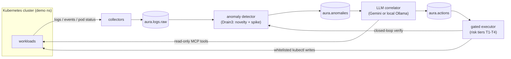

# AURA: Autonomous Understanding & Remediation Architecture

Bounded-autonomy self-healing for Kubernetes. An LLM correlates fragmented telemetry (container logs, cluster events, pod status) into a root-cause diagnosis and proposes a remediation; a deterministic, risk-tiered executor decides whether that proposal ever reaches the cluster. The model proposes, the gate disposes.



Every action is audited to `aura.audit`, and every executed action is re-checked after a verification window: it only counts as a success if the fault's fingerprint stops recurring.

## Results at a glance

A live chaos campaign injected seven distinct faults plus one benign load surge into a laboratory cluster. AURA detected 7/7 faults (the benign scenario correctly stayed silent), identified the root cause in 7/7 LLM calls, and executed 6/6 in-scope remediations verified end-to-end, with **zero false remediations**.

| Scenario | Fault layer | Detected (s) | Action (tier) | Outcome |
|---|---|---|---|---|
| bad-config | config/deploy | 1.23 | rollback_deployment (T2) | healed, verified |
| db-down | dependency | 0.21 | scale_workload postgres→1 (T1) | healed (victim vs. cause resolved) |
| oom-kill | resources | 2.47 | patch_deployment_resources (T2) | healed, verified |
| bad-image | release | 12.01 | rollback_deployment (T2) | healed, verified |
| node-pressure | node capacity | 0.08 | scale_workload mem-hog→0 (T1) | healed, verified |
| proxy-down | dependency | 0.15 | scale_workload edge-proxy→1 (T1) | healed, verified |
| traffic-spike | benign load | none (silent) | none | correct true negative |
| dns-failure | cluster infra | 16.1 | out of scope | correct refusal → escalation |

The dns-failure case is the safety boundary working as designed: the model correctly diagnosed CoreDNS but the fix lives in `kube-system`, outside the namespace whitelist. A synthetic attempt against it was rejected by the gate and the incident escalated to a human instead.

<p align="center">
  
</p>
<p align="center">
  
  
</p>

## Safety model

The LLM's self-reported risk assessment is ignored. The executor maps each tool to a tier deterministically and gates accordingly:

| Tier | Meaning | Tools | Gate |
|---|---|---|---|
| T1 | reversible, low blast radius | `scale_workload` | dry-run, then execute |
| T2 | reversible, service-level | `rollback_deployment`, `patch_deployment_resources`, `patch_pvc_size` | 600 s per-(namespace, tool) cooldown |
| T3 | needs judgment | (escalated actions) | human approval queue (web UI) |
| T4 | destructive | `delete_resource` | always rejected |

Additional guards, each exercised live in the campaign: namespace whitelist (`demo`, `aura-system` only), blast-radius escalation (an action touching >5 pods is promoted one tier), parameter whitelisting (unknown keys from the model never reach `kubectl`), a required-name guard (an action missing its target is audited as invalid, not guessed), and `kubectl --dry-run=server` before every write.

## LLM benchmark

Six frozen "golden cases" (real anomaly snapshots from the campaign) are replayed against four models: identical prompt, schema, temperature 0, 3 repeats:

| Model | Type | Latency mean/p95 (s) | JSON valid | Correct tool | Correct target | Root cause |
|---|---|---|---|---|---|---|
| gemini-3.1-flash-lite | cloud | 1.46 / 1.64 | 100% | 83% | 83% | 100% |
| qwen2.5:7b-instruct | local | 5.17 / 6.30 | 100% | 83% | 67% | 100% |
| llama3.1:8b | local | 4.21 / 4.93 | 100% | 67% | 33% | 33% |
| qwen3.5:9b | local | 15.86 / 18.60 | 100% | 17% | 17% | 0% |

Two findings worth pausing on: a local 7B model matches the cloud baseline on decision quality at ~3.5× the latency, so the correlation stage can run air-gapped; and the largest local model is the *worst* decision-maker: it emits valid JSON that ignores the supplied schema, so its plans parse empty. Schema adherence is a model-selection criterion in its own right.

<p align="center">
  
</p>

## Quickstart

Prerequisites: a local Kubernetes cluster (kind or Docker Desktop), `kubectl`, `stern`, [uv](https://docs.astral.sh/uv/), Redis via Docker, and either a `GEMINI_API_KEY` (in `.env`, from `.env.example`) or a local [Ollama](https://ollama.com) model.

```bash
uv sync --all-packages            # once
make redis-up                     # host-side Redis
make demo-build && make demo-deploy
make collect-up                   # logs + events -> aura.logs.raw
make detector &                   # builds the frozen baseline first
make correlator & make executor & # LLM correlation + gated remediation
make dashboard                    # live Streamlit view
make scenario S=bad-config        # watch a self-heal end to end
```

`make help` lists every target, including `stack-up` / `stack-down` and `make demo`.

## Chaos scenarios

Each scenario under [`scenarios/`](scenarios/) is a triple: `inject.sh` (break something), `expected.yaml` (ground truth: expected tool, target, scope), `cleanup.sh`. Run one with `make scenario S=<name>`; list them with `make scenario-list`.

## Reproducing the evaluation

```bash
make kpi                          # campaign KPIs + vector plots -> results/plots/
make llm-bench                    # 4-model benchmark on the frozen golden cases
make golden-capture S=<scenario> T0=<epoch>   # freeze a new golden case
```

The frozen cases live in [`eval/golden_cases.json`](eval/golden_cases.json); the harnesses are [`eval/llm_benchmark.py`](eval/llm_benchmark.py) and [`eval/kpi_report.py`](eval/kpi_report.py).

## Repository layout

```
services/
  anomaly-detector/   Drain3 template mining, frozen baseline, novelty + spike signals
  correlator/         one structured prompt, Gemini/Ollama, MCP read-only prefetch
  action-executor/    risk gate (T1-T4), cooldowns, dry-run, audit, approval UI
  dashboard/          Streamlit: logs -> anomalies -> plans -> outcomes
infra/
  collect/            stern + kubectl-events collectors -> Redis streams
  manifests/          demo app + scenario workloads
scenarios/            8 fault-injection scenarios (inject / expected / cleanup)
eval/                 golden-case capture, LLM benchmark, KPI reporting
```

Redis streams: `aura.logs.raw` → `aura.anomalies` → `aura.actions` → `aura.audit` / `aura.action_outcomes`.

## Status

Research prototype, evaluated on a single-node laboratory cluster. A paper describing the architecture and both evaluation campaigns is under review; the numbers above are reproducible from the harnesses and frozen cases in this repository.
