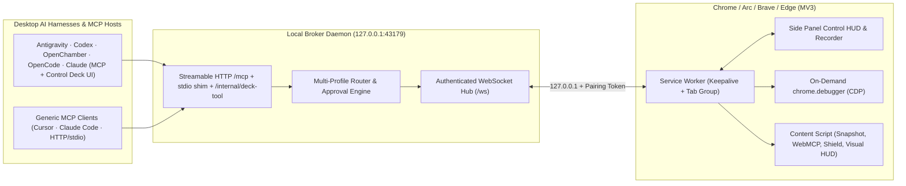

<div align="center">


# Chrome Browser MCP

**Next-gen Chrome Extension (MV3) & MCP v2 Server for real-session AI browser use**

Hybrid Content Script + On-Demand CDP · Native WebMCP · Prompt-Injection Shield · Workflow Recorder · Multi-Profile Broker · Unified Browser Control Deck UI (Antigravity · Codex · OpenChamber · OpenCode · Claude)

**English** · [Русский](./README.ru.md) · [简体中文](./README.zh-CN.md)

[](https://chromewebstore.google.com/detail/oahcjchkplfbfhhceojfndnpapgoeche)
[](https://github.com/szybnev/chrome-browser-mcp/actions/workflows/ci.yml)
[](https://modelcontextprotocol.io)
[](./packages/extension)
[](./packages/extension/src/background/service-worker.ts)
[](./package.json)
[](./tsconfig.base.json)
[](./PRIVACY.md)
[](./packages/protocol/src/shield.ts)
[](./LICENSE)
[](https://github.com/szybnev/chrome-browser-mcp/stargazers)

</div>

---

## Why Chrome Browser MCP?

Most browser-use extensions force painful trade-offs: they either spin up logged-out headless browsers, permanently show Chrome's yellow debugger banner, burn 30K+ tokens per step with raw screenshots/HTML, conflict when two agents run simultaneously, or expose every private tab to prompt injection.

| Capability                      | Chrome Browser MCP                                                                                                                                         | Typical Browser Relay / Visual Extensions                         |
| :------------------------------ | :--------------------------------------------------------------------------------------------------------------------------------------------------------- | :---------------------------------------------------------------- |
| **Real Logged-In Sessions**     | Works in your daily Chrome / Arc / Brave / Edge profile — no `--remote-debugging-port` hacks                                                               | Often needs separate debug profile or loses sessions              |
| **Hybrid Adaptive Engine**      | Silent Content Script + WebMCP by default; **on-demand `chrome.debugger` CDP** with idle auto-detach & DevTools-open fallback                              | Always-on yellow debugger banner or brittle synthetic-only clicks |
| **Token Efficiency**            | Pruned a11y/DOM snapshot with short refs (`e1`, `e2`…), **incremental diffs**, and **batch `browser_act`** (multi-step forms in 1 round-trip)              | Full DOM/screenshot every step; 1 LLM call per click              |
| **Multi-Agent & Multi-Profile** | Shared local Broker Daemon (Streamable HTTP + auto-spawn `stdio` shim with lease lifecycle) multiplexing multiple agents & browsers                        | Single-client port conflicts (`EADDRINUSE`)                       |
| **Security & Control**          | Dedicated colored **AI Agent Tab Group**, editable domain blocklist, risky-action approval gates, **Prompt-Injection Shield**, instant `Alt+Shift+P` Pause | Full unguarded browser access or constant friction                |
| **WebMCP & Workflow Recorder**  | Native `navigator.modelContext` tool discovery + “Show by hand” workflow recorder with password masking                                                    | Manual clicking only                                              |
| **Native Desktop Harness UIs**  | Built-in **Browser Control Deck** across **Google Antigravity**, **Codex Desktop**, **OpenChamber Desktop**, **OpenCode Desktop**, and **Claude Desktop** (Code Mod + `.mcpb` MCP App) | Text-only tool output                                             |

---

## Comparison with Other Browser Extensions

There are several strong browser-automation extensions and MCP bridges in the ecosystem, each optimizing for a different workflow. Below is a technical comparison across the criteria that matter most for real-session AI browser use.

| Criterion                                    |                     **Chrome Browser MCP**                     |         **Claude for Chrome**         |    **ChatGPT for Chrome**     |             **omp browser relay**              |           **Kimi Browser Ext.**           |          **Playwright MCP** (`--extension`)          |            **BrowserMCP**            |
| :------------------------------------------- | :------------------------------------------------------------: | :-----------------------------------: | :---------------------------: | :--------------------------------------------: | :---------------------------------------: | :--------------------------------------------------: | :----------------------------------: |
| **Open Source & License**                    |                             ✅ MIT                             |               ❌ Closed               |           ❌ Closed           |                 ✅ Open source                 |   ❌ Closed _(community MCP wrappers)_    |                    ✅ Apache-2.0                     |            ✅ Open source            |
| **Agent-Agnostic MCP v2**                    |           ✅ Any MCP host _(HTTP + `stdio` + Apps)_            |     ⚠️ Claude / Claude Code only      |        ❌ ChatGPT only        |          ⚠️ `omp` CLI / raw CDP relay          |     ⚠️ Kimi ecosystem _(+ wrappers)_      |                   ✅ Any MCP host                    |           ✅ Any MCP host            |
| **Real Logged-In Sessions**                  |           ✅ Daily profile _(Chrome/Arc/Brave/Edge)_           |           ✅ Daily profile            |       ✅ Daily profile        | ✅ Daily profile _(bypasses Chrome 136+ lock)_ |             ✅ Daily profile              | ⚠️ Manual _"Share This Tab"_ _(isolated by default)_ |           ✅ Daily profile           |
| **No Permanent Debugger Banner**             |      ✅ Hybrid CS + WebMCP; **on-demand CDP** auto-detach      |         ❌ Active CDP banner          |   ⚠️ Browser debugger perms   |         ❌ Always-on `chrome.debugger`         |      ❌ Always-on `chrome.debugger`       |            ❌ Always-on `chrome.debugger`            |    ❌ Always-on `chrome.debugger`    |
| **Works While DevTools Is Open**             |                   ✅ Content Script fallback                   |        ❌ CDP attach conflict         |          ⚠️ Limited           |          ❌ Single-debugger conflict           |        ❌ Single-debugger conflict        |             ❌ Single-debugger conflict              |     ❌ Single-debugger conflict      |
| **Token Efficiency (Diffs & Batching)**      |   ✅ Pruned refs + **incremental diffs** + **batch actions**   |    ⚠️ Full snapshots / screenshots    |      ⚠️ Backend-managed       |        ⚠️ Raw CDP _(depends on client)_        |     ⚠️ Markdown/CSV extract; no diffs     |      ⚠️ Full a11y tree per step; 1 action/call       | ⚠️ Full ARIA snapshot; 1 action/call |
| **Multi-Agent & Multi-Profile**              |      ✅ Shared Broker Daemon _(leases + named profiles)_       |       ❌ Single Claude session        |   ❌ Single ChatGPT session   |        ✅ Global daemon + Puppeteer mux        |          ❌ Single local bridge           |         ⚠️ Single shared tab in bridge mode          |      ❌ Single WS port / client      |
| **Tab Isolation & Human Controls**           | ✅ **AI Agent** Tab Group, blocklist, approvals, `Alt+Shift+P` | ⚠️ Tab group + noisy per-site prompts | ⚠️ Prompts on sensitive pages |             ❌ Basic relay attach              |     ⚠️ Basic sidebar/bridge controls      |             ⚠️ Manual per-tab share only             |       ⚠️ Manual popup connect        |
| **Prompt-Injection Shield**                  |     ✅ Local untrusted-DOM sanitizer & hidden-text filter      |         ⚠️ Provider-side only         |     ⚠️ Provider-side only     |                    ❌ None                     |                  ❌ None                  |                       ❌ None                        |               ❌ None                |
| **Native WebMCP (`navigator.modelContext`)** |                  ✅ Built-in discovery & call                  |                 ❌ No                 |             ❌ No             |                     ❌ No                      |                   ❌ No                   |                        ❌ No                         |                ❌ No                 |
| **Workflow Recorder ("Show by hand")**       |      ✅ Side Panel recorder _(password masking + replay)_      |     ⚠️ Saved prompts / shortcuts      |             ❌ No             |                     ❌ No                      |      ✅ Recorded Skills / CLI flows       |              ❌ Separate `codegen` tool              |                ❌ No                 |
| **100% Local-First / No Cloud Account**      |             ✅ `127.0.0.1` + token, zero telemetry             |         ❌ Anthropic account          |       ❌ OpenAI account       |                 ✅ 100% local                  | ⚠️ Local bridge; Kimi account for sidebar |                    ✅ 100% local                     |            ✅ 100% local             |

### How to Choose

- **Choose Chrome Browser MCP** if you want an **open-source, model-agnostic MCP v2** extension for your real logged-in browser — with multi-agent concurrency, token-saving diffs & batching, silent default execution (no permanent debugger banner), built-in Prompt-Injection Shield, native WebMCP, and strict `127.0.0.1` privacy.
- **Choose Claude for Chrome** or **ChatGPT for Chrome** if you work exclusively inside Anthropic's or OpenAI's first-party UI and want zero local CLI/daemon setup rather than cross-agent MCP interoperability.
- **Choose omp browser relay** if you live inside the `oh-my-pi` (`omp`) ecosystem and specifically need a raw CDP/Puppeteer multiplexer over your real Chrome profile.
- **Choose Kimi Browser Extension** if your workflow centers on Moonshot's Kimi sidebar, Kimi Work, and Kimi Skill/CLI routines.
- **Choose Playwright MCP (isolated mode)** for deterministic headless/clean-profile E2E testing and CI pipelines where you intentionally do _not_ want personal cookies or active logins.
- **Choose Chrome DevTools MCP (`chrome-devtools-mcp`)** _(non-extension CLI/CDP server)_ when your primary goal is deep frontend performance tracing, Lighthouse audits, and heap/network profiling rather than everyday authenticated browsing.

> _Comparison snapshot as of late 2026. Browser-agent tools evolve quickly — if something above is outdated, PRs to keep this matrix accurate are welcome._

---

## Architecture



---

## Quick Start

### 1. Build from source

```bash
git clone https://github.com/szybnev/chrome-browser-mcp.git
cd chrome-browser-mcp
pnpm install
pnpm build
```

### 2. Install the Chrome Extension (MV3)

- **Recommended (1-click):** Install from the **[Chrome Web Store](https://chromewebstore.google.com/detail/oahcjchkplfbfhhceojfndnpapgoeche)** (Chrome, Arc, Brave, Edge).
- **Or load unpacked from source:**
  1. Open `chrome://extensions` and enable **Developer mode**.
  2. Click **Load unpacked** and select `packages/extension/dist`.

Then click the **Chrome Browser MCP** icon in Chrome's toolbar to open the **Control HUD** Side Panel.

### 3. Pair with your local Broker (1-Click PIN or Token)

Generate a 2-minute 6-digit pairing PIN (recommended for the post-install Welcome Wizard & Side Panel):

```bash
node packages/server/dist/cli.js pair
```
Enter the 6-digit PIN in the **Welcome Tour** or **Pair** tab of the Chrome Side Panel (or expand **Advanced Connection** to paste a static token from `cli.js token`).

### 4. Connect your Desktop AI Harness

Chrome Browser MCP provides native GUI integrations with unified **Browser Control Deck** UX across all major desktop AI harnesses. All harnesses connect to the **same shared local Broker Daemon** (`127.0.0.1:43179`), so you pair Chrome once and control live tabs seamlessly across every desktop client at the same time.

| Desktop Harness | Integration Package | Control Deck UI Surface | MCP Auto-Registration |
| :--- | :--- | :--- | :--- |
| **Google Antigravity** | `plugins/antigravity/` | Side pane (`aux_pane`) + Left sidebar (`global`) MCP App | `mcp_config.json` |
| **Codex Desktop** | `plugins/codex/` + `.agents/plugins/marketplace.json` | Thread side panel (`thread`) + Global sidebar (`global`) MCP App | `mcp.json` / `.mcp.json` |
| **OpenChamber Desktop** (`>=2.5.0`) | `plugins/openchamber/` | Right-hand rail panel + Fullscreen page + Live Work Status strip + Rail badge | Bundled `opencodePlugin` |
| **OpenCode Desktop** (`>=2.2.0`) | `plugins/opencode/` | Native side `Panel` (Shadow DOM) + Side-panel `+` menu (`session.panel`) + Command Palette (`./gui-experimental`) | Server plugin (`ctx.mcp.transform`) |
| **Claude Desktop** | `plugins/claude/` + `release/chrome-browser-mcp.mcpb` | **Code tab**: Native 5-tab Claude Mod `Pane` (`/browser-deck`) + `AbovePrompt` status bar<br>**Chat tab**: `.mcpb` bundle with inline MCP App | `.mcp.json` / `.mcpb` |

> **Self-contained plugin bundles:** `pnpm build` bundles standalone server artifacts (`server/cli.js` + `server/app/deck.html`) inside `plugins/codex`, `plugins/openchamber`, and `plugins/opencode` with **no external `npx` fallback**, so plugins keep working reliably even after a harness copies them into its own cache or extensions directory outside this repository.

#### Quick Local Install Helper

Preview or install any desktop harness locally with:

```bash
pnpm install:local --all --dry-run
# Or install specific harnesses:
pnpm install:local --antigravity --codex --opencode --openchamber --claude
```

#### Antigravity (Plugin + Browser Control Deck MCP App + Skill)

Link `plugins/antigravity` into `~/.gemini/config/plugins/chrome-browser-mcp` (or run `pnpm install:local --antigravity`):

```bash
ln -s "$(pwd)/plugins/antigravity" ~/.gemini/config/plugins/chrome-browser-mcp
```
Antigravity automatically discovers:

- The MCP server (`chrome-browser-mcp_browser`)
- The **Browser Control Deck** MCP App in the side pane `+` menu (`aux_pane`) and left sidebar (`global`)
- The `chrome-browser-mcp` agent skill playbook

#### Codex Desktop (Codex Plugin + Global & Thread MCP App)

Register this repository as a local marketplace in `~/.codex/config.toml` (or run `pnpm install:local --codex`, which also refreshes Codex's local plugin cache):

```toml
[marketplaces.chrome-browser-mcp]
source_type = "local"
source = "/absolute/path/to/chrome-browser-mcp"

[plugins."chrome-browser-mcp@chrome-browser-mcp"]
enabled = true
```

Codex Desktop loads `plugins/codex/` with the **Browser Control Deck** in both the global sidebar (`openai/ui: global`) and every thread's side panel (`openai/ui: thread`), plus all `browser_*` tools and the `chrome-browser-mcp` skill.

#### OpenChamber Desktop (Right-Rail Extension + Work Status + Auto-MCP)

1. Open **OpenChamber → Settings → Extensions**.
2. Click **Add** and paste the local folder path `/absolute/path/to/chrome-browser-mcp/plugins/openchamber` (or install from Git URL).
3. Approve the local loopback service proxy and bundled OpenCode plugin.

OpenChamber mounts the full **Browser Control Deck** on the right-hand rail and sidebar Pages, adds a live **Work Status** strip with Pause/Resume/PIN controls, shows pending approval badges on the rail icon, and automatically registers `chrome-browser` MCP tools in OpenChamber's OpenCode server.

#### OpenCode Desktop (`@opencode/plugin/gui` Side Panel + Auto-MCP)

Add `plugins/opencode` to your global `~/.config/opencode/opencode.json` (or run `pnpm install:local --opencode`):

```json
{
  "plugins": ["/absolute/path/to/chrome-browser-mcp/plugins/opencode"]
}
```

OpenCode Desktop loads the server plugin (registering `chrome-browser` MCP tools via `ctx.mcp.transform`) and the `./gui-experimental` desktop bundle, adding the **Browser Control Deck** side panel, the `+` panel menu entry, Command Palette action (`⌘⇧P` → `Open Browser Control Deck`), and a quick-toggle button on the side panel strip.

#### Claude Desktop (Claude Mod for Code Tab + `.mcpb` for Chat Tab)

- **Code Tab (Claude Mod):** Load `plugins/claude/` as a plugin directory. Run `/browser-deck` at any time (even mid-turn) to open the native 5-tab **Browser Control Deck** side pane alongside the live `AbovePrompt` status strip with 1-click Approve/Deny and Pause controls.
- **Chat Tab (`.mcpb` MCP Bundle):** Run `pnpm pack:mcpb` to generate `release/chrome-browser-mcp.mcpb`, then drag-drop it into **Claude Desktop → Settings → Extensions** for all `browser_*` tools and inline `browser_deck` MCP App rendering.

#### Generic MCP Clients (`stdio` with automatic shared broker)

Add to your MCP config (`mcp_config.json`, `.mcp.json`, or Claude Desktop config):

```json
{
  "mcpServers": {
    "chrome-browser": {
      "command": "node",
      "args": ["/absolute/path/to/chrome-browser-mcp/packages/server/dist/cli.js", "stdio"]
    }
  }
}
```
Multiple MCP clients share one local Broker Daemon automatically via lease heartbeats.

#### Streamable HTTP MCP (2026 spec)

Start the daemon directly:

```bash
node packages/server/dist/cli.js daemon
```
Connect any Streamable HTTP MCP client to `http://127.0.0.1:43179/mcp`.

---

## MCP Tool Catalog

| Tool                                          | Purpose                                                                                                                                                                                                                                               |
| :-------------------------------------------- | :---------------------------------------------------------------------------------------------------------------------------------------------------------------------------------------------------------------------------------------------------- |
| `browser_profiles`                            | List connected Chrome/Arc/Brave/Edge profiles and switch the active default profile                                                                                                                                                                   |
| `browser_tabs`                                | List, open, focus, close, attach, or detach tabs in the **AI Agent** tab group                                                                                                                                                                        |
| `browser_navigate`                            | Go to URL, back/forward, reload, or wait for selector/text                                                                                                                                                                                            |
| `browser_snapshot`                            | Compact a11y/DOM snapshot across top frame, cross-origin `iframe`s (`f<id>:e1`), and Shadow DOM, with incremental **diff** mode and **Prompt-Injection Shield**                                                                                       |
| `browser_read`                                | Clean readable Markdown, structured HTML tables (`tables_csv` / `tables_json`), or PDF text extraction with pagination and hidden-DOM filtering                                                                                                       |
| `browser_screenshot`                          | Compressed WebP/JPEG/PNG screenshot with optional **Set-of-Mark** ref badges and `maxWidth` resizing                                                                                                                                                  |
| `browser_act`                                 | Execute 1 action or a **batch sequence** (`click`, `fill`, `type`, `press`, `select`, `check`, `scroll`, `hover`, `drag`, `upload`, `wait`) with **Zero-Secret `secretRef`**, optional in-page **Visual Agent Cursor**, and post-action diff snapshot |
| `browser_dialog`                              | Inspect, accept, or dismiss native JS `alert` / `confirm` / `prompt` / `beforeunload` dialogs without hanging                                                                                                                                         |
| `browser_downloads`                           | List recent downloads or wait for completion (opt-in `downloads` permission)                                                                                                                                                                          |
| `browser_emulate`                             | Emulate mobile/desktop viewports (`iphone-15`, `pixel-9`, `ipad`, `reset`), `light`/`dark` scheme, network throttling (`slow-3g`/`offline`), or geolocation                                                                                           |
| `browser_console`                             | Read captured browser console logs, warnings, and uncaught exceptions                                                                                                                                                                                 |
| `browser_network`                             | Inspect XHR/fetch requests & failures, plus redacted response body inspection (`includeBodyForRequestId`)                                                                                                                                             |
| `browser_eval`                                | Evaluate JavaScript in page context via CDP (approval-gated on new origins & read-only domains)                                                                                                                                                       |
| `browser_audit` / `browser_audit_export`      | Quick a11y/CWV/storage audit and self-contained **JSON / HTML Session Replay** audit export                                                                                                                                                           |
| `browser_webmcp_list` / `browser_webmcp_call` | Discover and invoke native client-side WebMCP tools (`navigator.modelContext`)                                                                                                                                                                        |
| `browser_workflows`                           | List, inspect, replay with `{{variables}}`, or export recorded flows to **Playwright `.spec.ts`**                                                                                                                                                     |
| `browser_deck`                                | Open or refresh the **Browser Control Deck** interactive MCP App (EN / RU / 中文, Dark / Light)                                                                                                                                                       |

---

## Security, Supply-Chain & Git Hooks

`pnpm install` automatically activates repository Git hooks via `core.hooksPath = .githooks`:

- **`pre-commit`**: scans staged files for secrets/keys and unsafe patterns (`eval`, `innerHTML`, `0.0.0.0` binding, MV2 regressions), verifies lockfile integrity & CVEs if dependencies changed, then runs `pnpm typecheck` and `pnpm test`.
- **`pre-push`**: runs full repository security scan, `sha512` lockfile & npm registry verification, unexpected `preinstall`/`install`/`postinstall` compromise check, `pnpm audit --audit-level=moderate`, plus full `typecheck`, `build`, and `test`.
- **`pnpm-workspace.yaml`**: enforces `blockExoticSubdeps: true` and strict `allowBuilds` allowlisting (`esbuild` only).

---

## Monorepo Layout

```text
chrome-browser-mcp/
├── packages/
│   ├── protocol/      # Shared Zod v4 schemas, RPC envelope, Prompt-Injection Shield, diff engine
│   ├── server/        # Local Broker Daemon (Streamable HTTP + stdio shim + WS Hub + CLI)
│   ├── extension/     # Chrome MV3 Extension (Service Worker, On-Demand CDP, Content Script, HUD, Side Panel)
│   └── mcp-app/       # Browser Control Deck (React + @modelcontextprotocol/ext-apps + vite-plugin-singlefile)
├── plugins/
│   ├── antigravity/   # Antigravity plugin (plugin.json, mcp_config.json, SKILL.md, logo)
│   ├── codex/         # Codex Desktop plugin (Agent Plugins 1.0 + .codex-plugin + mcp.json + skills)
│   ├── openchamber/   # OpenChamber Desktop extension (rail panel, page, Work Status, loopback service, bundled opencodePlugin)
│   ├── opencode/      # OpenCode Desktop plugin (server MCP auto-register + ./gui-experimental side panel)
│   └── claude/        # Claude Desktop Mod (5-tab Pane + AbovePrompt + .mcp.json) & .mcpb manifest
├── .agents/plugins/   # Root Codex marketplace descriptor (marketplace.json)
├── scripts/           # Security checker, desktop plugin bundler, local harness installer, .mcpb & Chrome Web Store packagers
├── .githooks/         # Automatic pre-commit & pre-push security, audit, and test hooks
├── CHROMEWEBSTORE.md  # Chrome Web Store listing, permission justifications & privacy disclosures
└── PRIVACY.md         # Local-first privacy policy (zero telemetry)
```

---

## Development & Testing

```bash
pnpm security:check             # Secret scan + static guardrails + lockfile integrity + pnpm audit
pnpm check                      # Biome lint & formatting check (zero warnings)
pnpm typecheck                  # Strict TypeScript check across all 4 packages
pnpm build                      # Build protocol -> mcp-app -> server (deck.html) -> extension -> desktop plugins
pnpm build:plugins              # Rebuild desktop harness bundles (Codex, OpenChamber, OpenCode, Claude)
pnpm test                       # Run Vitest unit + live Broker/MCP + desktop plugin tests
pnpm install:local --all --dry-run  # Preview local setup for Antigravity, Codex, OpenCode, OpenChamber & Claude
pnpm pack:mcpb                  # Package Claude Desktop Chat-tab .mcpb bundle in release/
pnpm pack:cws                   # Package clean Chrome Web Store ZIP in release/
```

---

## Roadmap

- Firefox & Safari WebExtension parity
- Multi-step visual diff assertions for exported Playwright tests
- Team-shareable signed security policy bundles

## License

MIT — see [LICENSE](./LICENSE).
