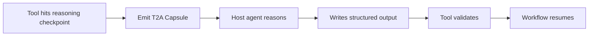

<p align="center">
  <picture>
    <source media="(prefers-color-scheme: dark)" srcset="assets/t2a-hero-dark.png">
    <source media="(prefers-color-scheme: light)" srcset="assets/t2a-hero-light.png">
    
  </picture>
</p>

<h1 align="center">T2A Protocol</h1>

<h3 align="center">Tools can be smart without embedding LLM calls.</h3>

<p align="center">
  T2A is the <strong>Tool-to-Agent Protocol</strong> for auditable reasoning handoffs.
</p>

<p align="center">
  For CLIs, APIs, SDKs, CI jobs, workflows, and MCP servers.
</p>

<p align="center">
  No tool-side LLM API key · No tool-side model billing · No tool-side local model required
</p>

<p align="center">
  <strong>The agent reasons.</strong><br/>
  <strong>The tool validates.</strong><br/>
  <strong>The workflow resumes.</strong>
</p>

## With an agent, why does every tool want another model?

You already have an intelligent agent such as Codex, Claude Code, or Cursor.

Then you connect a tool that reaches a reasoning checkpoint. It may need to summarize evidence, classify risk, consolidate memory, or draft a plan.

Today, that tool usually asks you to provide intelligence all over again:

- bring your own LLM API key
- pay the tool's hosted model bill
- run a tool-side local model

This is backwards. The intelligence is already available through the host agent, but the user must provision another model before the tool can deliver value.

For users, that means another key, account, bill, provider configuration, or local runtime.

For tool authors, that friction is not just maintenance overhead. It is a direct adoption problem: every extra setup step is another chance for users to abandon the tool before they experience its value.

T2A takes a different approach:

> When a tool needs intelligence, it borrows it from the agent that called it.

The tool emits a structured, auditable reasoning handoff. The host agent completes the reasoning with its existing model capability. The tool validates the structured result before changing state or resuming execution.

**The agent reasons. The tool validates. The workflow resumes.**

## First proof: smart memory without a memory-tool model key

`t2a-memory` is the first proof, not the whole protocol.

Memory is the pain in miniature.

A useful memory tool needs reasoning: extraction, consolidation, conflict handling, and durable updates.

Most smart memory tools solve that by asking for a model key, model config, SaaS account, or local model.

`t2a-memory` does not.

It is a local memory tool that:

- does not ask for an OpenAI key
- does not ask for an Anthropic key
- does not ask for a Gemini key
- does not require `model`, `base_url`, or `provider`
- does not create tool-side model billing
- does not run a tool-side local model

Yet a host agent can use it to create, consolidate, validate, and commit memory.

```text
User asks local agent:
  Remember that I prefer concise but structured technical advice.

t2a-memory:
  creates a T2A handoff

host agent:
  reads the capsule
  performs the reasoning
  writes structured output

t2a-memory:
  validates the output
  commits local memory

User:
  runs t2a-memory read
  sees the memory
```

Abbreviated result:

```text
t2a-memory doctor

T2A Memory doctor

Tool-side model setup: none

✓ provider/model/base_url config: none
✓ API key required by memory tool: no
✓ direct LLM SDK dependency: none
✓ tool-side local model required: no
✓ network required by memory operations: no

Result: ok

t2a-memory read

Memory:
  - The user prefers concise but structured technical advice.
```

The memory workflow became smart without the memory tool becoming an LLM client.

What this proves:

- the memory tool did not own the model call
- the memory tool did not ask for model credentials
- the host agent performed the reasoning
- the tool validated structured output
- local memory was committed
- the workflow completed without the tool becoming an LLM client

That is the T2A boundary in action.

## Choose your path

| I want to... | Start here |
| --- | --- |
| Feel the proof without installing | [First proof](#first-proof-smart-memory-without-a-memory-tool-model-key) |
| Try it with my local agent | [Copy-paste proof](#copy-paste-proof-ask-your-local-agent-to-run-it) |
| Try it without a capable agent | [Manual fallback](#manual-fallback) |
| Build a smart tool without an embedded LLM call | [For tool authors](#for-tool-authors) |
| Teach a host agent to complete T2A tasks | [For host agents](#for-host-agents) |
| Read the protocol | [T2A capsule](#t2a-capsule), [Spec](spec/v0.1/0001-overview.md) |

## Copy-paste proof: ask your local agent to run it

Have Codex, Claude Code, Cursor, or another shell-capable local agent? Copy this prompt. Works with macOS/Linux/WSL shells and Windows PowerShell; the agent should detect the OS and use the matching commands. The agent will install the packages, create the T2A handoff, complete the reasoning task, validate, commit, and read the memory.

The proof uses npm packages, so it needs Node.js 22+ and npm. Your local agent can check this first and, with your approval, install them if missing.

Copy this into your local agent:

```text
You are my local host agent.

Prove that t2a-memory can give me local memory without the memory tool owning a model key.

Use a user-level tool home. Do not require global npm permissions.

First, check whether Node.js 22+ and npm are available.

If they are available, continue.

If they are missing, tell me what is missing and ask for approval before installing Node.js/npm. Use the least invasive standard method for my OS, such as Homebrew on macOS, winget on Windows, or the system package manager / nvm / fnm on Linux if already available. Do not install system packages without asking.

First, detect my OS and shell.

If I am on macOS, Linux, or WSL, use this setup:

TOOL_HOME="${T2A_TOOL_HOME:-$HOME/.t2a/tools}"
mkdir -p "$TOOL_HOME"
npm install --prefix "$TOOL_HOME" @t2a-protocol/t2a @t2a-protocol/t2a-memory
T2A="$TOOL_HOME/node_modules/.bin/t2a"
T2A_MEMORY="$TOOL_HOME/node_modules/.bin/t2a-memory"

If I am on Windows PowerShell, use this setup:

$ToolHome = if ($env:T2A_TOOL_HOME) { $env:T2A_TOOL_HOME } else { Join-Path $HOME ".t2a\tools" }
New-Item -ItemType Directory -Force -Path $ToolHome | Out-Null
npm install --prefix $ToolHome @t2a-protocol/t2a @t2a-protocol/t2a-memory
$T2A = Join-Path $ToolHome "node_modules\.bin\t2a.cmd"
$T2AMemory = Join-Path $ToolHome "node_modules\.bin\t2a-memory.cmd"

Then run the doctor check and show the result:

macOS/Linux/WSL:
"$T2A_MEMORY" doctor

Windows PowerShell:
& $T2AMemory doctor

Create a memory handoff for this fact:

"I prefer concise but structured technical advice."

Run the matching command:

macOS/Linux/WSL:
"$T2A_MEMORY" remember "I prefer concise but structured technical advice."

Windows PowerShell:
& $T2AMemory remember "I prefer concise but structured technical advice."

Parse the JSON output from `t2a-memory remember`.
Set `TASK_DIR` on macOS/Linux/WSL, or `$TaskDir` on Windows PowerShell, from the returned `local.task_dir`.
Use that exact task directory for validation and commit.

Complete the T2A handoff:

- read `task.json` first
- inspect `prompt.md`, `input.json`, permissions, and `output.schema.json`
- write only `output.json` in the task directory, matching the schema
- run core T2A validation
- run T2A Memory validation
- repair output if validation fails
- commit only after validation passes
- run `t2a-memory read` and show me the committed memory

Use the matching commands:

macOS/Linux/WSL:
"$T2A" validate "$TASK_DIR"
"$T2A_MEMORY" validate "$TASK_DIR"
"$T2A_MEMORY" commit "$TASK_DIR"
"$T2A_MEMORY" read

Windows PowerShell:
& $T2A validate $TaskDir
& $T2AMemory validate $TaskDir
& $T2AMemory commit $TaskDir
& $T2AMemory read

Safety constraints:

- Do not configure an LLM provider for t2a-memory.
- Do not add OPENAI_API_KEY, ANTHROPIC_API_KEY, GEMINI_API_KEY, model, base_url, or provider config for the memory tool.
- Do not read unrelated user files.
- Ask before destructive changes.
- For package installation, write only inside the T2A user-level tool home.
- During the handoff and memory workflow, write only inside T2A/t2a-memory task and memory locations.

When done, explain what happened in one paragraph:

the agent reasoned, the tool validated, and the workflow resumed.
```

<details>
<summary>What the agent should do internally</summary>

- Detect the OS and shell.
- Install packages into `~/.t2a/tools` or another user-level tool home with `npm install --prefix`.
- Use `.cmd` binaries on Windows PowerShell.
- Run `t2a-memory doctor`.
- Run `t2a-memory remember`.
- Parse `local.task_dir`.
- Write `output.json`.
- Validate with `t2a` and `t2a-memory`.
- Commit with `t2a-memory`.
- Read with `t2a-memory read`.

</details>

Success means:

- `t2a-memory doctor` reports no tool-side model setup
- a T2A handoff was created
- the host agent wrote structured output
- validation passed
- memory was committed locally
- `t2a-memory read` shows the memory
- the memory tool still has no tool-side model key or model config

Optional: install reusable agent skills for future sessions.

(Not required for the proof above.)

```bash
TOOL_HOME="${T2A_TOOL_HOME:-$HOME/.t2a/tools}"
"$TOOL_HOME/node_modules/.bin/t2a-memory" install --agent auto
```

This may write T2A and T2A Memory skill files into local agent skill directories such as `.agents` or `.claude`.

<a id="manual-fallback"></a>
<details>
<summary>No local agent? Inspect the protocol manually</summary>

This path is for users who do not have a local shell-capable agent, have an agent that cannot reliably edit files, or want to inspect the protocol manually.

On Windows PowerShell, use the `.cmd` binaries under `node_modules\.bin` and PowerShell variable syntax.

Install the packages:

```bash
TOOL_HOME="${T2A_TOOL_HOME:-$HOME/.t2a/tools}"
export T2A_TOOL_HOME="$TOOL_HOME"
npm install --prefix "$TOOL_HOME" @t2a-protocol/t2a @t2a-protocol/t2a-memory
```

Create a memory handoff:

```bash
"$TOOL_HOME/node_modules/.bin/t2a-memory" remember "I prefer concise but structured technical advice."
```

Copy `local.task_dir` from the JSON output:

```bash
TASK_DIR="<task directory printed by t2a-memory remember>"
```

Inspect the capsule:

```bash
cat "$TASK_DIR/task.json"
cat "$TASK_DIR/prompt.md"
cat "$TASK_DIR/input.json"
cat "$TASK_DIR/output.schema.json"
```

Create `output.json` manually, or ask a separate chat model to produce JSON matching `output.schema.json`. Use the real `event_id` from `input.json`:

```json
{
  "event_id": "<event_id from input.json>",
  "decision": "commit",
  "operations": [
    {
      "op": "add",
      "topic": "communication-style",
      "statement": "I prefer concise but structured technical advice.",
      "source_event_ids": ["<event_id from input.json>"]
    }
  ],
  "rationale": "The user expressed a durable communication preference."
}
```

Then validate, commit, and read:

```bash
"$TOOL_HOME/node_modules/.bin/t2a" validate "$TASK_DIR"
"$TOOL_HOME/node_modules/.bin/t2a-memory" validate "$TASK_DIR"
"$TOOL_HOME/node_modules/.bin/t2a-memory" commit "$TASK_DIR"
"$TOOL_HOME/node_modules/.bin/t2a-memory" read
```

The manual path is not the main wow path. The main wow path is a local host agent completing the handoff.

</details>

## What just happened?

A tool reached a reasoning checkpoint.

Instead of embedding an LLM client, it emitted a T2A Capsule.

The capsule contains:

- task metadata
- bounded inputs
- prompt
- output schema
- validation boundary

The host agent completed the reasoning and wrote structured output.

The tool validated that output before committing state or resuming deterministic execution.

The agent reasons. The tool validates. The workflow resumes.

## Simple flow



## Why the boundary matters

T2A is not about removing model use.

It is about putting model use at the right boundary.

The host agent already owns the reasoning capability the user chose.

The tool is where domain constraints live: file paths, source IDs, memory schemas, risk labels, commit rules, and validation logic.

When a tool embeds its own model call, those boundaries collapse.

The tool starts owning prompts, provider configuration, model choice, credentials, billing, and failure recovery.

When a tool emits a T2A handoff, the boundary stays visible:

- the tool declares the task
- the agent performs the reasoning
- the tool validates structured output
- the workflow resumes only after validation

The usual alternatives all add user friction and tool-author adoption risk.

### 1. Bring your own LLM API key

Now every tool wants your OpenAI, Anthropic, Gemini, Cohere, Voyage, or local-compatible API key.

You may not have one. You may only have an agent product subscription. You may not want to hand billing credentials to every tool you try. You may not know what prompts the tool sends or how much it will spend.

For tool authors, BYOK is not just an integration chore. Every provider has different models, payloads, errors, rate limits, base URLs, streaming behavior, auth formats, and billing assumptions. The moment your tool asks for `api_key`, `model`, `base_url`, or `provider`, setup friction becomes part of your product, and users who do not have a key, do not trust the billing path, or do not want another provider form may never reach the first successful run.

### 2. Pay the tool's hosted model bill

The tool can hide the model call behind its own cloud service.

That removes the API-key form, but creates a new account, a new bill, a new data boundary, and a new trust decision. The user already pays for an agent with reasoning power; now every smart tool wants to charge for another slice of intelligence.

For tool authors, hosted model calls mean pricing, metering, abuse prevention, privacy questions, latency, support burden, and model-cost risk. They also move the adoption problem into your funnel: users must create or trust another account, accept another data boundary, and believe your tool is worth another recurring intelligence bill.

### 3. Run a tool-side local model

Local-first sounds good, but not every laptop can run a useful model. Local models consume CPU, GPU, RAM, disk, and battery. Small local models may be weaker than the host agent the user already has.

For tool authors, local model support means another setup path, another failure mode, and another quality problem. If the user's machine cannot run it well, or the local model gives weak results, the user experiences that as your tool failing.

## Embedded LLM call vs T2A handoff

| Embedded LLM call inside tool | T2A handoff |
| --- | --- |
| Tool asks for provider keys | Host agent uses its existing model capability |
| Tool handles model/provider differences | Host agent owns the model surface |
| Tool may receive billing credentials | Tool receives structured output |
| Hidden prompt/output | Auditable capsule and structured output |
| Tool owns model billing | Tool stays model-free |
| Tool trusts model output directly | Tool validates before commit/resume |
| Each tool reinvents provider config | One host agent can reason for many tools |

T2A does not eliminate LLMs. It moves the model call out of the tool and into the host-agent boundary.

## Protocol map

If you think in agent protocol maps, T2A fits like this:

| Protocol | Direction | What it standardizes |
| --- | --- | --- |
| MCP | Agent -> Tool | Agents call tools and access context |
| A2A | Agent <-> Agent | Agents coordinate with other agents |
| T2A | Tool -> Agent | Tools hand off reasoning checkpoints |

T2A does not replace MCP or A2A. It completes a missing direction: after an agent calls a tool, the tool can hand a reasoning checkpoint back to the host agent.

But T2A is not only for MCP servers. The issuing tool can be a CLI, API, SDK, CI job, workflow, or MCP server.

## T2A capsule

A T2A Capsule is a durable reasoning work order. In v0.1 it is local and file-based. Its entry document is `task.json`.

```text
.t2a/tasks/<task-id>/
  task.json
  prompt.md
  inputs/            # generic capsule input directory
  input.json         # some tools, such as t2a-memory, may use a single input file
  output.schema.json
  output.json       # produced later by the host agent
  validation.json   # produced later by validation
```

At handoff time, `task.json`, `prompt.md`, declared inputs, and `output.schema.json` exist.

Some tools may use a single `input.json`; others may use an `inputs/` directory.

The host agent writes `output.json` later.

`validation.json` is produced by validation.

T2A core validates the protocol envelope and output schema. The issuing tool validates domain semantics.

## T2A handoff result

A T2A Handoff Result is the machine-readable signal a tool returns when reasoning is required. Agents should not need to guess when to use T2A.

Minimal local shape:

```json
{
  "type": "t2a.handoff",
  "t2a_version": "0.1",
  "task_id": "memory-123",
  "local": {
    "task_dir": ".t2a/tasks/memory-123",
    "task_file": ".t2a/tasks/memory-123/task.json"
  }
}
```

Remote handoff patterns are documented, but v0.1 ships the local file-based flow first.

## For tool authors

Your goal is not to adopt a framework.

> Replace one embedded LLM call with one T2A handoff.
> Keep the rest of your tool unchanged.

Start here: [T2A Tool Author Kit](docs/tool-authors/README.md)

Fast path:

1. Copy the Tool Author Kit setup prompt into Codex / Claude Code / Cursor.
2. Let it run `t2a install tool-author-kit --agent auto`.
3. Review its one-checkpoint migration plan.
4. Approve the smallest local T2A handoff.
5. Run `t2a validate <task-dir>`.

The kit includes:

- a coding-agent migration prompt
- a tool-author skill
- a runnable minimal CLI example
- a concrete local handoff template
- a compatibility checklist

Conceptually:

```text
Before:
tool -> embedded LLM provider call -> parse result -> mutate state

After:
tool -> emit T2A Capsule
host agent -> write output.json
tool -> validate -> commit/resume
```

## For host agents

Host agents complete T2A tasks by following the capsule, not by guessing.

1. Read `task.json` first.
2. Inspect declared inputs and permissions.
3. Follow `prompt.md`.
4. Produce `output.json` matching `output.schema.json`.
5. Run validation when available and safe.
6. Repair until validation passes.
7. Stop before resume unless explicitly asked.

Minimal host support:

- recognize `type: "t2a.handoff"`
- open `local.task_file`
- read declared inputs and prompt
- write the declared output path
- run validation when available
- do not resume automatically

The generic host-agent instruction file lives at [skills/t2a/SKILL.md](skills/t2a/SKILL.md).

`t2a-memory` also ships installable skill templates:

- `integrations/t2a-memory/templates/skills/t2a/SKILL.md`
- `integrations/t2a-memory/templates/skills/t2a-memory/SKILL.md`

## Validate, resume, continue

`validate` is deterministic checking.

`resume` belongs to the issuing tool.

`continue` means `validate_then_resume`.

In v0.1, the T2A CLI validates first and then prints resume/continue guidance. It does not execute arbitrary tool-owned commands.

## Local-first v0.1

v0.1 is local-first, protocol-first, and intentionally small. It implements local file-based capsules first.

Remote APIs, SDKs, and MCP servers are documented as handoff patterns, but this repository does not include a hosted server, SDK, scheduler, daemon, or MCP bridge implementation yet.

## Zero tool-side model setup

This repository must not add tool-side LLM API calls and must not require `model`, `base_url`, `api_key`, `provider`, or LLM SDK configuration.

The host agent may use its own model capability. The tool does not own the model call.

## FAQ and not this

**Q: Does T2A remove model use entirely?**

A: No. It means no tool-side embedded LLM call. The host agent still performs reasoning.

**Q: Is T2A a memory database?**

A: No. `t2a-memory` is the first proof. T2A is a protocol for reasoning handoffs.

**Q: Is T2A an MCP replacement?**

A: No. T2A complements MCP and A2A.

**Q: Is T2A limited to MCP servers?**

A: No. T2A is for any tool that can emit a reasoning handoff: CLI, API, SDK, CI job, workflow, or MCP server. MCP Sampling is MCP-specific; T2A is a general tool-to-agent handoff pattern with capsule, validation, and commit/resume.

**Q: Is T2A an agent framework?**

A: No. T2A defines the handoff boundary.

**Q: Why not just call OpenAI/Anthropic inside the tool?**

A: Because the user may already have a trusted host agent with model access. Embedding another model call forces the tool to own provider configuration, credentials, billing, prompts, and recovery. T2A keeps reasoning with the host agent and makes the checkpoint auditable and validatable.

## T2A in one sentence

> T2A lets smart tools hand off reasoning to the host agent instead of embedding LLM calls.

## T2A in one loop

```text
Tool hits reasoning checkpoint
-> emits T2A Capsule
-> host agent reasons
-> tool validates
-> workflow resumes
```

If this boundary resonates, star the repo to follow the protocol, examples, and T2A-compatible tools.

## Examples

- [integrations/t2a-memory/](integrations/t2a-memory/): a memory tool records deterministic input, the host agent consolidates it, and the tool validates and commits local memory. Your agent gets memory. The memory tool gets no model key.
- [examples/tool-author-minimal-cli/](examples/tool-author-minimal-cli/): a tiny runnable tool-author example that replaces one embedded model-call path with one local T2A handoff.
- [examples/retrieval-brief/](examples/retrieval-brief/): a retrieval tool gathers bounded evidence, the host agent writes a grounded brief, and the issuing tool can validate source IDs.
- [examples/change-risk-review/](examples/change-risk-review/): a change tool records deterministic change inputs, the host agent classifies risk, and the issuing tool can validate resource IDs before continuing.

## From source / development

Requires Node.js 22 or newer.

Core CLI source quickstart:

```bash
cd cli
npm install
npm run build
node dist/index.js inspect ../examples/retrieval-brief/.t2a/tasks/demo
node dist/index.js validate ../examples/retrieval-brief/.t2a/tasks/demo
node dist/index.js continue ../examples/retrieval-brief/.t2a/tasks/demo
```

Local package smoke test:

```bash
cd cli
npm install
cd ../integrations/t2a-memory
npm install
npm run dogfood:pack-smoke
```

The smoke test builds and packs both local packages, installs them into a temporary tool home, simulates the host-agent output step, validates, commits, reads memory, and checks path boundaries. See [integrations/t2a-memory/README.md](integrations/t2a-memory/README.md).

## Repository layout

- `spec/v0.1/`: normative protocol documents.
- `schemas/v0.1/`: JSON Schema 2020-12 protocol schemas.
- `cli/`: TypeScript CLI for local capsule inspection, validation, and continue guidance.
- `docs/`: concepts, quickstart, capsule, handoff, validation, continue, security, and deferred/remote handoff notes.
- `examples/`: local capsule examples.
- `skills/t2a/`: host-agent skill for completing T2A capsules.
- `skills/t2a-tool-author/`: coding-agent skill for converting one tool reasoning checkpoint to T2A.
- `prompts/`: copy-paste prompts for host agents and coding agents.
- `templates/`: concrete T2A authoring templates.
- `integrations/`: integration templates and notes.
- `integrations/t2a-memory/`: user-level memory proof and package smoke flow.
- `scripts/dogfood/`: local package smoke tests.
- `conformance/`: validation fixtures for implementers.

## License

Code and specification materials are licensed under the Apache License, Version 2.0.
