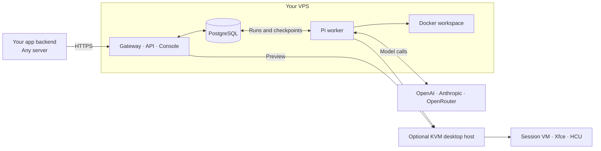

# Pi Managed Agents API

**Give your apps agents that run code, keep context, and deliver files. Powered by Pi. Hosted by you.**

[](https://github.com/taherchhabra/pi-managed-agents-api/actions/workflows/check.yml)

[Get started](#get-started) · [Comparison](#how-it-compares) · [Connect your app](#connect-your-app) · [Built-in documentation](#documentation-in-your-workspace) · [Architecture](docs/architecture.md)

Useful agents need a place to work, a way to carry context into the next task, and a record of what happened. Pi Managed Agents brings those pieces together in a self-hosted API and browser console built around the **Pi coding agent SDK**.

Define an agent, give it a workspace, and send it a task. Pi handles the model and tool loop; the service saves session state, runs code in Docker or operates a Linux desktop, records progress, and publishes the resulting files. Your application can call it from any server over HTTPS.


*A real DeepSeek run through OpenRouter: synthetic release metrics become a Python analysis and a downloadable report. Screenshots use a separate demo workspace.*

## Give an agent a Linux desktop

Choose **Desktop assistant**, select a vision model, and start a **Linux desktop** session. Pi uses [Microsoft HCU](https://github.com/microsoft/Hybrid-Computer-Use) to inspect accessibility controls and screenshots, then operate real applications inside a QEMU/KVM VM. The console shows a live preview and saves the model’s observations alongside its tool calls.

Apps and files stay with the session between runs. A desktop can run on a separate KVM server while your API stays on a VPS. Linux is supported first, with **Off, Internet, or domain-allowlist** networking for desktop sessions. Internet access uses an HTTP/HTTPS proxy; private networks and cloud metadata are blocked. The preview is read-only. Windows and macOS providers are not implemented.

Open **Docs → Linux desktops & HCU** in the app for setup and the API guide. The same guide is in [docs/desktop.md](docs/desktop.md).

[](docs/images/desktop-preview.jpg)

*The agent created a note in Mousepad, saved it through the GUI, then resumed the same desktop and appended a second line. Screenshots and the saved file are available in the session.*


*Choose a network policy for each new desktop session. The real DeepSeek browser test loaded an allowed website and verified that an unapproved domain was blocked. See the [browser result](docs/images/desktop-browser-preview.jpg) and [in-app guide screenshot](docs/images/desktop-network-docs.jpg).*

## How it compares

Vendor documentation checked on **14 November 2026**; the Pi column reflects the **implemented MVP as of 15 November 2026**. Vendor columns describe their hosted services, with self-hosting options called out separately. Links in the table point to the relevant vendor documentation.

| Capability | Pi Managed Agents API — current MVP | OpenAI Agents API | Claude Managed Agents API |
| --- | --- | --- | --- |
| Agent harness | Pi coding agent SDK | [Managed Codex harness](https://developers.openai.com/api/docs/guides/agents-api/architecture) | [Configurable Claude harness](https://platform.claude.com/docs/en/managed-agents/overview) |
| Host the API, harness, and session storage yourself | **Yes.** Docker Compose deployment on one Linux VPS | [OpenAI runs the service; self-hosted sandboxes move tool execution to your infrastructure](https://developers.openai.com/api/docs/guides/agents-api/architecture) | Hosted service, or [self-hosted service and sandboxes](https://platform.claude.com/docs/en/managed-agents/self-hosted) |
| Model choices | OpenAI, Anthropic, and OpenRouter catalogs; includes DeepSeek | [OpenAI models supported by the API](https://developers.openai.com/api/docs/guides/agents-api/configuration) | [Claude models](https://platform.claude.com/docs/en/managed-agents/overview); self-hosted service also supports [a choice of inference backend](https://platform.claude.com/docs/en/managed-agents/self-hosted) |
| Reusable agents | Immutable versions; sessions pin a version | [Saved or inline configuration; sessions copy saved settings](https://developers.openai.com/api/docs/guides/agents-api/configuration) | [Versioned agent definitions](https://platform.claude.com/docs/en/managed-agents/agent-setup) |
| Sessions and follow-up messages | **Yes.** Persistent context, queued runs, and follow-ups; five-minute limit per run | [Persistent sessions with asynchronous turns and follow-ups](https://developers.openai.com/api/docs/guides/agents-api/sessions) | [Stateful sessions with asynchronous user events](https://platform.claude.com/docs/en/managed-agents/overview) |
| Code execution and workspace | Docker workspaces or optional Linux desktops on QEMU/KVM with HCU; Bash, Python and persistent files; desktop HTTP/HTTPS with Off / Internet / domain allowlist, Docker networking off | [Hosted, self-hosted, or no environment](https://developers.openai.com/api/docs/guides/agents-api/architecture) | [Cloud sandboxes](https://platform.claude.com/docs/en/managed-agents/environments) or [self-hosted execution](https://platform.claude.com/docs/en/managed-agents/self-hosted-sandboxes) |
| File inputs and outputs | Downloads of published `outputs/` snapshots; **no input-upload API yet** | [Uploads and published artifacts for hosted environments; self-hosted files use your infrastructure](https://developers.openai.com/api/docs/guides/agents-api/environments/files) | [Upload, mount, and download session files](https://platform.claude.com/docs/en/managed-agents/files) |
| Streaming and history | Saved lifecycle/tool/result events over resumable SSE; **no token deltas yet** | [Live SSE with text deltas; saved items and turns for history](https://developers.openai.com/api/docs/guides/agents-api/sessions/events) | [Live text previews plus persisted completed events](https://platform.claude.com/docs/en/managed-agents/event-deltas) |
| Console and logs | Agent testing, session inspector, tool calls, log export, artifacts, and built-in docs | [Dashboard session logs, turn traces, and usage](https://developers.openai.com/api/docs/guides/agents-api/observability) | [Console session viewer, tool inspection, event export, and usage](https://platform.claude.com/docs/en/managed-agents/session-observability) |
| MCP and custom application tools | Fixed Bash/file tools plus built-in HCU `AX`/`GUI` integration; **no user-configurable MCP servers or custom tools yet** | [Function tools](https://developers.openai.com/api/docs/guides/agents-api/tools/functions) and [MCP connections](https://developers.openai.com/api/docs/guides/agents-api/tools/mcp) | [Custom tools and MCP](https://platform.claude.com/docs/en/managed-agents/tools) |
| Steering and cancellation | Cancellation supported; new messages queue or reject while busy; **no mid-run steering** | [Steer an active turn or cancel it](https://developers.openai.com/api/docs/guides/agents-api/sessions) | [Steer or interrupt with user events](https://platform.claude.com/docs/en/managed-agents/overview) |
| Subagents and orchestration | **Not yet.** One agent per session; one run at a time per worker | [Parallel subagents with separate context](https://developers.openai.com/api/docs/guides/agents-api/multi-agent) | [Subagents, threads, and dynamic workflows](https://platform.claude.com/docs/en/managed-agents/multiagent-orchestration) |
| Tool approvals | **Not yet.** Enabled tools execute within fixed sandbox restrictions | [Automatic review for supported approval requests](https://developers.openai.com/api/docs/guides/agents-api/sessions/approvals) | [Allow, ask, or automatic permission policies](https://platform.claude.com/docs/en/managed-agents/permission-policies) |
| Scheduling and webhooks | **Not yet.** Your app submits runs and polls or streams results | [Scheduled automations](https://developers.openai.com/api/docs/guides/agents-api/sessions/automations) and [session webhooks](https://developers.openai.com/api/docs/guides/agents-api/sessions/webhooks) | [Scheduled deployments](https://platform.claude.com/docs/en/managed-agents/scheduled-deployments) and [webhooks](https://platform.claude.com/docs/en/managed-agents/webhooks) |
| Failure recovery | Explicit `waiting` state; reconcile tool effects before retrying; **no automatic tool replay** | [Inspect saved state and tool effects before retrying failed work](https://developers.openai.com/api/docs/guides/agents-api/errors) | [Automatic rescheduling for transient errors; termination for unrecoverable errors](https://platform.claude.com/docs/en/managed-agents/webhooks) |
| Client integration | Own HTTP API and runnable Node.js example; **no OpenAI/Claude SDK compatibility** | [OpenAI SDK session APIs](https://developers.openai.com/api/docs/guides/agents-api/sessions) | [Anthropic SDK and CLI; same API for its self-hosted service, with exceptions](https://platform.claude.com/docs/en/managed-agents/self-hosted) |

Claude's self-hosted service currently omits the Files API, scheduled deployments, and webhooks, and limits delegation to predefined subagents; see its [documented feature differences](https://platform.claude.com/docs/en/managed-agents/self-hosted/differences). Hosting the whole service and hosting only a sandbox are separate options. Pi runs its service locally, while model requests go to the configured provider. Real inference has been tested through OpenRouter; direct OpenAI and Anthropic inference remains unverified.

Pi currently suits a trusted operator who wants a Pi-based runtime, provider choice, and a console on their own VPS. It does not yet provide high availability, per-user roles, spending quotas, or a hardened public execution service. See the [implemented contract and limits](docs/mvp.md) for the exact scope.

## Build an agent. See it work.

Start with instructions, a model, and the tools your agent needs. Use **OpenAI, Anthropic, or OpenRouter**, including DeepSeek V4.1 Flash 1017 through OpenRouter. The console shows the models available in the installed runtime.

Save a version, select **Test agent**, and send a task. You can build a coding assistant that writes and tests Python, an analyst that turns supplied data into a report, or a writing partner that keeps context through revisions.

Every saved agent version is immutable. Existing sessions keep their original configuration while you try new instructions or models in another session.


## Keep the conversation and the workspace

A session connects an agent version to an environment. Send related tasks to the same session to continue the conversation and work with the files it already created.

| You define | The service keeps |
| --- | --- |
| **Agent** | Versioned instructions, provider, model, and allowed tools |
| **Environment** | A Docker workspace, a Linux desktop VM, or a conversation-only session |
| **Session** | Conversation context, checkpoints, and persistent workspace files |
| **Run** | One submitted task, its status, output, and reported usage |
| **Events and artifacts** | Saved execution history and downloadable output snapshots |

Managed workspaces provide **Bash, Python, file reads, and file writes**. Each attempt runs in a fresh container with the session's persistent volume. Files saved under `outputs/` are published as artifacts after a successful run, ready for your app to download.

Disconnecting your app or closing the console does not cancel a run. Reopen the session to inspect its result, or reconnect to the event stream from the last sequence you received. Interrupted worker execution follows an explicit recovery flow; uncertain tool effects are never automatically replayed.

## Follow every run

The console puts the conversation and execution history side by side. Inspect a run's tool calls, expand their arguments and results, search the event log, and preview or download its artifacts. Export the saved session history when you need to investigate a result.

The API exposes that same history through a resumable **server-sent event stream**. These are saved lifecycle, tool, and result events; assistant responses appear when complete.


## Connect your app

Host Pi Agents on a VPS and call it from your application backend, wherever that backend runs. Your app needs an **API URL** and a [**workspace token**](#get-your-workspace-token). Model provider credentials stay on the agents server.

This complete Node.js example creates everything through the API: **agent → environment → session → user message → result → user reply → next result → files**. No console setup or existing session ID is required.

Use **Node.js 22.19+** and a running server with OpenRouter configured. Set these variables in your application's server environment, substituting your own URL and workspace token:

```sh
export API_URL='https://agents.example.com'
export API_TOKEN='your-workspace-token'
export MODEL_PROVIDER='openrouter'
export MODEL='deepseek/deepseek-v4.1-flash-1017'
```

For local development, use `API_URL=http://127.0.0.1:8080`. You can choose another configured provider/model pair from `GET /v1/capabilities`.

Save the following as `quickstart.mjs` and run `node quickstart.mjs`. It uses Node's built-in HTTP client; no client package is required. Each execution creates a new agent and session and makes two real agent runs.

```js
import { randomUUID } from 'node:crypto';
import { setTimeout as delay } from 'node:timers/promises';

const base = (process.env.API_URL ?? 'http://127.0.0.1:8080').replace(/\/$/, '');
const token = process.env.API_TOKEN;
if (!token) throw new Error('Set API_TOKEN to a workspace token from the server');
const headers = { Authorization: `Bearer ${token}` };

// For a retry, pass the original requestId and the unchanged body.
async function request(path, body, requestId = randomUUID()) {
  const response = await fetch(base + path, {
    method: body === undefined ? 'GET' : 'POST',
    headers: body === undefined ? headers : {
      ...headers, 'Content-Type': 'application/json', 'Idempotency-Key': requestId,
    },
    body: body === undefined ? undefined : JSON.stringify(body),
    signal: AbortSignal.timeout(15_000),
  });
  if (!response.ok) throw new Error(`HTTP ${response.status}: ${await response.text()}`);
  return response.json();
}

async function waitForRun(sessionPath, runId) {
  const runPath = `${sessionPath}/runs/${runId}`;
  const deadline = Date.now() + 360_000;
  while (Date.now() < deadline) {
    const run = await request(runPath);
    if (run.status === 'completed') return run;
    if (['failed', 'cancelled', 'waiting'].includes(run.status)) {
      throw new Error(`${runPath}: ${run.status}; ${run.error?.message ?? 'inspect the run in the console'}`);
    }
    await delay(1_000);
  }
  throw new Error(`Timed out waiting for ${runPath}; the server may still be working`);
}

// 1. Create an agent and its first immutable version.
const agent = await request('/v1/agents', {
  name: 'Python assistant',
  config: {
    provider: process.env.MODEL_PROVIDER ?? 'openrouter',
    model: process.env.MODEL ?? 'deepseek/deepseek-v4.1-flash-1017',
    instructions: 'Use Python to verify calculations. Save deliverables under outputs/. Keep replies concise.',
    tools: ['bash', 'read_file', 'write_file'],
  },
});

// 2. Give sessions a managed Docker workspace.
const environment = await request('/v1/environment-templates', {
  name: 'Python workspace', type: 'managed',
});

// 3. Start a conversation pinned to this agent version.
const session = await request('/v1/sessions', {
  agent_version_id: agent.latest_version.id,
  environment_template_id: environment.id,
});
const sessionPath = `/v1/sessions/${session.id}`;
console.log('Session:', session.id); // Store this ID with the conversation in your app.

// 4. Send the user's first message. Persist this key/body to retry safely.
const firstRequestId = randomUUID();
const firstMessage = {
  input: process.env.PROMPT ?? 'Use Python to calculate the first ten Fibonacci numbers starting with 0, 1. Save the code to outputs/fibonacci.py and the numbers to outputs/fibonacci.txt.',
  when_busy: 'queue',
};
console.log('User:', firstMessage.input);
const firstRun = await request(`${sessionPath}/runs`, firstMessage, firstRequestId);
console.log('Run:', firstRun.id); // HTTP 202 means accepted; model work is asynchronous.

// 5. Wait for completion and return the assistant's response to your user.
const firstResult = await waitForRun(sessionPath, firstRun.id);
console.log('Assistant:', firstResult.output_text);

// 6. The user replies. Reuse the session to keep its conversation and files.
const replyRequestId = randomUUID();
const replyMessage = {
  input: process.env.FOLLOWUP_PROMPT ?? 'Read outputs/fibonacci.txt and tell me the sum of those numbers.',
  when_busy: 'queue',
};
console.log('User:', replyMessage.input);
const nextRun = await request(`${sessionPath}/runs`, replyMessage, replyRequestId);
console.log('Run:', nextRun.id);
const nextResult = await waitForRun(sessionPath, nextRun.id);
console.log('Assistant:', nextResult.output_text);

// 7. Retrieve the latest run's output snapshots using the same authentication.
const { data: files } = await request(`${sessionPath}/artifacts`);
for (const file of files.filter(file => file.run_id === nextRun.id)) {
  const response = await fetch(base + file.download_url, {
    headers, signal: AbortSignal.timeout(15_000),
  });
  if (!response.ok) throw new Error(`Artifact download failed: HTTP ${response.status}`);
  const bytes = new Uint8Array(await response.arrayBuffer());
  console.log(`Downloaded ${file.path} (${bytes.length} bytes)`);
  // Store these bytes, or return them to the authorized user from your backend.
}
```

The user's follow-up reads the saved file in the **same session**. A verified DeepSeek run printed these results (session IDs and user messages omitted):

```text
Assistant: Done.

- `outputs/fibonacci.py` — computes the sequence iteratively and writes the result.
- `outputs/fibonacci.txt` — `0 1 1 2 3 5 8 13 21 34`
Assistant: The sum is **88**.
Downloaded fibonacci.txt (23 bytes)
Downloaded fibonacci.py (454 bytes)
```

Assistant wording and file sizes can vary by model. The downloaded bytes are available in memory for your app to save or return to its user.

A `202` response means a message was accepted and saved. The example polls until the run completes; it stops with an error on `failed`, `cancelled`, or `waiting`. A `waiting` run needs an explicit recovery decision. Timing out in your client does not cancel the server's work. To follow saved progress events instead, use `GET /v1/sessions/:session/events?stream=true`.

In your app, create an agent and environment once and reuse their IDs. Create a session for each new conversation, save its ID with the owning user or record, and send each subsequent user message as another run. Keep each POST's idempotency key and body in your job record so an uncertain response can be retried without duplicating work; generate a new key for a new message.

The [runnable example](examples/run.mjs) contains this same code and is also shown in the console's **Documentation → API quickstart**. From a checkout, with the variables above set, run `npm run example`.

Keep workspace tokens in your backend and authenticate your own app's users there. Keys mapped to one workspace share its data; separate workspaces isolate different apps. This project has its own HTTP contract; OpenAI and Claude SDK compatibility adapters are future work.

## Pi at the core, infrastructure you control

The **Pi coding agent SDK** handles model interaction, tool selection, and context management. This service supplies API authentication, asynchronous work, persisted checkpoints, Docker or desktop execution, event history, and artifact storage around it.



The VPS package separates the API from the worker. Only the worker receives model provider keys and Docker access. Tool containers run as a non-root user with a read-only root filesystem, **1 CPU**, **512 MiB RAM**, and networking disabled. Database state, session workspaces, and published artifacts persist on the host.

You operate the service and choose the model provider. The current runtime is pinned to Pi SDK **1.5.2**.

## Get started

### Self-host on a VPS

Use a dedicated Linux VPS with **Docker Engine and Compose**, **Git**, and **Node.js 22.19+**. Point a domain at the server and allow inbound TCP ports **80 and 443**.

```sh
git clone https://github.com/taherchhabra/pi-managed-agents-api.git
cd pi-managed-agents-api
node scripts/vps.mjs init agents.example.com you@example.com
# Add a model provider key to the generated .env.vps file.
node scripts/vps.mjs up
```

The helper generates private credentials and starts Caddy HTTPS, PostgreSQL, the API/console, and the Pi worker. Open `.env.vps` on the server and find `API_KEYS`: the JSON object's **key** is your automatically generated workspace token; its value, `demo`, is the workspace name. Copy just the token and use it to sign in at your domain. See [Get your workspace token](#get-your-workspace-token) for an example.

From there, follow **Documentation → Self-host on a VPS** for deployment checks, application tokens, updates, backups, and recovery. **Connect your app** explains how to use the hosted API from another server.

### Run locally

With the same prerequisites and npm, run these commands from the checkout:

```sh
npm ci
docker compose up -d --wait
docker build -f Dockerfile.sandbox -t pi-managed-sandbox:dev .
[ -f .env ] || cp .env.example .env
```

Edit `.env`: [generate and configure a workspace token](#get-your-workspace-token) in `API_KEYS`, and set `OPENROUTER_API_KEY`, `OPENAI_API_KEY`, or `ANTHROPIC_API_KEY`. Then run `npm run dev` and open **http://127.0.0.1:8080**.

Sign in with the workspace token, create an agent, and choose **Test agent**. For a first task, ask it to write and run a Python program and save the results under `outputs/`.

### Get your workspace token

The workspace token is a secret issued by the person running your Pi Agents server. It authenticates both console sign-in and API requests. OpenRouter, OpenAI, and Anthropic keys are separate credentials used by the server to call models.

- **VPS installation:** `node scripts/vps.mjs init ...` generates a token automatically and saves it in `.env.vps` under `API_KEYS`.
- **Existing local installation:** open `.env` and find the token already configured in `API_KEYS`.
- **New local installation:** generate a token with this command, then copy its output into `.env` as shown below:

```sh
node -e "console.log('pi_' + require('node:crypto').randomBytes(32).toString('base64url'))"
```

```dotenv
API_KEYS='{"PASTE_YOUR_GENERATED_TOKEN_HERE":"demo"}'
```

Replace `PASTE_YOUR_GENERATED_TOKEN_HERE` with your generated token. The text **before the colon** is the token; `demo` is the workspace name. Paste only the token into the console's sign-in field, and use that same value as `API_TOKEN` in your application's backend. Do not paste the whole JSON object or the workspace name.

If the server is already running, restart `npm run dev` after changing `.env`; for `.env.vps` changes, run `node scripts/vps.mjs up`. If someone else hosts the server, ask that operator for a token. Keep the token private; do not commit it to Git.

## Documentation in your workspace

Getting started, API integration, sessions, tools, logs, VPS operations, and HCU desktop setup are documented **inside the UI**, alongside the agents you are building. Find your workspace token, follow the complete agent-to-session walkthrough, and learn how to inspect tool calls, events, and files. Search the guides, copy runnable examples, and follow links straight into the console.


On a local install, [open Documentation](http://127.0.0.1:8080/#/docs/get-started). Every hosted instance serves the same guides at `/#/docs/get-started`, including before sign-in.

## Current scope

This is an MVP for a trusted operator on **one Linux Docker host**. It includes versioned agents, persistent sessions, queued runs, cancellation, explicit recovery, replayable events, artifacts, a console, and HTTPS deployment. The default stack has one API process and one worker.

Public untrusted-code hosting needs a stronger execution boundary, scoped user permissions, disk and spending quotas, and additional operational hardening. High availability, MCP, custom application tools, approvals, and subagents are future work. The [MVP contract](docs/mvp.md) documents implemented behavior and limits.

<details>
<summary><strong>Development and verification</strong></summary>

With development PostgreSQL running and the sandbox image built:

```sh
npm run check
npm run build
```

The tests use the real Pi SDK, PostgreSQL, and Docker with a local model-response fixture. `npm run test:deployment` also builds the full VPS stack and connects from a separate application container over verified HTTPS. Both run in [GitHub Actions](https://github.com/taherchhabra/pi-managed-agents-api/actions/workflows/check.yml) without model credentials.

For real inference, set `OPENROUTER_API_KEY` in your ignored `.env` file:

```sh
npm run test:live
npm run test:deployment:live
```

These opt-in tests use provider credits. The live suites verify model responses, Docker tools, artifacts, saved state, and follow-up work. The deployment suite also restarts the API, worker, and database before continuing the session. OpenRouter inference has been verified with GPT-4.1 mini and DeepSeek V4.1 Flash 1017; direct OpenAI and Anthropic inference remains unverified. [Live test details](docs/live-testing.md).

For UI development, run `npm run dev:api` and `npm run dev:ui` separately. The Vite UI is available at `http://127.0.0.1:5173`. [Console development guide](docs/console.md).

</details>

The design draws on the session-oriented approach described in the [OpenAI Agents API launch](https://openai.com/index/introducing-the-agents-api/) and [Claude Managed Agents launch](https://claude.com/resources/articles/claude-managed-agents). See the [provider architecture research](docs/provider-architecture.md) and [Pi architecture](docs/architecture.md) for the design decisions behind this implementation.
