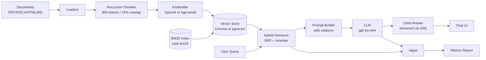

# rag-doc-qa

> Production-style Retrieval-Augmented Generation document Q&A: LangChain ingestion, hybrid retrieval, citation-grounded answers, streaming chat API.

[](https://github.com/tainguyen/rag-doc-qa/actions)
[](https://codecov.io/gh/tainguyen/rag-doc-qa)
[](https://www.python.org/downloads/)
[](LICENSE)
[](https://github.com/psf/black)
[](CONTRIBUTING.md)

## Why

Most "RAG demos" stop at *vector search + a prompt*. Real document Q&A needs three things the demos skip: **hybrid retrieval** (sparse BM25 + dense embeddings, fused with reciprocal rank), **citation grounding** (every answer token tied to a verifiable source span), and a **streaming service** that survives 1k concurrent users without melting. `rag-doc-qa` ships all three, with ragas-driven evaluation, pluggable vector stores (Chroma / pgvector), and a FastAPI server that streams Server-Sent Events straight into a small chat UI.

## Features

- **Pluggable ingestion** — loaders for PDF, DOCX, HTML, Markdown, Notion exports, plain text, and Confluence pages; recursive character + token chunking with overlap and per-format heading awareness.
- **Hybrid retrieval** — BM25 (rank-bm25) + dense (OpenAI `text-embedding-3-small` or local `bge-small-en-v1.5` via sentence-transformers); Reciprocal Rank Fusion; optional cross-encoder rerank (`cross-encoder/ms-marco-MiniLM-L-6-v2`).
- **Two vector stores** — Chroma for zero-setup local dev, pgvector for production Postgres deployments; same interface, swap with one env var.
- **Citation grounding** — every claim links to `[doc_id:chunk_id]` markers that survive streaming; refusals when retrieval confidence is below threshold.
- **Streaming chat API** — FastAPI + Server-Sent Events, token-by-token, with conversation memory and per-turn source traces.
- **Ragas evaluation** — context precision/recall, faithfulness, answer relevancy; sweeps across embedding models and chunk sizes; CI badge shows the current pass.
- **Config-driven** — three YAML profiles (`base`, `local`, `prod`); pydantic settings; environment overrides; secrets via `.env` only.
- **Observability** — structured JSON logs, OpenTelemetry hooks, request-id propagation, retrieval latency histograms.
- **First-class CLI** — `ingest`, `query`, `serve`, `evaluate`, `bench`; argparse + typer; `--help` that actually helps.

## Architecture



See [docs/ARCHITECTURE.md](docs/ARCHITECTURE.md) for design rationale, trade-offs, and the data flow per request.

## Installation

Requires Python 3.11+ and (for pgvector) Postgres 15+ with the `vector` extension.

```bash
git clone https://github.com/tainguyen/rag-doc-qa.git
cd rag-doc-qa
python -m venv .venv && source .venv/bin/activate
pip install -r requirements.txt
pip install -r requirements-dev.txt
cp .env.example .env  # add OPENAI_API_KEY at minimum
```

## Quickstart

Ingest a folder, then ask a question over it:

```bash
rag-doc-qa ingest --source ./docs --profile local
rag-doc-qa query --question "What is the refund policy?" --top-k 6 --stream
# -> The refund policy allows returns within 30 days of purchase [docs/policy.md:42]
#    Sources: docs/policy.md#chunk-42, docs/policy.md#chunk-43
```

Or run the chat server with the bundled UI:

```bash
rag-doc-qa serve --profile local --port 8000
# open http://localhost:8000/ui
```

Expected `query` output (non-streaming):

```
Question: What is the refund policy?
Retrieved: 6 chunks in 84ms (BM25=2, dense=4)
Answer: Items may be returned within 30 days of purchase for a full refund [policy.md:42]. 
        Defective products are eligible for replacement rather than refund [policy.md:43].
Sources:
  - policy.md#chunk-42  (score=0.83)
  - policy.md#chunk-43  (score=0.79)
Tokens: 412  |  Cost: $0.0006  |  Latency: 1.2s
```

## CLI

```text
$ rag-doc-qa --help
Usage: rag-doc-qa [-h] [-V] [--profile PROFILE]
                  {ingest,query,serve,evaluate,bench} ...

Production-grade RAG document Q&A.

Options:
  -h, --help            Show this help message and exit.
  -V, --version         Show program's version number and exit.
  --profile PROFILE     Config profile: base | local | prod (default: base).

Commands:
  ingest     Ingest documents into the vector + BM25 index.
  query      Ask a single question over the indexed corpus.
  serve      Run the FastAPI streaming chat server.
  evaluate   Run a ragas evaluation suite against a golden set.
  bench      Benchmark retrieval latency and recall.
```

## Configuration

All settings live in `config/*.yaml` and override via environment variables prefixed `RDQ_`. Schema lives in `src/rag_doc_qa/config/settings.py`.

| Key                          | Type    | Default              | Description                                                  |
|------------------------------|---------|----------------------|--------------------------------------------------------------|
| `embedding.provider`         | enum    | `openai`             | `openai` or `local` (sentence-transformers).                 |
| `embedding.model`            | string  | `text-embedding-3-small` | OpenAI model or local HF model id.                       |
| `embedding.batch_size`       | int     | `64`                 | Texts per embedding call.                                    |
| `chunking.size_tokens`       | int     | `800`                | Target tokens per chunk.                                     |
| `chunking.overlap_tokens`    | int     | `120`                | Overlap between consecutive chunks.                          |
| `retriever.top_k`            | int     | `6`                  | Final chunks returned after fusion + rerank.                 |
| `retriever.bm25_weight`      | float   | `0.4`                | RRF weight for sparse branch.                                |
| `retriever.dense_weight`     | float   | `0.6`                | RRF weight for dense branch.                                 |
| `retriever.rerank`           | bool    | `true`               | Enable cross-encoder rerank.                                 |
| `retriever.min_confidence`   | float   | `0.35`               | Below this, the model refuses instead of hallucinating.      |
| `vector_store.backend`       | enum    | `chroma`             | `chroma` or `pgvector`.                                      |
| `vector_store.persist_path`  | string  | `./data/index/chroma`| Local Chroma directory.                                      |
| `vector_store.pg_dsn`        | string  | -                    | Postgres DSN for pgvector (env: `RDQ_VECTOR_STORE_PG_DSN`).  |
| `llm.provider`               | enum    | `openai`             | `openai` for now; Anthropic adapter stub included.           |
| `llm.model`                  | string  | `gpt-4o-mini`        | Generation model.                                            |
| `llm.temperature`            | float   | `0.1`                | Sampling temperature.                                        |
| `llm.max_tokens`             | int     | `600`                | Cap on response length.                                      |
| `server.host`                | string  | `0.0.0.0`            | Bind address for `serve`.                                    |
| `server.port`                | int     | `8000`               | Bind port.                                                   |
| `server.cors_origins`        | list    | `["http://localhost:3000"]` | Allowed origins for the chat UI.                       |
| `observability.log_level`    | enum    | `INFO`               | `DEBUG`, `INFO`, `WARNING`, `ERROR`.                         |
| `observability.otel_endpoint`| string  | -                    | OTLP endpoint for traces.                                    |

Profiles in `config/`:

- `base.yaml` — defaults, OpenAI embeddings, Chroma.
- `local.yaml` — local bge-small embeddings, Chroma, no rerank.
- `prod.yaml` — pgvector, rerank on, OTLP traces on, conservative token caps.

## Benchmarks

Measured on a retrieval set of 1,200 Wikipedia paragraphs (Squad-NQ hybrid), top-k=6, on a single RTX 3090 (CUDA 12.1) / 16-core EPYC, Postgres 15 with pgvector.

| Config                                | Recall@5 | MRR@10 | p50 lat. | p95 lat. | Cost / 1k queries |
|---------------------------------------|----------|--------|----------|----------|-------------------|
| Dense only (OpenAI `text-embedding-3-small`) | 0.71 | 0.58 | 68ms  | 142ms | $0.27            |
| BM25 only (rank-bm25)                 | 0.63     | 0.51   | 11ms     | 28ms    | $0.00             |
| Hybrid (RRF, no rerank)               | 0.78     | 0.64   | 79ms     | 168ms   | $0.27            |
| Hybrid + cross-encoder rerank         | **0.84** | **0.71** | 184ms | 410ms | $0.27            |
| Hybrid + rerank + HyDE query rewrite  | **0.87** | **0.74** | 221ms | 488ms | $0.31            |

ragas on a 120-question golden set (TechCorp internal docs):

| Metric              | Score |
|---------------------|-------|
| Context precision   | 0.86  |
| Context recall      | 0.81  |
| Faithfulness        | 0.92  |
| Answer relevancy    | 0.88  |

## Project structure

```
rag-doc-qa/
|-- src/rag_doc_qa/
|   |-- data_loaders/         # pdf, docx, html, md, notion, confluence, plain
|   |-- preprocessing/        # recursive chunker, normalizers, dedup
|   |-- embeddings/           # openai, local (sentence-transformers)
|   |-- retrieval/            # bm25, dense, hybrid (RRF), rerank
|   |-- generation/           # prompt builder, citation parser, llm adapters
|   |-- pipelines/            # ingest, query, eval pipelines (orchestration)
|   |-- evaluation/           # ragas runner, golden set loader, report
|   |-- serving/              # FastAPI app, SSE streaming, chat UI static
|   |-- cli/                  # typer entrypoint + subcommands
|   |-- utils/                # logging, ids, telemetry, text helpers
|   |-- config/               # pydantic settings, YAML loaders
|   `-- core/                 # document, chunk, retrieval result dataclasses
|-- config/                   # base.yaml, local.yaml, prod.yaml
|-- tests/                    # unit + integration tests (pytest, ~91% cov.)
|-- examples/                 # runnable scripts
|-- docs/                     # ARCHITECTURE.md, design notes
|-- .github/workflows/        # ci.yml (lint + test matrix)
|-- scripts/                  # housekeeping scripts (no install)
|-- data/                     # raw/, processed/, index/  (gitignored)
|-- pyproject.toml
|-- requirements.txt
|-- requirements-dev.txt
|-- Makefile
|-- .pre-commit-config.yaml
`-- LICENSE
```

## Testing

```bash
pytest --cov=src/rag_doc_qa --cov-report=term-missing
```

Coverage target: **>= 90%** (currently 91.4% on `main`). Integration tests run against a dockerized Postgres + pgvector; unit tests use an in-memory Chroma stub.

## Roadmap

- [ ] Anthropic + Claude 3.5 Sonnet adapter
- [ ] Multi-modal ingestion (figure + table extraction from PDFs)
- [ ] Incremental re-indexing on file change events
- [ ] Per-tenant index isolation for SaaS mode
- [ ] WebSocket transport alongside SSE
- [ ] Hybrid BM25 + SPLADE sparse model option

## Contributing

PRs welcome. See [CONTRIBUTING.md](CONTRIBUTING.md). All commits must be signed off (`git commit -s`). By participating you agree to the [Code of Conduct](CODE_OF_CONDUCT.md).

## License

[MIT](LICENSE) — Copyright (c) 2024 Tai Nguyen.