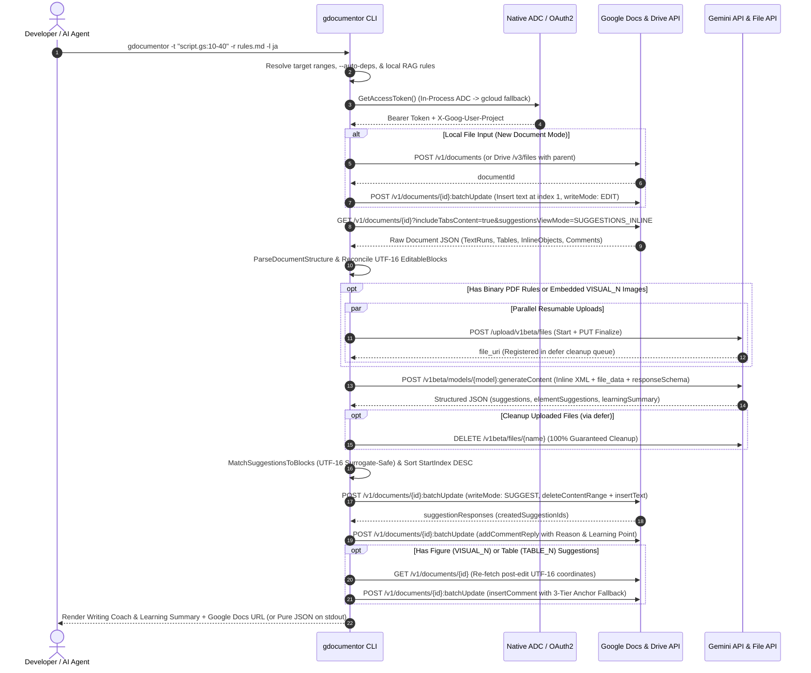

<a name="top"></a>
# gdocumentor — DocuMentor AI (Go CLI & Antigravity Agent Skill Edition)


[](https://github.com/tanaikech/gdocumentor)
[](https://go.dev/)
[](LICENSE)
[](https://developers.google.com/workspace/docs/api)
[](https://ai.google.dev/)

**[👤 Individual Setup (`INSTALL_INDIVIDUAL.md`)](INSTALL_INDIVIDUAL.md)** | **[🤖 Multi-Agent & Windows 11 ↔ WSL2 Guide (`INSTALL_AI_AGENTS.md`)](INSTALL_AI_AGENTS.md)** | **[🏫 School & Organization Setup (`INSTALL_ORGANIZATION.md`)](INSTALL_ORGANIZATION.md)** | **[⚡ 21 One-Command Test Cookbook (`TEST_COMMANDS.md`)](TEST_COMMANDS.md)** | **[🧪 End-to-End Verification Guide (`TESTING_GUIDE.md`)](TESTING_GUIDE.md)** | **[🤖 Agent Skill Specification (`skills/documentor-ai/SKILL.md`)](skills/documentor-ai/SKILL.md)** | **[📋 JSON I/O Schema (`skills/documentor-ai/references/json_schema.md`)](skills/documentor-ai/references/json_schema.md)**

**gdocumentor (`v1.0.0`, `DocuMentor AI`)** is a high-performance Golang CLI tool, **Global Model Context Protocol (MCP) Server (`gdocumentor mcp`)**, and **Google Antigravity Agent Skill / Plugin** that transforms Generative AI from a passive "ghostwriter" into an interactive **Writing & Code Review Coach**—featuring a **Dual AI Execution Architecture**:
- **Standalone CLI Mode (`gdocumentor`)**: Directly calls the **Gemini API (`GEMINI_API_KEY`)** in-process for fast, self-contained 1-command terminal, batch script, and CI/CD execution—supporting both **Google Docs Native Suggesting Mode (`WriteMode.SUGGEST` & `insertComment`)** (with a Google OAuth2 Access Token) and **Access-Token-Free Local File & Public URL Mode (`--no-auth` / `-o <file>`)**.
- **MCP Server Mode (`gdocumentor mcp`)**: Leverages the **client-side AI Agent's own LLM (Host AI)**—such as **Google Antigravity (`agy`)**, Claude Desktop, Cursor, or Windsurf—**without requiring `GEMINI_API_KEY` inside `gdocumentor`**, while `gdocumentor` handles all deterministic workspace/dependency/RAG resolution, surrogate-pair-safe UTF-16 coordinate matching, and Google Docs API `batchUpdate` automation (with optional fallback to internal Gemini API via `useInternalGemini: true`).

Ported from and extending the original Google Apps Script [DocuMentor AI](https://github.com/tanaikech/DocuMentorAI), this Go edition (`v1.0.0`) adds native **Pageless Google Docs** conversion for `.md`/`.txt`/`.pdf`/`.docx` (with parallel Base64 local image embedding), script insertion for source code files, deterministic line and character range scoping (`--target`, `--range`), automatic cross-file dependency resolution (`--auto-deps`), full `sync.WaitGroup` pipeline concurrency, custom AI Coach Persona via RAG rulebooks (`# AIの位置づけ` / `--persona`), **Coach Impact & Decision Record** tracking, a dedicated **Google Docs Coaching Summary Tab (`--summary-tab`)**, direct zero-token Google Docs editing (`edit`), and a triple interface: **Graphical CLI TUI**, **Strict Pure JSON (`--json`)**, and **Global MCP Server (`gdocumentor mcp`)**.

---

## 🚀 Choose Your Installation, Deployment & Testing Guide

Select the guide that matches your environment:

| Guide / Mode | Target Audience | Key Topics & Configuration | Detailed Step-by-Step Guide |
| :--- | :--- | :--- | :--- |
| **👤 Individual / Personal Mode** | Independent writers, researchers, engineers, students, and bloggers setting up `gdocumentor` on their own computer. | **Two Personal Tracks**<br/>1. **Instant Local Mode (`--no-auth`)**: Requires only `GEMINI_API_KEY` (zero `gcloud` / zero GCP setup).<br/>2. **Full Google Docs Mode**: Personal `gcloud` ADC login for Pageless Google Docs suggestions, comments, & Summary Tabs. | **[📖 Open Individual Installation & Usage Guide (`INSTALL_INDIVIDUAL.md`)](INSTALL_INDIVIDUAL.md)** |
| **🤖 Multi-Agent & Windows 11 ↔ WSL2 Bridge Mode** | Users of **Claude Desktop, Claude Code, Cursor, VS Code (GitHub Copilot), Windsurf, Gemini CLI, and Antigravity (`agy`)** on macOS, Linux, Windows, or Windows 11 GUI ↔ WSL2. | **Zero-`GEMINI_API_KEY` Host-AI MCP Setup**<br/>1. **1-Command Multi-Agent Installer (`gdocumentor setup`)**.<br/>2. **Windows 11 Claude Desktop / Cursor / VS Code ↔ WSL2 Bridge (`--wsl-host`)** with automatic `C:\...` ↔ `/mnt/c/...` path translation. | **[🤖 Open Multi-Agent & WSL2 Setup Guide (`INSTALL_AI_AGENTS.md`)](INSTALL_AI_AGENTS.md)** |
| **🏫 School, University, Lab & Organization Mode** | K–12 schools, universities, academic research labs, and engineering teams where an Admin / Instructor configures shared settings for multiple students or members with separate accounts. | **3 Organizational Topologies**<br/>1. **Zero-Google-Auth Lab (`--no-auth`)**: Shared `GEMINI_API_KEY` + rubric (`-r`).<br/>2. **Individual Student Google Accounts + Shared Admin Quota Project (`GOOGLE_CLOUD_QUOTA_PROJECT`)**: 100% student privacy isolation.<br/>3. **Instructor 1-to-N Batch Coaching**: Batch `--hint` & `--summary-tab` across 40+ student Google Docs. | **[📖 Open School & Organization Deployment Guide (`INSTALL_ORGANIZATION.md`)](INSTALL_ORGANIZATION.md)** |
| **⚡ 21 One-Command Test Cookbook** | Anyone who wants to experience `gdocumentor` immediately via copy-pasteable one-liners. | **21 Self-Contained One-Liners**<br/>Part 1 (`#1–#9`): Zero-OAuth `--no-auth` mode.<br/>Part 2 (`#10–#21`): Full Google Docs mode with automatic `--delete-doc` cleanup. | **[⚡ Open One-Command Test Cookbook (`TEST_COMMANDS.md`)](TEST_COMMANDS.md)** |
| **🧪 End-to-End Verification & Feature Testing Suite** | Developers and administrators who want to systematically verify all 13 feature suites step-by-step. | **13 Hands-On Test Scenarios**<br/>Covers Multimodal Proofreading, Socratic Hint-Only Mode, `--auto-deps`, RAG Personas, Summary Tabs, Direct `edit`, MCP Server, Decision Record, and Host-AI Dual Engine. | **[🧪 Open Step-by-Step Testing Guide (`TESTING_GUIDE.md`)](TESTING_GUIDE.md)** |

---

## Purpose, Motivation & Significance: From the GAS Add-on to the Go CLI & MCP Ecosystem

### 1. Shared Foundational Philosophy: Overcoming "AI-Induced Cognitive Offloading"
The fundamental reason and pedagogical purpose behind **`gdocumentor`** are identical to those of the original Google Apps Script add-on **[DocuMentor AI](https://github.com/tanaikech/DocuMentorAI)**: breaking away from the conventional generative AI proofreading paradigm—which prioritizes *"efficiency by directly overwriting the author's text"*—to achieve **"preserving human agency and maximizing learning outcomes."**

In recent years, **"cognitive offloading" (thought stopping)** and the erosion of critical thinking caused by passive reliance on generative AI have emerged as urgent challenges in education, academic research, and software engineering:
- **Cognitive Debt (MIT Media Lab, June 2025):** Demonstrated in *"Your Brain on ChatGPT"* that continuously and passively accepting AI-generated text reduces brain activity and neural connectivity ([Ref](https://www.media.mit.edu/projects/your-brain-on-chatgpt/overview/)).
- **The "Shortcut Trap" & "Cognitive Surrender" (CMU, Wharton School, MIT, 2026):** Showed that even 10 minutes of passive AI reliance reduces subsequent independent problem-solving and logical thinking performance by 20% ([Ref](https://japan.cnet.com/article/35247336/)), and that reading fluent AI outputs creates a false illusion of understanding that causes students and professionals to stop thinking critically for themselves ([Ref](https://www.asahi.com/articles/ASVB146BHVB1UHBI03JM.html)).
- **User Anxiety Over Declining Thinking Skills (Nikkei XTECH Survey, October 2026):** Reported that the #1 concern among generative AI users (42.1%) is the **"decline in thinking ability due to AI dependency"** ([Ref](https://xtech.nikkei.com/atcl/nxt/mag/nc/18/020600010/100500235/)).

Rather than acting as a ghostwriter that replaces your prose or code (`"Vibe Coding"`), **DocuMentor AI / `gdocumentor`** leverages Google Docs' native **Suggestion (`WriteMode.SUGGEST`)** and **Comment (`insertComment` / `addCommentReply`)** features to **visualize the thought process and rationale (`Why`—which part was revised, how, and why)**. Furthermore, in **💡 Socratic Hint-Only Mode (`--mode hint` / `--hint`)**, the AI deliberately withholds the rewritten answer on the document canvas and anchors only a diagnostic issue and coaching hint—prompting learners, researchers, and engineers to actively revise their own work first.

### 2. Why `gdocumentor` (CLI / MCP / Agent Skill) Was Developed After the GAS Version
While the GAS add-on **[DocuMentor AI](https://github.com/tanaikech/DocuMentorAI)** provides an intuitive sidebar inside Google Docs, a container-bound or Marketplace editor add-on has two fundamental architectural boundaries:
1. **1-to-1 Browser-Bound Operation:** It is designed for a single user interactively reviewing one open Google Document tab at a time inside a browser.
2. **Tightly Coupled Internal Gemini API Execution:** Because a GAS sidebar runs isolated inside Apps Script, it must always call the Gemini API internally using a configured `GEMINI_API_KEY`—it cannot delegate reasoning to an external AI coding or desktop agent that the user is already working with.

**`gdocumentor`** was developed to break through both boundaries at once:
- First, it expands DocuMentor AI from a **1-to-1 personal browser sidebar** into a **1-to-N automated, scriptable, and terminal-native platform** across local files, GitHub repositories, and multiple Google Docs.
- Second—and most innovatively—it introduces a **Dual AI Execution Architecture (Standalone CLI Internal Gemini API vs. MCP Client-Side Host AI)**. When executed as a **standalone CLI tool (`gdocumentor`)**, it calls its built-in Gemini API (`GEMINI_API_KEY`) for self-contained one-liner and batch execution. However, when executed as an **MCP Server (`gdocumentor mcp`)**, **`gdocumentor` does not call its internal Gemini API at all (`GEMINI_API_KEY` is not required)**; instead, it delegates all coaching, summarization, and drafting reasoning to **the client-side AI agent's own LLM (Host AI)**—allowing users of **Google Antigravity (`agy`), Claude Desktop, Claude Code, Cursor, VS Code (GitHub Copilot), Windsurf, and Gemini CLI** to use whatever AI model they already have active while `gdocumentor` deterministically handles workspace/dependency resolution, surrogate-pair-safe UTF-16 coordinate indexing, and Google Docs `WriteMode.SUGGEST` / comment application!

| Dimension | GAS Add-on (`DocuMentor AI`) | Go CLI, MCP Server & Agent Skill (`gdocumentor`) |
| :--- | :--- | :--- |
| **Primary User & Execution Model** | **1-to-1 Interactive Browser UI:** A single user (individual, student, or employee) opens one Google Doc in a browser and clicks the sidebar. | **1-to-N Terminal, Script & AI Agent Automation:** Educators, team leads, developers, or generative AI agents process **single or multiple local files, URLs, and Google Docs in batch** from the terminal or via MCP tools. |
| **🧠 AI Reasoning Architecture (Why CLI + MCP Matters)** | **Internal Gemini API Only:** Always calls the Gemini API inside Apps Script (`GEMINI_API_KEY` is always required). | **Dual AI Engine (CLI Internal Gemini vs. MCP Client Host AI):** Uses the internal Gemini API (`GEMINI_API_KEY`) in standalone CLI mode, but **completely bypasses internal Gemini API calls in MCP Server mode (`0` internal tokens, no `GEMINI_API_KEY` needed)** so the client AI agent (Antigravity, Claude Desktop, Cursor, Copilot, Windsurf, etc.) performs the reasoning with its own LLM! |
| **🏫 Classroom & Seminar Scaling (1 Teacher → $N$ Students)** | Each student (or the teacher) must manually open each Google Doc one by one in a browser tab to run the sidebar. | A teacher or professor can use the terminal, a shell script, or generative AI (such as Antigravity) to **deliver Socratic hints (`--hint`) or rubric-grounded suggestions (`-r`) and a Summary Tab (`--summary-tab`) across dozens of students' Google Docs automatically**. |
| **💻 Target Sources & Local Codebase Support** | Operates only on content already inside the currently open Google Document tab. | Natively ingests **local files/directories (`.md`, `.docx`, `.pdf`, multi-file source code), `stdin`, public Web/HTML URLs, and GitHub URLs (`#Lstart-Lend`, `--repo`)** with automatic cross-file dependency resolution (`--auto-deps`). |
| **🔐 Authentication Flexibility** | Requires a Google account, Google Workspace browser session, and `GEMINI_API_KEY`. | Supports **Full Google Docs Suggesting Mode** (with OAuth2 Access Token) and **Access-Token-Free Mode (`--no-auth` / `-o <file>`)**—and in **MCP Server + `noAuth: true` mode, requires neither `GEMINI_API_KEY` nor a Google OAuth2 Access Token**! |
| **🤖 Multi-Agent & Cross-Platform Ecosystem** | Standalone Google Docs sidebar UI. | Built-in **Global MCP Server (`gdocumentor mcp`)**, **1-command multi-agent installer (`gdocumentor setup`)**, and **WSL2 ↔ Windows GUI bridge (`--wsl-host`)** supporting Antigravity, Claude Desktop, Claude Code, Cursor, VS Code/Copilot, Windsurf, and Gemini CLI across Linux, macOS, and Windows. |
| **⚡ Runtime & Concurrency** | Subject to GAS's 6-minute execution limit and single-threaded V8 runtime. | Native **Go concurrency (`sync.WaitGroup`)** with zero Apps Script execution-time ceilings. |

### 3. Concrete Real-World Scenarios Unlocked by `gdocumentor`
1. **🏫 Educators & Academic Advisors Coaching Multiple Students' Google Docs at Once:**
   - In a school classroom, university writing seminar, or research lab, an instructor often collects dozens of Google Docs URLs/IDs submitted via Google Classroom or a spreadsheet. With `gdocumentor`, the instructor can iterate through all student Document IDs from the terminal or generative AI (such as Antigravity) (`for doc in ...; do gdocumentor -d "$doc" --hint -r course_rubric.md --summary-tab; done`) to attach Socratic coaching hints grounded in the course rubric and create a dedicated **`🎓 DocuMentor AI Summary`** tab in every student's Google Doc in one batch—empowering students to think and revise on their own while saving hours of manual grading preparation.
2. **💻 Software Engineering Teams, Multi-File Code Reviews & Overcoming "Vibe Coding":**
   - Developers working in a terminal or IDE can review specific line ranges (`-t "internal/cli/app.go:15-80"`) with automatic import/package dependency resolution (`--auto-deps`) and team architecture rules (`-r design.md`). `gdocumentor` either creates a Pageless Google Document with GitHub-style line-by-line `WriteMode.SUGGEST` code edits and rationale comments for team review, or outputs a local coaching report (`-o review.md`) so the developer or AI coding agent can inspect the architectural rationale before applying changes.
3. **🔬 Academic Laboratories & Collaborative Manuscript Verification:**
   - Research groups writing papers in Markdown, LaTeX/text, Word (`.docx`), or Google Docs can run `gdocumentor` with `--model gemini-4-argon` to verify cross-modal consistency across narrative claims, statistical tables (`TABLE_1`), embedded figures (`VISUAL_1`), and journal submission guidelines (`-r`), while tracking how many AI suggestions were accepted, refined, or rejected across revisions via the **Coach Impact & Decision Record**.
4. **🤖 AI-Assisted Explanation via Access-Token-Free Local Reports (`--no-auth` / `-o`) & Google Docs Summary Tabs (`--summary-tab`):**
   - Whether operating with a Google OAuth2 Access Token (visualizing inline suggestions, comments, and a persistent **`🎓 DocuMentor AI Summary`** tab inside Google Docs) or without an Access Token (`--no-auth`, outputting a structured Markdown report to a local file via Gemini API alone), generative AI agents can read the resulting report or summary tab to provide deeper, personalized follow-up tutoring to the user.

### 4. Technical Inspiration & Background
The DocuMentor AI project was inspired by the release of programmatic comment and suggestion management in the Google Docs API (`v1`) and the following three foundational articles by **Romin Irani**:
1. [Building an AI Document Reviewer with Google ADK, Gemini, and the New Google Docs Comments](https://medium.com/google-cloud/building-an-ai-document-reviewer-with-google-adk-gemini-and-the-new-google-docs-comments-1f79fb6cb86f)
2. [Grounding Google Docs Suggested Edits with Developer Knowledge MCP and Google Search](https://medium.com/google-cloud/grounding-google-docs-suggested-edits-with-developer-knowledge-mcp-and-google-search-9e2a3bf2800e)
3. [Building an AI Comment Assistant in Google Docs with ADK and the New Docs API v1 Comment](https://medium.com/google-cloud/building-an-ai-comment-assistant-in-google-docs-with-adk-and-the-new-docs-api-v1-comment-b293aecaa92c)

Reading these articles sparked the idea that programmatic Google Docs suggestions and comments could be harnessed not merely for automated proofreading, but as a **self-directed learning and coaching environment**—first realized as the Google Apps Script add-on ([Published Article on Medium](https://medium.com/google-cloud/building-a-multimodal-suggestion-based-ai-writing-coach-with-gemini-and-google-docs-ea07244fed99)), and now expanded into **`gdocumentor`** for terminal automation, multi-document education/enterprise workflows, and global MCP agent interoperability.

---

## Key Features

1. **Native Google Docs Suggesting Mode & Educational Rationales**:
   - Applies non-destructive inline edits (`deleteContentRange` + `insertText` with `writeControl.writeMode = "SUGGEST"`) sorted in **bottom-to-top (`StartIndex` descending)** order so earlier document offsets never shift.
   - Attaches a structured coaching reply (`addCommentReply`) to every suggestion card explaining **Why the revision is needed (`💡 Reason`)** and **How to improve future writing or code (`🎓 Learning Point`)**.
2. **Socratic Hint-Only Coaching Mode (`--mode hint`)**:
   - Instead of rewriting text for the author, anchors coaching comments (`insertComment`) to flagged phrases with diagnostic hints so learners and engineers can practice revising the work themselves.
3. **Single-File, Multi-File, Directory, & Partial-Range Proofreading (Native Pageless Document Conversion vs. Script Insertion)**:
   - **Automatic Pageless Mode (`DOCUMENT_MODE = PAGELESS`)**: Whenever `gdocumentor` creates or converts a new Google Document, it automatically configures the document in **Pageless Mode ("ページ分け無し形式", `documentFormat.documentMode = "PAGELESS"`)** via `updateDocumentStyle` so wide tables, diagrams, and code blocks render cleanly without page-break interruptions.
   - **Document Formats (`.md`, `.markdown`, `.txt`, `.pdf`, `.docx`)**: Single-file Markdown, Text, PDF, and Word (`.docx`) manuscripts are **natively converted into Google Docs (`application/vnd.google-apps.document`)** via Google Drive API v3 (`uploadType=multipart`). For Markdown files, local/remote images (``) are resolved in parallel and embedded as **Base64 Data URIs (`data:image/...;base64,...`)** so Google Drive natively converts both Markdown tables (`TABLE_1`) and images (`VISUAL_1` `inlineObjects`) with exact UTF-16 coordinates (backed by an automatic **Google Drive upload + `thumbnailLink` (`=s2048` / `sz=w2048`) + `insertInlineImage`** fallback).
   - **Scripts & Source Code (`.go`, `.py`, `.ts`, `.js`, `.gs`, `.rs`, `.sh`, etc.)**: Because source code files cannot be converted directly by Drive's document converter without losing line structure, `gdocumentor` creates a new Pageless Google Document on Google Drive and inserts the code text directly at index `1` (`WriteMode.EDIT`, with `=== [File: path] ===` headers for multi-file runs).
   - Scope proofreading to exact line ranges (`--target "internal/cli/app.go:15-45"`) or character offset ranges (`--target "article.md@100:250"`, `--range "100:250"`). Unselected lines and files remain strictly read-only context (**Fail-Closed Selection Scope Boundary**).
4. **Automatic Dependency & Adjacent Context Resolution (`--auto-deps`) & Full Pipeline Concurrency**:
   - Automatically parses target source files (Go imports/same-package files, JS/TS relative imports, Python relative imports, C/C++ `#include`, Rust `mod`, Markdown relative links, and numbered chapter neighbors like `01_intro.md` ↔ `02_methods.md`) and includes them as read-only `<reference_context_files>` for cross-file symbol and terminology verification.
   - Executes all independent I/O and processing stages **in parallel (`sync.WaitGroup`)**: target file loading, Markdown Base64 image embedding, dependency discovery, local/Drive RAG rulebook loading, Google Docs creation/fetching, embedded `contentUri` image downloading, and Gemini File API uploads.
5. **Hybrid Context Optimization, Custom AI Persona & Multimodal Review**:
   - **Custom AI Persona / Positioning (`--persona` & RAG Rulebooks)**: Customize the AI coach's identity and pedagogical stance (e.g., *"あなたは大学で日本語を教えている日本人です。"*) either by adding a `# AIの位置づけ` / `# AIの立場` / `# AI Persona` section inside a RAG rulebook (`-r`, `--rules-dir`, `--drive-rag`) or via `--persona` / `--role`.
   - **Zero-Latency Inline XML Context**: Local text/Markdown/JSON/YAML/DOCX files and Google Docs/Drive text RAG rulebooks are structured into `<organization_rules>`, `<reference_context_files>`, and `<target_files>` inline text parts without File API upload overhead.
   - **Parallel Gemini File API Resumable Upload & Guaranteed `defer` Cleanup**: Binary RAG rulebooks (PDFs), embedded Google Docs figures/charts (`VISUAL_1`, `VISUAL_2`, ... fetched in parallel from `inlineObjects` / `positionedObjects` `contentUri` / `sourceUri` with automatic OAuth2 Bearer fallback), and oversized contexts (>2 MB) are uploaded in parallel via `/upload/v1beta/files` and **100% deleted via `defer`** immediately after inference.
   - **3-Tier Element Anchor Fallback**: Attaches review comments to figures/charts (`VISUAL_N`) and tables (`TABLE_N`) after re-fetching post-edit coordinates, falling back from the exact element range -> containing paragraph range -> nearest settled text block.
6. **Flexible Gemini Model Selection**:
   - Defaults to **`gemini-3.8-flash`** for fast interactive reviews and **`gemini-4-argon`** (`--model gemini-4-argon` or `--model argon`) for deep multi-file architectural and editorial reasoning. Any arbitrary model name passed via `--model` or `DOCUMENTOR_MODEL` is forwarded transparently to the Gemini API endpoint.
7. **📈 Coach Impact & Decision Record (`Accepted` / `Edited` / `Rejected` / `Expired` + Provenance Isolation & Local Persistent Store)**:
   - **Local Persistent Store for Non-GAS Environments (`~/.config/gdocumentor/decision_records/<docId>.json`)**: Because the Google Docs REST API v1 does not expose GAS `PropertiesService.getDocumentProperties()`, `gdocumentor` persists per-document Decision Records (`DOCUMENTOR_DECISION_RECORD_V1`-compatible JSON) locally in `$DOCUMENTOR_CONFIG_DIR/decision_records/<docId>.json` (defaulting to `<os.UserConfigDir()>/gdocumentor/decision_records/<docId>.json`).
   - **Cross-Environment Suggestion Hydration & Stateless Fallback**: When opening a Google Document containing active or resolved suggestions created on another machine or via the GAS Add-on, `gdocumentor` automatically detects the `[DocuMentor AI | ...]` / `【DocuMentor AI｜...】` comment signature, hydrates active AI suggestions into `Pending` (reconstructing `orig`, `sug`, `cat`, and `ctxBefore`/`ctxAfter` anchors from the live document), and credits resolved AI threads once via `reconciledThreadIds`.
   - **Safe Reset on the Same Google Docs File (`--reset-record` vs. `--delete-doc`)**: Running `gdocumentor manage -d <docId> --reset-record` resets cumulative/last-run counters and recent decision logs to `0` while preserving `reconciledThreadIds` for all already-resolved threads on that Google Doc (so pre-reset resolved reviews never resurrect when continuing to work on the same document) and re-hydrating any still-open active AI suggestions on the canvas. Running `--delete-doc` deletes the Google Doc from Google Drive and purges the local `<docId>.json` file completely.
   - **4-State Reconciliation & Provenance Isolation**: Automatically reconciles resolved items into **✅ Accepted**, **✏️ Edited** (verified via surrounding context anchors and Sørensen–Dice character bigram similarity when the author further refines the phrase), **❌ Rejected**, or **🗑️ Expired** (excluded from the denominator when a paragraph is deleted, wiped, or older than 7 days), strictly isolating AI suggestions (`🤖 AI`) from human collaborator suggestions (`👤 Human`) to compute the **Draft Improvement Rate (Helpful Rate)** (`🟢 Improving Draft` / `🟡 Balanced Review` / `🟠 High Review Overhead`).
8. **Triple Interface: Graphical CLI TUI · Strict `--json` Stream · Global MCP Server (`gdocumentor mcp`)**:
   - **Interactive Graphical CLI TUI**: Renders a colorful terminal header banner with badge pills (`CMD`, `MODEL`, `MODE`, `LANG`), an animated **graphical loading spinner** with a live step progress bar (`▐████░░░░▌ 50%`), animated pulse wave (`▰▰▰▱▱`), and elapsed timer (`[0.8s]`), horizontal Coach Impact gauge bars (`▐████████████░░░░▌`), framed Unicode diff cards (`╭─ #1 ... ╰─`), and a highlighted Pageless Google Docs URL box (or Local Output Report file box).
   - **Strict `--json` (and `--input-json`) Mode**: Completely disables all graphical spinners and ANSI sequences, emitting **only** a single valid JSON object directly to `stdout`.
   - **Global Model Context Protocol (MCP) Server (`gdocumentor mcp` / `mcp_config.json`)**: Exposes all 6 tools (`gdocumentor_proofread`, `gdocumentor_summary`, `gdocumentor_inspect`, `gdocumentor_draft`, `gdocumentor_edit`, `gdocumentor_manage`) over standard JSON-RPC 2.0 `stdio` so **any Generative AI client** (Google Antigravity, Gemini CLI, Claude Desktop, Cursor, VS Code, Windsurf, etc.) can invoke `gdocumentor` natively using its own **Client Agent AI (Host AI)** without requiring `GEMINI_API_KEY`.
9. **Access-Token-Free Local File & Public URL Mode (`--no-auth` / `--local` & `-o` / `--output <file>`)**:
   - When you do not want to use a Google OAuth2 Access Token (or in air-gapped/CI environments without Google Workspace credentials), pass `--no-auth` (or `--no-access-token` / `--local`) to run `gdocumentor` using **only the Gemini API (`GEMINI_API_KEY` / `--api-key`)**.
   - Fetches and analyzes local files/directories (`.md`, `.txt`, `.html`, `.docx`, source code), `stdin`, public Web article/HTML URLs, and GitHub Blob (`#Lstart-Lend`) / `--repo` URLs—including Markdown tables (`TABLE_1`), local/remote Markdown images (`VISUAL_1`), and local/remote RAG rulebooks (`-r`, including `.pdf` rulebooks via the Gemini File API)—and writes the complete proofreading report (`--mode suggest`), Socratic coaching hints (`--mode hint` / `--hint`), or generated draft (`draft`) directly into a local file (`-o <path>` or auto-named `<stem>_proofread.md` / `<stem>_hint.md` / `gdocumentor_draft.md`).
10. **Dedicated Google Docs Coaching Summary Tab (`--summary-tab` / `--summary-tab-name <title>`)**:
   - Optionally creates or updates a dedicated **Google Docs Document Tab** (default title: **`🎓 DocuMentor AI Summary`**) inside the target Google Document via the Google Docs REST API v1 (`addDocumentTab` / tab-scoped `batchUpdate`), formatted in Pageless mode with `HEADING_1` / `HEADING_2` sections (Coach Impact & Decision Record, Core Writing Habits, Key Takeaways, Actionable Next Steps, and Coaching Items Digest).
   - On subsequent runs against the same Google Document (`-d <docId>`), `gdocumentor` searches `tabs[]` for the existing summary tab title, updates it in-place without duplicating tabs, and automatically excludes the summary tab from manuscript extraction so the main document body remains 100% untouched.

---

## Detailed Architecture & End-to-End Workflow

### 1. 4-Stage Architectural Dataflow

```mermaid
flowchart TD
    subgraph S1["Stage 1: Input, Scope & Authentication Resolution"]
        A1["Local Files / Directories / Stdin (-i)\nor Line/Char Target Scopes (-t, --range)"] --> A2["Auto-Dependency Resolver (--auto-deps)\nImports, Includes & Adjacent Chapters"]
        A3["Local RAG (--rules, --rules-dir)\n& Drive RAG (--drive-rag)"] --> A4["Workspace Bundle & UTF-16 Block Mapper"]
        A2 --> A4
        A5["Native In-Process ADC OAuth2\n+ Quota Project Auto-Fallback"] --> A6["Google Docs API v1 / Drive API v3"]
        A4 --> A6
        A6 --> A7["New Google Doc (Insert Text at Index 1)\nor Existing Google Doc (SUGGESTIONS_INLINE)"]
    end

    subgraph S2["Stage 2: Hybrid Gemini Context & Multimodal Inference"]
        A7 --> B1{"Payload Type &\nSize Check"}
        B1 -->|"Text Target, Context & Rules (< 2MB)"| B2["Zero-Latency Inline XML Tags\n<organization_rules>\n<reference_context_files>\n<target_files>"]
        B1 -->|"Binary PDFs, VISUAL_N Figures,\nor Overflow Context (> 2MB)"| B3["Parallel Resumable Upload\nPOST /upload/v1beta/files\n+ Guaranteed defer DELETE"]
        B2 --> B4["Gemini API (gemini-3.8-flash / gemini-4-argon)\nresponseMimeType: application/json + responseSchema"]
        B3 --> B4
    end

    subgraph S3["Stage 3: Deterministic UTF-16 Coordinate Matching"]
        B4 --> C1["Fail-Closed Selection Scope Filter\n(Editable Target Blocks Only)"]
        C1 --> C2["Surrogate-Pair Safe UTF-16 Matcher\n+ Duplicate Range Avoidance (usedRanges)"]
        C2 --> C3["Bottom-to-Top Sort (StartIndex Descending)\nto Prevent Index Shift"]
    end

    subgraph S4["Stage 4: Two-Phase Google Docs Batch Application & Output"]
        C3 --> D1{"Coaching Mode"}
        D1 -->|"Suggest Mode (--mode suggest)"| D2["Phase 1A: batchUpdate (writeMode: SUGGEST)\ndeleteContentRange + insertText"]
        D2 --> D3["Phase 1B: Extract createdSuggestionIds\n& Attach addCommentReply (Reason + Learning Point)"]
        D1 -->|"Hint-Only Mode (--mode hint)"| D4["Phase 1C: Anchored insertComment\n(Flagged Phrase + Socratic Hint)"]
        D3 --> D5["Phase 2: Re-fetch Fresh UTF-16 Coordinates\n& Apply VISUAL_N / TABLE_N Comments (3-Tier Fallback)"]
        D4 --> D5
        D5 --> D6["Output Stream Router"]
        D6 -->|"Interactive Terminal"| D7["Rich ANSI TUI Report\nWriting Coach Summary + Clickable Doc URL"]
        D6 -->|"Agent / CI (--json)"| D8["Pure JSON Object on stdout\n(Zero Spinner / ANSI Contamination)"]
    end
```



### 2. Sequence Diagram (Suggest Mode & Hybrid RAG Lifecycle)



---

## Required Google APIs & OAuth 2.0 Scopes

To use `gdocumentor` with Google Workspace, ensure the following APIs are enabled in your Google Cloud project:

| Google API | Service Name | Purpose |
| :--- | :--- | :--- |
| **Google Docs API v1** | `docs.googleapis.com` | Create documents, fetch `SUGGESTIONS_INLINE` / `COMMENTS_VIEW_MODE_INCLUDED` structure, and execute `batchUpdate` (`WriteMode.SUGGEST`, `addCommentReply`, `insertComment`, `acceptSuggestion`, `rejectSuggestion`, `deleteComment`). |
| **Google Drive API v3** | `drive.googleapis.com` | Create documents inside specific folders (`--parent-folder`) and load organization RAG rulebooks (`--drive-rag`) from Google Drive folders/files. |
| **Generative Language API** | `generativelanguage.googleapis.com` | Run `generateContent` (`gemini-3.8-flash`, `gemini-4-argon`, etc.) and temporary `/upload/v1beta/files` multimodal uploads. |

### Required OAuth 2.0 Scopes

| Scope URI | Usage |
| :--- | :--- |
| `https://www.googleapis.com/auth/documents` | Read and write Google Documents, inline suggestions, and anchored comments. |
| `https://www.googleapis.com/auth/drive` | Create documents in Drive folders and read Google Drive RAG rulebook files/folders. |
| `https://www.googleapis.com/auth/cloud-platform` | General Google Cloud project and quota authentication. |

---

## Installation & Updating

For detailed step-by-step instructions tailored to your environment, see:
- 👤 **For Individual Users (Personal Setup — Local `--no-auth` Track & Personal Google Docs Track):** **[Read `INSTALL_INDIVIDUAL.md`](INSTALL_INDIVIDUAL.md)**
- 🏫 **For Schools, Universities, Research Labs & Organizations (Admin Shared `GEMINI_API_KEY` & `GOOGLE_CLOUD_QUOTA_PROJECT` + Individual Student Account Privacy & 1-to-N Batch Coaching):** **[Read `INSTALL_ORGANIZATION.md`](INSTALL_ORGANIZATION.md)**

### Prerequisites
- **Go (Optional if using pre-compiled Release binaries)**: `1.27` or later if building from source or installing via `go install`. **Not required** if you download a pre-compiled binary from [GitHub Releases](https://github.com/tanaikech/gdocumentor/releases).
- **Gemini API Key (`GEMINI_API_KEY`) — Required for Standalone CLI Mode; NOT Required for MCP Server Mode**:
  - **Standalone CLI Mode (`gdocumentor -i ...`, `gdocumentor -d ...`)**: Exported as `GEMINI_API_KEY` (or passed via `--api-key`) so the CLI can directly call the Gemini API (`gemini-3.8-flash`, `gemini-4-argon`, etc.).
  - **MCP Server Mode (`gdocumentor mcp`)**: **Not required!** When invoked as an MCP server from an AI agent (such as **Google Antigravity CLI (`agy`)**, Claude Desktop, Cursor, or Windsurf), `gdocumentor` uses the **client-side AI agent's own LLM (Host AI)** to generate all proofreading suggestions, Socratic hints, summaries, and drafts (`aiResult`, `aiSummaryResult`, `generatedDraft`) while `gdocumentor` performs all deterministic workspace/RAG/dependency resolution, UTF-16 indexing, and Google Docs API `batchUpdate` operations.
- **Google OAuth2 Access Token / `gcloud` CLI (Required only for Google Docs & Drive Integration Mode; NOT needed with `--no-auth`)**: Configured via Application Default Credentials (`gcloud auth application-default login`) or `GOOGLE_OAUTH_ACCESS_TOKEN`.
  - **If `gcloud` CLI is not installed yet**, you can install it in one step (and if `gcloud` is missing when required at runtime, `gdocumentor` will also automatically display these installation instructions in the terminal):
    ```bash
    # Linux / macOS (Official 1-liner installer):
    curl https://sdk.cloud.google.com | bash && exec -l $SHELL
    # Or via package manager — Ubuntu/Debian: sudo apt-get install -y google-cloud-cli
    #                          macOS (Brew):  brew install --cask google-cloud-sdk
    #                          Windows:       winget install Google.CloudSDK
    # Official Install Guide: https://cloud.google.com/sdk/docs/install

    # Log in with Application Default Credentials (ADC):
    gcloud auth application-default login \
      --scopes="https://www.googleapis.com/auth/documents,https://www.googleapis.com/auth/drive,https://www.googleapis.com/auth/cloud-platform"
    ```

### Option 1: Download Pre-Compiled Binary (No Go Toolchain Required)

Pre-compiled zero-CGO static binaries (`CGO_ENABLED=0`) for **macOS, Linux, and Windows (`amd64` & `arm64`)** are available on the **[GitHub Releases page (`https://github.com/tanaikech/gdocumentor/releases`)](https://github.com/tanaikech/gdocumentor/releases)**:

| Operating System | Architecture | Release Binary Filename |
| :--- | :--- | :--- |
| **macOS** | Apple Silicon (`M1` / `M2` / `M3` / `M4`) | `gdocumentor_darwin_arm64` |
| **macOS** | Intel (`x86_64`) | `gdocumentor_darwin_amd64` |
| **Linux** | 64-bit `x86_64` (Ubuntu, Debian, WSL2, CI/CD) | `gdocumentor_linux_amd64` |
| **Linux** | 64-bit `ARM64` (AWS Graviton, Raspberry Pi 64-bit) | `gdocumentor_linux_arm64` |
| **Windows** | 64-bit `x86_64` | `gdocumentor_windows_amd64.exe` |
| **Windows** | 64-bit `ARM64` (Copilot+ PC / Surface ARM) | `gdocumentor_windows_arm64.exe` |
| **Checksums** | SHA-256 verification list | `gdocumentor_SHA256SUMS.txt` |

```bash
# Linux (x86_64 / amd64)
curl -L https://github.com/tanaikech/gdocumentor/releases/latest/download/gdocumentor_linux_amd64 -o gdocumentor
chmod +x gdocumentor
sudo mv gdocumentor /usr/local/bin/

# macOS (Apple Silicon / arm64)
curl -L https://github.com/tanaikech/gdocumentor/releases/latest/download/gdocumentor_darwin_arm64 -o gdocumentor
chmod +x gdocumentor
sudo mv gdocumentor /usr/local/bin/
```

```powershell
# Windows (PowerShell - x86_64 / amd64)
Invoke-WebRequest -Uri "https://github.com/tanaikech/gdocumentor/releases/latest/download/gdocumentor_windows_amd64.exe" -OutFile "gdocumentor.exe"
```

### Option 2: Install from Source (Standalone Go CLI)

```bash
git clone https://github.com/tanaikech/gdocumentor.git
cd gdocumentor
go build -o gdocumentor .

# Or install directly via go install:
go install github.com/tanaikech/gdocumentor@latest
```

### Option 3: Install as an Antigravity Plugin & Agent Skill (`agy plugin install`)

You can install `gdocumentor` (`documentor-ai` skill) globally into **Google Antigravity CLI (`agy`)** with a single command:

```bash
# Install directly from GitHub (both `agy plugin` and `agy plugins` are supported)
agy plugin install https://github.com/tanaikech/gdocumentor
# Or from a local clone:
agy plugin install .

# Verify installation
agy plugin list
```

### Option 4: One-Liner Multi-Agent Install Across Claude Desktop, Claude Code, Cursor, VS Code (GitHub Copilot), Windsurf, Gemini CLI & Antigravity (Linux / macOS / Windows / WSL2 Bridge)

> 📖 **Detailed Step-by-Step Walkthrough (including Windows 11 Claude Desktop ↔ WSL2 `gdocumentor` setup & sample prompts):** **[Open `INSTALL_AI_AGENTS.md`](INSTALL_AI_AGENTS.md)**

`gdocumentor` includes a built-in cross-platform installer (`gdocumentor setup`) and remote one-liner scripts (`scripts/install.sh` & `scripts/install.ps1`) that automatically configure the **MCP Server (`gdocumentor_server`)**, **Agent Skills (`SKILL.md`)**, **Rules (`.mdc` / `instructions.md`)**, and **Subagents (`gdocumentor-coach.md`)** across all major AI coding and desktop agents—non-destructively preserving any existing MCP servers in your config files:

| AI Agent / IDE | MCP Config File Configured by `gdocumentor setup` | Skill / Rule / Subagent Configured |
| :--- | :--- | :--- |
| **Google Antigravity (`agy`)** | `~/.gemini/config/mcp_config.json` / `<repo>/mcp_config.json` (`"mcpServers"`) | `~/.gemini/skills/documentor-ai/SKILL.md`, `.agents/skills/documentor-ai/SKILL.md` |
| **Claude Desktop** | macOS: `~/Library/Application Support/Claude/claude_desktop_config.json`<br>Windows: `%APPDATA%\Claude\claude_desktop_config.json`<br>Linux: `~/.config/Claude/claude_desktop_config.json` (`"mcpServers"`) | Native 6 MCP Tools (`gdocumentor_proofread`, `gdocumentor_summary`, `gdocumentor_inspect`, `gdocumentor_draft`, `gdocumentor_edit`, `gdocumentor_manage`) |
| **Claude Code** | `~/.claude.json` (user) / `<repo>/.mcp.json` (project) (`"mcpServers"`) | `~/.claude/skills/documentor-ai/SKILL.md`, `~/.claude/agents/gdocumentor-coach.md` |
| **Cursor** | `~/.cursor/mcp.json` (user) / `<repo>/.cursor/mcp.json` (project) (`"mcpServers"`) | `~/.cursor/skills/documentor-ai/SKILL.md`, `.cursor/rules/gdocumentor-workflow.mdc` |
| **VS Code / GitHub Copilot** | macOS: `~/Library/Application Support/Code/User/mcp.json`<br>Windows: `%APPDATA%\Code\User\mcp.json`<br>Linux: `~/.config/Code/User/mcp.json`<br>Project: `<repo>/.vscode/mcp.json` (`"servers"`, `"type": "stdio"`) | `~/.copilot/skills/documentor-ai/SKILL.md`, `.github/skills/documentor-ai/SKILL.md`, `.github/instructions/gdocumentor.instructions.md` |
| **Windsurf** | `~/.codeium/windsurf/mcp_config.json` (`"mcpServers"`) | `~/.codeium/windsurf/skills/documentor-ai/SKILL.md`, `.windsurf/rules/gdocumentor-workflow.md` |
| **Gemini CLI** | `~/.gemini/settings.json` (user) / `<repo>/.gemini/settings.json` (project) (`"mcpServers"`) | `~/.gemini/skills/documentor-ai/SKILL.md` |

#### A. Remote One-Liner Install (Downloads Binary + Configures All AI Agents)
```bash
# Linux / macOS / WSL2 — Install binary to ~/.local/bin/gdocumentor and configure ALL 7 AI agents:
curl -fsSL https://raw.githubusercontent.com/tanaikech/gdocumentor/main/scripts/install.sh | bash

# Or configure only specific agent(s) (e.g. Claude Desktop, Cursor, and VS Code):
curl -fsSL https://raw.githubusercontent.com/tanaikech/gdocumentor/main/scripts/install.sh | bash -s -- --agent claude-desktop,cursor,vscode
```

```powershell
# Windows (PowerShell) — Install gdocumentor.exe to %USERPROFILE%\.local\bin and configure ALL AI agents:
irm https://raw.githubusercontent.com/tanaikech/gdocumentor/main/scripts/install.ps1 | iex
```

```bash
# Universal Agent Skills CLI (optional — installs SKILL.md into Claude Code, Cursor, Copilot, Windsurf, Gemini CLI):
npx skills add https://github.com/tanaikech/gdocumentor --skill documentor-ai
```

#### B. Using `gdocumentor setup` Directly
```bash
# View detailed setup help & cross-platform (WSL2 <-> Windows 11) installation guide (does not modify any files)
gdocumentor setup
gdocumentor setup --help

# Configure ALL 7 supported AI agents at once (--all / -a / --agent all, user scope by default)
gdocumentor setup --all

# Configure specific agents in both user-level and current project-level (.cursor/, .vscode/, .claude/, .github/) configs
gdocumentor setup --agent cursor,vscode,claude-code --scope both

# Check installation status across all AI agents
gdocumentor setup --status

# Cleanly uninstall gdocumentor MCP & skill entries (preserves all other MCP servers)
gdocumentor setup --uninstall --agent claude-desktop
gdocumentor setup --uninstall --all
```

#### C. Hybrid Windows GUI App (Windows Claude Desktop / Cursor / VS Code / Windsurf) ↔ WSL2 `gdocumentor` Bridge (`--wsl-host`)
If you run **Claude Desktop, Cursor, VS Code, or Windsurf on Windows**, you can seamlessly invoke a `gdocumentor` binary installed **inside WSL2 (Ubuntu, Debian, etc.)**!
1. **`gdocumentor setup --all --wsl-host` (1-Command Automatic WSL2 Bridge)**:
   Run the following command **inside your WSL2 terminal**:
   ```bash
   # One-liner from GitHub inside WSL2 (configures all Windows host GUI clients):
   curl -fsSL https://raw.githubusercontent.com/tanaikech/gdocumentor/main/scripts/install.sh | bash -s -- --all --wsl-host

   # Or if gdocumentor is already installed in WSL2:
   gdocumentor setup --all --wsl-host
   gdocumentor setup --wsl-host --agent claude-desktop,cursor,vscode,windsurf
   # Optional flags: --wsl-distro Ubuntu-24.04 --win-user <YourWindowsUsername>
   ```
   This automatically writes the `wsl.exe` bridge into your Windows host config files (e.g. `/mnt/c/Users/<WinUser>/AppData/Roaming/Claude/claude_desktop_config.json`):
   ```json
   {
     "mcpServers": {
       "gdocumentor_server": {
         "command": "wsl.exe",
         "args": ["--exec", "/home/<user>/.local/bin/gdocumentor", "mcp"]
       }
     }
   }
   ```
2. **Automatic Cross-Platform Path Normalization (`C:\...` & `\\wsl.localhost\...` ↔ `/mnt/c/...` & `/home/...`)**:
   When a Windows GUI agent sends a Windows path (`C:\Users\Alice\Documents\draft.md` or `C:\Users\Alice\repo\main.go:15-45`) or a WSL UNC path (`\\wsl.localhost\Ubuntu\home\alice\draft.md`) to the WSL2 `gdocumentor` MCP server, `gdocumentor` **automatically translates it** to `/mnt/c/Users/Alice/...` or `/home/alice/...` in-process!
3. **Sharing Google OAuth2 Credentials Between Windows and WSL2**:
   Either run `gcloud auth application-default login` inside WSL2, or symlink your Windows ADC file into WSL2 so you only log in once:
   ```bash
   mkdir -p ~/.config/gcloud
   ln -sf "/mnt/c/Users/<YourWindowsUsername>/AppData/Roaming/gcloud/application_default_credentials.json" \
          ~/.config/gcloud/application_default_credentials.json
   ```

### Updating to the Latest Version

```bash
# If using a pre-compiled binary, re-download from GitHub Releases:
curl -L https://github.com/tanaikech/gdocumentor/releases/latest/download/gdocumentor_linux_amd64 -o gdocumentor && chmod +x gdocumentor && sudo mv gdocumentor /usr/local/bin/

# Or if building from source / go install:
cd /path/to/gdocumentor
git pull origin main
go build -o gdocumentor .
# Or via go install:
go install github.com/tanaikech/gdocumentor@latest
```

---

## Dual AI Execution Architecture (Standalone CLI vs. MCP Server) & Authentication Modes

### 1. Standalone CLI Mode (Internal Gemini API) vs. MCP Server Mode (Client Agent AI / Host AI)

`gdocumentor` is uniquely designed to give you the best of both worlds depending on how you invoke it:

| Dimension | 💻 **Standalone CLI Mode (`gdocumentor`)** | 🤖 **MCP Server Mode (`gdocumentor mcp`)** |
| :--- | :--- | :--- |
| **Who Performs AI Reasoning** | **Internal Gemini API (`GEMINI_API_KEY`)**: `gdocumentor` directly calls `/v1beta/models/{model}:generateContent` (`gemini-3.8-flash`, `gemini-4-argon`, etc.) in-process. | **Client-Side AI Agent (Host AI)**: The MCP client agent (e.g., **Google Antigravity `agy`**, Claude Desktop, Cursor, Windsurf) performs the reasoning using its own active LLM (`model: "agent-ai"`). |
| **`GEMINI_API_KEY` Requirement** | **Required** (`export GEMINI_API_KEY="..."` or `--api-key`). | **Not Required!** Works out of the box with whatever AI model/provider your agent uses (no separate Gemini API key needed). When using an AI agent (`agy`), `gdocumentor` is only executed as a CLI tool (using `GEMINI_API_KEY`) if your prompt **explicitly instructs to use `gdocumentor` as a CLI tool rather than via the MCP server**. |
| **Execution Flow** | **Single-Command End-to-End Pipeline**: Resolves workspace/RAG ➔ calls Gemini API ➔ matches UTF-16 coordinates ➔ updates Google Docs / local report in one pass. | **1-Step (`aiResult` passed directly)** for local files already read by the agent, or **2-Step (`prepareOnly` ➔ `aiResult` + `skipDocInsert: true`)** when `gdocumentor` first fetches an existing Google Doc (`docId`), Drive RAG, or `--auto-deps`. |
| **Deterministic Engine (Shared 100%)** | Surrogate-pair-safe bottom-up UTF-16 indexing (`utf16idx`), Pageless Google Docs conversion, `WriteMode.SUGGEST` inline edits, Socratic `--hint` comments, `🎓 DocuMentor AI Summary` tab, and Coach Decision Record. | **Identical 100% deterministic engine**: `gdocumentor` guarantees zero index drift, Markdown-stripped fallback matching on converted Docs, and non-duplicating Phase 2 application. |
| **Best Use Cases** | Fast terminal one-liners, shell loops (`for doc in ...`), automated CI/CD pre-PR checks, and environments without an external AI agent. | Interactive natural-language coaching in `agy`, multi-step agentic orchestration, parallel multi-document agent workflows, and teams using diverse LLM providers. |
| **Optional Override** | Can also run in Host-AI mode from CLI via `--use-agent-ai` / `--prepare-only` / `--ai-result`. | Can optionally use the internal Gemini API if `"useInternalGemini": true` or `DOCUMENTOR_MCP_USE_INTERNAL_GEMINI=true` is set. |

> **🔑 Setting `GEMINI_API_KEY` for Standalone CLI Mode**
> When running `gdocumentor` directly from your terminal as a standalone CLI tool (either with a Google OAuth2 Access Token in Mode 1 or with `--no-auth` in Mode 2), export your Gemini API key:
> ```bash
> export GEMINI_API_KEY="your-gemini-api-key"
> # Or pass --api-key "your-gemini-api-key" on the command line
> # Optional: set a default model (defaults to gemini-3.8-flash)
> export DOCUMENTOR_MODEL="gemini-3.8-flash"
> ```
> You can obtain a Gemini API key from [Google AI Studio (`https://aistudio.google.com/apikey`)](https://aistudio.google.com/apikey). *(When using `gdocumentor mcp` from an AI agent like Antigravity `agy`, `GEMINI_API_KEY` is not required because the agent's own AI generates the coaching payload.)*

### 2. Google Workspace Authentication Modes (With vs. Without Google OAuth2 Access Token)

`gdocumentor` supports two workspace modes depending on whether you want full Google Docs/Drive integration or purely local/offline-workspace operation:

| Capability | Mode 1: **With Google OAuth2 Access Token** (Default) | Mode 2: **Without Access Token (`--no-auth` / `--local`)** |
| :--- | :--- | :--- |
| **Required Credentials (CLI)** | `GEMINI_API_KEY` **+** Google OAuth2 Access Token (ADC / `gcloud` / `--access-token`) | **`GEMINI_API_KEY` ONLY** (zero Google OAuth2 / `gcloud` needed) |
| **Required Credentials (MCP)** | **Google OAuth2 Access Token ONLY** (uses Host Agent AI; `GEMINI_API_KEY` not needed) | **None (`0` API keys / `0` tokens in `gdocumentor`)** — uses Host Agent AI and writes local Markdown report! |
| **Where Results Are Written** | Native **Pageless Google Document** (`WriteMode.SUGGEST` inline cards + `insertComment` threads) **+ Optional Local Markdown File (`-o <file>` / `--save-local`)** | **Local Markdown File** (`-o <file>`, `<stem>_proofread.md`, `<stem>_hint.md`, or `gdocumentor_draft.md`) |
| **MCP Server (`gdocumentor mcp`)** | Graphical inline suggestions & comments on Google Docs (plus optional local file via `outputPath` / `saveLocal: true`) | Local Markdown report via `"noAuth": true` (or `gdocumentor mcp --no-auth`), allowing the AI to read the file and explain revisions/hints clearly |
| **Supported Target Inputs (`-i`, `-t`)** | Local `.md`, `.txt`, `.html`, `.docx`, `.pdf`, scripts, `stdin`, Web URLs, GitHub URLs/`--repo`, & **existing Google Docs (`-d`)** | Local `.md`, `.txt`, `.html`, `.docx`, scripts, `stdin`, public Web/HTML URLs, & GitHub URLs/`--repo` |
| **Multimodal Table & Image Review** | `TABLE_N` & `VISUAL_N` anchored directly onto the Google Doc (and saved to local report if `-o` / `--save-local` is set) | `TABLE_N` & embedded Markdown images (`VISUAL_N`) included in the local report |
| **RAG Rulebooks (`-r`, `--rules-dir`)** | Local/URL `.md`, `.txt`, `.json`, `.yaml`, `.docx`, `.pdf` **+** Google Drive `--drive-rag` | Local/URL `.md`, `.txt`, `.json`, `.yaml`, `.docx`, and `.pdf` |
| **Google Docs-Specific Operations** | `-d <docId>`, `--drive-rag`, `summary`, `inspect`, `manage`, `edit`, and binary `-i file.pdf` conversion | Not available (requires Google Docs / Drive API access) |

---

### Mode 1: Using a Google OAuth2 Access Token (Google Docs & Drive Integration Mode — Default)

In default mode, `gdocumentor` creates or updates **Pageless Google Documents** and applies native inline Suggested Edits (`WriteMode.SUGGEST`) and anchored comments (`insertComment`).

> **💡 Dual Output (Google Docs + Local Markdown File with `-o <file>` or `--save-local`)**
> Even when using a Google OAuth2 Access Token, you can pass **`-o <file>` (`--output <file>`)** or **`--save-local` (`--local-report`)** to `proofread`, `draft`, or `summary` (or `"outputPath"` / `"saveLocal": true` in MCP tool calls). `gdocumentor` will **both** apply the graphical inline suggestions/comments to Google Docs **and** save a complete local Markdown report (including the clickable Google Document URL, Coaching Summary, item-by-item suggestions/hints, annotated text, and clean revised preview) to your local workspace!

#### Token Resolution Priority
`gdocumentor` resolves OAuth2 access tokens in the following priority order for maximum speed (zero subprocess overhead when ADC is present):
1. Explicit `--access-token <token>` flag or `GOOGLE_OAUTH_ACCESS_TOKEN` environment variable.
2. **Native In-Process ADC (`golang.org/x/oauth2/google`)**: Reads `~/.config/gcloud/application_default_credentials.json` (or `GOOGLE_APPLICATION_CREDENTIALS`) directly in-memory and automatically refreshes tokens.
3. **Fallback `gcloud` CLI**: Executes `gcloud auth application-default print-access-token` -> `gcloud auth print-access-token`.

#### Installing & Configuring `gcloud` (Google Cloud SDK)
If you do not yet have the `gcloud` CLI installed, install it for your operating system and log in with Application Default Credentials (ADC). *(Note: When `gcloud` CLI is required and not installed on your system, `gdocumentor` also automatically prints a concise installation and login guide directly to the terminal.)*

1. **Install Google Cloud SDK (`gcloud`)**:
   - **Linux / macOS (Official Quick 1-Liner)**:
     ```bash
     curl https://sdk.cloud.google.com | bash
     exec -l $SHELL
     ```
   - **Linux (Debian / Ubuntu via `apt`)**:
     ```bash
     sudo apt-get update && sudo apt-get install -y apt-transport-https ca-certificates gnupg curl
     curl https://packages.cloud.google.com/apt/doc/apt-key.gpg | sudo gpg --dearmor -o /usr/share/keyrings/cloud.google.gpg
     echo "deb [signed-by=/usr/share/keyrings/cloud.google.gpg] https://packages.cloud.google.com/apt cloud-sdk main" | sudo tee /etc/apt/sources.list.d/google-cloud-sdk.list
     sudo apt-get update && sudo apt-get install -y google-cloud-cli
     ```
   - **macOS (Homebrew)**:
     ```bash
     brew install --cask google-cloud-sdk
     ```
   - **Windows (PowerShell / winget) or Official Installer**:
     ```powershell
     winget install Google.CloudSDK
     ```
     *(Or follow the official guide at [`https://cloud.google.com/sdk/docs/install`](https://cloud.google.com/sdk/docs/install))*

2. **Initialize `gcloud` and Enable Required APIs**:
   ```bash
   gcloud init
   gcloud services enable docs.googleapis.com drive.googleapis.com generativelanguage.googleapis.com
   ```

3. **Log In with Application Default Credentials (ADC) & Required Scopes**:
   ```bash
   gcloud auth application-default login \
     --scopes="https://www.googleapis.com/auth/documents,https://www.googleapis.com/auth/drive,https://www.googleapis.com/auth/cloud-platform"
   ```

#### Quota Project (`X-Goog-User-Project`) Resolution
`gdocumentor` resolves the Quota Project header in the order:
1. `--quota-project <project-id>` flag
2. `GOOGLE_CLOUD_QUOTA_PROJECT` environment variable
3. `quota_project_id` inside `~/.config/gcloud/application_default_credentials.json`

If Google's API returns a `403`/`400` Quota Project permission error, `gdocumentor` automatically retries the request without the `X-Goog-User-Project` header.

---

### Mode 2: Without a Google OAuth2 Access Token (`--no-auth` / `--local` — Gemini API Only Mode)

If you do **not** want to use a Google OAuth2 Access Token (or do not want to install `gcloud` or upload documents to Google Drive), pass **`--no-auth`** (aliases: `--no-access-token`, `--local`). In this mode, **only `GEMINI_API_KEY` is required**:

- **How It Works**:
  - `gdocumentor` reads your local files (`.md`, `.txt`, `.html`, `.docx`, source code scripts), `stdin` (`-`), public Web/HTML URLs (`https://...`), or GitHub Blob/Repo URLs (`#Lstart-Lend`, `--repo`), resolves `--auto-deps` and local/remote RAG rulebooks (`-r`), and calls the Gemini API directly.
  - For Markdown inputs with tables (`TABLE_1`) or local/remote images (`` -> `VISUAL_1`), `gdocumentor` parses the tables and uploads embedded images to the temporary Gemini File API (with guaranteed `defer DELETE` cleanup) so you still get full multimodal figure and table reviews without Google Docs.
  - Writes a rich Markdown report (including **Executive Assessment**, **Key Writing Patterns**, **Top 3 Actionable Next Steps**, **Inline Suggestions (`-` / `+` diff + Reason + Learning Point)** or **Socratic Coaching Hints (`--hint`)**, **Multimodal Visual/Table Feedback**, **Annotated Inline Text (`[-orig-]{+sug+}`)**, and **Clean Revised Text Preview**) directly to a local file specified via `-o, --output <file>` (or auto-named `<stem>_proofread.md` / `<stem>_hint.md` / `gdocumentor_draft.md`).
- **Quick Examples (`🔑 Required Credentials: GEMINI_API_KEY: Required | Google Docs / Drive OAuth2 Access Token: Not Required`)**:
  ```bash
  export GEMINI_API_KEY="your-gemini-api-key"

  # 1. Proofread a local Markdown article (including tables & images) and save report to a local file
  ./gdocumentor --no-auth -i sample/sample_article.md -o ./review_report.md -l ja

  # 2. Generate Socratic coaching hints (--hint) for a local script range without rewriting code
  ./gdocumentor --no-auth --hint -t "internal/cli/app.go:1-80" -o ./code_hints.md -l ja

  # 3. Proofread a public Web URL or GitHub Blob URL (#L1-L60) into a local file
  ./gdocumentor --no-auth -t "https://github.com/tanaikech/DocuMentorAI/blob/main/src/code.js#L1-L60" -o ./github_review.md -l ja
  ```

---

## CLI Usage & Flags

Running `gdocumentor` with no arguments displays the top-level `--help` guide. Running any subcommand with no arguments (e.g. `gdocumentor setup`, `gdocumentor proofread`, `gdocumentor edit`) or with `--help` / `-h` (e.g. `gdocumentor setup --help`, `gdocumentor mcp --help`) displays detailed subcommand-specific usage and sample commands.

```text
USAGE:
  gdocumentor [subcommand] [flags] [files/directories...]
  gdocumentor <subcommand> --help   (or -h: show detailed help & examples for a specific subcommand)

SUBCOMMANDS:
  proofread   Proofread local files/code or an existing Google Doc and apply inline suggestions/comments (default when -i/-t/-d is passed)
  summary     Analyze existing inline suggestions & comments on a Google Doc and generate a Learning Summary
  inspect     List paragraphs, line numbers, UTF-16 @start:end ranges, and suggestion/comment coordinates of a Google Doc
  draft       Generate a structured initial draft into a new/blank Google Doc (or local file with --no-auth)
  edit        Create/delete a Google Doc, insert text at any location, replace text/ranges, or delete ranges (0 Gemini tokens)
  manage      Accept/reject all inline suggestions, delete comments, reset Decision Record, or create/delete a Google Doc
  mcp         Start the Model Context Protocol (MCP) JSON-RPC 2.0 server over stdio for any AI client
  setup       Install, inspect (--status), or uninstall (--uninstall) gdocumentor MCP server & skills across AI clients
  version     Print version information
  help        Show help message (or 'gdocumentor help <subcommand>')

INPUT & SCOPE FLAGS:
  -i, --input <path|url>      Target file(s), directory, web/GitHub URL, or '-' for stdin (repeatable)
  -t, --target <spec>         Target file/URL with line or char range, e.g. "main.go:15-45", "url#L15-L45", "doc.md@100:250"
      --repo <github-url>     Shallow-clone a GitHub repository URL and resolve -i/-t/-c/--auto-deps inside it
      --range <spec>          Paragraph/line range ("2-5"), UTF-16 offset ("@100:600"), or section/heading text ("Intro")
  -c, --context <path|url>    Explicit read-only reference context file(s), directory, or URL for consistency checks
      --auto-deps             Automatically resolve local imports/includes & adjacent Markdown chapters (default: true)
      --no-auto-deps          Disable automatic dependency and adjacent file resolution

RAG / ORGANIZATION GUIDELINES & PERSONA FLAGS:
  -r, --rules <path|dir|url>  Rulebook file(s), directory (loads all rule files inside), or URL (.md, .txt, .json, .yaml, .docx, .pdf)
      --rules-dir <dir>       Directory of local RAG rulebook files (loads all rule files inside)
      --drive-rag <id|url>    Google Drive Folder or File ID/URL containing organization rulebooks
      --persona, --role <txt> Custom AI persona / positioning (or define "# AIの位置づけ" / "# AI Persona" inside RAG rules)

GOOGLE DOCS, LOCAL OUTPUT & WORKSPACE FLAGS:
  -d, --doc-id <id|url>       Existing Google Document ID or full URL (if omitted with local files, creates a new Doc)
      --title <string>        Custom title when creating a new Google Document (or local report header)
      --parent-folder <id>    Google Drive Folder ID or URL where the new Google Document should be created
      --tab-id <id>           Target tab ID within a multi-tab Google Document (e.g. "t.0")
      --summary-tab           Create or update a dedicated Coaching Summary Tab ("🎓 DocuMentor AI Summary") in the Google Doc
      --summary-tab-name <t>  Custom tab/tag name for the Google Docs Coaching Summary Tab (automatically enables --summary-tab)
      --no-auth, --local      Run WITHOUT Google OAuth2 Access Token (uses Gemini API only and writes to a local file)
  -o, --output <file>         Output file path for local report/draft (works BOTH with Access Token and with --no-auth)
      --save-local            Also save a local Markdown report (<stem>_proofread.md / <stem>_hint.md) when using Access Token

COACHING & AI MODEL FLAGS:
  -m, --mode <suggest|hint>   "suggest" (WriteMode.SUGGEST + educational reply) or "hint" (Socratic coaching comments)
      --include-resolved      Include resolved/accepted/rejected review threads as coaching context (default: true)
      --no-include-resolved   Exclude resolved review threads from AI context
      --model <name>          Gemini model: "gemini-3.8-flash" (default), "gemini-4-argon" (deep), or any model ID
  -l, --lang <code>           Coaching feedback & comment language: "en" (default), "ja", "de", "fr", "es", "zh", "ko", "auto", etc.
  -p, --prompt <text>         Custom focus instructions for proofreading or topic outline for draft generation

DIRECT GOOGLE DOCS EDITING FLAGS (edit SUBCOMMAND — 0 GEMINI TOKENS):
      --create-doc, --create  Create a new Google Document (optionally with --title, --parent-folder, and initial text/file)
      --delete-doc            Permanently delete the Google Document from Google Drive
      --text, --insert <str>  Text to insert or write (can also be passed via -i <file>, pipe '|', '<<<', '<<EOF', or '< file')
      --prepend, --start      Insert text at the very beginning of the document (index 1)
      --append, --end         Insert text at the end of the document (default when inserting into an existing Doc)
      --at <spec>             Insert at exact UTF-16 offset ("@150"), 1-based paragraph ("3"), "start", or "end"
      --index <num>           Insert at exact 1-based UTF-16 character index (e.g. "150" or "@150")
      --before <phrase>       Insert text immediately before the matching text/heading in the document
      --after <phrase>        Insert text immediately after the matching text/heading in the document
      --before-paragraph <N>  Insert text before 1-based paragraph number N
      --after-paragraph <N>   Insert text after 1-based paragraph number N
      --style <style>         Apply named paragraph style to inserted text ("HEADING_1".."HEADING_6", "TITLE", "NORMAL_TEXT")
      --markdown, --md        Convert Markdown syntax (headings, bold/italic/code/links, lists, tables, images) to Google Docs elements
      --raw-text              Insert .md file content as literal plain text without Markdown conversion
      --insert-image <src>    Insert a local image file (.png/.jpg/.gif/.webp) or image URL at the target location
      --replace-image <id>    Replace or resize an existing image ("VISUAL_1", "1", objectId, "@index", or "all")
      --resize-image <id>     Resize an existing image ("VISUAL_1", "1", objectId, "@index", or "all") in place
      --with-image <src>      Replacement local image file path or image URL for --replace-image (optional if resizing in place)
      --delete-image <id>     Delete an existing image ("VISUAL_1", "1", objectId, "@index", or "all") from the document
      --image-width <pt>      Optional width in points (PT) for inserted or replaced images
      --image-height <pt>     Optional height in points (PT) for inserted or replaced images
      --find <phrase>         Search text/phrase to replace (use with --replace, --text, -i <file>, or stdin)
      --replace <str>         Replacement text for --find or --replace-range
      --replace-range <spec>  Replace a specific range ("@100:250", "2-4", "all", or phrase) with new text
      --replace-body          Replace the entire body content of the target Google Document tab
      --delete-range <spec>   Delete a specific range ("@100:250", "3", "2-5", or "all") from the document
      --delete-text <phrase>  Delete occurrences of the specified text/phrase from the document
      --clear                 Clear all body text in the target Google Document tab (leaves document blank)
      --ignore-case           Case-insensitive matching for --find, --delete-text, --before, and --after
      --occurrence <N|all>    Target only the N-th occurrence (1-based) or "all" (0)
      --suggest               Apply text insertion/replacement/deletion as a Google Docs suggestion (WriteMode.SUGGEST)

MANAGE SUBCOMMAND FLAGS:
      --create-doc            Create a new blank Google Document on Google Drive
      --accept-all            Accept all pending inline suggestions in the document
      --reject-all            Reject (clear) all pending inline suggestions in the document
      --delete-comments       Delete all active comment threads in the document
      --reset-record          Reset the Coach Impact & Decision Record statistics for the document
      --delete-doc            Permanently delete the Google Document from Google Drive (and reset its Decision Record)

AUTHENTICATION, MCP SERVER & AGENT SKILL FLAGS:
      --mcp                   Start the Model Context Protocol (MCP) JSON-RPC 2.0 server over stdio
      --use-agent-ai          Use Client-Side Agent AI (Host AI) instead of internal Gemini API (default in MCP mode)
      --use-internal-gemini   Force internal Gemini API (GEMINI_API_KEY) even when running in MCP mode
      --prepare-only          Phase 1 Host-AI mode: resolve document/RAG/deps and return preparedContext without calling Gemini
      --skip-doc-insert       Phase 2 Host-AI mode: reconcile local line/file mapping against an already-populated Google Doc
      --ai-result <json|@f>   Pre-computed ProofreadResult JSON from the Host AI agent (skips internal Gemini API call)
      --ai-summary-result <j> Pre-computed SummaryResult JSON from the Host AI agent (skips internal Gemini API call)
      --generated-draft <txt> Pre-computed draft text from the Host AI agent (skips internal Gemini API call)
      --api-key <key>         Gemini API key (overrides GEMINI_API_KEY environment variable)
      --access-token <token>  Google OAuth2 access token (overrides ADC / gcloud)
      --quota-project <id>    Google Cloud Quota Project ID for X-Goog-User-Project header
      --input-json <json|@f>  Pass all options as a structured JSON string or @file.json
      --json                  Output ONLY pure, machine-readable JSON to stdout (disables TUI & spinner)

MULTI-AGENT PLUGIN & MCP SETUP FLAGS (setup SUBCOMMAND — run 'gdocumentor setup --help' for full details):
  -a, --all, --install-all    Automatically install/configure gdocumentor across ALL 7 supported AI clients
      --agent <name[,...]>    Target specific AI client(s): "antigravity", "claude-desktop", "claude-code", "cursor", "vscode", "windsurf", "gemini-cli", or "all"
      --scope <user|project>  Installation scope: "user" (global config, default), "project" (current workspace), or "both"
      --wsl-host              Configure Windows 11 host GUI apps (Claude Desktop, Cursor, VS Code, Windsurf) from inside WSL2 via wsl.exe --exec
      --wsl-distro <name>     Optional WSL2 distribution name for --wsl-host ("wsl.exe -d <name> --exec ...")
      --win-user <username>   Optional Windows host username override for /mnt/c/Users/<username>
      --binary-path <path>    Explicit path to the gdocumentor binary to register in MCP configurations
      --status                Inspect current installation status of gdocumentor across supported AI clients
      --uninstall             Cleanly remove gdocumentor MCP server and skill entries from the specified AI client(s)
```

---

## Comprehensive Examples

> **🔑 Credential Guide for All Examples Below:**
> - **Standalone CLI Commands (`./gdocumentor ...`)**: Require **`GEMINI_API_KEY`** (except `inspect`, `edit`, and `manage`, which consume `0` Gemini tokens and do **not** require `GEMINI_API_KEY`). Google Docs & Drive commands require a **Google OAuth2 Access Token** (`gcloud` ADC or `--access-token`), whereas `--no-auth` commands do **not** require a Google OAuth2 Access Token.
> - **MCP Server Mode (`./gdocumentor mcp` / Antigravity `agy` Prompts)**: Does **NOT** require `GEMINI_API_KEY` (uses the client-side Host AI by default; `gdocumentor` only uses `GEMINI_API_KEY` as a CLI tool when your prompt explicitly instructs to run `gdocumentor` as a CLI tool rather than via the MCP server).

### 1. Proofread a Local Markdown Article with Embedded Local Images & Tables (Bundled `sample/` Test)
- **🔑 Required Credentials:** `GEMINI_API_KEY`: **Required** | Google Docs / Drive OAuth2 Access Token: **Required** (unless `--no-auth` is added)

Converts [`sample/sample_article.md`](sample/sample_article.md) (which includes a Markdown table and a local image ``) into a **native Google Document** by automatically embedding [`sample/sample_figure.png`](sample/sample_figure.png) as a Base64 Data URI (`data:image/...;base64,...`) and calling Google Drive API v3 (`mimeType: "application/vnd.google-apps.document"`). It then applies inline Suggested Edits (`WriteMode.SUGGEST`) to the prose, anchors multimodal review comments onto both `TABLE_1` and `VISUAL_1`, and prints the **Writing Coach & Learning Summary** plus the Google Docs URL:

```bash
# Quick test using the bundled multimodal sample (Markdown + Table + Local Image)
./gdocumentor -i sample/sample_article.md -l ja
```

### 2. Proofread Only Specific Lines of a Go File with Auto-Resolved Imports & Style Rules (`-r` File or Directory)
- **🔑 Required Credentials:** `GEMINI_API_KEY`: **Required** | Google Docs / Drive OAuth2 Access Token: **Required** (unless `--no-auth` is added)

Inserts `internal/cli/app.go` into a new Google Document, restricts inline suggestions strictly to **lines 15–80**, automatically attaches imported packages as read-only `<reference_context_files>`, and enforces RAG rulebooks (passing either a single file or a **directory** to `-r` automatically loads all `.md`, `.txt`, `.json`, `.yaml`, `.pdf`, etc. files inside that directory):

```bash
# Pass a single rule file (-r "sample/rules/coding_standards.md") or an entire directory of rules (-r "sample/rules/")
./gdocumentor \
  -t "internal/cli/app.go:15-80" \
  -r "sample/rules/coding_standards.md" \
  --auto-deps \
  -p "Verify error handling, context propagation, and naming conventions."

# Load ALL rule files (.md, .txt, .pdf, etc.) inside ./sample/rules/ directory as RAG rules
./gdocumentor -i sample/sample_article.md -r "./sample/rules/" -l ja
```

### 3. Character-Offset Partial Proofreading (`@start:end`)
- **🔑 Required Credentials:** `GEMINI_API_KEY`: **Required** | Google Docs / Drive OAuth2 Access Token: **Required** (unless `--no-auth` is added)

Proofread only characters `100` to `450` (0-based rune offsets) of a manuscript while keeping the rest of the file as read-only context:

```bash
./gdocumentor -t "manuscript/chapter1.md@100:450" -l ja
```

### 4. Multi-File / Directory Code Review with `gemini-4-argon` in Socratic Hint-Only Mode
- **🔑 Required Credentials:** `GEMINI_API_KEY`: **Required** | Google Docs / Drive OAuth2 Access Token: **Required** (unless `--no-auth` is added)

Combines multiple files into a single review Google Doc with `=== [File: ...] ===` headers and attaches Socratic coaching hints (`insertComment`) without giving away the rewritten code:

```bash
./gdocumentor \
  -i internal/auth/ \
  -i internal/utf16idx/ \
  -m hint \
  --model gemini-4-argon \
  -l en
```

### 5. Proofread or Generate Socratic Hints on an Existing Google Document (`-d`)
- **🔑 Required Credentials:** `GEMINI_API_KEY`: **Required** | Google Docs / Drive OAuth2 Access Token: **Required**

Pass an existing Google Document URL or ID to `-d` (`--doc-id`) to review the document **in-place** (including any embedded `VISUAL_1` figures/charts, `TABLE_1` tables, pending suggestions, and resolved review history) in either **Suggest Mode** or **Hint-Only Mode**:

```bash
# A. Apply inline Suggested Edits (WriteMode.SUGGEST) directly to an existing Google Document
./gdocumentor -d "https://docs.google.com/document/d/1abc123XYZ.../edit" -l ja

# B. Attach Socratic Hint-Only coaching comments (-m hint) to an existing Google Document without rewriting text
./gdocumentor -d "https://docs.google.com/document/d/1abc123XYZ.../edit" -m hint -l ja

# C. Proofread or hint ONLY a specific range of an existing Google Document
#    (--range accepts paragraph numbers "2-5", heading/phrase text "Introduction", or UTF-16 offsets "@100:600")
./gdocumentor -d "https://docs.google.com/document/d/1abc123XYZ.../edit" --range "2-5" -l ja
./gdocumentor -d "https://docs.google.com/document/d/1abc123XYZ.../edit" --range "@100:600" -l ja

# D. Proofread an existing Google Document grounded in a Google Drive RAG rulebook folder
./gdocumentor \
  -d "https://docs.google.com/document/d/1abc123XYZ.../edit" \
  --drive-rag "https://drive.google.com/drive/folders/1folderID..." \
  --include-resolved \
  -l ja
```

### 6. Read an Existing Google Document, Inspect `@start:end` Ranges (`inspect`), and Output ONLY the Learning Summary (`summary`)
- **🔑 Required Credentials:** `GEMINI_API_KEY`: **Not Required** for `inspect` (`0` tokens); **Required** for `summary` & `proofread` | Google Docs / Drive OAuth2 Access Token: **Required**

Reads an existing Google Document (including all pending inline suggestions, open comment threads, and—by default—resolved/accepted/rejected review history) and outputs **only** the **Writing Coach & Learning Summary** and item-by-item analysis without modifying the document.

To check exact paragraph numbers (`#1`, `#2`, ...) and UTF-16 character ranges (`@start:end`) of an existing Google Document—or to see the `@start:end` coordinates of pending suggestions and comments—run `./gdocumentor inspect -d "<DOC_ID_OR_URL>"` (zero Gemini API tokens consumed):

```bash
# 1. Inspect paragraph numbers (#1, #2, ...) and exact UTF-16 ranges (@start:end) of a Google Doc
./gdocumentor inspect -d "https://docs.google.com/document/d/1abc123XYZ.../edit"

# 2. Read an existing Google Doc (URL or ID) and output ONLY the learning summary in Japanese
./gdocumentor summary -d "https://docs.google.com/document/d/1abc123XYZ.../edit" --include-resolved -l ja

# 3. Also write/update a dedicated Coaching Summary Tab ("🎓 DocuMentor AI Summary") inside the Google Doc (--summary-tab)
#    On subsequent runs, gdocumentor searches for the same tab title and updates it in-place!
./gdocumentor -i sample/sample_article.md --summary-tab -l ja
./gdocumentor summary -d "1abc123XYZ..." --summary-tab-name "🎓 AI推敲まとめ" -l ja

# 4. Summarize only the suggestions & comments within a specific range:
#    - By paragraph/line numbers: --range "2-5"
#    - By heading or text phrase: --range "Introduction"
#    - By UTF-16 character offsets (from `gdocumentor inspect`): --range "@100:600"
./gdocumentor summary -d "1abc123XYZ..." --range "2-5" -l ja
./gdocumentor summary -d "1abc123XYZ..." --range "@100:600" -l ja
```

### 7. Generate an Initial Draft into a New or Blank Google Document (`draft`)
- **🔑 Required Credentials:** `GEMINI_API_KEY`: **Required** | Google Docs / Drive OAuth2 Access Token: **Required** (unless `--no-auth` is added)

```bash
./gdocumentor draft \
  --title "Architecture RFC: Hybrid Context Optimization" \
  -r "sample/rules/writing_guidelines.md" \
  -p "Draft an RFC proposing inline XML tags for text files and Gemini File API resumable uploads for binary PDFs."
```

### 8. Batch Accept / Reject Suggestions, Delete Comments, or Reset Decision Record (`manage`)
- **🔑 Required Credentials:** `GEMINI_API_KEY`: **Not Required** (`0` Gemini tokens) | Google Docs / Drive OAuth2 Access Token: **Required**

```bash
# Accept all pending inline suggestions (automatically updates Coach Decision Record)
./gdocumentor manage -d "1abc123XYZ..." --accept-all

# Reject all pending suggestions and delete all comments
./gdocumentor manage -d "1abc123XYZ..." --reject-all --delete-comments

# Reset the Coach Impact & Decision Record statistics for the document
./gdocumentor manage -d "1abc123XYZ..." --reset-record
```

### 9. Pipe from `stdin` (`-`) and Output Pure JSON (`--json`)
- **🔑 Required Credentials:** `GEMINI_API_KEY`: **Required** | Google Docs / Drive OAuth2 Access Token: **Required** (unless `--no-auth` is added)

```bash
cat draft_section.md | ./gdocumentor -i - --title "Piped Draft Review" --json | jq '.documentUrl, .learningSummary'
```

### 10. Proofread Directly from a GitHub Repository or File URL (`#L15-L60`, `--repo`, or `curl`)
- **🔑 Required Credentials:** `GEMINI_API_KEY`: **Required** | Google Docs / Drive OAuth2 Access Token: **Required** (unless `--no-auth` is added)

`gdocumentor` supports proofreading specific scripts or line ranges directly from GitHub repositories in three ways:

```bash
# Method A: Pass a GitHub Blob URL with a #Lstart-Lend (or :start-end) line anchor directly to -t
./gdocumentor -t "https://github.com/tanaikech/DocuMentorAI/blob/main/src/code.js#L15-L60" -l ja

# Method B: Shallow-clone a GitHub repository (--repo) into an auto-cleaned workspace
#           so --auto-deps and -c resolve sibling files across the repository while proofreading only -t
./gdocumentor --repo "https://github.com/tanaikech/DocuMentorAI" \
  -t "src/code.js:1-120" \
  -c "README.md" \
  --auto-deps \
  -l ja

# Method C: Pipe a GitHub Raw URL via curl into stdin (-) with --range
curl -sL https://raw.githubusercontent.com/tanaikech/DocuMentorAI/main/src/code.js \
  | ./gdocumentor -i - --range "1-100" -l ja
```

### 11. Proofread Directly from Web Article / Documentation URLs (`https://...`)
- **🔑 Required Credentials:** `GEMINI_API_KEY`: **Required** | Google Docs / Drive OAuth2 Access Token: **Required** (unless `--no-auth` is added)

When an HTTP/HTTPS web page URL is passed to `-i`, `-t`, `-c`, or `-r`, `gdocumentor` automatically strips HTML boilerplate (`<script>`, `<style>`, `<nav>`, `<footer>`) and extracts the clean article headings, paragraphs, and lists:

```bash
# Proofread a web article or blog post URL directly into a new Google Document
./gdocumentor -i "https://example.com/blog/my-article" -l ja

# Proofread only characters 100 to 500 (@100:500) of a web article URL
./gdocumentor -t "https://example.com/blog/my-article@100:500" -l ja

# Use an online style guide URL as a RAG rulebook (-r) while proofreading a local draft
./gdocumentor -i draft.md -r "https://developers.google.com/style/highlights" -l ja
```

### 12. Socratic Hint-Only Coaching Mode (`-m hint` / `--hint`) vs. Suggest Mode (`-m suggest`)
- **🔑 Required Credentials:** `GEMINI_API_KEY`: **Required** | Google Docs / Drive OAuth2 Access Token: **Required** (unless `--no-auth` is added)

Add `-m hint` (or `--hint` / `--hint-only`) to withhold direct text replacements (`WriteMode.SUGGEST`) and instead anchor Socratic coaching hints via `insertComment` so learners can practice revising the work themselves:

```bash
# Proofread a local article, specific code lines, or an existing Google Doc in Socratic Hint-Only Mode
./gdocumentor -i article.md --hint -l ja
./gdocumentor -t "script.gs:1-25" -m hint -l ja
./gdocumentor -d "https://docs.google.com/document/d/1abc123XYZ.../edit" -m hint -l ja
```

### 13. Using Future or Custom Gemini Models (`--model <model-name>` & `DOCUMENTOR_MODEL`)
- **🔑 Required Credentials:** `GEMINI_API_KEY`: **Required** | Google Docs / Drive OAuth2 Access Token: **Required** (unless `--no-auth` is added)

`gdocumentor` does **not** restrict model names to a hardcoded allowlist. While `gemini-3.8-flash` (fast default) and `gemini-4-argon` (deep reasoning) are built-in defaults, any newly released or custom Gemini model identifier is passed transparently to the Gemini API endpoint (`/v1beta/models/{model}:generateContent`) without recompiling:

```bash
# Pass any future or preview Gemini model directly via --model
./gdocumentor -i article.md --model gemini-5.0-pro -l ja

# Or set DOCUMENTOR_MODEL in your shell profile to change the default model globally
export DOCUMENTOR_MODEL="gemini-5.0-pro"
./gdocumentor -t "internal/cli/app.go:1-100" -l ja
```

### 14. Testing the Coach Impact & Decision Record (`Accepted` / `Edited` / `Rejected` / `Expired` & `--reset-record`)
- **🔑 Required Credentials:** `GEMINI_API_KEY`: **Required** for Step 1 (`proofread`); **Not Required** for Steps 2–4 (`inspect` & `manage`) | Google Docs / Drive OAuth2 Access Token: **Required**

You can easily test how `gdocumentor` tracks AI-issued suggestions, distinguishes `🤖 AI` from `👤 Human` suggestions, and computes the **Draft Improvement Rate (Helpful Rate)** across runs:

```bash
# 1. Create a Google Doc with inline AI suggestions from a short sample text and capture the Document ID
DOC_ID=$(echo "This tool is basically the most biggest improvement for doing many various code reviews." \
  | ./gdocumentor -i - --title "Decision Record Quick Test" -l ja --json | jq -r '.documentId')

# 2. Inspect the document: see each pending suggestion tagged as "🤖 AI" and status [⏳ Awaiting Review]
./gdocumentor inspect -d "$DOC_ID" -l ja

# 3. Accept all pending AI suggestions (or accept/edit/reject individual cards in Google Docs)
#    and verify that Draft Improvement Rate updates to 100% [🟢 Improving Draft]
./gdocumentor manage -d "$DOC_ID" --accept-all -l ja

# 4. Reset the Coach Impact & Decision Record back to zero at any time
./gdocumentor manage -d "$DOC_ID" --reset-record -l ja
```

### 15. Customizing the AI Coach Persona / Positioning (`--persona` or RAG `# AIの位置づけ`) & Native PDF/DOCX Conversion
- **🔑 Required Credentials:** `GEMINI_API_KEY`: **Required** | Google Docs / Drive OAuth2 Access Token: **Required** (unless `--no-auth` is added for non-PDF inputs)

You can customize the AI's persona/role (e.g., a Japanese university professor teaching academic writing) either via `--persona` (`--role`) or by including a `# AIの位置づけ` (`# AIの立場` / `# AI Persona` / `# AI Role`) section inside any RAG rulebook file (`-r`, `--rules-dir`, `--drive-rag`). Additionally, `.md`, `.txt`, `.pdf`, and `.docx` files are natively converted into Google Docs via Drive API v3 (`uploadType=multipart`), while source code scripts (`.go`, `.js`, `.py`, etc.) are inserted as plain text into a newly created Google Doc:

```bash
# 1. Customize AI Persona directly via --persona flag while proofreading the bundled sample
./gdocumentor -i sample/sample_article.md \
  --persona "あなたは大学で日本語および技術ライティングを教えている日本人教授です。" \
  -l ja

# 2. Or define "# AIの位置づけ" inside a RAG rulebook file (-r) alongside editorial guidelines
cat << 'EOF' > /tmp/japanese_prof_rag.md
# AIの位置づけ
あなたは大学で日本語および技術英語を教えている日本人教授です。学生が自ら気づきを得られるよう丁寧な日本語で指導してください。

# 推敲ルール
1. 初出の略語（GAS等）は正式名称（Google Apps Script）を併記すること。
2. 本文中で図表（Figure / Table）を必ず明示的に参照すること。
EOF
./gdocumentor -i sample/sample_article.md -r /tmp/japanese_prof_rag.md -l ja

# 3. Native Google Docs conversion for PDF (.pdf) and Word (.docx) manuscripts vs. Script insertion (.go, .js)
./gdocumentor -i manuscript.pdf -l ja
./gdocumentor -i report.docx -l ja
./gdocumentor -i internal/cli/app.go -l ja
```

### 16. Global Model Context Protocol (MCP) Server (`gdocumentor mcp`) — Client Agent AI (Host AI) Execution & Verification Commands
- **🔑 Required Credentials:** `GEMINI_API_KEY`: **Not Required** (uses Host AI; only required if `useInternalGemini: true` is passed) | Google Docs / Drive OAuth2 Access Token: **Not Required** for Steps 1–2 (`noAuth: true`); **Required** for Step 3 (Google Docs creation, inspection, and deletion)
`gdocumentor` includes a built-in **Model Context Protocol (MCP) JSON-RPC 2.0 Server** (`gdocumentor mcp` or `gdocumentor --mcp`) over `stdio` exposing **6 tools** that cover 100% of `gdocumentor`'s capabilities.


#### Detailed 3-Stage Visual Workflow: How Any AI Agent Coaches Prose & Code Without `GEMINI_API_KEY` (Both Without and With Google Docs)

When running as an MCP server (`gdocumentor mcp`), `gdocumentor` defaults to **Host-AI Mode (`useAgentAi: true`)**: it **does NOT call its internal Gemini API** and **does NOT require `GEMINI_API_KEY`**. As shown in the visual infographic above, the workflow flows through three stages:

1. **Stage 1 — Your AI Client (`Host AI` • `Zero GEMINI_API_KEY Required`):**
   - Any MCP-compatible client—**Google Antigravity (`agy`), Claude Desktop & Claude Code, VS Code & GitHub Copilot (Agent Mode), Cursor & Windsurf, or Gemini CLI & WSL2**—uses its own active LLM (`model: "agent-ai"`) to analyze the target text/code, custom `--persona`, and RAG rulebooks (`-r`), generating the structured coaching JSON (`aiResult`) in either **`Suggest Mode`** (`Diffs + Reason`) or **`Socratic Hint Mode`** (`Hints Only`, with zero rewritten text).
2. **Stage 2 — `gdocumentor` MCP Engine (`0 Internal LLM Tokens` over `MCP JSON-RPC stdio`):**
   - Communicates over **MCP JSON-RPC (`stdio`)** (either in **1-Step Direct Execution** when the agent already has the local file/draft in context, or **2-Step Execution** via `prepareOnly: true` ➔ `skipDocInsert: true` for existing Google Docs `docId`, remote URLs, Drive RAG, or `--auto-deps`; pass `"useInternalGemini": true` only if you want `gdocumentor` to call its internal Gemini API).
   - Executes three deterministic subsystems in compiled Go:
     - **Workspace & RAG Loader:** Loads Docs, code, Web/GitHub URLs, `--auto-deps` dependencies, and RAG rules (`-r`).
     - **UTF-16 Coordinate Matcher (`utf16idx`):** Maps `originalText` to exact surrogate-pair-safe `[StartIndex, EndIndex)` UTF-16 coordinates and sorts them **Bottom-Up (`StartIndex` descending)** for zero offset drift.
     - **6 Native MCP Tools:** Exposes `proofread`, `summary`, `inspect`, `draft`, `edit`, and `manage`.
3. **Stage 3 — Dual Output Branching (`Mode A: Without Google Docs` vs. `Mode B: With Google Docs`):**
   - **🟢 Mode A — Without Google Docs (`noAuth` • `No Google Token Needed`):**
     - Requires **neither `GEMINI_API_KEY` nor a Google OAuth2 Access Token**.
     - Outputs a **Local Markdown Report (`-o report.md`)** (`Inline Diffs & Preview`), renders **Direct Chat Tables** (`Original vs. Suggested`) inside the AI client's chat window, and presents the **Coaching Summary** (`Habits & Actionable Tips`).
   - **🔵 Mode B — With Google Docs (`OAuth2` • `Pageless Google Docs`):**
     - Creates or updates a **Pageless Google Document** via Google Docs & Drive APIs:
       - **Tab 1 (`Main Canvas`):** Applies green `WriteMode.SUGGEST` inline edits + rationale replies (or yellow anchored Socratic comments in `hint` mode), plus `VISUAL_1` & `TABLE_1` comments.
       - **Tab 2 (`Summary Tab`) & `Decision Record`:** Generates the dedicated **`🎓 DocuMentor AI Summary`** tab (`summaryTab: true`, `Model: agent-ai`) and updates the local **Decision Record** (`Accepted • Edited • Rejected`).

The 6 exposed MCP tools are:
- `gdocumentor_proofread`: Proofread local files/directories (`.md`, `.txt`, `.pdf`, `.docx` converted to Pageless Google Docs; scripts inserted into Pageless Google Docs), partial ranges (`targets`, `range`), GitHub repos (`repoUrl`), Web URLs, or existing Google Docs (`docId`) with RAG (`rules`, `rulesDir`, `driveRag`), custom AI Persona (`persona`), and Host-AI payload (`aiResult`, `prepareOnly`, `skipDocInsert`). Supports **both** Google OAuth2 Access-Token Mode (graphical inline suggestions/comments on Google Docs + optional local report via `outputPath` / `saveLocal: true`) **and** Access-Token-Free Mode (`noAuth: true` + `outputPath`).
- `gdocumentor_summary`: Generate a standalone Writing Coach & Learning Summary + Coach Impact & Decision Record from an existing Google Doc (`docId`) using Host-AI `aiSummaryResult` (or `prepareOnly: true`), with optional local report export (`outputPath` or `saveLocal: true`).
- `gdocumentor_inspect`: Inspect paragraph numbers (`#1`, `#2`...), exact UTF-16 ranges (`@start:end`), pending `🤖 AI` / `👤 Human` suggestions, and comments on a Google Doc (`docId`) using zero LLM tokens.
- `gdocumentor_draft`: Generate a structured initial draft into a new (Pageless) or blank Google Doc (`prompt`, `title`, `generatedDraft`), and/or save directly to a local Markdown file (`outputPath`, `saveLocal: true`, or `noAuth: true`).
- `gdocumentor_edit`: Directly create or delete a Google Document, insert text/Markdown/images at any location (`start`, `end`, `@<utf16-index>`, paragraph number, or `before`/`after` any text phrase), replace text/ranges/full body/images, or delete arbitrary ranges/text/images in a Google Doc with zero LLM tokens.
- `gdocumentor_manage`: Create a new blank Google Doc (`createDoc`), accept/reject all suggestions (`acceptAll`, `rejectAll`), delete comments (`deleteComments`), reset Decision Record (`resetRecord`), or permanently delete a Google Doc from Google Drive (`deleteDoc`).

You can test the MCP server directly from your terminal (even with `GEMINI_API_KEY=""` unset!) with the following commands:

```bash
# 1. Test MCP handshake (`initialize`) and list all 6 registered tools (`tools/list`)
printf '{"jsonrpc":"2.0","id":1,"method":"initialize","params":{"protocolVersion":"2024-11-05"}}\n{"jsonrpc":"2.0","id":2,"method":"tools/list"}\n' \
  | ./gdocumentor mcp | jq .

# 2. Test Host-AI 1-Step `gdocumentor_proofread` via MCP WITHOUT `GEMINI_API_KEY` or Access Token (`"noAuth": true`, `"aiResult"`)
printf '{"jsonrpc":"2.0","id":1,"method":"tools/call","params":{"name":"gdocumentor_proofread","arguments":{"noAuth":true,"stdinContent":"This is the most biggest improvement.","outputPath":"/tmp/mcp_host_ai_report.md","lang":"ja","aiResult":{"overallFeedback":"簡潔で正確な表現に改善しましょう。","learningSummary":{"revisionsDigest":"二重最上級を解消しました。","weakPointsAndHabits":["二重最上級の使用"],"actionableTips":["最上級にはmostを重ねない"]},"suggestions":[{"id":"s1","originalText":"most biggest","suggestedText":"biggest","category":"Grammar","reason":"biggestは既に最上級です。","learningPoint":"二重最上級を避けましょう。"}]}}}}\n' \
  | env -u GEMINI_API_KEY ./gdocumentor mcp | jq '.result.structuredContent | {model, localMode, outputFilePath, appliedSuggestionsCount}' \
  && rm -f /tmp/mcp_host_ai_report.md

# 3. Test Host-AI `gdocumentor_draft` (`generatedDraft`), `gdocumentor_inspect`, and `gdocumentor_manage` (`deleteDoc: true`) via MCP (Zero `GEMINI_API_KEY`)
DOC_ID=$(printf '{"jsonrpc":"2.0","id":1,"method":"tools/call","params":{"name":"gdocumentor_draft","arguments":{"title":"MCP Host-AI Draft","generatedDraft":"Go goroutines and channels enable clean, high-concurrency pipelines.","lang":"en","saveLocal":true,"outputPath":"/tmp/mcp_draft.md"}}}\n' \
  | env -u GEMINI_API_KEY ./gdocumentor mcp | jq -r '.result.structuredContent.documentId')
echo "Created Pageless Doc via MCP Host-AI (and saved /tmp/mcp_draft.md): $DOC_ID"
rm -f /tmp/mcp_draft.md

# Inspect the created Google Doc via MCP `gdocumentor_inspect`
printf '{"jsonrpc":"2.0","id":2,"method":"tools/call","params":{"name":"gdocumentor_inspect","arguments":{"docId":"'"$DOC_ID"'"}}}\n' \
  | ./gdocumentor mcp | jq '.result.structuredContent | {documentId, documentTitle, blocks: (.inspectedDoc.editableBlocks | length)}'

# Delete the temporary Google Doc via MCP `gdocumentor_manage` (`deleteDoc: true`)
printf '{"jsonrpc":"2.0","id":3,"method":"tools/call","params":{"name":"gdocumentor_manage","arguments":{"docId":"'"$DOC_ID"'","deleteDoc":true}}}\n' \
  | ./gdocumentor mcp | jq '.result.structuredContent | {success, manageAction, managedCount}'
```

To register `gdocumentor mcp` in any MCP-compatible AI client (Claude Desktop, Cursor, Gemini CLI, Windsurf, or `~/.gemini/config/mcp_config.json`):
```json
{
  "mcpServers": {
    "gdocumentor_server": {
      "command": "/absolute/path/to/gdocumentor",
      "args": ["mcp"]
    }
  }
}
```
*(Tip: If you want the MCP server to run exclusively in Access-Token-Free Local Mode by default, pass `"args": ["mcp", "--no-auth"]` or set `"DOCUMENTOR_NO_AUTH": "1"` in `"env"`.)*

### 17. Local File Output: Both WITHOUT an Access Token (`--no-auth`) and WITH an Access Token (`-o <file>` / `--save-local`)
- **🔑 Required Credentials:** `GEMINI_API_KEY`: **Required** | Google Docs / Drive OAuth2 Access Token: **Not Required** for Part A (`--no-auth`); **Required** for Part B (Dual Output)

`gdocumentor` supports writing structured Markdown review reports (`Suggest Mode` or `Socratic Hint-Only Mode`) and drafts to local files in **both** operating modes:

- **Without an Access Token (`--no-auth` / `--local`)**: Uses only `GEMINI_API_KEY` (zero Google Docs/Drive API calls) and writes the review report or draft to `-o <file>` (or auto-named `<stem>_proofread.md`, `<stem>_hint.md`, or `gdocumentor_draft.md`).
- **With a Google OAuth2 Access Token + `-o <file>` (or `--save-local`)**: Simultaneously creates/updates the **Pageless Google Document** with graphical inline suggestions/comments **and** writes a local Markdown report (which includes the clickable Google Document URL in its header) so both you and your AI coding assistant can inspect the local file immediately!

```bash
export GEMINI_API_KEY="your-gemini-api-key"

# === A. WITHOUT a Google OAuth2 Access Token (--no-auth) ===
# 1. Proofread the bundled Markdown sample (prose + TABLE_1 + embedded sample_figure.png VISUAL_1) into a local file
./gdocumentor --no-auth -i sample/sample_article.md -o ./sample_article_proofread.md -l ja

# 2. Generate Socratic coaching hints (--hint) into a local file without rewriting text
./gdocumentor --no-auth --hint -i sample/sample_article.md -o ./sample_article_hint.md -l ja

# 3. Proofread a public Web URL or HTML page into a local file
./gdocumentor --no-auth -t "https://go.dev/doc/effective_go:1-80" -o ./effective_go_review.md -l ja

# 4. Proofread a GitHub Blob URL (#L1-L60) or --repo shallow clone into a local file
./gdocumentor --no-auth -t "https://github.com/tanaikech/DocuMentorAI/blob/main/src/code.js#L1-L60" -o ./code_review.md -l ja

# 5. Generate a new initial draft directly into a local Markdown file
./gdocumentor draft --no-auth --title "Go Concurrency Guide" -p "Write a 2-paragraph guide on goroutines and channels." -o ./draft.md -l ja

# === B. WITH a Google OAuth2 Access Token + Local File Output (-o <file> or --save-local) ===
# 6. Dual Output: Create a Pageless Google Doc with inline suggestions AND save the local Markdown report
./gdocumentor -i sample/sample_article.md -o ./dual_proofread_report.md -l ja
# (Or pass --save-local to auto-name the local file `./sample_article_proofread.md` alongside the Google Doc)
./gdocumentor -i sample/sample_article.md --save-local -l ja

# 7. Dual Output on an existing Google Document (-d) for `proofread` or `summary`
./gdocumentor -d "1abc123XYZ..." -o ./existing_doc_review.md -l ja
./gdocumentor summary -d "1abc123XYZ..." -o ./existing_doc_summary.md -l ja
```

### 18. Direct Google Docs Editing (`edit` Subcommand: Create, Delete, Rich Markdown Insertion, Image Insert/Replace/Delete, Text Replace & Range Delete — 0 Gemini Tokens)
- **🔑 Required Credentials:** `GEMINI_API_KEY`: **Not Required** (`0` Gemini tokens) | Google Docs / Drive OAuth2 Access Token: **Required**

In addition to AI-powered proofreading and coaching, `gdocumentor edit` lets you directly create, modify, convert & insert Markdown, manage images, replace text, and delete content in Google Documents from your terminal or shell scripts **without consuming any Gemini API tokens (0 tokens)**:

- **Create & Delete Google Documents**:
  - Create a new blank Pageless Google Doc (`--create-doc --title "..."` and optional `--parent-folder`), or create a new Doc pre-populated from text/files.
  - Permanently delete an existing Google Doc from Google Drive (`gdocumentor edit -d <docId> --delete-doc` or `gdocumentor manage -d <docId> --delete-doc`).
- **Write / Insert Plain Text or Rich Markdown at Any Location (`--prepend`, `--append`, `--at`, `--index`, `--before`, `--after`, `--before-paragraph`, `--after-paragraph`)**:
  - Accepts input via **`--text "..."`**, **file (`-i <file>` / `--file <file>`)**, **pipe (`|`)**, **here-string (`<<<`)**, **here-document (`<<EOF`)**, or **file redirect (`< file.txt`)**.
  - Insert at the beginning (`--prepend` / `--pos start`), at the end (`--append` / `--pos end`), at an exact 1-based UTF-16 index (`--at "@150"` or `--index 150`), before/after a 1-based paragraph number (`--before-paragraph 3` / `--after-paragraph 3`), or immediately before/after any matching text phrase (`--before "Heading"` / `--after "Heading"`).
  - **Rich Markdown Conversion (`--markdown` / `--md`, or automatic when `-i <file.md>` is passed)**: Converts `#`..`######` headings (`HEADING_1`..`HEADING_6`), `**bold**`, `*italic*`, `***bold-italic***`, `~~strikethrough~~`, `` `inline code` `` (while preserving `snake_case_identifiers`), `[links](url)`, nested bulleted/numbered/task lists (`- `, `1. `, `- [x] `), blockquotes (`>`), fenced code blocks (```` ``` ````), horizontal rules (`---`), Markdown tables (`| A | B |` with column alignment and reverse-index cell population), and embedded local/remote images (``) into native Google Docs elements at the target location.
  - Add `--style HEADING_2` (or `HEADING_1`..`HEADING_6`, `TITLE`, `NORMAL_TEXT`) for plain-text heading styles, or `--suggest` to propose text edits in Google Docs Suggestion Mode (`WriteMode.SUGGEST`).
- **Insert, Replace, and Delete Images (`--insert-image`, `--replace-image`, `--with-image`, `--delete-image`)**:
  - **Inspect Images & Tables (`gdocumentor inspect -d <docId>`)**: Lists every image (`VISUAL_1`, `objectId`, `@start:end`, inline vs. positioned) and table (`TABLE_1`, `@start:end`) in the document.
  - **Insert Image (`--insert-image <local-file-or-url>`)**: Inserts a local image (`.png`, `.jpg`, `.gif`, `.webp` via temporary Google Drive upload + `=s2048` high-res thumbnail + automatic `defer DELETE` cleanup) or public image URL at any target location (`--prepend`, `--append`, `--after-paragraph N`, `--before-paragraph N`, `--after "phrase"`, `--at "@index"`), with optional `--image-width <pt>` and `--image-height <pt>`.
  - **Replace Image (`--replace-image <VISUAL_1|N|objectId|@idx|all> --with-image <local-file-or-url>`)**: Replaces an existing inline or positioned image in-place (preserving frame size via `replaceImage`, or resizing when `--image-width`/`--image-height` is specified).
  - **Delete Image (`--delete-image <VISUAL_1|N|objectId|@idx|all>`)**: Deletes inline images (`deleteContentRange`, automatically removing standalone image paragraph newlines so no blank line remains) and positioned images (`deletePositionedObject`).
- **Replace Text, Ranges, or Entire Document Body (`--find` & `--replace`, `--replace-range`, `--replace-body`)**:
  - Search and replace across the document (`--find "old" --replace "new"`, or pass replacement text/Markdown via `-i <file>` / pipe / here-string / heredoc / redirect), optionally scoped to `--range` or `--occurrence N` or `--ignore-case`.
  - Replace a specific paragraph or UTF-16 range (`--replace-range "2-3"` or `--replace-range "@100:250"`, optionally with `--markdown`).
  - Replace the entire document body in-place while preserving the Document ID and URL (`--replace-body`, optionally with `--markdown`).
- **Delete Arbitrary Ranges, Text, or Clear the Body (`--delete-range`, `--delete-text`, `--clear`)**:
  - Delete specific paragraphs or UTF-16 ranges (`--delete-range "3"`, `--delete-range "2-4"`, or `--delete-range "@100:250"`).
  - Delete all or specific occurrences of a substring/phrase (`--delete-text "[DRAFT]"`).
  - Clear the entire body of the document tab (`--clear`).

```bash
# 1. Create a new blank G