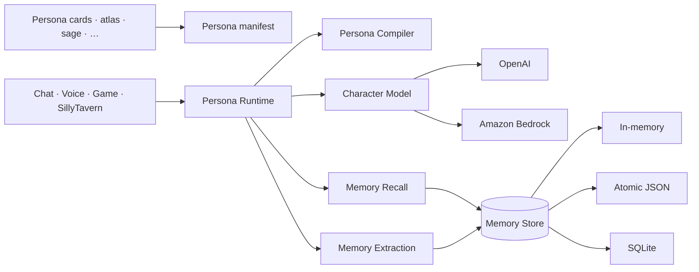

<div align="center">

# ✦ Character AI SDK

### Default personas, durable character memory, and provider adapters in a single package

Pick a persona, wire a model, and ship a character that remembers. The package combines the Tavern
Labs persona catalog with a provider-neutral memory and response runtime.

<p>
  
  
  
  
</p>

<p>
  
  
  
  
  
</p>

[Quick start](#quick-start) · [Personas](#personas) · [Choose your stack](#choose-your-stack) ·
[Documentation](#documentation) · [API reference](./docs/API_REFERENCE.md) ·
[Contributing](./CONTRIBUTING.md)

</div>

---

> [!NOTE] `character-ai-sdk` is published to npm as
> [`character-ai-sdk`](https://www.npmjs.com/package/character-ai-sdk). One install includes the
> memory runtime, the persona catalog, and the provider adapters.

## What is this?

`character-ai-sdk` is a TypeScript SDK for applications where an AI character should remain
recognizably itself and remember what matters across conversations. It separates five concerns that
are often tangled together:

| Layer       | Responsibility                                                           | Replaceable? |
| ----------- | ------------------------------------------------------------------------ | :----------: |
| Personas    | Ready-made cards: prompts, traits, greetings, and memory seeds           |      ✓       |
| Memory      | Extraction, provenance, consolidation, visibility, recall, and lifecycle |      ✓       |
| Model       | Character response generation                                            |      ✓       |
| Persistence | Memory records and persona state                                         |      ✓       |
| Interface   | Chat, voice, game, HTTP service, or SillyTavern                          |      ✓       |

The persona catalog and runtime share one versioned package, so applications can adopt a bundled
character without coupling its identity or memory to one provider.

---

## How it fits together



The persona runtime recalls relevant memories, compiles character instructions, asks a model for the
next response, ingests the completed turn, evolves relationship state, and returns both text and
voice delivery metadata.

---

## Quick start

### Requirements

- Node.js 20 or newer
- An OpenAI API key **or** AWS credentials with Bedrock model access
- `better-sqlite3` when using the SQLite adapter

### Install

```bash
npm install character-ai-sdk
```

From a source checkout:

```bash
npm install
npm run build
```

### 1. Pick a persona

```js
import { getPersona, listPersonas, DEFAULT_PERSONAS } from "character-ai-sdk";

// the two personas used in Tavern Labs demos
const atlas = getPersona("atlas");
const sage = getPersona("sage");
console.log("defaults:", DEFAULT_PERSONAS.join(", "));

// or see everything in the SDK
for (const p of listPersonas()) {
  console.log(p.id, "-", p.tagline);
}
```

### 2. Create a memory runtime

```js
import { createCharacterMemoryRuntime } from "character-ai-sdk";
import { createBedrockExtractor, createBedrockTitanEmbeddings } from "character-ai-sdk/bedrock";
import { JsonFileMemoryStore } from "character-ai-sdk/stores/json-file";

const region = process.env.AWS_REGION ?? "us-east-1";
const modelId = process.env.BEDROCK_MODEL_ID;
if (!modelId) throw new Error("BEDROCK_MODEL_ID is required");

const card = getPersona("atlas");
const memory = createCharacterMemoryRuntime({
  extractor: createBedrockExtractor({
    region,
    modelId,
  }),
  embeddings: createBedrockTitanEmbeddings({ region }),
  store: new JsonFileMemoryStore({ path: "./data/atlas-memory.json" }),
});
```

### 3. Generate a character response

```js
import { createBedrockCharacterModel } from "character-ai-sdk/bedrock";
import { createPersonaRuntime } from "character-ai-sdk/persona";

const runtime = createPersonaRuntime({
  persona: toManifest(card), // map the card onto a persona manifest - see below
  memory,
  model: createBedrockCharacterModel({
    region,
    modelId,
  }),
});

const response = await runtime.respond({
  conversationId: "demo",
  message: "Give me a read on charging for support personas.",
});

console.log(response.text);
console.log(response.delivery); // emotion, pace, expressiveness, style, pauseAfterMs
console.log(response.trace); // provider, model, timings, recalled memory IDs
```

That single call performs recall, prompt compilation, generation, turn ingestion, and relationship
state progression.

A card maps onto the persona manifest with its prompt, traits, and greeting:

```js
function toManifest(card) {
  return {
    id: card.id,
    version: card.version,
    name: card.name,
    description: `${card.tagline}. ${card.description}`,
    identity: {
      role: card.name,
      backstory: card.description,
      worldview: card.systemPrompt,
      traits: Object.entries(card.traits).map(([k, v]) => `${k}: ${v}`),
      goals: [],
    },
    speech: {
      tone: [card.traits.tone],
      vocabulary: "neutral",
      verbosity: 0.5,
      humor: 0.3,
      signaturePhrases: [],
      forbiddenPhrases: [],
    },
    behavior: {
      warmth: 0.6,
      assertiveness: 0.5,
      curiosity: 0.6,
      emotionalRange: 0.5,
      stayInCharacter: true,
    },
    boundaries: { discloseAi: true, rules: [], prohibitedTopics: [] },
    relationships: {
      stages: ["stranger", "acquaintance", "trusted"],
      defaultStage: "stranger",
      progression: "gradual",
    },
    voice: {
      voiceId: null,
      style: card.traits.tone,
      pace: 1,
      expressiveness: 0.5,
    },
    examples: [{ user: "Hello", assistant: card.greeting }],
    metadata: { suggestedModel: card.suggestedModel },
  };
}
```

Submit a card's `memorySeeds` through the normal extraction and validation pipeline:

```js
for (const [index, seed] of card.memorySeeds.entries()) {
  await memory.ingest({
    characterId: card.id,
    conversationId: "seed",
    messages: [{ id: `seed-${index}`, role: "system", content: seed.content }],
  });
}
```

Seeds are suggestions, not privileged records. The configured extractor may normalize, merge, or
reject them according to confidence and provenance rules.

---

## Personas

| id      | name  | role                                   |
| ------- | ----- | -------------------------------------- |
| `atlas` | Atlas | strategic analyst, executive briefings |
| `sage`  | Sage  | customer support agent                 |
| `vera`  | Vera  | sales development rep                  |
| `scout` | Scout | research assistant, citation-first     |
| `wren`  | Wren  | onboarding guide for new hires         |
| `ember` | Ember | brand copywriter                       |
| `lumen` | Lumen | technical explainer                    |
| `mica`  | Mica  | operations dispatcher, incident triage |

`DEFAULT_PERSONAS` is `["atlas", "sage"]`—the pair used in Tavern Labs demos. `getPersona(id)`
returns Atlas when an unknown ID is supplied; call `personaIds()` first when unknown IDs should be
treated as errors.

### Card format

```json
{
  "id": "atlas",
  "name": "Atlas",
  "tagline": "one line",
  "description": "two or three sentences",
  "traits": {
    "tone": "analytical",
    "formality": "professional",
    "verbosity": "concise"
  },
  "systemPrompt": "the prompt that defines behavior",
  "greeting": "first line the persona says",
  "memorySeeds": [{ "content": "a starting memory", "importance": 0.9 }],
  "suggestedModel": "provider.model-id",
  "version": "1.0.0",
  "author": "Tavern Labs"
}
```

Traits are advisory: pass them alongside the system prompt so a host application can adapt tone
without rewriting the prompt. Treat returned cards as immutable shared catalog data. A card's
`suggestedModel` is a recommendation, not a guarantee that the model is enabled in your provider
account or region.

---

## Choose your stack

### OpenAI

```js
import {
  createOpenAICharacterModel,
  createOpenAIEmbeddings,
  createOpenAIExtractor,
} from "character-ai-sdk/openai";
```

The adapters use the Responses API for extraction and character generation and the Embeddings API
for vectors. Specify model IDs explicitly so a package upgrade never changes model behavior.

### Amazon Bedrock

```js
import {
  createBedrockCharacterModel,
  createBedrockExtractor,
  createBedrockTitanEmbeddings,
} from "character-ai-sdk/bedrock";

const region = process.env.AWS_REGION ?? "us-east-1";
const modelId = process.env.BEDROCK_MODEL_ID;
if (!modelId) throw new Error("BEDROCK_MODEL_ID is required");

const adapters = {
  extractor: createBedrockExtractor({ region, modelId }),
  embeddings: createBedrockTitanEmbeddings({ region }),
  model: createBedrockCharacterModel({ region, modelId }),
};
```

Bedrock uses the standard AWS SDK credential chain. The execution identity needs permission to
invoke the configured models.

### Mix providers

Extraction, embeddings, and generation are independent ports. An application can use Bedrock for
generation and OpenAI embeddings, or replace embeddings with an entirely local adapter.

---

## Storage

| Adapter     | Import                              | Best for                                 | Durability       |
| ----------- | ----------------------------------- | ---------------------------------------- | ---------------- |
| In-memory   | Root package                        | Unit tests and ephemeral sessions        | Process lifetime |
| Atomic JSON | `character-ai-sdk/stores/json-file` | Prototypes and local tools               | File-backed      |
| SQLite      | `character-ai-sdk/stores/sqlite`    | Desktop, single-node, and small services | Transactional    |

SQLite is an optional native dependency:

```bash
npm install better-sqlite3
```

For horizontally scaled deployments, implement the documented `MemoryStore` contract using a
tenant-partitioned database such as PostgreSQL or DynamoDB.

---

## What's inside

| Import                         | Provides                                                           |
| ------------------------------ | ------------------------------------------------------------------ |
| `character-ai-sdk`             | Core memory runtime, persona loader, and all bundled persona cards |
| `character-ai-sdk/personas`    | Persona catalog utilities without the core runtime exports         |
| `character-ai-sdk/personas/*`  | Direct JSON access to one bundled card                             |
| `character-ai-sdk/bedrock`     | Bedrock Converse extraction, Titan V2 embeddings, character models |
| `character-ai-sdk/openai`      | OpenAI extraction, embeddings, and character models                |
| `character-ai-sdk/persona`     | Persona response runtime with relationship state                   |
| `character-ai-sdk/service`     | Framework-neutral web handlers and the Node adapter                |
| `character-ai-sdk/sillytavern` | Character Card and JSONL chat import                               |
| `character-ai-sdk/evaluation`  | Retrieval and persona evaluation helpers                           |
| `character-ai-sdk/stores/*`    | Atomic JSON and SQLite persistence                                 |

---

## Documentation

| Guide                                        | Use it when…                                                  |
| -------------------------------------------- | ------------------------------------------------------------- |
| [Getting started](./docs/GETTING_STARTED.md) | You want a complete first integration with environment setup  |
| [Concepts](./docs/CONCEPTS.md)               | You need to understand memory scopes, lifecycle, and branches |
| [API reference](./docs/API_REFERENCE.md)     | You need imports, parameters, returns, and failure behavior   |
| [SillyTavern](./docs/SILLYTAVERN.md)         | You are importing cards/chats or installing the extension     |
| [Deployment](./docs/DEPLOYMENT.md)           | You are running the HTTP service or Studio                    |
| [Security and privacy](./docs/SECURITY.md)   | You are handling real users, secrets, tenancy, or erasure     |
| [Architecture](./ARCHITECTURE.md)            | You are extending providers, stores, or runtime boundaries    |
| [Contributing](./CONTRIBUTING.md)            | You are proposing or implementing a change                    |
| [Changelog](./CHANGELOG.md)                  | You need version history and notable changes                  |

---

## Development

```bash
npm install
npm run check
npm pack --dry-run
```

`npm run check` verifies formatting, TypeScript, deterministic tests, and the distributable build.
Live provider tests are opt-in because they consume paid API quota:

```bash
RUN_LIVE_PROVIDER_TESTS=1 npm test
```

Set the appropriate provider credentials and model variables first. See `.env.example` for the full
list.

---

## Project status

Version `1.0.1` includes the memory runtime, both provider adapters, the SQLite store, the persona
layer with relationship state, SillyTavern compatibility, the service adapter, and eight default
persona cards.

---

## Contributing, citation, and license

Contributions are welcome. Read [CONTRIBUTING.md](./CONTRIBUTING.md) before proposing a change.

When referencing the software, cite the package name, semantic version, and exact Git commit so the
result can be reproduced:

```text
character-ai-sdk, version 1.0.1, commit <git-commit>, MIT License.
```

Released under the [MIT License](./LICENSE). See [CHANGELOG.md](./CHANGELOG.md) for version history.

---

<div align="center">

Built for characters that should remember who they are—and who you are to them.

</div>
