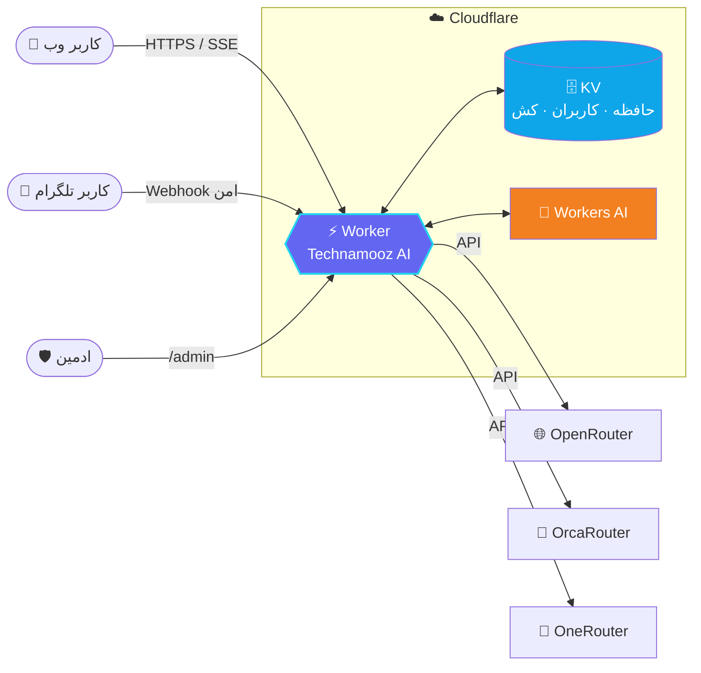

<div align="center">


<br/>

[](https://github.com/technamooz)
[](https://workers.cloudflare.com/)
[](#)
[](#-مجوز)
[](https://t.me/technamooz)


### 🧠 هوش مصنوعی فارسی، حرفه‌ای و بدون سرور

**چت وب · ربات تلگرام · پنل مدیریت · چهار سرویس‌دهندهٔ AI · ۱۶ شخصیت تخصصی**
**همه در یک Worker. بدون سرور، بدون دیتابیس، بدون Python.**

<br/>

[🚀 شروع سریع](#-نصب-و-راه‌اندازی) •
[🎬 آموزش ویدیویی](#-آموزش-کامل-ویدیویی) •
[✨ امکانات](#-امکانات) •
[🧩 شخصیت‌ها](#-شخصیت‌ها-۱۶-مورد) •
[🔐 امنیت](#-امنیت) •
[🛠️ عیب‌یابی](#️-عیب‌یابی)

<br/>


</div>

<div dir="rtl">

## 🌐 ما را دنبال کنید

<div align="center">

[](https://technamooz.ir)
[](https://t.me/technamooz)
[](https://instagram.com/technamooz)

[](https://youtube.com/@technamooz)
[](https://github.com/technamooz)
[](https://x.com/technamooz)

[](https://t.me/technamooz_support)

</div>

> 👨‍💻 **سازنده: امیر پارسا (Amir Parsa)** — با ❤️ برای جامعهٔ فارسی‌زبان

<br/>

## 🎬 آموزش کامل ویدیویی

نصب، راه‌اندازی و استفادهٔ کامل از پروژه را **قدم‌به‌قدم** در ویدیوی زیر ببینید:

<div align="center">

[](https://youtu.be/aMuzdPpteUA?si=LD1V5J38PJhotPF9)

### [▶️ تماشای آموزش در یوتیوب](https://youtu.be/aMuzdPpteUA?si=LD1V5J38PJhotPF9)

</div>

<br/>

## 📊 پروژه در یک نگاه

<div align="center">

| 🧩 | 🔌 | 🌐 | 🤖 | 🛡️ |
|:---:|:---:|:---:|:---:|:---:|
| **۱۶**<br/>شخصیت تخصصی | **۴**<br/>سرویس‌دهندهٔ AI | **۱**<br/>چت وب RTL | **۱۵+**<br/>دستور تلگرام | **۱**<br/>پنل ادمین جدا |

| ⚡ | 💸 | 🧠 | 📡 | 🔒 |
|:---:|:---:|:---:|:---:|:---:|
| **SSE**<br/>استریم واقعی | **رایگان**<br/>روی پلن Free | **حافظه**<br/>بلندمدت هر کاربر | **۶ ساعت**<br/>کش مدل‌ها در KV | **PBKDF2**<br/>+ CSRF + CSP |

</div>


## ✨ امکانات

### 🌐 چت وب

- 🎨 رابط **فارسی RTL**، ریسپانسیو و **دارک‌مود**
- 🧭 انتخاب **پلتفرم** و سپس **لیست واقعی مدل‌های همان پلتفرم** به‌صورت گرافیکی
- 🆓 نمایش مدل‌های رایگان، جست‌وجوی مدل، شناسه و توضیح مدل
- 🎭 **۱۶ شخصیت تخصصی** که با **همهٔ مدل‌ها** کار می‌کنند
- 💡 پیشنهاد مدل مناسب هر شخصیت، بدون اجبار؛ کاربر همیشه آزاد است مدل دیگری انتخاب کند
- 🧠 **حافظهٔ بلندمدت** برای هر کاربر + خلاصهٔ گفتگو + فکت‌های قابل ویرایش/پاک‌سازی
- 🔥 **«حالت نهایت قدرت»** برای پاسخ‌های عمیق‌تر و طولانی‌تر
- 📏 طول پاسخ هوشمند و متناسب با نوع سؤال
- ⚡ **استریم واقعی** پاسخ (SSE)، نمایش استدلال مدل‌های reasoning، Markdown، کپی پاسخ و تولید دوباره
- 💬 بخش پشتیبانی، بازخورد و شبکه‌های اجتماعی

### 🤖 ربات تلگرام

- 🔄 همان هوش مصنوعی، همان حافظه، همان شخصیت‌ها و همان پلتفرم‌ها
- 🎛️ انتخاب پلتفرم و مدل با دکمه‌های **Inline** و صفحه‌بندی
- 🔐 پشتیبانی از **وب‌هوک امن** با secret در مسیر
- 📣 ارسال همگانی (**Broadcast**) دسته‌ای برای رعایت محدودیت‌های پلن رایگان

<details>
<summary><b>📋 فهرست کامل دستورات ربات (کلیک کنید)</b></summary>

<br/>

| دستور | کاربرد |
|---|---|
| `/start` | شروع و خوش‌آمدگویی |
| `/help` | راهنمای کامل |
| `/models` | انتخاب پلتفرم و مدل |
| `/model` | مدل فعلی |
| `/persona` | انتخاب شخصیت |
| `/deep` | حالت نهایت قدرت |
| `/new` | گفتگوی جدید |
| `/reset` | پاک‌سازی حافظه |
| `/memory` | مشاهدهٔ حافظه |
| `/settings` | تنظیمات |
| `/support` | پشتیبانی |
| `/about` | دربارهٔ پروژه |
| `/social` | شبکه‌های اجتماعی |
| `/feedback` | ارسال بازخورد |
| `/status` | وضعیت سرویس |
| `/adminstats` | آمار (فقط ادمین) |

</details>

### 🛡️ پنل مدیریت جداگانه

- 🕵️ مسیر `/admin` — **از صفحهٔ چت عمومی لینک نشده است**
- 🔑 مدیریت کلیدها و اتصال چهار سرویس‌دهنده
- ⚙️ تنظیمات کلادفلر، مدل پیش‌فرض، شخصیت پیش‌فرض، محدودیت توکن، حافظه، fallback و **حالت تعمیرات**
- 👥 مدیریت کاربران وب و تلگرام: مشاهده، مسدودسازی، پاک‌سازی حافظه و حذف
- 🤖 مدیریت توکن ربات، ادمین‌ها، webhook، تست و broadcast
- 📈 گزارش‌ها، آمار، امنیت و تغییر نام کاربری/رمز عبور

> [!WARNING]
> ورود پیش‌فرض پنل `admin` / `admin` است. **بعد از اولین ورود فوراً آن را تغییر دهید!**


## 🏗️ معماری



<br/>

## 🔌 چهار سرویس‌دهندهٔ هوش مصنوعی

| سرویس | نحوهٔ اتصال | مدل پیش‌فرض |
|---|---|---|
| ☁️ **Cloudflare Workers AI** | binding `AI` (یا REST با Account ID + Token) | `@cf/meta/llama-3.3-70b-instruct-fp8-fast` |
| 🌐 **OpenRouter** | API Key از پنل ادمین | `openrouter/free` |
| 🐋 **OrcaRouter** | API Key از پنل ادمین | `orcarouter/free` |
| 🔀 **OneRouter** | API Key + Base URL قابل تنظیم | `deepseek/deepseek-v4.1-flash:free` |

- 🔄 لیست مدل‌ها از **API واقعی** هر سرویس گرفته و **۶ ساعت در KV کش** می‌شود.
- 🛟 اگر اولین درخواست به مدل انتخابی شروع نشود، در صورت فعال بودن **fallback**، مدل جایگزین انتخاب می‌شود؛ خطاهای وسط استریم شفاف نمایش داده می‌شوند.
- 🔒 کلیدها فقط در Worker و KV می‌مانند؛ در پاسخ‌های عمومی API **هرگز** برنمی‌گردند و در پنل ادمین فقط نسخهٔ ماسک‌شده دیده می‌شود.


## 🧩 شخصیت‌ها (۱۶ مورد)

| شخصیت | مناسب برای | پیشنهاد شروع |
|---|---|---|
| 🧠 متخصص همه‌کاره | همهٔ حوزه‌ها | Workers AI / Llama 3.3 70B |
| 🌍 مترجم حرفه‌ای | ترجمهٔ طبیعی بین زبان‌ها | Workers AI / Llama 3.3 70B |
| 🎓 معلم خصوصی | آموزش گام‌به‌گام | OrcaRouter / tencent-hy4 |
| 🤝 رفیق صمیمی | گفتگوی گرم و خودمانی | Workers AI / Llama 3.1 8B |
| 🧿 ابرمتفکر | تحلیل عمیق، مقاله، پروژه | Workers AI / DeepSeek R1 Distill |
| 💻 متخصص تکنولوژی | فناوری، کامپیوتر، ابزارها | Workers AI / Qwen Coder |
| ⌨️ برنامه‌نویس ارشد | کد production-quality | Workers AI / Qwen Coder |
| ✍️ نویسنده و متخصص محتوا | مقاله، کپی‌رایتینگ، ویرایش | Workers AI / Llama 3.3 70B |
| 📈 مشاور کسب‌وکار | استراتژی، بازاریابی، فروش | Workers AI / Llama 3.3 70B |
| 🩺 مشاور سلامت | اطلاعات عمومی سلامت | Workers AI / Llama 3.3 70B |
| ⚖️ مشاور حقوقی | آشنایی عمومی حقوقی | Workers AI / Llama 3.3 70B |
| 👨‍🍳 سرآشپز حرفه‌ای | آشپزی و برنامهٔ غذایی | Workers AI / Llama 3.1 8B |
| ✈️ مشاور سفر | برنامه‌ریزی سفر | Workers AI / Llama 3.3 70B |
| 💰 مشاور مالی | بودجه و مفاهیم مالی | Workers AI / Llama 3.3 70B |
| 🏋️ مربی تناسب اندام | تمرین و سبک زندگی | Workers AI / Llama 3.1 8B |
| 📖 قصه‌گو و خلاقیت | داستان و ایده‌پردازی | Workers AI / Llama 3.3 70B |

> [!NOTE]
> پیشنهادها فقط **نقطهٔ شروع** هستند. همهٔ ۱۶ شخصیت با هر مدلی از هر چهار سرویس کار می‌کنند.


## 🚀 نصب و راه‌اندازی

> [!TIP]
> اگر ترجیح می‌دهید همه‌چیز را تصویری ببینید، [ویدیوی آموزشی کامل](https://youtu.be/aMuzdPpteUA?si=LD1V5J38PJhotPF9) را تماشا کنید. 🎬

### 📋 پیش‌نیازها

- ☁️ حساب **Cloudflare** (پلن رایگان کافی است)
- 🟢 **Node.js ۱۸ یا بالاتر** (پروژه با Node 18.19.1 تست شده است)
- 🧰 **Wrangler 3.114.17** برای Node 18 (اگر Node 22 دارید می‌توانید Wrangler 4 نصب کنید)

### ۱️⃣ نصب پکیج‌ها

```bash
npm install
```

### ۲️⃣ ساخت KV و اتصال آن

```bash
npx wrangler login
npm run setup
```

اسکریپت `setup` یک KV namespace با نام `DB` می‌سازد و `id` آن را جای‌گذاری می‌کند. اگر خودکار انجام نشد:

```bash
npx wrangler kv namespace create DB
```

سپس مقدار `id` را در `wrangler.toml` جای‌گذاری کنید:

```toml
[[kv_namespaces]]
binding = "DB"
id = "شناسهٔ_واقعی_KV"
```

> [!NOTE]
> پروژه از **KV** استفاده می‌کند، نه D1. هیچ migration یا `schema.sql` لازم نیست.

### ۳️⃣ دیپلوی

```bash
npm run deploy
# یا
npx wrangler deploy
```

آدرس Worker را باز کنید. صفحهٔ چت عمومی روی `/` است و پنل مدیریت روی `/admin` (بدون لینک از صفحهٔ عمومی).

### ۴️⃣ اتصال سرویس‌دهنده‌ها

وارد `/admin` شوید و در بخش **کلیدها**:

| سرویس | کار لازم |
|---|---|
| ☁️ **Workers AI** | به‌صورت پیش‌فرض با binding `AI` فعال است. برای لیست کامل مدل‌ها، Account ID و API Token کلادفلر را هم وارد کنید. |
| 🌐 **OpenRouter** | کلید را از [openrouter.ai/keys](https://openrouter.ai/keys) بگیرید. |
| 🐋 **OrcaRouter** | کلید را از [orcarouter.ai](https://www.orcarouter.ai) بگیرید. |
| 🔀 **OneRouter** | کلید را از [infron.ai](https://infron.ai/dashboard/apiKeys) بگیرید. Base URL پیش‌فرض `https://llm.onerouter.pro/v1` است و در پنل قابل تغییر است (دامنه‌های `onerouter.pro`، `onerouter.ai`، `onerouter.com` و `infron.ai` پذیرفته می‌شوند). |

### ۵️⃣ امنیت اولیه

1. با `admin` / `admin` وارد شوید.
2. فوراً از بخش **امنیت** رمز عبور قوی (حداقل ۱۲ نویسه) و در صورت نیاز نام کاربری را تغییر دهید.
3. دکمهٔ **«خروج از همهٔ نشست‌ها»** را بزنید.
4. روی پلن رایگان، مقدار پیش‌فرض PBKDF2 برابر ۲۵۰۰ است تا CPU کم نیاید. روی پلن پولی می‌توانید در `wrangler.toml` اضافه کنید:

```toml
[vars]
ADMIN_PBKDF2_ITERATIONS = "100000"
```

حداکثر مقدار مجاز `۱۰۰۰۰۰` است.


## 🤖 راه‌اندازی ربات تلگرام

1. از [@BotFather](https://t.me/BotFather) یک ربات بسازید و **توکن** بگیرید.
2. در پنل `/admin` ← **تلگرام**، توکن را ذخیره کنید.
3. دکمهٔ **تنظیم Webhook** را بزنید. مسیر امن به‌صورت خودکار ساخته می‌شود:
   `/telegram/webhook/<secret>`
4. برای دریافت گزارش‌های مدیریتی، آیدی عددی خود را در بخش **ادمین‌های تلگرام** اضافه کنید.
5. دکمهٔ **ارسال تست** و سپس **Broadcast** را بررسی کنید.

> [!IMPORTANT]
> توکن ربات و secret وب‌هوک در KV نگهداری می‌شوند و در پاسخ‌های عمومی نمایش داده نمی‌شوند.


## 🔐 امنیت

| لایه | توضیح |
|---|---|
| 🕵️ **پنهان‌سازی ادمین** | `/admin` از صفحهٔ عمومی لینک نشده و `robots.txt` آن را disallow می‌کند. |
| 🔑 **هش رمز** | **PBKDF2-SHA256** با نمک تصادفی؛ رمز خام هرگز ذخیره نمی‌شود. |
| 🍪 **کوکی نشست** | `HttpOnly`، `SameSite=Strict` و در HTTPS `Secure`. |
| 🛡️ **CSRF** | هر نشست یک توکن دارد؛ همهٔ POSTهای `/admin/api/*` هدر `X-CSRF-Token` را الزامی می‌کنند. |
| 🌍 **Origin Check** | بررسی Origin برای ورود، خروج و درخواست‌های تغییردهنده. |
| 🚫 **Rate Limit** | محدودیت تلاش ورود بر اساس IP. |
| ♻️ **ابطال نشست‌ها** | تغییر رمز یا «خروج از همه» با افزایش `epoch` همهٔ نشست‌های قبلی را باطل می‌کند. |
| 🙈 **کلیدهای مخفی** | کلیدها هرگز در `/api/config`، `/api/models` یا HTML عمومی نمی‌آیند. |
| 🧱 **هدرهای امنیتی** | CSP، `X-Frame-Options: DENY`، `nosniff` و سایر هدرها. |
| 🧬 **جداسازی داده** | کلیدهای KV برای هر کاربر وب (`web:<uid>`) و تلگرام (`tg:<chatId>`) جدا هستند؛ حافظه، facts، پروفایل و تاریخچه مشترک نیست. |

<br/>

## 🧠 حافظه و جداسازی کاربران

- 🪪 هر کاربر وب یک UID تصادفی در کوکی `tm_uid` دارد.
- 💬 هر کاربر تلگرام با `chatId` خودش شناخته می‌شود.
- ⚙️ هر کاربر **پروفایل مستقل** (پلتفرم، مدل، شخصیت، حالت عمیق) و **حافظهٔ مستقل** دارد.
- 📝 حافظه شامل خلاصهٔ گفتگو و فکت‌های استخراج‌شده است و از پنل ادمین قابل مشاهده/پاک‌سازی است.
- 🧹 `reset` فقط حافظه را پاک می‌کند و می‌تواند آخرین دور گفتگو را نگه دارد؛ `new` گفتگوی جدید می‌سازد.


## 📡 API عمومی (خلاصه)

| متد | مسیر | توضیح |
|:---:|---|---|
| `GET` | `/health` | وضعیت سلامت و آمادگی سرویس‌دهنده‌ها |
| `GET` | `/api/config` | تنظیمات عمومی، پلتفرم‌ها، لینک‌های اجتماعی |
| `GET` | `/api/personas` | ۱۶ شخصیت عمومی |
| `GET` | `/api/models?platform=...` | لیست مدل‌های یک پلتفرم |
| `GET/POST` | `/api/session` | ساخت/دریافت نشست کاربر وب |
| `GET` | `/api/history` | تاریخچهٔ کاربر |
| `POST` | `/api/prefs` | ذخیرهٔ پلتفرم/مدل/شخصیت/حالت عمیق |
| `POST` | `/api/chat` | چت SSE |
| `POST` | `/api/reset` | پاک‌سازی حافظه |
| `POST` | `/api/feedback` | ثبت بازخورد |

پنل ادمین: `/admin`، `/admin/status`، `/admin/login`، `/admin/logout` و `/admin/api/*`.

<br/>

## 🗂️ ساختار پروژه

<details>
<summary><b>📁 نمایش ساختار کامل (کلیک کنید)</b></summary>

```text
technamooz-ai/
├── wrangler.toml              # KV + AI binding + assets + vars
├── package.json               # scripts: setup/check/test/assets/deploy
├── public/
│   ├── index.html             # چت عمومی (بدون لینک ادمین)
│   ├── admin.html             # پنل مدیریت جداگانه
│   ├── css/style.css
│   ├── css/admin.css
│   ├── js/app.js
│   ├── js/admin.js
│   └── assets/                # logo.svg + PNG/favicon/OG
├── src/
│   ├── index.js               # Worker entry + routing + security headers
│   ├── config.js              # metadata, 4 providers, limits
│   ├── personas.js            # 16 personas + curated models
│   ├── store.js               # KV storage + isolation + logs + stats
│   ├── auth.js                # PBKDF2, sessions, CSRF, cookies, rate limit
│   ├── providers.js           # 4 adapters, model lists, SSE parser, fallback
│   ├── chat.js                # selection, context, memory, persistence
│   ├── tgapi.js               # Telegram Bot API client
│   ├── telegram.js            # Telegram bot flows
│   └── routes/
│       ├── user.js            # public chat API (SSE)
│       └── admin.js           # authenticated admin API
├── scripts/
│   ├── setup-kv.mjs
│   ├── check-syntax.mjs
│   ├── test-sse-parser.mjs
│   └── generate-assets.mjs
└── test/                      # unit + Worker mock integration tests
```

</details>

<br/>

## 🧪 تست و بررسی

```bash
npm run check          # syntax check همهٔ فایل‌های JS
npm test               # unit + mock integration (Node test runner)
npm run test:sse       # تست اختصاصی SSE parser
npm run assets         # تولید مجدد PNG/favicon/OG با sharp
npx wrangler deploy --dry-run
```

> ✅ تست‌ها بدون نیاز به حساب Cloudflare اجرا می‌شوند (KV، ASSETS و Workers AI **mock** می‌شوند).


## ⚠️ نکات پلن رایگان

- 📉 Workers AI روی پلن رایگان **سهمیهٔ روزانه** دارد؛ مصرف مدل‌های سنگین را در نظر بگیرید.
- ⏱️ PBKDF2 عمداً روی ۲۵۰۰ دور تنظیم شده تا ورود ادمین در CPU محدود پلن رایگان پایدار بماند.
- 📦 اندازهٔ صفحهٔ کاربران (۲۰) و batch ارسال همگانی تلگرام (۱۰) برای کنترل subrequestها محدود شده است.
- 🆓 مدل‌های «free» ممکن است توسط سرویس‌دهنده تغییر کنند یا موقتاً در دسترس نباشند؛ fallback و انتخاب مدل دیگر را در نظر بگیرید.
- 🔀 OneRouter ممکن است Base URL متفاوتی برای حساب شما بخواهد؛ آن را در پنل ادمین تنظیم کنید.

<br/>

## 🛠️ عیب‌یابی

<details>
<summary><b>🗄️ KV تنظیم نشده است</b></summary>

`npm run setup` را اجرا کنید یا `id` را در `wrangler.toml` بگذارید.

</details>

<details>
<summary><b>🚪 صفحهٔ <code>/admin</code> باز نمی‌شود</b></summary>

مطمئن شوید `run_worker_first = true` در بخش `[assets]` هست و `public/admin.html` دیپلوی شده است.

</details>

<details>
<summary><b>🧠 مدل‌های Workers AI کم هستند</b></summary>

Account ID و API Token کلادفلر را در پنل ادمین وارد کنید تا لیست زندهٔ مدل‌ها دریافت شود؛ در غیر این صورت لیست curated استفاده می‌شود.

</details>

<details>
<summary><b>🔑 خطای 401 از سرویس‌دهنده</b></summary>

کلید را در پنل ادمین بررسی کنید. کلیدها فقط از سمت Worker استفاده می‌شوند.

</details>

<details>
<summary><b>⏱️ خطای CPU در ورود ادمین</b></summary>

مقدار `ADMIN_PBKDF2_ITERATIONS` را کم کنید یا پلن Workers را ارتقا دهید.

</details>

<details>
<summary><b>📨 وب‌هوک تلگرام کار نمی‌کند</b></summary>

دامنهٔ Worker باید **HTTPS** و از اینترنت قابل دسترسی باشد؛ `localhost` برای webhook تلگرام مناسب نیست.

</details>

<br/>

## 🤝 مشارکت و حمایت

- ⭐ اگر پروژه به دردتان خورد، **به آن ستاره بدهید**.
- 🐛 باگ پیدا کردید؟ یک **Issue** باز کنید یا به [@technamooz_support](https://t.me/technamooz_support) پیام بدهید.
- 🔀 پیشنهاد یا بهبود دارید؟ **Pull Request** بفرستید.
- 📺 برای آموزش‌های بیشتر، کانال [یوتیوب](https://youtube.com/@technamooz) را دنبال کنید.

<br/>

## 📜 مجوز

**MIT** — استفاده، تغییر و انتشار با ذکر نام **امیر پارسا (Amir Parsa)** و پروژهٔ **Technamooz AI** آزاد است.

</div>


<div align="center">

### 🧠 Technamooz AI — `v1.0.0`

**ساختهٔ [امیر پارسا](https://t.me/technamooz) با ❤️ روی Cloudflare Workers**

[](https://technamooz.ir)
[](https://t.me/technamooz)
[](https://instagram.com/technamooz)
[](https://youtube.com/@technamooz)
[](https://github.com/technamooz)
[](https://x.com/technamooz)

<br/>

⭐ **اگر این پروژه را دوست داشتید، یک ستاره بدهید!** ⭐

</div>
