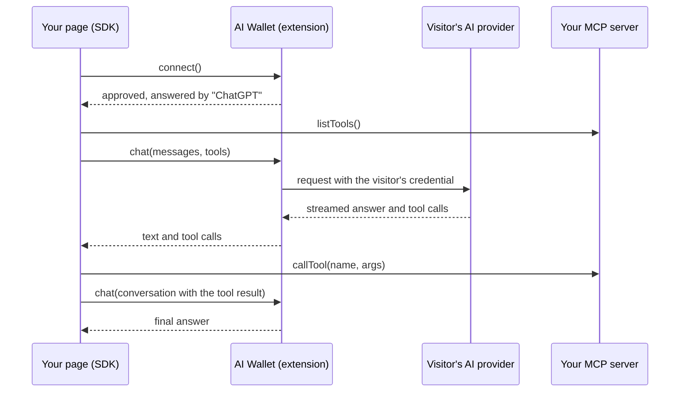

# AI Connect: the SDK for website AI that runs on your visitors' AI accounts

[](https://www.npmjs.com/package/@tensorpass/aiconnect)
[](LICENSE)
[](https://chromewebstore.google.com/detail/ai-wallet/gkmgamdkmlidbjfmheeghkcjdofdafge)
[](https://addons.mozilla.org/en-US/firefox/addon/ai-wallet/)

**Add an AI chat to your website that answers on each visitor's own ChatGPT, Claude or Gemini plan. Your site pays nothing per answer and holds no provider key.**

[Try it live](https://tensorpass.app) · [Docs](https://tensorpass.app/docs) · [AI Wallet for Chrome](https://chromewebstore.google.com/detail/ai-wallet/gkmgamdkmlidbjfmheeghkcjdofdafge) · [AI Wallet for Firefox](https://addons.mozilla.org/en-US/firefox/addon/ai-wallet/)

## Try it in one minute

1. Add AI Wallet to your browser from the [Chrome Web Store](https://chromewebstore.google.com/detail/ai-wallet/gkmgamdkmlidbjfmheeghkcjdofdafge) (Chrome, Edge, Brave, Opera) or [Firefox Add-ons](https://addons.mozilla.org/en-US/firefox/addon/ai-wallet/).
2. Connect an AI account in the wallet: ChatGPT, Claude, Gemini, Grok, OpenRouter, an API key, or TensorPass's own plan.
3. Open https://tensorpass.app and ask the chat a question. The answer runs on your account and reads the docs through the site's MCP server.

## Add it to your site

One script tag and one element add a chat to any page, with the script served from npm by jsDelivr:

```html
<script src="https://cdn.jsdelivr.net/npm/@tensorpass/aiconnect-elements@0.1/dist/aiconnect-elements.js" defer></script>
<aiconnect-chat variant="popup" mcp="/api/mcp" system="You answer questions about this site."></aiconnect-chat>
```

React, Next.js, Vue, Svelte, WordPress and Shopify have their own quickstarts below and in the [docs](https://tensorpass.app/docs). If AI Connect is useful to you, a star on this repository helps other developers find it.

## What AI Connect is

AI Connect is the open source SDK of [TensorPass](https://tensorpass.app) that lets the AI features of a website run on the AI account each visitor already pays for. The visitor holds a ChatGPT, Claude, Gemini, Grok or OpenRouter account, or an API key, in AI Wallet, a browser extension. Each request from your site goes through the wallet to the provider, signed with the visitor's own account. The inference costs your site nothing. Your site needs no provider key, and the visitor's credentials stay in the wallet.

The full documentation lives at [tensorpass.app/docs](https://tensorpass.app/docs).

## What AI Connect is for

AI Connect is for sites that want a chat, a search bar that answers, or an AI mode, without paying for every answer their visitors ask. A site that calls a model with its own API key pays for each visitor's tokens, rate limits every visitor on one key and carries the cost of abuse. With AI Connect, each answer counts against the visitor's own plan, credits or key, inside the limits the visitor already has with their provider.

The site keeps its own data and tools. It exposes them as an [MCP server](https://modelcontextprotocol.io), and the visitor's model calls them from the page through the SDK. A catalog search, a booking lookup or a docs search stays on your server, and the model that reads the results is the visitor's.

Visitors without an AI account can pick one in the wallet. The wallet offers TensorPass's own monthly plan, and the free ChatGPT and Muse accounts a visitor creates as they sign in.

## How AI Connect works

A request from your page goes from the SDK to the wallet, then to the provider, and the answer comes back to your page as a stream.



1. AI Wallet places `window.aiwallet` in every page before your scripts run.
2. Your `AiConnect` client looks for the wallet and checks whether the visitor has approved your site. A site the visitor approved on an earlier visit is connected again without a click.
3. On a first visit, your connect button calls `connect()`. The wallet opens its approval window with your site's host and the account that will answer it.
4. The SDK reads your tool definitions from your MCP server and sends the conversation to the wallet through `chat`.
5. The wallet's background calls the provider with the visitor's credential and streams the answer back to your page.
6. When the model asks for a tool, the SDK calls your MCP server from the page, adds the result and asks the model again, until the model answers in plain text.

The [introduction](https://tensorpass.app/docs) describes a whole visit step by step.

## Packages

The SDK is four packages under the `@tensorpass` scope, plus a demo, a WordPress plugin and a Claude Code plugin.

| Package | What it gives your site |
| --- | --- |
| `@tensorpass/aiconnect` | `AiConnect`, the connection to the visitor's AI through the wallet. `AiConnect.fetch` and `sdkOptions`, which let the AI SDK you already use answer through the wallet. `runConversation`, the loop that runs your tools. `McpToolSource`, your tools read from your MCP server. The guards that run on every conversation. |
| `@tensorpass/aiconnect-react` | `AiConnectProvider`, the connect window, `useAiConnect`, `useAiChat`, and the interface modules `AiChatPanel`, `AiChatPopup`, `AiChatInline`, `AiChatPage` and `AiSearch`. |
| `@tensorpass/aiconnect-elements` | The interface modules as Web Components, `<aiconnect-chat>` and `<aiconnect-search>`, in one script for sites without React, and a loader of 8 KB that loads that script when the visitor reaches for the chat. |
| `@tensorpass/aiconnect-design` | The `--aic-*` CSS tokens in light and dark, the TensorPass mark, the providers' marks and the key card colours shared by the wallet and the website. |
| `apps/demo` | A bookshop playground on port 4605, with every module at `?module=panel`, `popup`, `inline`, `page` or `search`, and the Web Components at `/elements.html`. |
| `integrations/wordpress` | The WordPress plugin: the chat as a block and a shortcode, and the site's posts served as an MCP server. |
| `integrations/claude-code` | The Claude Code plugin: the five skills of `skills` and the two TensorPass MCP servers. |

## Install AI Connect

Install the core SDK and the React components from npm:

```bash
npm install @tensorpass/aiconnect @tensorpass/aiconnect-react
```

`@tensorpass/aiconnect-react` depends on `@tensorpass/aiconnect-design`, so you do not install the tokens yourself. React 19 or later is needed for the React package.

To try a page, you need a desktop Chrome, Edge, Brave, Opera or Firefox with AI Wallet installed and one account connected. AI Wallet is on the [Chrome Web Store](https://chromewebstore.google.com/detail/ai-wallet/gkmgamdkmlidbjfmheeghkcjdofdafge) and on [Firefox Add-ons](https://addons.mozilla.org/en-US/firefox/addon/ai-wallet/), and the [AI Wallet page](https://tensorpass.app/wallet) names the store for each browser.

## Quickstart with React

The React quickstart adds an AI chat to your app in two files. Wrap the app in the provider once:

```tsx
// src/main.tsx
import { createRoot } from 'react-dom/client';
import { AiConnect } from '@tensorpass/aiconnect';
import { AiConnectProvider } from '@tensorpass/aiconnect-react';
import '@tensorpass/aiconnect-react/styles.css';
import { App } from './App.tsx';

const client = new AiConnect();

createRoot(document.getElementById('root')!).render(
  <AiConnectProvider client={client} locale="en">
    <App />
  </AiConnectProvider>,
);
```

Then render a module where it belongs. In this example, the popup's answers use the tools of your MCP server:

```tsx
// src/App.tsx
import { AiChatPopup } from '@tensorpass/aiconnect-react';

const SYSTEM = 'You recommend books from this site\'s catalog. Always search the catalog before recommending.';

export function App() {
  return (
    <>
      <YourSite />
      <AiChatPopup system={SYSTEM} mcp="/api/mcp" suggestions={['A calm book for tonight']} />
    </>
  );
}
```

On a first visit, the visitor clicks the floating button and connects their AI in the popup before asking a question. A visitor without the wallet sees an "Add to Chrome" button, named after their browser, that leads to the AI Wallet page.

For an interface of your own, use `useAiChat`, which holds the conversation and runs the tool loop:

```tsx
import { McpToolSource } from '@tensorpass/aiconnect';
import { useAiChat } from '@tensorpass/aiconnect-react';

const tools = new McpToolSource('/api/mcp');

function Chat() {
  const { turns, send } = useAiChat({ system: SYSTEM, tools });
  // Render turns, and call send(question) from your form.
}
```

The [React quickstart](https://tensorpass.app/docs/quickstart/react) and the [Next.js quickstart](https://tensorpass.app/docs/quickstart/nextjs) cover the connect button, the states and server rendering.

## Web Components quickstart for sites without React

With the Web Components, one script tag adds every module to a page, and no build step is needed. This suits WordPress pages, static sites and server rendered templates.

```html
<script src="/aiconnect-elements.js" defer></script>

<aiconnect-chat variant="popup" mcp="/api/mcp"
  system="You recommend books from this site's catalog. Always search the catalog first."
  tool-labels='{"search_books": "Searching the catalog"}'></aiconnect-chat>

<aiconnect-search mcp="/api/mcp"
  system="You answer questions about this bookshop's catalog."
  suggestions='["A calm book for tonight", "Something funny"]'></aiconnect-search>
```

Host `packages/elements/dist/aiconnect-elements.js` with your site's files. The script is about 650 KB, 185 KB with gzip. A page with a tight script budget can load `aiconnect-loader.js` first. This 8 KB file draws the chat's button and loads the full script when the visitor points at the button or presses it. The [Web Components guide](https://tensorpass.app/docs/modules/web-components) lists every attribute.

A page built with plain JavaScript and a bundler can use `AiConnect` and `runConversation` without React. The [JavaScript quickstart](https://tensorpass.app/docs/quickstart/javascript) shows how to build the connect button and the chat yourself.

## Visitors without AI Wallet: web accounts

In a browser without the extension, on a computer or a phone, the connect window and the modules keep the install step and add two sign ins under it. The visitor signs in to OpenRouter, offered on every site and paid from the visitor's OpenRouter credits, or to the TensorPass plan, offered when the site passes its site key. The chat then runs the same conversation loop, tools and guards as with the wallet, so `useAiChat`, the modules and `AiConnect.fetch` need no other change.

```ts
const client = new AiConnect({ siteKey: process.env.NEXT_PUBLIC_TENSORPASS_SITE_KEY });
```

A site key is public: it names the site on TensorPass's sign in page and works on `https://<domain>` and on `http://localhost` for development, with no proof of the domain. The command line opens TensorPass's sign in in your browser, which comes back to the command on your computer once you approve, then creates the key and prints where it goes for your project:

```bash
npx @tensorpass/aiconnect site-key shop.example
```

The Web Components take it as `data-site-key` on their script tag or `site-key` on the element, and the WordPress plugin as its TensorPass site key setting, under Settings, AI Connect. Coding agents get the key from TensorPass's account MCP server at https://plan.tensorpass.app/mcp.

Each sign in opens in a popup from the visitor's click, with PKCE and a checked state, and comes back to the site's return page. Give the client a page that does nothing else, so the popup never loads the whole site:

```ts
const client = new AiConnect({ siteKey, signInCallback: '/aiconnect/callback' });
```

That page runs `finishSignIn()` on load. It hands the answer to the page that opened the popup, by `postMessage` to that page's origin, by a BroadcastChannel named after the sign in's state and by a storage event, so it still arrives when a sign in page with a Cross-Origin-Opener-Policy, such as Google's, has cut the popup from its opener. It then closes the popup, or shows one line saying the visitor can close it. In a framework, the page is a route whose client code calls `finishSignIn()` from `@tensorpass/aiconnect`, or from `@tensorpass/aiconnect/callback`, which brings nothing else. A site without a framework serves `aiconnect-callback.js`, the 2 KB script that `packages/elements` builds beside the Web Components script, from a static page:

```html
<!doctype html>
<meta charset="utf-8">
<meta name="robots" content="noindex">
<title>Signing in</title>
<script src="/aiconnect-callback.js" defer></script>
```

The Web Components take the page as `data-sign-in-callback` on their script tag or `sign-in-callback` on the element. Without a return page, the sign in comes back to the page itself, which finishes it as it loads. Where the browser blocks the popup, the tab itself goes to the sign in and the return page sends it back to the page it left. The credential, an OpenRouter key or a TensorPass token of 15 minutes with its refresh token, is kept in the site's `localStorage` for its origin, and `client.signOut()` removes it. Every script of the site's pages can read it there, which the wallet's accounts are kept from. A TensorPass token only answers chats, from the site's origin. Plan accounts such as ChatGPT, Claude, Gemini and Grok stay in the extension: on 15 November 2026 each of them refused a web page at its sign in or its chat.

`client.webAccounts` lists the accounts the site offers, `client.signIn(account)` starts a sign in from a click, and the connection state goes through `signingIn` to `connected`, with `account` naming the web account, or back to `noWallet` with `signInFailure`. When the visitor closes the popup, the page leaves its waiting step as it regains focus, and still takes the answer if one comes. A TensorPass account without a plan gets the plans in the chat, read with `client.planAccess()`, and its question is answered once the plan is active. The [web accounts page](https://tensorpass.app/docs/providers/web-accounts) covers the details.

## Use the AI SDK you already have

A site that already calls a model through an AI SDK keeps its code and passes one option. `AiConnect.fetch` passes the SDK's request to the visitor's wallet and returns the answer in the format the SDK expects, as a stream or in one piece. The SDK's requests stay in the browser and go to the wallet. The API key the SDK requires is set to the placeholder `aiwallet`, which the wallet ignores.

```ts
import OpenAI from 'openai';
import Anthropic from '@anthropic-ai/sdk';
import { GoogleGenAI } from '@google/genai';
import { createOpenAI } from '@ai-sdk/openai';
import { ChatOpenAI } from '@langchain/openai';
import { AiConnect } from '@tensorpass/aiconnect';

const aiconnect = new AiConnect();

// OpenAI SDK: chat completions and the Responses API
const openai = new OpenAI(aiconnect.sdkOptions);

// Anthropic SDK
const anthropic = new Anthropic(aiconnect.sdkOptions);

// Google Gen AI
const gemini = new GoogleGenAI({ apiKey: aiconnect.sdkOptions.apiKey, httpOptions: { fetch: aiconnect.fetch } });

// Vercel AI SDK, with createAnthropic and createGoogleGenerativeAI taking the same two options
const provider = createOpenAI({ apiKey: aiconnect.sdkOptions.apiKey, fetch: aiconnect.fetch });

// LangChain
const model = new ChatOpenAI({
  model: 'gpt-6-luna',
  apiKey: aiconnect.sdkOptions.apiKey,
  configuration: aiconnect.sdkOptions,
});
```

Any account in the wallet can answer any of these protocols. For example, a Claude plan can answer a request from the OpenAI SDK. The model in each answer is the one the visitor picked for your site in the wallet, and the answer reports its name. The [AI SDK guide](https://tensorpass.app/docs/guides/existing-sdks) has a page for each SDK, including LlamaIndex.

## WordPress and Shopify

The WordPress plugin in `integrations/wordpress` adds the chat as a block and a shortcode, and serves the site's published posts and pages as an MCP server, so the visitor's model searches the site before it answers. It needs WordPress 6.5 or later with PHP 8.1. The plugin is not in the WordPress plugin directory yet; `integrations/wordpress/scripts/package.sh` builds its zip. See the [WordPress quickstart](https://tensorpass.app/docs/quickstart/wordpress).

On Shopify, AI Connect comes as an app with a theme app extension: the merchant switches on the chat in the theme editor, and the app serves the store's catalog as an MCP server on the store's own domain. The app is not on the Shopify App Store yet. See the [Shopify quickstart](https://tensorpass.app/docs/quickstart/shopify).

## Expose your site's tools over MCP

Your site serves its tools from an MCP server, and the visitor's model calls them from the page. `McpToolSource` is the MCP client of `@tensorpass/aiconnect`. It connects over Streamable HTTP on first use, reads the tool list once and returns each result as text.

```ts
import { McpToolSource } from '@tensorpass/aiconnect';

const tools = new McpToolSource('/api/mcp', 'Bookshop');
```

The tool loop of `useAiChat` and `runConversation` calls the tools the model asks for, in order, and sends the results back until the model answers in plain text, for 6 steps by default. When a tool throws, the model receives a `Tool error:` result and the conversation goes on. Your MCP server is reachable without the page, so it should validate each argument and check each result before returning it. The [MCP guide](https://tensorpass.app/docs/guides/mcp-tools) shows how to serve and design your tools.

## Skills for coding agents

The `skills` folder holds five [Agent Skills](https://agentskills.io/specification) for Claude Code, Cursor, Codex, Gemini CLI and any agent that reads skills:

| Skill | Use it to |
| --- | --- |
| `aiconnect-integrate` | Add AI Connect to a React, Next.js or JavaScript site, from the provider and the site key to the chat |
| `aiconnect-mcp-tools` | Turn a site's server, API or OpenAPI file into MCP tools a model uses well, and check them with a script |
| `aiconnect-rag-chatbot` | Build a chatbot that answers from the site's own pages: a search index, the MCP server and the chat |
| `aiconnect-hardening` | Guard a chat against prompt injection and leaks, and pen test it in English, French and Hebrew |
| `aiconnect-auth` | Harden the site's login before its MCP server serves signed in or staff tools, and migrate live users |

Install them from this repository or from https://tensorpass.app, which serves the same skills:

```bash
npx skills add tensorpass/aiconnect
npx skills add https://tensorpass.app
```

## Claude Code plugin

This repository is also the `tensorpass` plugin marketplace for Claude Code. Its `aiconnect` plugin, in `integrations/claude-code`, installs the five skills with two MCP servers: the AI Connect docs at `https://tensorpass.app/mcp`, and the TensorPass account at `https://plan.tensorpass.app/mcp`, which creates the site key once you sign in from `/mcp`. In Claude Code, run:

```
/plugin marketplace add tensorpass/aiconnect
/plugin install aiconnect@tensorpass
```

From a shell, `claude plugin marketplace add tensorpass/aiconnect` and `claude plugin install aiconnect@tensorpass` do the same. Then ask Claude Code to add an AI chat to your site.

## Interface modules

The interface modules are ready made AI interfaces that connect to the visitor's wallet and to your MCP tools.

| Form | React | Web Component |
| --- | --- | --- |
| A chat docked in a side panel at the page's edge | `AiChatPanel` | `<aiconnect-chat variant="panel">` |
| A floating button that opens a chat popup | `AiChatPopup` | `<aiconnect-chat variant="popup">` |
| A chat inline in the page | `AiChatInline` | `<aiconnect-chat variant="inline">` |
| A full page AI mode | `AiChatPage` | `<aiconnect-chat variant="page">` |
| A search bar that answers | `AiSearch` | `<aiconnect-search>` |

Each module streams the answer and shows each tool call while it runs. A web address in the answer becomes a link labelled with its host and path, and the guards check it as they check every link. The header names the account and the model that answer. A Stop button ends an answer early, and the install and connect steps appear until the visitor's AI is connected. A question asked before the connection stays on screen and goes out once the wallet connects the site.

On a screen up to 640 pixels wide, the side panel and the popup take the whole screen. While they are open there, the page behind them holds its scroll and its position, so a swipe on the module leaves the page in place, and the module sits on the part of the screen the keyboard leaves visible. On a touch screen, opening a module focuses the module itself, and the keyboard opens when the visitor taps the question box. On a wider screen, the page beside the panel and the popup stays usable. The full page mode holds the page's scroll on every screen. A site needs no scroll lock of its own around them.

| Prop | What it sets |
| --- | --- |
| `system` | The instructions the visitor's model gets before the first question. |
| `mcp` or `tools` | Where your tools come from: your MCP server's address, or any object with `listTools` and `callTool`. |
| `title`, `intro`, `placeholder` | Your words for the header, the empty conversation and the question box. |
| `suggestions` | Questions shown in an empty conversation, sent with one click. |
| `toolLabels` | A plain name per tool, shown while it runs. |
| `guards` | Your values for the guards: internal names, allowed hosts, the safe answer. |
| `renderToolResults` | Your own cards for a turn's tool results. Its second argument holds every file the visitor added so far. |
| `footer` | Your own line under the question box, such as a credit or a privacy note. Nothing is drawn without it. |
| `attachments` | Images, PDFs and text files the visitor drops, pastes or attaches, and dictation. `{}` takes every kind. |
| `analytics` | A name for the module's actions in your click analytics. |

The [modules guide](https://tensorpass.app/docs/modules) documents each form and its opening options.

## Theming with the `--aic-*` tokens

The colours, the font, the radii and the sizes of the connect window and the modules come from CSS custom properties named `--aic-*`. Set the ones you want in a stylesheet loaded after `@tensorpass/aiconnect-react/styles.css`:

```css
:root {
  --aic-font: var(--font-montserrat), sans-serif;
  --aic-ink: #2f2b22;
  --aic-surface: #ffffff;
  --aic-border: #e2ddd1;
  --aic-accent: #6f6754;
  --aic-accent-ink: #ffffff;
}
```

Every token has a light and a dark value, and the modules follow your site's theme. The [theming guide](https://tensorpass.app/docs/guides/theming) lists each token with its default.

## Languages and right to left

The connect window and the modules are available in English, French, Hebrew, Arabic and Chinese. The provider's `locale` sets the language. Hebrew and Arabic lay the modules out right to left, and the side panel and the popup move to the left edge.

## Supported AI accounts and providers

AI Wallet holds the accounts and translates one chat format to each provider's API, so your code is the same for every account.

| Account | How the visitor connects it | Paid from |
| --- | --- | --- |
| ChatGPT plan | Sign in, then approve a code on OpenAI's page | Plan |
| Claude plan | Sign in on claude.ai | Plan |
| Gemini plan | Google sign in | Plan |
| Grok | Sign in, then approve a code on xAI's page | Plan |
| Muse (Meta) | Sign in, then approve a code | Plan |
| GLM (Z.ai) | Sign in and approve on Z.ai | Plan |
| Qwen | Sign in, then approve a code | Plan |
| MiniMax | Sign in, then approve a code | Plan |
| Kimi | Sign in, then approve a code | Plan |
| OpenRouter | Sign in on openrouter.ai | Credits |
| CodeBuddy | Sign in and approve on codebuddy.ai | Plan |
| MiMo (Xiaomi) | Authorize on the MiMo platform | Plan |
| Nous Portal | Sign in, then approve a code | Credits |
| TensorPass plan | Sign in with Google, GitHub or an email code | Monthly plan from TensorPass |
| API keys | DeepSeek, OpenAI, Gemini, Anthropic, Mistral, Perplexity, NVIDIA | The key's account |

The [providers page](https://tensorpass.app/docs/providers) gives each account's default model, its model list and how its sign in finishes. A missing provider can be proposed with the [connector form](https://tensorpass.app/connectors/propose).

AI Wallet runs in desktop Chrome, Edge, Brave and Opera from the [Chrome Web Store](https://chromewebstore.google.com/detail/ai-wallet/gkmgamdkmlidbjfmheeghkcjdofdafge), and in desktop Firefox from [Firefox Add-ons](https://addons.mozilla.org/en-US/firefox/addon/ai-wallet/). A Safari version is planned. In Safari, on a Mac, an iPhone or an iPad, the install button reads "Add to Safari", and a line under it tells a visitor who already added the wallet to click AI Wallet in Safari's toolbar and choose Always Allow on Every Website among Safari's own options, since Safari runs an extension only on the sites the visitor allowed. In any other browser of a phone, the install button reads "Install AI Wallet" and leads to the AI Wallet page.

## Security and privacy model

With AI Connect, the credentials stay inside the wallet. A site talks to the wallet through four methods, `status`, `connect`, `disconnect` and `chat`, and receives:

* whether its origin may use the visitor's AI;
* the display name and the model of the account that answers it, such as `ChatGPT` or `Auto`;
* the text of each answer as it streams, with the tool calls, the finish reason, the model that answered and the token counts.

A site has no method to read the visitor's credentials, the list of accounts in the wallet, the other approved sites or another site's conversations. The provider of the visitor's account receives the conversation, since the answer runs on that account. Your MCP server receives the arguments of each tool call.

The wallet keeps the accounts in a vault encrypted on the visitor's computer, unlocked with a password, and asks the visitor before each new site uses them.

A web account, which a visitor without the wallet signs in to on the page, works another way: its credential is kept in the site's `localStorage`, where the site's scripts can read it, and the page calls OpenRouter or TensorPass's gateway itself. A TensorPass token from a site lasts 15 minutes, answers chats only and only from that site's origin, and the visitor removes the site's access from their TensorPass account page.

The modules and `useAiChat` run guards on each conversation, and they need no setup. Each conversation draws a random salt that marks the start and the end of your instructions and of each tool result. Text planted in your data therefore reaches the model as data. A question that tries to replace your instructions stops before it reaches the model. An answer stops at its first unsafe piece, and your safe answer replaces it. Unsafe pieces include a repeat of your instructions, a link outside the hosts you allow and a name you keep internal. The [security model](https://tensorpass.app/docs/security) and the [guards page](https://tensorpass.app/docs/modules/guards) describe each check.

## The wallet protocol

The wallet protocol defines the `window.aiwallet` object a wallet places in each page. Another wallet or SDK can implement it from the specification. It covers discovery through the `aiwallet:announce` and `aiwallet:request` events, the four methods, the events a chat streams, the errors with their statuses and the link notices sent when the visitor changes a site's account. The [wallet protocol page](https://tensorpass.app/docs/protocol/wallet-provider) is the specification.

## AI Connect compared with calling a provider API directly

| Question | Your own provider API key | AI Connect with AI Wallet |
| --- | --- | --- |
| Who pays for each answer | Your site | The visitor's plan, credits or key |
| Where the provider key lives | On your server | In the visitor's encrypted wallet |
| Rate limits | One key shared by every visitor | Each visitor's own limits |
| Model choice | Your code picks it | The visitor picks it in the wallet |
| Visitors who can use the feature | Every visitor | Visitors with AI Wallet and an AI account, or with an OpenRouter account or a TensorPass plan they sign in to on the page |
| Your tools | Called from your server | Served over MCP, called from the page |

## Frequently asked questions

### Does my site pay for the AI answers?

Your site is not billed for the answers. Each answer runs on the account the visitor picked in AI Wallet and counts against that account's plan, credits or key.

### Can my site see the visitor's API key or password?

No method of the wallet returns a credential. The keys and sign in tokens stay in the wallet's vault, and the wallet's background sends each one only to the provider it belongs to.

### Which AI accounts can my visitors use?

AI Wallet supports ChatGPT, Claude, Gemini, Grok, Muse, GLM, Qwen, MiniMax, Kimi, OpenRouter, CodeBuddy, MiMo, Nous Portal, TensorPass's own plan, and API keys from DeepSeek, OpenAI, Gemini, Anthropic, Mistral, Perplexity and NVIDIA.

### What does a visitor without AI Wallet see?

The modules show an install step with a button named after the visitor's browser, such as "Add to Chrome", which opens the AI Wallet page, and under it the sign ins of the web accounts: TensorPass when the site passes its site key, and OpenRouter. A question typed before the install or the sign in stays on screen and goes out once the visitor is connected.

### What if a visitor has no AI account at all?

The wallet's first screen offers accounts for newcomers: TensorPass's monthly plan, which needs no other account, and free ChatGPT and Muse accounts the visitor creates while signing in.

### Can I keep my OpenAI SDK, Vercel AI SDK or LangChain code?

Yes. Pass `aiconnect.sdkOptions` or `aiconnect.fetch` to the SDK, and the visitor's account answers its requests. Your tool loop, structured output and error handling stay as they are.

### Do I need an MCP server?

A module needs tools only if your AI feature reads your site's data. Give the module `mcp` with your server's address, or `tools` with any object that has `listTools` and `callTool`.

### Which browsers does AI Wallet support?

Desktop Chrome, Edge, Brave and Opera run the same build from the Chrome Web Store, and desktop Firefox runs its own build from Firefox Add-ons. A Safari version is planned.

### Who sees the conversation?

Your page builds the conversation and receives the answers. The visitor's provider runs the model on it. Your MCP server receives the arguments of the tool calls. Other sites the visitor approved see nothing of it.

### Is AI Connect open source?

The SDK in this repository is open source under the Apache License, Version 2.0. AI Wallet, the extension, is proprietary software of TensorPass in its own repository.

### Are the packages on npm?

Yes. All four packages are available under the `@tensorpass` scope. The install section above shows the commands.

## Documentation

* [Introduction](https://tensorpass.app/docs)
* Quickstarts: [React](https://tensorpass.app/docs/quickstart/react), [Next.js](https://tensorpass.app/docs/quickstart/nextjs), [JavaScript](https://tensorpass.app/docs/quickstart/javascript), [Vue](https://tensorpass.app/docs/quickstart/vue), [Svelte](https://tensorpass.app/docs/quickstart/svelte), [WordPress](https://tensorpass.app/docs/quickstart/wordpress), [Shopify](https://tensorpass.app/docs/quickstart/shopify)
* [Web accounts for visitors without AI Wallet](https://tensorpass.app/docs/providers/web-accounts)
* [Use the AI SDK you already have](https://tensorpass.app/docs/guides/existing-sdks)
* [Expose your tools over MCP](https://tensorpass.app/docs/guides/mcp-tools)
* [Interface modules](https://tensorpass.app/docs/modules) and [Guards](https://tensorpass.app/docs/modules/guards)
* [Theming](https://tensorpass.app/docs/guides/theming)
* [Providers](https://tensorpass.app/docs/providers)
* [Wallet protocol](https://tensorpass.app/docs/protocol/wallet-provider)
* [Security model](https://tensorpass.app/docs/security)
* [Agent Skills and the docs MCP server for coding agents](https://tensorpass.app/docs/agents)
* [API reference](https://tensorpass.app/docs/reference/core)

## Contributing

[CONTRIBUTING.md](CONTRIBUTING.md) explains the set up, the layout, the rules the linter enforces and how a pull request is checked. The connectors live in the wallet, so a new AI provider is proposed through the [connector form](https://tensorpass.app/connectors/propose). The [code of conduct](CODE_OF_CONDUCT.md) applies to every space of the project.

```bash
npm run build       # build every package
npm test            # unit tests
npm run lint
npm run typecheck
npm run dev         # the demo on port 4605
npm run brand -w @tensorpass/aiconnect-design -- <folder>   # the TensorPass logo files
```

## Security

Report a vulnerability in private to security@tensorpass.app. [SECURITY.md](SECURITY.md) describes the process.

## Licence

The SDK is open source under the Apache License, Version 2.0 ([LICENSE](LICENSE), with [NOTICE](NOTICE)). The licence covers the whole repository: `packages/`, where each of the four `@tensorpass` packages is published with its own copy of the two files, `apps/demo` and `integrations/wordpress`.

The names TensorPass, AI Connect and AI Wallet and the TensorPass mark are trademarks of TensorPass. As section 6 of the licence says, it grants no right to use them beyond naming the origin of the software.
