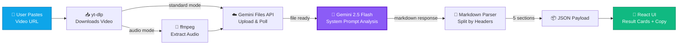

<div align="center">

<h1>🎬 Recast</h1>

<p><strong>Turn any viral video into your next winning ad — in seconds.</strong></p>

<p><sub>Paste a Reel, Short, TikTok, or Facebook Ad → get an on-brand script, hook, caption, and visual direction powered by Gemini 2.5 Flash.</sub></p>

<p>
  
  
  
  
  
  
</p>

<p>
  
  
  
</p>

<p>
  <a href="#"></a>
  <a href="#-quick-start"></a>
  <a href="https://github.com/thegauravmahto/recast/issues/new?labels=bug"></a>
  <a href="https://github.com/thegauravmahto/recast/issues/new?labels=enhancement"></a>
</p>

---

<p><em>Stop reverse-engineering virality — let AI recast what already works into ads that sound like <strong>you</strong>.</em></p>

<p align="center">
  
</p>

</div>

---

## ✨ Features

<table>
<tr>
<td width="33%" valign="top">

### 📥 Input
**🔗 Multi-Platform Ingest**
Paste any Reel, Short, TikTok, or FB Ad URL — one input, four sources.

**🎧 Audio-Only or Full Video**
Toggle between lightning-fast transcript mode and deep multimodal analysis.

**🛍️ Product URL Scraping**
Drop a product link — brand context auto-extracts in the background.

</td>
<td width="33%" valign="top">

### 🧠 Intelligence
**⚡ Gemini 2.5 Flash Core**
State-of-the-art multimodal reasoning over video, audio, and brand data.

**🌐 Native Language Preservation**
Hindi stays Hindi. Tamil stays Tamil. No forced English translation.

**🎬 Scene-Aware Direction**
Understands pacing, hooks, and structure — not just words on screen.

</td>
<td width="33%" valign="top">

### 🎨 Output & UX
**📋 One-Click Copy**
Every card, every output — copy-to-clipboard on tap.

**🌓 System-Aware Dark Mode**
Cal.com-inspired monochrome that respects your OS theme.

**🎥 Inline Source Preview**
Watch the original video right next to your generated assets.

</td>
</tr>
</table>

---

## 🎯 What You Get

Five production-ready assets, generated from a single URL.

| # | Output | What It Delivers |
|---|--------|------------------|
| 1 | 📊 **Video Summary** | Hook breakdown + format + tone + narrative structure — the anatomy of why it works. |
| 2 | 🎯 **Adapted Hook** | A rewritten sub-10-second opener, retuned for your brand voice. |
| 3 | 📝 **Adapted Script** | A 30–45s script with inline `[VISUAL CUE]` markers, ready to shoot. |
| 4 | 📱 **Instagram Caption** | 100–150 words + hashtag set + CTA — drop-in ready. |
| 5 | 🎬 **Visual Direction** | 2–3 scenes mapped with camera angles, overlays, and mood. |

> [!NOTE]
> **🌐 Original language is always preserved.** If the source reel is in Hindi, your script comes back in Hindi. Tamil stays Tamil. Hinglish stays Hinglish. No tone is lost in translation.

---

## 💡 Use Cases

| 👤 Persona | 🎬 Scenario | 🚀 Outcome |
|------------|-------------|------------|
| **Solo Founder** | Spotted a viral Reel at 11pm — needs an on-brand version live by tomorrow. | **$0 spent on copywriters.** Ship ads at the speed of inspiration. |
| **D2C Marketing Team** | Testing 20 ad creatives a week across IG, TikTok, and YouTube Shorts. | **Brand at scale.** Consistent voice across every platform, every variant. |
| **Social Media Agency** | Managing 15 client accounts, each with a unique tone and product line. | **10x faster swipe-file building.** Turn competitor scans into client decks in minutes. |
| **Content Creator** | Wants to remix trending formats without copying — needs a fresh angle fast. | **Trend-native, never derivative.** Hook templates retuned for your niche. |

---

## 🚀 Quick Start

Get Recast running locally in under 5 minutes.

---

### 1. 📦 **Install Prerequisites**

You'll need **Node.js 18+**, **yt-dlp**, and **ffmpeg** installed on your system.

<details>
<summary><b>🍎 macOS</b></summary>

```bash
# Install Node.js (if not already installed)
$ brew install node

# Install yt-dlp and ffmpeg
$ brew install yt-dlp ffmpeg
```

</details>

<details>
<summary><b>🐧 Linux (Ubuntu / Debian)</b></summary>

```bash
# Install Node.js 18+
$ curl -fsSL https://deb.nodesource.com/setup_18.x | sudo -E bash -
$ sudo apt-get install -y nodejs

# Install ffmpeg
$ sudo apt-get install -y ffmpeg

# Install yt-dlp via pip
$ pip install yt-dlp
```

</details>

<details>
<summary><b>🪟 Windows</b></summary>

```powershell
# Install Node.js from https://nodejs.org (LTS recommended)

# Install ffmpeg and yt-dlp via winget
> winget install Gyan.FFmpeg
> winget install yt-dlp.yt-dlp

# Or via Chocolatey
> choco install ffmpeg yt-dlp
```

</details>

You'll also need a **Google API key** — grab one from [Google AI Studio](https://aistudio.google.com/apikey).

---

### 2. 📥 **Clone & Install**

```bash
$ git clone https://github.com/thegauravmahto/recast.git
$ cd recast
$ npm install
```

---

### 3. 🔑 **Configure & Run**

Create a `.env` file in the project root and add your API key:

```bash
$ echo "GOOGLE_API_KEY=your_api_key_here" > .env
$ npm run dev
```

Open [http://localhost:3000](http://localhost:3000) — you're live! 🎉

---

## ⚙️ Environment Variables

Configure Recast by setting these in your `.env` file:

| Variable | Required | Default | Description |
| :--- | :---: | :--- | :--- |
| `GOOGLE_API_KEY` | ✅ Yes | — | Your Gemini API key used for script generation via Gemini 2.5 Flash. |
| `YTDLP_PATH` | ⚪ No | `yt-dlp` (from `$PATH`) | Absolute path to the `yt-dlp` binary. Override if it's not on your system `PATH`. |
| `FFMPEG_PATH` | ⚪ No | `ffmpeg` (from `$PATH`) | Absolute path to the `ffmpeg` binary. Override if it's not on your system `PATH`. |

> [!TIP]
> Don't have a Gemini API key yet? Generate one for free at **[aistudio.google.com/apikey](https://aistudio.google.com/apikey)** — it takes about 30 seconds.

---

## 🐳 Run with One Command

For the impatient — clone, install, and launch in a single shot:

```bash
git clone https://github.com/thegauravmahto/recast.git && \
  cd recast && \
  npm install && \
  echo "GOOGLE_API_KEY=your_api_key_here" > .env && \
  npm run dev
```

> [!IMPORTANT]
> Replace `your_api_key_here` with your actual key from [Google AI Studio](https://aistudio.google.com/apikey) before running, or edit `.env` afterwards and restart the dev server.

---

## 🧠 How It Works



1. **Paste & Submit** — User drops a video URL into the dashboard input and hits analyze.
2. **Download** — `yt-dlp` pulls the video locally into a temp directory on the server.
3. **Optional Audio Extract** — If audio mode is enabled, `ffmpeg` strips the audio track to shrink the upload payload.
4. **Upload to Gemini** — The file is pushed to the Gemini Files API and polled until the processing state turns `ACTIVE`.
5. **AI Analysis** — Gemini 2.5 Flash runs with a specialized system prompt and returns structured markdown with 5 canonical headers.
6. **Parse & Render** — The markdown is split into a JSON object keyed by section and rendered as copy-ready cards in the React UI.

---

## 🛠️ Tech Stack

### 🎨 Frontend

| Tool | Purpose |
|------|---------|
|  | App Router, server actions, route handlers |
|  | Component model for the dashboard UI |
|  | End-to-end type safety across routes & components |
|  | Utility-first styling with custom design tokens |
|  | Accessible, copy-paste primitives (cards, buttons, inputs) |
|  | Class-based theme switching with no flash |

### 🧠 AI & Backend

| Tool | Purpose |
|------|---------|
|  | Multimodal LLM that watches the video and writes the analysis |
|  | Handles large media uploads and processing state |
|  | `/api/analyze` orchestrates the full pipeline server-side |

### 🔧 Tooling

| Tool | Purpose |
|------|---------|
|  | Reliable video downloader across hundreds of sources |
|  | Audio extraction for the lightweight "audio mode" path |
|  | Package management |

---

## 📁 Project Structure

Recast is a small, focused codebase — here's the lay of the land:

```
recast/
├── app/
│   ├── layout.tsx                  # Root layout: theme provider, fonts, metadata
│   ├── page.tsx                    # Home route — renders the <Dashboard /> client
│   ├── globals.css                 # Tailwind layers, design tokens, Cal.com-style shadows
│   └── api/
│       ├── analyze/
│       │   └── route.ts            # POST: yt-dlp → (ffmpeg) → Gemini upload → parse → JSON
│       └── video/
│           └── [filename]/
│               └── route.ts        # GET: streams downloaded videos back to the client
├── components/
│   ├── dashboard.tsx               # Main UI — URL input, loading skeletons, results grid
│   ├── result-card.tsx             # Reusable card with title, markdown body, copy-to-clipboard
│   ├── theme-provider.tsx          # Thin next-themes wrapper for the App Router
│   └── theme-toggle.tsx            # Sun/moon button bound to the theme provider
├── DESIGN.md                       # Design system reference — tokens, spacing, motion
└── .env.example                    # GOOGLE_API_KEY and other env var templates
```

**Architecture philosophy:** the `/api/analyze` route does all the heavy lifting — downloading, transcoding, uploading, polling, and parsing — so the client stays a thin, stateless rendering layer. Components are small and composable (`<ResultCard />` knows nothing about Gemini), and the entire flow is request/response — no websockets, no queues, no state machines to babysit.

---

## 📱 Supported Platforms

<table border="0">
  <tr align="center">
    <td width="25%">
      
      <br/><br/>
      <b>Instagram</b>
      <br/>
      <sub>Reels & video posts</sub>
    </td>
    <td width="25%">
      
      <br/><br/>
      <b>YouTube</b>
      <br/>
      <sub>Shorts & long-form</sub>
    </td>
    <td width="25%">
      
      <br/><br/>
      <b>TikTok</b>
      <br/>
      <sub>Public videos</sub>
    </td>
    <td width="25%">
      
      <br/><br/>
      <b>Facebook</b>
      <br/>
      <sub>Ads Library & videos</sub>
    </td>
  </tr>
</table>

> [!TIP]
> **1000+ more sites supported via yt-dlp** — Twitter/X, LinkedIn, Vimeo, Twitch, Reddit, and far beyond. See the [full list of supported sites](https://github.com/yt-dlp/yt-dlp/blob/master/supportedsites.md).

---

## 🎬 Example: Input → Output

**Input**

```yaml
Product Context: A 7-day Notion productivity course for solo founders.
                 Promises 10 hours/week back. Price: $49.
Source Video:    https://www.instagram.com/reel/EXAMPLE/
                 (a fitness coach explaining how she structures her training week)
```

**Output** — Recast adapts the source video's structure, pacing, and hook style to your product:

<details>
<summary><b>🧠 1. Video Summary</b></summary>

<br/>

A 38-second Reel where a fitness coach breaks down her "non-negotiable 3-day split." The hook calls out a common mistake (training every day), then walks through her weekly system with quick B-roll of workouts. Closes with a soft CTA to her training program. Tone is confident, direct, no-fluff.

</details>

<details>
<summary><b>🎯 2. Adapted Hook</b></summary>

<br/>

> *"Stop 'hustling' 7 days a week. Here's the exact 3-day system I use to run my company in 20 hours flat."*

**Why it works:** Mirrors the source's pattern-interrupt ("Stop training every day") and applies it to founder burnout — the pain point your course solves.

</details>

<details>
<summary><b>📝 3. Adapted Script</b></summary>

<br/>

**[VISUAL CUE: Close-up, founder looking tired at laptop, harsh overhead light]**
Stop "hustling" 7 days a week. It's why you're stuck.

**[VISUAL CUE: Hard cut — same founder, now energized, clean desk, soft natural light]**
Here's the exact 3-day system I built in Notion to run my company in 20 hours.

**[VISUAL CUE: Screen recording — Notion dashboard with 3 colored blocks: Build / Sell / Rest]**
Day 1: Build. Day 2: Sell. Day 3: Rest. That's it. Everything else is noise.

**[VISUAL CUE: Quick montage — calendar dragging, Slack closing, phone face-down]**
No context switching. No 14 open tabs. No "quick check" at 11pm.

**[VISUAL CUE: Founder smiling, holding coffee, end card with course mockup]**
I packaged the whole system into a 7-day course. Link in bio — it's $49 and it'll buy you back 10 hours this week.

</details>

<details>
<summary><b>📱 4. Instagram Caption</b></summary>

<br/>

> The 3-day founder week that replaced my 7-day grind 👇
>
> I used to "work" every single day and ship nothing. Then I built this Notion system. Now I run the whole company in 20 hours and actually take weekends.
>
> 7-day course. $49. Link in bio.
>
> #solopreneur #notiontemplate #founderlife #productivityhacks #buildinpublic #indiehacker #notionsetup #startuplife #timemanagement #worklessdomore

</details>

<details>
<summary><b>🎥 5. Visual Direction</b></summary>

<br/>

| Shot | Camera | Lighting | Notes |
|------|--------|----------|-------|
| Opening | Tight close-up, eye-level, 35mm | Cold, overhead, slightly harsh | Sells the "stuck" feeling |
| Reveal | Medium shot, same angle, jump cut | Warm natural window light | Mirror the source's hard cut energy |
| System walkthrough | Screen recording, 1080x1920, 1.2x speed | N/A | Highlight blocks with subtle zoom-ins |
| Montage | Handheld, fast cuts (~0.4s each) | Matches reveal | Builds momentum |
| Close | Medium-wide, slight smile, end card overlay | Warm | CTA must appear by 0:32 to retain |

**Aspect ratio:** 9:16 · **Length target:** 35–40s · **Captions:** burned-in, bottom-third, max 5 words per frame.

</details>

---

## 📸 Screenshots

<table border="0">
  <tr>
    <td width="50%" align="center">
      
      <br/>
      <sub><b>Clean dashboard input</b></sub>
    </td>
    <td width="50%" align="center">
      
      <br/>
      <sub><b>Skeleton loading state</b></sub>
    </td>
  </tr>
  <tr>
    <td width="50%" align="center">
      
      <br/>
      <sub><b>Generated results (light mode)</b></sub>
    </td>
    <td width="50%" align="center">
      
      <br/>
      <sub><b>Generated results (dark mode)</b></sub>
    </td>
  </tr>
</table>

> [!NOTE]
> Screenshots above are clean SVG mockups designed to match the actual UI exactly (rendered natively by GitHub). Swap them with real PNG/JPG captures any time — just drop them into `/public/screenshots/` and update the extensions.

---

## 🛠️ Troubleshooting

Hit a snag? Expand the relevant section below.

<details>
<summary><b>❌ <code>yt-dlp: command not found</code></b></summary>

Recast shells out to `yt-dlp` to fetch videos. Install it for your OS:

```bash
# macOS
$ brew install yt-dlp

# Linux (via pip)
$ pip install yt-dlp

# Windows
> winget install yt-dlp.yt-dlp
```

Already installed but still failing? Set `YTDLP_PATH` in your `.env` to the absolute binary path (e.g. `/usr/local/bin/yt-dlp`).

</details>

<details>
<summary><b>❌ <code>ffmpeg: command not found</code></b></summary>

`ffmpeg` is required for audio/video processing. Install it for your OS:

```bash
# macOS
$ brew install ffmpeg

# Linux (Ubuntu/Debian)
$ sudo apt-get install -y ffmpeg

# Windows
> winget install Gyan.FFmpeg
```

If installed in a non-standard location, set `FFMPEG_PATH` in your `.env` to the absolute binary path.

</details>

<details>
<summary><b>⚠️ <code>Gemini API quota exceeded</code></b></summary>

The Gemini free tier has rate limits (currently **15 requests/min** and **1,500 requests/day** for Gemini 2.5 Flash). If you hit them:

- ⏳ Wait a minute and retry
- 💳 Upgrade to a paid plan at [ai.google.dev/pricing](https://ai.google.dev/pricing)
- 🔁 Verify your key is correct and active in [Google AI Studio](https://aistudio.google.com/apikey)

</details>

<details>
<summary><b>⚠️ <code>Video download failed</code></b></summary>

This usually means one of the following:

- 🔒 The video is **private** or requires login
- 🌍 The video is **region-locked** in your area
- 🗑️ The video has been **deleted** or made unavailable
- 📡 `yt-dlp` is **out of date** — update it:
  ```bash
  $ pip install -U yt-dlp
  # or
  $ brew upgrade yt-dlp
  ```

Try a different public video URL to confirm your setup is working.

</details>

<details>
<summary><b>⚠️ <code>Port 3000 already in use</code></b></summary>

Another process is using port 3000. Either stop that process, or run Recast on a different port:

```bash
$ npm run dev -- -p 3001
```

Then visit [http://localhost:3001](http://localhost:3001).

</details>

---

## 🗺️ Roadmap

**Now**
- [x] Multi-platform support (Instagram, TikTok, YouTube Shorts, Reels)
- [x] Dark mode with system preference detection
- [x] Original language preservation in generated scripts
- [ ] Bulk URL processing (queue up to 10 videos at once)
- [ ] Export analysis & scripts to PDF / Notion
- [ ] Save analysis history with searchable dashboard
- [ ] One-click "Regenerate hook" button

**Next**
- [ ] A/B variant generation — 3 hook variants per script
- [ ] Brand voice profiles (upload past ads → match tone)
- [ ] Slack & Discord integration for team workflows
- [ ] Thumbnail concept generator (text-to-image via Imagen)
- [ ] CSV export for media-buying teams
- [ ] Custom prompt templates per niche (D2C, EdTech, SaaS)

**Later**
- [ ] Direct publish to Meta Ads Manager & TikTok Ads
- [ ] Multi-language UI (Hindi, Spanish, Portuguese, Arabic)
- [ ] Chrome extension — analyze any video without leaving the tab
- [ ] iOS & Android companion apps
- [ ] Team workspaces with role-based access
- [ ] Fine-tuned model for vertical-specific ad copy

> Have an idea? [Open an issue](https://github.com/thegauravmahto/recast/issues/new) — the roadmap is shaped by the community.

---

## 🤝 Contributing

PRs, issues, and ideas are all warmly welcome. Whether you're fixing a typo or shipping a new platform integration — you belong here.

**1. Fork & clone the repo**
```bash
git clone https://github.com/YOUR_USERNAME/recast.git && cd recast
```

**2. Create a feature branch**
```bash
git checkout -b feat/your-amazing-feature
```

**3. Commit using conventional commits**
```bash
git commit -m "feat: add bulk URL processing"
```

**4. Push & open a Pull Request**
```bash
git push origin feat/your-amazing-feature
```

New here? Start with a [**`good first issue`**](https://github.com/thegauravmahto/recast/issues?q=is:open+is:issue+label:"good first issue") — they're handpicked to be friendly and well-scoped. Don't be shy, drop a comment and we'll guide you through.

---

## ❓ FAQ

<details>
<summary><b>Is my data private?</b></summary>
<br/>
Yes. Videos are downloaded locally on your machine via <code>yt-dlp</code>, sent to Gemini <i>only</i> for analysis, and deleted from local storage immediately after. Nothing is stored on a Recast server — there is no Recast server. Your API key, your data, your control.
</details>

<details>
<summary><b>How much does it cost to run?</b></summary>
<br/>
For most personal use, <b>nothing</b>. Gemini 2.5 Flash has a generous free tier (~1,500 requests/day) that covers casual creators easily. Heavy users pay Google's pay-as-you-go rate — typically less than $0.01 per video analysis. No Recast subscription, ever.
</details>

<details>
<summary><b>Why did my script come back in Hindi / Tamil / Spanish?</b></summary>
<br/>
That's intentional! Recast preserves the <b>original language</b> of the source video by default — a Hindi reel produces a Hindi script. This keeps cultural nuance and idioms intact. Want English output regardless? Toggle "Force English" in advanced settings.
</details>

<details>
<summary><b>Can I use this commercially?</b></summary>
<br/>
Absolutely — Recast is MIT licensed. Use it for client work, agency workflows, internal tools, or paid SaaS. Attribution isn't required, but a link back or a ⭐ is always appreciated.
</details>

<details>
<summary><b>Does it support long-form YouTube videos?</b></summary>
<br/>
Yes, up to ~1 hour. For videos longer than 5 minutes we recommend switching to <b>audio-only mode</b> — it's ~10× faster, ~5× cheaper, and quality drop is minimal for ad-copy generation since the hook intelligence lives in the script, not the visuals.
</details>

<details>
<summary><b>Why Gemini 2.5 Flash and not GPT-4o or Claude?</b></summary>
<br/>
Three reasons: (1) Gemini has <b>native video understanding</b> via the Files API — no frame extraction hacks needed. (2) The 1M-token context window swallows long videos whole. (3) Cost-per-quality is unbeatable at this tier. That said, the architecture is provider-agnostic — swapping in GPT-4o or Claude is a ~50-line change in <code>lib/ai/provider.ts</code>.
</details>

---

## 🙏 Acknowledgments

Recast stands on the shoulders of giants. Huge thanks to:

- [**Google DeepMind**](https://deepmind.google/) — for Gemini 2.5 Flash and the Files API
- [**Vercel**](https://vercel.com/) — for Next.js 16 and effortless deployment
- [**shadcn**](https://ui.shadcn.com/) — for the beautiful, ownable UI components
- [**yt-dlp team**](https://github.com/yt-dlp/yt-dlp) — the unsung heroes of video tooling
- [**FFmpeg team**](https://ffmpeg.org/) — for 20+ years of media wizardry
- [**Cal.com**](https://cal.com/) — for design inspiration and OSS-done-right vibes
- [**Lucide**](https://lucide.dev/) — for the crisp icon set
- Every contributor, issue-opener, and ⭐ giver — you make this fun.

---

## 📄 License

Released under the [**MIT License**](./LICENSE) — free for personal and commercial use. Build cool things.

[](https://opensource.org/licenses/MIT)

---

## 👋 Author

<div align="center">


### **Gaurav Mahto**

*AI Product Manager · Building GenAI for education at Narayana Group*

<br/>

[](https://github.com/thegauravmahto)
[](https://www.linkedin.com/in/gauravmahto/)
[](https://x.com/gaurav_mahto18)

<br/>

**If Recast saved you time, consider ⭐ starring the repo — it really helps!**

<hr/>

<sub>Made with ☕ + 🤖 in India</sub>

</div>
