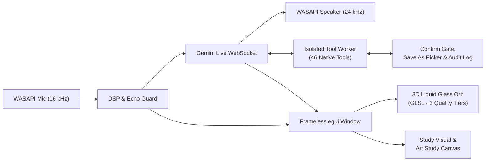

<div align="center">


# Boogie

**Native Rust real-time voice AI assistant & desktop agent for Windows.**  
Powered by Gemini Live API, a 60 FPS 3D Liquid Glass GLSL orb, interactive Study Visual board, and Document Studio.

<p>
  <a href="https://github.com/thodark/Boogie-AI-Assistant/releases/latest"><strong>Download v0.5.0</strong></a>
  &nbsp;·&nbsp;
  <a href="https://thodark.github.io/Boogie-AI-Assistant/">Website &amp; Guide (VI / EN)</a>
  &nbsp;·&nbsp;
  <a href="#quick-start">Quick Start</a>
  &nbsp;·&nbsp;
  <a href="#performance">Benchmarks</a>
  &nbsp;·&nbsp;
  <a href="#changelog">Changelog</a>
</p>

<p>
  <a href="https://github.com/thodark/Boogie-AI-Assistant/releases/latest"></a>
  <a href="https://github.com/thodark/Boogie-AI-Assistant/actions/workflows/ci.yml"></a>
  <a href="LICENSE"></a>
  
</p>

<br />


<sub><code>~137 ms</code> cold start &nbsp;·&nbsp; <code>~580 ms</code> audio TTFB &nbsp;·&nbsp; <code>~33 MB</code> private RAM &nbsp;·&nbsp; <code>46</code> native Windows tools &nbsp;·&nbsp; zero runtime required</sub>

</div>

---

## Overview

Boogie is a single-binary Windows voice assistant written from scratch in **pure Rust**. Instead of bundling Electron or chaining slow STT → LLM → TTS pipelines, it streams raw 16 kHz WASAPI microphone audio straight to **Gemini Live** over a persistent TLS WebSocket, renders an audio-reactive **3D Liquid Glass orb** via OpenGL GLSL, and executes desktop, study, and document workflows locally.

| Capability | What It Does |
| :--- | :--- |
| **Real-Time Voice & 3D Orb** | `~580 ms` first-audio latency, `< 20 ms` barge-in interrupt, Push-to-Talk (`Space`), 3 GPU quality tiers (`Low` / `Medium` / `High`), and 8 live-preview color themes. |
| **Study Visual & Art Study** | Toggleable split-screen teaching board (`study_board`): `< 50 ms` instant zero-quota direct rendering, Sticky Teaching Mode, step-by-step reveal, 2D Math/Physics graphs, flowcharts/mindmaps, highlighted code, **Art Study** (Rule of Thirds, B&W Value Study, pixel HEX palette, animated Live Sketch Replay), and 1-click PDF/Word export. |
| **Study Brain (Grade 1 → Uni)** | **Smart Hybrid routing** (`study_solve`): instant `~1.3 s` Direct Crisp Live Vision (`1920px Q90`, 0 REST quota) for quizzes, IT, English & theory, and verified sign-checking `gemini-2.5-flash` thinking (`~2.5–4 s`, hard `12 s` cap + 0 ms fallback) for Math, Physics, Chemistry & work-checking — with a `~25 ms` shutter beep so you can `Alt+Tab` right away. |
| **Document Studio** | Generates UTF-8 study guides, practice exams with separate answer keys, structured notes, and formula-driven Excel sheets (`=SUM`, `=AVERAGE`) in **PDF**, **Word (`.docx`)**, and **Excel (`.xlsx`)** — no Microsoft Office needed (`.pptx` intentionally excluded). |
| **46 Native Windows Tools** | App launcher (Win32 / Start Menu / Registry), real browser automation, screen vision, system controls, reminders, timers, YouTube media, Steam library, PDF/Excel reader, clipboard, and reversible `undo`. |
| **Persistent Smart Memory** | Stores settings, API key, and long-term memory in `%APPDATA%\Boogie\` so upgrading to a newer versioned `.exe` never loses data. Supports Vietnamese diacritic-tolerant search and an in-app Memory Manager. |

---

## Download

No Rust, Python, or installer required. Grab the latest Windows 10 / 11 (64-bit) build from [**GitHub Releases**](https://github.com/thodark/Boogie-AI-Assistant/releases/latest):

| Artifact | Size | Contents | Link |
| :--- | :---: | :--- | :--- |
| **`Boogie-v0.5.0-Windows-x64.zip`** | `11.9 MB` | **Recommended** — `Boogie-v0.5.0.exe`, config template, `README.md`, `LICENSE` | [Download ZIP](https://github.com/thodark/Boogie-AI-Assistant/releases/latest/download/Boogie-v0.5.0-Windows-x64.zip) |
| **`Boogie-v0.5.0.exe`** | `32.2 MB` | Standalone portable executable with embedded Windows version info | [Download EXE](https://github.com/thodark/Boogie-AI-Assistant/releases/latest/download/Boogie-v0.5.0.exe) |
| **`SHA256SUMS.txt`** | `182 B` | Official SHA-256 release checksums | [View Checksums](https://github.com/thodark/Boogie-AI-Assistant/releases/latest/download/SHA256SUMS.txt) |

---

## Quick Start

1. **Get a free Gemini API key** at [Google AI Studio](https://aistudio.google.com/apikey) (`AIza...`).
2. **Launch `Boogie-v0.5.0.exe`** (extract the ZIP anywhere, or run the standalone `.exe`).
3. **Complete Setup** — paste your key, pick a graphics tier (`Low` for integrated GPUs, `High` for dedicated GPUs), choose a theme & voice, and click **Save & Connect**.

Your API key and memories are stored locally in `%APPDATA%\Boogie\` and only connect directly to Google's Gemini endpoints. Open the top-right **Settings** gear anytime to hot-reload settings without restarting.

<details>
<summary><strong>SmartScreen Notice, SHA-256 Verification &amp; Portable Mode</strong></summary>

- **Windows SmartScreen:** Because open-source releases are not signed with a paid EV certificate, Windows may show *"Windows protected your PC"*. Verify the SHA-256 hash below, then click **More info → Run anyway**.
- **Verify Checksum (PowerShell):**
  ```powershell
  Get-FileHash .\Boogie-v0.5.0-Windows-x64.zip -Algorithm SHA256
  ```
- **Upgrade Persistence & USB Portable Mode:** By default, Boogie stores `api_keys.json`, `memory.json`, `long_term.json`, and `boogie.log` in `%APPDATA%\Boogie\` (automatically migrating legacy `v0.1–v0.3` files from `<exe_dir>\config\` on first launch). Create an empty `portable.txt` next to the `.exe` if you prefer local `<exe_dir>\config\` storage.
- **Diagnostics:** Set `RUST_LOG=boogie=debug` for verbose trace logging (defaults to `boogie=info`).

</details>

---

## Example Voice Commands

Boogie responds naturally in **English** and **Vietnamese** — no rigid command syntax needed:

| Workflow | Example Phrase |
| :--- | :--- |
| **Study Visual** | *"Enter teaching mode and plot y = x^2 - 2x - 3 step by step on the board."* |
| **Art Study** | *"Open Study Visual and analyze the composition, values, palette, and sketch steps of the painting on my screen."* |
| **Study Brain** | *"Solve question 3 on my screen"* or *"I snipped a math problem with Win+Shift+S — check my steps in the clipboard."* |
| **Document Studio** | *"Create a 10-question Calculus midterm practice exam with an answer key as a PDF."* |
| **Excel Formulas** | *"Build a monthly student budget spreadsheet in Excel with SUM and AVERAGE formulas."* |
| **Desktop & Memory** | *"Open VS Code and Spotify, dim the screen a bit, and remember my project deadline is Friday."* |

---

## Performance

Measured on Windows 10/11 x64 (`target/release/boogie.exe`, active WASAPI audio streams + OpenGL 3D shader + persistent Gemini Live TLS WebSocket).

| Metric | Boogie (Rust) | Typical Python + PyQt6 | Typical Electron |
| :--- | :---: | :---: | :---: |
| **Window Ready (Cold Start)** | **`~137 ms`** | ~2.5 – 4.5 s | ~3.5 – 7.0 s |
| **First Audio Byte (TTFB)** | **`~580 ms`** | ~2.2 – 4.5 s | ~2.5 – 5.0 s |
| **Private RAM** | **`~33 MB`** | ~240 – 380 MB | ~450 – 800+ MB |
| **Total Working Set** | **`~61 MB`** | ~300 – 450 MB | ~550 – 1,000+ MB |
| **Distributable Size** | **`32.2 MB`** (1 file) | 350+ MB (folder) | 250 – 600 MB (folder) |
| **Runtime Dependencies** | **None** | Python + Qt DLLs | Bundled Chromium + Node |


<details>
<summary><strong>Detailed Cold-Boot &amp; Voice Pipeline Breakdown</strong></summary>

| Stage | Latency | Under the Hood |
| :--- | :---: | :--- |
| **Process → WASAPI Audio** | `28 ms` | Native 16 kHz mic & 24 kHz speaker opened via `cpal` |
| **GUI Window Live** | `137 ms` | Frameless Obsidian window visible on screen |
| **Gemini Live Ready** | `~520 ms` | TLS WebSocket `101 Switching Protocols` + `setupComplete` |
| **Local DSP & Echo Guard** | `< 2 ms` | Anti-alias resampling, RMS level, FFT visemes (`rustfft`) & speaker-aware echo suppression |
| **First Spoken Audio** | `~580 ms` | Native audio-to-audio streaming (`541–626 ms` measured, zero separate STT/TTS hop) |
| **Barge-In Interrupt** | `< 20 ms` | Instant `PlaybackCmd::Clear` flushing the 180-second WASAPI ring buffer |
| **Screen Shutter Beep** | `~25 ms` | Fires the instant raw pixels are captured in RAM so `Alt+Tab` is immediately safe |

</details>

---

## Architecture & Security



- **Mandatory Native Save As Picker:** Every user file save (`generate_document`, `write_file`, `generate_qrcode`, Study Visual exports) opens a native Windows Save As dialog (`rfd`), blocks protected OS directories, and logs save/cancel outcomes to `~/.boogie/audit.log`.
- **On-Screen Confirmation Gate:** Destructive or external actions (`delete_file`, `move_file`, `kill_process`, `send_message`, mutating `run_command`, shutdown/restart) require explicit Approve/Deny with request-ID matching.
- **Prompt Injection Defense:** External data from web pages, PDFs, Excel files, and clipboard is wrapped in `<<<UNTRUSTED>>>` markers and automatically escalates desktop input tools in the same turn.
- **Hardened Networking & Keys:** SSRF guard blocks loopback/LAN targets, API keys are transmitted strictly via `x-goog-api-key` headers (never in URLs or logs), and the optional local dashboard (`:8765`) is disabled by default with Origin checks + random token auth.

---

## Changelog

### [`v0.5.0`](https://github.com/thodark/Boogie-AI-Assistant/releases/tag/v0.5.0) — 2026-11-26
- **Universal Research → Confirm → Generate Exam Workflow (`prompt.txt`, `documents.rs`):** For ANY subject, university course, or certification, Boogie now researches the real official exam format via `web_search` first, summarizes the sections found (or asks openly when lecturer/school-specific), invites you to add/customize sections & confirm PDF/Word/Excel, and passes the confirmed blueprint via the new `exam_structure` parameter.
- **Dedicated Multi-Model Document Author Engine (`study.rs`, `documents.rs`):** Added a 4-bucket free-tier REST cascade (`gemini-2.5-flash` → `gemini-flash-lite-latest` → `gemini-3.5-flash-lite` → `gemma-4-26b-a4b-it`) with a dedicated 55 s timeout and 24K output token budget so Document Studio generates real full-length exams even after `gemini-2.5-flash`'s 20/day limit is reached.
- **Automated Exam Quality Gate & Auto-Repair:** Validates every draft before opening Save As — automatically catching question-count shortfalls, `..` placeholders, missing Reading passages, missing Listening audio scripts, empty Writing/Speaking prompts, and thin Answer Keys, then running an automatic repair regeneration pass so stub exams never slip through.
- **All-Subject Blueprints & Publication-Grade PDF/Word Layout:** Added subject-specific authoring blueprints (English VSTEP/IELTS/TOEIC with real 220–350 word Reading passages & Listening Transcripts, Math, Physics/Chemistry/Biology, Informatics/CS/SQL code blocks, Literature excerpts & rubrics, History/Geography/Economics tables) plus a clean exam header (candidate strip, duration, score, instructions), `@page` running page numbers, editorial passage & code boxes, ruled essay writing lines, dedicated Listening Transcripts page, and a Quick Answer Grid.

### [`v0.4.5`](https://github.com/thodark/Boogie-AI-Assistant/releases/tag/v0.4.5) — 2026-11-26
- **Bulletproof Headless PDF Export (`documents.rs`):** Fixed a race condition where Microsoft Edge's first-launch relaunch process exited early before flushing the PDF — `render_pdf` now prints to an ASCII temp file first, waits up to 6 s for `%PDF-` stabilization before cleaning up temp HTML, enforces a 16 s per-browser timeout, automatically cascades across **Chrome → Edge → Brave**, and clearly reports file-lock errors (e.g. PDF already open in Foxit/Edge).
- **Zero-Audio Vision Guard, Clean `GoAway` Refresh & Error Logging (`main.rs`):** Extended the spoken readback guard to catch silent empty/thought-only vision turns (not just text-only turns), cleared expiring `resume_handle` on `GoAway` to eliminate `code=1008` disconnects 50 s after refresh, and logged full tool error details in `boogie.log`.
- **Scrollbar-Safe Smart Content Crop (`study.rs`):** Raised browser top-chrome trim to 9.4% (past Brave/Chrome's full address bar) and skipped the 22 px right scrollbar & corner widgets so exam pages crop cleanly down to the text column.

### [`v0.4.4`](https://github.com/thodark/Boogie-AI-Assistant/releases/tag/v0.4.4) — 2026-11-26
- **Fixed Missing Voice Audio on High-Res Screen Answers (`study.rs`, `screen.rs`, `main.rs`):** Replaced bracketed protocol tags inside `clientContent` image turns (which triggered Gemini 3.1 Live's text-only LaTeX bug with 0 audio bytes) with natural spoken-language instructions, verified 5/5 spoken audio playback (~0.83–2.0 s first audio), AND added an automatic zero-audio self-healing readback guard in `main.rs` so Boogie always speaks answers aloud.

### [`v0.4.3`](https://github.com/thodark/Boogie-AI-Assistant/releases/tag/v0.4.3) — 2026-11-26
- **True 1,120-Token High-Res Live Vision (`SILENT` Tool Response + `clientContent` Image Turn):** Live benchmarks revealed that both `realtimeInput.video` and `functionResponse.parts` silently downscale images to ~256 tokens on Gemini 3.1 Live. `v0.4.3` closes image tool calls with `scheduling: "SILENT"` and delivers the screenshot immediately inside a `clientContent` user turn (`MEDIA_RESOLUTION_HIGH`), unlocking true 1,120-token tiled OCR (~0.86 s first spoken audio, zero REST quota, accurate on dense Grade-12 math fractions, roots, and Oxyz coordinates!).
- **Floating-Icon-Resistant Smart Crop:** Upgraded `crop_active_content_rgba` to ignore floating sidebar/chat icons (e.g., Zalo, TOC menus) when trimming empty page gutters so exam pages crop cleanly to the actual text column.

### [`v0.4.2`](https://github.com/thodark/Boogie-AI-Assistant/releases/tag/v0.4.2) — 2026-11-26
- **Fixed Blurry Screen Vision & Stale-Tab Reads (`gemini.rs`, `main.rs`, `study.rs`):** Enabled `MEDIA_RESOLUTION_HIGH` (1,120-token tiled attention — 4× sharper visual detail) in Gemini Live setup and moved screenshot delivery from the async low-res `realtimeInput.video` channel to atomic **`functionResponse.parts`** stamped with monotonic capture IDs and the active foreground window title — eliminating both misread math formulas and reading previous browser tabs.
- **Smart Active-Content Crop & Anti-Stale Clipboard Guard:** Automatically trims Windows taskbar, browser top chrome, and solid side margins (`crop_active_content_rgba`) so exam questions get ~2× higher pixel density per character, and prevents `source="clipboard"` from reading an old copied image when the user asks about the live screen.
- **Window-Title-Aware STEM Routing:** Automatically detects Math / Physics / Chemistry exams from the active browser tab title (e.g. *"đề thi môn Toán"* even if you only say *"giải câu 16"*).

### [`v0.4.1`](https://github.com/thodark/Boogie-AI-Assistant/releases/tag/v0.4.1) — 2026-11-26
- **Smart Hybrid On-Screen Study Routing (`study_solve`):** Default `Auto` mode now routes quizzes, IT/networking, English, humanities, and general screen questions directly to crisp **`1920px Q90` Direct Live Vision (`~1.3 s`, 0 REST quota)**, while reserving verified **`gemini-2.5-flash` thinking (`~2.5–4 s`, hard `12 s` cap)** for Math, Physics, Chemistry, and check-work sign verification (with instant `0 ms` fallback to Live Vision if daily REST quota is reached).
- **Eliminated 24s–65s REST Hangs:** Removed congested `gemini-3.1-flash-lite` from interactive study/board fallbacks, tightened REST timeouts (`12 s` / `15 s`), and prioritized instant `< 50 ms` Direct `board_json` rendering on Study Visual.
- **Automated Versioned Release Workflow:** Updated `.github/workflows/release.yml` so GitHub Actions automatically packages `Boogie-v<ver>.exe`, `Boogie-v<ver>-Windows-x64.zip`, and `SHA256SUMS.txt`.

### [`v0.4.0`](https://github.com/thodark/Boogie-AI-Assistant/releases/tag/v0.4.0) — 2026-11-26
- **Upgrade-Safe Persistent Storage (`%APPDATA%\Boogie\`) & Versioned `.exe` (`Boogie-v0.4.0.exe`):** Config, API key, and memory persist across folder deletions and upgrades with automatic one-time migration from legacy `config/` folders.
- **Mandatory Native Save As Picker (`rfd`):** Every user file save brings Boogie to front and prompts for folder & filename before writing.
- **Document Studio (`generate_document`):** Print-ready **PDF**, **Word (`.docx`)**, and formula-powered **Excel (`.xlsx`)** generation in UTF-8 (`.pptx` excluded), with strict missing-format confirmation and stale-dialog cancellation guards.
- **`Study Visual` Teaching Board & Art Study Studio:** Toggleable split-screen board with Sticky Teaching Mode, `< 50 ms` instant zero-quota direct rendering, 2D graphs, diagrams, tables, code highlighting, Art Study (Rule of Thirds, Value Study, pixel HEX palette, animated Live Sketch Replay), and 1-click PDF/Word export.
- **Live Progress Card, `~25 ms` Shutter Beep & Quota Immunity:** Animated frosted-glass Progress Card, post-capture shutter chime for instant `Alt+Tab`, fast `1920px Q95 JPEG` capture, verified REST cascade (`gemini-2.5-flash` → `gemini-3.1-flash-lite`) with automatic Direct Live Vision fallback, and `Flash Direct Vision (~1.2s)` mode in Settings.

<details>
<summary><strong>Previous Releases (v0.3.0, v0.2.0, v0.1.0)</strong></summary>

#### [`v0.3.0`](https://github.com/thodark/Boogie-AI-Assistant/releases/tag/v0.3.0) — 2026-11-25
- Added **Deep Study Brain (`study_solve`)** supporting Grade 1 through University across `solve`, `hint`, `check`, and `explain` modes with `Win+Shift+S` clipboard snip support, `Lanczos3` crisp scaling, and copyable Study Solution cards.

#### [`v0.2.0`](https://github.com/thodark/Boogie-AI-Assistant/releases/tag/v0.2.0) — 2026-11-23
- Added **3 GPU quality tiers** (`Low` analytical glass shader ~15× lighter, `Medium`, `High`), **8 live-preview color themes**, **Smart Long-Term Memory** with Vietnamese diacritic-folding search + Settings Memory Manager tab, and warmer conversational voice.

#### [`v0.1.0`](https://github.com/thodark/Boogie-AI-Assistant/releases/tag/v0.1.0) — 2026-11-22
- Initial prebuilt Windows x64 release with native WASAPI audio, 60 FPS raymarched 3D Liquid Glass orb, first-run Setup & live Settings UI, and 42 security-gated Windows automation tools.

</details>

---

## Build from Source

Requires **Windows 10 / 11 (64-bit)** and **Rust 1.85+** (Edition 2024).

```powershell
git clone https://github.com/thodark/Boogie-AI-Assistant.git
cd Boogie-AI-Assistant
cargo build --release
.\target\release\boogie.exe
```

Run checks or package versioned release artifacts (`dist/Boogie-v<ver>.exe`, ZIP & `SHA256SUMS.txt`):

```powershell
cargo fmt --all -- --check
cargo clippy --all-targets -- -D warnings
cargo test
powershell -ExecutionPolicy Bypass -File scripts\package-release.ps1
```

<details>
<summary><strong>Project Layout &amp; Core Crates</strong></summary>

```text
├── .github/workflows/       # Windows CI (fmt, clippy, test) & versioned Release pipeline
├── assets/                  # Logos, icons, UI screenshot & benchmark SVGs
├── core/prompt.txt          # Embedded system protocol
├── docs/                    # Bilingual VI/EN GitHub Pages site
├── scripts/                 # Release packaging script (package-release.ps1)
└── src/
    ├── main.rs              # Supervisor, non-blocking tool worker & session loop
    ├── gui.rs               # Frameless Obsidian UI, Progress Card, Settings & Drawer
    ├── orb_shader.rs        # 3-tier GLSL 3D Liquid Glass orb shader
    ├── study_visual.rs      # Split-screen Study Visual board, 2D plotter & Art Study engine
    ├── gemini.rs            # Gemini Live WebSocket client (audio + vision)
    ├── audio.rs / dsp.rs    # WASAPI audio, FFT visemes & echo guard (echo.rs)
    ├── confirm.rs / util.rs # Permission tiers, SSRF & prompt-injection guards
    ├── config.rs / memory.rs# Persistent %APPDATA% storage & Vietnamese smart memory
    └── actions/             # 19 modules implementing 46 tools (incl. documents.rs & study.rs)
```

**Core Crates:** `eframe`/`egui` 0.31 · `glow` · `tokio` · `tokio-tungstenite` · `cpal` · `rustfft` · `windows` · `screenshots` · `chromiumoxide` · `docx-rs` · `rust_xlsxwriter` · `rfd` · `reqwest` · `axum` · `ring`

</details>

---

## License

MIT © [Suyz Nguyen](https://github.com/thodark) · See [LICENSE](LICENSE) for details.
