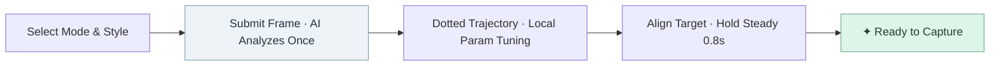

<div align="center">


# Drama Camera

### Turn "how to shoot" into visible next steps.

AI understands your frame and guides your composition with directional dotted lines.<br />
Align with your target, hold steady, and wait for a clear "Ready to Capture".


[UI Preview](#-ui-preview) · [In-App Usage](#-in-app-usage) · [Getting Started](#-getting-started)

<p>
  <b>English</b> · <a href="README_ZH.md">简体中文</a>
</p>

</div>

---

Drama is an AI photography guidance app built with **Expo + React Native**, targeting Android first. Select your shooting mode and aesthetic style, then send the current framing to a vision model; the model returns a structured plan, while your device displays the trajectory, tunes supported camera parameters, and verifies alignment locally.

**One request, one-step guidance, completed locally.** No continuous video streaming, no periodic polling of the model; when a new composition is needed, simply tap "Replan".

---

## 📸 UI Preview

### Feature Demo

<div align="center">

<p><sub>Mobile feature demo · Looping playback</sub></p>
</div>

### Core Screens

<table>
  <tr>
    <th align="center">🎥 Camera Home</th>
    <th align="center">⚙️ AI Configuration</th>
    <th align="center">👤 Profile</th>
  </tr>
  <tr>
    <td align="center"></td>
    <td align="center"></td>
    <td align="center"></td>
  </tr>
  <tr>
    <td align="center"><sub>Cinematic lighting guidance, explore presets & open camera</sub></td>
    <td align="center"><sub>Select provider (Kimi / DeepSeek), enter API Key</sub></td>
    <td align="center"><sub>Creator profile, shooting stats & AI settings entry</sub></td>
  </tr>
</table>

<table>
  <tr>
    <th align="center">✨ Inspiration Feed</th>
    <th align="center">🖼️ Photo Album</th>
  </tr>
  <tr>
    <td align="center"></td>
    <td align="center"></td>
  </tr>
  <tr>
    <td align="center"><sub>Curated lighting inspirations & composition presets</sub></td>
    <td align="center"><sub>Work gallery, film parameters & tone fine-tuning</sub></td>
  </tr>
</table>

> Screenshots captured from Expo Web preview using mobile dimensions (390 × 844); no real API keys entered. Android system bars, permissions, and native camera behavior may differ.

### Key Highlights

| Feature | Experience |
| :--- | :--- |
| **Visible Trajectory Lines** | The viewfinder shows the frame center, dotted path, and target circle. Follow instructions to align the center with the target circle. Control labels stay outside the preview frame. |
| **Instant Ready Indicator** | When framing requirements and parameter tuning are met and held steady for ~**0.8s**, green framing corners, pulsing ring, shutter highlight, and "Ready to Capture" appear with haptic feedback. |
| **3 Shooting Modes** | Portrait (subject-background harmony), Landscape (visual center, leading lines, depth), Night (ambient light, contrast, stability). Each mode uses dedicated prompts. |
| **4 Aesthetic Styles** | Clear, Apricot, Mint, and Vintage Film participate in AI composition reasoning (currently prompt-based aesthetic preferences rather than post-processing filters). |
| **Hardware-Adaptive Parameters** | Supports digital zoom and flashlight; custom Android native module adjusts white balance presets and contrast based on device capabilities. Aperture and auto-exposure remain managed by the system. |
| **BYO Model Services** | Enter your API key, HTTPS base URL, and model name directly in the app. Supports Chat Completions compatible vision endpoints. |
| **Capture & Save** | Flip between front and rear cameras, preview captured shots, retake, or save to system media gallery. |

Inspiration, Album, and Profile screens are fully integrated into the app; some cards and settings menus remain demo mockups.

---

## 📱 In-App Usage

### Configuring API Key

**No need to hardcode keys into source code or create `.env` files.** The app reads credentials directly from the in-app "AI Configuration" screen. The device sends requests directly to your chosen provider; there is no independent backend in this repo.

#### 1. Prepare a Vision-Capable Model

Create your API Key in your provider's developer console, and ensure sufficient balance and model access. Note that consumer web chat subscriptions do not always grant API quota.

| Item | Kimi Example | DeepSeek Preset |
| :--- | :--- | :--- |
| Platform | [Moonshot Open Platform](https://platform.moonshot.cn/) | [DeepSeek Open Platform](https://platform.deepseek.com/) |
| API Base URL | `https://api.moonshot.cn/v1` | `https://api.deepseek.com` |
| Model ID | `kimi-k3` | `deepseek-flash` |
| API Key | Personal key from the provider | Personal key from the provider |

The above URLs and model IDs represent current project presets, **not guarantees of availability or service quality**. Please refer to your account permissions and official provider documentation. When switching models, verify that the model supports both **vision input + JSON output**. See the [Kimi Quickstart](https://platform.moonshot.cn/docs/guide/start-using-kimi-api) and [DeepSeek API Docs](https://api-docs.deepseek.com/).

#### 2. Enter Credentials in App

<div align="center">

<p><sub>AI Configuration: Select Provider → Enter Key → Test Connection → Save & Select</sub></p>
</div>

1. Open bottom tab **"Profile" → "AI Configuration"**; or access settings from the top-right of the viewfinder.
2. Select **Kimi** or **DeepSeek**; configuration is saved independently for each provider.
3. Fill in **API Key**, **API Base URL**, and **Model ID**.
4. Tap **"Test Connection"** to verify that credentials and model respond.
5. Tap **"Save & Select"**, then return to the camera to enable AI guidance.

| Field | Formatting Note |
| :--- | :--- |
| **API Key** | Paste full key directly; do not add `Bearer` prefix, quotes, or extra spaces. |
| **API URL** | Enter HTTPS base URL, keeping provider path prefixes like `/v1`; do not append `/chat/completions`. |
| **Model ID** | Enter the exact model ID as documented by your provider. |

> **Connection testing sends a single text ping without images.** Passing the test does not verify vision capabilities; compressed frames are only transmitted when guidance is activated in the viewfinder for the first time. Both connection tests and image analyses may incur provider usage fees.

#### 3. Custom & Third-Party Compatible Endpoints

You can customize the API URL, model, and key under any preset. Self-hosted services must meet:

- HTTPS `POST {baseURL}/chat/completions` with Bearer token authentication.
- Support for `image_url` within `messages`, including Base64 Data URLs.
- Support for `response_format: { type: "json_schema", json_schema: { ..., strict: true } }`.
- Return a JSON string adhering to the project's [JSON v3 Schema](docs/camera-guidance-v3.schema.json) in `choices[0].message.content`.

Official DeepSeek / Moonshot domains use `json_object`, while custom domains use strict `json_schema`. All responses undergo strict TypeScript field and semantic validation; missing fields, extra fields, out-of-bounds parameters, or markdown code fences are rejected.

#### Credential and Image Privacy

- **Android / iOS:** Keys are stored locally using `expo-secure-store`; you can delete local keys in settings.
- **Web:** Keys are held in session memory only and reset upon refresh.
- **Analysis:** Compressed frame, mode, style, and device capability context are sent directly to your configured provider. Please use trusted services.
- **Photo Samples:** Guidance frames are not written to the system photo library; final shots are saved only when you tap Save.

Never commit real API keys into code, screenshots, issues, or git commits.

### First Shoot



<div align="center">

<p><sub>Camera Home: Explore lighting and style presets, tap "Open Camera" to enter viewfinder</sub></p>
</div>

1. Grant camera permission, enter the viewfinder, and choose Portrait, Landscape, or Night mode.
2. Enable AI guidance, wait for the analysis, and follow the dotted trajectory to adjust phone position.
3. The app executes device-supported parameters. If auto-zoom is off, manually adjust to the target focal length.
4. Once the center crosshair enters the target circle and remains steady, the capture indicator appears immediately **without requiring a second model roundtrip**.
5. Press the shutter button, preview the photo, and save it to your photo album.

For pure lateral translation, forward/backward distance, or when rotation sensors are unavailable, adjust as instructed and tap **"Adjusted, Confirm in Position"**. Device gyro/rotation sensors cannot reliably measure translational displacement in centimeters.

Noticeable movements revoke the ready state; sensor-tracked trajectories recover locally once realigned. Changing mode, style, lens, or tapping "Replan" triggers a fresh plan. Guidance does not loop automatically upon errors, timeouts, or incomplete movement.

---

## 🛠 Getting Started

Run all commands in the directory containing `package.json`. If cloned inside an outer directory, enter `frontend/` first.

### Environment & Startup

Ensure Node.js LTS, npm, and Git are installed, then install locked dependencies:

```bash
npm ci
npm start
```

Web preview:

```bash
npm run web
```

Compile and run Android native build locally (requires Android SDK / JDK):

```bash
npx expo run:android
```

> The project includes a custom native module `modules/camera-tuning`. **Native features like white balance and contrast tuning require compiling an Android build; Expo Go cannot execute native tuning modules.** Web preview is suitable for UI inspection but cannot replace Android device testing; browser API requests may also encounter CORS limitations.

### Building Android APK

Configured via [EAS Build](eas.json): `preview` generates an installable APK, and `production` builds an AAB for app store releases.

When building for the first time with your own Expo account, update [app.json](app.json): set `expo.owner` to your account or organization, remove `expo.extra.eas.projectId`, and run `eas init` to link your EAS project. Also configure your own `expo.android.package` (and iOS `bundleIdentifier`).

```bash
npx eas-cli@latest login
npx eas-cli@latest init
npx eas-cli@latest build --platform android --profile preview
```

Download and install the APK from the EAS build output link. API keys are filled by users after installation and **not baked into application binaries**.

For AAB store builds:

```bash
npx eas-cli@latest build --platform android --profile production
```

### Directory Structure

```text
.
├── src/app/                    # Expo Router pages and navigation
├── src/components/business/    # Viewfinder, guidance overlay, capture effects, AI config
├── src/constants/              # Photography prompts, JSON schema, theme, provider presets
├── src/hooks/                  # Camera flow, AI requests, and local guidance state
├── src/lib/                    # API client, JSON validation, param execution, secure storage
├── modules/camera-tuning/      # Android native camera parameter tuning module
└── docs/                       # Protocols, photography design rationale, screenshots
```

| Area | Entry Point |
| :--- | :--- |
| Aesthetic guidelines by mode | [photographyPrompts.ts](src/constants/photographyPrompts.ts) · [Design Rationale](docs/photography-prompts.md) |
| Model return schema & execution rules | [Common Prompts](src/constants/guidance.ts) · [Protocol Docs](docs/camera-guidance-protocol.md) |
| Default providers & models | [ai.ts](src/constants/ai.ts) |
| Requests, timeouts & compatibility | [aiClient.ts](src/lib/aiClient.ts) |
| Trajectory, target circle & effects | [CameraDirectionOverlay.tsx](src/components/business/CameraDirectionOverlay.tsx) · [CameraReadyEffects.tsx](src/components/business/CameraReadyEffects.tsx) |

### Testing

Run the TypeScript check:

```bash
npx tsc --noEmit
```

Real hardware parameters, lens switches, and real model performance require physical device verification; see [Test & Verification Checklist](docs/testing.md).

### FAQ

<details>
<summary><b>Connection test succeeds, but no guidance in camera?</b></summary>

A successful text ping only confirms connectivity. Ensure your model supports vision input and JSON output, and that your account has appropriate privileges. Self-hosted endpoints must support strict JSON schema. Error messages appear outside the viewfinder; correct settings and tap "Replan".

</details>

<details>
<summary><b>Requests timing out, or receiving 401 / 404 / 429 errors?</b></summary>

Default request timeout is 45 seconds. Check network quality or switch to a faster vision model; requests do not auto-retry.

- **401:** Key is invalid, expired, or does not match provider.
- **403:** Account lacks permissions for the requested model.
- **404:** Base URL or model ID incorrect.
- **402 / 429:** Check balance, quota, or rate limits.
- **400 / 422:** Check vision input format, JSON mode, and Schema compliance.

Web network errors may also stem from provider CORS restrictions.

</details>

<details>
<summary><b>Why not automatically tune aperture, ISO, and shutter speed?</b></summary>

Auto-exposure and aperture are managed natively by the OS camera subsystem. White balance presets and contrast adjustments are only applied when supported by both the native module and device hardware; unsupported parameters are not falsified as successful. Night mode offers framing and lighting advice rather than native multi-frame night algorithms.

</details>

<details>
<summary><b>Does "Ready to Capture" mean the model re-verified the frame?</b></summary>

It indicates that the local trajectory and parameter conditions from the current plan have been satisfied. The model does not perform a second verification pass; subject movement, light shifts, and gradual drift may not register on gyro sensors. When the scene changes visibly, please trigger a replan manually.

</details>

<details>
<summary><b>Are iOS, Web, and offline AI models supported?</b></summary>

React Native pages adapt to iOS and Web, but the camera tuning native module currently targets Android and requires native compilation and testing. Web preview does not offer sensor-based guidance. AI analysis requires internet access to call your chosen service; once a plan is received, guidance and completion detection run locally. The app does not embed an on-device NPU LLM.

</details>

---

<div align="center">

**Less guesswork, better photographs.**<br />
Drama Camera · Confidence in every shutter press.

</div>
