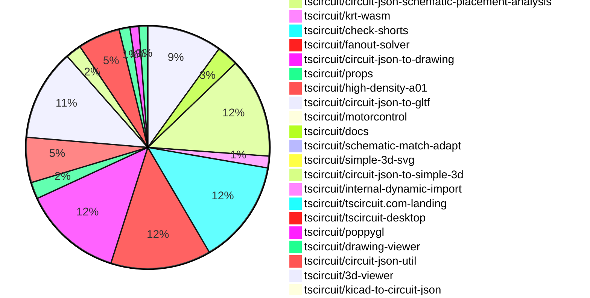

# contribution tracker

[contributions.tscircuit.com](https://contributions.tscircuit.com) ・ [tscircuit.com](https://tscircuit.com) ・ [Contribution Overviews](./contribution-overviews/) ・ [Changelogs](./changelogs/)

Generates weekly contribution overviews for tscircuit contributors. Check out all
the [contribution overviews here](./contribution-overviews/)
You can find AI-generated monthly changelogs in the [changelogs directory](./changelogs/)

- All PRs in the tscircuit org are scanned/summarized via an LLM
- The LLM classifies each Diff/PR as into a set of attributes for scoring
- All the PRs, summaries, and classifications are organized into charts and tables for [the website](https://contributions.tscircuit.com)

> Want to run locally? See the [Development Section](#development)

## Current Week

<!-- START_CURRENT_WEEK -->

# Contribution Overview 2026-11-17

The current week is shown below. There are 3 major sections:

- [Contributor Overview](#contributor-overview)
- [PRs by Repository](#prs-by-repository)
- [PRs by Contributor](#changes-by-contributor)
- [Scoring & Sponsorship Details](/docs/sponsorship-calculation-explanation.md)

## PRs by Repository

## Contributor Overview

| Contributor | 🐳 Major | 🐙 Minor | 🐌 Tiny | Score | ⭐ |
|-------------|---------|---------|---------|-------|-----|
| [ShiboSoftwareDev](#ShiboSoftwareDev) | 105 | 29 | 61 | 491.5 | 👑👑👑 |
| [seveibar](#seveibar) | 12 | 15 | 23 | 91 | 👑 |
| [0hmX](#0hmX) | 10 | 8 | 16 | 69 | ⭐⭐⭐ |
| [rushabhcodes](#rushabhcodes) | 4 | 5 | 14 | 38 | ⭐⭐ |
| [imrishabh18](#imrishabh18) | 2 | 10 | 7 | 36 | ⭐⭐ |
| [MustafaMulla29](#MustafaMulla29) | 2 | 5 | 12 | 31 | ⭐⭐ |
| [Abse2001](#Abse2001) | 3 | 5 | 0 | 23 | ⭐⭐ |
| [mohan-bee](#mohan-bee) | 4 | 2 | 1 | 21 | ⭐⭐ |
| [tscircuitbot](#tscircuitbot) | 0 | 0 | 508 | 12 | ⭐⭐ |
| [AnasSarkiz](#AnasSarkiz) | 2 | 0 | 2 | 11 | ⭐⭐ |
| [GokulPandi-M](#GokulPandi-M) | 1 | 0 | 1 | 5 | ⭐ |
| [VB-Blue](#VB-Blue) | 1 | 0 | 0 | 4 | ⭐ |
| [KrishnaX12](#KrishnaX12) | 0 | 1 | 0 | 2 |  |

## Staff Pass Ratio (SPR)

| Contributor | Reviewed PRs | Rejections | Approvals | SPR |
|-------------|--------------|------------|-----------|-----|
| [0hmX](#0hmX) | 12 | 1 | 13 | 91.7% |
| [rushabhcodes](#rushabhcodes) | 8 | 2 | 6 | 75.0% |
| [ShiboSoftwareDev](#ShiboSoftwareDev) | 5 | 0 | 6 | 100.0% |
| [Abse2001](#Abse2001) | 3 | 0 | 3 | 100.0% |
| [MustafaMulla29](#MustafaMulla29) | 3 | 0 | 3 | 100.0% |
| [GokulPandi-M](#GokulPandi-M) | 1 | 1 | 0 | 0.0% |
| [hrithik18k](#hrithik18k) | 1 | 1 | 0 | 0.0% |
| [VB-Blue](#VB-Blue) | 1 | 0 | 1 | 100.0% |

0hmX SPR PRs (12)

- [#5628](https://github.com/tscircuit/core/pull/5628) refactor!: remove the analog IBIS simulation API
- [#5632](https://github.com/tscircuit/core/pull/5632) feat: add <simulation.eyediagram>
- [#5650](https://github.com/tscircuit/core/pull/5650) feat: pick default pseudo-random binary sequence (PRBS) seeds across a board
- [#5647](https://github.com/tscircuit/core/pull/5647) feat: copy JLCPCB hole plating thickness into preset stackups
- [#5629](https://github.com/tscircuit/core/pull/5629) feat: add <simulation.ibismodel>
- [#5423](https://github.com/tscircuit/core/pull/5423) feat: add <simulation.pcbtransientchannelsimulation>
- [#5649](https://github.com/tscircuit/core/pull/5649) feat: add <simulation.pcbdriverreceiverchannel>
- [#11](https://github.com/tscircuit/jlcpcb-manufacturing-specs/pull/11) feat: add hole plating copper thickness to JLCPCB stackups
- [#6](https://github.com/tscircuit/ibis-to-spice/pull/6) feat: expose [Ramp] dV/dt and R_load on IbisBuffer
- [#141](https://github.com/tscircuit/signal-integrity-pipeline/pull/141) feat: estimate IBIS output edge duration for channel endpoints
- [#117](https://github.com/tscircuit/signal-integrity-pipeline/pull/117) feat: add isQuiet to board and the default capture duration to pipeline/timing
- [#118](https://github.com/tscircuit/signal-integrity-pipeline/pull/118) feat: inspect IBIS pin capabilities and references for channel endpoints

rushabhcodes SPR PRs (8)

- [#998](https://github.com/tscircuit/circuit-json/pull/998) Preserve arc geometry in PCB board outlines and cutouts
- [#1028](https://github.com/tscircuit/circuit-json/pull/1028) fix: preserve namespaced KiCad metadata on existing records
- [#1025](https://github.com/tscircuit/circuit-json/pull/1025) Revert "Preserve arc geometry in PCB board outlines and cutouts (#998)"
- [#1036](https://github.com/tscircuit/props/pull/1036) Preserve rectangular solder paste rotation
- [#1032](https://github.com/tscircuit/props/pull/1032) feat: add native net class authoring props
- [#5962](https://github.com/tscircuit/tscircuit.com/pull/5962) Add the Drawing tab to package previews
- [#298](https://github.com/tscircuit/circuit-json-to-gltf/pull/298) Resolve selected CAD model URLs at load time
- [#58](https://github.com/tscircuit/poppygl/pull/58) Skip shading for constant unlit opaque surfaces

ShiboSoftwareDev SPR PRs (5)

- [#5748](https://github.com/tscircuit/core/pull/5748) Keep fixed copper as traces between autorouting phases
- [#4091](https://github.com/tscircuit/tscircuit-autorouter/pull/4091) Reproduce whole-trace neckdowns on Glider and OrangeCrab DDR
- [#3985](https://github.com/tscircuit/tscircuit-autorouter/pull/3985) Keep preloaded copper as paths throughout Pipeline9
- [#341](https://github.com/tscircuit/fanout-solver/pull/341) Skip duplicate first-route plane searches
- [#298](https://github.com/tscircuit/fanout-solver/pull/298) Honor crossed pour antipads in final fanout validation

Abse2001 SPR PRs (3)

- [#5502](https://github.com/tscircuit/core/pull/5502) Keep small-board mouse bites drillable (#5066)
- [#5876](https://github.com/tscircuit/cli/pull/5876) Resolve relative model paths in tsci export glb and gltf (#5654)
- [#13](https://github.com/tscircuit/jlcpcb-manufacturing-specs/pull/13) Add JLCPCB panelization rules

MustafaMulla29 SPR PRs (3)

- [#580](https://github.com/tscircuit/checks/pull/580) Report schematic box width and pin-padding warnings
- [#1451](https://github.com/tscircuit/schematic-trace-solver/pull/1451) Place shared ground labels at the lower end of their rail
- [#484](https://github.com/tscircuit/circuit-json-schematic-placement-analysis/pull/484) fix: let 0 ohm links away from ground lie in line

GokulPandi-M SPR PRs (1)

- [#334](https://github.com/tscircuit/tiny-hypergraph/pull/334) Support per-route layer constraints during path search

hrithik18k SPR PRs (1)

- [#5738](https://github.com/tscircuit/core/pull/5738) test(repro): nested group keepout stays behind after packing

VB-Blue SPR PRs (1)

- [#651](https://github.com/tscircuit/jlcsearch/pull/651) fix: include LED Indication - Discrete subcategory in led derived table

> Note: AI evaluates PRs and assigns 1-3 star ratings automatically. 4 and 5 star ratings require manual staff review.

## Review Table

[reviews-received-hover]: ## "Number of reviews received for PRs for this contributor"
[approvals-received-hover]: ## "Number of approvals received for PRs this contributor authored"
[rejections-received-hover]: ## "Number of rejections received for PRs this contributor authored"
[prs-opened-hover]: ## "Number of PRs opened by this contributor"
[issues-created-hover]: ## "Number of issues created by this contributor"

| Contributor | Reviews Received | Approvals Received | Rejections Received | Approvals | Rejections Given | PRs Opened | PRs Merged | Issues Created |
|---|---|---|---|---|---|---|---|---|
| [0hmX](#0hmX) | 42 | 16 | 0 | 21 | 1 | 83 | 34 | 0 |
| [0xNexuz](#0xNexuz) | 0 | 0 | 0 | 0 | 0 | 1 | 0 | 0 |
| [aaka3h](#aaka3h) | 0 | 0 | 0 | 0 | 0 | 1 | 0 | 0 |
| [abdalraof-albarbar](#abdalraof-albarbar) | 0 | 0 | 0 | 0 | 0 | 4 | 0 | 0 |
| [Abse2001](#Abse2001) | 3 | 3 | 0 | 22 | 0 | 19 | 8 | 0 |
| [AJ0070](#AJ0070) | 0 | 0 | 0 | 0 | 0 | 29 | 0 | 0 |
| [Aming9303](#Aming9303) | 0 | 0 | 0 | 0 | 0 | 2 | 0 | 0 |
| [AnasSarkiz](#AnasSarkiz) | 5 | 4 | 0 | 1 | 0 | 13 | 4 | 0 |
| [Andresdev14](#Andresdev14) | 0 | 0 | 0 | 0 | 0 | 1 | 0 | 0 |
| [aryansanganti](#aryansanganti) | 0 | 0 | 0 | 0 | 0 | 1 | 0 | 0 |
| [aswadi](#aswadi) | 0 | 0 | 0 | 0 | 0 | 2 | 0 | 0 |
| [bhatipoglu](#bhatipoglu) | 0 | 0 | 0 | 0 | 0 | 2 | 0 | 0 |
| [CrazyEther](#CrazyEther) | 0 | 0 | 0 | 0 | 0 | 1 | 0 | 0 |
| [dat-hoangnguyentuandat](#dat-hoangnguyentuandat) | 0 | 0 | 0 | 0 | 0 | 1 | 0 | 0 |
| [Devesh36](#Devesh36) | 0 | 0 | 0 | 0 | 0 | 6 | 0 | 0 |
| [GokulPandi-M](#GokulPandi-M) | 15 | 3 | 2 | 0 | 0 | 11 | 2 | 0 |
| [Hajjy22](#Hajjy22) | 0 | 0 | 0 | 0 | 0 | 7 | 0 | 0 |
| [hrithik18k](#hrithik18k) | 1 | 0 | 1 | 0 | 0 | 3 | 0 | 0 |
| [imrishabh18](#imrishabh18) | 1 | 0 | 0 | 9 | 2 | 30 | 19 | 0 |
| [Kefia-02](#Kefia-02) | 0 | 0 | 0 | 0 | 0 | 1 | 0 | 0 |
| [KrishnaX12](#KrishnaX12) | 3 | 2 | 0 | 0 | 0 | 1 | 1 | 0 |
| [kunalgoesbyken](#kunalgoesbyken) | 0 | 0 | 0 | 0 | 0 | 3 | 0 | 0 |
| [LBCron](#LBCron) | 0 | 0 | 0 | 0 | 0 | 30 | 0 | 0 |
| [menwo535-jpg](#menwo535-jpg) | 0 | 0 | 0 | 0 | 0 | 2 | 0 | 0 |
| [mohan-bee](#mohan-bee) | 5 | 2 | 0 | 0 | 0 | 28 | 7 | 0 |
| [MustafaMulla29](#MustafaMulla29) | 12 | 8 | 0 | 1 | 0 | 26 | 19 | 0 |
| [NavaneethKSD](#NavaneethKSD) | 0 | 0 | 0 | 0 | 0 | 1 | 0 | 0 |
| [pecopeko](#pecopeko) | 0 | 0 | 0 | 0 | 0 | 8 | 0 | 0 |
| [pethapixels-create](#pethapixels-create) | 0 | 0 | 0 | 0 | 0 | 9 | 0 | 0 |
| [rushabhcodes](#rushabhcodes) | 40 | 15 | 3 | 0 | 0 | 53 | 24 | 0 |
| [Semihzx](#Semihzx) | 0 | 0 | 0 | 0 | 0 | 1 | 0 | 0 |
| [seveibar](#seveibar) | 14 | 0 | 0 | 35 | 4 | 84 | 51 | 0 |
| [ShiboSoftwareDev](#ShiboSoftwareDev) | 66 | 46 | 1 | 11 | 0 | 304 | 197 | 0 |
| [singhaditya21](#singhaditya21) | 0 | 0 | 0 | 0 | 0 | 6 | 0 | 0 |
| [sxpnet64](#sxpnet64) | 0 | 0 | 0 | 0 | 0 | 1 | 0 | 0 |
| [thisisanubhav](#thisisanubhav) | 0 | 0 | 0 | 0 | 0 | 2 | 0 | 0 |
| [tscircuitbot](#tscircuitbot) | 0 | 0 | 0 | 0 | 0 | 613 | 508 | 0 |
| [tunguyen1993](#tunguyen1993) | 0 | 0 | 0 | 0 | 0 | 2 | 0 | 0 |
| [U-ITACHII](#U-ITACHII) | 0 | 0 | 0 | 0 | 0 | 8 | 0 | 0 |
| [VB-Blue](#VB-Blue) | 1 | 1 | 0 | 0 | 0 | 8 | 1 | 0 |

## Changes by Repository

### [tscircuit/core](https://github.com/tscircuit/core)

| PR # | Impact | Rating | Contributor | Description |
|------|--------|--------|-------------|-------------|
| [#5629](https://github.com/tscircuit/core/pull/5629) | 🐳 Major | ⭐⭐⭐ | 0hmX | Render simulation.ibismodel into a Circuit JSON IBIS model record with component, pin, and reference-port bindings, validating ambiguous, duplicate, or undeclared vendor pin bindings. |
| [#5649](https://github.com/tscircuit/core/pull/5649) | 🐳 Major | ⭐⭐⭐ | 0hmX | Adds simulation.pcbdriverreceiverchannel, resolves driver and receiver pins to IBIS models, validates PCB connectivity and routing, and writes channel records with an explicit seed when supplied. |
| [#5645](https://github.com/tscircuit/core/pull/5645) | 🐳 Major | ⭐⭐⭐ | seveibar | Fixes saved-phase failures by ensuring complete phases validate copper connectivity for export and replay, allowing shared anchor pads and junctions while rejecting cross-net connections. |
| [#5794](https://github.com/tscircuit/core/pull/5794) | 🐳 Major | ⭐⭐⭐ | ShiboSoftwareDev | Updates the autorouter version from 0.0.1149 to 0.0.1152 and the fanout solver version from 0.0.101 to 0.0.102, incorporating several bug fixes and performance improvements. |
| [#5790](https://github.com/tscircuit/core/pull/5790) | 🐳 Major | ⭐⭐⭐ | ShiboSoftwareDev | Updates the bus lanes solver from version 0.0.64 to 0.0.65, incorporating multiple fixes and optimizations, including improved visibility searches and debug pad outlines. |
| [#5782](https://github.com/tscircuit/core/pull/5782) | 🐳 Major | ⭐⭐⭐ | ShiboSoftwareDev | Fixes duplicate port entries during breakout point creation by indexing ports before the selector-index phase and clearing the cache with each inserted point. |
| [#5748](https://github.com/tscircuit/core/pull/5748) | 🐳 Major | ⭐⭐⭐ | ShiboSoftwareDev | Preserves completed DDR routes as fixed traces to maintain their paths and net ownership during subsequent autorouting phases. |
| [#5779](https://github.com/tscircuit/core/pull/5779) | 🐳 Major | ⭐⭐⭐ | ShiboSoftwareDev | Pins the private winding dependency to the latest main commit, which includes merged winding and repro changes, affecting dependency management. |
| [#5766](https://github.com/tscircuit/core/pull/5766) | 🐳 Major | ⭐⭐⭐ | ShiboSoftwareDev | Updates the tscircuitcapacity-autorouter package from version 0.0.1140 to 0.0.1142, incorporating the merged DDR stack and enhancing routing capabilities while maintaining existing functionalities. |
| [#5763](https://github.com/tscircuit/core/pull/5763) | 🐳 Major | ⭐⭐⭐ | ShiboSoftwareDev | Bumps tscircuitcapacity-autorouter from 0.0.1139 to 0.0.1140 to include the physical regional-routing terminal-overlap guard, rejecting impossible fixed endpoints before invalid via candidates or wasted search. |
| [#5765](https://github.com/tscircuit/core/pull/5765) | 🐳 Major | ⭐⭐⭐ | ShiboSoftwareDev | Reuse the existing selectAll result when resolving typed ports, so the ambiguity check shares the same traversal. |
| [#5707](https://github.com/tscircuit/core/pull/5707) | 🐳 Major | ⭐⭐⭐ | ShiboSoftwareDev | Bumps the tscircuitcapacity-autorouter package from version 0.0.1129 to 0.0.1132, improving regional force handling to preserve valid routes during optimization, specifically addressing via clearance issues in the H616 region. |
| [#5681](https://github.com/tscircuit/core/pull/5681) | 🐳 Major | ⭐⭐⭐ | ShiboSoftwareDev | Updates the autorouter to version 0.0.1126, enhancing BGA routing by enforcing stricter clearance and via requirements. |
| [#5659](https://github.com/tscircuit/core/pull/5659) | 🐳 Major | ⭐⭐⭐ | ShiboSoftwareDev | Fixes recursive rendering issue in routing callbacks that prevents proper copper pours from being generated during autorouting. |
| [#5637](https://github.com/tscircuit/core/pull/5637) | 🐳 Major | ⭐⭐⭐ | ShiboSoftwareDev | Publish completed trace-only routing phases while later phases continue, allowing for better visibility of routing progress on complex boards. |
| [#5673](https://github.com/tscircuit/core/pull/5673) | 🐳 Major | ⭐⭐⭐ | ShiboSoftwareDev | Updates the capacity autorouter and bus lanes solver dependencies, allowing for improved routing capabilities and fixes for cramped-port searches. |
| [#5657](https://github.com/tscircuit/core/pull/5657) | 🐳 Major | ⭐⭐⭐ | ShiboSoftwareDev | Reproduces a ground pour generated before its routed signal via when an autorouting:start listener reads getCircuitJson(). |
| [#5732](https://github.com/tscircuit/core/pull/5732) | 🐳 Major | ⭐⭐⭐ | mohan-bee | Fixes the issue where the auto_local preset ignored the allowViaInPad setting, allowing vias to be added in pads where they were explicitly prohibited by the board designer. |
| [#5731](https://github.com/tscircuit/core/pull/5731) | 🐳 Major | ⭐⭐⭐ | mohan-bee | Reproduces the lost via-in-pad override in Cores auto_local preset, ensuring that the autorouter respects the prohibition of vias in pads during routing. |
| [#5628](https://github.com/tscircuit/core/pull/5628) | 🐙 Minor | ⭐⭐ | 0hmX | Summary Bump circuit-json to 0.0.552 and tscircuitprops to 0.0.735 in the development dependencies and overrides. Remove the analog IBIS stimulus and eye declarations, IBIS pin states, and the external pcb_spice special case. Keep native analog transient analysis available through registered SPICE engines. Keep cached IBIS model restoration and narrow the copper-pour fixture to the PCB elements it renders. |
| [#5632](https://github.com/tscircuit/core/pull/5632) | 🐙 Minor | ⭐⭐ | 0hmX | Render simulation.eyediagram against transient channel records, with channel selection and timing windows expressed in milliseconds. |
| [#5650](https://github.com/tscircuit/core/pull/5650) | 🐙 Minor | ⭐⭐ | 0hmX | Allows channels using pseudo-random binary sequence (PRBS) patterns to automatically select distinct seeds based on signal names and sequence lengths, preventing identical bit transmission across channels. |
| [#5647](https://github.com/tscircuit/core/pull/5647) | 🐙 Minor | ⭐⭐ | 0hmX | Copies plated_hole_copper_thickness from the JLCPCB stackup data into pcb_stackup for boards using a JLCPCB fabricatorPreset, enabling accurate modeling of vias in PCB transient channel simulations. |
| [#5423](https://github.com/tscircuit/core/pull/5423) | 🐙 Minor | ⭐⭐ | 0hmX | Add simulation.pcbtransientchannelsimulation as a direct child of a PCB board, emitting run records with settings and covering tests for board-only rules. |
| [#5788](https://github.com/tscircuit/core/pull/5788) | 🐙 Minor | ⭐⭐ | seveibar | Adds support for explicit autorouter selection using tscircuit and tscircuit_beta, updating the props dependency and ensuring regression tests pass for the new configurations. |
| [#5692](https://github.com/tscircuit/core/pull/5692) | 🐙 Minor | ⭐⭐ | rushabhcodes | Fixes the issue where a TLV75533PDBVR regulator footprint loses the requested 90 rotation on its stencil apertures, causing misalignment with copper lands. |
| [#5781](https://github.com/tscircuit/core/pull/5781) | 🐙 Minor | ⭐⭐ | ShiboSoftwareDev | Adds tests to verify that the automatic breakout-point creation correctly handles trace ports on the real iCEPi board without repeated scans. |
| [#5764](https://github.com/tscircuit/core/pull/5764) | 🐙 Minor | ⭐⭐ | ShiboSoftwareDev | A cold typed port lookup traverses the component tree twice: once to find the port and again to check ambiguity. Adds a regular PCB snapshot recording the traversal count, plus the original full IcePi circuit and its PCB snapshot. IcePi still fails fanout (1432); this repro concerns selector cost before routing. Fix stacked in 5765. Validation: both repro tests, typecheck and all ten CI test shards pass. |
| [#5777](https://github.com/tscircuit/core/pull/5777) | 🐙 Minor | ⭐⭐ | ShiboSoftwareDev | Adds a test to validate the performance of the iCEPi boards connectivity map generation, measuring the number of Set.has calls required for the process. |
| [#5756](https://github.com/tscircuit/core/pull/5756) | 🐙 Minor | ⭐⭐ | ShiboSoftwareDev | Bumps the tscircuitfanout-solver dependency from version 0.0.93 to 0.0.94, enhancing same-layer routing capabilities and ensuring compatibility with existing tests and structures. |
| [#5706](https://github.com/tscircuit/core/pull/5706) | 🐙 Minor | ⭐⭐ | ShiboSoftwareDev | Updates the ngspice engine and SPICE exporter to use newer versions of dependencies, ensuring compatibility and improved functionality in simulation tests. |
| [#5636](https://github.com/tscircuit/core/pull/5636) | 🐙 Minor | ⭐⭐ | ShiboSoftwareDev | Reproduces buffered output of completed routing work while the next autorouting phase is pending, ensuring that traces from the first phase remain accessible until the second phase is completed. |
| [#5510](https://github.com/tscircuit/core/pull/5510) | 🐙 Minor | ⭐⭐ | KrishnaX12 | Fixes the issue of redundant schematic wires being added to already connected pins during endpoint repair in the Cores schematic system. |
| [#5492](https://github.com/tscircuit/core/pull/5492) | 🐙 Minor | ⭐⭐ | Abse2001 | Reproduces the issue of insufficient drill size for mouse bites on small boards, ensuring they remain drillable. |
| [#5502](https://github.com/tscircuit/core/pull/5502) | 🐙 Minor | ⭐⭐ | Abse2001 | Adjusts mouse-bite drill sizes for small boards to ensure they remain drillable according to JLCPCBs specifications, while addressing clearance issues with traces. |
| [#5685](https://github.com/tscircuit/core/pull/5685) | 🐙 Minor | ⭐⭐ | imrishabh18 | Captures and normalizes schematic and source warnings and errors for the NEMA 17 example, ensuring stability across test orders. |
| [#5702](https://github.com/tscircuit/core/pull/5702) | 🐙 Minor | ⭐⭐ | imrishabh18 | Recomputes NEMA 17 diagnostics by rerunning pin specification and schematic checks using the installed Checks package, while retaining source-render annotations. |

🐌 Tiny Contributions (39)

| PR # | Impact | Contributor | Description |
|------|--------|-------------|-------------|
| [#5769](https://github.com/tscircuit/core/pull/5769) | 🐌 Tiny | tscircuitbot | Updates the tscircuitkrt-wasm package from version 0.1.1 to 0.1.10 in package.json |
| [#5699](https://github.com/tscircuit/core/pull/5699) | 🐌 Tiny | tscircuitbot | Updates the version of the tscircuitchecks package from 0.0.280 to 0.0.281 in package.json |
| [#5694](https://github.com/tscircuit/core/pull/5694) | 🐌 Tiny | tscircuitbot | Updates the version of the tscircuitfanout-solver package from 0.0.84 to 0.0.85 in package.json |
| [#5688](https://github.com/tscircuit/core/pull/5688) | 🐌 Tiny | tscircuitbot | Updates the version of the tscircuitchecks package from 0.0.279 to 0.0.280 in package.json |
| [#5768](https://github.com/tscircuit/core/pull/5768) | 🐌 Tiny | seveibar | Emit a Circuit JSON warning when a board, group, breakout, or routing phase explicitly supplies autorouter.traceClearance. The message directs authors to set minTraceToPadEdgeClearance on the board or routing phase. Keep serializing the legacy field for FreeRouting compatibility. Remove the SEPIC reproduction from 5686, its two annotated snapshots, and its private board fixture. The focused warning test covers zero, a unit string, and a second render. The existing subcircuit test still verifies legacy serialization. Companion TypeScript deprecation: https:github.comtscircuitpropspull1054. Supersedes the implementation direction in 5767. Typecheck and changed tests pass. Two neighboring legacy-router PCB snapshots differ locally by 0.27 and 0.48. Both differences reproduce on untouched main. |
| [#5643](https://github.com/tscircuit/core/pull/5643) | 🐌 Tiny | seveibar | Adds four small TSX reproductions for the saved-phase bug in 5614, providing tests for various routing scenarios that previously resulted in errors during autorouting. |
| [#5641](https://github.com/tscircuit/core/pull/5641) | 🐌 Tiny | seveibar | Adds guidance on testing patterns in AGENTS.md, specifying that tests should be simple, shallow TSX without complex logic or large imports unless they represent an entire real circuit. |
| [#5691](https://github.com/tscircuit/core/pull/5691) | 🐌 Tiny | rushabhcodes | Reproduces a bug where rotated paste-only apertures cannot be expressed, exposing a rotation bug in the Core. |
| [#5800](https://github.com/tscircuit/core/pull/5800) | 🐌 Tiny | ShiboSoftwareDev | Bumps tscircuitcapacity-autorouter from 0.0.1153 to 0.0.1154 to include updates that prevent greedy crossings of immutable copper while preserving movable-route crossings for downstream unraveling. |
| [#5796](https://github.com/tscircuit/core/pull/5796) | 🐌 Tiny | ShiboSoftwareDev | Bumps the tscircuitcapacity-autorouter dependency from 0.0.1152 to 0.0.1153 to include fixes for terminal-adjacent via landings and improve regional subcircuit routing capabilities. |
| [#5795](https://github.com/tscircuit/core/pull/5795) | 🐌 Tiny | ShiboSoftwareDev | Updates the tscircuitfanout-solver dependency from version 0.0.102 to 0.0.103, incorporating improvements from tscircuitfanout-solver369, which allows interior plane pads to utilize the existing centered-escape pass after original candidates while maintaining clearance checks. |
| [#5793](https://github.com/tscircuit/core/pull/5793) | 🐌 Tiny | ShiboSoftwareDev | Updates the tscircuitcapacity-autorouter dependency from version 0.0.1148 to 0.0.1149, incorporating performance improvements and bug fixes from the upstream repository. |
| [#5789](https://github.com/tscircuit/core/pull/5789) | 🐌 Tiny | ShiboSoftwareDev | Updates the tscircuitfanout-solver dependency from version 0.0.100 to 0.0.101, incorporating improvements that avoid exact distance calculations for distant pads and vias while maintaining checks for nearby geometry. |
| [#5787](https://github.com/tscircuit/core/pull/5787) | 🐌 Tiny | ShiboSoftwareDev | Updates the bus lanes solver to version 0.0.64 and the capacity autorouter to version 0.0.1148, ensuring compatibility and performance improvements without introducing new features. |
| [#5786](https://github.com/tscircuit/core/pull/5786) | 🐌 Tiny | ShiboSoftwareDev | Bumps tscircuitfanout-solver from 0.0.99 to 0.0.100 to include the emptysingle-via collection fast path, avoiding temporary filtered arrays while preserving existing multi-via behavior. |
| [#5785](https://github.com/tscircuit/core/pull/5785) | 🐌 Tiny | ShiboSoftwareDev | Updates the tscircuitcapacity-autorouter and tscircuitfanout-solver dependencies to their latest versions, ensuring compatibility and performance improvements in routing and fanout calculations. |
| [#5783](https://github.com/tscircuit/core/pull/5783) | 🐌 Tiny | ShiboSoftwareDev | Updates the tscircuitfanout-solver dependency from version 0.0.97 to 0.0.98 to include cached static boundary-rejection reuse, optimizing candidate rebuilding by retaining search decisions and blocker counts. |
| [#5776](https://github.com/tscircuit/core/pull/5776) | 🐌 Tiny | ShiboSoftwareDev | Updates the autorouter, fanout solver, and bus lanes solver to their latest versions, ensuring compatibility and maintaining existing functionality. |
| [#5762](https://github.com/tscircuit/core/pull/5762) | 🐌 Tiny | ShiboSoftwareDev | Bumps tscircuitfanout-solver from 0.0.94 to 0.0.95 to include checked-failure route-prefix reuse, optimizing cache by reusing unchanged copper prefixes while preserving repair priorities. |
| [#5778](https://github.com/tscircuit/core/pull/5778) | 🐌 Tiny | ShiboSoftwareDev | Selects the already published indexed connectivity map and updates the dependency to version 0.0.36, ensuring alignment with the public package update while maintaining performance improvements in rendering times. |
| [#5775](https://github.com/tscircuit/core/pull/5775) | 🐌 Tiny | ShiboSoftwareDev | Updates the tscircuitcapacity-autorouter and tscircuitfanout-solver dependencies to their latest versions, ensuring compatibility and performance improvements without altering existing functionality. |
| [#5713](https://github.com/tscircuit/core/pull/5713) | 🐌 Tiny | ShiboSoftwareDev | Core turns completed DDR routes into obstacle tiles before the next routing phase, reproducing the handoff for A64 and OrangeCrab boards with detailed fixtures and SVG representations. |
| [#5744](https://github.com/tscircuit/core/pull/5744) | 🐌 Tiny | ShiboSoftwareDev | Updates the tscircuitfanout-solver package from version 0.0.92 to 0.0.93, improving the handling of plane-via candidates and ensuring successful copper escapes in the ButterStick region. |
| [#5741](https://github.com/tscircuit/core/pull/5741) | 🐌 Tiny | ShiboSoftwareDev | Updates the tscircuitfanout-solver dependency from version 0.0.91 to 0.0.92, adjusting trace widths and terminal-plane copper validation, and refining boundary-heading inference with retries for unconstrained escapes. |
| [#5719](https://github.com/tscircuit/core/pull/5719) | 🐌 Tiny | ShiboSoftwareDev | Bumps the version of tscircuitfanout-solver from 0.0.90 to 0.0.91 to include improvements in conservative segment bounds and clearance decisions for obstacles. |
| [#5712](https://github.com/tscircuit/core/pull/5712) | 🐌 Tiny | ShiboSoftwareDev | Updates the autorouter and fanout solver to their latest versions, improving routing capabilities and optimization. |
| [#5721](https://github.com/tscircuit/core/pull/5721) | 🐌 Tiny | ShiboSoftwareDev | Updates the capacity-autorouter dependency from version 0.0.1133 to 0.0.1135, which includes improvements to routing capabilities and fixes related to native regulator feedback. |
| [#5720](https://github.com/tscircuit/core/pull/5720) | 🐌 Tiny | ShiboSoftwareDev | Updates Cores canonical simulation dependency versions to published spicets 0.0.6, circuit-json-to-spice 0.0.50 and ngspice-spice-engine 0.0.25, ensuring compatibility with downstream dependencies and incorporating parser fixes and corrections. |
| [#5716](https://github.com/tscircuit/core/pull/5716) | 🐌 Tiny | ShiboSoftwareDev | Bumps tscircuitfanout-solver from 0.0.89 to 0.0.90 to optimize warm plane searches by skipping geometry construction when static clearance rejects all endpoint variants and the base plan, while maintaining cache misses, endpoint ordering, and live copper checks. |
| [#5705](https://github.com/tscircuit/core/pull/5705) | 🐌 Tiny | ShiboSoftwareDev | Bumps tscircuitfanout-solver from 0.0.87 to 0.0.88 to include support for antipads through crossed copper pours while preserving clearance rejection on terminal layers, pads, and through-holes. |
| [#5698](https://github.com/tscircuit/core/pull/5698) | 🐌 Tiny | ShiboSoftwareDev | Bumps the tscircuitfanout-solver dependency from version 0.0.86 to 0.0.87, improving clearance-scan performance by skipping distant obstacles before scanning their aliases. |
| [#5696](https://github.com/tscircuit/core/pull/5696) | 🐌 Tiny | ShiboSoftwareDev | Bumps the tscircuitcapacity-autorouter package version from 0.0.1128 to 0.0.1129, ensuring improved handling of fixed-via clearance violations during autorouting processes. |
| [#5690](https://github.com/tscircuit/core/pull/5690) | 🐌 Tiny | ShiboSoftwareDev | Updates the autorouter and fanout solver dependencies to their latest versions, ensuring compatibility and improved functionality in routing and clearance checks. |
| [#5683](https://github.com/tscircuit/core/pull/5683) | 🐌 Tiny | ShiboSoftwareDev | Updates the tscircuitcapacity-autorouter package from version 0.0.1126 to 0.0.1127, which includes improvements to the repair03 process and the native trace-pair DRC evaluator during via cleanup. |
| [#5679](https://github.com/tscircuit/core/pull/5679) | 🐌 Tiny | ShiboSoftwareDev | Updates the tscircuitcapacity-autorouter dependency from version 0.0.1124 to 0.0.1125, which includes improvements to pad-alias resolution during clearance search and a grid correction for component-pad-only A13. |
| [#5642](https://github.com/tscircuit/core/pull/5642) | 🐌 Tiny | ShiboSoftwareDev | Bumps the tscircuitcapacity-autorouter dependency from version 0.0.1120 to 0.0.1121, incorporating improvements and fixes from upstream, including enhanced clearance-grid channel builds and reduced physical findings in routing tests. |
| [#5638](https://github.com/tscircuit/core/pull/5638) | 🐌 Tiny | ShiboSoftwareDev | Bumps the tscircuitcapacity-autorouter dependency from version 0.0.1119 to 0.0.1120, improving routing preferences and connection stitching. |
| [#5701](https://github.com/tscircuit/core/pull/5701) | 🐌 Tiny | imrishabh18 | Updates the tscircuitchecks dependency to version 0.0.282, ensuring that Core honors explicit false power and ground pin requirements. |
| [#5686](https://github.com/tscircuit/core/pull/5686) | 🐌 Tiny | GokulPandi-M | Motivation Increasing autorouter.traceClearance should change the clearance requested from the router. On this SEPIC board, requesting either 0.25 mm or 0.50 mm produces identical routing input with minTraceToPadEdgeClearance: 0.1. The larger requested spacing is silently lost before routing, so changing this setting does not enforce the intended clearance. This reproduction renders the full board TSX, retains its manual traces, and captures the input passed to the native local autorouter. The passing characterization test records the current bug; each snapshot labels the requested clearance and the received input field. Those labels describe routing settings, not measured copper gaps.  Requested: 0.25 mm  Requested: 0.50 mm   ---  ---   !Board requesting 0.25 mm; router receives 0.1 mm(https:raw.githubusercontent.comGokulPandi-Mcore5c476f43e2f901dc405c4708c5549ecfa778dd05testsrepros__snapshots__repro-autorouter-clearance-board-0.25mm-pcb.snap.svg)  !Board requesting 0.50 mm; router receives 0.1 mm(https:raw.githubusercontent.comGokulPandi-Mcore5c476f43e2f901dc405c4708c5549ecfa778dd05testsrepros__snapshots__repro-autorouter-clearance-board-0.50mm-pcb.snap.svg)   Validation Reproduction and snapshot verification pass: 1 test, 7 assertions. Type check and production build pass. Source fixture retains the boards components, placements and eight manual traces; no production code changes. |

### [tscircuit/ibis-to-spice](https://github.com/tscircuit/ibis-to-spice)

| PR # | Impact | Rating | Contributor | Description |
|------|--------|--------|-------------|-------------|
| [#8](https://github.com/tscircuit/ibis-to-spice/pull/8) | 🐳 Major | ⭐⭐⭐ | 0hmX | Share scalar reference-voltage resolution between rail checks and SPICE conversion, accept all four explicit references without Voltage Range in separate-reference conversion, and reject missing typical waveform samples when parsing the selected model. |
| [#7](https://github.com/tscircuit/ibis-to-spice/pull/7) | 🐳 Major | ⭐⭐⭐ | 0hmX | Exports the resolveIbisReferences function to unify rail mapping and diagnostics in the signal-integrity pipeline, ensuring consistent output across multiple runs. |
| [#6](https://github.com/tscircuit/ibis-to-spice/pull/6) | 🐳 Major | ⭐⭐⭐ | 0hmX | Expose the typical, minimum and maximum rising and falling Ramp ratios on IbisBuffer.ramp, along with the optional R_load in ohms. |

### [tscircuit/signal-integrity-pipeline](https://github.com/tscircuit/signal-integrity-pipeline)

| PR # | Impact | Rating | Contributor | Description |
|------|--------|--------|-------------|-------------|
| [#141](https://github.com/tscircuit/signal-integrity-pipeline/pull/141) | 🐳 Major | ⭐⭐⭐ | 0hmX | Adds edgeDurationSeconds to estimate the 1090 edge duration for channel endpoints, enabling accurate transient timestep sizing across fixtures. |
| [#118](https://github.com/tscircuit/signal-integrity-pipeline/pull/118) | 🐳 Major | ⭐⭐⭐ | 0hmX | Resolves the buffer, pin capabilities and reference rails for selected channel endpoints. Stacked on 117. The inspection exports have no production callers in this layer. 99 uses them to prepare channels. Inspection resolves the selected pins rail overrides and vendor pin mappings through resolveIbisReferences and checks clamp voltages at the typical corner. It gets the typical voltages from resolveIbisReferenceVoltages, the same function the converter uses. It checks every selected pin binding for duplicates before skipping power, ground and unconnected pins. IBIS rail ports (7)(https:github.comtscircuitibis-to-spicepull7)  Shared reference voltages (8)(https:github.comtscircuitibis-to-spicepull8) |
| [#98](https://github.com/tscircuit/signal-integrity-pipeline/pull/98) | 🐳 Major | ⭐⭐⭐ | 0hmX | Removes the 3D extraction pipeline, DDR report and viewer, old observation folding, and their examples and tests. Retains the independently usable board, simulation, and adapter utilities. |
| [#116](https://github.com/tscircuit/signal-integrity-pipeline/pull/116) | 🐳 Major | ⭐⭐⭐ | 0hmX | Adds circuit-json-to-connectivity-map 0.0.35 as a direct dependency and uses it for source-net membership, introducing helpers for source connection groups and passive bridges for signal analysis. |
| [#127](https://github.com/tscircuit/signal-integrity-pipeline/pull/127) | 🐳 Major | ⭐⭐⭐ | 0hmX | Remove the local Circuit JSON schema overrides, the obsolete AM3352 fixture and its attribution, and the two tests for legacy forms. Keep the malformed-record checks.  Input checked against circuit-json 0.0.552  Failures   ---  ---:   Private DDR3 board  0   Fresh core 0.0.2409 render of examplesroutedtwo-trace-board.tsx  0   testsfixturesstraight.circuit.json  0   Old AM3352 core export  234  Old exports that use the removed forms now fail with a circuit_schema error identifying the record. Re-export those boards with current core. This follows ShiboSoftwareDevs review comment(https:github.comtscircuitsignal-integrity-pipelinepull125discussion_r4618728046) and is stacked on 125.  Generated with Claude Code(https:claude.comclaude-code) |
| [#119](https://github.com/tscircuit/signal-integrity-pipeline/pull/119) | 🐙 Minor | ⭐⭐ | 0hmX | Check that selected routed copper connects each driver to its receivers and follows a linear path. The check raises channel_fanout for a branch, channel_net for disconnected copper, and channel_driver_terminal_missing or channel_receiver_terminal_missing for missing PCB terminals in strict mode. |
| [#117](https://github.com/tscircuit/signal-integrity-pipeline/pull/117) | 🐙 Minor | ⭐⭐ | 0hmX | Adds isQuiet functionality to determine if a channel is quiet and sets a default capture duration for timing in the pipeline. |

🐌 Tiny Contributions (15)

| PR # | Impact | Contributor | Description |
|------|--------|-------------|-------------|
| [#143](https://github.com/tscircuit/signal-integrity-pipeline/pull/143) | 🐌 Tiny | 0hmX | Adds tests for IBIS pin inspection and edge duration using real vendor files, ensuring proper verification of vendor models and their integration into the testing framework. |
| [#151](https://github.com/tscircuit/signal-integrity-pipeline/pull/151) | 🐌 Tiny | 0hmX | This PR changes the CI configuration to utilize tscircuitplop workflow templates for formatting, typechecking, tests, and package verification, while retaining the existing CI triggers and toolchain. |
| [#147](https://github.com/tscircuit/signal-integrity-pipeline/pull/147) | 🐌 Tiny | 0hmX | Adds flatten-jscore and tscircuitcircuit-json-util as direct runtime dependencies, pinning their versions to 1.6.14 and 0.0.123 respectively. |
| [#145](https://github.com/tscircuit/signal-integrity-pipeline/pull/145) | 🐌 Tiny | 0hmX | Pins tscircuitibis-to-spice to version 5feb4d0, ensuring consistent behavior across converter cases by locking the dependency to a specific commit that includes ramp parsing, reference ports, and shared reference voltages. |
| [#144](https://github.com/tscircuit/signal-integrity-pipeline/pull/144) | 🐌 Tiny | 0hmX | Removes unnecessary metadata fields from the vendor model lock file, streamlining the data structure. |
| [#140](https://github.com/tscircuit/signal-integrity-pipeline/pull/140) | 🐌 Tiny | 0hmX | Pins tscircuitibis-to-spice to the merged reference export commit acf8701, ensuring consistent behavior with edge-duration estimation and rail lookup functionality. |
| [#139](https://github.com/tscircuit/signal-integrity-pipeline/pull/139) | 🐌 Tiny | 0hmX | Adds a rule to AGENTS.md stating that pushed PR history should not be rewritten, emphasizing the importance of maintaining commit history for review purposes. |
| [#125](https://github.com/tscircuit/signal-integrity-pipeline/pull/125) | 🐌 Tiny | 0hmX | Makes pnpm lint enforce a 120-character limit for TypeScript, TSX, and MJS files, with an exception for URL-only lines. It also enforces one type member or multiline object property per line and keeps the existing one-statement rule. This repository has no formatter. Review feedback called out long lines and multiple declarations on one line, so this PR fixes the existing violations and makes ESLint catch new ones. Stacked on 98. |
| [#115](https://github.com/tscircuit/signal-integrity-pipeline/pull/115) | 🐌 Tiny | 0hmX | Updates dependencies to the latest versions, including tscircuitcore, tscircuitprops, and circuit-json, while adjusting peer dependencies and removing unused packages. |
| [#137](https://github.com/tscircuit/signal-integrity-pipeline/pull/137) | 🐌 Tiny | 0hmX | Allows multiple behaviour files under testsmodulesource while maintaining source mapping in ESLint, producing lint errors for unmatched paths. |
| [#135](https://github.com/tscircuit/signal-integrity-pipeline/pull/135) | 🐌 Tiny | 0hmX | Migrates the test suite to Bun, updates CI workflows, and renames SVG snapshot files while ensuring byte-identical outputs. |
| [#129](https://github.com/tscircuit/signal-integrity-pipeline/pull/129) | 🐌 Tiny | 0hmX | Replaces the pnpm lockfile and workspace configuration with a frozen Bun 1.3.14 install, updating CI and release jobs to use Bun instead of pnpm. |
| [#124](https://github.com/tscircuit/signal-integrity-pipeline/pull/124) | 🐌 Tiny | 0hmX | Records the code, test, and PR conventions used across the routed pipeline. |
| [#131](https://github.com/tscircuit/signal-integrity-pipeline/pull/131) | 🐌 Tiny | 0hmX | Formats the base repository with Biome 2.0.0 and checks formatting in CI. This is the third tooling layer, stacked on 129 above the contributor guide in 124.  New concepts Biome configuration. Uses the tscircuit template with repository-specific exclusions for generated output, models, and snapshots. Lint ownership. Biome handles layout and import order. ESLint retains JSDoc, typed signatures, enum restrictions, file length, and test-to-source rules. Feature layers above this PR are Biome-formatted and run their tests with bun:test. |
| [#133](https://github.com/tscircuit/signal-integrity-pipeline/pull/133) | 🐌 Tiny | 0hmX | Stacked on main, directly below 117. Use named inputs for internal pipeline and tooling calls. Move stateful helpers to module scope and name return shapes and limits so callers can read their intent at the call site. The public transmittedBits helper now takes a named input object.  New concepts Named inputs make the roles of multiple arguments explicit at a call site. The circuit-node lookup factory captures the same per-circuit maps and returns the node lookup used by declarations and deck assembly. Compiled buffers are typed as groups in experiment order, with each groups buffers in model order.  Generated with Claude Code(https:claude.comclaude-code) |

### [tscircuit/jlcpcb-manufacturing-specs](https://github.com/tscircuit/jlcpcb-manufacturing-specs)

| PR # | Impact | Rating | Contributor | Description |
|------|--------|--------|-------------|-------------|
| [#13](https://github.com/tscircuit/jlcpcb-manufacturing-specs/pull/13) | 🐳 Major | ⭐⭐⭐ | Abse2001 | Adds JLCPCBs published panelization rules for PCB manufacturing, including specifications for mouse-bite drills, breakaway tabs, and board spacing. |
| [#11](https://github.com/tscircuit/jlcpcb-manufacturing-specs/pull/11) | 🐙 Minor | ⭐⭐ | 0hmX | Adds plated_hole_copper_thickness to every JLCPCB stackup, setting it to JLCPCBs published average hole plating thickness of 0.018 mm for all stackups. |

### [tscircuit/pcb-viewer](https://github.com/tscircuit/pcb-viewer)

🐌 Tiny Contributions (1)

| PR # | Impact | Contributor | Description |
|------|--------|-------------|-------------|
| [#1223](https://github.com/tscircuit/pcb-viewer/pull/1223) | 🐌 Tiny | 0hmX | Adds support for rendering differential-pair local skew in the WebGPU rendering engine, allowing for accurate visual representation of skew in PCB designs. |

### [tscircuit/tscircuit](https://github.com/tscircuit/tscircuit)

🐌 Tiny Contributions (102)

| PR # | Impact | Contributor | Description |
|------|--------|-------------|-------------|
| [#6604](https://github.com/tscircuit/tscircuit/pull/6604) | 🐌 Tiny | tscircuitbot | Automated package update |
| [#6603](https://github.com/tscircuit/tscircuit/pull/6603) | 🐌 Tiny | tscircuitbot | Automated package update |
| [#6602](https://github.com/tscircuit/tscircuit/pull/6602) | 🐌 Tiny | tscircuitbot | Automated package update |
| [#6601](https://github.com/tscircuit/tscircuit/pull/6601) | 🐌 Tiny | tscircuitbot | Automated package update |
| [#6600](https://github.com/tscircuit/tscircuit/pull/6600) | 🐌 Tiny | tscircuitbot | Automated package update |
| [#6599](https://github.com/tscircuit/tscircuit/pull/6599) | 🐌 Tiny | tscircuitbot | Automated package update |
| [#6598](https://github.com/tscircuit/tscircuit/pull/6598) | 🐌 Tiny | tscircuitbot | Automated package update |
| [#6597](https://github.com/tscircuit/tscircuit/pull/6597) | 🐌 Tiny | tscircuitbot | Automated package update |
| [#6596](https://github.com/tscircuit/tscircuit/pull/6596) | 🐌 Tiny | tscircuitbot | Automated package update |
| [#6595](https://github.com/tscircuit/tscircuit/pull/6595) | 🐌 Tiny | tscircuitbot | Automated package update |
| [#6594](https://github.com/tscircuit/tscircuit/pull/6594) | 🐌 Tiny | tscircuitbot | Automated package update |
| [#6593](https://github.com/tscircuit/tscircuit/pull/6593) | 🐌 Tiny | tscircuitbot | Automated package update |
| [#6592](https://github.com/tscircuit/tscircuit/pull/6592) | 🐌 Tiny | tscircuitbot | Automated package update |
| [#6591](https://github.com/tscircuit/tscircuit/pull/6591) | 🐌 Tiny | tscircuitbot | Automated package update |
| [#6590](https://github.com/tscircuit/tscircuit/pull/6590) | 🐌 Tiny | tscircuitbot | Automated package update |
| [#6589](https://github.com/tscircuit/tscircuit/pull/6589) | 🐌 Tiny | tscircuitbot | Automated package update |
| [#6588](https://github.com/tscircuit/tscircuit/pull/6588) | 🐌 Tiny | tscircuitbot | Automated package update |
| [#6587](https://github.com/tscircuit/tscircuit/pull/6587) | 🐌 Tiny | tscircuitbot | Automated package update |
| [#6582](https://github.com/tscircuit/tscircuit/pull/6582) | 🐌 Tiny | tscircuitbot | Automated package update |
| [#6563](https://github.com/tscircuit/tscircuit/pull/6563) | 🐌 Tiny | tscircuitbot | Automated package version bump from 0.0.3260 to 0.0.3261 |
| [#6560](https://github.com/tscircuit/tscircuit/pull/6560) | 🐌 Tiny | tscircuitbot | Automated package update |
| [#6586](https://github.com/tscircuit/tscircuit/pull/6586) | 🐌 Tiny | tscircuitbot | Automated package update |
| [#6585](https://github.com/tscircuit/tscircuit/pull/6585) | 🐌 Tiny | tscircuitbot | Automated package update |
| [#6575](https://github.com/tscircuit/tscircuit/pull/6575) | 🐌 Tiny | tscircuitbot | Automated package update |
| [#6574](https://github.com/tscircuit/tscircuit/pull/6574) | 🐌 Tiny | tscircuitbot | Automated package update |
| [#6572](https://github.com/tscircuit/tscircuit/pull/6572) | 🐌 Tiny | tscircuitbot | Automated package update |
| [#6570](https://github.com/tscircuit/tscircuit/pull/6570) | 🐌 Tiny | tscircuitbot | Automated package update |
| [#6568](https://github.com/tscircuit/tscircuit/pull/6568) | 🐌 Tiny | tscircuitbot | Automated package update |
| [#6567](https://github.com/tscircuit/tscircuit/pull/6567) | 🐌 Tiny | tscircuitbot | Updates the tscircuitcli package to version 0.1.2481 in the package.json file. |
| [#6564](https://github.com/tscircuit/tscircuit/pull/6564) | 🐌 Tiny | tscircuitbot | Updates the version of the tscircuiteval and tscircuitrunframe packages in package.json |
| [#6562](https://github.com/tscircuit/tscircuit/pull/6562) | 🐌 Tiny | tscircuitbot | Automated package update |
| [#6561](https://github.com/tscircuit/tscircuit/pull/6561) | 🐌 Tiny | tscircuitbot | Automated package update |
| [#6559](https://github.com/tscircuit/tscircuit/pull/6559) | 🐌 Tiny | tscircuitbot | Automated package update |
| [#6558](https://github.com/tscircuit/tscircuit/pull/6558) | 🐌 Tiny | tscircuitbot | Automated package update |
| [#6584](https://github.com/tscircuit/tscircuit/pull/6584) | 🐌 Tiny | tscircuitbot | Automated package update |
| [#6581](https://github.com/tscircuit/tscircuit/pull/6581) | 🐌 Tiny | tscircuitbot | Automated package update |
| [#6573](https://github.com/tscircuit/tscircuit/pull/6573) | 🐌 Tiny | tscircuitbot | Automated package update |
| [#6557](https://github.com/tscircuit/tscircuit/pull/6557) | 🐌 Tiny | tscircuitbot | Automated package update |
| [#6583](https://github.com/tscircuit/tscircuit/pull/6583) | 🐌 Tiny | tscircuitbot | Automated package update |
| [#6576](https://github.com/tscircuit/tscircuit/pull/6576) | 🐌 Tiny | tscircuitbot | Automated package update |
| [#6571](https://github.com/tscircuit/tscircuit/pull/6571) | 🐌 Tiny | tscircuitbot | Automated package update |
| [#6565](https://github.com/tscircuit/tscircuit/pull/6565) | 🐌 Tiny | tscircuitbot | Automated package update |
| [#6556](https://github.com/tscircuit/tscircuit/pull/6556) | 🐌 Tiny | tscircuitbot | Automated package update |
| [#6554](https://github.com/tscircuit/tscircuit/pull/6554) | 🐌 Tiny | tscircuitbot | Automated package update |
| [#6549](https://github.com/tscircuit/tscircuit/pull/6549) | 🐌 Tiny | tscircuitbot | Updates the tscircuitcli package to version 0.1.2479 |
| [#6547](https://github.com/tscircuit/tscircuit/pull/6547) | 🐌 Tiny | tscircuitbot | Updates the version of the tscircuiteval and tscircuitrunframe packages in package.json |
| [#6544](https://github.com/tscircuit/tscircuit/pull/6544) | 🐌 Tiny | tscircuitbot | Automated package update |
| [#6543](https://github.com/tscircuit/tscircuit/pull/6543) | 🐌 Tiny | tscircuitbot | Updates the tscircuitcli package version from 0.1.2476 to 0.1.2477 |
| [#6537](https://github.com/tscircuit/tscircuit/pull/6537) | 🐌 Tiny | tscircuitbot | Updates the versions of several dependencies in the package.json file. |
| [#6553](https://github.com/tscircuit/tscircuit/pull/6553) | 🐌 Tiny | tscircuitbot | Updates the tscircuitcli package version from 0.1.2479 to 0.1.2480 |
| [#6552](https://github.com/tscircuit/tscircuit/pull/6552) | 🐌 Tiny | tscircuitbot | Automated package update |
| [#6551](https://github.com/tscircuit/tscircuit/pull/6551) | 🐌 Tiny | tscircuitbot | Automated package update |
| [#6550](https://github.com/tscircuit/tscircuit/pull/6550) | 🐌 Tiny | tscircuitbot | Automated package update |
| [#6548](https://github.com/tscircuit/tscircuit/pull/6548) | 🐌 Tiny | tscircuitbot | Automated package update |
| [#6546](https://github.com/tscircuit/tscircuit/pull/6546) | 🐌 Tiny | tscircuitbot | Automated package update |
| [#6542](https://github.com/tscircuit/tscircuit/pull/6542) | 🐌 Tiny | tscircuitbot | Automated package update |
| [#6541](https://github.com/tscircuit/tscircuit/pull/6541) | 🐌 Tiny | tscircuitbot | Automated package update |
| [#6540](https://github.com/tscircuit/tscircuit/pull/6540) | 🐌 Tiny | tscircuitbot | Automated package update |
| [#6539](https://github.com/tscircuit/tscircuit/pull/6539) | 🐌 Tiny | tscircuitbot | Automated package update |
| [#6538](https://github.com/tscircuit/tscircuit/pull/6538) | 🐌 Tiny | tscircuitbot | Automated package update |
| [#6545](https://github.com/tscircuit/tscircuit/pull/6545) | 🐌 Tiny | tscircuitbot | Automated package update |
| [#6531](https://github.com/tscircuit/tscircuit/pull/6531) | 🐌 Tiny | tscircuitbot | Automated package update |
| [#6526](https://github.com/tscircuit/tscircuit/pull/6526) | 🐌 Tiny | tscircuitbot | Automated package update |
| [#6524](https://github.com/tscircuit/tscircuit/pull/6524) | 🐌 Tiny | tscircuitbot | Automated package update |
| [#6535](https://github.com/tscircuit/tscircuit/pull/6535) | 🐌 Tiny | tscircuitbot | Updates the version of the tscircuiteval package from 0.0.1821 to 0.0.1822 in package.json |
| [#6534](https://github.com/tscircuit/tscircuit/pull/6534) | 🐌 Tiny | tscircuitbot | Automated package update |
| [#6533](https://github.com/tscircuit/tscircuit/pull/6533) | 🐌 Tiny | tscircuitbot | Automated package update |
| [#6530](https://github.com/tscircuit/tscircuit/pull/6530) | 🐌 Tiny | tscircuitbot | Automated package update |
| [#6529](https://github.com/tscircuit/tscircuit/pull/6529) | 🐌 Tiny | tscircuitbot | Automated package update |
| [#6528](https://github.com/tscircuit/tscircuit/pull/6528) | 🐌 Tiny | tscircuitbot | Automated package update |
| [#6527](https://github.com/tscircuit/tscircuit/pull/6527) | 🐌 Tiny | tscircuitbot | Automated package update |
| [#6525](https://github.com/tscircuit/tscircuit/pull/6525) | 🐌 Tiny | tscircuitbot | Automated package update |
| [#6523](https://github.com/tscircuit/tscircuit/pull/6523) | 🐌 Tiny | tscircuitbot | Automated package update |
| [#6522](https://github.com/tscircuit/tscircuit/pull/6522) | 🐌 Tiny | tscircuitbot | Automated package update |
| [#6521](https://github.com/tscircuit/tscircuit/pull/6521) | 🐌 Tiny | tscircuitbot | Automated package update |
| [#6520](https://github.com/tscircuit/tscircuit/pull/6520) | 🐌 Tiny | tscircuitbot | Updates the version of tscircuitcore and other related packages in package.json |
| [#6519](https://github.com/tscircuit/tscircuit/pull/6519) | 🐌 Tiny | tscircuitbot | Automated package update |
| [#6518](https://github.com/tscircuit/tscircuit/pull/6518) | 🐌 Tiny | tscircuitbot | Automated package update |
| [#6517](https://github.com/tscircuit/tscircuit/pull/6517) | 🐌 Tiny | tscircuitbot | Automated package update |
| [#6516](https://github.com/tscircuit/tscircuit/pull/6516) | 🐌 Tiny | tscircuitbot | Automated package update |
| [#6515](https://github.com/tscircuit/tscircuit/pull/6515) | 🐌 Tiny | tscircuitbot | Automated package update |
| [#6514](https://github.com/tscircuit/tscircuit/pull/6514) | 🐌 Tiny | tscircuitbot | Automated package update |
| [#6513](https://github.com/tscircuit/tscircuit/pull/6513) | 🐌 Tiny | tscircuitbot | Automated package update |
| [#6512](https://github.com/tscircuit/tscircuit/pull/6512) | 🐌 Tiny | tscircuitbot | Automated package update |
| [#6496](https://github.com/tscircuit/tscircuit/pull/6496) | 🐌 Tiny | tscircuitbot | Update tscircuitcore from 0.0.2405 to 0.0.2406 and tscircuitcapacity-autorouter from 0.0.1120 to 0.0.1121, along with other package updates and lockfile refresh. |
| [#6510](https://github.com/tscircuit/tscircuit/pull/6510) | 🐌 Tiny | tscircuitbot | Automated package update |
| [#6509](https://github.com/tscircuit/tscircuit/pull/6509) | 🐌 Tiny | tscircuitbot | Automated package update |
| [#6508](https://github.com/tscircuit/tscircuit/pull/6508) | 🐌 Tiny | tscircuitbot | Automated package update |
| [#6502](https://github.com/tscircuit/tscircuit/pull/6502) | 🐌 Tiny | tscircuitbot | Automated package update |
| [#6494](https://github.com/tscircuit/tscircuit/pull/6494) | 🐌 Tiny | tscircuitbot | Update tscircuitcore from 0.0.2404 to 0.0.2405 and tscircuitcapacity-autorouter from 0.0.1119 to 0.0.1120, ensuring the new autorouter preserves accessible routed via bridges during layer stitching. |
| [#6511](https://github.com/tscircuit/tscircuit/pull/6511) | 🐌 Tiny | tscircuitbot | Automated package update |
| [#6506](https://github.com/tscircuit/tscircuit/pull/6506) | 🐌 Tiny | tscircuitbot | Automated package update |
| [#6505](https://github.com/tscircuit/tscircuit/pull/6505) | 🐌 Tiny | tscircuitbot | Automated package update |
| [#6499](https://github.com/tscircuit/tscircuit/pull/6499) | 🐌 Tiny | tscircuitbot | Automated package update |
| [#6498](https://github.com/tscircuit/tscircuit/pull/6498) | 🐌 Tiny | tscircuitbot | Automated package update |
| [#6497](https://github.com/tscircuit/tscircuit/pull/6497) | 🐌 Tiny | tscircuitbot | Automated package update |
| [#6504](https://github.com/tscircuit/tscircuit/pull/6504) | 🐌 Tiny | tscircuitbot | Automated package update |
| [#6507](https://github.com/tscircuit/tscircuit/pull/6507) | 🐌 Tiny | tscircuitbot | Automated package update |
| [#6503](https://github.com/tscircuit/tscircuit/pull/6503) | 🐌 Tiny | tscircuitbot | Automated package update |
| [#6495](https://github.com/tscircuit/tscircuit/pull/6495) | 🐌 Tiny | tscircuitbot | Automated package update |
| [#6569](https://github.com/tscircuit/tscircuit/pull/6569) | 🐌 Tiny | seveibar | Updates the core, eval, and KRT dependencies to their latest versions, ensuring compatibility with the published eval worker that uses the embedded Rust core version 0.24.1. |
| [#6566](https://github.com/tscircuit/tscircuit/pull/6566) | 🐌 Tiny | seveibar | Checks the embedded KRT WASM against the binary supplied by the installed tscircuitkrt-wasm before copying the eval worker, ensuring alignment of versions and preventing runtime errors. |

### [tscircuit/circuit-json](https://github.com/tscircuit/circuit-json)

| PR # | Impact | Rating | Contributor | Description |
|------|--------|--------|-------------|-------------|
| [#1017](https://github.com/tscircuit/circuit-json/pull/1017) | 🐳 Major | ⭐⭐⭐ | seveibar | Proposes how laser-engraved text on an assembly part appears in Circuit JSON, as the counterpart of manufacturing.laserengraving.text  from tscircuitprops1025. It is two records, split the way Circuit JSON already splits source and output: - source_laser_engraving_text: the manufacturing step. What is engraved and how, with no geometry. - cad_laser_engraving_text: the 3D output. Where that text sits on the part, as a resolved world-space frame. |
| [#1023](https://github.com/tscircuit/circuit-json/pull/1023) | 🐳 Major | ⭐⭐⭐ | seveibar | Adds new elements for wire harness drawings, including cable wires, harness views, drawing tables, and balloons, enhancing the representation of cable manufacturing in the system. |
| [#1019](https://github.com/tscircuit/circuit-json/pull/1019) | 🐳 Major | ⭐⭐⭐ | seveibar | Proposes the Circuit JSON contract for per-net PCB trace clearance by storing the authoring value on source_net.min_trace_clearance as an optional finite, nonnegative number in millimeters. |
| [#998](https://github.com/tscircuit/circuit-json/pull/998) | 🐳 Major | ⭐⭐⭐ | rushabhcodes | Preserves arc geometry in PCB board outlines and cutouts by reusing the existing BRep point_with_bulge schema, preventing loss of circular arc data during KiCad export. |
| [#1034](https://github.com/tscircuit/circuit-json/pull/1034) | 🐙 Minor | ⭐⭐ | seveibar | Adds an optional corner_radius to cad_sticker so stickers with rounded corners can be described. |
| [#1018](https://github.com/tscircuit/circuit-json/pull/1018) | 🐙 Minor | ⭐⭐ | seveibar | Adds support for cad_sticker and source_sticker elements in Circuit JSON, allowing for the representation of stickers applied to components in circuit assemblies. |

🐌 Tiny Contributions (6)

| PR # | Impact | Contributor | Description |
|------|--------|-------------|-------------|
| [#1031](https://github.com/tscircuit/circuit-json/pull/1031) | 🐌 Tiny | tscircuitbot | Automated package update |
| [#1030](https://github.com/tscircuit/circuit-json/pull/1030) | 🐌 Tiny | tscircuitbot | Automated package update |
| [#1035](https://github.com/tscircuit/circuit-json/pull/1035) | 🐌 Tiny | tscircuitbot | Automated package update |
| [#1026](https://github.com/tscircuit/circuit-json/pull/1026) | 🐌 Tiny | tscircuitbot | Automated package update |
| [#1024](https://github.com/tscircuit/circuit-json/pull/1024) | 🐌 Tiny | tscircuitbot | Automated package update |
| [#1020](https://github.com/tscircuit/circuit-json/pull/1020) | 🐌 Tiny | tscircuitbot | Automated package update |

### [tscircuit/tscircuit.com](https://github.com/tscircuit/tscircuit.com)

| PR # | Impact | Rating | Contributor | Description |
|------|--------|--------|-------------|-------------|
| [#5985](https://github.com/tscircuit/tscircuit.com/pull/5985) | 🐳 Major | ⭐⭐⭐ | seveibar | Updates the circuit-to-svg and circuit-json libraries to support custom wire colors and line patterns, ensuring that the runtime parser preserves these style fields during rendering. |
| [#6009](https://github.com/tscircuit/tscircuit.com/pull/6009) | 🐳 Major | ⭐⭐⭐ | rushabhcodes | Reduces model download time by reusing the rendered Drawing view when switching tabs, preventing unnecessary model downloads and improving performance. |
| [#5962](https://github.com/tscircuit/tscircuit.com/pull/5962) | 🐳 Major | ⭐⭐⭐ | rushabhcodes | Adds a Drawing tab to the package page for inspecting engineering drawings alongside PCB, schematic, and 3D views. |

🐌 Tiny Contributions (103)

| PR # | Impact | Contributor | Description |
|------|--------|-------------|-------------|
| [#6092](https://github.com/tscircuit/tscircuit.com/pull/6092) | 🐌 Tiny | tscircuitbot | Updates the tscircuitrunframe package from version 0.0.3324 to 0.0.3325 |
| [#6091](https://github.com/tscircuit/tscircuit.com/pull/6091) | 🐌 Tiny | tscircuitbot | Updates the tscircuiteval package from version 0.0.1846 to 0.0.1847 |
| [#6090](https://github.com/tscircuit/tscircuit.com/pull/6090) | 🐌 Tiny | tscircuitbot | Updates the tscircuitrunframe package from version 0.0.3323 to 0.0.3324 |
| [#6089](https://github.com/tscircuit/tscircuit.com/pull/6089) | 🐌 Tiny | tscircuitbot | Updates the tscircuiteval package from version 0.0.1845 to 0.0.1846 in the package.json file. |
| [#6088](https://github.com/tscircuit/tscircuit.com/pull/6088) | 🐌 Tiny | tscircuitbot | Updates the tscircuitrunframe package from version 0.0.3322 to 0.0.3323 |
| [#6087](https://github.com/tscircuit/tscircuit.com/pull/6087) | 🐌 Tiny | tscircuitbot | Updates the tscircuiteval package from version 0.0.1844 to 0.0.1845 |
| [#6086](https://github.com/tscircuit/tscircuit.com/pull/6086) | 🐌 Tiny | tscircuitbot | Updates the tscircuitrunframe package from version 0.0.3321 to 0.0.3322 |
| [#6085](https://github.com/tscircuit/tscircuit.com/pull/6085) | 🐌 Tiny | tscircuitbot | Updates the tscircuiteval package version from 0.0.1843 to 0.0.1844 in package.json |
| [#6084](https://github.com/tscircuit/tscircuit.com/pull/6084) | 🐌 Tiny | tscircuitbot | Updates the tscircuitrunframe package from version 0.0.3320 to 0.0.3321 |
| [#6083](https://github.com/tscircuit/tscircuit.com/pull/6083) | 🐌 Tiny | tscircuitbot | Updates the tscircuiteval package from version 0.0.1842 to 0.0.1843 |
| [#6082](https://github.com/tscircuit/tscircuit.com/pull/6082) | 🐌 Tiny | tscircuitbot | Updates the tscircuitrunframe package version from 0.0.3319 to 0.0.3320 |
| [#6081](https://github.com/tscircuit/tscircuit.com/pull/6081) | 🐌 Tiny | tscircuitbot | Updates the tscircuiteval package version from 0.0.1840 to 0.0.1842 |
| [#6080](https://github.com/tscircuit/tscircuit.com/pull/6080) | 🐌 Tiny | tscircuitbot | Updates the tscircuitrunframe package from version 0.0.3318 to 0.0.3319 |
| [#6078](https://github.com/tscircuit/tscircuit.com/pull/6078) | 🐌 Tiny | tscircuitbot | Updates the tscircuitrunframe package from version 0.0.3317 to 0.0.3318 |
| [#6077](https://github.com/tscircuit/tscircuit.com/pull/6077) | 🐌 Tiny | tscircuitbot | Updates the tscircuiteval package from version 0.0.1839 to 0.0.1840 |
| [#6076](https://github.com/tscircuit/tscircuit.com/pull/6076) | 🐌 Tiny | tscircuitbot | Updates the tscircuitrunframe package from version 0.0.3316 to 0.0.3317 |
| [#6075](https://github.com/tscircuit/tscircuit.com/pull/6075) | 🐌 Tiny | tscircuitbot | Updates the tscircuiteval package from version 0.0.1838 to 0.0.1839 |
| [#6074](https://github.com/tscircuit/tscircuit.com/pull/6074) | 🐌 Tiny | tscircuitbot | Updates the tscircuitrunframe package from version 0.0.3315 to 0.0.3316 |
| [#6073](https://github.com/tscircuit/tscircuit.com/pull/6073) | 🐌 Tiny | tscircuitbot | Updates the tscircuiteval package from version 0.0.1837 to 0.0.1838 |
| [#6072](https://github.com/tscircuit/tscircuit.com/pull/6072) | 🐌 Tiny | tscircuitbot | Updates the tscircuitrunframe package from version 0.0.3314 to 0.0.3315 |
| [#6071](https://github.com/tscircuit/tscircuit.com/pull/6071) | 🐌 Tiny | tscircuitbot | Updates the tscircuiteval package from version 0.0.1836 to 0.0.1837 |
| [#6070](https://github.com/tscircuit/tscircuit.com/pull/6070) | 🐌 Tiny | tscircuitbot | Updates the tscircuitrunframe package from version 0.0.3313 to 0.0.3314 |
| [#6069](https://github.com/tscircuit/tscircuit.com/pull/6069) | 🐌 Tiny | tscircuitbot | Updates the tscircuiteval package from version 0.0.1835 to 0.0.1836 |
| [#6065](https://github.com/tscircuit/tscircuit.com/pull/6065) | 🐌 Tiny | tscircuitbot | Updates the tscircuiteval package from version 0.0.1833 to 0.0.1834 |
| [#6062](https://github.com/tscircuit/tscircuit.com/pull/6062) | 🐌 Tiny | tscircuitbot | Updates the tscircuitrunframe package version from 0.0.3309 to 0.0.3310 |
| [#6061](https://github.com/tscircuit/tscircuit.com/pull/6061) | 🐌 Tiny | tscircuitbot | Updates the tscircuiteval package from version 0.0.1831 to 0.0.1832 |
| [#6060](https://github.com/tscircuit/tscircuit.com/pull/6060) | 🐌 Tiny | tscircuitbot | Updates the tscircuitrunframe package from version 0.0.3308 to 0.0.3309 |
| [#6057](https://github.com/tscircuit/tscircuit.com/pull/6057) | 🐌 Tiny | tscircuitbot | Updates the tscircuitrunframe package from version 0.0.3307 to 0.0.3308 |
| [#6056](https://github.com/tscircuit/tscircuit.com/pull/6056) | 🐌 Tiny | tscircuitbot | Updates the tscircuiteval package from version 0.0.1829 to 0.0.1830 |
| [#6049](https://github.com/tscircuit/tscircuit.com/pull/6049) | 🐌 Tiny | tscircuitbot | Updates the tscircuitrunframe package version from 0.0.3303 to 0.0.3304 in package.json |
| [#6048](https://github.com/tscircuit/tscircuit.com/pull/6048) | 🐌 Tiny | tscircuitbot | Updates the tscircuiteval package from version 0.0.1825 to 0.0.1826 |
| [#6047](https://github.com/tscircuit/tscircuit.com/pull/6047) | 🐌 Tiny | tscircuitbot | Updates the tscircuitrunframe package from version 0.0.3302 to 0.0.3303 |
| [#6068](https://github.com/tscircuit/tscircuit.com/pull/6068) | 🐌 Tiny | tscircuitbot | Automated package update |
| [#6067](https://github.com/tscircuit/tscircuit.com/pull/6067) | 🐌 Tiny | tscircuitbot | Updates the tscircuiteval package version from 0.0.1834 to 0.0.1835 in package.json |
| [#6066](https://github.com/tscircuit/tscircuit.com/pull/6066) | 🐌 Tiny | tscircuitbot | Updates the tscircuitrunframe package from version 0.0.3311 to 0.0.3312 |
| [#6064](https://github.com/tscircuit/tscircuit.com/pull/6064) | 🐌 Tiny | tscircuitbot | Updates the tscircuitrunframe package from version 0.0.3310 to 0.0.3311 |
| [#6063](https://github.com/tscircuit/tscircuit.com/pull/6063) | 🐌 Tiny | tscircuitbot | Updates the tscircuiteval package from version 0.0.1832 to 0.0.1833 |
| [#6059](https://github.com/tscircuit/tscircuit.com/pull/6059) | 🐌 Tiny | tscircuitbot | Automated package update |
| [#6055](https://github.com/tscircuit/tscircuit.com/pull/6055) | 🐌 Tiny | tscircuitbot | Updates the tscircuitrunframe package to version 0.0.3307 |
| [#6054](https://github.com/tscircuit/tscircuit.com/pull/6054) | 🐌 Tiny | tscircuitbot | Updates the tscircuiteval package version from 0.0.1828 to 0.0.1829 in package.json |
| [#6053](https://github.com/tscircuit/tscircuit.com/pull/6053) | 🐌 Tiny | tscircuitbot | Updates the tscircuitrunframe package from version 0.0.3305 to 0.0.3306 |
| [#6052](https://github.com/tscircuit/tscircuit.com/pull/6052) | 🐌 Tiny | tscircuitbot | Updates the tscircuiteval package from version 0.0.1827 to 0.0.1828 |
| [#6051](https://github.com/tscircuit/tscircuit.com/pull/6051) | 🐌 Tiny | tscircuitbot | Updates the tscircuitrunframe package from version 0.0.3304 to 0.0.3305 |
| [#6050](https://github.com/tscircuit/tscircuit.com/pull/6050) | 🐌 Tiny | tscircuitbot | Updates the tscircuiteval package from version 0.0.1826 to 0.0.1827 in the package.json file. |
| [#6046](https://github.com/tscircuit/tscircuit.com/pull/6046) | 🐌 Tiny | tscircuitbot | Updates the tscircuiteval package from version 0.0.1824 to 0.0.1825 |
| [#6045](https://github.com/tscircuit/tscircuit.com/pull/6045) | 🐌 Tiny | tscircuitbot | Updates the tscircuitrunframe package version from 0.0.3301 to 0.0.3302 in package.json |
| [#6044](https://github.com/tscircuit/tscircuit.com/pull/6044) | 🐌 Tiny | tscircuitbot | Updates the tscircuiteval package from version 0.0.1823 to 0.0.1824 in the package.json file. |
| [#6043](https://github.com/tscircuit/tscircuit.com/pull/6043) | 🐌 Tiny | tscircuitbot | Updates the tscircuitrunframe package from version 0.0.3300 to 0.0.3301 |
| [#6042](https://github.com/tscircuit/tscircuit.com/pull/6042) | 🐌 Tiny | tscircuitbot | Updates the tscircuiteval package from version 0.0.1822 to 0.0.1823 |
| [#6041](https://github.com/tscircuit/tscircuit.com/pull/6041) | 🐌 Tiny | tscircuitbot | Updates the tscircuitrunframe package version from 0.0.3299 to 0.0.3300 in package.json |
| [#6040](https://github.com/tscircuit/tscircuit.com/pull/6040) | 🐌 Tiny | tscircuitbot | Updates the tscircuiteval package from version 0.0.1821 to 0.0.1822 in the package.json file. |
| [#6039](https://github.com/tscircuit/tscircuit.com/pull/6039) | 🐌 Tiny | tscircuitbot | Updates the tscircuitrunframe package from version 0.0.3298 to 0.0.3299 |
| [#6038](https://github.com/tscircuit/tscircuit.com/pull/6038) | 🐌 Tiny | tscircuitbot | Updates the tscircuiteval package from version 0.0.1820 to 0.0.1821 in the package.json file. |
| [#6037](https://github.com/tscircuit/tscircuit.com/pull/6037) | 🐌 Tiny | tscircuitbot | Updates the tscircuitrunframe package to version 0.0.3298 |
| [#6035](https://github.com/tscircuit/tscircuit.com/pull/6035) | 🐌 Tiny | tscircuitbot | Updates the tscircuitrunframe package from version 0.0.3296 to 0.0.3297 |
| [#6034](https://github.com/tscircuit/tscircuit.com/pull/6034) | 🐌 Tiny | tscircuitbot | Updates the tscircuiteval package from version 0.0.1818 to 0.0.1819 |
| [#6033](https://github.com/tscircuit/tscircuit.com/pull/6033) | 🐌 Tiny | tscircuitbot | Updates the tscircuitrunframe package from version 0.0.3295 to 0.0.3296 |
| [#6032](https://github.com/tscircuit/tscircuit.com/pull/6032) | 🐌 Tiny | tscircuitbot | Updates the tscircuiteval package from version 0.0.1817 to 0.0.1818 in the package.json file. |
| [#6031](https://github.com/tscircuit/tscircuit.com/pull/6031) | 🐌 Tiny | tscircuitbot | Updates the tscircuitrunframe package from version 0.0.3294 to 0.0.3295 |
| [#6030](https://github.com/tscircuit/tscircuit.com/pull/6030) | 🐌 Tiny | tscircuitbot | Updates the tscircuiteval package from version 0.0.1816 to 0.0.1817 |
| [#6029](https://github.com/tscircuit/tscircuit.com/pull/6029) | 🐌 Tiny | tscircuitbot | Updates the tscircuitrunframe package from version 0.0.3293 to 0.0.3294 |
| [#6028](https://github.com/tscircuit/tscircuit.com/pull/6028) | 🐌 Tiny | tscircuitbot | Updates the tscircuiteval package from version 0.0.1815 to 0.0.1816 |
| [#6027](https://github.com/tscircuit/tscircuit.com/pull/6027) | 🐌 Tiny | tscircuitbot | Updates the tscircuitrunframe package from version 0.0.3292 to 0.0.3293 |
| [#6026](https://github.com/tscircuit/tscircuit.com/pull/6026) | 🐌 Tiny | tscircuitbot | Updates the tscircuiteval package from version 0.0.1814 to 0.0.1815 in the package.json file. |
| [#6025](https://github.com/tscircuit/tscircuit.com/pull/6025) | 🐌 Tiny | tscircuitbot | Updates the tscircuitrunframe package from version 0.0.3291 to 0.0.3292 |
| [#6024](https://github.com/tscircuit/tscircuit.com/pull/6024) | 🐌 Tiny | tscircuitbot | Automated package update |
| [#6023](https://github.com/tscircuit/tscircuit.com/pull/6023) | 🐌 Tiny | tscircuitbot | Updates the tscircuitrunframe package version from 0.0.3290 to 0.0.3291 |
| [#6022](https://github.com/tscircuit/tscircuit.com/pull/6022) | 🐌 Tiny | tscircuitbot | Updates the tscircuiteval package from version 0.0.1812 to 0.0.1813 |
| [#6021](https://github.com/tscircuit/tscircuit.com/pull/6021) | 🐌 Tiny | tscircuitbot | Automated package update |
| [#6020](https://github.com/tscircuit/tscircuit.com/pull/6020) | 🐌 Tiny | tscircuitbot | Updates the tscircuiteval package from version 0.0.1811 to 0.0.1812 in the package.json file. |
| [#6019](https://github.com/tscircuit/tscircuit.com/pull/6019) | 🐌 Tiny | tscircuitbot | Updates the tscircuitrunframe package version from 0.0.3288 to 0.0.3289 in package.json |
| [#6018](https://github.com/tscircuit/tscircuit.com/pull/6018) | 🐌 Tiny | tscircuitbot | Updates the tscircuitrunframe package version from 0.0.3287 to 0.0.3288 in package.json |
| [#6017](https://github.com/tscircuit/tscircuit.com/pull/6017) | 🐌 Tiny | tscircuitbot | Updates the tscircuiteval package from version 0.0.1810 to 0.0.1811 |
| [#6036](https://github.com/tscircuit/tscircuit.com/pull/6036) | 🐌 Tiny | tscircuitbot | Automated package update |
| [#6014](https://github.com/tscircuit/tscircuit.com/pull/6014) | 🐌 Tiny | tscircuitbot | Updates the tscircuitrunframe package version from 0.0.3285 to 0.0.3286 in package.json |
| [#6011](https://github.com/tscircuit/tscircuit.com/pull/6011) | 🐌 Tiny | tscircuitbot | Updates the tscircuiteval package from version 0.0.1806 to 0.0.1808 in the package.json file. |
| [#6007](https://github.com/tscircuit/tscircuit.com/pull/6007) | 🐌 Tiny | tscircuitbot | Updates the tscircuitrunframe package from version 0.0.3283 to 0.0.3284 |
| [#6005](https://github.com/tscircuit/tscircuit.com/pull/6005) | 🐌 Tiny | tscircuitbot | Updates the tscircuitrunframe package from version 0.0.3282 to 0.0.3283 |
| [#6004](https://github.com/tscircuit/tscircuit.com/pull/6004) | 🐌 Tiny | tscircuitbot | Updates the tscircuiteval package from version 0.0.1805 to 0.0.1806 |
| [#6002](https://github.com/tscircuit/tscircuit.com/pull/6002) | 🐌 Tiny | tscircuitbot | Updates the tscircuiteval package from version 0.0.1804 to 0.0.1805 |
| [#5998](https://github.com/tscircuit/tscircuit.com/pull/5998) | 🐌 Tiny | tscircuitbot | Updates the tscircuitrunframe package version from 0.0.3278 to 0.0.3279 |
| [#5997](https://github.com/tscircuit/tscircuit.com/pull/5997) | 🐌 Tiny | tscircuitbot | Updates the tscircuiteval package from version 0.0.1802 to 0.0.1803 in the package.json file. |
| [#5995](https://github.com/tscircuit/tscircuit.com/pull/5995) | 🐌 Tiny | tscircuitbot | Updates the tscircuiteval package from version 0.0.1801 to 0.0.1802 in the package.json file. |
| [#5990](https://github.com/tscircuit/tscircuit.com/pull/5990) | 🐌 Tiny | tscircuitbot | Updates the tscircuitrunframe package version from 0.0.3274 to 0.0.3275 |
| [#5987](https://github.com/tscircuit/tscircuit.com/pull/5987) | 🐌 Tiny | tscircuitbot | Updates the tscircuitrunframe package from version 0.0.3273 to 0.0.3274 |
| [#5986](https://github.com/tscircuit/tscircuit.com/pull/5986) | 🐌 Tiny | tscircuitbot | Updates the tscircuiteval package from version 0.0.1797 to 0.0.1798 in the package.json file. |
| [#6016](https://github.com/tscircuit/tscircuit.com/pull/6016) | 🐌 Tiny | tscircuitbot | Updates the tscircuitrunframe package version from 0.0.3286 to 0.0.3287 in package.json |
| [#6015](https://github.com/tscircuit/tscircuit.com/pull/6015) | 🐌 Tiny | tscircuitbot | Automated package update |
| [#6013](https://github.com/tscircuit/tscircuit.com/pull/6013) | 🐌 Tiny | tscircuitbot | Updates the tscircuiteval package from version 0.0.1808 to 0.0.1809 in the package.json file. |
| [#6012](https://github.com/tscircuit/tscircuit.com/pull/6012) | 🐌 Tiny | tscircuitbot | Updates the tscircuitrunframe package from version 0.0.3284 to 0.0.3285 |
| [#6003](https://github.com/tscircuit/tscircuit.com/pull/6003) | 🐌 Tiny | tscircuitbot | Updates the tscircuitrunframe package from version 0.0.3281 to 0.0.3282 |
| [#6000](https://github.com/tscircuit/tscircuit.com/pull/6000) | 🐌 Tiny | tscircuitbot | Updates the tscircuiteval package from version 0.0.1803 to 0.0.1804 |
| [#5999](https://github.com/tscircuit/tscircuit.com/pull/5999) | 🐌 Tiny | tscircuitbot | Updates the tscircuitrunframe package version from 0.0.3279 to 0.0.3280 |
| [#5996](https://github.com/tscircuit/tscircuit.com/pull/5996) | 🐌 Tiny | tscircuitbot | Updates the tscircuitrunframe package from version 0.0.3277 to 0.0.3278 |
| [#5994](https://github.com/tscircuit/tscircuit.com/pull/5994) | 🐌 Tiny | tscircuitbot | Updates the tscircuitrunframe package from version 0.0.3276 to 0.0.3277 |
| [#5993](https://github.com/tscircuit/tscircuit.com/pull/5993) | 🐌 Tiny | tscircuitbot | Updates the tscircuiteval package from version 0.0.1800 to 0.0.1801 in package.json |
| [#5992](https://github.com/tscircuit/tscircuit.com/pull/5992) | 🐌 Tiny | tscircuitbot | Automated package update |
| [#5989](https://github.com/tscircuit/tscircuit.com/pull/5989) | 🐌 Tiny | tscircuitbot | Updates the tscircuiteval package from version 0.0.1798 to 0.0.1799 |
| [#6001](https://github.com/tscircuit/tscircuit.com/pull/6001) | 🐌 Tiny | tscircuitbot | Updates the tscircuitrunframe package from version 0.0.3280 to 0.0.3281 |
| [#5991](https://github.com/tscircuit/tscircuit.com/pull/5991) | 🐌 Tiny | tscircuitbot | Updates the tscircuiteval package from version 0.0.1799 to 0.0.1800 |
| [#5988](https://github.com/tscircuit/tscircuit.com/pull/5988) | 🐌 Tiny | seveibar | Apply a shared Roboto ExtraBold (800) wordmark style with normal letter spacing to both application headers and the footer, following the logo specification. Load the 800 font face through the existing Google Fonts request and update the header typography assertions. |
| [#5961](https://github.com/tscircuit/tscircuit.com/pull/5961) | 🐌 Tiny | rushabhcodes | Reproduces the issue where the Drawing tab is missing in the package preview for the Classic F1 v6.0.12 package, ensuring that the Drawing viewport opens correctly during testing. |
| [#6008](https://github.com/tscircuit/tscircuit.com/pull/6008) | 🐌 Tiny | rushabhcodes | Reproduces a bug where returning to the Drawing tab unmounts the existing DrawingViewer and causes unnecessary model downloads, impacting performance. |

### [tscircuit/eval](https://github.com/tscircuit/eval)

🐌 Tiny Contributions (102)

| PR # | Impact | Contributor | Description |
|------|--------|-------------|-------------|
| [#6082](https://github.com/tscircuit/eval/pull/6082) | 🐌 Tiny | tscircuitbot | Automated package update |
| [#6081](https://github.com/tscircuit/eval/pull/6081) | 🐌 Tiny | tscircuitbot | Updates package dependencies to their latest versions as part of routine maintenance. |
| [#6079](https://github.com/tscircuit/eval/pull/6079) | 🐌 Tiny | tscircuitbot | Automated package update |
| [#6078](https://github.com/tscircuit/eval/pull/6078) | 🐌 Tiny | tscircuitbot | Updates the version of tscircuitcore from 0.0.2457 to 0.0.2458 and tscircuitfanout-solver from 0.0.102 to 0.0.103 in package.json |
| [#6076](https://github.com/tscircuit/eval/pull/6076) | 🐌 Tiny | tscircuitbot | Automated package update |
| [#6075](https://github.com/tscircuit/eval/pull/6075) | 🐌 Tiny | tscircuitbot | Updates various package dependencies to their latest versions |
| [#6073](https://github.com/tscircuit/eval/pull/6073) | 🐌 Tiny | tscircuitbot | Automated package update |
| [#6072](https://github.com/tscircuit/eval/pull/6072) | 🐌 Tiny | tscircuitbot | Updates package dependencies to their latest versions as part of routine maintenance. |
| [#6070](https://github.com/tscircuit/eval/pull/6070) | 🐌 Tiny | tscircuitbot | Automated package update |
| [#6069](https://github.com/tscircuit/eval/pull/6069) | 🐌 Tiny | tscircuitbot | Updates package dependencies to their latest versions as part of routine maintenance. |
| [#6067](https://github.com/tscircuit/eval/pull/6067) | 🐌 Tiny | tscircuitbot | Automated package update |
| [#6066](https://github.com/tscircuit/eval/pull/6066) | 🐌 Tiny | tscircuitbot | Automated package update |
| [#6064](https://github.com/tscircuit/eval/pull/6064) | 🐌 Tiny | tscircuitbot | Automated package update |
| [#6063](https://github.com/tscircuit/eval/pull/6063) | 🐌 Tiny | tscircuitbot | Updates the version of tscircuitcore from 0.0.2452 to 0.0.2453 and tscircuitprops from 0.0.741 to 0.0.744 in package.json |
| [#6062](https://github.com/tscircuit/eval/pull/6062) | 🐌 Tiny | tscircuitbot | Automated package update |
| [#6060](https://github.com/tscircuit/eval/pull/6060) | 🐌 Tiny | tscircuitbot | Automated package update |
| [#6058](https://github.com/tscircuit/eval/pull/6058) | 🐌 Tiny | tscircuitbot | Automated package update |
| [#6057](https://github.com/tscircuit/eval/pull/6057) | 🐌 Tiny | tscircuitbot | Updates package dependencies to their latest versions without introducing new functionality. |
| [#6055](https://github.com/tscircuit/eval/pull/6055) | 🐌 Tiny | tscircuitbot | Automated package update |
| [#6054](https://github.com/tscircuit/eval/pull/6054) | 🐌 Tiny | tscircuitbot | Automated package update |
| [#6052](https://github.com/tscircuit/eval/pull/6052) | 🐌 Tiny | tscircuitbot | Automated package update |
| [#6051](https://github.com/tscircuit/eval/pull/6051) | 🐌 Tiny | tscircuitbot | Automated package update |
| [#6049](https://github.com/tscircuit/eval/pull/6049) | 🐌 Tiny | tscircuitbot | Automated package update |
| [#6048](https://github.com/tscircuit/eval/pull/6048) | 🐌 Tiny | tscircuitbot | Updates the version of tscircuitcore from 0.0.2447 to 0.0.2448 and tscircuitfanout-solver from 0.0.97 to 0.0.98 in package.json |
| [#6021](https://github.com/tscircuit/eval/pull/6021) | 🐌 Tiny | tscircuitbot | Updates the version of tscircuitcore from 0.0.2436 to 0.0.2437 and tscircuitfanout-solver from 0.0.94 to 0.0.95 in package.json |
| [#6042](https://github.com/tscircuit/eval/pull/6042) | 🐌 Tiny | tscircuitbot | Updates package dependencies to their latest versions as part of routine maintenance. |
| [#6039](https://github.com/tscircuit/eval/pull/6039) | 🐌 Tiny | tscircuitbot | Automated package update |
| [#6031](https://github.com/tscircuit/eval/pull/6031) | 🐌 Tiny | tscircuitbot | Updates the version of the tscircuitcore package from 0.0.2440 to 0.0.2441 in package.json |
| [#6024](https://github.com/tscircuit/eval/pull/6024) | 🐌 Tiny | tscircuitbot | Updates the versions of several dependencies in the package.json file. |
| [#6022](https://github.com/tscircuit/eval/pull/6022) | 🐌 Tiny | tscircuitbot | Automated package update |
| [#6012](https://github.com/tscircuit/eval/pull/6012) | 🐌 Tiny | tscircuitbot | Updates the versions of several dependencies in the package.json file. |
| [#6046](https://github.com/tscircuit/eval/pull/6046) | 🐌 Tiny | tscircuitbot | Automated package update |
| [#6045](https://github.com/tscircuit/eval/pull/6045) | 🐌 Tiny | tscircuitbot | Updates package dependencies to their latest versions as part of routine maintenance. |
| [#6043](https://github.com/tscircuit/eval/pull/6043) | 🐌 Tiny | tscircuitbot | Automated package update |
| [#6040](https://github.com/tscircuit/eval/pull/6040) | 🐌 Tiny | tscircuitbot | Automated package update |
| [#6037](https://github.com/tscircuit/eval/pull/6037) | 🐌 Tiny | tscircuitbot | Automated package update |
| [#6036](https://github.com/tscircuit/eval/pull/6036) | 🐌 Tiny | tscircuitbot | Automated package update |
| [#6034](https://github.com/tscircuit/eval/pull/6034) | 🐌 Tiny | tscircuitbot | Automated package update |
| [#6029](https://github.com/tscircuit/eval/pull/6029) | 🐌 Tiny | tscircuitbot | Automated package update |
| [#6028](https://github.com/tscircuit/eval/pull/6028) | 🐌 Tiny | tscircuitbot | Automated package update |
| [#6025](https://github.com/tscircuit/eval/pull/6025) | 🐌 Tiny | tscircuitbot | Automated package update |
| [#6016](https://github.com/tscircuit/eval/pull/6016) | 🐌 Tiny | tscircuitbot | Automated package update |
| [#6015](https://github.com/tscircuit/eval/pull/6015) | 🐌 Tiny | tscircuitbot | Automated package update |
| [#6013](https://github.com/tscircuit/eval/pull/6013) | 🐌 Tiny | tscircuitbot | Automated package update |
| [#6018](https://github.com/tscircuit/eval/pull/6018) | 🐌 Tiny | tscircuitbot | Automated package update |
| [#6033](https://github.com/tscircuit/eval/pull/6033) | 🐌 Tiny | tscircuitbot | Updates various package dependencies to their latest versions in package.json |
| [#6019](https://github.com/tscircuit/eval/pull/6019) | 🐌 Tiny | tscircuitbot | Automated package update |
| [#6010](https://github.com/tscircuit/eval/pull/6010) | 🐌 Tiny | tscircuitbot | Automated package update |
| [#6009](https://github.com/tscircuit/eval/pull/6009) | 🐌 Tiny | tscircuitbot | Updates package dependencies to their latest versions as part of routine maintenance. |
| [#6007](https://github.com/tscircuit/eval/pull/6007) | 🐌 Tiny | tscircuitbot | Automated package update |
| [#6006](https://github.com/tscircuit/eval/pull/6006) | 🐌 Tiny | tscircuitbot | Updates package dependencies to their latest versions as part of routine maintenance. |
| [#6004](https://github.com/tscircuit/eval/pull/6004) | 🐌 Tiny | tscircuitbot | Automated package update |
| [#6003](https://github.com/tscircuit/eval/pull/6003) | 🐌 Tiny | tscircuitbot | Updates the versions of several dependencies in the package.json file. |
| [#5972](https://github.com/tscircuit/eval/pull/5972) | 🐌 Tiny | tscircuitbot | Updates the version of tscircuitcore from 0.0.2418 to 0.0.2419 and tscircuitfanout-solver from 0.0.86 to 0.0.87 in package.json |
| [#6001](https://github.com/tscircuit/eval/pull/6001) | 🐌 Tiny | tscircuitbot | Automated package update |
| [#5996](https://github.com/tscircuit/eval/pull/5996) | 🐌 Tiny | tscircuitbot | Automated package update |
| [#5995](https://github.com/tscircuit/eval/pull/5995) | 🐌 Tiny | tscircuitbot | Updates the version of tscircuitcore from 0.0.2426 to 0.0.2427 and tscircuitfanout-solver from 0.0.90 to 0.0.91 in package.json |
| [#5992](https://github.com/tscircuit/eval/pull/5992) | 🐌 Tiny | tscircuitbot | Automated package update |
| [#5991](https://github.com/tscircuit/eval/pull/5991) | 🐌 Tiny | tscircuitbot | Updates various package dependencies to their latest versions in package.json |
| [#5987](https://github.com/tscircuit/eval/pull/5987) | 🐌 Tiny | tscircuitbot | Automated package update |
| [#5986](https://github.com/tscircuit/eval/pull/5986) | 🐌 Tiny | tscircuitbot | Updates package dependencies to their latest versions as part of routine maintenance. |
| [#5983](https://github.com/tscircuit/eval/pull/5983) | 🐌 Tiny | tscircuitbot | Automated package update |
| [#5982](https://github.com/tscircuit/eval/pull/5982) | 🐌 Tiny | tscircuitbot | Automated package update |
| [#5978](https://github.com/tscircuit/eval/pull/5978) | 🐌 Tiny | tscircuitbot | Automated package update |
| [#5975](https://github.com/tscircuit/eval/pull/5975) | 🐌 Tiny | tscircuitbot | Automated package update |
| [#5969](https://github.com/tscircuit/eval/pull/5969) | 🐌 Tiny | tscircuitbot | Automated package update |
| [#5966](https://github.com/tscircuit/eval/pull/5966) | 🐌 Tiny | tscircuitbot | Automated package update |
| [#6000](https://github.com/tscircuit/eval/pull/6000) | 🐌 Tiny | tscircuitbot | Automated package update |
| [#5984](https://github.com/tscircuit/eval/pull/5984) | 🐌 Tiny | tscircuitbot | Automated package update |
| [#5979](https://github.com/tscircuit/eval/pull/5979) | 🐌 Tiny | tscircuitbot | Automated package update |
| [#5976](https://github.com/tscircuit/eval/pull/5976) | 🐌 Tiny | tscircuitbot | Automated package update |
| [#5973](https://github.com/tscircuit/eval/pull/5973) | 🐌 Tiny | tscircuitbot | Automated package update |
| [#5970](https://github.com/tscircuit/eval/pull/5970) | 🐌 Tiny | tscircuitbot | Automated package update |
| [#5967](https://github.com/tscircuit/eval/pull/5967) | 🐌 Tiny | tscircuitbot | Automated package update |
| [#5981](https://github.com/tscircuit/eval/pull/5981) | 🐌 Tiny | tscircuitbot | Updates the version of tscircuitcore from 0.0.2421 to 0.0.2422 and tscircuitfanout-solver from 0.0.87 to 0.0.88 in package.json |
| [#5963](https://github.com/tscircuit/eval/pull/5963) | 🐌 Tiny | tscircuitbot | Updates the version of tscircuitcore from 0.0.2415 to 0.0.2416 and tscircuitfanout-solver from 0.0.84 to 0.0.85 in package.json |
| [#5955](https://github.com/tscircuit/eval/pull/5955) | 🐌 Tiny | tscircuitbot | Automated package update |
| [#5945](https://github.com/tscircuit/eval/pull/5945) | 🐌 Tiny | tscircuitbot | Automated package update |
| [#5940](https://github.com/tscircuit/eval/pull/5940) | 🐌 Tiny | tscircuitbot | Automated package update |
| [#5939](https://github.com/tscircuit/eval/pull/5939) | 🐌 Tiny | tscircuitbot | Updates the version of the tscircuitcore package from 0.0.2407 to 0.0.2408 in package.json |
| [#5934](https://github.com/tscircuit/eval/pull/5934) | 🐌 Tiny | tscircuitbot | Automated package update |
| [#5964](https://github.com/tscircuit/eval/pull/5964) | 🐌 Tiny | tscircuitbot | Automated package update |
| [#5961](https://github.com/tscircuit/eval/pull/5961) | 🐌 Tiny | tscircuitbot | Automated package update |
| [#5960](https://github.com/tscircuit/eval/pull/5960) | 🐌 Tiny | tscircuitbot | Updates the version of several dependencies in the package.json file. |
| [#5958](https://github.com/tscircuit/eval/pull/5958) | 🐌 Tiny | tscircuitbot | Automated package update |
| [#5957](https://github.com/tscircuit/eval/pull/5957) | 🐌 Tiny | tscircuitbot | Automated package update |
| [#5954](https://github.com/tscircuit/eval/pull/5954) | 🐌 Tiny | tscircuitbot | Automated package update |
| [#5953](https://github.com/tscircuit/eval/pull/5953) | 🐌 Tiny | tscircuitbot | Automated package update |
| [#5951](https://github.com/tscircuit/eval/pull/5951) | 🐌 Tiny | tscircuitbot | Automated package update |
| [#5949](https://github.com/tscircuit/eval/pull/5949) | 🐌 Tiny | tscircuitbot | Automated package update |
| [#5948](https://github.com/tscircuit/eval/pull/5948) | 🐌 Tiny | tscircuitbot | Automated package update |
| [#5946](https://github.com/tscircuit/eval/pull/5946) | 🐌 Tiny | tscircuitbot | Automated package update |
| [#5943](https://github.com/tscircuit/eval/pull/5943) | 🐌 Tiny | tscircuitbot | Automated package update |
| [#5942](https://github.com/tscircuit/eval/pull/5942) | 🐌 Tiny | tscircuitbot | Automated package update |
| [#5937](https://github.com/tscircuit/eval/pull/5937) | 🐌 Tiny | tscircuitbot | Automated package update |
| [#5936](https://github.com/tscircuit/eval/pull/5936) | 🐌 Tiny | tscircuitbot | Automated package update |
| [#5933](https://github.com/tscircuit/eval/pull/5933) | 🐌 Tiny | tscircuitbot | Automated package update |
| [#5931](https://github.com/tscircuit/eval/pull/5931) | 🐌 Tiny | tscircuitbot | Automated package update |
| [#5930](https://github.com/tscircuit/eval/pull/5930) | 🐌 Tiny | tscircuitbot | Updates package dependencies to their latest versions as part of routine maintenance. |
| [#5928](https://github.com/tscircuit/eval/pull/5928) | 🐌 Tiny | tscircuitbot | Automated package update |
| [#5927](https://github.com/tscircuit/eval/pull/5927) | 🐌 Tiny | tscircuitbot | Updates the versions of several dependencies in the package.json file. |
| [#5993](https://github.com/tscircuit/eval/pull/5993) | 🐌 Tiny | ShiboSoftwareDev | Updates eval to use Core 0.0.2429 and synchronizes dependencies with the latest versions, including spicets 0.0.6, circuit-json-to-spice 0.0.50, and ngspice-spice-engine 0.0.25, ensuring compatibility and integration of merged parser and initial-condition fixes into the simulation worker and platform configuration. |

### [tscircuit/runframe](https://github.com/tscircuit/runframe)

🐌 Tiny Contributions (101)

| PR # | Impact | Contributor | Description |
|------|--------|-------------|-------------|
| [#6497](https://github.com/tscircuit/runframe/pull/6497) | 🐌 Tiny | tscircuitbot | Automated package update |
| [#6496](https://github.com/tscircuit/runframe/pull/6496) | 🐌 Tiny | tscircuitbot | Updates the tscircuiteval package from version 0.0.1846 to 0.0.1847 |
| [#6495](https://github.com/tscircuit/runframe/pull/6495) | 🐌 Tiny | tscircuitbot | Automated package update |
| [#6494](https://github.com/tscircuit/runframe/pull/6494) | 🐌 Tiny | tscircuitbot | Updates the tscircuiteval package from version 0.0.1845 to 0.0.1846 |
| [#6493](https://github.com/tscircuit/runframe/pull/6493) | 🐌 Tiny | tscircuitbot | Automated package update |
| [#6492](https://github.com/tscircuit/runframe/pull/6492) | 🐌 Tiny | tscircuitbot | Updates the tscircuiteval package from version 0.0.1844 to 0.0.1845 |
| [#6491](https://github.com/tscircuit/runframe/pull/6491) | 🐌 Tiny | tscircuitbot | Automated package update |
| [#6490](https://github.com/tscircuit/runframe/pull/6490) | 🐌 Tiny | tscircuitbot | Updates the tscircuiteval package from version 0.0.1843 to 0.0.1844 |
| [#6489](https://github.com/tscircuit/runframe/pull/6489) | 🐌 Tiny | tscircuitbot | Automated package update |
| [#6488](https://github.com/tscircuit/runframe/pull/6488) | 🐌 Tiny | tscircuitbot | Updates the tscircuiteval package from version 0.0.1842 to 0.0.1843 |
| [#6487](https://github.com/tscircuit/runframe/pull/6487) | 🐌 Tiny | tscircuitbot | Automated package update |
| [#6486](https://github.com/tscircuit/runframe/pull/6486) | 🐌 Tiny | tscircuitbot | Updates the tscircuiteval package from version 0.0.1841 to 0.0.1842 |
| [#6485](https://github.com/tscircuit/runframe/pull/6485) | 🐌 Tiny | tscircuitbot | Automated package update |
| [#6484](https://github.com/tscircuit/runframe/pull/6484) | 🐌 Tiny | tscircuitbot | Updates the tscircuiteval package from version 0.0.1840 to 0.0.1841 |
| [#6482](https://github.com/tscircuit/runframe/pull/6482) | 🐌 Tiny | tscircuitbot | Updates the tscircuiteval package from version 0.0.1839 to 0.0.1840 |
| [#6481](https://github.com/tscircuit/runframe/pull/6481) | 🐌 Tiny | tscircuitbot | Automated package update |
| [#6480](https://github.com/tscircuit/runframe/pull/6480) | 🐌 Tiny | tscircuitbot | Updates the tscircuiteval package from version 0.0.1838 to 0.0.1839 |
| [#6479](https://github.com/tscircuit/runframe/pull/6479) | 🐌 Tiny | tscircuitbot | Automated package update |
| [#6478](https://github.com/tscircuit/runframe/pull/6478) | 🐌 Tiny | tscircuitbot | Automated package update |
| [#6477](https://github.com/tscircuit/runframe/pull/6477) | 🐌 Tiny | tscircuitbot | Automated package update |
| [#6476](https://github.com/tscircuit/runframe/pull/6476) | 🐌 Tiny | tscircuitbot | Updates the tscircuiteval package from version 0.0.1836 to 0.0.1837 |
| [#6475](https://github.com/tscircuit/runframe/pull/6475) | 🐌 Tiny | tscircuitbot | Automated package update |
| [#6474](https://github.com/tscircuit/runframe/pull/6474) | 🐌 Tiny | tscircuitbot | Updates the tscircuiteval package from version 0.0.1835 to 0.0.1836 |
| [#6465](https://github.com/tscircuit/runframe/pull/6465) | 🐌 Tiny | tscircuitbot | Automated package update |
| [#6473](https://github.com/tscircuit/runframe/pull/6473) | 🐌 Tiny | tscircuitbot | Automated package update |
| [#6472](https://github.com/tscircuit/runframe/pull/6472) | 🐌 Tiny | tscircuitbot | Updates the tscircuiteval package from version 0.0.1834 to 0.0.1835 |
| [#6471](https://github.com/tscircuit/runframe/pull/6471) | 🐌 Tiny | tscircuitbot | Automated package update |
| [#6470](https://github.com/tscircuit/runframe/pull/6470) | 🐌 Tiny | tscircuitbot | Updates the tscircuiteval package from version 0.0.1833 to 0.0.1834 |
| [#6469](https://github.com/tscircuit/runframe/pull/6469) | 🐌 Tiny | tscircuitbot | Automated package update |
| [#6468](https://github.com/tscircuit/runframe/pull/6468) | 🐌 Tiny | tscircuitbot | Updates the tscircuiteval package from version 0.0.1832 to 0.0.1833 |
| [#6467](https://github.com/tscircuit/runframe/pull/6467) | 🐌 Tiny | tscircuitbot | Automated package update |
| [#6466](https://github.com/tscircuit/runframe/pull/6466) | 🐌 Tiny | tscircuitbot | Updates the tscircuiteval package from version 0.0.1831 to 0.0.1832 |
| [#6464](https://github.com/tscircuit/runframe/pull/6464) | 🐌 Tiny | tscircuitbot | Updates the tscircuiteval package from version 0.0.1830 to 0.0.1831 |
| [#6462](https://github.com/tscircuit/runframe/pull/6462) | 🐌 Tiny | tscircuitbot | Automated package update |
| [#6461](https://github.com/tscircuit/runframe/pull/6461) | 🐌 Tiny | tscircuitbot | Automated package update |
| [#6459](https://github.com/tscircuit/runframe/pull/6459) | 🐌 Tiny | tscircuitbot | Automated package update |
| [#6458](https://github.com/tscircuit/runframe/pull/6458) | 🐌 Tiny | tscircuitbot | Updates the tscircuiteval package from version 0.0.1827 to 0.0.1828 in the package.json file. |
| [#6456](https://github.com/tscircuit/runframe/pull/6456) | 🐌 Tiny | tscircuitbot | Updates the tscircuiteval package from version 0.0.1826 to 0.0.1827 |
| [#6454](https://github.com/tscircuit/runframe/pull/6454) | 🐌 Tiny | tscircuitbot | Updates the tscircuiteval package from version 0.0.1825 to 0.0.1826 |
| [#6453](https://github.com/tscircuit/runframe/pull/6453) | 🐌 Tiny | tscircuitbot | Automated package update |
| [#6452](https://github.com/tscircuit/runframe/pull/6452) | 🐌 Tiny | tscircuitbot | Updates the tscircuiteval package from version 0.0.1824 to 0.0.1825 |
| [#6455](https://github.com/tscircuit/runframe/pull/6455) | 🐌 Tiny | tscircuitbot | Automated package update |
| [#6463](https://github.com/tscircuit/runframe/pull/6463) | 🐌 Tiny | tscircuitbot | Automated package update |
| [#6460](https://github.com/tscircuit/runframe/pull/6460) | 🐌 Tiny | tscircuitbot | Updates the tscircuiteval package from version 0.0.1828 to 0.0.1829 |
| [#6457](https://github.com/tscircuit/runframe/pull/6457) | 🐌 Tiny | tscircuitbot | Automated package update |
| [#6450](https://github.com/tscircuit/runframe/pull/6450) | 🐌 Tiny | tscircuitbot | Updates the tscircuiteval package from version 0.0.1823 to 0.0.1824 |
| [#6451](https://github.com/tscircuit/runframe/pull/6451) | 🐌 Tiny | tscircuitbot | Automated package update |
| [#6448](https://github.com/tscircuit/runframe/pull/6448) | 🐌 Tiny | tscircuitbot | Updates the tscircuiteval package from version 0.0.1822 to 0.0.1823 |
| [#6446](https://github.com/tscircuit/runframe/pull/6446) | 🐌 Tiny | tscircuitbot | Automated package update |
| [#6445](https://github.com/tscircuit/runframe/pull/6445) | 🐌 Tiny | tscircuitbot | Automated package update |
| [#6429](https://github.com/tscircuit/runframe/pull/6429) | 🐌 Tiny | tscircuitbot | Updates the tscircuiteval package from version 0.0.1813 to 0.0.1814 |
| [#6443](https://github.com/tscircuit/runframe/pull/6443) | 🐌 Tiny | tscircuitbot | Updates the tscircuiteval package from version 0.0.1820 to 0.0.1821 |
| [#6441](https://github.com/tscircuit/runframe/pull/6441) | 🐌 Tiny | tscircuitbot | Updates the tscircuiteval package from version 0.0.1819 to 0.0.1820 |
| [#6427](https://github.com/tscircuit/runframe/pull/6427) | 🐌 Tiny | tscircuitbot | Updates the tscircuiteval package from version 0.0.1812 to 0.0.1813 |
| [#6444](https://github.com/tscircuit/runframe/pull/6444) | 🐌 Tiny | tscircuitbot | Automated package update |
| [#6442](https://github.com/tscircuit/runframe/pull/6442) | 🐌 Tiny | tscircuitbot | Automated package update |
| [#6440](https://github.com/tscircuit/runframe/pull/6440) | 🐌 Tiny | tscircuitbot | Automated package update |
| [#6439](https://github.com/tscircuit/runframe/pull/6439) | 🐌 Tiny | tscircuitbot | Updates the tscircuiteval package from version 0.0.1818 to 0.0.1819 |
| [#6438](https://github.com/tscircuit/runframe/pull/6438) | 🐌 Tiny | tscircuitbot | Automated package update |
| [#6437](https://github.com/tscircuit/runframe/pull/6437) | 🐌 Tiny | tscircuitbot | Updates the tscircuiteval package from version 0.0.1817 to 0.0.1818 |
| [#6436](https://github.com/tscircuit/runframe/pull/6436) | 🐌 Tiny | tscircuitbot | Automated package update |
| [#6435](https://github.com/tscircuit/runframe/pull/6435) | 🐌 Tiny | tscircuitbot | Updates the tscircuiteval package from version 0.0.1816 to 0.0.1817 |
| [#6434](https://github.com/tscircuit/runframe/pull/6434) | 🐌 Tiny | tscircuitbot | Automated package update |
| [#6433](https://github.com/tscircuit/runframe/pull/6433) | 🐌 Tiny | tscircuitbot | Updates the tscircuiteval package from version 0.0.1815 to 0.0.1816 |
| [#6432](https://github.com/tscircuit/runframe/pull/6432) | 🐌 Tiny | tscircuitbot | Automated package update |
| [#6431](https://github.com/tscircuit/runframe/pull/6431) | 🐌 Tiny | tscircuitbot | Updates the tscircuiteval package from version 0.0.1814 to 0.0.1815 |
| [#6430](https://github.com/tscircuit/runframe/pull/6430) | 🐌 Tiny | tscircuitbot | Automated package update |
| [#6428](https://github.com/tscircuit/runframe/pull/6428) | 🐌 Tiny | tscircuitbot | Automated package update |
| [#6426](https://github.com/tscircuit/runframe/pull/6426) | 🐌 Tiny | tscircuitbot | Automated package update |
| [#6425](https://github.com/tscircuit/runframe/pull/6425) | 🐌 Tiny | tscircuitbot | Updates the tscircuiteval package from version 0.0.1811 to 0.0.1812 |
| [#6424](https://github.com/tscircuit/runframe/pull/6424) | 🐌 Tiny | tscircuitbot | Automated package update |
| [#6423](https://github.com/tscircuit/runframe/pull/6