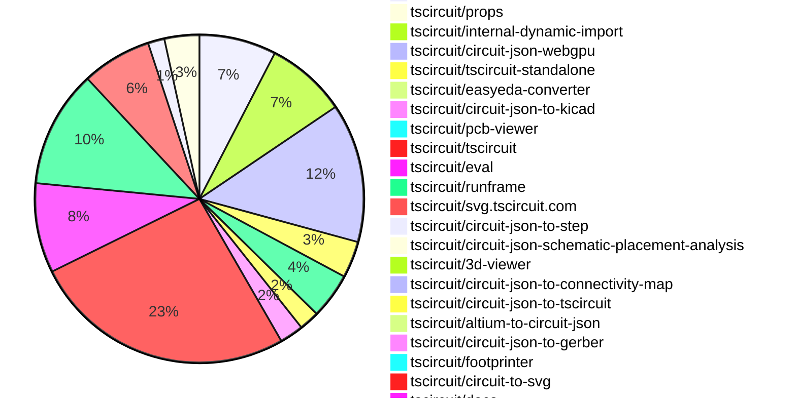

# contribution tracker

[contributions.tscircuit.com](https://contributions.tscircuit.com) ・ [tscircuit.com](https://tscircuit.com) ・ [Contribution Overviews](./contribution-overviews/) ・ [Changelogs](./changelogs/)

Generates weekly contribution overviews for tscircuit contributors. Check out all
the [contribution overviews here](./contribution-overviews/)
You can find AI-generated monthly changelogs in the [changelogs directory](./changelogs/)

- All PRs in the tscircuit org are scanned/summarized via an LLM
- The LLM classifies each Diff/PR as into a set of attributes for scoring
- All the PRs, summaries, and classifications are organized into charts and tables for [the website](https://contributions.tscircuit.com)

> Want to run locally? See the [Development Section](#development)

## Current Week

<!-- START_CURRENT_WEEK -->

# Contribution Overview 2026-10-13

The current week is shown below. There are 3 major sections:

- [Contributor Overview](#contributor-overview)
- [PRs by Repository](#prs-by-repository)
- [PRs by Contributor](#changes-by-contributor)
- [Scoring & Sponsorship Details](/docs/sponsorship-calculation-explanation.md)

## PRs by Repository

## Contributor Overview

| Contributor | 🐳 Major | 🐙 Minor | 🐌 Tiny | Score | ⭐ |
|-------------|---------|---------|---------|-------|-----|
| [seveibar](#seveibar) | 26 | 21 | 15 | 159 | 👑👑 |
| [imrishabh18](#imrishabh18) | 11 | 11 | 16 | 79 | ⭐⭐⭐ |
| [ShiboSoftwareDev](#ShiboSoftwareDev) | 4 | 7 | 4 | 49 | ⭐⭐ |
| [MustafaMulla29](#MustafaMulla29) | 5 | 6 | 14 | 45 | ⭐⭐ |
| [techmannih](#techmannih) | 6 | 1 | 4 | 31 | ⭐⭐ |
| [Abse2001](#Abse2001) | 0 | 3 | 4 | 25 | ⭐⭐ |
| [rushabhcodes](#rushabhcodes) | 1 | 6 | 4 | 21 | ⭐⭐ |
| [tscircuitbot](#tscircuitbot) | 0 | 0 | 411 | 18 | ⭐⭐ |
| [Devesh36](#Devesh36) | 1 | 2 | 7 | 16 | ⭐⭐ |
| [0hmX](#0hmX) | 2 | 1 | 2 | 13 | ⭐⭐ |
| [GokulPandi-M](#GokulPandi-M) | 0 | 4 | 3 | 11 | ⭐⭐ |
| [trixie010](#trixie010) | 1 | 2 | 0 | 8 | ⭐ |
| [KrishnaX12](#KrishnaX12) | 0 | 3 | 2 | 8 | ⭐ |
| [mohan-bee](#mohan-bee) | 0 | 3 | 1 | 8 | ⭐ |
| [AnasSarkiz](#AnasSarkiz) | 1 | 1 | 2 | 8 | ⭐ |
| [hrithik18k](#hrithik18k) | 0 | 2 | 1 | 5 | ⭐ |
| [anil08607](#anil08607) | 0 | 1 | 1 | 3 |  |
| [raykholo](#raykholo) | 0 | 0 | 1 | 1 |  |

## Staff Pass Ratio (SPR)

| Contributor | Reviewed PRs | Rejections | Approvals | SPR |
|-------------|--------------|------------|-----------|-----|
| [imrishabh18](#imrishabh18) | 12 | 0 | 12 | 100.0% |
| [MustafaMulla29](#MustafaMulla29) | 8 | 1 | 8 | 87.5% |
| [rushabhcodes](#rushabhcodes) | 5 | 0 | 5 | 100.0% |
| [Abse2001](#Abse2001) | 3 | 0 | 3 | 100.0% |
| [techmannih](#techmannih) | 3 | 2 | 2 | 33.3% |
| [trixie010](#trixie010) | 3 | 0 | 3 | 100.0% |
| [0hmX](#0hmX) | 1 | 0 | 1 | 100.0% |
| [hrithik18k](#hrithik18k) | 1 | 1 | 0 | 0.0% |
| [mohan-bee](#mohan-bee) | 1 | 0 | 1 | 100.0% |
| [raykholo](#raykholo) | 1 | 0 | 1 | 100.0% |
| [ShiboSoftwareDev](#ShiboSoftwareDev) | 1 | 0 | 1 | 100.0% |

imrishabh18 SPR PRs (12)

- [#5390](https://github.com/tscircuit/cli/pull/5390) Route standalone imports through the baked asset server
- [#5395](https://github.com/tscircuit/cli/pull/5395) Search baked datasheets in standalone
- [#5384](https://github.com/tscircuit/cli/pull/5384) Use embedded eval worker configuration for standalone dev
- [#5388](https://github.com/tscircuit/cli/pull/5388) Block network fallbacks for standalone imports
- [#5368](https://github.com/tscircuit/cli/pull/5368) Serve baked assets and expose parts-engine base URLs
- [#5344](https://github.com/tscircuit/cli/pull/5344) Copy prepared JS CDN packages for static site builds
- [#5348](https://github.com/tscircuit/cli/pull/5348) Serve prepared JS CDN packages in tsci dev
- [#5324](https://github.com/tscircuit/cli/pull/5324) Add --jscdn-base-url to static site builds
- [#67](https://github.com/tscircuit/parts-engine/pull/67) Support configurable provider base URLs
- [#38](https://github.com/tscircuit/internal-dynamic-import/pull/38) Support window.TSCIRCUIT_JSCDN_BASE_URL for browser imports
- [#16](https://github.com/tscircuit/tscircuit-standalone/pull/16) Add macOS terminal installation without browser quarantine
- [#11](https://github.com/tscircuit/tscircuit-standalone/pull/11) Launch shared CLI with bundled RunFrame JS CDN packages

MustafaMulla29 SPR PRs (8)

- [#4649](https://github.com/tscircuit/core/pull/4649) Preserve required schematic branches when removing redundant net-label wires
- [#4596](https://github.com/tscircuit/core/pull/4596) Add standalone solder paste apertures
- [#284](https://github.com/tscircuit/circuit-json-schematic-placement-analysis/pull/284) feat: detect resistors separated from crystals
- [#291](https://github.com/tscircuit/circuit-json-schematic-placement-analysis/pull/291) feat: detect misaligned parallel diode capacitor pairs
- [#288](https://github.com/tscircuit/circuit-json-schematic-placement-analysis/pull/288) feat: detect parallel LED branches drawn inline
- [#271](https://github.com/tscircuit/circuit-json-schematic-placement-analysis/pull/271) feat: detect ungrouped switch RC networks
- [#249](https://github.com/tscircuit/circuit-json-schematic-placement-analysis/pull/249) feat: detect separated switch diodes and excessive matrix spacing
- [#277](https://github.com/tscircuit/circuit-json-schematic-placement-analysis/pull/277) feat: detect inline parallel capacitor pairs

rushabhcodes SPR PRs (5)

- [#930](https://github.com/tscircuit/footprinter/pull/930) fix: parse explicit polarity pins in LED footprint strings
- [#4624](https://github.com/tscircuit/core/pull/4624) fix: honor oval plated-hole rotation during autorouting
- [#4571](https://github.com/tscircuit/core/pull/4571) Fix footprint keepouts staying behind after PCB layout
- [#4570](https://github.com/tscircuit/core/pull/4570) fix: respect rotated pad geometry when assigning routed source traces
- [#857](https://github.com/tscircuit/circuit-to-svg/pull/857) fix: default polygon-pad drill offsets to zero

Abse2001 SPR PRs (3)

- [#1088](https://github.com/tscircuit/pcb-viewer/pull/1088) feat: search PCB components and briefly highlight results
- [#943](https://github.com/tscircuit/props/pull/943) Add symbol contain fitting and an explicit local viewbox (#4698)
- [#197](https://github.com/tscircuit/circuit-json-to-gerber/pull/197) Preserve filled fabrication polarity artwork on a real LED board

techmannih SPR PRs (3)

- [#4597](https://github.com/tscircuit/core/pull/4597) Preserve native keepout outlines with verified autorouter coverage
- [#4641](https://github.com/tscircuit/core/pull/4641) Fix polygon cutout coverage gaps in generated routing obstacles
- [#3054](https://github.com/tscircuit/tscircuit-autorouter/pull/3054) Preserve coverage of unconnected rotated keepouts

trixie010 SPR PRs (3)

- [#598](https://github.com/tscircuit/easyeda-converter/pull/598) fix: stop emitting a duplicate pcb_cutout for every HOLE record
- [#153](https://github.com/tscircuit/circuit-json-to-step/pull/153) repro: circular holes are only half cut in STEP exports
- [#149](https://github.com/tscircuit/circuit-json-to-step/pull/149) fix: honour pcb_plated_hole drill offset and route every variant

0hmX SPR PRs (1)

- [#4529](https://github.com/tscircuit/core/pull/4529) fix: report disallowed blind/buried vias in manual paths

hrithik18k SPR PRs (1)

- [#861](https://github.com/tscircuit/circuit-to-svg/pull/861) Fix route-via dimensions and standalone via deduplication

mohan-bee SPR PRs (1)

- [#4378](https://github.com/tscircuit/core/pull/4378) preserve initial rectangular cutout rotation and bounds

raykholo SPR PRs (1)

- [#636](https://github.com/tscircuit/circuit-json-to-kicad/pull/636) Export pcb_via tenting to KiCad vias

ShiboSoftwareDev SPR PRs (1)

- [#58](https://github.com/tscircuit/circuit-json-to-connectivity-map/pull/58) Index connected network membership

> Note: AI evaluates PRs and assigns 1-3 star ratings automatically. 4 and 5 star ratings require manual staff review.

## Review Table

[reviews-received-hover]: ## "Number of reviews received for PRs for this contributor"
[approvals-received-hover]: ## "Number of approvals received for PRs this contributor authored"
[rejections-received-hover]: ## "Number of rejections received for PRs this contributor authored"
[prs-opened-hover]: ## "Number of PRs opened by this contributor"
[issues-created-hover]: ## "Number of issues created by this contributor"

| Contributor | Reviews Received | Approvals Received | Rejections Received | Approvals | Rejections Given | PRs Opened | PRs Merged | Issues Created |
|---|---|---|---|---|---|---|---|---|
| [0hmX](#0hmX) | 3 | 1 | 1 | 2 | 0 | 12 | 5 | 0 |
| [Abse2001](#Abse2001) | 4 | 3 | 0 | 15 | 0 | 20 | 7 | 0 |
| [adamscarmccoy-boop](#adamscarmccoy-boop) | 0 | 0 | 0 | 0 | 0 | 3 | 0 | 0 |
| [AnasSarkiz](#AnasSarkiz) | 3 | 3 | 0 | 0 | 0 | 4 | 4 | 0 |
| [anil08607](#anil08607) | 5 | 3 | 1 | 0 | 0 | 5 | 2 | 0 |
| [atani](#atani) | 24 | 0 | 0 | 0 | 0 | 16 | 0 | 0 |
| [CloudCorpRecords](#CloudCorpRecords) | 0 | 0 | 0 | 0 | 0 | 2 | 0 | 0 |
| [CreedTech](#CreedTech) | 0 | 0 | 0 | 0 | 0 | 1 | 0 | 0 |
| [daniellachev](#daniellachev) | 0 | 0 | 0 | 0 | 0 | 1 | 0 | 0 |
| [deus-intus](#deus-intus) | 0 | 0 | 0 | 0 | 0 | 1 | 0 | 0 |
| [Devesh36](#Devesh36) | 14 | 10 | 1 | 1 | 0 | 19 | 10 | 0 |
| [duongynhi000005-oss](#duongynhi000005-oss) | 0 | 0 | 0 | 0 | 0 | 129 | 0 | 0 |
| [elcuervo171234](#elcuervo171234) | 0 | 0 | 0 | 0 | 0 | 1 | 0 | 0 |
| [exantiv](#exantiv) | 0 | 0 | 0 | 0 | 0 | 1 | 0 | 0 |
| [GokulPandi-M](#GokulPandi-M) | 9 | 8 | 1 | 0 | 0 | 9 | 7 | 0 |
| [hrithik18k](#hrithik18k) | 11 | 3 | 2 | 0 | 0 | 16 | 3 | 0 |
| [imrishabh18](#imrishabh18) | 17 | 15 | 0 | 16 | 10 | 48 | 38 | 0 |
| [jloa-dev](#jloa-dev) | 0 | 0 | 0 | 0 | 0 | 21 | 0 | 0 |
| [KrishnaX12](#KrishnaX12) | 7 | 5 | 0 | 0 | 0 | 5 | 5 | 0 |
| [LuisaW07](#LuisaW07) | 0 | 0 | 0 | 0 | 0 | 1 | 0 | 0 |
| [mohan-bee](#mohan-bee) | 5 | 3 | 1 | 1 | 0 | 29 | 4 | 0 |
| [MustafaMulla29](#MustafaMulla29) | 15 | 11 | 1 | 12 | 0 | 29 | 25 | 0 |
| [oziass](#oziass) | 0 | 0 | 0 | 0 | 0 | 1 | 0 | 0 |
| [Pr1yansu](#Pr1yansu) | 0 | 0 | 0 | 0 | 0 | 4 | 0 | 0 |
| [prajwal-0706](#prajwal-0706) | 0 | 0 | 0 | 0 | 0 | 3 | 0 | 0 |
| [Ratanlavate](#Ratanlavate) | 0 | 0 | 0 | 0 | 0 | 1 | 0 | 0 |
| [raykholo](#raykholo) | 2 | 2 | 0 | 0 | 0 | 12 | 2 | 0 |
| [robertomartinezconsultor](#robertomartinezconsultor) | 0 | 0 | 0 | 0 | 0 | 1 | 0 | 0 |
| [rushabhcodes](#rushabhcodes) | 45 | 17 | 0 | 1 | 0 | 17 | 12 | 0 |
| [Sayandevxyz](#Sayandevxyz) | 0 | 0 | 0 | 0 | 0 | 5 | 0 | 0 |
| [sebas8866](#sebas8866) | 0 | 0 | 0 | 0 | 0 | 1 | 0 | 0 |
| [seveibar](#seveibar) | 13 | 1 | 0 | 43 | 2 | 96 | 62 | 0 |
| [ShiboSoftwareDev](#ShiboSoftwareDev) | 16 | 12 | 0 | 16 | 0 | 119 | 15 | 0 |
| [smartcalsystems-sketch](#smartcalsystems-sketch) | 0 | 0 | 0 | 0 | 0 | 5 | 0 | 0 |
| [tarazum](#tarazum) | 0 | 0 | 0 | 0 | 0 | 1 | 0 | 0 |
| [techmannih](#techmannih) | 19 | 8 | 1 | 3 | 0 | 20 | 11 | 0 |
| [trixie010](#trixie010) | 9 | 5 | 3 | 0 | 0 | 6 | 3 | 0 |
| [tscircuitbot](#tscircuitbot) | 0 | 0 | 0 | 0 | 0 | 527 | 411 | 0 |
| [vreview](#vreview) | 0 | 0 | 0 | 0 | 0 | 1 | 0 | 0 |
| [WilliamxLeismer](#WilliamxLeismer) | 0 | 0 | 0 | 0 | 0 | 1 | 0 | 0 |

## Changes by Repository

### [tscircuit/core](https://github.com/tscircuit/core)

| PR # | Impact | Rating | Contributor | Description |
|------|--------|--------|-------------|-------------|
| [#4667](https://github.com/tscircuit/core/pull/4667) | 🐳 Major | ⭐⭐⭐ | seveibar | Supplier Circuit JSON can contain permanent internal pin groups, but core discards those groups while importing the footprint. Retain the groups as derived component metadata, resolve supplier-local source-port IDs to component pin names, and use them for emitted source connectivity and missing-trace checks. Explicit internallyConnectedPins, including , takes precedence without mutating user props or imported Circuit JSON. Groundpower connection queries now follow permanent internal contacts on both ends of a trace; overlapping groups are traversed transitively. Ground attributes and aliases take precedence over fallback power-name detection, so a ground ball address such as V3 does not disable automatic decoupling trace limits when reached through an internal group. Push buttons opt into parts-engine datasheet enrichment so a four-terminal switch can share AB and CD without connecting its momentary switch terminals. Runtime datasheet enrichment requires the parts-engine change in https:github.comtscircuitparts-enginepull68 to be published and used by the calling parts engine. This PR consumes the existing Circuit JSON internal-connection field and needs no schema change. Source design-rule checks also compare the explicit internallyConnectedPins prop against datasheet groups and warn when a reported connection is missing from the declaration. For example: The datasheet reports pins A and B are internally connected, but the internallyConnectedPins prop isnt set on SW1. Imported defaults do not suppress this warning. Empty or incomplete declarations warn too; pin aliases, numbers, and transitive groups count as equivalent declarations. Warnings update or disappear when the declaration changes, and respect the DRC disable controls. Custom-footprint chips, pushbuttons, and op amps can fetch comparison metadata even without pinAttributes; supplier-footprint imports reuse their existing metadata request. Fetching comparison facts does not replace custom geometry or mutate props. Validation: 25 focused tests pass, including suppliercustom footprint warnings, missing and empty declarations, equivalent aliasestransitive groups, disabled checks, warning updates, imported connectivity, and existing datasheet pin-attribute checks. Labeled PCB snapshots are included and visually reviewed. Package build, typecheck, and formatting pass. Related PRs: website https:github.comtscircuittscircuit.compull5454; core https:github.comtscircuitcorepull4667; CLI https:github.comtscircuitclipull5397; parts engine https:github.comtscircuitparts-enginepull68. Homepage smoke test: rebuilt the exact homepage releases of seveibarnrf-smart-watch0.1.1, imrishabh18rp2040-motor-controller1.0.41, absewifi-smart-switch1.0.29, and absegameboy1.0.15 against the PR and its base, using the same cached live network responses and the parts-engine internal-pin support. All 274 components rendered with identical diagnostics after the routing-disable fix. This check keeps autorouting disabled. Async datasheet validation now respects routing-disable controls on update, preventing routing diagnostics during a disabled-routing render. A regression test covers both platform and board controls. seveibarf1c100s-linux-dev-board1.9.2 fails on both versions before rendering: its routingBoundaryRef callback calls the absent internal method doInitialPcbImplicitCopperPourRender. This existing compatibility issue prevents a complete smoke test of that board. |
| [#4604](https://github.com/tscircuit/core/pull/4604) | 🐳 Major | ⭐⭐⭐ | seveibar | Allows chips and connectors to use physical BGA ball names directly in pinLabels, connections, footprint hints, schematic arrangements, and pin styles, resolving previous issues with alias resolution. |
| [#4603](https://github.com/tscircuit/core/pull/4603) | 🐳 Major | ⭐⭐⭐ | seveibar | Fixes autorouting failure by resolving bare trace names and explicit trace selectors, ensuring proper diagnostics for unmatched or ambiguous selectors. |
| [#4624](https://github.com/tscircuit/core/pull/4624) | 🐳 Major | ⭐⭐⭐ | rushabhcodes | Fixes autorouting issues by ensuring that oval plated-hole dimensions are correctly rotated and used as routing obstacles during PCB design. |
| [#4597](https://github.com/tscircuit/core/pull/4597) | 🐳 Major | ⭐⭐⭐ | techmannih | Reduces the number of SRJ obstacles from 1430 to 475 for open keepout arcs while ensuring full coverage during autorouting. |
| [#4602](https://github.com/tscircuit/core/pull/4602) | 🐳 Major | ⭐⭐⭐ | techmannih | Records the behavior of Sample024s five open keepout arcs expanding into 1,430 SRJ obstacles while leaving sampled points uncovered, with visual reproductions and tests. |
| [#4669](https://github.com/tscircuit/core/pull/4669) | 🐳 Major | ⭐⭐⭐ | techmannih | Preserves native keepout outlines and improves autorouter coverage by implementing an approved patch from a previous pull request, ensuring no uncovered stroke points and reducing obstacles significantly. |
| [#4596](https://github.com/tscircuit/core/pull/4596) | 🐳 Major | ⭐⭐⭐ | MustafaMulla29 | Problem and change solderpaste is defined by tscircuitprops, but Core rejects it as an unregistered element. This adds the native primitive so one continuous copper pad can carry several independent stencil apertures. The renderer uses the existing props and pcb_solder_paste schemas, supports rectangles and circles on either outer layer, and preserves parent rotations, footprint flips, layout movement, and removal. Cached subcircuits retain independent apertures and their orientation, including suppressed full-pad openings. User props remain immutable. Uses the published tscircuitcircuit-json-util0.0.122, which includes https:github.comtscircuitcircuit-json-utilpull238. Cached PCB primitives use the shared transform utility. Circuit JSON import retains an apertures existing rotation as derived state because authored solder-paste props only expose axis-aligned shapes. Cached circular through-hole paste is restored as independent paste geometry, so inflated round holes must not generate it again. This uses Cores existing _isInflatedFromCircuitJson state. Two focused regressions verify that a mixed footprint keeps three automatic paste records and that an explicitly overlapping aperture is preserved, with caching on and off. Each new regression has its own file and labeled snapshot. Pill and oval generation are unchanged. Includes ten solder-paste tests, including a six-window pattern over a single exposed copper pad. Updated to mains isSmt support; keeps tscircuitprops0.0.701 and the released paste transformation fix. Fixes 3577.  Validation All 10 solder-paste tests pass. The two new cache regressions failed before the fix (5 instead of 3 records, and 6 instead of 4). Focused suite: 34 pass, 1 existing pill-paste snapshot mismatch. The 0.12 mismatch reproduces on unchanged main f518678 with the same dependencies and produces an identical diff image; its snapshot is unchanged. Existing isSmt tests, manual-via regression, and standalone primitive caching pass. The manual-via test now matches main exactly. Polygon plated-hole test and both new snapshot comparisons pass after removing ternaries from the newly touched primitive. bunx tsc --noEmit, bun run build, and bun run smoke-test:dist pass. bun run format, git diff --check, and INPUT_PACKAGE_TYPEinternal_lib bunx tscircuitdependency-check pass. Zero ternaries in the 17 changed TSTSX files. The neighboring polygon-paste caching snapshot previously showed a 0.04 mismatch on both this PR and unchanged code with the same dependencies. That baseline is unchanged. The full test suite was not rerun for this update.  Scope This implements Core rendering and Circuit JSON importcache support. It does not change downstream Gerber or KiCad exporters; they must consume independent pcb_solder_paste records to preserve these apertures. |
| [#4723](https://github.com/tscircuit/core/pull/4723) | 🐙 Minor | ⭐⭐ | seveibar | Updates the bundled tscircuitfanout-solver from version 0.0.78 to 0.0.81, enhancing layer-aware dogbone clearance checks for PCB routing. |
| [#4636](https://github.com/tscircuit/core/pull/4636) | 🐙 Minor | ⭐⭐ | seveibar | Exposed testprobe pads can now use smtpad noSolderPaste  to omit pcb_solder_paste while keeping copper exposed, affecting all six pad shapes and ensuring proper paste creation checks. |
| [#4632](https://github.com/tscircuit/core/pull/4632) | 🐙 Minor | ⭐⭐ | ShiboSoftwareDev | Fixes incorrect source trace attribution for routed endpoints overlapping adjacent pads in PCB designs. |
| [#4627](https://github.com/tscircuit/core/pull/4627) | 🐙 Minor | ⭐⭐ | ShiboSoftwareDev | Prefers exact PCB-port matches for routed endpoints to avoid incorrect source trace attribution when endpoints fall inside adjacent pads. |
| [#4621](https://github.com/tscircuit/core/pull/4621) | 🐙 Minor | ⭐⭐ | ShiboSoftwareDev | Fixes the issue where a requested teardrop is missing when routed copper is attributed to another source trace on the same physical net. |
| [#4619](https://github.com/tscircuit/core/pull/4619) | 🐙 Minor | ⭐⭐ | ShiboSoftwareDev | Fixes the issue where teardrops for equivalent source traces were not rendered correctly, leading to missing teardrops on routed copper. |
| [#4571](https://github.com/tscircuit/core/pull/4571) | 🐙 Minor | ⭐⭐ | rushabhcodes | Fixes the issue where footprint keepouts do not move with their associated PCB components during layout, allowing copper to intrude into designated clearance areas. |
| [#4570](https://github.com/tscircuit/core/pull/4570) | 🐙 Minor | ⭐⭐ | rushabhcodes | Fixes incorrect source trace assignments for routed traces on rotated SMT pads, resolving trace-continuity validation failures. |
| [#4623](https://github.com/tscircuit/core/pull/4623) | 🐙 Minor | ⭐⭐ | Devesh36 | Fixes the issue where mounting slots do not rotate with the connector footprint in PCB designs, ensuring visual consistency in the layout. |
| [#4694](https://github.com/tscircuit/core/pull/4694) | 🐙 Minor | ⭐⭐ | KrishnaX12 | Fixes false supplier-footprint mismatch warnings that occur after rotating components by adjusting the calculation of copper bounds without altering the emitted geometry. |
| [#4378](https://github.com/tscircuit/core/pull/4378) | 🐙 Minor | ⭐⭐ | mohan-bee | Fixes the issue where a rectangular cutout does not rotate correctly with its footprint, ensuring alignment during board design. |
| [#4377](https://github.com/tscircuit/core/pull/4377) | 🐙 Minor | ⭐⭐ | mohan-bee | Reproduces a bug where a rectangular cutout does not rotate with its footprint in a PCB design, ensuring the cutout aligns with the rotated pads. |
| [#4652](https://github.com/tscircuit/core/pull/4652) | 🐙 Minor | ⭐⭐ | mohan-bee | Demonstrates that an exposed pad with noSolderPaste still receives solder paste, by adding a test and PCB snapshot showing paste on both pads, including the one marked no paste. |
| [#4656](https://github.com/tscircuit/core/pull/4656) | 🐙 Minor | ⭐⭐ | imrishabh18 | Fixes alignment of generated rounded board outlines with the resolved board center during rendering, preventing false outside-board errors. |
| [#4649](https://github.com/tscircuit/core/pull/4649) | 🐙 Minor | ⭐⭐ | MustafaMulla29 | Preserves required schematic branches and routes when removing redundant net-label wires, ensuring connectivity to fixed net labels without altering source-net connectivity. |
| [#4648](https://github.com/tscircuit/core/pull/4648) | 🐙 Minor | ⭐⭐ | MustafaMulla29 | Reproduces the dangling EP trace below U_PDs explicit GND symbol in the PD sheet, preserving schematic symbols and connections without altering production behavior. |
| [#4645](https://github.com/tscircuit/core/pull/4645) | 🐙 Minor | ⭐⭐ | MustafaMulla29 | Fixes the issue of extra built-in terminals being created when a custom symbol declares its own ports, preventing false unconnected-pin warnings. |
| [#4593](https://github.com/tscircuit/core/pull/4593) | 🐙 Minor | ⭐⭐ | hrithik18k | Modifies solder paste generation logic to respect the isSmt property, preventing unwanted paste for through-hole components while retaining paste for mixed footprints. |
| [#4529](https://github.com/tscircuit/core/pull/4529) | 🐙 Minor | ⭐⭐ | 0hmX | Reports disallowed blind or buried vias in manual paths when the board disables them, preserving saved copper and aggregating all disallowed vias. |

🐌 Tiny Contributions (15)

| PR # | Impact | Contributor | Description |
|------|--------|-------------|-------------|
| [#4732](https://github.com/tscircuit/core/pull/4732) | 🐌 Tiny | seveibar | Updates the tscircuitcapacity-autorouter dependency from version 0.0.985 to 0.0.986 to utilize the Pipeline9 joint DRC repair speedup, while retaining existing functionality and ensuring all tests pass. |
| [#4609](https://github.com/tscircuit/core/pull/4609) | 🐌 Tiny | seveibar | Updates tscircuitcapacity-autorouter from 0.0.974 to 0.0.982. |
| [#4665](https://github.com/tscircuit/core/pull/4665) | 🐌 Tiny | tscircuitbot | Updates the tscircuitchecks package from version 0.0.253 to 0.0.255 in package.json |
| [#4705](https://github.com/tscircuit/core/pull/4705) | 🐌 Tiny | Abse2001 | Fixes symbol rendering by preserving custom proportions and local viewbox sizing for schematic symbols, ensuring correct scaling behavior for various fit modes. |
| [#4706](https://github.com/tscircuit/core/pull/4706) | 🐌 Tiny | Abse2001 | Fixes symbol rendering to preserve proportions using fit modes and local viewbox settings, ensuring consistent scaling for schematic symbols. |
| [#4618](https://github.com/tscircuit/core/pull/4618) | 🐌 Tiny | rushabhcodes | Reproduces a bug where CC traces of a rotated USB-C connector touch grounded shield slots, providing a comprehensive test to validate the issue. |
| [#4617](https://github.com/tscircuit/core/pull/4617) | 🐌 Tiny | rushabhcodes | Update the circuit-json development dependency and override from 0.0.525 to 0.0.528, ensuring the installed schema and public types recognize the ownership field for components. |
| [#4682](https://github.com/tscircuit/core/pull/4682) | 🐌 Tiny | Devesh36 | Updates tscircuitfootprinter from 0.0.431 to 0.0.440, ensuring core uses the latest footprint definitions and fixes. |
| [#4671](https://github.com/tscircuit/core/pull/4671) | 🐌 Tiny | Devesh36 | Fixes overlapping copper pads in the imported ESD5Z5.0T1G TVS footprint when using a 0.8 mm flex gap. |
| [#4622](https://github.com/tscircuit/core/pull/4622) | 🐌 Tiny | Devesh36 | Reproduces a bug where LED silkscreen rectangles do not rotate with their corresponding pads when set at 45 degrees. |
| [#4693](https://github.com/tscircuit/core/pull/4693) | 🐌 Tiny | KrishnaX12 | Fixes false footprint mismatch warnings for rotated components in the supplier footprint matching system. |
| [#4653](https://github.com/tscircuit/core/pull/4653) | 🐌 Tiny | mohan-bee | Honors the noSolderPaste directive on exposed SMT pads in the design files. |
| [#4666](https://github.com/tscircuit/core/pull/4666) | 🐌 Tiny | imrishabh18 | Updates the tscircuitchecks dependency to version 0.0.256 and aligns existing fixtures with courtyard-aware boundary checks, including adjustments to board dimensions and validation of routing fixtures. |
| [#4644](https://github.com/tscircuit/core/pull/4644) | 🐌 Tiny | MustafaMulla29 | Fixes the issue where the custom DPDT symbol incorrectly inherits an extra phantom pin4, leading to missing trace warnings. |
| [#4557](https://github.com/tscircuit/core/pull/4557) | 🐌 Tiny | GokulPandi-M | Fixes rendering issue where a female pinheader with an explicit footprint incorrectly renders male pins instead of female sockets in 3D. |

### [tscircuit/checks](https://github.com/tscircuit/checks)

| PR # | Impact | Rating | Contributor | Description |
|------|--------|--------|-------------|-------------|
| [#427](https://github.com/tscircuit/checks/pull/427) | 🐳 Major | ⭐⭐⭐ | seveibar | Reduces unnecessary computation in continuity validation by deferring the construction of the physical trace graph until needed, optimizing the process of checking connectivity between traces. |
| [#433](https://github.com/tscircuit/checks/pull/433) | 🐳 Major | ⭐⭐⭐ | imrishabh18 | Fixes incorrect reporting of component overhangs by using actual footprint geometry for boundary checks instead of bounding rectangles. |

### [tscircuit/tscircuit.com](https://github.com/tscircuit/tscircuit.com)

| PR # | Impact | Rating | Contributor | Description |
|------|--------|--------|-------------|-------------|
| [#5454](https://github.com/tscircuit/tscircuit.com/pull/5454) | 🐳 Major | ⭐⭐⭐ | seveibar | Displays each pins permanently connected contacts in the datasheet, makes them searchable, and includes internallyConnectedPins in the generated TSX component. |

🐌 Tiny Contributions (43)

| PR # | Impact | Contributor | Description |
|------|--------|-------------|-------------|
| [#5437](https://github.com/tscircuit/tscircuit.com/pull/5437) | 🐌 Tiny | seveibar | Removes the blue introduction label, the entire Downloads and versions section, and the closing local-project sentence, while adjusting typography for consistency. |
| [#5480](https://github.com/tscircuit/tscircuit.com/pull/5480) | 🐌 Tiny | tscircuitbot | Updates the tscircuitrunframe package from version 0.0.3010 to 0.0.3011 |
| [#5479](https://github.com/tscircuit/tscircuit.com/pull/5479) | 🐌 Tiny | tscircuitbot | Automated package update |
| [#5477](https://github.com/tscircuit/tscircuit.com/pull/5477) | 🐌 Tiny | tscircuitbot | Automated package update |
| [#5476](https://github.com/tscircuit/tscircuit.com/pull/5476) | 🐌 Tiny | tscircuitbot | Updates the tscircuitrunframe package version from 0.0.3006 to 0.0.3008 in package.json |
| [#5475](https://github.com/tscircuit/tscircuit.com/pull/5475) | 🐌 Tiny | tscircuitbot | Updates the tscircuiteval package from version 0.0.1629 to 0.0.1630 |
| [#5474](https://github.com/tscircuit/tscircuit.com/pull/5474) | 🐌 Tiny | tscircuitbot | Updates the tscircuitrunframe package from version 0.0.3005 to 0.0.3006 |
| [#5473](https://github.com/tscircuit/tscircuit.com/pull/5473) | 🐌 Tiny | tscircuitbot | Updates the tscircuiteval package from version 0.0.1628 to 0.0.1629 in the package.json file. |
| [#5472](https://github.com/tscircuit/tscircuit.com/pull/5472) | 🐌 Tiny | tscircuitbot | Updates the tscircuitrunframe package from version 0.0.3003 to 0.0.3005 |
| [#5471](https://github.com/tscircuit/tscircuit.com/pull/5471) | 🐌 Tiny | tscircuitbot | Updates the tscircuiteval package from version 0.0.1627 to 0.0.1628 |
| [#5469](https://github.com/tscircuit/tscircuit.com/pull/5469) | 🐌 Tiny | tscircuitbot | Updates the tscircuiteval package from version 0.0.1625 to 0.0.1627 in the package.json file. |
| [#5467](https://github.com/tscircuit/tscircuit.com/pull/5467) | 🐌 Tiny | tscircuitbot | Updates the tscircuitrunframe package from version 0.0.3002 to 0.0.3003 |
| [#5463](https://github.com/tscircuit/tscircuit.com/pull/5463) | 🐌 Tiny | tscircuitbot | Updates the tscircuitrunframe package from version 0.0.3001 to 0.0.3002 |
| [#5462](https://github.com/tscircuit/tscircuit.com/pull/5462) | 🐌 Tiny | tscircuitbot | Updates the tscircuitrunframe package from version 0.0.3000 to 0.0.3001 |
| [#5461](https://github.com/tscircuit/tscircuit.com/pull/5461) | 🐌 Tiny | tscircuitbot | Automated package update |
| [#5460](https://github.com/tscircuit/tscircuit.com/pull/5460) | 🐌 Tiny | tscircuitbot | Automated package update |
| [#5459](https://github.com/tscircuit/tscircuit.com/pull/5459) | 🐌 Tiny | tscircuitbot | Automated package update |
| [#5458](https://github.com/tscircuit/tscircuit.com/pull/5458) | 🐌 Tiny | tscircuitbot | Updates the tscircuitrunframe package version from 0.0.2998 to 0.0.2999 in package.json |
| [#5457](https://github.com/tscircuit/tscircuit.com/pull/5457) | 🐌 Tiny | tscircuitbot | Updates the tscircuiteval package from version 0.0.1622 to 0.0.1623 in the package.json file. |
| [#5456](https://github.com/tscircuit/tscircuit.com/pull/5456) | 🐌 Tiny | tscircuitbot | Updates the tscircuitrunframe package from version 0.0.2997 to 0.0.2998 |
| [#5453](https://github.com/tscircuit/tscircuit.com/pull/5453) | 🐌 Tiny | tscircuitbot | Automated package update |
| [#5452](https://github.com/tscircuit/tscircuit.com/pull/5452) | 🐌 Tiny | tscircuitbot | Updates the tscircuiteval package from version 0.0.1619 to 0.0.1622 in the package.json file. |
| [#5451](https://github.com/tscircuit/tscircuit.com/pull/5451) | 🐌 Tiny | tscircuitbot | Updates the tscircuitrunframe package to version 0.0.2996 |
| [#5449](https://github.com/tscircuit/tscircuit.com/pull/5449) | 🐌 Tiny | tscircuitbot | Automated package update |
| [#5446](https://github.com/tscircuit/tscircuit.com/pull/5446) | 🐌 Tiny | tscircuitbot | Updates the tscircuitrunframe package from version 0.0.2992 to 0.0.2993 |
| [#5445](https://github.com/tscircuit/tscircuit.com/pull/5445) | 🐌 Tiny | tscircuitbot | Updates the tscircuiteval package from version 0.0.1616 to 0.0.1618. |
| [#5427](https://github.com/tscircuit/tscircuit.com/pull/5427) | 🐌 Tiny | tscircuitbot | Updates the tscircuiteval package from version 0.0.1611 to 0.0.1612 in the package.json file. |
| [#5444](https://github.com/tscircuit/tscircuit.com/pull/5444) | 🐌 Tiny | tscircuitbot | Automated package update |
| [#5441](https://github.com/tscircuit/tscircuit.com/pull/5441) | 🐌 Tiny | tscircuitbot | Updates the tscircuiteval package from version 0.0.1613 to 0.0.1616 |
| [#5429](https://github.com/tscircuit/tscircuit.com/pull/5429) | 🐌 Tiny | tscircuitbot | Automated package update |
| [#5447](https://github.com/tscircuit/tscircuit.com/pull/5447) | 🐌 Tiny | tscircuitbot | Updates the tscircuiteval package from version 0.0.1618 to 0.0.1619 |
| [#5426](https://github.com/tscircuit/tscircuit.com/pull/5426) | 🐌 Tiny | tscircuitbot | Automated package update |
| [#5436](https://github.com/tscircuit/tscircuit.com/pull/5436) | 🐌 Tiny | tscircuitbot | Automated package update |
| [#5434](https://github.com/tscircuit/tscircuit.com/pull/5434) | 🐌 Tiny | tscircuitbot | Automated package update |
| [#5425](https://github.com/tscircuit/tscircuit.com/pull/5425) | 🐌 Tiny | tscircuitbot | Updates the tscircuiteval package from version 0.0.1609 to 0.0.1611 |
| [#5424](https://github.com/tscircuit/tscircuit.com/pull/5424) | 🐌 Tiny | tscircuitbot | Automated package update |
| [#5422](https://github.com/tscircuit/tscircuit.com/pull/5422) | 🐌 Tiny | tscircuitbot | Automated package update |
| [#5421](https://github.com/tscircuit/tscircuit.com/pull/5421) | 🐌 Tiny | tscircuitbot | Updates the tscircuiteval package from version 0.0.1607 to 0.0.1609 in the package.json file. |
| [#5420](https://github.com/tscircuit/tscircuit.com/pull/5420) | 🐌 Tiny | tscircuitbot | Updates the tscircuitrunframe package to version 0.0.2981 |
| [#5419](https://github.com/tscircuit/tscircuit.com/pull/5419) | 🐌 Tiny | tscircuitbot | Automated package update |
| [#5433](https://github.com/tscircuit/tscircuit.com/pull/5433) | 🐌 Tiny | tscircuitbot | Updates the tscircuitrunframe package to version 0.0.2987 in package.json |
| [#5468](https://github.com/tscircuit/tscircuit.com/pull/5468) | 🐌 Tiny | Devesh36 | Removes the unused CodeEditorHeader component and replaces its FileName alias with string in remaining helper imports. |
| [#5465](https://github.com/tscircuit/tscircuit.com/pull/5465) | 🐌 Tiny | Devesh36 | Remove tscircuitprompt-benchmarks and the obsolete srccomponentspackage-portCodeEditor.tsx, as requested in review. The website already uses WorkspaceCodeEditor from tscircuitmonaco-code-editor, and nothing imports the old editor. Deleting the old editor removes the last import of prompt-benchmarks, resolving the typecheck error from removing the dependency. Regenerate bun.lock to prune dependencies that are no longer needed. |

### [tscircuit/cli](https://github.com/tscircuit/cli)

| PR # | Impact | Rating | Contributor | Description |
|------|--------|--------|-------------|-------------|
| [#5397](https://github.com/tscircuit/cli/pull/5397) | 🐳 Major | ⭐⭐⭐ | seveibar | Fetches and validates datasheet pin attributes and permanent internal pin groups, passing them as typed options to easyedas convertRawEasyToTsx. |
| [#5384](https://github.com/tscircuit/cli/pull/5384) | 🐳 Major | ⭐⭐⭐ | imrishabh18 | When TSCIRCUIT_STANDALONE1, serve the bundled RunFrame and preset the CLIs pinned eval version through the existing TSCIRCUIT_LATEST_EVAL_VERSION global. Disable online version selection, telemetry, and hosted page resources. Normal CLI behavior is unchanged. |
| [#5368](https://github.com/tscircuit/cli/pull/5368) | 🐳 Major | ⭐⭐⭐ | imrishabh18 | Starts a loopback asset server for every command when TSCIRCUIT_BAKED_ASSET_SERVER_DIR is set, sets provider base URLs, and honors them in CLI searchimport lookups. |
| [#5324](https://github.com/tscircuit/cli/pull/5324) | 🐳 Major | ⭐⭐⭐ | imrishabh18 | Add --jscdn-base-url url to tsci build, allowing users to set the JS CDN base URL for dynamic imports in the generated static site. |
| [#5371](https://github.com/tscircuit/cli/pull/5371) | 🐙 Minor | ⭐⭐ | rushabhcodes | Fixes the issue where the diode identity and polarity were lost during the import of footprint strings, ensuring accurate representation in the PCB design. |
| [#5390](https://github.com/tscircuit/cli/pull/5390) | 🐙 Minor | ⭐⭐ | imrishabh18 | Replaces the standalone import bailout with platformFetch routing to the local baked asset server, allowing EasyEDA requests, model downloads, and registry requests to stay local while handling missing baked responses appropriately. |
| [#5380](https://github.com/tscircuit/cli/pull/5380) | 🐙 Minor | ⭐⭐ | imrishabh18 | Adds functionality to import generated datasheet TSX files in standalone mode, saving them to the imports directory before searching JLCSearch. |
| [#5388](https://github.com/tscircuit/cli/pull/5388) | 🐙 Minor | ⭐⭐ | imrishabh18 | Standalone imports that cannot use the baked TSX now exit with code 1 and display a message indicating unavailability in tscircuit standalone, preventing fallback to online sources. |
| [#5350](https://github.com/tscircuit/cli/pull/5350) | 🐙 Minor | ⭐⭐ | imrishabh18 | Copies prepared JS CDN packages to distjscdn when TSCIRCUIT_STANDALONE is set, allowing for automatic site builds with a default base URL. |
| [#5344](https://github.com/tscircuit/cli/pull/5344) | 🐙 Minor | ⭐⭐ | imrishabh18 | Copies prepared JS CDN packages from TSCIRCUIT_JSCDN_DIR into distjscdn for static site builds, preserving paths and contents without downloading or rebuilding packages. |
| [#5348](https://github.com/tscircuit/cli/pull/5348) | 🐙 Minor | ⭐⭐ | imrishabh18 | Serve prepared packages from TSCIRCUIT_JSCDN_DIR at jscdn and set window.TSCIRCUIT_JSCDN_BASE_URL  jscdn before runframe loads, with support for local testing via --jscdn-dir path. |
| [#5410](https://github.com/tscircuit/cli/pull/5410) | 🐙 Minor | ⭐⭐ | GokulPandi-M | Fixes KiCad export to preserve the root schematic when a child sheet has the same name as the project, preventing loss of hierarchy in exported projects. |
| [#5236](https://github.com/tscircuit/cli/pull/5236) | 🐙 Minor | ⭐⭐ | GokulPandi-M | Fixes KiCad export to include hierarchical child schematics, preventing blank pages when opening child sheets. |
| [#5218](https://github.com/tscircuit/cli/pull/5218) | 🐙 Minor | ⭐⭐ | GokulPandi-M | Fixes the issue where KiCad exports do not include hierarchical child schematic files, resulting in blank pages when attempting to open them. |

🐌 Tiny Contributions (62)

| PR # | Impact | Contributor | Description |
|------|--------|-------------|-------------|
| [#5440](https://github.com/tscircuit/cli/pull/5440) | 🐌 Tiny | tscircuitbot | Automated package update |
| [#5439](https://github.com/tscircuit/cli/pull/5439) | 🐌 Tiny | tscircuitbot | Updates the tscircuitrunframe package from version 0.0.3010 to 0.0.3011 |
| [#5438](https://github.com/tscircuit/cli/pull/5438) | 🐌 Tiny | tscircuitbot | Automated package update |
| [#5437](https://github.com/tscircuit/cli/pull/5437) | 🐌 Tiny | tscircuitbot | Updates the tscircuitrunframe package from version 0.0.3009 to 0.0.3010 |
| [#5436](https://github.com/tscircuit/cli/pull/5436) | 🐌 Tiny | tscircuitbot | Automated package update |
| [#5435](https://github.com/tscircuit/cli/pull/5435) | 🐌 Tiny | tscircuitbot | Updates the tscircuitrunframe package from version 0.0.3008 to 0.0.3009 |
| [#5434](https://github.com/tscircuit/cli/pull/5434) | 🐌 Tiny | tscircuitbot | Automated package update |
| [#5432](https://github.com/tscircuit/cli/pull/5432) | 🐌 Tiny | tscircuitbot | Automated package update |
| [#5431](https://github.com/tscircuit/cli/pull/5431) | 🐌 Tiny | tscircuitbot | Updates the tscircuitrunframe package from version 0.0.3007 to 0.0.3008 |
| [#5429](https://github.com/tscircuit/cli/pull/5429) | 🐌 Tiny | tscircuitbot | Automated package update |
| [#5428](https://github.com/tscircuit/cli/pull/5428) | 🐌 Tiny | tscircuitbot | Updates the tscircuitrunframe package from version 0.0.3006 to 0.0.3007 |
| [#5427](https://github.com/tscircuit/cli/pull/5427) | 🐌 Tiny | tscircuitbot | Automated package update |
| [#5426](https://github.com/tscircuit/cli/pull/5426) | 🐌 Tiny | tscircuitbot | Updates the tscircuitrunframe package from version 0.0.3005 to 0.0.3006 |
| [#5423](https://github.com/tscircuit/cli/pull/5423) | 🐌 Tiny | tscircuitbot | Automated package update |
| [#5422](https://github.com/tscircuit/cli/pull/5422) | 🐌 Tiny | tscircuitbot | Updates the tscircuitrunframe package from version 0.0.3004 to 0.0.3005 |
| [#5421](https://github.com/tscircuit/cli/pull/5421) | 🐌 Tiny | tscircuitbot | Automated package update |
| [#5420](https://github.com/tscircuit/cli/pull/5420) | 🐌 Tiny | tscircuitbot | Updates the tscircuitrunframe package from version 0.0.3003 to 0.0.3004 |
| [#5399](https://github.com/tscircuit/cli/pull/5399) | 🐌 Tiny | tscircuitbot | Updates the tscircuitrunframe package version from 0.0.2997 to 0.0.2999 in package.json |
| [#5412](https://github.com/tscircuit/cli/pull/5412) | 🐌 Tiny | tscircuitbot | Updates the tscircuitrunframe package from version 0.0.3002 to 0.0.3003 |
| [#5404](https://github.com/tscircuit/cli/pull/5404) | 🐌 Tiny | tscircuitbot | Updates the version of the tscircuitrunframe package from 0.0.3000 to 0.0.3001 in package.json |
| [#5419](https://github.com/tscircuit/cli/pull/5419) | 🐌 Tiny | tscircuitbot | Automated package update |
| [#5413](https://github.com/tscircuit/cli/pull/5413) | 🐌 Tiny | tscircuitbot | Automated package update |
| [#5411](https://github.com/tscircuit/cli/pull/5411) | 🐌 Tiny | tscircuitbot | Automated package update |
| [#5407](https://github.com/tscircuit/cli/pull/5407) | 🐌 Tiny | tscircuitbot | Automated package update |
| [#5405](https://github.com/tscircuit/cli/pull/5405) | 🐌 Tiny | tscircuitbot | Automated package update |
| [#5403](https://github.com/tscircuit/cli/pull/5403) | 🐌 Tiny | tscircuitbot | Automated package update |
| [#5402](https://github.com/tscircuit/cli/pull/5402) | 🐌 Tiny | tscircuitbot | Updates the tscircuitrunframe package version from 0.0.2999 to 0.0.3000 in package.json |
| [#5396](https://github.com/tscircuit/cli/pull/5396) | 🐌 Tiny | tscircuitbot | Automated package update |
| [#5418](https://github.com/tscircuit/cli/pull/5418) | 🐌 Tiny | tscircuitbot | Automated package update |
| [#5409](https://github.com/tscircuit/cli/pull/5409) | 🐌 Tiny | tscircuitbot | Updates the tscircuitrunframe package version from 0.0.3001 to 0.0.3002 in package.json |
| [#5400](https://github.com/tscircuit/cli/pull/5400) | 🐌 Tiny | tscircuitbot | Automated package update |
| [#5389](https://github.com/tscircuit/cli/pull/5389) | 🐌 Tiny | tscircuitbot | Automated package update |
| [#5383](https://github.com/tscircuit/cli/pull/5383) | 🐌 Tiny | tscircuitbot | Automated package update |
| [#5379](https://github.com/tscircuit/cli/pull/5379) | 🐌 Tiny | tscircuitbot | Automated package update |
| [#5391](https://github.com/tscircuit/cli/pull/5391) | 🐌 Tiny | tscircuitbot | Updates the tscircuitrunframe package version from 0.0.2995 to 0.0.2997 in package.json |
| [#5387](https://github.com/tscircuit/cli/pull/5387) | 🐌 Tiny | tscircuitbot | Automated package update |
| [#5337](https://github.com/tscircuit/cli/pull/5337) | 🐌 Tiny | tscircuitbot | Automated package update |
| [#5334](https://github.com/tscircuit/cli/pull/5334) | 🐌 Tiny | tscircuitbot | Updates the tscircuitrunframe package to version 0.0.2980 in package.json |
| [#5361](https://github.com/tscircuit/cli/pull/5361) | 🐌 Tiny | tscircuitbot | Updates the tscircuitrunframe package from version 0.0.2988 to 0.0.2989 |
| [#5359](https://github.com/tscircuit/cli/pull/5359) | 🐌 Tiny | tscircuitbot | Updates the tscircuitrunframe package from version 0.0.2987 to 0.0.2988 |
| [#5357](https://github.com/tscircuit/cli/pull/5357) | 🐌 Tiny | tscircuitbot | Updates the tscircuitrunframe package to version 0.0.2987 in the package.json file |
| [#5356](https://github.com/tscircuit/cli/pull/5356) | 🐌 Tiny | tscircuitbot | Automated package update |
| [#5355](https://github.com/tscircuit/cli/pull/5355) | 🐌 Tiny | tscircuitbot | Updates the tscircuitrunframe package to version 0.0.2986 |
| [#5354](https://github.com/tscircuit/cli/pull/5354) | 🐌 Tiny | tscircuitbot | Automated package update |
| [#5353](https://github.com/tscircuit/cli/pull/5353) | 🐌 Tiny | tscircuitbot | Updates the tscircuitrunframe package from version 0.0.2984 to 0.0.2985 |
| [#5347](https://github.com/tscircuit/cli/pull/5347) | 🐌 Tiny | tscircuitbot | Automated package update |
| [#5345](https://github.com/tscircuit/cli/pull/5345) | 🐌 Tiny | tscircuitbot | Updates the tscircuitrunframe package version from 0.0.2983 to 0.0.2984 in package.json |
| [#5342](https://github.com/tscircuit/cli/pull/5342) | 🐌 Tiny | tscircuitbot | Updates the tscircuitrunframe package from version 0.0.2982 to 0.0.2983 |
| [#5336](https://github.com/tscircuit/cli/pull/5336) | 🐌 Tiny | tscircuitbot | Updates the tscircuitrunframe package from version 0.0.2980 to 0.0.2981 |
| [#5335](https://github.com/tscircuit/cli/pull/5335) | 🐌 Tiny | tscircuitbot | Automated package update |
| [#5362](https://github.com/tscircuit/cli/pull/5362) | 🐌 Tiny | tscircuitbot | Automated package update |
| [#5358](https://github.com/tscircuit/cli/pull/5358) | 🐌 Tiny | tscircuitbot | Automated package update |
| [#5349](https://github.com/tscircuit/cli/pull/5349) | 🐌 Tiny | tscircuitbot | Automated package update |
| [#5343](https://github.com/tscircuit/cli/pull/5343) | 🐌 Tiny | tscircuitbot | Automated package update |
| [#5340](https://github.com/tscircuit/cli/pull/5340) | 🐌 Tiny | tscircuitbot | Automated package update |
| [#5351](https://github.com/tscircuit/cli/pull/5351) | 🐌 Tiny | tscircuitbot | Automated package update |
| [#5370](https://github.com/tscircuit/cli/pull/5370) | 🐌 Tiny | rushabhcodes | Reproduces a bug where the import of the C82046 component loses diode identity and polarity markings during the import process. |
| [#5433](https://github.com/tscircuit/cli/pull/5433) | 🐌 Tiny | imrishabh18 | Removes the --private flag from the tsci push command, clarifying that it does not affect existing package visibility and replaces it with a regression test for help output. |
| [#5363](https://github.com/tscircuit/cli/pull/5363) | 🐌 Tiny | imrishabh18 | Excludes the running executable from initial file synchronization and filesystem watching during tsci dev, preventing upload timeouts. |
| [#5378](https://github.com/tscircuit/cli/pull/5378) | 🐌 Tiny | imrishabh18 | Update tscircuiteval to 0.0.1619 and tscircuitrunframe to 0.0.2995 to consume the merged parts-engine base URL support in the CLI and browser worker. |
| [#5417](https://github.com/tscircuit/cli/pull/5417) | 🐌 Tiny | MustafaMulla29 | Updates the dependency for circuit-json-schematic-placement-analysis from version 0.0.50 to 0.0.68, ensuring compatibility with existing tarball URL formats and updating related metadata in the bun.lock file. |
| [#5406](https://github.com/tscircuit/cli/pull/5406) | 🐌 Tiny | MustafaMulla29 | Updates circuit-json-to-kicad from 0.0.230 to 0.0.235 and kicadts from 0.0.47 to 0.0.58 to resolve CLI startup failure due to missing exports. |

### [tscircuit/tscircuit-autorouter](https://github.com/tscircuit/tscircuit-autorouter)

| PR # | Impact | Rating | Contributor | Description |
|------|--------|--------|-------------|-------------|
| [#3114](https://github.com/tscircuit/tscircuit-autorouter/pull/3114) | 🐳 Major | ⭐⭐⭐ | seveibar | Run bounded regional repair before the broad exactB01 portfolio on boards without preloaded copper, achieving a 3.96 local speedup while maintaining zero-issue reference DRC results. |
| [#2998](https://github.com/tscircuit/tscircuit-autorouter/pull/2998) | 🐳 Major | ⭐⭐⭐ | seveibar | Adds a post-repair cleanup stage that commits only valid improvements and preserves route endpoints while reducing via counts in autorouting. |
| [#3054](https://github.com/tscircuit/tscircuit-autorouter/pull/3054) | 🐳 Major | ⭐⭐⭐ | techmannih | Fixes autorouting failure when routing around unconnected rotated keepouts by ensuring proper clearance is maintained without increasing approximation rectangle count. |
| [#3098](https://github.com/tscircuit/tscircuit-autorouter/pull/3098) | 🐳 Major | ⭐⭐⭐ | techmannih | Applies the approved rotated keepout fix from 3054 to main, preventing Pipeline9 from routing through uncovered portions of an unconnected rotated keepout. |
| [#3127](https://github.com/tscircuit/tscircuit-autorouter/pull/3127) | 🐳 Major | ⭐⭐⭐ | imrishabh18 | Fixes copper connectivity issues for QFP thermal pads, ensuring proper routing and obstacle handling in autorouting. |
| [#3126](https://github.com/tscircuit/tscircuit-autorouter/pull/3126) | 🐙 Minor | ⭐⭐ | seveibar | Adds the ability to specify the number of routing threads per sample for Pipeline9 in the benchmarking process, allowing for improved concurrency and resource management during routing tasks. |

🐌 Tiny Contributions (14)

| PR # | Impact | Contributor | Description |
|------|--------|-------------|-------------|
| [#3063](https://github.com/tscircuit/tscircuit-autorouter/pull/3063) | 🐌 Tiny | seveibar | Updates the tscircuitchecks dependency to version 0.0.255 to recover via-cleanup performance by incorporating continuity geometry optimization. |
| [#3044](https://github.com/tscircuit/tscircuit-autorouter/pull/3044) | 🐌 Tiny | seveibar | Updates the trace simplification solver dependency to a specific upstream commit, improving the handling of routed-copper vias and related cache test instrumentation. |
| [#3052](https://github.com/tscircuit/tscircuit-autorouter/pull/3052) | 🐌 Tiny | seveibar | Updates the dependency on tscircuitchecks to version 0.0.249 and modifies two tests for upstream readable-name diagnostics, ensuring tracegap assertions and structured trace-pair identity are retained. |
| [#3064](https://github.com/tscircuit/tscircuit-autorouter/pull/3064) | 🐌 Tiny | seveibar | Updates the high-density-repair02 dependency to optimize sequential repair by implementing conservative obstacle pruning, cached clearances, boundary checks, and reused spatial-query hits, while preserving candidate ordering and acceptance checks. |
| [#3129](https://github.com/tscircuit/tscircuit-autorouter/pull/3129) | 🐌 Tiny | tscircuitbot | Automated package update |
| [#3128](https://github.com/tscircuit/tscircuit-autorouter/pull/3128) | 🐌 Tiny | tscircuitbot | Automated package update |
| [#3119](https://github.com/tscircuit/tscircuit-autorouter/pull/3119) | 🐌 Tiny | tscircuitbot | Automated package update |
| [#3100](https://github.com/tscircuit/tscircuit-autorouter/pull/3100) | 🐌 Tiny | tscircuitbot | Automated package update |
| [#3097](https://github.com/tscircuit/tscircuit-autorouter/pull/3097) | 🐌 Tiny | tscircuitbot | Automated package update |
| [#3069](https://github.com/tscircuit/tscircuit-autorouter/pull/3069) | 🐌 Tiny | tscircuitbot | Automated package update |
| [#3062](https://github.com/tscircuit/tscircuit-autorouter/pull/3062) | 🐌 Tiny | tscircuitbot | Automated package update |
| [#3057](https://github.com/tscircuit/tscircuit-autorouter/pull/3057) | 🐌 Tiny | tscircuitbot | Automated package update |
| [#3055](https://github.com/tscircuit/tscircuit-autorouter/pull/3055) | 🐌 Tiny | techmannih | Reproduces a bug where Pipeline9 incorrectly routes traces through a rotated keepout area, adding tests and fixtures to validate the issue without changing production code. |
| [#3088](https://github.com/tscircuit/tscircuit-autorouter/pull/3088) | 🐌 Tiny | imrishabh18 | Add bugreport109-book-reading-clip-lamp for the full placements-only book reading clip lamp 0.4.3(https:tscircuit.commusebook-reading-clip-lampfiles). Placements, connections and board rules are preserved; existing copper is removed. The number follows the packages bug-report script: highest existing number (108) plus one. The directory contains the matching .fixture.tsx and .srj.json files. There is no provenance file. Start the debugger with bun run start, then select bug-reports  bugreport109-book-reading-clip-lamp. One test attempts the entire circuit at effort 1 with caching disabled and saves a single native pipeline snapshot. Current Pipeline 9 stops at the static reachability precheck for source_net_0_mst26 (U5 EP  GND1), before detailed routing. The test asserts that existing failure. No solver changes. !Full-circuit Pipeline 9 routing attempt(https:raw.githubusercontent.comtscircuittscircuit-autorouterf3bf5bc4e944523437d470100800994b2a3ed88dtestsbugs__snapshots__bugreport109-book-reading-clip-lamp.snap.svg) Validation: renamed test passes against the existing snapshot; type check and full format check pass. sh bun test --timeout 9999999 testsbugsbugreport109-book-reading-clip-lamp.test.ts |

### [tscircuit/parts-engine](https://github.com/tscircuit/parts-engine)

| PR # | Impact | Rating | Contributor | Description |
|------|--------|--------|-------------|-------------|
| [#68](https://github.com/tscircuit/parts-engine/pull/68) | 🐳 Major | ⭐⭐⭐ | seveibar | Preserves internal pin connections from datasheets by converting them to source_component.internally_connected_source_port_ids and ensuring complete groups are published during reconciliation. |
| [#67](https://github.com/tscircuit/parts-engine/pull/67) | 🐙 Minor | ⭐⭐ | imrishabh18 | Allows JLC, DigiKey, Mouser, and datasheet requests to use serialized base URL options or their TSCIRCUIT__BASE_URL environment variables, preserving local server path prefixes and isolating cached responses by request URL. |

### [tscircuit/circuit-json-to-gltf](https://github.com/tscircuit/circuit-json-to-gltf)

| PR # | Impact | Rating | Contributor | Description |
|------|--------|--------|-------------|-------------|
| [#256](https://github.com/tscircuit/circuit-json-to-gltf/pull/256) | 🐳 Major | ⭐⭐⭐ | seveibar | Fixes GLB import issues by correctly decoding interleaved vertex data and applying glTF normalization for various component types, ensuring accurate rendering of positions and normals. |

🐌 Tiny Contributions (1)

| PR # | Impact | Contributor | Description |
|------|--------|-------------|-------------|
| [#257](https://github.com/tscircuit/circuit-json-to-gltf/pull/257) | 🐌 Tiny | seveibar | Reproduces issue 255 through generated component GLBs, convertCircuitJsonToGltf, and PoppyGL, capturing broken behavior in GLB accessors for further debugging and fixing. |

### [tscircuit/solver-utils](https://github.com/tscircuit/solver-utils)

| PR # | Impact | Rating | Contributor | Description |
|------|--------|--------|-------------|-------------|
| [#50](https://github.com/tscircuit/solver-utils/pull/50) | 🐳 Major | ⭐⭐⭐ | seveibar | Solvers can now register their constructors once and execute by name through an inline runtime or a reusable BunNode worker pool. The same registration supplies the serial implementation; callers do not pass a separate fallback function. ts class HighDensityNodeSolver extends BaseSolver  static readonly solverName: string  HighDensityNodeSolver  Existing solver implementation...  SolverRuntime.registerSolver(HighDensityNodeSolver)  Both forms use the same registration and worker selection. const byName  await runtime.executeAsync(HighDensityNodeSolver, params) const byClass  await runtime.executeAsync(HighDensityNodeSolver, params)  Every registered class must define its own non-empty static solverName, including subclasses; runtime validation rejects inheritedmissinginvalid names and conflicting registrations. Class calls infer constructor input and getOutput() types. Constructors are never sent through worker messages, and class invocation does not auto-register. Each request constructs the registered solver, awaits solveAsync(runtime) when implemented (otherwise calls synchronous solve()), rejects reported failure, and returns getOutput(). Existing BaseSolver, stepping, and synchronous solving are unchanged.  Parallel orchestration Keep the parent on the host and let its async method submit child solvers: ts async solveAsync(runtime: SolverRuntimeExecutor): Promisevoid  const pending  this.nodeInputs.map(input  runtime.executeAsync(HighDensityNodeSolver, input), ) const outputs  await Promise.all(pending) for (const output of outputs) this.applyOutput(output) this.solved  true   Host const parent  new HighDensityPhaseSolver(input) await parent.solveAsync(runtime)  A parent submitted as a worker task also works, but descendants execute inline inside that worker. This initial policy prevents nested pools and starvation; host orchestration is necessary to parallelize children. Solvers still own deterministic commits, seeds, iteration budgets, and cache behavior.  Registration and packaging Default tscircuitsolver-utils entry exports the inline runtime and typed executortransport contracts, without Node worker imports. Optional runtimebun and runtimenode entries share the default registry. Prefer the native Bun adapter on Bun. Worker entrypoints import their solver registration modules, then call SolverRuntime.listen(). Registration in the parent does not install worker code. Hosts build those entrypoints into self-contained source strings: ESMBlob workers on Bun, CommonJSeval workers on Node. No adjacent worker path is required after rebundling. An explicit workerUrl option also supports unbundled applications. Inputsoutputs have native message-clone isolation in both modes, preserving intentional SharedArrayBuffer sharing. docssolver-runtime.md(https:github.comtscircuitsolver-utilsblobfeatsolver-runtimedocssolver-runtime.md) includes complete examples and the worker-source generation step.  Execution selection and lifecycle Workers advertise registrations during startup. Missing worker registration uses the local registered constructor; unknown names reject. Startup errors throw by default, with an opt-in diagnosed startupFailure: serial policy. requireWorker: true disables serial execution for CI and parity checks. Slow tasks never trigger serial retries. Solver exceptions reject without retries; unexpected worker exits reject outstandingfuture work. Disposal rejects pending work and terminates owned workers, including partially initialized pools. Inline synchronous work is not interruptible; per-task progresscancellation is outside this initial API. Threaded execution under Bun requires 1.4.2 after observing worker-cleanup hangscrashes on 1.3.2. Tested locally with the available Bun 1.4.2; downloading latest stable 1.4.3 was blocked by network access. The existing structural SolverExecutor contract remains unchanged. Downstream autoroutercoreevalCLI adoption is separate.  Validation 33 tests  184 assertions pass on Bun 1.4.2, including real concurrent leaf tasks, serialasync parity, nested dispatch, missing registrations, startuppartial startup failure, shared memory, failed solver states, worker exits, and disposal. Type checking, package builddeclarations, and repository format check pass. Minified packed tarball checks exercise both class and string invocation and pass on actual Node 26.4.0 and Bun 1.4.2, with externalized and fully rebundled consumers; tests require remote execution, exercise async orchestration and local registration sharing, and verify errors. Packed browser bundle runs inline without Node worker imports. CI now builds and runs the packed consumer checks with Node 22 and latest Bun. The isolated packaging check bundles the real installed graphics-debug peerdependencies rather than performing a network install; it tests solver-utils package boundary. |
| [#47](https://github.com/tscircuit/solver-utils/pull/47) | 🐳 Major | ⭐⭐⭐ | seveibar | Add a typed solver executor and shared-memory contracts to enable solvers to share execution resources without depending on a parent autorouter. |

### [tscircuit/fanout-solver](https://github.com/tscircuit/fanout-solver)

| PR # | Impact | Rating | Contributor | Description |
|------|--------|--------|-------------|-------------|
| [#255](https://github.com/tscircuit/fanout-solver/pull/255) | 🐳 Major | ⭐⭐⭐ | seveibar | Fixes the issue where dogbone matching rejects a legal TOP escape wire due to unrelated BOTTOM pad overlaps, by filtering source-wire obstacles based on the wires layer while retaining through-via clearance checks on every layer. |

### [tscircuit/bus-lanes-solver](https://github.com/tscircuit/bus-lanes-solver)

| PR # | Impact | Rating | Contributor | Description |
|------|--------|--------|-------------|-------------|
| [#61](https://github.com/tscircuit/bus-lanes-solver/pull/61) | 🐳 Major | ⭐⭐⭐ | seveibar | Fixes the handling of omitted optional allowedLayers in native-layer escape fallback to align with pipeline allocation, ensuring proper escape assignment for DDR routing. |
| [#59](https://github.com/tscircuit/bus-lanes-solver/pull/59) | 🐳 Major | ⭐⭐⭐ | seveibar | Stacked on 58, targeting its repro branch. A routable near-horizontal pair can return null when centerline shortening reverses one offset rail and creates a 135 corner. Add an optional validity predicate to the ordinary reducer and check conventional turns and self-clearance on both paired rails. Shortcuts preserve already-valid rails while allowing progressive repair of initially invalid paths. Ordinary callers retain their behavior and final routing validation remains in place. Add the exact repro as coupled-offset-shortening, the twelfth case in both the default CLI benchmark and the shared main-versus-PR manifest. It routes through each selected revisions public pipeline, with independent requirements for 2 signals, no fixed copper or buses, and one matched pair. The eleven AM3352 cases retain their original 47-signal161-fixed-fanout checks. Tests cover revision selection, failedcontradictory solver states, missing cases, strict reports and completion statistics. Validation: Original repro unchanged: 3 tests  86 assertions pass. Current benchmarkregression suite: 35 tests  987 assertions across 7 files pass; type checking and the full 338-file format check pass. The actual new benchmark worker fails on pre-fix revision 7726294 with coupled_routing_failed (02 signals), and passes on the fix (22, full DRCconnectivitycouplingmatching, 0 mm pair skew, 68.263 ms solve). A fresh AM3352 control run passes 4747 signals with full DRCmatching and all 161 fixed fanouts preserved: 42.978 s solve. Total-copper byte-bus skews are approximately 0.635 mm; pair skews are 0.077868, 0.126884 and 0.072830 mm. The prior completed eleven-case AM3352 run and all eleven inspected PNGs remain unchanged. A separate fully validated reduced-case PNGSVG and native worker report are added; its PNG was opened and inspected. See measurements, native reports and completed snapshots(https:github.comtscircuitbus-lanes-solverblobd61928ea9b2ab6640b06932d10fdcf25b3dbcdc0docscoupled-offset-shortening-fixREADME.md). The historical eleven-case run is not presented as a newly rerun twelve-case aggregate. Its mixed GC settings remain documented, and its original JSON capture stays byte-for-byte intact. GitHub benchmark uses the trusted default-branch harness: it will include the new case after this harnessmanifest change reaches main. |

🐌 Tiny Contributions (1)

| PR # | Impact | Contributor | Description |
|------|--------|-------------|-------------|
| [#60](https://github.com/tscircuit/bus-lanes-solver/pull/60) | 🐌 Tiny | seveibar | Reproduces a bug where the fresh AM3352 DDR input fails due to omitted optional global allowedLayers, causing the native-layer fallback to treat it as no permitted layers. |

### [tscircuit/motorcontrol](https://github.com/tscircuit/motorcontrol)

| PR # | Impact | Rating | Contributor | Description |
|------|--------|--------|-------------|-------------|
| [#36](https://github.com/tscircuit/motorcontrol/pull/36) | 🐳 Major | ⭐⭐⭐ | seveibar | Changes Add saved stall sensitivity and Run Stall-based Homing on the single-axis, XY, and general motor pages. The sensitivity slider moves the current-score threshold used by the graph, warning and homing detector. NEMA23 retains its torque-threshold control. Homing seeks both ends, verifies release during each backoff, applies a conservative contactdetector allowance, saves the usable travel range, and returns to zero. Each leg has a finite travel ceiling and timeout. Stop, USBheartbeat loss and faults abort. Two connected axes run sequentially, and a failed axis cancels the batch. The firmware reserves queued STEP pulses against the saved bounds, rejects out-of-range finite moves and clips joggingbraking at the boundary. Reboot preserves bounds but requires a fresh home; homing changes the coordinate session so old saved positions cannot be reused.  Validation Native tests: two-contact state machine, clear-stall requirement, no-contacttimeoutcancel paths, settings migrationpersistence, both travel bounds and queued-pulse reservations. Dashboard tests: sensitivity commands, singleXY homing, sequential execution, cancellation, connectionpower failures. Existing nativedashboard suites and 45 Python tests pass. Local ARM builds pass for all three board profiles. Physical end-stop homing has not been run: mechanism suitability is awaiting operator confirmation. These are inferred commanded-step bounds, not encoder-backed travel protection. |
| [#34](https://github.com/tscircuit/motorcontrol/pull/34) | 🐳 Major | ⭐⭐⭐ | seveibar | Changes Add persistent Stall beeping on and Stall time until auto stop settings to the controller and all motor-control pages. Beeping defaults on; auto-stop defaults off (0 seconds). A detected stall produces three rapid 1800 Hz chirps, distinct from the higher-pitched overheat alarm, which retains priority. A configured timeout stops only after a continuous valid stall detection. Free, uncertain, stale, stopped, and unknown states reset the timer. NEMA17 uses its experimental current estimator and NEMA23 uses valid torque stall detection; unsupported DRV8847 boards do not expose the controls. Existing temperature and USB-name settings migrate without being reset.  Validation Native host suite including protocol validation, actual stop behavior, alarm priority, settings migrationpersistence, timeout reset, disabled timeout, and chirp cadence. All dashboard tests and 45 Python tests pass. RP2040 builds for all three board profiles. The NEMA17 detector remains experimental; timing follows its reported stall state and does not supply independent shaft feedback. |
| [#33](https://github.com/tscircuit/motorcontrol/pull/33) | 🐳 Major | ⭐⭐⭐ | seveibar | The earlier NEMA17 current-pattern indicator used one 500 ms harmonic model and often missed fixture-confirmed stalls at other speeds. Replace it with a speed-conditioned, six-feature model trained from 24 user-labelled recordings. Feature windows are 100 ms at 60100 full stepssec, 400 ms at 25, and 800 ms at 12.5. Thresholds reject the free-running envelope instead of using a class midpoint. Expose explicit freesuspecteduncertain states, keep the unreliable low-speed profile uncertain, and flag interpolation, unfamiliar current patterns and temperatures outside the recorded range. Unsupported speedsvoltage requests return unknown. This remains observational and never controls motion or power. Evaluate every 50 ms and emit lightweight motion telemetry every 100 ms. Trainingexport tools, dataset fingerprint and nested whole-trial validation results are checked in. Retrospective outer-fold worst window error was 61.5, 10, 0, and 8.6 at 12.52560100 respectively; these are small-data development estimates, not universal accuracy claims or a new blind test. Validation: native tests replay eight recorded waveform windows and verify featurescore parity, timing, uncertaintydomain gates, gaps and trace retention; host comparison matches all 24 final-model cases. Dashboard tests and all 45 Python tests pass. RP2040 build succeeds. Firmware 1.0.13 was flashed and re-identified on the target NEMA17; bounded commanded-motion checks verify pulse counts and no dropped samples. A fresh fixture-confirmed stall validation is still needed beyond the recorded data. |
| [#31](https://github.com/tscircuit/motorcontrol/pull/31) | 🐳 Major | ⭐⭐⭐ | seveibar | Move the NEMA17 current-pattern estimator into firmware so USB drops no longer determine its input. Consume the 100 kHz-per-winding ADC stream with an independent cursor, extract 1 kHz waveform features in bounded chunks, and report score, extrapolation status, sample losses, raw ripple RMS and processing time. No estimator result controls motion or power. Normalize logical step modes to physical full-step frequency. Other voltage requests, directions, speeds and temperature conditions produce explicitly unvalidated extrapolations; missing current, faults, insufficient cycles or bandwidth report unknown. The supported feature range is 4320 full stepssec. The dashboard prefers firmware scores and retains the browser estimator for older firmware. Waveform export is now opt-in for this target; default USB traffic contains scores and ordinary telemetry. Optional export uses peak-preserving 10 ms summaries. Firmware 1.0.11. Validation: recorded freestalled waveform tests; logical-resolution, gap, stoppedfault and extrapolation tests; dashboard and Python suites; native firmware builds. Connected-board tests covered all five logical step modes, reverse direction, alternative voltage requests and low speed. Final default-mode runs at 60 and 4 full stepssec analyzed approximately 100,000 samplessec, reported no analysis drops or pulse underruns, and completed commanded pulse counts. Optional waveform export can reduce availability of long uninterrupted windows; 15 V requested produced insufficient winding current to estimate on this setup. |
| [#25](https://github.com/tscircuit/motorcontrol/pull/25) | 🐳 Major | ⭐⭐⭐ | seveibar | NEMA23 runtime interlock and driver reports previously latched off firmware and independently stopped browser jogging. Add a report-only default and an explicit Stop on detected stall  electrical fault checkbox, off after reboot. Both firmware and browser honor the policy. Hardware interlocks and driver protection still act independently; the UI warns when shaft motion is inhibited and labels positions as commanded. Observe the DRV8452 sensorless torque counter by default, with a configurable software threshold, startupsteady-motion warmup, invalid-data exclusion and 200 ms persistence. Stall indication does not drive nFAULT and causes no software stop unless the optional policy is enabled. Show stall suspected as an uncalibrated indication, with unknown states for shortstoppedstartupfault conditions. Add a torque-count plot sharing the currenttemperature time window. Thermal, sensor, communication and SPI configuration shutdown behavior remains independent. Validation: native defaultopt-in policy, stall debouncerecoveryinvalid-data and protection regressions; all dashboard tests including browser policy, stall controls and chart gaps; 45 Python tests; local NEMA23 UF2 build. Physical shaft-stall accuracy is not yet calibrated. Firmware version: 1.0.6. Connected-board verification: report-only full-scaleinterlock test completed all 160 commanded pulses while recording hardware inhibition, with no firmware latch. The same interlock test with stopping enabled latched off after 49 pulses. At 1 A, forwardreverse commands completed 640 pulses each, and a longer run yielded live torque counts of 1226. FNB58 input-voltagecurrent packets were CRC-validated throughout. These are commandsensor checks, not calibrated physical stall detection. The live stall-notification path was also checked with a deliberately high temporary threshold (4095), without inducing a physical shaft stall: reporting-only emitted stall suspected and completed all 1280 requested pulses; opt-in stopping latched on the indication after 608 pulses. Threshold 3, stop mode off, the users 3 A setting and disabled motor power were restored afterward. This validates notificationpolicy integration, not physical-stall classification accuracy. |
| [#17](https://github.com/tscircuit/motorcontrol/pull/17) | 🐳 Major | ⭐⭐⭐ | seveibar | The published NEMA23 1.3.2 board has a different driver, GPIO map, current scale and power interlocks from the DRV8825 controller. Add a separate MOTOR_BOARDnema23_drv8452 native C target and matching controls on the bench, single-motor and gantry pages. This PR is based on 16s current-capture work. The profile uses the published STEPDIRSPIRGBbuzzer wiring, nominal 0.2 VA current sensing, a conservative 1 A peak current default and a verified fixed 116 driver configuration. Both regular telemetry and high-rate graph frames use the boards current scale. Driver SPI is checked with ARM low before motion; fault clearing is limited to explicit power arming. Sensorless stall detection and the DNP encoder are not enabled. POWER_ARMARMWAKEbuffer enable boot low. Voltage changes isolate and discharge the rail for 12 seconds, then require fresh PD communicationprotocolcurrent checks. PG is ignored by default so a deasserted signal cannot prevent the first software voltage request. The UI exposes optional strict PG gating, and changing it disarms the rail. Raw PG telemetry remains separate from the override and measured voltage remains unavailable. Power needs explicit arming below 55C; 60C folds current back and 70C or sensoreFusedriverSPI failure latches off the rail. HeartbeatUSB loss disarms. The buffer is disabled after disarm, communication failure or any latched fault. Validation: Both ARM targets built; UBSan motionprotocolsettingscurrent and new production NEMA23 parserpowerSPI tests passed. All 45 Python regressions and dashboardjogpositionssongcurrent-graphcontrol tests passed. CI builds both board profiles and runs ASanUBSan. Flashed two physical NEMA23 controllers. The second (e6658c344b0a562a) is connected to a motor and reported healthy temperaturecurrent sensing, approximately 100k ADC samplessec per winding, a 1 A peak default, and disabled motorpower rail. Driver-disabled PIO tests emitted exact counts at 1k64k200k settings with zero queue underruns while current data streamed. With PG ignored, the second board completed a 15 V request and reported a 3 A PD contract. Protected-rail and SPI readback checks passed. At a 1 A peak limit it completed ten full steps forward and ten back (18 commanded each way) at 20 full stepssec, with 160 counted pulses each direction and about 0.7 A measured in an energized winding. The user confirmed seeing forwardreverse motion. Test ended stopped and disarmed. Actual rail voltage, calibrated current and loaded positional accuracy remain unmeasured. Matching UI deployed to https:motorcontrol.tscircuit.com; explicit armcurrent controls preserve legacy board behavior. |
| [#13](https://github.com/tscircuit/motorcontrol/pull/13) | 🐳 Major | ⭐⭐⭐ | seveibar | The latest RP2040 motor controller uses DRV8825 STEPDIR, transistor-driven RGB outputs, winding-current ADC inputs and GPIO-controlled CH224K voltage selection. The firmware and dashboard, single-motor jog and gantry pages now support that board while retaining the original DRV8847 profile. Startup keeps the motor disabled at 5 V. Voltage changes disable the driver and enforce a settling interval; temperature, heartbeat, watchdog and driver-fault protection remain active. Automatic RGB status and manual colors are available, with alarms taking priority. The hardware fixes 116 microsteps; larger selected increments group pulses and saved-position GOTO uses the finest supported increment. Validation: 45 Python tests and all dashboardjogGOTOsong checks pass; CI stages both board profiles. On board e66568714f117e21, all 21 uploaded files matched SHA-256. Live Web Serial controls applied RGB settings and the user confirmed LED operation. With the replacement charger and an explicit 9 V request, two 800-microstep forwardreverse moves completed with exact commanded counts, about 0.87 A peak absolute winding samples and no reported faults; the user confirmed the motor spun. Temperature stayed around 28 C and the motor was stopped afterward. Use 9 V with the tested charger. A 15 V request yielded a measured 9 V input and no movement; the actual PG behavior was not measured. Voltage telemetry represents the request and settling timer, not measured rail voltage. Current samples are uncalibrated, and high-speedloadphysical return accuracy remain unverified. |
| [#15](https://github.com/tscircuit/motorcontrol/pull/15) | 🐳 Major | ⭐⭐⭐ | seveibar | DRV8825 controllers currently generate STEP edges in MicroPython, so higher requested speeds can exceed the interpreters pulse throughput. Add a native Pico SDK C application that generates pulses in PIO and counts emitted edges with a separate PIO state machine and DMA. The application retains protocol 3, the existing dashboardgantry commands, 400 ms ramps, deferred GOTO starts, RGBUSB-PD controls, alarms, songs, and temperaturedriverheartbeatwatchdog protections. Native settings use two reserved flash sectors with checksum and partial-write recovery. A build fingerprint identifies the image on live boards. The legacy DRV8847 MicroPython implementation remains available; this native image targets the DRV8825RGB PCB. Validation: Cross-built the UF2 with Pico SDK 2.3.1; native motion, protocolprotection, and settings tests passed with UBSan. Existing 45 Python tests and dashboard, song, single-motor, gantry, and saved-position checks passed. Flashed both physical controllers and checked their build fingerprints. Driver-disabled electrical tests emitted exact requested counts at 1k, 64k, 128k, and 200k physical pulsessec with zero PIO queue underruns. At the 200k setting, observed throughput was approximately 199.7k pulsessec on both boards. Verified heartbeat expiry and USB disconnect stop pulse generation, heartbeats do not resume it, settings survive restart, and restarts return to disabled 5 V with fresh position sessions. No shaft movement or loaded mechanical performance was tested. Independent pulse-widthjitter measurement, loaded torque, and physical positional accuracy remain unverified. CI adds host native tests and an ARM UF2 build. |
| [#16](https://github.com/tscircuit/motorcontrol/pull/16) | 🐳 Major | ⭐⭐⭐ | seveibar | Add winding-current graphs to the bench, single-motor and gantry pages, backed by native ADCDMA capture at 100,000 samplessec per winding. The browser shows ten seconds of signed current, preserving peak ranges and weighted averages without streaming every raw reading. Legacy firmware falls back to regular telemetry. |
| [#14](https://github.com/tscircuit/motorcontrol/pull/14) | 🐳 Major | ⭐⭐⭐ | seveibar | The single-motor jogging page now exposes supported quarter, 18 and 116 step sizes with angular increments and RPM estimates. Speed labels follow the selected increment, and saved-position GOTO converts that speed to its finest supported increment so changing step size does not silently change return speed. |
| [#37](https://github.com/tscircuit/motorcontrol/pull/37) | 🐙 Minor | ⭐⭐ | seveibar | Uses the existing NEMA17 current-pattern model as a shared default across compatible DRV8825 controllers, removing hardcoded serial-number eligibility checks from estimator initialization and stall-based homing, allowing Gantry YY to home without a separate calibration run. |
| [#35](https://github.com/tscircuit/motorcontrol/pull/35) | 🐙 Minor | ⭐⭐ | seveibar | Changes stall beeping behavior to activate for high scores (65) even when confidence is uncertain, while maintaining auto-stop requirements for definite detections. |
| [#32](https://github.com/tscircuit/motorcontrol/pull/32) | 🐙 Minor | ⭐⭐ | seveibar | Adds an opt-in NEMA17 diagnostic recorder for investigating stall-detection latency, retaining the final 4.096 seconds of contiguous 1 kHz current features when deceleration begins, and downloading paged samples only while stopped. |
| [#29](https://github.com/tscircuit/motorcontrol/pull/29) | 🐙 Minor | ⭐⭐ | seveibar | Adds explicit reporting for NEMA17 torque-count and sensorless stall-detection capabilities, displaying null values for unavailable stall data and clarifying hardware limitations in telemetry. |
| [#28](https://github.com/tscircuit/motorcontrol/pull/28) | 🐙 Minor | ⭐⭐ | seveibar | Removes fixed 12-second discharge cooldown and 2-second settling pause for NEMA23 voltage requests, allowing immediate enabling after command success. |
| [#27](https://github.com/tscircuit/motorcontrol/pull/27) | 🐙 Minor | ⭐⭐ | seveibar | Changes the peak winding-current limit on an armed, stopped NEMA23 controller to keep the unchanged supply on while sleeping the driver, allowing verification of the new current setting without a 12-second discharge wait. |
| [#26](https://github.com/tscircuit/motorcontrol/pull/26) | 🐙 Minor | ⭐⭐ | seveibar | Fixes the issue where changing current or power settings could incorrectly report Ready to arm while the firmware still required a discharge wait, leading to a pending enable state after armed telemetry arrived. |
| [#24](https://github.com/tscircuit/motorcontrol/pull/24) | 🐙 Minor | ⭐⭐ | seveibar | Preserves GPIO levels and driver fault register before isolating power, reporting separate interlock-loss and driver-fault messages for NEMA23. |
| [#23](https://github.com/tscircuit/motorcontrol/pull/23) | 🐙 Minor | ⭐⭐ | seveibar | Adds two separate NEMA23 dashboard checkboxes: Ignore overcurrent fault shutdown selects DRV8452 OCP auto-retry and bypasses only OCP-only software shutdown; Disable peak winding-current limit uses the boards approximately 3.965 A peak full-scale setting while retaining the configured cap for restoration. |
| [#22](https://github.com/tscircuit/motorcontrol/pull/22) | 🐙 Minor | ⭐⭐ | seveibar | Removes PD negotiation verification for NEMA23 power gating and extends test tone duration to two seconds with an optional parameter. |
| [#21](https://github.com/tscircuit/motorcontrol/pull/21) | 🐙 Minor | ⭐⭐ | seveibar | Adds an optional checkbox to ignore fuse power fault input for NEMA23 controllers, allowing operation even when a fault is asserted, while maintaining safety checks and telemetry visibility. |
| [#18](https://github.com/tscircuit/motorcontrol/pull/18) | 🐙 Minor | ⭐⭐ | seveibar | Adds a native CPIO target for the retained second-generation NEMA17 DRV8847 board. The firmware drives its four bridge inputs using the historical fullhalf-step phase sequence, while retaining the current sites protocol 3 jogging, fixed 400 ms ramps, prepared GOTO, settings and buzzer interfaces. Unsupported PDRGBcurrentpulse-test controls are excluded and rejected. Organizes board definitions under firmware-cboardsnema17-drv8847, nema17-drv8825-1.0.42, and nema23-drv8452-1.3.2. The DRV8847 PCB release number is unknown, so its directory uses the confirmed driver identity. The oldest NEMA17 generation remains retired. Existing build selectorsdefaults, dashboard files, STEPDIR backend and NEMA23 power module are preserved. Validation: All three RP2040 UF2 targets cross-build with Pico SDK 2.3.1. Native host tests (UBSan), 45 Python tests, and all dashboardgantry tests pass. Added production-backend tests cover historical phases, exact counts, reverseretarget, wakeprepared timing, braking and every Stopcount-tail boundary. Actual C telemetry is fed through the unchanged single-motor page to test capability gating, jog and exact half-step GOTO. For the latest DRV8825 target, allocated applicationprofile object sections and their relocations match the original code compiled with the same configuration. Its motion source and the entire dist tree are unchanged. Deployed pagescript bytes match the tested sources. Connected board e6658c344b809535 identified as DRV8847 before flashing. Backed up all 40 MicroPython files, flashed native build bc3182f626237f17, and verified its name (Gantry X), alarm threshold (55 C), valid 27 C sensing and disabled startup. USB needed a reconnect after the initial UF2 copy. Live tests completed ten full steps forwardbackward at 20 stepssec and two prepared four-half-step moves, with exact PIO transition counts, zero reported underruns, no reported faults and commanded position returning to zero. Left stopped. These are electrical coil-command counts; shaft movement, loaded accuracy and waveforms are not independently established. |
| [#19](https://github.com/tscircuit/motorcontrol/pull/19) | 🐙 Minor | ⭐⭐ | seveibar | All motor-control pages now use the same temperaturecurrent widget. Temperature remains visible on boards without current sensing; capable boards show both plots over the same rolling ten seconds, with the alarm threshold marked on temperature. The bench retains its existing five-minute history as well. |

🐌 Tiny Contributions (2)

| PR # | Impact | Contributor | Description |
|------|--------|-------------|-------------|
| [#30](https://github.com/tscircuit/motorcontrol/pull/30) | 🐌 Tiny | seveibar | Add an experimental, observational current-based stall-pattern indicator for the connected DRV8825 NEMA17 motor. It compares 500 ms waveform features with user-confirmed free-running and restrained recordings, displays a 0100 similarity trace, and returns unknown outside the calibrated controller9 V60 full-steps-per-secondforward conditions or when telemetry is unsuitable. It never issues motor or power commands. Fit on two complete runs per class and evaluated on one separate run per class. All ten windows from the two held-out runs separated at the selected threshold; this is a limited experiment, not a calibrated probability or general stall detector. Document the untested conditions and preserve the hardware torque-count limitation. Validation: recorded-waveform feature parity and held-out classification tests, data-coverage and telemetry-state gates, existing dashboard tests, and Python tests. No firmware change. |
| [#20](https://github.com/tscircuit/motorcontrol/pull/20) | 🐌 Tiny | seveibar | Motor power enable could be disabled by dashboard checks or rejected because the eFuse fault signal stays low while the protected rail is off. Keep Enable available while connected and stopped, report firmware errors, and validate the eFuse after enabling the rail with a bounded startup timeout. Version the firmware as 1.0.1 and show each connected controllers firmware version and upgrade indicator. Enable requests 20 V when no motor voltage has been selected and arms after negotiation. Disconnect, stale telemetry, failed requests and power-off cancel queued enable requests. Firmware still requires a verified PDcurrent contract, valid temperature, protected-rail power-good and driver checks. Persistent eFuse faults latch power off. Move jog controls above charts and collapse secondary settings, charts and saved positions. Validation: 45 Python tests; dashboard, board-control, firmware-version, current-chart, song, single-motor, gantry, saved-position and DRV8847 dashboard suites; JavaScript syntax checks; native firmware tests and local NEMA23 firmware build. Version 1.0.1 was flashed and re-identified on the connected NEMA23 controller; physical arming and motor motion have not been tested. |

### [tscircuit/single-layer-grid-router](https://github.com/tscircuit/single-layer-grid-router)

| PR # | Impact | Rating | Contributor | Description |
|------|--------|--------|-------------|-------------|
| [#1](https://github.com/tscircuit/single-layer-grid-router/pull/1) | 🐳 Major | ⭐⭐⭐ | seveibar | Add a single-layer PCB grid routing solver and custom tscircuit algorithmFn. The supplied 74HC00 breakout is reconstructed as a fixture and solves all 14 nets through 20 branches, entirely on one copper layer, without vias or jumpers. The solver extends BaseSolver, uses conservative clearance-aware A, groups shared electrical terminals, and retries deterministic net orders after ripping up generated copper. The event adapter supports async routing, progress, cancellationrestart, and synchronous solves. Include a React Cosmos debugger and handbookplop bootstrap configuration. Every test has a committed visual SVG snapshot, with brief test bodies and setupverification in testsfixtures; AGENTS.md documents this rule. The board dimensions are estimated from the screenshot and documented in the fixture and README. Validation: 11 Bun tests passed, including a real tscircuit layers1 integration, independent continuous connectivityclearance checks, existing copper, rotated obstacles, off-grid terminals, rip-up retries, and failurecancellation behavior. Type checking, format checking, and the Cosmos production export passed. All SVG snapshots were visually inspected. |

### [tscircuit/schematic-viewer](https://github.com/tscircuit/schematic-viewer)

| PR # | Impact | Rating | Contributor | Description |
|------|--------|--------|-------------|-------------|
| [#291](https://github.com/tscircuit/schematic-viewer/pull/291) | 🐙 Minor | ⭐⭐ | seveibar | Fixes dropdown menus appearing behind schematic toolbar controls due to z-index conflict by raising the view-menu layer to 110. |

### [tscircuit/props](https://github.com/tscircuit/props)

| PR # | Impact | Rating | Contributor | Description |
|------|--------|--------|-------------|-------------|
| [#938](https://github.com/tscircuit/props/pull/938) | 🐙 Minor | ⭐⭐ | seveibar | Adds noSolderPaste?: boolean to the TypeScript interfaces and Zod schemas for every smtpad shape: rect, rotated rect, circle, pill, rotated pill, and polygon, allowing TSX authors to express testprobe pads with exposed copper and no solder paste. |
| [#942](https://github.com/tscircuit/props/pull/942) | 🐙 Minor | ⭐⭐ | Abse2001 | Adds optional fit modes and viewbox bounds to symbol properties, allowing for better control over symbol sizing and proportions. |
| [#943](https://github.com/tscircuit/props/pull/943) | 🐙 Minor | ⭐⭐ | Abse2001 | Adds optional custom-symbol fit modes and viewbox properties for improved symbol rendering in local coordinate space. |

### [tscircuit/internal-dynamic-import](https://github.com/tscircuit/internal-dynamic-import)

| PR # | Impact | Rating | Contributor | Description |
|------|--------|--------|-------------|-------------|
| [#37](https://github.com/tscircuit/internal-dynamic-import/pull/37) | 🐙 Minor | ⭐⭐ | seveibar | Adds support for lazy loading of JSCAD STEP and Parasolid exporters, including versioned imports and declaration synchronization. |
| [#38](https://github.com/tscircuit/internal-dynamic-import/pull/38) | 🐙 Minor | ⭐⭐ | imrishabh18 | Allows hosts to set window.TSCIRCUIT_JSCDN_BASE_URL for importing optional modules, enabling a standalone CLI to serve bundled dependencies without custom importers. |

🐌 Tiny Contributions (2)

| PR # | Impact | Contributor | Description |
|------|--------|-------------|-------------|
| [#40](https://github.com/tscircuit/internal-dynamic-import/pull/40) | 🐌 Tiny | seveibar | Fixes the issue where exporter declaration snapshots were not aligned with the installed published packages, causing build failures during releases. |
| [#39](https://github.com/tscircuit/internal-dynamic-import/pull/39) | 🐌 Tiny | tscircuitbot | Automated package update |

### [tscircuit/circuit-json-webgpu](https://github.com/tscircuit/circuit-json-webgpu)

| PR # | Impact | Rating | Contributor | Description |
|------|--------|--------|-------------|-------------|
| [#48](https://github.com/tscircuit/circuit-json-webgpu/pull/48) | 🐙 Minor | ⭐⭐ | seveibar | Fixes repeated diagnostics for unsupported PCB elements by recognizing and skipping mechanical elements like pcb_bend and pcb_stiffener in the 2D view. |
| [#46](https://github.com/tscircuit/circuit-json-webgpu/pull/46) | 🐙 Minor | ⭐⭐ | anil08607 | Sets the default copper pour opacity to 50 to match circuit-to-canvas and circuit-to-svgs topbottom appearance, preserving explicit opacity overrides and opaque X-Ray selections. |

🐌 Tiny Contributions (3)

| PR # | Impact | Contributor | Description |
|------|--------|-------------|-------------|
| [#54](https://github.com/tscircuit/circuit-json-webgpu/pull/54) | 🐌 Tiny | imrishabh18 | Removes tracking of all generated distribution files in the repository, ensuring that they are ignored by Git. |
| [#52](https://github.com/tscircuit/circuit-json-webgpu/pull/52) | 🐌 Tiny | imrishabh18 | Remove the generated distindex.js bundle from version control and ignore that path so future builds do not add it back. The existing release workflow builds before publishing, and files: dist includes the generated bundle in published packages. Fix existing CI blockers in the base revision: Remove duplicate Resvg and convertCircuitJsonToPcbSvg imports from testsvisual.ts. Align the unit and browser bend tests with the renderers existing treatment of pcb_bend as mechanical metadata. The unit test compares the full board meshes with and without bend metadata; browser pixel and snapshot checks remain in place. Validation on 5873575: Renderer CI passes(https:github.comtscircuitcircuit-json-webgpuactionsruns39049840535): type checking, 89 unit tests, distribution build, 24 visual snapshots, all 597 feature snapshots, and layout checks. Parity CI passes(https:github.comtscircuitcircuit-json-webgpuactionsruns39049840217): zero regressions across 597 comparisons against the base revision. Vercel preview deployment passes. git check-ignore confirms the bundle is ignored. |
| [#43](https://github.com/tscircuit/circuit-json-webgpu/pull/43) | 🐌 Tiny | anil08607 | Reproduces unsupported-element diagnostics for two PCB bend elements that do not render centerlines in WebGPU. |

### [tscircuit/tscircuit-standalone](https://github.com/tscircuit/tscircuit-standalone)

| PR # | Impact | Rating | Contributor | Description |
|------|--------|--------|-------------|-------------|
| [#18](https://github.com/tscircuit/tscircuit-standalone/pull/18) | 🐳 Major | ⭐⭐⭐ | imrishabh18 | Publish direct binaries for all five targets and link to them first in release notes. Keep optional archives, companion license notices, and checksums for every asset. Documentation edits are limited to the download table and usagechecksum details. |
| [#15](https://github.com/tscircuit/tscircuit-standalone/pull/15) | 🐳 Major | ⭐⭐⭐ | imrishabh18 | Embed complete datasheet API responses, including generated TSX and pin attributes, and set TSCIRCUIT_BAKED_ASSET_SERVER_DIR to their extracted directory before launching the shared CLI. Reuse the catalog downloader and asset embedding, update the CLI pin to its merged server support, and share the baked snapshot across release targets. |
| [#16](https://github.com/tscircuit/tscircuit-standalone/pull/16) | 🐳 Major | ⭐⭐⭐ | imrishabh18 | Add a macOS terminal installer that downloads a specified release with curl, selects arm64 or x64 automatically, verifies the selected archive against SHA256SUMS before extracting, and preserves all redistribution notices. |
| [#11](https://github.com/tscircuit/tscircuit-standalone/pull/11) | 🐳 Major | ⭐⭐⭐ | imrishabh18 | The standalone executable now launches the shared tscircuitcli and supplies the prepared JS CDN directory expected by its merged devsite support. The CLI dependency is pinned to merged commit fc0f4e0739ce3b93b1fb1c332387c9ce9449ae98 (tscircuitcli5350). At build time, follow that CLIs RunFrame dependency graph to discover internal-dynamic-import calls, bundle the 11 requested packages from existing dependencies, and reuse the browserWASM adapters. At startup, extract the embedded files into a temporary directory and set TSCIRCUIT_STANDALONE1 and TSCIRCUIT_JSCDN_DIR before loading the CLI. tsci dev serves jscdn; tsci build --site automatically copies the files into distjscdn. Asset URLs remain relative for sites hosted below a subpath. Include the shared CLIs buildsnapshot workers and runtime module registration. Use portable RollupResvg WASM loaders for compilation. The previous prototype CLI remains available from source; the README and CI now describe and exercise the shared CLI. This bundles the JS CDN packages, not every remote service used by the CLI or RunFrame. No CLI package.json dependencies are added. Validation: Typechecks and the two small JS CDN unit tests pass. Compiled executable smoke passes on macOS arm64Bun 1.3.14: versionhelp, sequential and worker TSX builds, PNG output, automatic site copying, and real tsci dev, with no project dependencies or runtime on PATH. Chromium imports all 11 bundled packages and runs a WASM-backed FDM exporter from both dev and nested static-site URLs, with external browser requests blocked. Linux x64 cross-compilation and license inventory pass with CIs pinned Bun 1.3.12; the graph contains no native .node addons. Bun 1.3.12s compiled executables could not run on this Mac, so native local smoke used 1.3.14. Existing suite: 149 pass; one existing archive test requires GNU tar (--sortname), unavailable with this Macs BSD tar. Ubuntu CI covers the full suite, loopback-only browser check, and five compilation targets. |
| [#10](https://github.com/tscircuit/tscircuit-standalone/pull/10) | 🐙 Minor | ⭐⭐ | seveibar | Fixes the LED fixtures warning emissions to ensure only the correct components emit manufacturer-part-number warnings, allowing successful nightly release qualifications. |
| [#14](https://github.com/tscircuit/tscircuit-standalone/pull/14) | 🐙 Minor | ⭐⭐ | imrishabh18 | Fixes startup issues for the development environment when the standalone binary is located within the project directory, ensuring the executable is excluded during the process. |

🐌 Tiny Contributions (5)

| PR # | Impact | Contributor | Description |
|------|--------|-------------|-------------|
| [#12](https://github.com/tscircuit/tscircuit-standalone/pull/12) | 🐌 Tiny | seveibar | Add a manual standalone release workflow that allows users to publish prereleases with a specific version or the latest version, even if a daily release has already been published. |
| [#20](https://github.com/tscircuit/tscircuit-standalone/pull/20) | 🐌 Tiny | imrishabh18 | Updates the macOS installer example in the README to always download the latest published release using GitHubs releases API instead of a fixed dated release. |
| [#19](https://github.com/tscircuit/tscircuit-standalone/pull/19) | 🐌 Tiny | imrishabh18 | Pins the CLI to a specific commit to ensure unavailable standalone imports return a representative message instead of falling back to EasyEDA or the registry. |
| [#17](https://github.com/tscircuit/tscircuit-standalone/pull/17) | 🐌 Tiny | imrishabh18 | Embed the CLIs eval worker through RunFrames existing INJECT_TSCIRCUIT_EVAL_WEB_WORKER_BLOB_URL placeholder during binary compilation, allowing the browser to start the embedded code from a Blob URL without a separate worker file or endpoint. |
| [#13](https://github.com/tscircuit/tscircuit-standalone/pull/13) | 🐌 Tiny | imrishabh18 | Fixes macOS standalone binaries being killed on startup due to malformed signature by updating Bun version and ensuring proper signing and verificatio