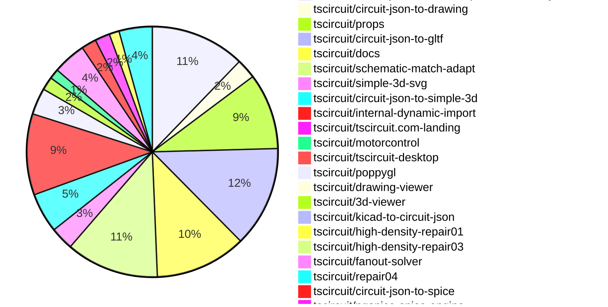

# contribution tracker

[contributions.tscircuit.com](https://contributions.tscircuit.com) ・ [tscircuit.com](https://tscircuit.com) ・ [Contribution Overviews](./contribution-overviews/) ・ [Changelogs](./changelogs/)

Generates weekly contribution overviews for tscircuit contributors. Check out all
the [contribution overviews here](./contribution-overviews/)
You can find AI-generated monthly changelogs in the [changelogs directory](./changelogs/)

- All PRs in the tscircuit org are scanned/summarized via an LLM
- The LLM classifies each Diff/PR as into a set of attributes for scoring
- All the PRs, summaries, and classifications are organized into charts and tables for [the website](https://contributions.tscircuit.com)

> Want to run locally? See the [Development Section](#development)

## Current Week

<!-- START_CURRENT_WEEK -->

# Contribution Overview 2026-11-17

The current week is shown below. There are 3 major sections:

- [Contributor Overview](#contributor-overview)
- [PRs by Repository](#prs-by-repository)
- [PRs by Contributor](#changes-by-contributor)
- [Scoring & Sponsorship Details](/docs/sponsorship-calculation-explanation.md)

## PRs by Repository

## Contributor Overview

| Contributor | 🐳 Major | 🐙 Minor | 🐌 Tiny | Score | ⭐ |
|-------------|---------|---------|---------|-------|-----|
| [ShiboSoftwareDev](#ShiboSoftwareDev) | 46 | 16 | 34 | 229.5 | 👑👑👑 |
| [seveibar](#seveibar) | 10 | 7 | 16 | 67 | ⭐⭐⭐ |
| [0hmX](#0hmX) | 10 | 7 | 14 | 67 | ⭐⭐⭐ |
| [rushabhcodes](#rushabhcodes) | 4 | 5 | 12 | 38 | ⭐⭐ |
| [imrishabh18](#imrishabh18) | 2 | 10 | 7 | 36 | ⭐⭐ |
| [MustafaMulla29](#MustafaMulla29) | 2 | 5 | 12 | 31 | ⭐⭐ |
| [mohan-bee](#mohan-bee) | 4 | 2 | 1 | 21 | ⭐⭐ |
| [Abse2001](#Abse2001) | 3 | 4 | 0 | 21 | ⭐⭐ |
| [tscircuitbot](#tscircuitbot) | 0 | 0 | 284 | 12 | ⭐⭐ |
| [AnasSarkiz](#AnasSarkiz) | 2 | 0 | 2 | 11 | ⭐⭐ |
| [GokulPandi-M](#GokulPandi-M) | 1 | 0 | 1 | 5 | ⭐ |
| [VB-Blue](#VB-Blue) | 1 | 0 | 0 | 4 | ⭐ |

## Staff Pass Ratio (SPR)

| Contributor | Reviewed PRs | Rejections | Approvals | SPR |
|-------------|--------------|------------|-----------|-----|
| [0hmX](#0hmX) | 12 | 1 | 13 | 91.7% |
| [rushabhcodes](#rushabhcodes) | 8 | 2 | 6 | 75.0% |
| [Abse2001](#Abse2001) | 3 | 0 | 3 | 100.0% |
| [MustafaMulla29](#MustafaMulla29) | 3 | 0 | 3 | 100.0% |
| [ShiboSoftwareDev](#ShiboSoftwareDev) | 2 | 0 | 2 | 100.0% |
| [GokulPandi-M](#GokulPandi-M) | 1 | 1 | 0 | 0.0% |
| [VB-Blue](#VB-Blue) | 1 | 0 | 1 | 100.0% |

0hmX SPR PRs (12)

- [#5628](https://github.com/tscircuit/core/pull/5628) refactor!: remove the analog IBIS simulation API
- [#5632](https://github.com/tscircuit/core/pull/5632) feat: add <simulation.eyediagram>
- [#5650](https://github.com/tscircuit/core/pull/5650) feat: pick default pseudo-random binary sequence (PRBS) seeds across a board
- [#5647](https://github.com/tscircuit/core/pull/5647) feat: copy JLCPCB hole plating thickness into preset stackups
- [#5629](https://github.com/tscircuit/core/pull/5629) feat: add <simulation.ibismodel>
- [#5423](https://github.com/tscircuit/core/pull/5423) feat: add <simulation.pcbtransientchannelsimulation>
- [#5649](https://github.com/tscircuit/core/pull/5649) feat: add <simulation.pcbdriverreceiverchannel>
- [#11](https://github.com/tscircuit/jlcpcb-manufacturing-specs/pull/11) feat: add hole plating copper thickness to JLCPCB stackups
- [#6](https://github.com/tscircuit/ibis-to-spice/pull/6) feat: expose [Ramp] dV/dt and R_load on IbisBuffer
- [#141](https://github.com/tscircuit/signal-integrity-pipeline/pull/141) feat: estimate IBIS output edge duration for channel endpoints
- [#118](https://github.com/tscircuit/signal-integrity-pipeline/pull/118) feat: inspect IBIS pin capabilities and references for channel endpoints
- [#117](https://github.com/tscircuit/signal-integrity-pipeline/pull/117) feat: add isQuiet to board and the default capture duration to pipeline/timing

rushabhcodes SPR PRs (8)

- [#998](https://github.com/tscircuit/circuit-json/pull/998) Preserve arc geometry in PCB board outlines and cutouts
- [#1028](https://github.com/tscircuit/circuit-json/pull/1028) fix: preserve namespaced KiCad metadata on existing records
- [#1025](https://github.com/tscircuit/circuit-json/pull/1025) Revert "Preserve arc geometry in PCB board outlines and cutouts (#998)"
- [#1036](https://github.com/tscircuit/props/pull/1036) Preserve rectangular solder paste rotation
- [#1032](https://github.com/tscircuit/props/pull/1032) feat: add native net class authoring props
- [#5962](https://github.com/tscircuit/tscircuit.com/pull/5962) Add the Drawing tab to package previews
- [#298](https://github.com/tscircuit/circuit-json-to-gltf/pull/298) Resolve selected CAD model URLs at load time
- [#58](https://github.com/tscircuit/poppygl/pull/58) Skip shading for constant unlit opaque surfaces

Abse2001 SPR PRs (3)

- [#5502](https://github.com/tscircuit/core/pull/5502) Keep small-board mouse bites drillable (#5066)
- [#5876](https://github.com/tscircuit/cli/pull/5876) Resolve relative model paths in tsci export glb and gltf (#5654)
- [#13](https://github.com/tscircuit/jlcpcb-manufacturing-specs/pull/13) Add JLCPCB panelization rules

MustafaMulla29 SPR PRs (3)

- [#580](https://github.com/tscircuit/checks/pull/580) Report schematic box width and pin-padding warnings
- [#1451](https://github.com/tscircuit/schematic-trace-solver/pull/1451) Place shared ground labels at the lower end of their rail
- [#484](https://github.com/tscircuit/circuit-json-schematic-placement-analysis/pull/484) fix: let 0 ohm links away from ground lie in line

ShiboSoftwareDev SPR PRs (2)

- [#3985](https://github.com/tscircuit/tscircuit-autorouter/pull/3985) Keep preloaded copper as paths throughout Pipeline9
- [#298](https://github.com/tscircuit/fanout-solver/pull/298) Honor crossed pour antipads in final fanout validation

GokulPandi-M SPR PRs (1)

- [#334](https://github.com/tscircuit/tiny-hypergraph/pull/334) Support per-route layer constraints during path search

VB-Blue SPR PRs (1)

- [#651](https://github.com/tscircuit/jlcsearch/pull/651) fix: include LED Indication - Discrete subcategory in led derived table

> Note: AI evaluates PRs and assigns 1-3 star ratings automatically. 4 and 5 star ratings require manual staff review.

## Review Table

[reviews-received-hover]: ## "Number of reviews received for PRs for this contributor"
[approvals-received-hover]: ## "Number of approvals received for PRs this contributor authored"
[rejections-received-hover]: ## "Number of rejections received for PRs this contributor authored"
[prs-opened-hover]: ## "Number of PRs opened by this contributor"
[issues-created-hover]: ## "Number of issues created by this contributor"

| Contributor | Reviews Received | Approvals Received | Rejections Received | Approvals | Rejections Given | PRs Opened | PRs Merged | Issues Created |
|---|---|---|---|---|---|---|---|---|
| [0hmX](#0hmX) | 39 | 15 | 0 | 18 | 0 | 64 | 31 | 0 |
| [0xNexuz](#0xNexuz) | 0 | 0 | 0 | 0 | 0 | 1 | 0 | 0 |
| [aaka3h](#aaka3h) | 0 | 0 | 0 | 0 | 0 | 1 | 0 | 0 |
| [abdalraof-albarbar](#abdalraof-albarbar) | 0 | 0 | 0 | 0 | 0 | 4 | 0 | 0 |
| [Abse2001](#Abse2001) | 3 | 3 | 0 | 20 | 0 | 17 | 7 | 0 |
| [AJ0070](#AJ0070) | 0 | 0 | 0 | 0 | 0 | 1 | 0 | 0 |
| [Aming9303](#Aming9303) | 0 | 0 | 0 | 0 | 0 | 2 | 0 | 0 |
| [AnasSarkiz](#AnasSarkiz) | 5 | 4 | 0 | 1 | 0 | 12 | 4 | 0 |
| [Andresdev14](#Andresdev14) | 0 | 0 | 0 | 0 | 0 | 1 | 0 | 0 |
| [bhatipoglu](#bhatipoglu) | 0 | 0 | 0 | 0 | 0 | 2 | 0 | 0 |
| [CrazyEther](#CrazyEther) | 0 | 0 | 0 | 0 | 0 | 1 | 0 | 0 |
| [Devesh36](#Devesh36) | 0 | 0 | 0 | 0 | 0 | 5 | 0 | 0 |
| [GokulPandi-M](#GokulPandi-M) | 12 | 3 | 2 | 0 | 0 | 10 | 2 | 0 |
| [Hajjy22](#Hajjy22) | 0 | 0 | 0 | 0 | 0 | 3 | 0 | 0 |
| [hrithik18k](#hrithik18k) | 0 | 0 | 0 | 0 | 0 | 3 | 0 | 0 |
| [imrishabh18](#imrishabh18) | 1 | 0 | 0 | 8 | 2 | 30 | 19 | 0 |
| [Kefia-02](#Kefia-02) | 0 | 0 | 0 | 0 | 0 | 1 | 0 | 0 |
| [LBCron](#LBCron) | 0 | 0 | 0 | 0 | 0 | 21 | 0 | 0 |
| [menwo535-jpg](#menwo535-jpg) | 0 | 0 | 0 | 0 | 0 | 2 | 0 | 0 |
| [mohan-bee](#mohan-bee) | 5 | 2 | 0 | 0 | 0 | 28 | 7 | 0 |
| [MustafaMulla29](#MustafaMulla29) | 12 | 8 | 0 | 1 | 0 | 26 | 19 | 0 |
| [NavaneethKSD](#NavaneethKSD) | 0 | 0 | 0 | 0 | 0 | 1 | 0 | 0 |
| [pecopeko](#pecopeko) | 0 | 0 | 0 | 0 | 0 | 8 | 0 | 0 |
| [rushabhcodes](#rushabhcodes) | 35 | 14 | 3 | 0 | 0 | 47 | 22 | 0 |
| [Semihzx](#Semihzx) | 0 | 0 | 0 | 0 | 0 | 1 | 0 | 0 |
| [seveibar](#seveibar) | 9 | 0 | 0 | 31 | 3 | 43 | 33 | 0 |
| [ShiboSoftwareDev](#ShiboSoftwareDev) | 50 | 38 | 0 | 9 | 0 | 181 | 98 | 0 |
| [singhaditya21](#singhaditya21) | 0 | 0 | 0 | 0 | 0 | 6 | 0 | 0 |
| [tscircuitbot](#tscircuitbot) | 0 | 0 | 0 | 0 | 0 | 345 | 284 | 0 |
| [U-ITACHII](#U-ITACHII) | 0 | 0 | 0 | 0 | 0 | 8 | 0 | 0 |
| [VB-Blue](#VB-Blue) | 1 | 1 | 0 | 0 | 0 | 8 | 1 | 0 |

## Changes by Repository

### [tscircuit/tscircuit](https://github.com/tscircuit/tscircuit)

🐌 Tiny Contributions (57)

| PR # | Impact | Contributor | Description |
|------|--------|-------------|-------------|
| [#6554](https://github.com/tscircuit/tscircuit/pull/6554) | 🐌 Tiny | tscircuitbot | Automated package update |
| [#6553](https://github.com/tscircuit/tscircuit/pull/6553) | 🐌 Tiny | tscircuitbot | Updates the tscircuitcli package version from 0.1.2479 to 0.1.2480 |
| [#6552](https://github.com/tscircuit/tscircuit/pull/6552) | 🐌 Tiny | tscircuitbot | Automated package update |
| [#6551](https://github.com/tscircuit/tscircuit/pull/6551) | 🐌 Tiny | tscircuitbot | Automated package update |
| [#6550](https://github.com/tscircuit/tscircuit/pull/6550) | 🐌 Tiny | tscircuitbot | Automated package update |
| [#6549](https://github.com/tscircuit/tscircuit/pull/6549) | 🐌 Tiny | tscircuitbot | Updates the tscircuitcli package to version 0.1.2479 |
| [#6548](https://github.com/tscircuit/tscircuit/pull/6548) | 🐌 Tiny | tscircuitbot | Automated package update |
| [#6547](https://github.com/tscircuit/tscircuit/pull/6547) | 🐌 Tiny | tscircuitbot | Updates the version of the tscircuiteval and tscircuitrunframe packages in package.json |
| [#6546](https://github.com/tscircuit/tscircuit/pull/6546) | 🐌 Tiny | tscircuitbot | Automated package update |
| [#6545](https://github.com/tscircuit/tscircuit/pull/6545) | 🐌 Tiny | tscircuitbot | Automated package update |
| [#6544](https://github.com/tscircuit/tscircuit/pull/6544) | 🐌 Tiny | tscircuitbot | Automated package update |
| [#6543](https://github.com/tscircuit/tscircuit/pull/6543) | 🐌 Tiny | tscircuitbot | Updates the tscircuitcli package version from 0.1.2476 to 0.1.2477 |
| [#6542](https://github.com/tscircuit/tscircuit/pull/6542) | 🐌 Tiny | tscircuitbot | Automated package update |
| [#6541](https://github.com/tscircuit/tscircuit/pull/6541) | 🐌 Tiny | tscircuitbot | Automated package update |
| [#6540](https://github.com/tscircuit/tscircuit/pull/6540) | 🐌 Tiny | tscircuitbot | Automated package update |
| [#6539](https://github.com/tscircuit/tscircuit/pull/6539) | 🐌 Tiny | tscircuitbot | Automated package update |
| [#6538](https://github.com/tscircuit/tscircuit/pull/6538) | 🐌 Tiny | tscircuitbot | Automated package update |
| [#6537](https://github.com/tscircuit/tscircuit/pull/6537) | 🐌 Tiny | tscircuitbot | Updates the versions of several dependencies in the package.json file. |
| [#6531](https://github.com/tscircuit/tscircuit/pull/6531) | 🐌 Tiny | tscircuitbot | Automated package update |
| [#6526](https://github.com/tscircuit/tscircuit/pull/6526) | 🐌 Tiny | tscircuitbot | Automated package update |
| [#6524](https://github.com/tscircuit/tscircuit/pull/6524) | 🐌 Tiny | tscircuitbot | Automated package update |
| [#6535](https://github.com/tscircuit/tscircuit/pull/6535) | 🐌 Tiny | tscircuitbot | Updates the version of the tscircuiteval package from 0.0.1821 to 0.0.1822 in package.json |
| [#6534](https://github.com/tscircuit/tscircuit/pull/6534) | 🐌 Tiny | tscircuitbot | Automated package update |
| [#6533](https://github.com/tscircuit/tscircuit/pull/6533) | 🐌 Tiny | tscircuitbot | Automated package update |
| [#6530](https://github.com/tscircuit/tscircuit/pull/6530) | 🐌 Tiny | tscircuitbot | Automated package update |
| [#6529](https://github.com/tscircuit/tscircuit/pull/6529) | 🐌 Tiny | tscircuitbot | Automated package update |
| [#6528](https://github.com/tscircuit/tscircuit/pull/6528) | 🐌 Tiny | tscircuitbot | Automated package update |
| [#6527](https://github.com/tscircuit/tscircuit/pull/6527) | 🐌 Tiny | tscircuitbot | Automated package update |
| [#6525](https://github.com/tscircuit/tscircuit/pull/6525) | 🐌 Tiny | tscircuitbot | Automated package update |
| [#6523](https://github.com/tscircuit/tscircuit/pull/6523) | 🐌 Tiny | tscircuitbot | Automated package update |
| [#6522](https://github.com/tscircuit/tscircuit/pull/6522) | 🐌 Tiny | tscircuitbot | Automated package update |
| [#6521](https://github.com/tscircuit/tscircuit/pull/6521) | 🐌 Tiny | tscircuitbot | Automated package update |
| [#6520](https://github.com/tscircuit/tscircuit/pull/6520) | 🐌 Tiny | tscircuitbot | Updates the version of tscircuitcore and other related packages in package.json |
| [#6519](https://github.com/tscircuit/tscircuit/pull/6519) | 🐌 Tiny | tscircuitbot | Automated package update |
| [#6518](https://github.com/tscircuit/tscircuit/pull/6518) | 🐌 Tiny | tscircuitbot | Automated package update |
| [#6517](https://github.com/tscircuit/tscircuit/pull/6517) | 🐌 Tiny | tscircuitbot | Automated package update |
| [#6516](https://github.com/tscircuit/tscircuit/pull/6516) | 🐌 Tiny | tscircuitbot | Automated package update |
| [#6515](https://github.com/tscircuit/tscircuit/pull/6515) | 🐌 Tiny | tscircuitbot | Automated package update |
| [#6514](https://github.com/tscircuit/tscircuit/pull/6514) | 🐌 Tiny | tscircuitbot | Automated package update |
| [#6513](https://github.com/tscircuit/tscircuit/pull/6513) | 🐌 Tiny | tscircuitbot | Automated package update |
| [#6512](https://github.com/tscircuit/tscircuit/pull/6512) | 🐌 Tiny | tscircuitbot | Automated package update |
| [#6496](https://github.com/tscircuit/tscircuit/pull/6496) | 🐌 Tiny | tscircuitbot | Update tscircuitcore from 0.0.2405 to 0.0.2406 and tscircuitcapacity-autorouter from 0.0.1120 to 0.0.1121, along with other package updates and lockfile refresh. |
| [#6510](https://github.com/tscircuit/tscircuit/pull/6510) | 🐌 Tiny | tscircuitbot | Automated package update |
| [#6509](https://github.com/tscircuit/tscircuit/pull/6509) | 🐌 Tiny | tscircuitbot | Automated package update |
| [#6508](https://github.com/tscircuit/tscircuit/pull/6508) | 🐌 Tiny | tscircuitbot | Automated package update |
| [#6502](https://github.com/tscircuit/tscircuit/pull/6502) | 🐌 Tiny | tscircuitbot | Automated package update |
| [#6494](https://github.com/tscircuit/tscircuit/pull/6494) | 🐌 Tiny | tscircuitbot | Update tscircuitcore from 0.0.2404 to 0.0.2405 and tscircuitcapacity-autorouter from 0.0.1119 to 0.0.1120, ensuring the new autorouter preserves accessible routed via bridges during layer stitching. |
| [#6511](https://github.com/tscircuit/tscircuit/pull/6511) | 🐌 Tiny | tscircuitbot | Automated package update |
| [#6506](https://github.com/tscircuit/tscircuit/pull/6506) | 🐌 Tiny | tscircuitbot | Automated package update |
| [#6505](https://github.com/tscircuit/tscircuit/pull/6505) | 🐌 Tiny | tscircuitbot | Automated package update |
| [#6499](https://github.com/tscircuit/tscircuit/pull/6499) | 🐌 Tiny | tscircuitbot | Automated package update |
| [#6498](https://github.com/tscircuit/tscircuit/pull/6498) | 🐌 Tiny | tscircuitbot | Automated package update |
| [#6497](https://github.com/tscircuit/tscircuit/pull/6497) | 🐌 Tiny | tscircuitbot | Automated package update |
| [#6504](https://github.com/tscircuit/tscircuit/pull/6504) | 🐌 Tiny | tscircuitbot | Automated package update |
| [#6507](https://github.com/tscircuit/tscircuit/pull/6507) | 🐌 Tiny | tscircuitbot | Automated package update |
| [#6503](https://github.com/tscircuit/tscircuit/pull/6503) | 🐌 Tiny | tscircuitbot | Automated package update |
| [#6495](https://github.com/tscircuit/tscircuit/pull/6495) | 🐌 Tiny | tscircuitbot | Automated package update |

### [tscircuit/circuit-json](https://github.com/tscircuit/circuit-json)

| PR # | Impact | Rating | Contributor | Description |
|------|--------|--------|-------------|-------------|
| [#1017](https://github.com/tscircuit/circuit-json/pull/1017) | 🐳 Major | ⭐⭐⭐ | seveibar | Proposes how laser-engraved text on an assembly part appears in Circuit JSON, as the counterpart of manufacturing.laserengraving.text  from tscircuitprops1025. It is two records, split the way Circuit JSON already splits source and output: - source_laser_engraving_text: the manufacturing step. What is engraved and how, with no geometry. - cad_laser_engraving_text: the 3D output. Where that text sits on the part, as a resolved world-space frame. |
| [#1023](https://github.com/tscircuit/circuit-json/pull/1023) | 🐳 Major | ⭐⭐⭐ | seveibar | Adds new elements for wire harness drawings, including cable wires, harness views, drawing tables, and balloons, enhancing the representation of cable manufacturing in the system. |
| [#1019](https://github.com/tscircuit/circuit-json/pull/1019) | 🐳 Major | ⭐⭐⭐ | seveibar | Proposes the Circuit JSON contract for per-net PCB trace clearance by storing the authoring value on source_net.min_trace_clearance as an optional finite, nonnegative number in millimeters. |
| [#998](https://github.com/tscircuit/circuit-json/pull/998) | 🐳 Major | ⭐⭐⭐ | rushabhcodes | Preserves arc geometry in PCB board outlines and cutouts by reusing the existing BRep point_with_bulge schema, preventing loss of circular arc data during KiCad export. |
| [#1034](https://github.com/tscircuit/circuit-json/pull/1034) | 🐙 Minor | ⭐⭐ | seveibar | Adds an optional corner_radius to cad_sticker so stickers with rounded corners can be described. |
| [#1018](https://github.com/tscircuit/circuit-json/pull/1018) | 🐙 Minor | ⭐⭐ | seveibar | Adds support for cad_sticker and source_sticker elements in Circuit JSON, allowing for the representation of stickers applied to components in circuit assemblies. |

🐌 Tiny Contributions (6)

| PR # | Impact | Contributor | Description |
|------|--------|-------------|-------------|
| [#1031](https://github.com/tscircuit/circuit-json/pull/1031) | 🐌 Tiny | tscircuitbot | Automated package update |
| [#1030](https://github.com/tscircuit/circuit-json/pull/1030) | 🐌 Tiny | tscircuitbot | Automated package update |
| [#1035](https://github.com/tscircuit/circuit-json/pull/1035) | 🐌 Tiny | tscircuitbot | Automated package update |
| [#1026](https://github.com/tscircuit/circuit-json/pull/1026) | 🐌 Tiny | tscircuitbot | Automated package update |
| [#1024](https://github.com/tscircuit/circuit-json/pull/1024) | 🐌 Tiny | tscircuitbot | Automated package update |
| [#1020](https://github.com/tscircuit/circuit-json/pull/1020) | 🐌 Tiny | tscircuitbot | Automated package update |

### [tscircuit/core](https://github.com/tscircuit/core)

| PR # | Impact | Rating | Contributor | Description |
|------|--------|--------|-------------|-------------|
| [#5645](https://github.com/tscircuit/core/pull/5645) | 🐳 Major | ⭐⭐⭐ | seveibar | Fixes saved-phase failures by ensuring complete phases validate copper connectivity for export and replay, allowing shared anchor pads and junctions while rejecting cross-net connections. |
| [#5707](https://github.com/tscircuit/core/pull/5707) | 🐳 Major | ⭐⭐⭐ | ShiboSoftwareDev | Bumps the tscircuitcapacity-autorouter package from version 0.0.1129 to 0.0.1132, improving regional force handling to preserve valid routes during optimization, specifically addressing via clearance issues in the H616 region. |
| [#5681](https://github.com/tscircuit/core/pull/5681) | 🐳 Major | ⭐⭐⭐ | ShiboSoftwareDev | Updates the autorouter to version 0.0.1126, enhancing BGA routing by enforcing stricter clearance and via requirements. |
| [#5659](https://github.com/tscircuit/core/pull/5659) | 🐳 Major | ⭐⭐⭐ | ShiboSoftwareDev | Fixes recursive rendering issue in routing callbacks that prevents proper copper pours from being generated during autorouting. |
| [#5637](https://github.com/tscircuit/core/pull/5637) | 🐳 Major | ⭐⭐⭐ | ShiboSoftwareDev | Publish completed trace-only routing phases while later phases continue, allowing for better visibility of routing progress on complex boards. |
| [#5673](https://github.com/tscircuit/core/pull/5673) | 🐳 Major | ⭐⭐⭐ | ShiboSoftwareDev | Updates the capacity autorouter and bus lanes solver dependencies, allowing for improved routing capabilities and fixes for cramped-port searches. |
| [#5657](https://github.com/tscircuit/core/pull/5657) | 🐳 Major | ⭐⭐⭐ | ShiboSoftwareDev | Reproduces a ground pour generated before its routed signal via when an autorouting:start listener reads getCircuitJson(). |
| [#5732](https://github.com/tscircuit/core/pull/5732) | 🐳 Major | ⭐⭐⭐ | mohan-bee | Fixes the issue where the auto_local preset ignored the allowViaInPad setting, allowing vias to be added in pads where they were explicitly prohibited by the board designer. |
| [#5731](https://github.com/tscircuit/core/pull/5731) | 🐳 Major | ⭐⭐⭐ | mohan-bee | Reproduces the lost via-in-pad override in Cores auto_local preset, ensuring that the autorouter respects the prohibition of vias in pads during routing. |
| [#5629](https://github.com/tscircuit/core/pull/5629) | 🐳 Major | ⭐⭐⭐ | 0hmX | Render simulation.ibismodel into a Circuit JSON IBIS model record with component, pin, and reference-port bindings, validating ambiguous, duplicate, or undeclared vendor pin bindings. |
| [#5649](https://github.com/tscircuit/core/pull/5649) | 🐳 Major | ⭐⭐⭐ | 0hmX | Adds simulation.pcbdriverreceiverchannel, resolves driver and receiver pins to IBIS models, validates PCB connectivity and routing, and writes channel records with an explicit seed when supplied. |
| [#5692](https://github.com/tscircuit/core/pull/5692) | 🐙 Minor | ⭐⭐ | rushabhcodes | Fixes the issue where a TLV75533PDBVR regulator footprint loses the requested 90 rotation on its stencil apertures, causing misalignment with copper lands. |
| [#5706](https://github.com/tscircuit/core/pull/5706) | 🐙 Minor | ⭐⭐ | ShiboSoftwareDev | Updates the ngspice engine and SPICE exporter to use newer versions of dependencies, ensuring compatibility and improved functionality in simulation tests. |
| [#5636](https://github.com/tscircuit/core/pull/5636) | 🐙 Minor | ⭐⭐ | ShiboSoftwareDev | Reproduces buffered output of completed routing work while the next autorouting phase is pending, ensuring that traces from the first phase remain accessible until the second phase is completed. |
| [#5492](https://github.com/tscircuit/core/pull/5492) | 🐙 Minor | ⭐⭐ | Abse2001 | Reproduces the issue of insufficient drill size for mouse bites on small boards, ensuring they remain drillable. |
| [#5502](https://github.com/tscircuit/core/pull/5502) | 🐙 Minor | ⭐⭐ | Abse2001 | Adjusts mouse-bite drill sizes for small boards to ensure they remain drillable according to JLCPCBs specifications, while addressing clearance issues with traces. |
| [#5685](https://github.com/tscircuit/core/pull/5685) | 🐙 Minor | ⭐⭐ | imrishabh18 | Captures and normalizes schematic and source warnings and errors for the NEMA 17 example, ensuring stability across test orders. |
| [#5702](https://github.com/tscircuit/core/pull/5702) | 🐙 Minor | ⭐⭐ | imrishabh18 | Recomputes NEMA 17 diagnostics by rerunning pin specification and schematic checks using the installed Checks package, while retaining source-render annotations. |
| [#5628](https://github.com/tscircuit/core/pull/5628) | 🐙 Minor | ⭐⭐ | 0hmX | Summary Bump circuit-json to 0.0.552 and tscircuitprops to 0.0.735 in the development dependencies and overrides. Remove the analog IBIS stimulus and eye declarations, IBIS pin states, and the external pcb_spice special case. Keep native analog transient analysis available through registered SPICE engines. Keep cached IBIS model restoration and narrow the copper-pour fixture to the PCB elements it renders. |
| [#5632](https://github.com/tscircuit/core/pull/5632) | 🐙 Minor | ⭐⭐ | 0hmX | Render simulation.eyediagram against transient channel records, with channel selection and timing windows expressed in milliseconds. |
| [#5650](https://github.com/tscircuit/core/pull/5650) | 🐙 Minor | ⭐⭐ | 0hmX | Allows channels using pseudo-random binary sequence (PRBS) patterns to automatically select distinct seeds based on signal names and sequence lengths, preventing identical bit transmission across channels. |
| [#5647](https://github.com/tscircuit/core/pull/5647) | 🐙 Minor | ⭐⭐ | 0hmX | Copies plated_hole_copper_thickness from the JLCPCB stackup data into pcb_stackup for boards using a JLCPCB fabricatorPreset, enabling accurate modeling of vias in PCB transient channel simulations. |
| [#5423](https://github.com/tscircuit/core/pull/5423) | 🐙 Minor | ⭐⭐ | 0hmX | Add simulation.pcbtransientchannelsimulation as a direct child of a PCB board, emitting run records with settings and covering tests for board-only rules. |

🐌 Tiny Contributions (23)

| PR # | Impact | Contributor | Description |
|------|--------|-------------|-------------|
| [#5699](https://github.com/tscircuit/core/pull/5699) | 🐌 Tiny | tscircuitbot | Updates the version of the tscircuitchecks package from 0.0.280 to 0.0.281 in package.json |
| [#5694](https://github.com/tscircuit/core/pull/5694) | 🐌 Tiny | tscircuitbot | Updates the version of the tscircuitfanout-solver package from 0.0.84 to 0.0.85 in package.json |
| [#5688](https://github.com/tscircuit/core/pull/5688) | 🐌 Tiny | tscircuitbot | Updates the version of the tscircuitchecks package from 0.0.279 to 0.0.280 in package.json |
| [#5643](https://github.com/tscircuit/core/pull/5643) | 🐌 Tiny | seveibar | Adds four small TSX reproductions for the saved-phase bug in 5614, providing tests for various routing scenarios that previously resulted in errors during autorouting. |
| [#5641](https://github.com/tscircuit/core/pull/5641) | 🐌 Tiny | seveibar | Adds guidance on testing patterns in AGENTS.md, specifying that tests should be simple, shallow TSX without complex logic or large imports unless they represent an entire real circuit. |
| [#5691](https://github.com/tscircuit/core/pull/5691) | 🐌 Tiny | rushabhcodes | Reproduces a bug where rotated paste-only apertures cannot be expressed, exposing a rotation bug in the Core. |
| [#5744](https://github.com/tscircuit/core/pull/5744) | 🐌 Tiny | ShiboSoftwareDev | Updates the tscircuitfanout-solver package from version 0.0.92 to 0.0.93, improving the handling of plane-via candidates and ensuring successful copper escapes in the ButterStick region. |
| [#5741](https://github.com/tscircuit/core/pull/5741) | 🐌 Tiny | ShiboSoftwareDev | Updates the tscircuitfanout-solver dependency from version 0.0.91 to 0.0.92, adjusting trace widths and terminal-plane copper validation, and refining boundary-heading inference with retries for unconstrained escapes. |
| [#5719](https://github.com/tscircuit/core/pull/5719) | 🐌 Tiny | ShiboSoftwareDev | Bumps the version of tscircuitfanout-solver from 0.0.90 to 0.0.91 to include improvements in conservative segment bounds and clearance decisions for obstacles. |
| [#5712](https://github.com/tscircuit/core/pull/5712) | 🐌 Tiny | ShiboSoftwareDev | Updates the autorouter and fanout solver to their latest versions, improving routing capabilities and optimization. |
| [#5721](https://github.com/tscircuit/core/pull/5721) | 🐌 Tiny | ShiboSoftwareDev | Updates the capacity-autorouter dependency from version 0.0.1133 to 0.0.1135, which includes improvements to routing capabilities and fixes related to native regulator feedback. |
| [#5720](https://github.com/tscircuit/core/pull/5720) | 🐌 Tiny | ShiboSoftwareDev | Updates Cores canonical simulation dependency versions to published spicets 0.0.6, circuit-json-to-spice 0.0.50 and ngspice-spice-engine 0.0.25, ensuring compatibility with downstream dependencies and incorporating parser fixes and corrections. |
| [#5716](https://github.com/tscircuit/core/pull/5716) | 🐌 Tiny | ShiboSoftwareDev | Bumps tscircuitfanout-solver from 0.0.89 to 0.0.90 to optimize warm plane searches by skipping geometry construction when static clearance rejects all endpoint variants and the base plan, while maintaining cache misses, endpoint ordering, and live copper checks. |
| [#5705](https://github.com/tscircuit/core/pull/5705) | 🐌 Tiny | ShiboSoftwareDev | Bumps tscircuitfanout-solver from 0.0.87 to 0.0.88 to include support for antipads through crossed copper pours while preserving clearance rejection on terminal layers, pads, and through-holes. |
| [#5698](https://github.com/tscircuit/core/pull/5698) | 🐌 Tiny | ShiboSoftwareDev | Bumps the tscircuitfanout-solver dependency from version 0.0.86 to 0.0.87, improving clearance-scan performance by skipping distant obstacles before scanning their aliases. |
| [#5696](https://github.com/tscircuit/core/pull/5696) | 🐌 Tiny | ShiboSoftwareDev | Bumps the tscircuitcapacity-autorouter package version from 0.0.1128 to 0.0.1129, ensuring improved handling of fixed-via clearance violations during autorouting processes. |
| [#5690](https://github.com/tscircuit/core/pull/5690) | 🐌 Tiny | ShiboSoftwareDev | Updates the autorouter and fanout solver dependencies to their latest versions, ensuring compatibility and improved functionality in routing and clearance checks. |
| [#5683](https://github.com/tscircuit/core/pull/5683) | 🐌 Tiny | ShiboSoftwareDev | Updates the tscircuitcapacity-autorouter package from version 0.0.1126 to 0.0.1127, which includes improvements to the repair03 process and the native trace-pair DRC evaluator during via cleanup. |
| [#5679](https://github.com/tscircuit/core/pull/5679) | 🐌 Tiny | ShiboSoftwareDev | Updates the tscircuitcapacity-autorouter dependency from version 0.0.1124 to 0.0.1125, which includes improvements to pad-alias resolution during clearance search and a grid correction for component-pad-only A13. |
| [#5642](https://github.com/tscircuit/core/pull/5642) | 🐌 Tiny | ShiboSoftwareDev | Bumps the tscircuitcapacity-autorouter dependency from version 0.0.1120 to 0.0.1121, incorporating improvements and fixes from upstream, including enhanced clearance-grid channel builds and reduced physical findings in routing tests. |
| [#5638](https://github.com/tscircuit/core/pull/5638) | 🐌 Tiny | ShiboSoftwareDev | Bumps the tscircuitcapacity-autorouter dependency from version 0.0.1119 to 0.0.1120, improving routing preferences and connection stitching. |
| [#5701](https://github.com/tscircuit/core/pull/5701) | 🐌 Tiny | imrishabh18 | Updates the tscircuitchecks dependency to version 0.0.282, ensuring that Core honors explicit false power and ground pin requirements. |
| [#5686](https://github.com/tscircuit/core/pull/5686) | 🐌 Tiny | GokulPandi-M | Motivation Increasing autorouter.traceClearance should change the clearance requested from the router. On this SEPIC board, requesting either 0.25 mm or 0.50 mm produces identical routing input with minTraceToPadEdgeClearance: 0.1. The larger requested spacing is silently lost before routing, so changing this setting does not enforce the intended clearance. This reproduction renders the full board TSX, retains its manual traces, and captures the input passed to the native local autorouter. The passing characterization test records the current bug; each snapshot labels the requested clearance and the received input field. Those labels describe routing settings, not measured copper gaps.  Requested: 0.25 mm  Requested: 0.50 mm   ---  ---   !Board requesting 0.25 mm; router receives 0.1 mm(https:raw.githubusercontent.comGokulPandi-Mcore5c476f43e2f901dc405c4708c5549ecfa778dd05testsrepros__snapshots__repro-autorouter-clearance-board-0.25mm-pcb.snap.svg)  !Board requesting 0.50 mm; router receives 0.1 mm(https:raw.githubusercontent.comGokulPandi-Mcore5c476f43e2f901dc405c4708c5549ecfa778dd05testsrepros__snapshots__repro-autorouter-clearance-board-0.50mm-pcb.snap.svg)   Validation Reproduction and snapshot verification pass: 1 test, 7 assertions. Type check and production build pass. Source fixture retains the boards components, placements and eight manual traces; no production code changes. |

### [tscircuit/tscircuit.com](https://github.com/tscircuit/tscircuit.com)

| PR # | Impact | Rating | Contributor | Description |
|------|--------|--------|-------------|-------------|
| [#5985](https://github.com/tscircuit/tscircuit.com/pull/5985) | 🐳 Major | ⭐⭐⭐ | seveibar | Updates the circuit-to-svg and circuit-json libraries to support custom wire colors and line patterns, ensuring that the runtime parser preserves these style fields during rendering. |
| [#6009](https://github.com/tscircuit/tscircuit.com/pull/6009) | 🐳 Major | ⭐⭐⭐ | rushabhcodes | Reduces model download time by reusing the rendered Drawing view when switching tabs, preventing unnecessary model downloads and improving performance. |
| [#5962](https://github.com/tscircuit/tscircuit.com/pull/5962) | 🐳 Major | ⭐⭐⭐ | rushabhcodes | Adds a Drawing tab to the package page for inspecting engineering drawings alongside PCB, schematic, and 3D views. |

🐌 Tiny Contributions (58)

| PR # | Impact | Contributor | Description |
|------|--------|-------------|-------------|
| [#6045](https://github.com/tscircuit/tscircuit.com/pull/6045) | 🐌 Tiny | tscircuitbot | Updates the tscircuitrunframe package version from 0.0.3301 to 0.0.3302 in package.json |
| [#6044](https://github.com/tscircuit/tscircuit.com/pull/6044) | 🐌 Tiny | tscircuitbot | Updates the tscircuiteval package from version 0.0.1823 to 0.0.1824 in the package.json file. |
| [#6043](https://github.com/tscircuit/tscircuit.com/pull/6043) | 🐌 Tiny | tscircuitbot | Updates the tscircuitrunframe package from version 0.0.3300 to 0.0.3301 |
| [#6042](https://github.com/tscircuit/tscircuit.com/pull/6042) | 🐌 Tiny | tscircuitbot | Updates the tscircuiteval package from version 0.0.1822 to 0.0.1823 |
| [#6041](https://github.com/tscircuit/tscircuit.com/pull/6041) | 🐌 Tiny | tscircuitbot | Updates the tscircuitrunframe package version from 0.0.3299 to 0.0.3300 in package.json |
| [#6040](https://github.com/tscircuit/tscircuit.com/pull/6040) | 🐌 Tiny | tscircuitbot | Updates the tscircuiteval package from version 0.0.1821 to 0.0.1822 in the package.json file. |
| [#6039](https://github.com/tscircuit/tscircuit.com/pull/6039) | 🐌 Tiny | tscircuitbot | Updates the tscircuitrunframe package from version 0.0.3298 to 0.0.3299 |
| [#6038](https://github.com/tscircuit/tscircuit.com/pull/6038) | 🐌 Tiny | tscircuitbot | Updates the tscircuiteval package from version 0.0.1820 to 0.0.1821 in the package.json file. |
| [#6037](https://github.com/tscircuit/tscircuit.com/pull/6037) | 🐌 Tiny | tscircuitbot | Updates the tscircuitrunframe package to version 0.0.3298 |
| [#6035](https://github.com/tscircuit/tscircuit.com/pull/6035) | 🐌 Tiny | tscircuitbot | Updates the tscircuitrunframe package from version 0.0.3296 to 0.0.3297 |
| [#6034](https://github.com/tscircuit/tscircuit.com/pull/6034) | 🐌 Tiny | tscircuitbot | Updates the tscircuiteval package from version 0.0.1818 to 0.0.1819 |
| [#6033](https://github.com/tscircuit/tscircuit.com/pull/6033) | 🐌 Tiny | tscircuitbot | Updates the tscircuitrunframe package from version 0.0.3295 to 0.0.3296 |
| [#6032](https://github.com/tscircuit/tscircuit.com/pull/6032) | 🐌 Tiny | tscircuitbot | Updates the tscircuiteval package from version 0.0.1817 to 0.0.1818 in the package.json file. |
| [#6031](https://github.com/tscircuit/tscircuit.com/pull/6031) | 🐌 Tiny | tscircuitbot | Updates the tscircuitrunframe package from version 0.0.3294 to 0.0.3295 |
| [#6030](https://github.com/tscircuit/tscircuit.com/pull/6030) | 🐌 Tiny | tscircuitbot | Updates the tscircuiteval package from version 0.0.1816 to 0.0.1817 |
| [#6029](https://github.com/tscircuit/tscircuit.com/pull/6029) | 🐌 Tiny | tscircuitbot | Updates the tscircuitrunframe package from version 0.0.3293 to 0.0.3294 |
| [#6028](https://github.com/tscircuit/tscircuit.com/pull/6028) | 🐌 Tiny | tscircuitbot | Updates the tscircuiteval package from version 0.0.1815 to 0.0.1816 |
| [#6027](https://github.com/tscircuit/tscircuit.com/pull/6027) | 🐌 Tiny | tscircuitbot | Updates the tscircuitrunframe package from version 0.0.3292 to 0.0.3293 |
| [#6026](https://github.com/tscircuit/tscircuit.com/pull/6026) | 🐌 Tiny | tscircuitbot | Updates the tscircuiteval package from version 0.0.1814 to 0.0.1815 in the package.json file. |
| [#6025](https://github.com/tscircuit/tscircuit.com/pull/6025) | 🐌 Tiny | tscircuitbot | Updates the tscircuitrunframe package from version 0.0.3291 to 0.0.3292 |
| [#6024](https://github.com/tscircuit/tscircuit.com/pull/6024) | 🐌 Tiny | tscircuitbot | Automated package update |
| [#6023](https://github.com/tscircuit/tscircuit.com/pull/6023) | 🐌 Tiny | tscircuitbot | Updates the tscircuitrunframe package version from 0.0.3290 to 0.0.3291 |
| [#6022](https://github.com/tscircuit/tscircuit.com/pull/6022) | 🐌 Tiny | tscircuitbot | Updates the tscircuiteval package from version 0.0.1812 to 0.0.1813 |
| [#6021](https://github.com/tscircuit/tscircuit.com/pull/6021) | 🐌 Tiny | tscircuitbot | Automated package update |
| [#6020](https://github.com/tscircuit/tscircuit.com/pull/6020) | 🐌 Tiny | tscircuitbot | Updates the tscircuiteval package from version 0.0.1811 to 0.0.1812 in the package.json file. |
| [#6019](https://github.com/tscircuit/tscircuit.com/pull/6019) | 🐌 Tiny | tscircuitbot | Updates the tscircuitrunframe package version from 0.0.3288 to 0.0.3289 in package.json |
| [#6018](https://github.com/tscircuit/tscircuit.com/pull/6018) | 🐌 Tiny | tscircuitbot | Updates the tscircuitrunframe package version from 0.0.3287 to 0.0.3288 in package.json |
| [#6017](https://github.com/tscircuit/tscircuit.com/pull/6017) | 🐌 Tiny | tscircuitbot | Updates the tscircuiteval package from version 0.0.1810 to 0.0.1811 |
| [#6036](https://github.com/tscircuit/tscircuit.com/pull/6036) | 🐌 Tiny | tscircuitbot | Automated package update |
| [#6014](https://github.com/tscircuit/tscircuit.com/pull/6014) | 🐌 Tiny | tscircuitbot | Updates the tscircuitrunframe package version from 0.0.3285 to 0.0.3286 in package.json |
| [#6011](https://github.com/tscircuit/tscircuit.com/pull/6011) | 🐌 Tiny | tscircuitbot | Updates the tscircuiteval package from version 0.0.1806 to 0.0.1808 in the package.json file. |
| [#6007](https://github.com/tscircuit/tscircuit.com/pull/6007) | 🐌 Tiny | tscircuitbot | Updates the tscircuitrunframe package from version 0.0.3283 to 0.0.3284 |
| [#6005](https://github.com/tscircuit/tscircuit.com/pull/6005) | 🐌 Tiny | tscircuitbot | Updates the tscircuitrunframe package from version 0.0.3282 to 0.0.3283 |
| [#6004](https://github.com/tscircuit/tscircuit.com/pull/6004) | 🐌 Tiny | tscircuitbot | Updates the tscircuiteval package from version 0.0.1805 to 0.0.1806 |
| [#6002](https://github.com/tscircuit/tscircuit.com/pull/6002) | 🐌 Tiny | tscircuitbot | Updates the tscircuiteval package from version 0.0.1804 to 0.0.1805 |
| [#5998](https://github.com/tscircuit/tscircuit.com/pull/5998) | 🐌 Tiny | tscircuitbot | Updates the tscircuitrunframe package version from 0.0.3278 to 0.0.3279 |
| [#5997](https://github.com/tscircuit/tscircuit.com/pull/5997) | 🐌 Tiny | tscircuitbot | Updates the tscircuiteval package from version 0.0.1802 to 0.0.1803 in the package.json file. |
| [#5995](https://github.com/tscircuit/tscircuit.com/pull/5995) | 🐌 Tiny | tscircuitbot | Updates the tscircuiteval package from version 0.0.1801 to 0.0.1802 in the package.json file. |
| [#5990](https://github.com/tscircuit/tscircuit.com/pull/5990) | 🐌 Tiny | tscircuitbot | Updates the tscircuitrunframe package version from 0.0.3274 to 0.0.3275 |
| [#5987](https://github.com/tscircuit/tscircuit.com/pull/5987) | 🐌 Tiny | tscircuitbot | Updates the tscircuitrunframe package from version 0.0.3273 to 0.0.3274 |
| [#5986](https://github.com/tscircuit/tscircuit.com/pull/5986) | 🐌 Tiny | tscircuitbot | Updates the tscircuiteval package from version 0.0.1797 to 0.0.1798 in the package.json file. |
| [#6016](https://github.com/tscircuit/tscircuit.com/pull/6016) | 🐌 Tiny | tscircuitbot | Updates the tscircuitrunframe package version from 0.0.3286 to 0.0.3287 in package.json |
| [#6015](https://github.com/tscircuit/tscircuit.com/pull/6015) | 🐌 Tiny | tscircuitbot | Automated package update |
| [#6013](https://github.com/tscircuit/tscircuit.com/pull/6013) | 🐌 Tiny | tscircuitbot | Updates the tscircuiteval package from version 0.0.1808 to 0.0.1809 in the package.json file. |
| [#6012](https://github.com/tscircuit/tscircuit.com/pull/6012) | 🐌 Tiny | tscircuitbot | Updates the tscircuitrunframe package from version 0.0.3284 to 0.0.3285 |
| [#6003](https://github.com/tscircuit/tscircuit.com/pull/6003) | 🐌 Tiny | tscircuitbot | Updates the tscircuitrunframe package from version 0.0.3281 to 0.0.3282 |
| [#6000](https://github.com/tscircuit/tscircuit.com/pull/6000) | 🐌 Tiny | tscircuitbot | Updates the tscircuiteval package from version 0.0.1803 to 0.0.1804 |
| [#5999](https://github.com/tscircuit/tscircuit.com/pull/5999) | 🐌 Tiny | tscircuitbot | Updates the tscircuitrunframe package version from 0.0.3279 to 0.0.3280 |
| [#5996](https://github.com/tscircuit/tscircuit.com/pull/5996) | 🐌 Tiny | tscircuitbot | Updates the tscircuitrunframe package from version 0.0.3277 to 0.0.3278 |
| [#5994](https://github.com/tscircuit/tscircuit.com/pull/5994) | 🐌 Tiny | tscircuitbot | Updates the tscircuitrunframe package from version 0.0.3276 to 0.0.3277 |
| [#5993](https://github.com/tscircuit/tscircuit.com/pull/5993) | 🐌 Tiny | tscircuitbot | Updates the tscircuiteval package from version 0.0.1800 to 0.0.1801 in package.json |
| [#5992](https://github.com/tscircuit/tscircuit.com/pull/5992) | 🐌 Tiny | tscircuitbot | Automated package update |
| [#5989](https://github.com/tscircuit/tscircuit.com/pull/5989) | 🐌 Tiny | tscircuitbot | Updates the tscircuiteval package from version 0.0.1798 to 0.0.1799 |
| [#6001](https://github.com/tscircuit/tscircuit.com/pull/6001) | 🐌 Tiny | tscircuitbot | Updates the tscircuitrunframe package from version 0.0.3280 to 0.0.3281 |
| [#5991](https://github.com/tscircuit/tscircuit.com/pull/5991) | 🐌 Tiny | tscircuitbot | Updates the tscircuiteval package from version 0.0.1799 to 0.0.1800 |
| [#5988](https://github.com/tscircuit/tscircuit.com/pull/5988) | 🐌 Tiny | seveibar | Apply a shared Roboto ExtraBold (800) wordmark style with normal letter spacing to both application headers and the footer, following the logo specification. Load the 800 font face through the existing Google Fonts request and update the header typography assertions. |
| [#5961](https://github.com/tscircuit/tscircuit.com/pull/5961) | 🐌 Tiny | rushabhcodes | Reproduces the issue where the Drawing tab is missing in the package preview for the Classic F1 v6.0.12 package, ensuring that the Drawing viewport opens correctly during testing. |
| [#6008](https://github.com/tscircuit/tscircuit.com/pull/6008) | 🐌 Tiny | rushabhcodes | Reproduces a bug where returning to the Drawing tab unmounts the existing DrawingViewer and causes unnecessary model downloads, impacting performance. |

### [tscircuit/eval](https://github.com/tscircuit/eval)

🐌 Tiny Contributions (55)

| PR # | Impact | Contributor | Description |
|------|--------|-------------|-------------|
| [#6010](https://github.com/tscircuit/eval/pull/6010) | 🐌 Tiny | tscircuitbot | Automated package update |
| [#6009](https://github.com/tscircuit/eval/pull/6009) | 🐌 Tiny | tscircuitbot | Updates package dependencies to their latest versions as part of routine maintenance. |
| [#6007](https://github.com/tscircuit/eval/pull/6007) | 🐌 Tiny | tscircuitbot | Automated package update |
| [#6006](https://github.com/tscircuit/eval/pull/6006) | 🐌 Tiny | tscircuitbot | Updates package dependencies to their latest versions as part of routine maintenance. |
| [#6004](https://github.com/tscircuit/eval/pull/6004) | 🐌 Tiny | tscircuitbot | Automated package update |
| [#6003](https://github.com/tscircuit/eval/pull/6003) | 🐌 Tiny | tscircuitbot | Updates the versions of several dependencies in the package.json file. |
| [#5972](https://github.com/tscircuit/eval/pull/5972) | 🐌 Tiny | tscircuitbot | Updates the version of tscircuitcore from 0.0.2418 to 0.0.2419 and tscircuitfanout-solver from 0.0.86 to 0.0.87 in package.json |
| [#6001](https://github.com/tscircuit/eval/pull/6001) | 🐌 Tiny | tscircuitbot | Automated package update |
| [#5996](https://github.com/tscircuit/eval/pull/5996) | 🐌 Tiny | tscircuitbot | Automated package update |
| [#5995](https://github.com/tscircuit/eval/pull/5995) | 🐌 Tiny | tscircuitbot | Updates the version of tscircuitcore from 0.0.2426 to 0.0.2427 and tscircuitfanout-solver from 0.0.90 to 0.0.91 in package.json |
| [#5992](https://github.com/tscircuit/eval/pull/5992) | 🐌 Tiny | tscircuitbot | Automated package update |
| [#5991](https://github.com/tscircuit/eval/pull/5991) | 🐌 Tiny | tscircuitbot | Updates various package dependencies to their latest versions in package.json |
| [#5987](https://github.com/tscircuit/eval/pull/5987) | 🐌 Tiny | tscircuitbot | Automated package update |
| [#5986](https://github.com/tscircuit/eval/pull/5986) | 🐌 Tiny | tscircuitbot | Updates package dependencies to their latest versions as part of routine maintenance. |
| [#5983](https://github.com/tscircuit/eval/pull/5983) | 🐌 Tiny | tscircuitbot | Automated package update |
| [#5982](https://github.com/tscircuit/eval/pull/5982) | 🐌 Tiny | tscircuitbot | Automated package update |
| [#5978](https://github.com/tscircuit/eval/pull/5978) | 🐌 Tiny | tscircuitbot | Automated package update |
| [#5975](https://github.com/tscircuit/eval/pull/5975) | 🐌 Tiny | tscircuitbot | Automated package update |
| [#5969](https://github.com/tscircuit/eval/pull/5969) | 🐌 Tiny | tscircuitbot | Automated package update |
| [#5966](https://github.com/tscircuit/eval/pull/5966) | 🐌 Tiny | tscircuitbot | Automated package update |
| [#6000](https://github.com/tscircuit/eval/pull/6000) | 🐌 Tiny | tscircuitbot | Automated package update |
| [#5984](https://github.com/tscircuit/eval/pull/5984) | 🐌 Tiny | tscircuitbot | Automated package update |
| [#5979](https://github.com/tscircuit/eval/pull/5979) | 🐌 Tiny | tscircuitbot | Automated package update |
| [#5976](https://github.com/tscircuit/eval/pull/5976) | 🐌 Tiny | tscircuitbot | Automated package update |
| [#5973](https://github.com/tscircuit/eval/pull/5973) | 🐌 Tiny | tscircuitbot | Automated package update |
| [#5970](https://github.com/tscircuit/eval/pull/5970) | 🐌 Tiny | tscircuitbot | Automated package update |
| [#5967](https://github.com/tscircuit/eval/pull/5967) | 🐌 Tiny | tscircuitbot | Automated package update |
| [#5981](https://github.com/tscircuit/eval/pull/5981) | 🐌 Tiny | tscircuitbot | Updates the version of tscircuitcore from 0.0.2421 to 0.0.2422 and tscircuitfanout-solver from 0.0.87 to 0.0.88 in package.json |
| [#5963](https://github.com/tscircuit/eval/pull/5963) | 🐌 Tiny | tscircuitbot | Updates the version of tscircuitcore from 0.0.2415 to 0.0.2416 and tscircuitfanout-solver from 0.0.84 to 0.0.85 in package.json |
| [#5955](https://github.com/tscircuit/eval/pull/5955) | 🐌 Tiny | tscircuitbot | Automated package update |
| [#5945](https://github.com/tscircuit/eval/pull/5945) | 🐌 Tiny | tscircuitbot | Automated package update |
| [#5940](https://github.com/tscircuit/eval/pull/5940) | 🐌 Tiny | tscircuitbot | Automated package update |
| [#5939](https://github.com/tscircuit/eval/pull/5939) | 🐌 Tiny | tscircuitbot | Updates the version of the tscircuitcore package from 0.0.2407 to 0.0.2408 in package.json |
| [#5934](https://github.com/tscircuit/eval/pull/5934) | 🐌 Tiny | tscircuitbot | Automated package update |
| [#5964](https://github.com/tscircuit/eval/pull/5964) | 🐌 Tiny | tscircuitbot | Automated package update |
| [#5961](https://github.com/tscircuit/eval/pull/5961) | 🐌 Tiny | tscircuitbot | Automated package update |
| [#5960](https://github.com/tscircuit/eval/pull/5960) | 🐌 Tiny | tscircuitbot | Updates the version of several dependencies in the package.json file. |
| [#5958](https://github.com/tscircuit/eval/pull/5958) | 🐌 Tiny | tscircuitbot | Automated package update |
| [#5957](https://github.com/tscircuit/eval/pull/5957) | 🐌 Tiny | tscircuitbot | Automated package update |
| [#5954](https://github.com/tscircuit/eval/pull/5954) | 🐌 Tiny | tscircuitbot | Automated package update |
| [#5953](https://github.com/tscircuit/eval/pull/5953) | 🐌 Tiny | tscircuitbot | Automated package update |
| [#5951](https://github.com/tscircuit/eval/pull/5951) | 🐌 Tiny | tscircuitbot | Automated package update |
| [#5949](https://github.com/tscircuit/eval/pull/5949) | 🐌 Tiny | tscircuitbot | Automated package update |
| [#5948](https://github.com/tscircuit/eval/pull/5948) | 🐌 Tiny | tscircuitbot | Automated package update |
| [#5946](https://github.com/tscircuit/eval/pull/5946) | 🐌 Tiny | tscircuitbot | Automated package update |
| [#5943](https://github.com/tscircuit/eval/pull/5943) | 🐌 Tiny | tscircuitbot | Automated package update |
| [#5942](https://github.com/tscircuit/eval/pull/5942) | 🐌 Tiny | tscircuitbot | Automated package update |
| [#5937](https://github.com/tscircuit/eval/pull/5937) | 🐌 Tiny | tscircuitbot | Automated package update |
| [#5936](https://github.com/tscircuit/eval/pull/5936) | 🐌 Tiny | tscircuitbot | Automated package update |
| [#5933](https://github.com/tscircuit/eval/pull/5933) | 🐌 Tiny | tscircuitbot | Automated package update |
| [#5931](https://github.com/tscircuit/eval/pull/5931) | 🐌 Tiny | tscircuitbot | Automated package update |
| [#5930](https://github.com/tscircuit/eval/pull/5930) | 🐌 Tiny | tscircuitbot | Updates package dependencies to their latest versions as part of routine maintenance. |
| [#5928](https://github.com/tscircuit/eval/pull/5928) | 🐌 Tiny | tscircuitbot | Automated package update |
| [#5927](https://github.com/tscircuit/eval/pull/5927) | 🐌 Tiny | tscircuitbot | Updates the versions of several dependencies in the package.json file. |
| [#5993](https://github.com/tscircuit/eval/pull/5993) | 🐌 Tiny | ShiboSoftwareDev | Updates eval to use Core 0.0.2429 and synchronizes dependencies with the latest versions, including spicets 0.0.6, circuit-json-to-spice 0.0.50, and ngspice-spice-engine 0.0.25, ensuring compatibility and integration of merged parser and initial-condition fixes into the simulation worker and platform configuration. |

### [tscircuit/runframe](https://github.com/tscircuit/runframe)

🐌 Tiny Contributions (56)

| PR # | Impact | Contributor | Description |
|------|--------|-------------|-------------|
| [#6451](https://github.com/tscircuit/runframe/pull/6451) | 🐌 Tiny | tscircuitbot | Automated package update |
| [#6450](https://github.com/tscircuit/runframe/pull/6450) | 🐌 Tiny | tscircuitbot | Updates the tscircuiteval package from version 0.0.1823 to 0.0.1824 |
| [#6448](https://github.com/tscircuit/runframe/pull/6448) | 🐌 Tiny | tscircuitbot | Updates the tscircuiteval package from version 0.0.1822 to 0.0.1823 |
| [#6446](https://github.com/tscircuit/runframe/pull/6446) | 🐌 Tiny | tscircuitbot | Automated package update |
| [#6445](https://github.com/tscircuit/runframe/pull/6445) | 🐌 Tiny | tscircuitbot | Automated package update |
| [#6429](https://github.com/tscircuit/runframe/pull/6429) | 🐌 Tiny | tscircuitbot | Updates the tscircuiteval package from version 0.0.1813 to 0.0.1814 |
| [#6443](https://github.com/tscircuit/runframe/pull/6443) | 🐌 Tiny | tscircuitbot | Updates the tscircuiteval package from version 0.0.1820 to 0.0.1821 |
| [#6441](https://github.com/tscircuit/runframe/pull/6441) | 🐌 Tiny | tscircuitbot | Updates the tscircuiteval package from version 0.0.1819 to 0.0.1820 |
| [#6427](https://github.com/tscircuit/runframe/pull/6427) | 🐌 Tiny | tscircuitbot | Updates the tscircuiteval package from version 0.0.1812 to 0.0.1813 |
| [#6444](https://github.com/tscircuit/runframe/pull/6444) | 🐌 Tiny | tscircuitbot | Automated package update |
| [#6442](https://github.com/tscircuit/runframe/pull/6442) | 🐌 Tiny | tscircuitbot | Automated package update |
| [#6440](https://github.com/tscircuit/runframe/pull/6440) | 🐌 Tiny | tscircuitbot | Automated package update |
| [#6439](https://github.com/tscircuit/runframe/pull/6439) | 🐌 Tiny | tscircuitbot | Updates the tscircuiteval package from version 0.0.1818 to 0.0.1819 |
| [#6438](https://github.com/tscircuit/runframe/pull/6438) | 🐌 Tiny | tscircuitbot | Automated package update |
| [#6437](https://github.com/tscircuit/runframe/pull/6437) | 🐌 Tiny | tscircuitbot | Updates the tscircuiteval package from version 0.0.1817 to 0.0.1818 |
| [#6436](https://github.com/tscircuit/runframe/pull/6436) | 🐌 Tiny | tscircuitbot | Automated package update |
| [#6435](https://github.com/tscircuit/runframe/pull/6435) | 🐌 Tiny | tscircuitbot | Updates the tscircuiteval package from version 0.0.1816 to 0.0.1817 |
| [#6434](https://github.com/tscircuit/runframe/pull/6434) | 🐌 Tiny | tscircuitbot | Automated package update |
| [#6433](https://github.com/tscircuit/runframe/pull/6433) | 🐌 Tiny | tscircuitbot | Updates the tscircuiteval package from version 0.0.1815 to 0.0.1816 |
| [#6432](https://github.com/tscircuit/runframe/pull/6432) | 🐌 Tiny | tscircuitbot | Automated package update |
| [#6431](https://github.com/tscircuit/runframe/pull/6431) | 🐌 Tiny | tscircuitbot | Updates the tscircuiteval package from version 0.0.1814 to 0.0.1815 |
| [#6430](https://github.com/tscircuit/runframe/pull/6430) | 🐌 Tiny | tscircuitbot | Automated package update |
| [#6428](https://github.com/tscircuit/runframe/pull/6428) | 🐌 Tiny | tscircuitbot | Automated package update |
| [#6426](https://github.com/tscircuit/runframe/pull/6426) | 🐌 Tiny | tscircuitbot | Automated package update |
| [#6425](https://github.com/tscircuit/runframe/pull/6425) | 🐌 Tiny | tscircuitbot | Updates the tscircuiteval package from version 0.0.1811 to 0.0.1812 |
| [#6424](https://github.com/tscircuit/runframe/pull/6424) | 🐌 Tiny | tscircuitbot | Automated package update |
| [#6423](https://github.com/tscircuit/runframe/pull/6423) | 🐌 Tiny | tscircuitbot | Automated package update |
| [#6422](https://github.com/tscircuit/runframe/pull/6422) | 🐌 Tiny | tscircuitbot | Automated package update |
| [#6421](https://github.com/tscircuit/runframe/pull/6421) | 🐌 Tiny | tscircuitbot | Updates the tscircuiteval package from version 0.0.1810 to 0.0.1811 |
| [#6417](https://github.com/tscircuit/runframe/pull/6417) | 🐌 Tiny | tscircuitbot | Updates the tscircuiteval package from version 0.0.1808 to 0.0.1809 in the package.json file. |
| [#6409](https://github.com/tscircuit/runframe/pull/6409) | 🐌 Tiny | tscircuitbot | Updates the tscircuiteval package from version 0.0.1804 to 0.0.1805 |
| [#6398](https://github.com/tscircuit/runframe/pull/6398) | 🐌 Tiny | tscircuitbot | Updates the tscircuiteval package from version 0.0.1800 to 0.0.1801 |
| [#6397](https://github.com/tscircuit/runframe/pull/6397) | 🐌 Tiny | tscircuitbot | Automated package update |
| [#6394](https://github.com/tscircuit/runframe/pull/6394) | 🐌 Tiny | tscircuitbot | Updates the tscircuiteval package from version 0.0.1798 to 0.0.1799 |
| [#6420](https://github.com/tscircuit/runframe/pull/6420) | 🐌 Tiny | tscircuitbot | Automated package update |
| [#6419](https://github.com/tscircuit/runframe/pull/6419) | 🐌 Tiny | tscircuitbot | Updates the tscircuiteval package from version 0.0.1809 to 0.0.1810 |
| [#6416](https://github.com/tscircuit/runframe/pull/6416) | 🐌 Tiny | tscircuitbot | Automated package update |
| [#6415](https://github.com/tscircuit/runframe/pull/6415) | 🐌 Tiny | tscircuitbot | Updates the tscircuiteval package from version 0.0.1807 to 0.0.1808 in the package.json file. |
| [#6413](https://github.com/tscircuit/runframe/pull/6413) | 🐌 Tiny | tscircuitbot | Updates the tscircuiteval package from version 0.0.1806 to 0.0.1807 |
| [#6411](https://github.com/tscircuit/runframe/pull/6411) | 🐌 Tiny | tscircuitbot | Updates the tscircuiteval package from version 0.0.1805 to 0.0.1806 in the package.json file. |
| [#6410](https://github.com/tscircuit/runframe/pull/6410) | 🐌 Tiny | tscircuitbot | Automated package update |
| [#6408](https://github.com/tscircuit/runframe/pull/6408) | 🐌 Tiny | tscircuitbot | Automated package update |
| [#6407](https://github.com/tscircuit/runframe/pull/6407) | 🐌 Tiny | tscircuitbot | Updates the tscircuiteval package from version 0.0.1803 to 0.0.1804 in the package.json file. |
| [#6406](https://github.com/tscircuit/runframe/pull/6406) | 🐌 Tiny | tscircuitbot | Automated package update |
| [#6405](https://github.com/tscircuit/runframe/pull/6405) | 🐌 Tiny | tscircuitbot | Updates the circuit-json-to-kicad package version from 0.0.278 to 0.0.279 in package.json |
| [#6403](https://github.com/tscircuit/runframe/pull/6403) | 🐌 Tiny | tscircuitbot | Automated package update |
| [#6402](https://github.com/tscircuit/runframe/pull/6402) | 🐌 Tiny | tscircuitbot | Updates the tscircuiteval package from version 0.0.1802 to 0.0.1803 |
| [#6401](https://github.com/tscircuit/runframe/pull/6401) | 🐌 Tiny | tscircuitbot | Automated package update |
| [#6399](https://github.com/tscircuit/runframe/pull/6399) | 🐌 Tiny | tscircuitbot | Automated package update |
| [#6396](https://github.com/tscircuit/runframe/pull/6396) | 🐌 Tiny | tscircuitbot | Updates the tscircuiteval package from version 0.0.1799 to 0.0.1800 |
| [#6393](https://github.com/tscircuit/runframe/pull/6393) | 🐌 Tiny | tscircuitbot | Automated package update |
| [#6392](https://github.com/tscircuit/runframe/pull/6392) | 🐌 Tiny | tscircuitbot | Updates the tscircuiteval package from version 0.0.1797 to 0.0.1798 |
| [#6418](https://github.com/tscircuit/runframe/pull/6418) | 🐌 Tiny | tscircuitbot | Automated package update |
| [#6414](https://github.com/tscircuit/runframe/pull/6414) | 🐌 Tiny | tscircuitbot | Automated package update |
| [#6400](https://github.com/tscircuit/runframe/pull/6400) | 🐌 Tiny | tscircuitbot | Updates the tscircuiteval package from version 0.0.1801 to 0.0.1802 in the package.json file. |
| [#6395](https://github.com/tscircuit/runframe/pull/6395) | 🐌 Tiny | tscircuitbot | Automated package update |

### [tscircuit/cli](https://github.com/tscircuit/cli)

| PR # | Impact | Rating | Contributor | Description |
|------|--------|--------|-------------|-------------|
| [#5875](https://github.com/tscircuit/cli/pull/5875) | 🐙 Minor | ⭐⭐ | Abse2001 | Fixes the issue where tsci export -f glb fails to load a cadModel with a relative stepUrl, resulting in a 404 error and an incomplete GLB file. |
| [#5876](https://github.com/tscircuit/cli/pull/5876) | 🐙 Minor | ⭐⭐ | Abse2001 | Fixes 404 errors when exporting glb and gltf formats by ensuring relative model paths are converted to file URLs before processing. |
| [#5863](https://github.com/tscircuit/cli/pull/5863) | 🐙 Minor | ⭐⭐ | imrishabh18 | Fixes the error output when the registry rejects an oversized archive, allowing for individual file uploads instead. |
| [#5867](https://github.com/tscircuit/cli/pull/5867) | 🐙 Minor | ⭐⭐ | imrishabh18 | Fixes the issue where cloning an existing project overwrites custom scripts and dependencies, ensuring existing project files are preserved during the cloning process. |

🐌 Tiny Contributions (10)

| PR # | Impact | Contributor | Description |
|------|--------|-------------|-------------|
| [#5882](https://github.com/tscircuit/cli/pull/5882) | 🐌 Tiny | tscircuitbot | Automated package update |
| [#5881](https://github.com/tscircuit/cli/pull/5881) | 🐌 Tiny | tscircuitbot | Automated package update |
| [#5880](https://github.com/tscircuit/cli/pull/5880) | 🐌 Tiny | tscircuitbot | Automated package update |
| [#5857](https://github.com/tscircuit/cli/pull/5857) | 🐌 Tiny | tscircuitbot | Automated package update |
| [#5856](https://github.com/tscircuit/cli/pull/5856) | 🐌 Tiny | ShiboSoftwareDev | Fixes CLI startup failure when using Circuit JSON 0.0.552 due to removed schemas in the bundled PCB SPICE pipeline, by updating to the renamed signal-integrity-pipeline and adjusting imports accordingly. |
| [#5862](https://github.com/tscircuit/cli/pull/5862) | 🐌 Tiny | imrishabh18 | Fixes excessive error output by truncating large error messages and omitting sensitive data from upload error diagnostics. |
| [#5864](https://github.com/tscircuit/cli/pull/5864) | 🐌 Tiny | imrishabh18 | Fixes the issue where tsci clone overwrites custom devstart scripts and dependencies, ensuring that project files and configurations are preserved during cloning. |
| [#5865](https://github.com/tscircuit/cli/pull/5865) | 🐌 Tiny | imrishabh18 | Fixes the package name format for registry creation to align with the expected registry format and adds tests for various package visibility flags. |
| [#5866](https://github.com/tscircuit/cli/pull/5866) | 🐌 Tiny | imrishabh18 | Fixes the package name format when creating a package with an organization, changing it from npm-style to registry-compatible format. |
| [#5877](https://github.com/tscircuit/cli/pull/5877) | 🐌 Tiny | MustafaMulla29 | Updates the version of tscircuitcircuit-json-schematic-placement-analysis from 0.0.97 to 0.0.102, incorporating several analyzer fixes including false-positive corrections for inverted rails and improved handling of crystal placements. |

### [tscircuit/svg.tscircuit.com](https://github.com/tscircuit/svg.tscircuit.com)

🐌 Tiny Contributions (24)

| PR # | Impact | Contributor | Description |
|------|--------|-------------|-------------|
| [#2988](https://github.com/tscircuit/svg.tscircuit.com/pull/2988) | 🐌 Tiny | tscircuitbot | Updates the tscircuit package version from 0.0.3254 to 0.0.3255 in package.json |
| [#2987](https://github.com/tscircuit/svg.tscircuit.com/pull/2987) | 🐌 Tiny | tscircuitbot | Updates the tscircuit package version from 0.0.3253 to 0.0.3254 in package.json |
| [#2986](https://github.com/tscircuit/svg.tscircuit.com/pull/2986) | 🐌 Tiny | tscircuitbot | Updates the tscircuit package version from 0.0.3252 to 0.0.3253 in package.json |
| [#2985](https://github.com/tscircuit/svg.tscircuit.com/pull/2985) | 🐌 Tiny | tscircuitbot | Updates the tscircuit package version from 0.0.3251 to 0.0.3252 in package.json |
| [#2984](https://github.com/tscircuit/svg.tscircuit.com/pull/2984) | 🐌 Tiny | tscircuitbot | Updates the tscircuit package version from 0.0.3250 to 0.0.3251 in package.json |
| [#2983](https://github.com/tscircuit/svg.tscircuit.com/pull/2983) | 🐌 Tiny | tscircuitbot | Updates the tscircuit package version from 0.0.3249 to 0.0.3250 in package.json |
| [#2982](https://github.com/tscircuit/svg.tscircuit.com/pull/2982) | 🐌 Tiny | tscircuitbot | Updates the tscircuit package version from 0.0.3248 to 0.0.3249 in package.json |
| [#2981](https://github.com/tscircuit/svg.tscircuit.com/pull/2981) | 🐌 Tiny | tscircuitbot | Updates the tscircuit package version from 0.0.3247 to 0.0.3248 in package.json |
| [#2980](https://github.com/tscircuit/svg.tscircuit.com/pull/2980) | 🐌 Tiny | tscircuitbot | Updates the tscircuit package version from 0.0.3245 to 0.0.3247 in package.json |
| [#2971](https://github.com/tscircuit/svg.tscircuit.com/pull/2971) | 🐌 Tiny | tscircuitbot | Updates the tscircuit package version from 0.0.3236 to 0.0.3237 in package.json |
| [#2979](https://github.com/tscircuit/svg.tscircuit.com/pull/2979) | 🐌 Tiny | tscircuitbot | Updates the tscircuit package version from 0.0.3244 to 0.0.3245 in package.json |
| [#2978](https://github.com/tscircuit/svg.tscircuit.com/pull/2978) | 🐌 Tiny | tscircuitbot | Updates the tscircuit package version from 0.0.3243 to 0.0.3244 in package.json |
| [#2977](https://github.com/tscircuit/svg.tscircuit.com/pull/2977) | 🐌 Tiny | tscircuitbot | Updates the tscircuit package version from 0.0.3242 to 0.0.3243 in package.json |
| [#2975](https://github.com/tscircuit/svg.tscircuit.com/pull/2975) | 🐌 Tiny | tscircuitbot | Updates the tscircuit package version from 0.0.3238 to 0.0.3240 in package.json |
| [#2972](https://github.com/tscircuit/svg.tscircuit.com/pull/2972) | 🐌 Tiny | tscircuitbot | Updates the tscircuit package version from 0.0.3237 to 0.0.3238 in package.json |
| [#2970](https://github.com/tscircuit/svg.tscircuit.com/pull/2970) | 🐌 Tiny | tscircuitbot | Updates the tscircuit package version from 0.0.3235 to 0.0.3236 |
| [#2976](https://github.com/tscircuit/svg.tscircuit.com/pull/2976) | 🐌 Tiny | tscircuitbot | Updates the tscircuit package version from 0.0.3240 to 0.0.3242 in package.json |
| [#2969](https://github.com/tscircuit/svg.tscircuit.com/pull/2969) | 🐌 Tiny | tscircuitbot | Updates the tscircuit package version from 0.0.3234 to 0.0.3235 in package.json |
| [#2968](https://github.com/tscircuit/svg.tscircuit.com/pull/2968) | 🐌 Tiny | tscircuitbot | Updates the tscircuit package version from 0.0.3233 to 0.0.3234 in package.json |
| [#2967](https://github.com/tscircuit/svg.tscircuit.com/pull/2967) | 🐌 Tiny | tscircuitbot | Updates the tscircuit package version from 0.0.3232 to 0.0.3233 in package.json |
| [#2966](https://github.com/tscircuit/svg.tscircuit.com/pull/2966) | 🐌 Tiny | tscircuitbot | Updates the tscircuit package version from 0.0.3231 to 0.0.3232 in package.json |
| [#2965](https://github.com/tscircuit/svg.tscircuit.com/pull/2965) | 🐌 Tiny | tscircuitbot | Updates the tscircuit package version from 0.0.3230 to 0.0.3231 in package.json |
| [#2964](https://github.com/tscircuit/svg.tscircuit.com/pull/2964) | 🐌 Tiny | tscircuitbot | Updates the tscircuit package version from 0.0.3229 to 0.0.3230 in package.json |
| [#2963](https://github.com/tscircuit/svg.tscircuit.com/pull/2963) | 🐌 Tiny | tscircuitbot | Updates the tscircuit package version from 0.0.3225 to 0.0.3229 in package.json |

### [tscircuit/tscircuit-autorouter](https://github.com/tscircuit/tscircuit-autorouter)

| PR # | Impact | Rating | Contributor | Description |
|------|--------|--------|-------------|-------------|
| [#3969](https://github.com/tscircuit/tscircuit-autorouter/pull/3969) | 🐳 Major | ⭐⭐⭐ | seveibar | Fixes autorouting failure by utilizing the connectivity map for calculating the via lower bound in the polyline solver, resolving VREF fanout rejection issues. |
| [#3982](https://github.com/tscircuit/tscircuit-autorouter/pull/3982) | 🐳 Major | ⭐⭐⭐ | ShiboSoftwareDev | Fixes autorouting failure when via seeding mistakes a shared PCB pad for a foreign crossing, allowing the native C18R37R38 fanout to utilize its via limit effectively. |
| [#3981](https://github.com/tscircuit/tscircuit-autorouter/pull/3981) | 🐳 Major | ⭐⭐⭐ | ShiboSoftwareDev | Fixes via limit exhaustion in the regulator feedback fanout when branches meet at a shared pad within the same electrical net. |
| [#3967](https://github.com/tscircuit/tscircuit-autorouter/pull/3967) | 🐳 Major | ⭐⭐⭐ | ShiboSoftwareDev | Reproduces the native C2C3R1R2 VREF fanout rejection due to insufficient vias for routing. |
| [#3960](https://github.com/tscircuit/tscircuit-autorouter/pull/3960) | 🐳 Major | ⭐⭐⭐ | ShiboSoftwareDev | Preserves legal routes when a nodes optimization violates via clearance, preventing signal vias from moving too close to DDR pads. |
| [#3956](https://github.com/tscircuit/tscircuit-autorouter/pull/3956) | 🐳 Major | ⭐⭐⭐ | ShiboSoftwareDev | Captures a legal H616 regional route that force improvement moves too close to a DDR pad, creating four clearance errors. The regional solve then fails despite having a valid route available. |
| [#3893](https://github.com/tscircuit/tscircuit-autorouter/pull/3893) | 🐳 Major | ⭐⭐⭐ | ShiboSoftwareDev | Reproduces the iCEPi CPUX terminal-layer failure using 24 captured route fragments and 32 nearby pads. The passing test records 12 terminals and 3 via sites. Once stitching succeeds, it runs native simplification; 3894 naturally updates the same SVG to 22 terminals and 1 via site. Remaining DRC findings stay visible. The whole plane repro captures 8,935 fragments and fails after 537559 connections. SVG rendering lives in fixture helpers; each test checks routing behavior. Focused snapshot(https:raw.githubusercontent.comtscircuittscircuit-autorouter93193735a959e0721fc7df083aaa7ab09eebf4d0testsrepro__snapshots__icepi-planar-stitch.snap.svg)  Whole plane snapshot(https:raw.githubusercontent.comtscircuittscircuit-autorouter93193735a959e0721fc7df083aaa7ab09eebf4d0testsrepro__snapshots__icepi-plane-stitch.snap.svg). |
| [#3939](https://github.com/tscircuit/tscircuit-autorouter/pull/3939) | 🐳 Major | ⭐⭐⭐ | ShiboSoftwareDev | Validates all direct shortcuts and inset candidates against existing point and segment collision checks to prevent routing through neighboring pads, improving routing accuracy and reducing copper shorts. |
| [#3937](https://github.com/tscircuit/tscircuit-autorouter/pull/3937) | 🐳 Major | ⭐⭐⭐ | ShiboSoftwareDev | Fixes native trace clearance issue caused by via cleanup that leaves a trace gap violating clearance rules. |
| [#3931](https://github.com/tscircuit/tscircuit-autorouter/pull/3931) | 🐳 Major | ⭐⭐⭐ | ShiboSoftwareDev | Fixes the autorouting process to reuse existing vias when escaping BGA pads, improving routing efficiency and maintaining connectivity without introducing new vias. |
| [#3929](https://github.com/tscircuit/tscircuit-autorouter/pull/3929) | 🐳 Major | ⭐⭐⭐ | ShiboSoftwareDev | Fixes the issue where the BGA escape routing adds an additional via beside an existing via-in-pad instead of utilizing the existing via, leading to unnecessary complexity in the routing. |
| [#3919](https://github.com/tscircuit/tscircuit-autorouter/pull/3919) | 🐳 Major | ⭐⭐⭐ | ShiboSoftwareDev | Captures a native 4  3 mm cut of ButterSticks plane-escape search and measures repeated adjacency scans while freezing all ordered candidates and their parent chains. |
| [#3903](https://github.com/tscircuit/tscircuit-autorouter/pull/3903) | 🐳 Major | ⭐⭐⭐ | ShiboSoftwareDev | Fixes DDR routing issues on the i.MX6 PCB by implementing pad-safe via repairs, eliminating DRC errors and preventing regression. |
| [#3889](https://github.com/tscircuit/tscircuit-autorouter/pull/3889) | 🐳 Major | ⭐⭐⭐ | ShiboSoftwareDev | Reproduces the routing of the native A13 board after all data phases, capturing remaining connections and DRC findings without altering pads, placement, or layers. |
| [#3952](https://github.com/tscircuit/tscircuit-autorouter/pull/3952) | 🐳 Major | ⭐⭐⭐ | ShiboSoftwareDev | Prevents worsening existing clearance violations against fixed DDR vias during force improvement, allowing the i.MX6 to repair its remaining DRC error. |
| [#3932](https://github.com/tscircuit/tscircuit-autorouter/pull/3932) | 🐳 Major | ⭐⭐⭐ | ShiboSoftwareDev | Reduces clearance search time by 89.9 by avoiding repeated pad-alias lookups, preserving paths and empty-alias behavior. |
| [#3920](https://github.com/tscircuit/tscircuit-autorouter/pull/3920) | 🐳 Major | ⭐⭐⭐ | ShiboSoftwareDev | Avoid rescanning a capacity region when an earlier expansion already has an equal or lower cost. Cheaper later approaches still expand. Stacked on 3919. |
| [#3912](https://github.com/tscircuit/tscircuit-autorouter/pull/3912) | 🐳 Major | ⭐⭐⭐ | ShiboSoftwareDev | Fixes copper handoff validation by checking exact repairs against cached reference DRC, ensuring circuit-error priority is preserved and final fixed-copper validation is accurate. |
| [#3900](https://github.com/tscircuit/tscircuit-autorouter/pull/3900) | 🐳 Major | ⭐⭐⭐ | ShiboSoftwareDev | Fixes the issue of fixed vias adding rows and columns to the BGA pad-channel grid by generating extra channels from component pads. |
| [#3894](https://github.com/tscircuit/tscircuit-autorouter/pull/3894) | 🐳 Major | ⭐⭐⭐ | ShiboSoftwareDev | Fixes CPUX stitching bypassing an existing via and missing the bottom-layer terminal. |
| [#3938](https://github.com/tscircuit/tscircuit-autorouter/pull/3938) | 🐳 Major | ⭐⭐⭐ | ShiboSoftwareDev | Preserves a safe layer detour when via removal introduces a new native trace-pair violation, ensuring that the indexed DRC count remains unchanged while reducing native DRC errors from 10 to 9. |
| [#4000](https://github.com/tscircuit/tscircuit-autorouter/pull/4000) | 🐳 Major | ⭐⭐⭐ | mohan-bee | Pins the length-matching solver to a specific commit to fix routing issues with differential pairs. |
| [#3964](https://github.com/tscircuit/tscircuit-autorouter/pull/3964) | 🐳 Major | ⭐⭐⭐ | imrishabh18 | Fixes phantom via repair on the RP2040 motor controller by ensuring existing plated-hole transitions are not treated as new vias. |
| [#4002](https://github.com/tscircuit/tscircuit-autorouter/pull/4002) | 🐳 Major | ⭐⭐⭐ | GokulPandi-M | Fixes autorouting failure by ensuring that Pipeline 9 respects layer restrictions for bus connections, preventing routing on forbidden layers. |
| [#3949](https://github.com/tscircuit/tscircuit-autorouter/pull/3949) | 🐙 Minor | ⭐⭐ | ShiboSoftwareDev | Captures i.MX6 DDR routing beside completed data-byte copper, retaining 53404 connected nets and addressing one physical clearance error. |

🐌 Tiny Contributions (24)

| PR # | Impact | Contributor | Description |
|------|--------|-------------|-------------|
| [#4017](https://github.com/tscircuit/tscircuit-autorouter/pull/4017) | 🐌 Tiny | tscircuitbot | Automated package update |
| [#4005](https://github.com/tscircuit/tscircuit-autorouter/pull/4005) | 🐌 Tiny | tscircuitbot | Automated package update |
| [#3991](https://github.com/tscircuit/tscircuit-autorouter/pull/3991) | 🐌 Tiny | tscircuitbot | Automated package update |
| [#3986](https://github.com/tscircuit/tscircuit-autorouter/pull/3986) | 🐌 Tiny | tscircuitbot | Automated package update |
| [#3975](https://github.com/tscircuit/tscircuit-autorouter/pull/3975) | 🐌 Tiny | tscircuitbot | Automated package update |
| [#3965](https://github.com/tscircuit/tscircuit-autorouter/pull/3965) | 🐌 Tiny | tscircuitbot | Automated package update |
| [#3961](https://github.com/tscircuit/tscircuit-autorouter/pull/3961) | 🐌 Tiny | tscircuitbot | Automated package update |
| [#3957](https://github.com/tscircuit/tscircuit-autorouter/pull/3957) | 🐌 Tiny | tscircuitbot | Automated package update |
| [#3954](https://github.com/tscircuit/tscircuit-autorouter/pull/3954) | 🐌 Tiny | tscircuitbot | Automated package update |
| [#3947](https://github.com/tscircuit/tscircuit-autorouter/pull/3947) | 🐌 Tiny | tscircuitbot | Automated package update |
| [#3942](https://github.com/tscircuit/tscircuit-autorouter/pull/3942) | 🐌 Tiny | tscircuitbot | Automated package update |
| [#3941](https://github.com/tscircuit/tscircuit-autorouter/pull/3941) | 🐌 Tiny | tscircuitbot | Automated package update |
| [#3936](https://github.com/tscircuit/tscircuit-autorouter/pull/3936) | 🐌 Tiny | tscircuitbot | Automated package update |
| [#3925](https://github.com/tscircuit/tscircuit-autorouter/pull/3925) | 🐌 Tiny | tscircuitbot | Automated package update |
| [#3916](https://github.com/tscircuit/tscircuit-autorouter/pull/3916) | 🐌 Tiny | tscircuitbot | Automated package update |
| [#3913](https://github.com/tscircuit/tscircuit-autorouter/pull/3913) | 🐌 Tiny | tscircuitbot | Automated package update |
| [#3908](https://github.com/tscircuit/tscircuit-autorouter/pull/3908) | 🐌 Tiny | tscircuitbot | Automated package update |
| [#3905](https://github.com/tscircuit/tscircuit-autorouter/pull/3905) | 🐌 Tiny | tscircuitbot | Automated package update |
| [#3911](https://github.com/tscircuit/tscircuit-autorouter/pull/3911) | 🐌 Tiny | ShiboSoftwareDev | Refreshes the existing SEPIC repro with a fixed 6  4 mm view of the native copper, surrounding pads, and measured same-layer clearance, capturing the failing route before the fix. |
| [#3917](https://github.com/tscircuit/tscircuit-autorouter/pull/3917) | 🐌 Tiny | ShiboSoftwareDev | Adds a fixed-camera native PCB view of the A13 trace contacting a neighboring RAM pad BALL_C3, while keeping the existing full-board clearance snapshot unchanged. |
| [#3902](https://github.com/tscircuit/tscircuit-autorouter/pull/3902) | 🐌 Tiny | ShiboSoftwareDev | Reproduces the remaining bank-address via clock-enable trace clearance error on the native i.MX6 PCB, with all 53 DDR nets connected. |
| [#3995](https://github.com/tscircuit/tscircuit-autorouter/pull/3995) | 🐌 Tiny | mohan-bee | Run Pipeline 9 once on the full 82  59 mm, six-layer RK3506G2 test layout. The fixture relocates and resizes two DSI_D0 terminal pads as a staggered breakout and keeps the other 340 obstacles. With the previous solver pin, DSI_D0 has 2.989 mm of length skew against a 0.250 mm limit. The normal solve exports all four nets, and the snapshot records the measured skew and copper. Baseline SVG(https:github.comtscircuittscircuit-autorouterblob15fc92f19d004f151f07ae8f49d9da6c7549b5abtestsbugs__snapshots__pipeline9-differential-pair-partial-output.snap.svg) The stack uses this one fixture and test on both branches. The solver pin and the resulting SVG change in 4000. |
| [#3948](https://github.com/tscircuit/tscircuit-autorouter/pull/3948) | 🐌 Tiny | imrishabh18 | The BeaglePlay DDR4 fixture needs pad-to-port metadata so DRC can recognize its 102 terminals. Add that metadata and run the existing input through Pipeline 9 in the BeaglePlay test. The test checks all 51 routes, all 102 connected ports, zero DRC error messages under the boards 0.081 mm clearance, and the platforms routed SVG snapshot. Linux and macOS each have a recorded snapshot. Remove the provenance Markdown and routedunrouted PNGs. Keep the original hardware license and interactive fixture. CI assigns this test the existing full-board routing timeout. The annotated input routes cleanly with the existing solver. Validation runs use effort 1 with caching disabled. |
| [#3958](https://github.com/tscircuit/tscircuit-autorouter/pull/3958) | 🐌 Tiny | imrishabh18 | Adds the captured input, debugger fixture, and default Pipeline 9 snapshot test for the RP2040 motor controller(https:tscircuit.comimrishabh18rp2040-motor-controllerpcb) with saved routes removed. The generated snapshot reports 2 relaxed DRC errors. Validated with the focused snapshot test and TypeScript check. |

### [tscircuit/schematic-trace-solver](https://github.com/tscircuit/schematic-trace-solver)

| PR # | Impact | Rating | Contributor | Description |
|------|--------|--------|-------------|-------------|
| [#1451](https://github.com/tscircuit/schematic-trace-solver/pull/1451) | 🐳 Major | ⭐⭐⭐ | MustafaMulla29 | Fixes the placement of shared ground labels on the power-stage sheet to ensure they are positioned at the lower end of their respective rails instead of hanging from stubs. |

🐌 Tiny Contributions (2)

| PR # | Impact | Contributor | Description |
|------|--------|-------------|-------------|
| [#1453](https://github.com/tscircuit/schematic-trace-solver/pull/1453) | 🐌 Tiny | tscircuitbot | Updates the package version from 0.0.247 to 0.0.248 in package.json for jscdn publishing. |
| [#1450](https://github.com/tscircuit/schematic-trace-solver/pull/1450) | 🐌 Tiny | MustafaMulla29 | Adds the full power-stage sheet of the TI TPS25751EVM reference schematic as a schematic trace solver repro. |

### [tscircuit/copper-pour-solver](https://github.com/tscircuit/copper-pour-solver)

🐌 Tiny Contributions (2)

| PR # | Impact | Contributor | Description |
|------|--------|-------------|-------------|
| [#161](https://github.com/tscircuit/copper-pour-solver/pull/161) | 🐌 Tiny | tscircuitbot | Automated package update |
| [#160](https://github.com/tscircuit/copper-pour-solver/pull/160) | 🐌 Tiny | seveibar | Add the standard MIT license to the repository root and declare MIT in package.json so GitHub and npm users can identify the license. |

### [tscircuit/circuit-json-to-kicad](https://github.com/tscircuit/circuit-json-to-kicad)

🐌 Tiny Contributions (3)

| PR # | Impact | Contributor | Description |
|------|--------|-------------|-------------|
| [#939](https://github.com/tscircuit/circuit-json-to-kicad/pull/939) | 🐌 Tiny | tscircuitbot | Automated package update |
| [#913](https://github.com/tscircuit/circuit-json-to-kicad/pull/913) | 🐌 Tiny | rushabhcodes | Maps Circuit JSONs allow_placements to KiCads footprints and pads flags, enabling proper handling of component placements within keepouts. |
| [#912](https://github.com/tscircuit/circuit-json-to-kicad/pull/912) | 🐌 Tiny | rushabhcodes | Reproduces a bug where KiCad incorrectly flags allowed placements in keepouts, ensuring that the exported rules reflect the correct restrictions on tracks, vias, and copper pours. |

### [tscircuit/circuit-json-schematic-placement-analysis](https://github.com/tscircuit/circuit-json-schematic-placement-analysis)

| PR # | Impact | Rating | Contributor | Description |
|------|--------|--------|-------------|-------------|
| [#467](https://github.com/tscircuit/circuit-json-schematic-placement-analysis/pull/467) | 🐙 Minor | ⭐⭐ | seveibar | Emit a warning when a fuse is drawn as a generic box instead of a dedicated fuse symbol, and skip the vertical rail-orientation warning for two-terminal generic chips connected between distinct power nets. |
| [#487](https://github.com/tscircuit/circuit-json-schematic-placement-analysis/pull/487) | 🐙 Minor | ⭐⭐ | MustafaMulla29 | Fixes alignment checks for diode-resistor pairs to only consider true series links, excluding shared rails and parallel pairs. |
| [#470](https://github.com/tscircuit/circuit-json-schematic-placement-analysis/pull/470) | 🐙 Minor | ⭐⭐ | MustafaMulla29 | Fixes pin padding calculations to allow one drawn pitch of padding in the pin-padding solver, improving layout accuracy for components with varying pin spacing. |
| [#484](https://github.com/tscircuit/circuit-json-schematic-placement-analysis/pull/484) | 🐙 Minor | ⭐⭐ | MustafaMulla29 | Fixes the orientation check for 0 ohm links, allowing them to be drawn in line when not connected to ground, aligning with TIs reference designs. |
| [#473](https://github.com/tscircuit/circuit-json-schematic-placement-analysis/pull/473) | 🐙 Minor | ⭐⭐ | MustafaMulla29 | Fixes crystal positioning issue when load capacitors are stacked above and below the crystal, ensuring the crystal is centered vertically between the capacitor bodies. |

🐌 Tiny Contributions (11)

| PR # | Impact | Contributor | Description |
|------|--------|-------------|-------------|
| [#478](https://github.com/tscircuit/circuit-json-schematic-placement-analysis/pull/478) | 🐌 Tiny | tscircuitbot | Automated package update |
| [#468](https://github.com/tscircuit/circuit-json-schematic-placement-analysis/pull/468) | 🐌 Tiny | tscircuitbot | Automated package update |
| [#466](https://github.com/tscircuit/circuit-json-schematic-placement-analysis/pull/466) | 🐌 Tiny | tscircuitbot | Automated package update |
| [#485](https://github.com/tscircuit/circuit-json-schematic-placement-analysis/pull/485) | 🐌 Tiny | MustafaMulla29 | Adds tests to reproduce and validate the alignment behavior of diode-resistor pairs in schematic analysis, specifically addressing incorrect warnings for series and parallel configurations. |
| [#469](https://github.com/tscircuit/circuit-json-schematic-placement-analysis/pull/469) | 🐌 Tiny | MustafaMulla29 | Reproduces false SchematicPinPaddingToEdgeTooLarge warnings for eight boxes in the TI TPS25751EVM schematic due to incorrect pin padding calculations without altering the solver. |
| [#483](https://github.com/tscircuit/circuit-json-schematic-placement-analysis/pull/483) | 🐌 Tiny | MustafaMulla29 | Reproduces a warning for the vertical orientation of a 0 ohm link in the TI TPS25751EVM schematic. |
| [#476](https://github.com/tscircuit/circuit-json-schematic-placement-analysis/pull/476) | 🐌 Tiny | MustafaMulla29 | Fixes orientation rules for bootstrap capacitors and series supply resistors to allow horizontal placement based on TI reference designs. |
| [#472](https://github.com/tscircuit/circuit-json-schematic-placement-analysis/pull/472) | 🐌 Tiny | MustafaMulla29 | Reproduces a false warning for crystal centering when load capacitors are stacked, ensuring the warning is correctly asserted in tests. |
| [#475](https://github.com/tscircuit/circuit-json-schematic-placement-analysis/pull/475) | 🐌 Tiny | MustafaMulla29 | Reproduces false vertical-orientation warnings for two horizontal components in the TPS25751EVM schematic, specifically the bootstrap capacitor and a do-not-place resistor, without altering the solver. |
| [#464](https://github.com/tscircuit/circuit-json-schematic-placement-analysis/pull/464) | 🐌 Tiny | MustafaMulla29 | Restricts inversion warnings to components with a positive-supply terminal below its ground terminal, removing false positives from valid layouts. |
| [#463](https://github.com/tscircuit/circuit-json-schematic-placement-analysis/pull/463) | 🐌 Tiny | MustafaMulla29 | Reproduces false inverted-rail warnings for TI schematics by adding tests that capture incorrect behavior in the analyzer. |

### [tscircuit/circuit-json-to-drawing](https://github.com/tscircuit/circuit-json-to-drawing)

| PR # | Impact | Rating | Contributor | Description |
|------|--------|--------|-------------|-------------|
| [#14](https://github.com/tscircuit/circuit-json-to-drawing/pull/14) | 🐳 Major | ⭐⭐⭐ | seveibar | Renders wire harness (cable manufacturing) sheets from the elements proposed in tscircuitcircuit-json1023. TSX spec: tscircuitprops1030. |

🐌 Tiny Contributions (1)

| PR # | Impact | Contributor | Description |
|------|--------|-------------|-------------|
| [#15](https://github.com/tscircuit/circuit-json-to-drawing/pull/15) | 🐌 Tiny | tscircuitbot | Automated package update |

### [tscircuit/props](https://github.com/tscircuit/props)

| PR # | Impact | Rating | Contributor | Description |
|------|--------|--------|-------------|-------------|
| [#1030](https://github.com/tscircuit/props/pull/1030) | 🐳 Major | ⭐⭐⭐ | seveibar | Add support for wire harness drawings including cable specifications, wiring tables, and BOM tables in TSX format. |
| [#1027](https://github.com/tscircuit/props/pull/1027) | 🐳 Major | ⭐⭐⭐ | seveibar | Proposes the optional minTraceClearance?: Distance prop on net. |
| [#1025](https://github.com/tscircuit/props/pull/1025) | 🐳 Major | ⭐⭐⭐ | seveibar | Proposes a manufacturing namespace with two elements for laser-engraved marks on a part surface. They are children of assembly.printedpart or assembly.part. Elements are named for the process, so a mark says how it is made and not only how it looks. |
| [#1044](https://github.com/tscircuit/props/pull/1044) | 🐙 Minor | ⭐⭐ | seveibar | Adds cornerRadius to assembly.sticker  for stickers with rounded corners, allowing for customizable rounded corners up to half the width or height of the sticker. |
| [#1026](https://github.com/tscircuit/props/pull/1026) | 🐙 Minor | ⭐⭐ | seveibar | Adds assemblyProps.sticker for an assembly.sticker  element, allowing users to apply adhesive stickers to parts in their assemblies. |
| [#1036](https://github.com/tscircuit/props/pull/1036) | 🐙 Minor | ⭐⭐ | rushabhcodes | Retains the existing pcbRotation placement prop in the rectangular solder-paste interface and schema to address the rotation input gap reported by Jan Mrzek. |
| [#1035](https://github.com/tscircuit/props/pull/1035) | 🐙 Minor | ⭐⭐ | rushabhcodes | Fixes the issue where rotated paste-only apertures lose their requested rotation during props validation. |

🐌 Tiny Contributions (1)

| PR # | Impact | Contributor | Description |
|------|--------|-------------|-------------|
| [#1051](https://github.com/tscircuit/props/pull/1051) | 🐌 Tiny | rushabhcodes | Adds support for pill-shaped solder paste props to the existing API, allowing for the representation of oval and rotated paste-only apertures in PCB designs. |

### [tscircuit/circuit-json-to-gltf](https://github.com/tscircuit/circuit-json-to-gltf)

| PR # | Impact | Rating | Contributor | Description |
|------|--------|--------|-------------|-------------|
| [#304](https://github.com/tscircuit/circuit-json-to-gltf/pull/304) | 🐙 Minor | ⭐⭐ | seveibar | Renders rounded sticker corners from cad_sticker.corner_radius, allowing for more visually appealing sticker designs with adjustable corner radii. |
| [#302](https://github.com/tscircuit/circuit-json-to-gltf/pull/302) | 🐙 Minor | ⭐⭐ | seveibar | Adds functionality to render the proposed cad_sticker record, allowing for the display of stickers on 3D models with specified artwork and dimensions. |
| [#298](https://github.com/tscircuit/circuit-json-to-gltf/pull/298) | 🐙 Minor | ⭐⭐ | rushabhcodes | Allows the glTF converter to resolve CAD model URLs at load time, preventing missing models in the 3D scene by utilizing a shared lookup function from the website. |

🐌 Tiny Contributions (1)

| PR # | Impact | Contributor | Description |
|------|--------|-------------|-------------|
| [#297](https://github.com/tscircuit/circuit-json-to-gltf/pull/297) | 🐌 Tiny | rushabhcodes | Adds a test to reproduce the missing geometry for the Classic F1 LCD model when using a relative model URL, ensuring the converter correctly resolves and loads the LCD triangles. |

### [tscircuit/docs](https://github.com/tscircuit/docs)

🐌 Tiny Contributions (1)

| PR # | Impact | Contributor | Description |
|------|--------|-------------|-------------|
| [#1049](https://github.com/tscircuit/docs/pull/1049) | 🐌 Tiny | seveibar | Render the tscircuit wordmark in Roboto ExtraBold (800) with normal letter spacing in the desktop navbar and mobile navigation. |

### [tscircuit/schematic-match-adapt](https://github.com/tscircuit/schematic-match-adapt)

🐌 Tiny Contributions (1)

| PR # | Impact | Contributor | Description |
|------|--------|-------------|-------------|
| [#44](https://github.com/tscircuit/schematic-match-adapt/pull/44) | 🐌 Tiny | seveibar | Add the standard MIT license to the repository root and declare MIT in package.json so GitHub and npm users can identify the license. |

### [tscircuit/simple-3d-svg](https://github.com/tscircuit/simple-3d-svg)

🐌 Tiny Contributions (1)

| PR # | Impact | Contributor | Description |
|------|--------|-------------|-------------|
| [#87](https://github.com/tscircuit/simple-3d-svg/pull/87) | 🐌 Tiny | seveibar | Add the standard MIT license to the repository root and declare MIT in package.json so GitHub and npm users can identify the license. |

### [tscircuit/circuit-json-to-simple-3d](https://github.com/tscircuit/circuit-json-to-simple-3d)

🐌 Tiny Contributions (1)

| PR # | Impact | Contributor | Description |
|------|--------|-------------|-------------|
| [#16](https://github.com/tscircuit/circuit-json-to-simple-3d/pull/16) | 🐌 Tiny | seveibar | Add the standard MIT license to the repository root and declare MIT in package.json so GitHub and npm users can identify the license. |

### [tscircuit/internal-dynamic-import](https://github.com/tscircuit/internal-dynamic-import)

🐌 Tiny Contributions (1)

| PR # | Impact | Contributor | Description |
|------|--------|-------------|-------------|
| [#44](https://github.com/tscircuit/internal-dynamic-import/pull/44) | 🐌 Tiny | seveibar | Add the standard MIT license to the repository root and declare MIT in package.json so GitHub and npm users can identify the license. |

### [tscircuit/tscircuit.com-landing](https://github.com/tscircuit/tscircuit.com-landing)

🐌 Tiny Contributions (1)

| PR # | Impact | Contributor | Description |
|------|--------|-------------|-------------|
| [#79](https://github.com/tscircuit/tscircuit.com-landing/pull/79) | 🐌 Tiny | seveibar | Render the header and footer tscircuit wordmarks in Roboto ExtraBold (800) with normal letter spacing and the existing black color, including on hover. |

### [tscircuit/motorcontrol](https://github.com/tscircuit/motorcontrol)

🐌 Tiny Contributions (6)

| PR # | Impact | Contributor | Description |
|------|--------|-------------|-------------|
| [#53](https://github.com/tscircuit/motorcontrol/pull/53) | 🐌 Tiny | seveibar | The printed NEMA17 booklet sends new owners to the site. The homepage now gives them one place to start, alongside direct access to Motor bench for returning users. Walk through DATA connection, USB-PD power, and the first 50-step move from the kit booklet. The guide uses the existing bench controls and advances from controller telemetry. Owners can open the full bench without reconnecting. Group stepper, gantry, and brushless controls under Workspaces. Put the kit booklet, firmware, desktop app, and printable parts under Resources on every page. Keep keyboard navigation in the header separate from keyboard jogging. Preserve Escape to stop. Tested the full setup in Chrome with a simulated USB controller, including power settling, alarm gating, the finite move, and switching into the full bench with the same connection. Checked every workspace at 320, 390, 768, and 1440 px, including keyboard menus. The dashboard regressions, Python tests, native host tests and desktop integration tests passed locally. Physical USB hardware was not used. |
| [#49](https://github.com/tscircuit/motorcontrol/pull/49) | 🐌 Tiny | seveibar | Adds Motorcontrol Desktop for Apple silicon and Windows x64, enabling USB serial communication and firmware updates for NEMA17 controllers, along with an editable kit booklet and associated documentation. |
| [#51](https://github.com/tscircuit/motorcontrol/pull/51) | 🐌 Tiny | seveibar | Applies the blue Roboto ExtraBold wordmark from the product packaging brand guide to the NEMA17 booklet cover in the editable, reading, and duplex print files. |
| [#50](https://github.com/tscircuit/motorcontrol/pull/50) | 🐌 Tiny | seveibar | Replaces the logo on the NEMA17 kit booklet with the primary tscircuit logo across all formats including Word and PDF. |
| [#47](https://github.com/tscircuit/motorcontrol/pull/47) | 🐌 Tiny | seveibar | Summary Match the Assets pages light Tailwind palette across the motor dashboards and firmware page. Add consistent navigation, including the three-axis gantry, and update chart, alarm, and Stop colors for light backgrounds. Build the shared dashboard stylesheet from its Tailwind source and check the generated CSS in CI.  Verification Checked all seven pages in Chrome at 320, 390, 768, and 1440 px. Passed the dashboard, Python, and native host suites and both firmware staging commands. |
| [#46](https://github.com/tscircuit/motorcontrol/pull/46) | 🐌 Tiny | AnasSarkiz | Add the existing NEMA17 controller enclosure to the Assets page alongside all seven retained spacer entries. The editable page is React TSX, rendered at build time into the existing static distassets.html route. Downloads remain ordinary HTML links and work without JavaScript; preview controls remain typed browser TypeScript. |

### [tscircuit/tscircuit-desktop](https://github.com/tscircuit/tscircuit-desktop)

🐌 Tiny Contributions (1)

| PR # | Impact | Contributor | Description |
|------|--------|-------------|-------------|
| [#32](https://github.com/tscircuit/tscircuit-desktop/pull/32) | 🐌 Tiny | seveibar | Adds a manual release workflow for the native USB companion in tscircuitmotorcontrol, enabling signing and distribution of the Motorcontrol Desktop application for macOS and Windows. |

### [tscircuit/poppygl](https://github.com/tscircuit/poppygl)

| PR # | Impact | Rating | Contributor | Description |
|------|--------|--------|-------------|-------------|
| [#58](https://github.com/tscircuit/poppygl/pull/58) | 🐳 Major | ⭐⭐⭐ | rushabhcodes | Optimizes rendering by skipping shading calculations for constant unlit opaque surfaces, reducing computational load and improving performance without altering visual output. |

🐌 Tiny Contributions (1)

| PR # | Impact | Contributor | Description |
|------|--------|-------------|-------------|
| [#57](https://github.com/tscircuit/poppygl/pull/57) | 🐌 Tiny | rushabhcodes | Reproduces a bug where Classic F1s constant white outline surfaces incorrectly compute shader interpolations, leading to unnecessary CPU work and allocations. |

### [tscircuit/drawing-viewer](https://github.com/tscircuit/drawing-viewer)

| PR # | Impact | Rating | Contributor | Description |
|------|--------|--------|-------------|-------------|
| [#16](https://github.com/tscircuit/drawing-viewer/pull/16) | 🐙 Minor | ⭐⭐ | rushabhcodes | Allows the website to pass the CAD file lookup to DrawingViewer through an optional resolveStaticAsset function, enabling proper rendering of the LCD model in the drawing. |

🐌 Tiny Contributions (1)

| PR # | Impact | Contributor | Description |
|------|--------|-------------|-------------|
| [#15](https://github.com/tscircuit/drawing-viewer/pull/15) | 🐌 Tiny | rushabhcodes | Reproduces a bug where the LCD geometry is missing in the Classic F1 drawing by implementing a test case that validates the renderers asset resolution for the LCD path. |

### [tscircuit/3d-viewer](https://github.com/tscircuit/3d-viewer)

🐌 Tiny Contributions (1)

| PR # | Impact | Contributor | Description |
|------|--------|-------------|-------------|
| [#1144](https://github.com/tscircuit/3d-viewer/pull/1144) | 🐌 Tiny | rushabhcodes | Adds an Unhide Components hover submenu to the 3D viewer context menu, allowing users to restore hidden components individually or unhide all at once, while preserving the visibility of other objects during isolation. |

### [tscircuit/kicad-to-circuit-json](https://github.com/tscircuit/kicad-to-circuit-json)

🐌 Tiny Contributions (2)

| PR # | Impact | Contributor | Description |
|------|--------|-------------|-------------|
| [#326](https://github.com/tscircuit/kicad-to-circuit-json/pull/326) | 🐌 Tiny | rushabhcodes | Preserves declared KiCad paste apertures and capsule geometry for the USB1046 connector during import, ensuring accurate stencil geometry and pad representation. |
| [#325](https://github.com/tscircuit/kicad-to-circuit-json/pull/325) | 🐌 Tiny | rushabhcodes | Reproduces the issue of lost F.Paste stencil in the USB1046 footprint when imported into the converter, ensuring all six apertures are preserved in the output. |

### [tscircuit/high-density-repair01](https://github.com/tscircuit/high-density-repair01)

| PR # | Impact | Rating | Contributor | Description |
|------|--------|--------|-------------|-------------|
| [#55](https://github.com/tscircuit/high-density-repair01/pull/55) | 🐳 Major | ⭐⭐⭐ | ShiboSoftwareDev | Exports RegionalForceImproveSolver to allow callers to reject a nodes force improvement while preserving its original legal routes, addressing issues with signal via placement near DDR pads on H616. |

### [tscircuit/high-density-repair03](https://github.com/tscircuit/high-density-repair03)

| PR # | Impact | Rating | Contributor | Description |
|------|--------|--------|-------------|-------------|
| [#216](https://github.com/tscircuit/high-density-repair03/pull/216) | 🐳 Major | ⭐⭐⭐ | ShiboSoftwareDev | Checks via-removal shortcuts against the callers reference DRC before accepting them to prevent new trace-pair clearance violations. |
| [#214](https://github.com/tscircu