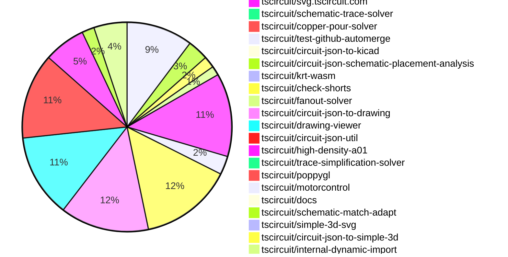

# contribution tracker

[contributions.tscircuit.com](https://contributions.tscircuit.com) ・ [tscircuit.com](https://tscircuit.com) ・ [Contribution Overviews](./contribution-overviews/) ・ [Changelogs](./changelogs/)

Generates weekly contribution overviews for tscircuit contributors. Check out all
the [contribution overviews here](./contribution-overviews/)
You can find AI-generated monthly changelogs in the [changelogs directory](./changelogs/)

- All PRs in the tscircuit org are scanned/summarized via an LLM
- The LLM classifies each Diff/PR as into a set of attributes for scoring
- All the PRs, summaries, and classifications are organized into charts and tables for [the website](https://contributions.tscircuit.com)

> Want to run locally? See the [Development Section](#development)

## Current Week

<!-- START_CURRENT_WEEK -->

# Contribution Overview 2026-11-17

The current week is shown below. There are 3 major sections:

- [Contributor Overview](#contributor-overview)
- [PRs by Repository](#prs-by-repository)
- [PRs by Contributor](#changes-by-contributor)
- [Scoring & Sponsorship Details](/docs/sponsorship-calculation-explanation.md)

## PRs by Repository

## Contributor Overview

| Contributor | 🐳 Major | 🐙 Minor | 🐌 Tiny | Score | ⭐ |
|-------------|---------|---------|---------|-------|-----|
| [ShiboSoftwareDev](#ShiboSoftwareDev) | 108 | 29 | 62 | 503.5 | 👑👑👑 |
| [seveibar](#seveibar) | 22 | 20 | 35 | 141 | 👑👑 |
| [0hmX](#0hmX) | 14 | 11 | 19 | 91 | 👑 |
| [imrishabh18](#imrishabh18) | 2 | 13 | 10 | 45 | ⭐⭐ |
| [rushabhcodes](#rushabhcodes) | 4 | 7 | 17 | 42 | ⭐⭐ |
| [MustafaMulla29](#MustafaMulla29) | 2 | 5 | 13 | 31 | ⭐⭐ |
| [Abse2001](#Abse2001) | 3 | 5 | 0 | 23 | ⭐⭐ |
| [mohan-bee](#mohan-bee) | 4 | 2 | 2 | 22 | ⭐⭐ |
| [AnasSarkiz](#AnasSarkiz) | 4 | 0 | 3 | 20 | ⭐⭐ |
| [tscircuitbot](#tscircuitbot) | 0 | 0 | 571 | 12 | ⭐⭐ |
| [GokulPandi-M](#GokulPandi-M) | 1 | 0 | 1 | 5 | ⭐ |
| [VB-Blue](#VB-Blue) | 1 | 0 | 0 | 4 | ⭐ |
| [Devesh36](#Devesh36) | 0 | 1 | 1 | 3 |  |
| [KrishnaX12](#KrishnaX12) | 0 | 1 | 0 | 2 |  |
| [AJ0070](#AJ0070) | 0 | 1 | 0 | 2 |  |

## Staff Pass Ratio (SPR)

| Contributor | Reviewed PRs | Rejections | Approvals | SPR |
|-------------|--------------|------------|-----------|-----|
| [0hmX](#0hmX) | 14 | 2 | 14 | 85.7% |
| [rushabhcodes](#rushabhcodes) | 10 | 3 | 7 | 70.0% |
| [ShiboSoftwareDev](#ShiboSoftwareDev) | 6 | 0 | 7 | 100.0% |
| [Abse2001](#Abse2001) | 3 | 0 | 3 | 100.0% |
| [MustafaMulla29](#MustafaMulla29) | 3 | 0 | 3 | 100.0% |
| [GokulPandi-M](#GokulPandi-M) | 1 | 1 | 0 | 0.0% |
| [hrithik18k](#hrithik18k) | 1 | 1 | 0 | 0.0% |
| [VB-Blue](#VB-Blue) | 1 | 0 | 1 | 100.0% |

0hmX SPR PRs (14)

- [#5804](https://github.com/tscircuit/core/pull/5804) feat: emit aggressor controls in channel simulation records
- [#5628](https://github.com/tscircuit/core/pull/5628) refactor!: remove the analog IBIS simulation API
- [#5632](https://github.com/tscircuit/core/pull/5632) feat: add <simulation.eyediagram>
- [#5650](https://github.com/tscircuit/core/pull/5650) feat: pick default pseudo-random binary sequence (PRBS) seeds across a board
- [#5647](https://github.com/tscircuit/core/pull/5647) feat: copy JLCPCB hole plating thickness into preset stackups
- [#5629](https://github.com/tscircuit/core/pull/5629) feat: add <simulation.ibismodel>
- [#5423](https://github.com/tscircuit/core/pull/5423) feat: add <simulation.pcbtransientchannelsimulation>
- [#5649](https://github.com/tscircuit/core/pull/5649) feat: add <simulation.pcbdriverreceiverchannel>
- [#11](https://github.com/tscircuit/jlcpcb-manufacturing-specs/pull/11) feat: add hole plating copper thickness to JLCPCB stackups
- [#114](https://github.com/tscircuit/circuit-json-webgpu/pull/114) feat: draw retained coloured strokes within WebGPU PCB layers
- [#6](https://github.com/tscircuit/ibis-to-spice/pull/6) feat: expose [Ramp] dV/dt and R_load on IbisBuffer
- [#141](https://github.com/tscircuit/signal-integrity-pipeline/pull/141) feat: estimate IBIS output edge duration for channel endpoints
- [#117](https://github.com/tscircuit/signal-integrity-pipeline/pull/117) feat: add isQuiet to board and the default capture duration to pipeline/timing
- [#118](https://github.com/tscircuit/signal-integrity-pipeline/pull/118) feat: inspect IBIS pin capabilities and references for channel endpoints

rushabhcodes SPR PRs (10)

- [#998](https://github.com/tscircuit/circuit-json/pull/998) Preserve arc geometry in PCB board outlines and cutouts
- [#1028](https://github.com/tscircuit/circuit-json/pull/1028) fix: preserve namespaced KiCad metadata on existing records
- [#1025](https://github.com/tscircuit/circuit-json/pull/1025) Revert "Preserve arc geometry in PCB board outlines and cutouts (#998)"
- [#1036](https://github.com/tscircuit/props/pull/1036) Preserve rectangular solder paste rotation
- [#1032](https://github.com/tscircuit/props/pull/1032) feat: add native net class authoring props
- [#5825](https://github.com/tscircuit/core/pull/5825) Compose silkscreen text rotation with parent placement
- [#5962](https://github.com/tscircuit/tscircuit.com/pull/5962) Add the Drawing tab to package previews
- [#298](https://github.com/tscircuit/circuit-json-to-gltf/pull/298) Resolve selected CAD model URLs at load time
- [#58](https://github.com/tscircuit/poppygl/pull/58) Skip shading for constant unlit opaque surfaces
- [#330](https://github.com/tscircuit/kicad-to-circuit-json/pull/330) Preserve KiCad footprint text angles and keep-upright behavior

ShiboSoftwareDev SPR PRs (6)

- [#5748](https://github.com/tscircuit/core/pull/5748) Keep fixed copper as traces between autorouting phases
- [#4091](https://github.com/tscircuit/tscircuit-autorouter/pull/4091) Reproduce whole-trace neckdowns on Glider and OrangeCrab DDR
- [#3985](https://github.com/tscircuit/tscircuit-autorouter/pull/3985) Keep preloaded copper as paths throughout Pipeline9
- [#341](https://github.com/tscircuit/fanout-solver/pull/341) Skip duplicate first-route plane searches
- [#298](https://github.com/tscircuit/fanout-solver/pull/298) Honor crossed pour antipads in final fanout validation
- [#236](https://github.com/tscircuit/bus-lanes-solver/pull/236) Preserve endpoint IDs and layer limits on completed bus traces

Abse2001 SPR PRs (3)

- [#5502](https://github.com/tscircuit/core/pull/5502) Keep small-board mouse bites drillable (#5066)
- [#5876](https://github.com/tscircuit/cli/pull/5876) Resolve relative model paths in tsci export glb and gltf (#5654)
- [#13](https://github.com/tscircuit/jlcpcb-manufacturing-specs/pull/13) Add JLCPCB panelization rules

MustafaMulla29 SPR PRs (3)

- [#580](https://github.com/tscircuit/checks/pull/580) Report schematic box width and pin-padding warnings
- [#1451](https://github.com/tscircuit/schematic-trace-solver/pull/1451) Place shared ground labels at the lower end of their rail
- [#484](https://github.com/tscircuit/circuit-json-schematic-placement-analysis/pull/484) fix: let 0 ohm links away from ground lie in line

GokulPandi-M SPR PRs (1)

- [#334](https://github.com/tscircuit/tiny-hypergraph/pull/334) Support per-route layer constraints during path search

hrithik18k SPR PRs (1)

- [#5738](https://github.com/tscircuit/core/pull/5738) test(repro): nested group keepout stays behind after packing

VB-Blue SPR PRs (1)

- [#651](https://github.com/tscircuit/jlcsearch/pull/651) fix: include LED Indication - Discrete subcategory in led derived table

> Note: AI evaluates PRs and assigns 1-3 star ratings automatically. 4 and 5 star ratings require manual staff review.

## Review Table

[reviews-received-hover]: ## "Number of reviews received for PRs for this contributor"
[approvals-received-hover]: ## "Number of approvals received for PRs this contributor authored"
[rejections-received-hover]: ## "Number of rejections received for PRs this contributor authored"
[prs-opened-hover]: ## "Number of PRs opened by this contributor"
[issues-created-hover]: ## "Number of issues created by this contributor"

| Contributor | Reviews Received | Approvals Received | Rejections Received | Approvals | Rejections Given | PRs Opened | PRs Merged | Issues Created |
|---|---|---|---|---|---|---|---|---|
| [2848823170](#2848823170) | 0 | 0 | 0 | 0 | 0 | 4 | 0 | 0 |
| [0hmX](#0hmX) | 43 | 17 | 1 | 22 | 2 | 93 | 44 | 0 |
| [0xNexuz](#0xNexuz) | 0 | 0 | 0 | 0 | 0 | 1 | 0 | 0 |
| [aaka3h](#aaka3h) | 0 | 0 | 0 | 0 | 0 | 1 | 0 | 0 |
| [abdalraof-albarbar](#abdalraof-albarbar) | 0 | 0 | 0 | 0 | 0 | 4 | 0 | 0 |
| [Abse2001](#Abse2001) | 3 | 3 | 0 | 22 | 0 | 24 | 8 | 0 |
| [AJ0070](#AJ0070) | 1 | 1 | 0 | 0 | 0 | 30 | 1 | 0 |
| [Aming9303](#Aming9303) | 0 | 0 | 0 | 0 | 0 | 2 | 0 | 0 |
| [anaaracena](#anaaracena) | 0 | 0 | 0 | 0 | 0 | 1 | 0 | 0 |
| [AnasSarkiz](#AnasSarkiz) | 8 | 6 | 0 | 2 | 0 | 13 | 7 | 0 |
| [Andresdev14](#Andresdev14) | 0 | 0 | 0 | 0 | 0 | 1 | 0 | 0 |
| [aryansanganti](#aryansanganti) | 1 | 0 | 0 | 0 | 0 | 1 | 0 | 0 |
| [ashtygn](#ashtygn) | 0 | 0 | 0 | 0 | 0 | 14 | 0 | 0 |
| [aswadi](#aswadi) | 0 | 0 | 0 | 0 | 0 | 2 | 0 | 0 |
| [bhatipoglu](#bhatipoglu) | 0 | 0 | 0 | 0 | 0 | 2 | 0 | 0 |
| [CrazyEther](#CrazyEther) | 0 | 0 | 0 | 0 | 0 | 1 | 0 | 0 |
| [dat-hoangnguyentuandat](#dat-hoangnguyentuandat) | 0 | 0 | 0 | 0 | 0 | 1 | 0 | 0 |
| [devbox-zero-ops](#devbox-zero-ops) | 0 | 0 | 0 | 0 | 0 | 8 | 0 | 0 |
| [Devesh36](#Devesh36) | 5 | 4 | 1 | 0 | 0 | 10 | 2 | 0 |
| [GokulPandi-M](#GokulPandi-M) | 16 | 3 | 3 | 0 | 0 | 11 | 2 | 0 |
| [Hajjy22](#Hajjy22) | 0 | 0 | 0 | 0 | 0 | 9 | 0 | 0 |
| [hrithik18k](#hrithik18k) | 1 | 0 | 1 | 0 | 0 | 3 | 0 | 0 |
| [imrishabh18](#imrishabh18) | 2 | 0 | 0 | 14 | 5 | 35 | 25 | 0 |
| [Kefia-02](#Kefia-02) | 0 | 0 | 0 | 0 | 0 | 1 | 0 | 0 |
| [KrishnaX12](#KrishnaX12) | 3 | 2 | 0 | 0 | 0 | 1 | 1 | 0 |
| [kunalgoesbyken](#kunalgoesbyken) | 0 | 0 | 0 | 0 | 0 | 3 | 0 | 0 |
| [LBCron](#LBCron) | 0 | 0 | 0 | 0 | 0 | 31 | 0 | 0 |
| [menwo535-jpg](#menwo535-jpg) | 0 | 0 | 0 | 0 | 0 | 2 | 0 | 0 |
| [mohan-bee](#mohan-bee) | 7 | 3 | 0 | 0 | 0 | 35 | 8 | 0 |
| [MustafaMulla29](#MustafaMulla29) | 13 | 9 | 0 | 1 | 0 | 28 | 20 | 0 |
| [NavaneethKSD](#NavaneethKSD) | 0 | 0 | 0 | 0 | 0 | 1 | 0 | 0 |
| [parthchilwerwar](#parthchilwerwar) | 1 | 0 | 0 | 0 | 0 | 1 | 0 | 0 |
| [pecopeko](#pecopeko) | 0 | 0 | 0 | 0 | 0 | 9 | 0 | 0 |
| [pethapixels-create](#pethapixels-create) | 0 | 0 | 0 | 0 | 0 | 14 | 0 | 0 |
| [rushabhcodes](#rushabhcodes) | 47 | 18 | 5 | 1 | 0 | 62 | 29 | 0 |
| [Semihzx](#Semihzx) | 0 | 0 | 0 | 0 | 0 | 1 | 0 | 0 |
| [seveibar](#seveibar) | 19 | 0 | 0 | 40 | 6 | 128 | 78 | 0 |
| [ShiboSoftwareDev](#ShiboSoftwareDev) | 68 | 47 | 2 | 12 | 0 | 337 | 201 | 0 |
| [singhaditya21](#singhaditya21) | 0 | 0 | 0 | 0 | 0 | 6 | 0 | 0 |
| [sxpnet64](#sxpnet64) | 0 | 0 | 0 | 0 | 0 | 1 | 0 | 0 |
| [thisisanubhav](#thisisanubhav) | 0 | 0 | 0 | 0 | 0 | 2 | 0 | 0 |
| [tscircuitbot](#tscircuitbot) | 0 | 0 | 0 | 0 | 0 | 695 | 571 | 0 |
| [tunguyen1993](#tunguyen1993) | 0 | 0 | 0 | 0 | 0 | 2 | 0 | 0 |
| [U-ITACHII](#U-ITACHII) | 0 | 0 | 0 | 0 | 0 | 8 | 0 | 0 |
| [VB-Blue](#VB-Blue) | 1 | 1 | 0 | 0 | 0 | 10 | 1 | 0 |

## Changes by Repository

### [tscircuit/core](https://github.com/tscircuit/core)

| PR # | Impact | Rating | Contributor | Description |
|------|--------|--------|-------------|-------------|
| [#5629](https://github.com/tscircuit/core/pull/5629) | 🐳 Major | ⭐⭐⭐ | 0hmX | Render simulation.ibismodel into a Circuit JSON IBIS model record with component, pin, and reference-port bindings, validating ambiguous, duplicate, or undeclared vendor pin bindings. |
| [#5649](https://github.com/tscircuit/core/pull/5649) | 🐳 Major | ⭐⭐⭐ | 0hmX | Adds simulation.pcbdriverreceiverchannel, resolves driver and receiver pins to IBIS models, validates PCB connectivity and routing, and writes channel records with an explicit seed when supplied. |
| [#5816](https://github.com/tscircuit/core/pull/5816) | 🐳 Major | ⭐⭐⭐ | seveibar | Fixes autorouting failure due to unrotated plated holes in packed USB-C connectors, allowing successful routing of the board. |
| [#5814](https://github.com/tscircuit/core/pull/5814) | 🐳 Major | ⭐⭐⭐ | seveibar | Adds maxLength and maxViaCount properties to Simple Route JSON connections to enforce routing constraints for traces, preserving the distinction between terminal-to-terminal and terminal-to-net connections. |
| [#5645](https://github.com/tscircuit/core/pull/5645) | 🐳 Major | ⭐⭐⭐ | seveibar | Fixes saved-phase failures by ensuring complete phases validate copper connectivity for export and replay, allowing shared anchor pads and junctions while rejecting cross-net connections. |
| [#5732](https://github.com/tscircuit/core/pull/5732) | 🐳 Major | ⭐⭐⭐ | mohan-bee | Fixes the issue where the auto_local preset ignored the allowViaInPad setting, allowing vias to be added in pads where they were explicitly prohibited by the board designer. |
| [#5731](https://github.com/tscircuit/core/pull/5731) | 🐳 Major | ⭐⭐⭐ | mohan-bee | Reproduces the lost via-in-pad override in Cores auto_local preset, ensuring that the autorouter respects the prohibition of vias in pads during routing. |
| [#5790](https://github.com/tscircuit/core/pull/5790) | 🐳 Major | ⭐⭐⭐ | ShiboSoftwareDev | Updates the bus lanes solver from version 0.0.64 to 0.0.65, incorporating multiple fixes and optimizations, including improved visibility searches and debug pad outlines. |
| [#5794](https://github.com/tscircuit/core/pull/5794) | 🐳 Major | ⭐⭐⭐ | ShiboSoftwareDev | Updates the autorouter version from 0.0.1149 to 0.0.1152 and the fanout solver version from 0.0.101 to 0.0.102, incorporating several bug fixes and performance improvements. |
| [#5782](https://github.com/tscircuit/core/pull/5782) | 🐳 Major | ⭐⭐⭐ | ShiboSoftwareDev | Fixes duplicate port entries during breakout point creation by indexing ports before the selector-index phase and clearing the cache with each inserted point. |
| [#5748](https://github.com/tscircuit/core/pull/5748) | 🐳 Major | ⭐⭐⭐ | ShiboSoftwareDev | Preserves completed DDR routes as fixed traces to maintain their paths and net ownership during subsequent autorouting phases. |
| [#5779](https://github.com/tscircuit/core/pull/5779) | 🐳 Major | ⭐⭐⭐ | ShiboSoftwareDev | Pins the private winding dependency to the latest main commit, which includes merged winding and repro changes, affecting dependency management. |
| [#5766](https://github.com/tscircuit/core/pull/5766) | 🐳 Major | ⭐⭐⭐ | ShiboSoftwareDev | Updates the tscircuitcapacity-autorouter package from version 0.0.1140 to 0.0.1142, incorporating the merged DDR stack and enhancing routing capabilities while maintaining existing functionalities. |
| [#5763](https://github.com/tscircuit/core/pull/5763) | 🐳 Major | ⭐⭐⭐ | ShiboSoftwareDev | Bumps tscircuitcapacity-autorouter from 0.0.1139 to 0.0.1140 to include the physical regional-routing terminal-overlap guard, rejecting impossible fixed endpoints before invalid via candidates or wasted search. |
| [#5765](https://github.com/tscircuit/core/pull/5765) | 🐳 Major | ⭐⭐⭐ | ShiboSoftwareDev | Reuse the existing selectAll result when resolving typed ports, so the ambiguity check shares the same traversal. |
| [#5707](https://github.com/tscircuit/core/pull/5707) | 🐳 Major | ⭐⭐⭐ | ShiboSoftwareDev | Bumps the tscircuitcapacity-autorouter package from version 0.0.1129 to 0.0.1132, improving regional force handling to preserve valid routes during optimization, specifically addressing via clearance issues in the H616 region. |
| [#5681](https://github.com/tscircuit/core/pull/5681) | 🐳 Major | ⭐⭐⭐ | ShiboSoftwareDev | Updates the autorouter to version 0.0.1126, enhancing BGA routing by enforcing stricter clearance and via requirements. |
| [#5659](https://github.com/tscircuit/core/pull/5659) | 🐳 Major | ⭐⭐⭐ | ShiboSoftwareDev | Fixes recursive rendering issue in routing callbacks that prevents proper copper pours from being generated during autorouting. |
| [#5637](https://github.com/tscircuit/core/pull/5637) | 🐳 Major | ⭐⭐⭐ | ShiboSoftwareDev | Publish completed trace-only routing phases while later phases continue, allowing for better visibility of routing progress on complex boards. |
| [#5673](https://github.com/tscircuit/core/pull/5673) | 🐳 Major | ⭐⭐⭐ | ShiboSoftwareDev | Updates the capacity autorouter and bus lanes solver dependencies, allowing for improved routing capabilities and fixes for cramped-port searches. |
| [#5657](https://github.com/tscircuit/core/pull/5657) | 🐳 Major | ⭐⭐⭐ | ShiboSoftwareDev | Reproduces a ground pour generated before its routed signal via when an autorouting:start listener reads getCircuitJson(). |
| [#5804](https://github.com/tscircuit/core/pull/5804) | 🐙 Minor | ⭐⭐ | 0hmX | Serialize aggressorPattern and aggressorDisabled as aggressor_pattern and aggressor_disabled on PCB transient channel simulation records, ensuring omitted fields are not included and preserving explicitly declared values. |
| [#5628](https://github.com/tscircuit/core/pull/5628) | 🐙 Minor | ⭐⭐ | 0hmX | Summary Bump circuit-json to 0.0.552 and tscircuitprops to 0.0.735 in the development dependencies and overrides. Remove the analog IBIS stimulus and eye declarations, IBIS pin states, and the external pcb_spice special case. Keep native analog transient analysis available through registered SPICE engines. Keep cached IBIS model restoration and narrow the copper-pour fixture to the PCB elements it renders. |
| [#5632](https://github.com/tscircuit/core/pull/5632) | 🐙 Minor | ⭐⭐ | 0hmX | Render simulation.eyediagram against transient channel records, with channel selection and timing windows expressed in milliseconds. |
| [#5650](https://github.com/tscircuit/core/pull/5650) | 🐙 Minor | ⭐⭐ | 0hmX | Allows channels using pseudo-random binary sequence (PRBS) patterns to automatically select distinct seeds based on signal names and sequence lengths, preventing identical bit transmission across channels. |
| [#5647](https://github.com/tscircuit/core/pull/5647) | 🐙 Minor | ⭐⭐ | 0hmX | Copies plated_hole_copper_thickness from the JLCPCB stackup data into pcb_stackup for boards using a JLCPCB fabricatorPreset, enabling accurate modeling of vias in PCB transient channel simulations. |
| [#5423](https://github.com/tscircuit/core/pull/5423) | 🐙 Minor | ⭐⭐ | 0hmX | Add simulation.pcbtransientchannelsimulation as a direct child of a PCB board, emitting run records with settings and covering tests for board-only rules. |
| [#5839](https://github.com/tscircuit/core/pull/5839) | 🐙 Minor | ⭐⭐ | imrishabh18 | Updates circuit-to-svg to version 0.0.463 and circuit-json-util to 0.0.135, aligning dependencies and ensuring compatibility with the latest runtime and CLI updates, while also validating authored waypoint paths and refreshing PCB snapshots. |
| [#5685](https://github.com/tscircuit/core/pull/5685) | 🐙 Minor | ⭐⭐ | imrishabh18 | Captures and normalizes schematic and source warnings and errors for the NEMA 17 example, ensuring stability across test orders. |
| [#5702](https://github.com/tscircuit/core/pull/5702) | 🐙 Minor | ⭐⭐ | imrishabh18 | Recomputes NEMA 17 diagnostics by rerunning pin specification and schematic checks using the installed Checks package, while retaining source-render annotations. |
| [#5788](https://github.com/tscircuit/core/pull/5788) | 🐙 Minor | ⭐⭐ | seveibar | Adds support for explicit autorouter selection using tscircuit and tscircuit_beta, updating the props dependency and ensuring regression tests pass for the new configurations. |
| [#5724](https://github.com/tscircuit/core/pull/5724) | 🐙 Minor | ⭐⭐ | rushabhcodes | Adds native support for pill solder-paste apertures in imported footprints, preserving stencil geometry and preventing duplicates during import. |
| [#5692](https://github.com/tscircuit/core/pull/5692) | 🐙 Minor | ⭐⭐ | rushabhcodes | Fixes the issue where a TLV75533PDBVR regulator footprint loses the requested 90 rotation on its stencil apertures, causing misalignment with copper lands. |
| [#5781](https://github.com/tscircuit/core/pull/5781) | 🐙 Minor | ⭐⭐ | ShiboSoftwareDev | Adds tests to verify that the automatic breakout-point creation correctly handles trace ports on the real iCEPi board without repeated scans. |
| [#5764](https://github.com/tscircuit/core/pull/5764) | 🐙 Minor | ⭐⭐ | ShiboSoftwareDev | A cold typed port lookup traverses the component tree twice: once to find the port and again to check ambiguity. Adds a regular PCB snapshot recording the traversal count, plus the original full IcePi circuit and its PCB snapshot. IcePi still fails fanout (1432); this repro concerns selector cost before routing. Fix stacked in 5765. Validation: both repro tests, typecheck and all ten CI test shards pass. |
| [#5777](https://github.com/tscircuit/core/pull/5777) | 🐙 Minor | ⭐⭐ | ShiboSoftwareDev | Adds a test to validate the performance of the iCEPi boards connectivity map generation, measuring the number of Set.has calls required for the process. |
| [#5756](https://github.com/tscircuit/core/pull/5756) | 🐙 Minor | ⭐⭐ | ShiboSoftwareDev | Bumps the tscircuitfanout-solver dependency from version 0.0.93 to 0.0.94, enhancing same-layer routing capabilities and ensuring compatibility with existing tests and structures. |
| [#5706](https://github.com/tscircuit/core/pull/5706) | 🐙 Minor | ⭐⭐ | ShiboSoftwareDev | Updates the ngspice engine and SPICE exporter to use newer versions of dependencies, ensuring compatibility and improved functionality in simulation tests. |
| [#5636](https://github.com/tscircuit/core/pull/5636) | 🐙 Minor | ⭐⭐ | ShiboSoftwareDev | Reproduces buffered output of completed routing work while the next autorouting phase is pending, ensuring that traces from the first phase remain accessible until the second phase is completed. |
| [#5510](https://github.com/tscircuit/core/pull/5510) | 🐙 Minor | ⭐⭐ | KrishnaX12 | Fixes the issue of redundant schematic wires being added to already connected pins during endpoint repair in the Cores schematic system. |
| [#5492](https://github.com/tscircuit/core/pull/5492) | 🐙 Minor | ⭐⭐ | Abse2001 | Reproduces the issue of insufficient drill size for mouse bites on small boards, ensuring they remain drillable. |
| [#5502](https://github.com/tscircuit/core/pull/5502) | 🐙 Minor | ⭐⭐ | Abse2001 | Adjusts mouse-bite drill sizes for small boards to ensure they remain drillable according to JLCPCBs specifications, while addressing clearance issues with traces. |

🐌 Tiny Contributions (44)

| PR # | Impact | Contributor | Description |
|------|--------|-------------|-------------|
| [#5841](https://github.com/tscircuit/core/pull/5841) | 🐌 Tiny | imrishabh18 | Update Cores circuit-json-to-gltf development dependency from 0.0.164 to 0.0.169, which includes a model-origin fix and visual regression tests. |
| [#5701](https://github.com/tscircuit/core/pull/5701) | 🐌 Tiny | imrishabh18 | Updates the tscircuitchecks dependency to version 0.0.282, ensuring that Core honors explicit false power and ground pin requirements. |
| [#5769](https://github.com/tscircuit/core/pull/5769) | 🐌 Tiny | tscircuitbot | Updates the tscircuitkrt-wasm package from version 0.1.1 to 0.1.10 in package.json |
| [#5699](https://github.com/tscircuit/core/pull/5699) | 🐌 Tiny | tscircuitbot | Updates the version of the tscircuitchecks package from 0.0.280 to 0.0.281 in package.json |
| [#5694](https://github.com/tscircuit/core/pull/5694) | 🐌 Tiny | tscircuitbot | Updates the version of the tscircuitfanout-solver package from 0.0.84 to 0.0.85 in package.json |
| [#5688](https://github.com/tscircuit/core/pull/5688) | 🐌 Tiny | tscircuitbot | Updates the version of the tscircuitchecks package from 0.0.279 to 0.0.280 in package.json |
| [#5810](https://github.com/tscircuit/core/pull/5810) | 🐌 Tiny | seveibar | Fixes default schematic box sizing for pin headers and two-pin connectors to comply with schematic placement checks. |
| [#5768](https://github.com/tscircuit/core/pull/5768) | 🐌 Tiny | seveibar | Emit a Circuit JSON warning when a board, group, breakout, or routing phase explicitly supplies autorouter.traceClearance. The message directs authors to set minTraceToPadEdgeClearance on the board or routing phase. Keep serializing the legacy field for FreeRouting compatibility. Remove the SEPIC reproduction from 5686, its two annotated snapshots, and its private board fixture. The focused warning test covers zero, a unit string, and a second render. The existing subcircuit test still verifies legacy serialization. Companion TypeScript deprecation: https:github.comtscircuitpropspull1054. Supersedes the implementation direction in 5767. Typecheck and changed tests pass. Two neighboring legacy-router PCB snapshots differ locally by 0.27 and 0.48. Both differences reproduce on untouched main. |
| [#5643](https://github.com/tscircuit/core/pull/5643) | 🐌 Tiny | seveibar | Adds four small TSX reproductions for the saved-phase bug in 5614, providing tests for various routing scenarios that previously resulted in errors during autorouting. |
| [#5641](https://github.com/tscircuit/core/pull/5641) | 🐌 Tiny | seveibar | Adds guidance on testing patterns in AGENTS.md, specifying that tests should be simple, shallow TSX without complex logic or large imports unless they represent an entire real circuit. |
| [#5723](https://github.com/tscircuit/core/pull/5723) | 🐌 Tiny | rushabhcodes | Reproduces the issue of missing support for oval and rotated paste-only apertures in the USB1046 footprint, ensuring six bottom apertures without top duplicates. |
| [#5826](https://github.com/tscircuit/core/pull/5826) | 🐌 Tiny | rushabhcodes | Updates the kicad-to-circuit-json dependency to version 0.0.154, correcting fabrication-text and keep-upright angles in existing Arduino importreroute SVGs without altering the original KiCad board or workflows. |
| [#5691](https://github.com/tscircuit/core/pull/5691) | 🐌 Tiny | rushabhcodes | Reproduces a bug where rotated paste-only apertures cannot be expressed, exposing a rotation bug in the Core. |
| [#5813](https://github.com/tscircuit/core/pull/5813) | 🐌 Tiny | ShiboSoftwareDev | Updates the autorouter version from 0.0.1154 to 0.0.1156 and the fanout solver version from 0.0.103 to 0.0.104, incorporating various improvements and fixes related to STM32MP157 BGA-channel routing and fanout solver recovery of same-net plane drops. |
| [#5800](https://github.com/tscircuit/core/pull/5800) | 🐌 Tiny | ShiboSoftwareDev | Bumps tscircuitcapacity-autorouter from 0.0.1153 to 0.0.1154 to include updates that prevent greedy crossings of immutable copper while preserving movable-route crossings for downstream unraveling. |
| [#5795](https://github.com/tscircuit/core/pull/5795) | 🐌 Tiny | ShiboSoftwareDev | Updates the tscircuitfanout-solver dependency from version 0.0.102 to 0.0.103, incorporating improvements from tscircuitfanout-solver369, which allows interior plane pads to utilize the existing centered-escape pass after original candidates while maintaining clearance checks. |
| [#5796](https://github.com/tscircuit/core/pull/5796) | 🐌 Tiny | ShiboSoftwareDev | Bumps the tscircuitcapacity-autorouter dependency from 0.0.1152 to 0.0.1153 to include fixes for terminal-adjacent via landings and improve regional subcircuit routing capabilities. |
| [#5793](https://github.com/tscircuit/core/pull/5793) | 🐌 Tiny | ShiboSoftwareDev | Updates the tscircuitcapacity-autorouter dependency from version 0.0.1148 to 0.0.1149, incorporating performance improvements and bug fixes from the upstream repository. |
| [#5789](https://github.com/tscircuit/core/pull/5789) | 🐌 Tiny | ShiboSoftwareDev | Updates the tscircuitfanout-solver dependency from version 0.0.100 to 0.0.101, incorporating improvements that avoid exact distance calculations for distant pads and vias while maintaining checks for nearby geometry. |
| [#5787](https://github.com/tscircuit/core/pull/5787) | 🐌 Tiny | ShiboSoftwareDev | Updates the bus lanes solver to version 0.0.64 and the capacity autorouter to version 0.0.1148, ensuring compatibility and performance improvements without introducing new features. |
| [#5785](https://github.com/tscircuit/core/pull/5785) | 🐌 Tiny | ShiboSoftwareDev | Updates the tscircuitcapacity-autorouter and tscircuitfanout-solver dependencies to their latest versions, ensuring compatibility and performance improvements in routing and fanout calculations. |
| [#5786](https://github.com/tscircuit/core/pull/5786) | 🐌 Tiny | ShiboSoftwareDev | Bumps tscircuitfanout-solver from 0.0.99 to 0.0.100 to include the emptysingle-via collection fast path, avoiding temporary filtered arrays while preserving existing multi-via behavior. |
| [#5783](https://github.com/tscircuit/core/pull/5783) | 🐌 Tiny | ShiboSoftwareDev | Updates the tscircuitfanout-solver dependency from version 0.0.97 to 0.0.98 to include cached static boundary-rejection reuse, optimizing candidate rebuilding by retaining search decisions and blocker counts. |
| [#5776](https://github.com/tscircuit/core/pull/5776) | 🐌 Tiny | ShiboSoftwareDev | Updates the autorouter, fanout solver, and bus lanes solver to their latest versions, ensuring compatibility and maintaining existing functionality. |
| [#5762](https://github.com/tscircuit/core/pull/5762) | 🐌 Tiny | ShiboSoftwareDev | Bumps tscircuitfanout-solver from 0.0.94 to 0.0.95 to include checked-failure route-prefix reuse, optimizing cache by reusing unchanged copper prefixes while preserving repair priorities. |
| [#5778](https://github.com/tscircuit/core/pull/5778) | 🐌 Tiny | ShiboSoftwareDev | Selects the already published indexed connectivity map and updates the dependency to version 0.0.36, ensuring alignment with the public package update while maintaining performance improvements in rendering times. |
| [#5775](https://github.com/tscircuit/core/pull/5775) | 🐌 Tiny | ShiboSoftwareDev | Updates the tscircuitcapacity-autorouter and tscircuitfanout-solver dependencies to their latest versions, ensuring compatibility and performance improvements without altering existing functionality. |
| [#5713](https://github.com/tscircuit/core/pull/5713) | 🐌 Tiny | ShiboSoftwareDev | Core turns completed DDR routes into obstacle tiles before the next routing phase, reproducing the handoff for A64 and OrangeCrab boards with detailed fixtures and SVG representations. |
| [#5744](https://github.com/tscircuit/core/pull/5744) | 🐌 Tiny | ShiboSoftwareDev | Updates the tscircuitfanout-solver package from version 0.0.92 to 0.0.93, improving the handling of plane-via candidates and ensuring successful copper escapes in the ButterStick region. |
| [#5741](https://github.com/tscircuit/core/pull/5741) | 🐌 Tiny | ShiboSoftwareDev | Updates the tscircuitfanout-solver dependency from version 0.0.91 to 0.0.92, adjusting trace widths and terminal-plane copper validation, and refining boundary-heading inference with retries for unconstrained escapes. |
| [#5719](https://github.com/tscircuit/core/pull/5719) | 🐌 Tiny | ShiboSoftwareDev | Bumps the version of tscircuitfanout-solver from 0.0.90 to 0.0.91 to include improvements in conservative segment bounds and clearance decisions for obstacles. |
| [#5712](https://github.com/tscircuit/core/pull/5712) | 🐌 Tiny | ShiboSoftwareDev | Updates the autorouter and fanout solver to their latest versions, improving routing capabilities and optimization. |
| [#5721](https://github.com/tscircuit/core/pull/5721) | 🐌 Tiny | ShiboSoftwareDev | Updates the capacity-autorouter dependency from version 0.0.1133 to 0.0.1135, which includes improvements to routing capabilities and fixes related to native regulator feedback. |
| [#5720](https://github.com/tscircuit/core/pull/5720) | 🐌 Tiny | ShiboSoftwareDev | Updates Cores canonical simulation dependency versions to published spicets 0.0.6, circuit-json-to-spice 0.0.50 and ngspice-spice-engine 0.0.25, ensuring compatibility with downstream dependencies and incorporating parser fixes and corrections. |
| [#5716](https://github.com/tscircuit/core/pull/5716) | 🐌 Tiny | ShiboSoftwareDev | Bumps tscircuitfanout-solver from 0.0.89 to 0.0.90 to optimize warm plane searches by skipping geometry construction when static clearance rejects all endpoint variants and the base plan, while maintaining cache misses, endpoint ordering, and live copper checks. |
| [#5705](https://github.com/tscircuit/core/pull/5705) | 🐌 Tiny | ShiboSoftwareDev | Bumps tscircuitfanout-solver from 0.0.87 to 0.0.88 to include support for antipads through crossed copper pours while preserving clearance rejection on terminal layers, pads, and through-holes. |
| [#5698](https://github.com/tscircuit/core/pull/5698) | 🐌 Tiny | ShiboSoftwareDev | Bumps the tscircuitfanout-solver dependency from version 0.0.86 to 0.0.87, improving clearance-scan performance by skipping distant obstacles before scanning their aliases. |
| [#5696](https://github.com/tscircuit/core/pull/5696) | 🐌 Tiny | ShiboSoftwareDev | Bumps the tscircuitcapacity-autorouter package version from 0.0.1128 to 0.0.1129, ensuring improved handling of fixed-via clearance violations during autorouting processes. |
| [#5690](https://github.com/tscircuit/core/pull/5690) | 🐌 Tiny | ShiboSoftwareDev | Updates the autorouter and fanout solver dependencies to their latest versions, ensuring compatibility and improved functionality in routing and clearance checks. |
| [#5683](https://github.com/tscircuit/core/pull/5683) | 🐌 Tiny | ShiboSoftwareDev | Updates the tscircuitcapacity-autorouter package from version 0.0.1126 to 0.0.1127, which includes improvements to the repair03 process and the native trace-pair DRC evaluator during via cleanup. |
| [#5679](https://github.com/tscircuit/core/pull/5679) | 🐌 Tiny | ShiboSoftwareDev | Updates the tscircuitcapacity-autorouter dependency from version 0.0.1124 to 0.0.1125, which includes improvements to pad-alias resolution during clearance search and a grid correction for component-pad-only A13. |
| [#5642](https://github.com/tscircuit/core/pull/5642) | 🐌 Tiny | ShiboSoftwareDev | Bumps the tscircuitcapacity-autorouter dependency from version 0.0.1120 to 0.0.1121, incorporating improvements and fixes from upstream, including enhanced clearance-grid channel builds and reduced physical findings in routing tests. |
| [#5638](https://github.com/tscircuit/core/pull/5638) | 🐌 Tiny | ShiboSoftwareDev | Bumps the tscircuitcapacity-autorouter dependency from version 0.0.1119 to 0.0.1120, improving routing preferences and connection stitching. |
| [#5686](https://github.com/tscircuit/core/pull/5686) | 🐌 Tiny | GokulPandi-M | Motivation Increasing autorouter.traceClearance should change the clearance requested from the router. On this SEPIC board, requesting either 0.25 mm or 0.50 mm produces identical routing input with minTraceToPadEdgeClearance: 0.1. The larger requested spacing is silently lost before routing, so changing this setting does not enforce the intended clearance. This reproduction renders the full board TSX, retains its manual traces, and captures the input passed to the native local autorouter. The passing characterization test records the current bug; each snapshot labels the requested clearance and the received input field. Those labels describe routing settings, not measured copper gaps.  Requested: 0.25 mm  Requested: 0.50 mm   ---  ---   !Board requesting 0.25 mm; router receives 0.1 mm(https:raw.githubusercontent.comGokulPandi-Mcore5c476f43e2f901dc405c4708c5549ecfa778dd05testsrepros__snapshots__repro-autorouter-clearance-board-0.25mm-pcb.snap.svg)  !Board requesting 0.50 mm; router receives 0.1 mm(https:raw.githubusercontent.comGokulPandi-Mcore5c476f43e2f901dc405c4708c5549ecfa778dd05testsrepros__snapshots__repro-autorouter-clearance-board-0.50mm-pcb.snap.svg)   Validation Reproduction and snapshot verification pass: 1 test, 7 assertions. Type check and production build pass. Source fixture retains the boards components, placements and eight manual traces; no production code changes. |

### [tscircuit/ibis-to-spice](https://github.com/tscircuit/ibis-to-spice)

| PR # | Impact | Rating | Contributor | Description |
|------|--------|--------|-------------|-------------|
| [#8](https://github.com/tscircuit/ibis-to-spice/pull/8) | 🐳 Major | ⭐⭐⭐ | 0hmX | Share scalar reference-voltage resolution between rail checks and SPICE conversion, accept all four explicit references without Voltage Range in separate-reference conversion, and reject missing typical waveform samples when parsing the selected model. |
| [#7](https://github.com/tscircuit/ibis-to-spice/pull/7) | 🐳 Major | ⭐⭐⭐ | 0hmX | Exports the resolveIbisReferences function to unify rail mapping and diagnostics in the signal-integrity pipeline, ensuring consistent output across multiple runs. |
| [#6](https://github.com/tscircuit/ibis-to-spice/pull/6) | 🐳 Major | ⭐⭐⭐ | 0hmX | Expose the typical, minimum and maximum rising and falling Ramp ratios on IbisBuffer.ramp, along with the optional R_load in ohms. |

### [tscircuit/signal-integrity-pipeline](https://github.com/tscircuit/signal-integrity-pipeline)

| PR # | Impact | Rating | Contributor | Description |
|------|--------|--------|-------------|-------------|
| [#99](https://github.com/tscircuit/signal-integrity-pipeline/pull/99) | 🐳 Major | ⭐⭐⭐ | 0hmX | Prepare each PCB transient channel simulation written by core. Validate its driverreceiver channels, scope the copper and IBIS models, and lower the settings, stimuli and probes used by routed admission in 100. Stacked on 120.  New concepts Channel simulation preparation. prepareChannelSimulationById prepares the drivers, receivers, timing and stimuli for one simulation. Model, supply and control helpers return updated Circuit JSON. Declared and nominal supplies. A declared voltage source stays with the retained nets it supplies. The IBIS reference voltages bias unpowered rails. Pseudo-random binary sequence (PRBS). The seed determines the starting phase. Preparation generates only the bits needed for the recording, up to the pattern limit. Adjacent routed segments may share a physical endpoint. Constant drivers hold their level from t0 regardless of the stimulus offset.  Aggressor states Use aggressorPattern to set a quiet level or switching pattern, or set aggressorDisabled for high impedance. Every retained output-capable pin outside the declared driver roles needs an explicit state, including bidirectional receivers. Admission names the pins in the error if their state is missing. This PR pins the core preview from tscircuitcore5804 so TSX emits the aggressor fields. Switch the preview pin to the release when it ships. |
| [#120](https://github.com/tscircuit/signal-integrity-pipeline/pull/120) | 🐳 Major | ⭐⭐⭐ | 0hmX | Adds CopperScope for routed channel extraction. Stacked on 158. Routed admission in 99 supplies the distance in millimetres and defaults to 32 mm. Scope rejects non-finite or negative distances with simulation_scope. |
| [#158](https://github.com/tscircuit/signal-integrity-pipeline/pull/158) | 🐳 Major | ⭐⭐⭐ | 0hmX | Refactors the filtering of Circuit JSON records using the cju utility, ensuring local bookkeeping and maintaining existing checks for cardinality and duplicate identifiers. |
| [#141](https://github.com/tscircuit/signal-integrity-pipeline/pull/141) | 🐳 Major | ⭐⭐⭐ | 0hmX | Adds edgeDurationSeconds to estimate the 1090 edge duration for channel endpoints, enabling accurate transient timestep sizing across fixtures. |
| [#118](https://github.com/tscircuit/signal-integrity-pipeline/pull/118) | 🐳 Major | ⭐⭐⭐ | 0hmX | Resolves the buffer, pin capabilities and reference rails for selected channel endpoints. Stacked on 117. The inspection exports have no production callers in this layer. 99 uses them to prepare channels. Inspection resolves the selected pins rail overrides and vendor pin mappings through resolveIbisReferences and checks clamp voltages at the typical corner. It gets the typical voltages from resolveIbisReferenceVoltages, the same function the converter uses. It checks every selected pin binding for duplicates before skipping power, ground and unconnected pins. IBIS rail ports (7)(https:github.comtscircuitibis-to-spicepull7)  Shared reference voltages (8)(https:github.comtscircuitibis-to-spicepull8) |
| [#98](https://github.com/tscircuit/signal-integrity-pipeline/pull/98) | 🐳 Major | ⭐⭐⭐ | 0hmX | Removes the 3D extraction pipeline, DDR report and viewer, old observation folding, and their examples and tests. Retains the independently usable board, simulation, and adapter utilities. |
| [#116](https://github.com/tscircuit/signal-integrity-pipeline/pull/116) | 🐳 Major | ⭐⭐⭐ | 0hmX | Adds circuit-json-to-connectivity-map 0.0.35 as a direct dependency and uses it for source-net membership, introducing helpers for source connection groups and passive bridges for signal analysis. |
| [#127](https://github.com/tscircuit/signal-integrity-pipeline/pull/127) | 🐳 Major | ⭐⭐⭐ | 0hmX | Remove the local Circuit JSON schema overrides, the obsolete AM3352 fixture and its attribution, and the two tests for legacy forms. Keep the malformed-record checks.  Input checked against circuit-json 0.0.552  Failures   ---  ---:   Private DDR3 board  0   Fresh core 0.0.2409 render of examplesroutedtwo-trace-board.tsx  0   testsfixturesstraight.circuit.json  0   Old AM3352 core export  234  Old exports that use the removed forms now fail with a circuit_schema error identifying the record. Re-export those boards with current core. This follows ShiboSoftwareDevs review comment(https:github.comtscircuitsignal-integrity-pipelinepull125discussion_r4618728046) and is stacked on 125.  Generated with Claude Code(https:claude.comclaude-code) |
| [#119](https://github.com/tscircuit/signal-integrity-pipeline/pull/119) | 🐙 Minor | ⭐⭐ | 0hmX | Check that selected routed copper connects each driver to its receivers and follows a linear path. The check raises channel_fanout for a branch, channel_net for disconnected copper, and channel_driver_terminal_missing or channel_receiver_terminal_missing for missing PCB terminals in strict mode. |
| [#117](https://github.com/tscircuit/signal-integrity-pipeline/pull/117) | 🐙 Minor | ⭐⭐ | 0hmX | Adds isQuiet functionality to determine if a channel is quiet and sets a default capture duration for timing in the pipeline. |

🐌 Tiny Contributions (17)

| PR # | Impact | Contributor | Description |
|------|--------|-------------|-------------|
| [#156](https://github.com/tscircuit/signal-integrity-pipeline/pull/156) | 🐌 Tiny | 0hmX | Renames the seed argument to memberId in the sourceNetMembers function to clarify its purpose as the identifier for the source port or net. |
| [#155](https://github.com/tscircuit/signal-integrity-pipeline/pull/155) | 🐌 Tiny | 0hmX | Add three rules to AGENTS.md regarding naming conventions, value transformation, and function length. |
| [#143](https://github.com/tscircuit/signal-integrity-pipeline/pull/143) | 🐌 Tiny | 0hmX | Adds tests for IBIS pin inspection and edge duration using real vendor files, ensuring proper verification of vendor models and their integration into the testing framework. |
| [#151](https://github.com/tscircuit/signal-integrity-pipeline/pull/151) | 🐌 Tiny | 0hmX | This PR changes the CI configuration to utilize tscircuitplop workflow templates for formatting, typechecking, tests, and package verification, while retaining the existing CI triggers and toolchain. |
| [#147](https://github.com/tscircuit/signal-integrity-pipeline/pull/147) | 🐌 Tiny | 0hmX | Adds flatten-jscore and tscircuitcircuit-json-util as direct runtime dependencies, pinning their versions to 1.6.14 and 0.0.123 respectively. |
| [#145](https://github.com/tscircuit/signal-integrity-pipeline/pull/145) | 🐌 Tiny | 0hmX | Pins tscircuitibis-to-spice to version 5feb4d0, ensuring consistent behavior across converter cases by locking the dependency to a specific commit that includes ramp parsing, reference ports, and shared reference voltages. |
| [#144](https://github.com/tscircuit/signal-integrity-pipeline/pull/144) | 🐌 Tiny | 0hmX | Removes unnecessary metadata fields from the vendor model lock file, streamlining the data structure. |
| [#140](https://github.com/tscircuit/signal-integrity-pipeline/pull/140) | 🐌 Tiny | 0hmX | Pins tscircuitibis-to-spice to the merged reference export commit acf8701, ensuring consistent behavior with edge-duration estimation and rail lookup functionality. |
| [#139](https://github.com/tscircuit/signal-integrity-pipeline/pull/139) | 🐌 Tiny | 0hmX | Adds a rule to AGENTS.md stating that pushed PR history should not be rewritten, emphasizing the importance of maintaining commit history for review purposes. |
| [#125](https://github.com/tscircuit/signal-integrity-pipeline/pull/125) | 🐌 Tiny | 0hmX | Makes pnpm lint enforce a 120-character limit for TypeScript, TSX, and MJS files, with an exception for URL-only lines. It also enforces one type member or multiline object property per line and keeps the existing one-statement rule. This repository has no formatter. Review feedback called out long lines and multiple declarations on one line, so this PR fixes the existing violations and makes ESLint catch new ones. Stacked on 98. |
| [#115](https://github.com/tscircuit/signal-integrity-pipeline/pull/115) | 🐌 Tiny | 0hmX | Updates dependencies to the latest versions, including tscircuitcore, tscircuitprops, and circuit-json, while adjusting peer dependencies and removing unused packages. |
| [#137](https://github.com/tscircuit/signal-integrity-pipeline/pull/137) | 🐌 Tiny | 0hmX | Allows multiple behaviour files under testsmodulesource while maintaining source mapping in ESLint, producing lint errors for unmatched paths. |
| [#135](https://github.com/tscircuit/signal-integrity-pipeline/pull/135) | 🐌 Tiny | 0hmX | Migrates the test suite to Bun, updates CI workflows, and renames SVG snapshot files while ensuring byte-identical outputs. |
| [#129](https://github.com/tscircuit/signal-integrity-pipeline/pull/129) | 🐌 Tiny | 0hmX | Replaces the pnpm lockfile and workspace configuration with a frozen Bun 1.3.14 install, updating CI and release jobs to use Bun instead of pnpm. |
| [#124](https://github.com/tscircuit/signal-integrity-pipeline/pull/124) | 🐌 Tiny | 0hmX | Records the code, test, and PR conventions used across the routed pipeline. |
| [#131](https://github.com/tscircuit/signal-integrity-pipeline/pull/131) | 🐌 Tiny | 0hmX | Formats the base repository with Biome 2.0.0 and checks formatting in CI. This is the third tooling layer, stacked on 129 above the contributor guide in 124.  New concepts Biome configuration. Uses the tscircuit template with repository-specific exclusions for generated output, models, and snapshots. Lint ownership. Biome handles layout and import order. ESLint retains JSDoc, typed signatures, enum restrictions, file length, and test-to-source rules. Feature layers above this PR are Biome-formatted and run their tests with bun:test. |
| [#133](https://github.com/tscircuit/signal-integrity-pipeline/pull/133) | 🐌 Tiny | 0hmX | Stacked on main, directly below 117. Use named inputs for internal pipeline and tooling calls. Move stateful helpers to module scope and name return shapes and limits so callers can read their intent at the call site. The public transmittedBits helper now takes a named input object.  New concepts Named inputs make the roles of multiple arguments explicit at a call site. The circuit-node lookup factory captures the same per-circuit maps and returns the node lookup used by declarations and deck assembly. Compiled buffers are typed as groups in experiment order, with each groups buffers in model order.  Generated with Claude Code(https:claude.comclaude-code) |

### [tscircuit/circuit-json-to-differential-pair-phase-skew](https://github.com/tscircuit/circuit-json-to-differential-pair-phase-skew)

| PR # | Impact | Rating | Contributor | Description |
|------|--------|--------|-------------|-------------|
| [#2](https://github.com/tscircuit/circuit-json-to-differential-pair-phase-skew/pull/2) | 🐳 Major | ⭐⭐⭐ | 0hmX | Adds getDifferentialPairPhaseSkew( circuitJson ), a pure function that computes KiCad-style phase skew for every routed differential pair, so pcb-viewer can draw it on demand instead of reading it from Circuit JSON. It ports the calculation from tscircuitcore 5749 (closed) and the via length through the stackup from core 5752 (closed), with the shared contracts snake_case output: source_bus_id, positive_trace  negative_trace (pcb_trace_id, max_phase_skew, min_phase_skew, segments with optional phase_skew), max_abs_phase_skew, end_to_end_length_delta (always present) and max_length_skew (copied from differentialpair maxLengthSkew, an unsigned limit). Reads Circuit JSON through tscircuitcircuit-json-util (cju) and finds each pairs board with its createBoardOwnerMap. Reads the boards thickness and num_layers through circuit-jsons pcb_board schema, so a record that omits them gets the schemas defaults. Walks copper with the copper renderers layer rules: wire points on one layer, a wire point and a via on one of the vias layers, a through pad across its pad. A via joins its two layers whichever way it is stored, also at the start of a route. Two vias in a row, as core routes pcbPath vias, join on the layer they share. Measures routing inside the start and end pads, and on either side of a via inside its pad where the vias outer diameter is known, straight from the pad centre to where the route leaves the pad, or to a via inside the pad, as KiCads tuning path does, so a jog hidden in a pad, its drill or a vias pad adds no phase skew. Pads are measured by their outer copper outline as renderers draw it (drill included, oval plated pads as ellipses), built from each pad shapes fields without throwing; each leg is checked for where it first crosses the outline (points on an edge count as inside), so a leg through the notch of a concave pad leaves the pad there however the route is split. Routing whose straight replacement would cross a concave pads notch is kept as drawn. Cuts teardrop tapers into constant-width wire points every 0.01 mm of width change before clipping, so matching and drawing use the local width, also where a taper crosses a pad edge. A via counts its height through the boards stackup; without one, it is estimated by spacing copper layers evenly through the board thickness by num_layers. That is close to KiCads default stackup but not equal (KiCad takes off copper and solder mask first: 1.58 mm rather than 1.6 mm top to bottom on a 1.6 mm 4-layer board). Ramps are sampled every 0.05 mm, joining neighbours with the same rounded phase skew (10 nm), so sub-micron ramps keep their gradient. A pair is left out, without throwing or hiding other pairs, when a side is routed as several pcb_traces or is unrouted, the same trace is on both sides, a trace has no planar copper (a via in pad joining two pads at one point), a traces copper jumps layers without a via or changes to a copper layer its board doesnt have, or its boards dimensions fail the pcb_board schema or still give no finite length. Deleted with the core render phase: the stored element and its colours, the runtime error for a failed pair, the split-pair warning, and the teardropasync-routing ordering (a pure function measures whatever Circuit JSON it is given). Functions return new values instead of mutating their arguments (walk joining, interval insertion, phase skew range), per AGENTS.md. Tests: the TSX USB reproduction (core 5747), the KiCad-ported behaviour tests from core 5749 and pcb-viewer fix6calc, and regression tests for the cases above, all rendered through tscircuitcore, with SVG snapshots of the overlay in KiCads colours. Packages: adds tscircuitcircuit-json-util as a dependency; tscircuitcore, tscircuit, tscircuitchecks, react and bun-match-svg as test-only dev dependencies. Install preview (no build step; ships lib.ts): bash bun add https:pkg.pr.newtscircuitcircuit-json-to-differential-pair-phase-skew0836b0e  mermaid flowchart LR Asource_bus with differential_pair -- Bone pcb_trace per side B -- Tcut tapers into constant-width pieces T -- Cclip routing inside start and end pads and via pads C -- Dwalk copper by renderer layer rules, vias by stackup height, tapers by local width D --no planar copper or a layer jump Xpair left out D -- Eorient walks from output ports E -- Ffind parallel, close coupled runs F -- Gspans: unknown, measured, interpolated G -- Hsegments every 0.05 mm with phase_skew, equal neighbours joined  Stacked on: 1 (scaffold).  New concepts Phase skew: at a point along a pair, how much farther this trace has run than its partner (mm). It is signed per trace, as KiCad shows it: positive_trace holds P minus N and negative_trace holds N minus P, so the two traces show opposite colours at the same place. end_to_end_length_delta is always P minus N. Coupled run: a stretch where both traces run parallel (cosine  0.9999) on one layer within (gap  mean width)  1.2. Phase skew is known inside runs, interpolated between them, and unknown before the first and after the last. Pad clipping: KiCads OptimiseTraceInPad and OptimiseTraceInVia. From the end of a route inside its pad, the measured path runs straight to the first point where the route leaves the pads outer outline, or to a via inside the pad; the wire points in between are dropped. Routing that already runs straight is left as it is. Behaviour differs from core in one place: a via counts its height through the boards stackup (or an estimate from evenly spaced layers through its thickness without one), as core 5752 proposed. Core main still counts 1.6 mm per via in pcb_trace.trace_length, so on boards that arent 1.6 mm thick end_to_end_length_delta can differ from cores bus length skew check. |

🐌 Tiny Contributions (1)

| PR # | Impact | Contributor | Description |
|------|--------|-------------|-------------|
| [#1](https://github.com/tscircuit/circuit-json-to-differential-pair-phase-skew/pull/1) | 🐌 Tiny | 0hmX | Sets up the package so the differential pair phase skew calculation can land in the next PR. |

### [tscircuit/circuit-json](https://github.com/tscircuit/circuit-json)

| PR # | Impact | Rating | Contributor | Description |
|------|--------|--------|-------------|-------------|
| [#1041](https://github.com/tscircuit/circuit-json/pull/1041) | 🐳 Major | ⭐⭐⭐ | seveibar | Adds optional schematic_length_unit to 18 schematic record types for specifying geometry length units, supporting mm, in, and a legacy unit. |
| [#1017](https://github.com/tscircuit/circuit-json/pull/1017) | 🐳 Major | ⭐⭐⭐ | seveibar | Proposes how laser-engraved text on an assembly part appears in Circuit JSON, as the counterpart of manufacturing.laserengraving.text  from tscircuitprops1025. It is two records, split the way Circuit JSON already splits source and output: - source_laser_engraving_text: the manufacturing step. What is engraved and how, with no geometry. - cad_laser_engraving_text: the 3D output. Where that text sits on the part, as a resolved world-space frame. |
| [#1023](https://github.com/tscircuit/circuit-json/pull/1023) | 🐳 Major | ⭐⭐⭐ | seveibar | Adds new elements for wire harness drawings, including cable wires, harness views, drawing tables, and balloons, enhancing the representation of cable manufacturing in the system. |
| [#1019](https://github.com/tscircuit/circuit-json/pull/1019) | 🐳 Major | ⭐⭐⭐ | seveibar | Proposes the Circuit JSON contract for per-net PCB trace clearance by storing the authoring value on source_net.min_trace_clearance as an optional finite, nonnegative number in millimeters. |
| [#998](https://github.com/tscircuit/circuit-json/pull/998) | 🐳 Major | ⭐⭐⭐ | rushabhcodes | Preserves arc geometry in PCB board outlines and cutouts by reusing the existing BRep point_with_bulge schema, preventing loss of circular arc data during KiCad export. |
| [#1042](https://github.com/tscircuit/circuit-json/pull/1042) | 🐙 Minor | ⭐⭐ | 0hmX | Add optional aggressor_pattern and aggressor_disabled fields to PCB transient channel simulation records, allowing for more precise control over aggressor behavior in simulations. |
| [#1034](https://github.com/tscircuit/circuit-json/pull/1034) | 🐙 Minor | ⭐⭐ | seveibar | Adds an optional corner_radius to cad_sticker so stickers with rounded corners can be described. |
| [#1018](https://github.com/tscircuit/circuit-json/pull/1018) | 🐙 Minor | ⭐⭐ | seveibar | Adds support for cad_sticker and source_sticker elements in Circuit JSON, allowing for the representation of stickers applied to components in circuit assemblies. |

🐌 Tiny Contributions (7)

| PR # | Impact | Contributor | Description |
|------|--------|-------------|-------------|
| [#1043](https://github.com/tscircuit/circuit-json/pull/1043) | 🐌 Tiny | tscircuitbot | Automated package update |
| [#1031](https://github.com/tscircuit/circuit-json/pull/1031) | 🐌 Tiny | tscircuitbot | Automated package update |
| [#1030](https://github.com/tscircuit/circuit-json/pull/1030) | 🐌 Tiny | tscircuitbot | Automated package update |
| [#1035](https://github.com/tscircuit/circuit-json/pull/1035) | 🐌 Tiny | tscircuitbot | Automated package update |
| [#1026](https://github.com/tscircuit/circuit-json/pull/1026) | 🐌 Tiny | tscircuitbot | Automated package update |
| [#1024](https://github.com/tscircuit/circuit-json/pull/1024) | 🐌 Tiny | tscircuitbot | Automated package update |
| [#1020](https://github.com/tscircuit/circuit-json/pull/1020) | 🐌 Tiny | tscircuitbot | Automated package update |

### [tscircuit/props](https://github.com/tscircuit/props)

| PR # | Impact | Rating | Contributor | Description |
|------|--------|--------|-------------|-------------|
| [#1030](https://github.com/tscircuit/props/pull/1030) | 🐳 Major | ⭐⭐⭐ | seveibar | Add support for wire harness drawings including cable specifications, wiring tables, and BOM tables in TSX format. |
| [#1027](https://github.com/tscircuit/props/pull/1027) | 🐳 Major | ⭐⭐⭐ | seveibar | Proposes the optional minTraceClearance?: Distance prop on net. |
| [#1025](https://github.com/tscircuit/props/pull/1025) | 🐳 Major | ⭐⭐⭐ | seveibar | Proposes a manufacturing namespace with two elements for laser-engraved marks on a part surface. They are children of assembly.printedpart or assembly.part. Elements are named for the process, so a mark says how it is made and not only how it looks. |
| [#1058](https://github.com/tscircuit/props/pull/1058) | 🐙 Minor | ⭐⭐ | 0hmX | Add optional aggressorPattern and aggressorDisabled props to simulation.pcbtransientchannelsimulation for enhanced control over simulation aggressors. |
| [#1056](https://github.com/tscircuit/props/pull/1056) | 🐙 Minor | ⭐⭐ | seveibar | Defines defaultSchematicLengthUnit for boards and subcircuits, allowing for unit specification in mm, in, or a legacy unit, with boards defaulting to the legacy unit. |
| [#1055](https://github.com/tscircuit/props/pull/1055) | 🐙 Minor | ⭐⭐ | seveibar | Adds tscircuit to the public autorouter preset types and schemas, enabling TSX authors to discover it through autocomplete. |
| [#1044](https://github.com/tscircuit/props/pull/1044) | 🐙 Minor | ⭐⭐ | seveibar | Adds cornerRadius to assembly.sticker  for stickers with rounded corners, allowing for customizable rounded corners up to half the width or height of the sticker. |
| [#1026](https://github.com/tscircuit/props/pull/1026) | 🐙 Minor | ⭐⭐ | seveibar | Adds assemblyProps.sticker for an assembly.sticker  element, allowing users to apply adhesive stickers to parts in their assemblies. |
| [#1036](https://github.com/tscircuit/props/pull/1036) | 🐙 Minor | ⭐⭐ | rushabhcodes | Retains the existing pcbRotation placement prop in the rectangular solder-paste interface and schema to address the rotation input gap reported by Jan Mrzek. |
| [#1035](https://github.com/tscircuit/props/pull/1035) | 🐙 Minor | ⭐⭐ | rushabhcodes | Fixes the issue where rotated paste-only apertures lose their requested rotation during props validation. |

🐌 Tiny Contributions (2)

| PR # | Impact | Contributor | Description |
|------|--------|-------------|-------------|
| [#1054](https://github.com/tscircuit/props/pull/1054) | 🐌 Tiny | seveibar | Deprecates the legacy autorouter option traceClearance in TypeScript and the generated props overview, directing users to use minTraceToPadEdgeClearance instead. |
| [#1051](https://github.com/tscircuit/props/pull/1051) | 🐌 Tiny | rushabhcodes | Adds support for pill-shaped solder paste props to the existing API, allowing for the representation of oval and rotated paste-only apertures in PCB designs. |

### [tscircuit/jlcpcb-manufacturing-specs](https://github.com/tscircuit/jlcpcb-manufacturing-specs)

| PR # | Impact | Rating | Contributor | Description |
|------|--------|--------|-------------|-------------|
| [#13](https://github.com/tscircuit/jlcpcb-manufacturing-specs/pull/13) | 🐳 Major | ⭐⭐⭐ | Abse2001 | Adds JLCPCBs published panelization rules for PCB manufacturing, including specifications for mouse-bite drills, breakaway tabs, and board spacing. |
| [#11](https://github.com/tscircuit/jlcpcb-manufacturing-specs/pull/11) | 🐙 Minor | ⭐⭐ | 0hmX | Adds plated_hole_copper_thickness to every JLCPCB stackup, setting it to JLCPCBs published average hole plating thickness of 0.018 mm for all stackups. |

### [tscircuit/pcb-viewer](https://github.com/tscircuit/pcb-viewer)

🐌 Tiny Contributions (1)

| PR # | Impact | Contributor | Description |
|------|--------|-------------|-------------|
| [#1223](https://github.com/tscircuit/pcb-viewer/pull/1223) | 🐌 Tiny | 0hmX | Adds support for rendering differential-pair local skew in the WebGPU rendering engine, allowing for accurate visual representation of skew in PCB designs. |

### [tscircuit/jlcsearch](https://github.com/tscircuit/jlcsearch)

| PR # | Impact | Rating | Contributor | Description |
|------|--------|--------|-------------|-------------|
| [#657](https://github.com/tscircuit/jlcsearch/pull/657) | 🐳 Major | ⭐⭐⭐ | imrishabh18 | Optimizes search functionality by incorporating package codes into the text index, reducing candidate results and improving search speed. |
| [#651](https://github.com/tscircuit/jlcsearch/pull/651) | 🐳 Major | ⭐⭐⭐ | VB-Blue | Adds LED Indication - Discrete to ledTableSpec.listCandidateComponents so standard indicator LEDs are included in the led derived table and ledslist, while updating metadata parsing for discrete indicator LEDs. |

### [tscircuit/tscircuit-autorouter](https://github.com/tscircuit/tscircuit-autorouter)

| PR # | Impact | Rating | Contributor | Description |
|------|--------|--------|-------------|-------------|
| [#3964](https://github.com/tscircuit/tscircuit-autorouter/pull/3964) | 🐳 Major | ⭐⭐⭐ | imrishabh18 | Fixes phantom via repair on the RP2040 motor controller by ensuring existing plated-hole transitions are not treated as new vias. |
| [#4124](https://github.com/tscircuit/tscircuit-autorouter/pull/4124) | 🐳 Major | ⭐⭐⭐ | seveibar | Reduces copper DRC violations from 7 to 6 by ensuring trace simplification respects the boards 0.20 mm trace-to-hole edge clearance. |
| [#4130](https://github.com/tscircuit/tscircuit-autorouter/pull/4130) | 🐳 Major | ⭐⭐⭐ | seveibar | Reproduce high-density routing cannot complete the GND connection on the Four-port USB hub source(https:github.comtscircuitbasic-usbc-devicesblob4a134c7046b91a66ba77106b4bca589d7c00aaa8hub.circuit.tsx). This capture retains the board placement, connections and design rules and replaces the board-level router with the default local Pipeline 9. The input has 55 connections and 356 obstacles. The board uses tscircuit 0.0.3271 and the bundled autorouter 0.0.1147. Its routing result includes this finding:  Pipeline9 primary high-density routing failed: B01 failed: No path found for source_net_0_mst76; regional fallback failed: Failed to solve 1 nodes, cmn_29. err0: GrowShrinkHighDensityIntraNodeSolver failed after resizing to 8x. Last error: All solvers failed in hyper solver. Example failures: Candidate solution rejected by validator, Candidate solution rejected by validator, CachedIntraNodeRouteSolver ran out of iterations (MAX_ITERATIONS8000), CachedIntraNodeRouteSolver ran out of iterations (MAX_ITERATIONS8000), CachedIntraNodeRouteSolver ran out of iterations (MAX_ITERATIONS8000). (capacity-autorouter0.0.1147) The routing failure leaves the board without global routes. From the repository root after installing dependencies, run: sh bun fixturesbug-reportsbugreport111-0535adreproduce.ts  The command exits nonzero while the reported defect reproduces. The adjacent Cosmos fixture opens the same input in the pipeline debugger. Public autorouting bug report(https:api.tscircuit.comautoroutingbug_reportsview?autorouting_bug_report_id0535adf0-8deb-4d71-82db-27c320495fb7) |
| [#4075](https://github.com/tscircuit/tscircuit-autorouter/pull/4075) | 🐳 Major | ⭐⭐⭐ | seveibar | Reduces copper DRC violations on the gamepad SRJ from 9 to 7 by reserving via footprints during routing to prevent accidental contacts. |
| [#4036](https://github.com/tscircuit/tscircuit-autorouter/pull/4036) | 🐳 Major | ⭐⭐⭐ | seveibar | Fixes autorouting failure when routing connections near fine-pitch pads by preserving pad escapes with a refined grid selection process. |
| [#3969](https://github.com/tscircuit/tscircuit-autorouter/pull/3969) | 🐳 Major | ⭐⭐⭐ | seveibar | Fixes autorouting failure by utilizing the connectivity map for calculating the via lower bound in the polyline solver, resolving VREF fanout rejection issues. |
| [#4000](https://github.com/tscircuit/tscircuit-autorouter/pull/4000) | 🐳 Major | ⭐⭐⭐ | mohan-bee | Pins the length-matching solver to a specific commit to fix routing issues with differential pairs. |
| [#4110](https://github.com/tscircuit/tscircuit-autorouter/pull/4110) | 🐳 Major | ⭐⭐⭐ | ShiboSoftwareDev | Completes the routing of all 72 DDR nets for the STM32MP157 by implementing a new BGA escape routing solver that effectively utilizes narrow pad channels, ensuring all connections are electrically complete and meet clearance requirements. |
| [#4109](https://github.com/tscircuit/tscircuit-autorouter/pull/4109) | 🐳 Major | ⭐⭐⭐ | ShiboSoftwareDev | Fixes autorouting failure in STM32MP157 DDR board by reproducing the incomplete routing and updating the visual regression tests. |
| [#4111](https://github.com/tscircuit/tscircuit-autorouter/pull/4111) | 🐳 Major | ⭐⭐⭐ | ShiboSoftwareDev | Replays the greedy finishing pass used by Pipeline9 on an anonymous captured circuit fragment: 18 regions, 19 ports, and immutable preloaded copper. The current dependency reports success with one impossible same-layer crossing. |
| [#4059](https://github.com/tscircuit/tscircuit-autorouter/pull/4059) | 🐳 Major | ⭐⭐⭐ | ShiboSoftwareDev | Shares the clearance check for through-via positions across destination layers, reducing the number of checks significantly and improving routing performance. |
| [#4112](https://github.com/tscircuit/tscircuit-autorouter/pull/4112) | 🐳 Major | ⭐⭐⭐ | ShiboSoftwareDev | Fixes greedy autorouting failures by preventing crossings of immutable copper while allowing movable-route crossings for downstream unraveling. |
| [#4096](https://github.com/tscircuit/tscircuit-autorouter/pull/4096) | 🐳 Major | ⭐⭐⭐ | ShiboSoftwareDev | Updates the A01 dependency to preserve terminal-adjacent via landings in Pipeline9, ensuring all routes are accepted without explicit vias at layer-change endpoints. |
| [#4084](https://github.com/tscircuit/tscircuit-autorouter/pull/4084) | 🐳 Major | ⭐⭐⭐ | ShiboSoftwareDev | Fixes autorouting failure when regional trace cuts overlap unrelated fixed terminals in immutable-preload mode. |
| [#4083](https://github.com/tscircuit/tscircuit-autorouter/pull/4083) | 🐳 Major | ⭐⭐⭐ | ShiboSoftwareDev | Fixes autorouting failure when regional trace cuts overlap an unrelated fixed terminal, causing repair to fail. |
| [#4079](https://github.com/tscircuit/tscircuit-autorouter/pull/4079) | 🐳 Major | ⭐⭐⭐ | ShiboSoftwareDev | Reduces memory allocations during net comparisons in native copper validation by directly comparing IDs instead of creating temporary arrays. |
| [#4077](https://github.com/tscircuit/tscircuit-autorouter/pull/4077) | 🐳 Major | ⭐⭐⭐ | ShiboSoftwareDev | Updates the B01 dependency to improve routing efficiency and validation for high-density designs, specifically addressing through-vias near fixed endpoints. |
| [#4071](https://github.com/tscircuit/tscircuit-autorouter/pull/4071) | 🐳 Major | ⭐⭐⭐ | ShiboSoftwareDev | Optimizes the detailed routing process by caching occupant lists for repeated via checks, resulting in significant runtime improvements across various boards. |
| [#4068](https://github.com/tscircuit/tscircuit-autorouter/pull/4068) | 🐳 Major | ⭐⭐⭐ | ShiboSoftwareDev | Avoids retaining regional routing diagnostics by default, aligning with ordinary Pipeline 9 routing behavior to keep diagnostics off unless explicitly requested. |
| [#4057](https://github.com/tscircuit/tscircuit-autorouter/pull/4057) | 🐳 Major | ⭐⭐⭐ | ShiboSoftwareDev | Implements B01s bounded fixed-wire rasterization to optimize the routing process by reducing unnecessary cell checks for long wires, improving CPU time and maintaining routing accuracy. |
| [#4046](https://github.com/tscircuit/tscircuit-autorouter/pull/4046) | 🐳 Major | ⭐⭐⭐ | ShiboSoftwareDev | Stacked on the iCEPi visual repro 4038. The crossing-capacity fix in 4039 builds on this cleanup. The preloaded trace graph solver now coordinates three operations. It converts saved copper into layer-specific segments, assigns each segment to mesh boundaries, and adds crossing ports in clear intervals. Each operation lives in a module named for what it does. The solver shrinks from 490 to 144 lines. Pipeline 9 keeps the routing sequence, per-stage state, and public output methods in its entrypoint. The entrypoint shows where path search runs between the topology, high-density routing, trace refinement, and post-processing stages. Saved-trace updates and debug drawing have their own modules. A regression checks that each instance owns all 25 stage objects so the networked pipeline can replace its high-density stage independently. The entrypoint shrinks from 1,803 to 583 lines. The unfixed iCEPi repro still assigns both conflicting crossings and connects 16 of 50 nets. Both existing SVG snapshots pass. I also compared all 25 stage names and constructors, rendered graphics, previews, and final copper on a saved-trace fixture. The results matched in both layer and net colors. I reran all ten DDR TSX boards through tscircuit with this cleanup. Every native routing-phase input matched the release. All 460 emitted trace records, all 751 via records, and all physical and connectivity findings matched. The package build, TypeScript check, and all nine CI test shards passed. Cleanup CI(https:github.comtscircuittscircuit-autorouteractionsruns44870381311) Visual repro 4038(https:github.comtscircuittscircuit-autorouterpull4038)  Crossing-capacity fix 4039(https:github.comtscircuittscircuit-autorouterpull4039)  tscircuit code handbook(https:github.comtscircuithandbookblobmainguidescode.md) |
| [#4051](https://github.com/tscircuit/tscircuit-autorouter/pull/4051) | 🐳 Major | ⭐⭐⭐ | ShiboSoftwareDev | Fixes autorouting issue where unrelated copper is treated as connected due to matching net names in the connectivity map. |
| [#4039](https://github.com/tscircuit/tscircuit-autorouter/pull/4039) | 🐳 Major | ⭐⭐⭐ | ShiboSoftwareDev | Fixes autorouting failure by replanning DDR crossings that cannot fit beside fixed copper, allowing for improved connectivity on the iCEPi DDR board. |
| [#4038](https://github.com/tscircuit/tscircuit-autorouter/pull/4038) | 🐳 Major | ⭐⭐⭐ | ShiboSoftwareDev | Reproduces a bug where overlapping DDR gap crossings in the iCEPi board cause routing failures due to insufficient spacing between traces. |
| [#4030](https://github.com/tscircuit/tscircuit-autorouter/pull/4030) | 🐳 Major | ⭐⭐⭐ | ShiboSoftwareDev | Bounds clamping moves escape points on new routes that the force solver has already marked fixed, preserving the wire and its via together beside native fixed copper. |
| [#4025](https://github.com/tscircuit/tscircuit-autorouter/pull/4025) | 🐳 Major | ⭐⭐⭐ | ShiboSoftwareDev | Reproduces DDR routing failures beside fixed bus copper for ButterStick and i.MX6 boards, ensuring accurate routing and continuity checks in high-density scenarios. |
| [#4028](https://github.com/tscircuit/tscircuit-autorouter/pull/4028) | 🐳 Major | ⭐⭐⭐ | ShiboSoftwareDev | Fixes autorouting failure by rejecting overlapping terminals in native regional routing, preventing impossible fixed endpoints before malformed via candidates. |
| [#4026](https://github.com/tscircuit/tscircuit-autorouter/pull/4026) | 🐳 Major | ⭐⭐⭐ | ShiboSoftwareDev | Fixes autorouting failure by preventing through-via assignments that overlap fixed DDR copper, ensuring proper routing on A64 and ButterStick boards. |
| [#3985](https://github.com/tscircuit/tscircuit-autorouter/pull/3985) | 🐳 Major | ⭐⭐⭐ | ShiboSoftwareDev | Core replaces saved DDR routes with obstacle tiles, hiding their paths and net ownership. Keep them as native paths through graph planning and the existing detailed-routing and repair stages. Pass saved paths into force cleanup so it preserves their copper while moving new routes. |
| [#3982](https://github.com/tscircuit/tscircuit-autorouter/pull/3982) | 🐳 Major | ⭐⭐⭐ | ShiboSoftwareDev | Fixes autorouting failure when via seeding mistakes a shared PCB pad for a foreign crossing, allowing the native C18R37R38 fanout to utilize its via limit effectively. |
| [#3981](https://github.com/tscircuit/tscircuit-autorouter/pull/3981) | 🐳 Major | ⭐⭐⭐ | ShiboSoftwareDev | Fixes via limit exhaustion in the regulator feedback fanout when branches meet at a shared pad within the same electrical net. |
| [#3967](https://github.com/tscircuit/tscircuit-autorouter/pull/3967) | 🐳 Major | ⭐⭐⭐ | ShiboSoftwareDev | Reproduces the native C2C3R1R2 VREF fanout rejection due to insufficient vias for routing. |
| [#3960](https://github.com/tscircuit/tscircuit-autorouter/pull/3960) | 🐳 Major | ⭐⭐⭐ | ShiboSoftwareDev | Preserves legal routes when a nodes optimization violates via clearance, preventing signal vias from moving too close to DDR pads. |
| [#3956](https://github.com/tscircuit/tscircuit-autorouter/pull/3956) | 🐳 Major | ⭐⭐⭐ | ShiboSoftwareDev | Captures a legal H616 regional route that force improvement moves too close to a DDR pad, creating four clearance errors. The regional solve then fails despite having a valid route available. |
| [#3893](https://github.com/tscircuit/tscircuit-autorouter/pull/3893) | 🐳 Major | ⭐⭐⭐ | ShiboSoftwareDev | Reproduces the iCEPi CPUX terminal-layer failure using 24 captured route fragments and 32 nearby pads. The passing test records 12 terminals and 3 via sites. Once stitching succeeds, it runs native simplification; 3894 naturally updates the same SVG to 22 terminals and 1 via site. Remaining DRC findings stay visible. The whole plane repro captures 8,935 fragments and fails after 537559 connections. SVG rendering lives in fixture helpers; each test checks routing behavior. Focused snapshot(https:raw.githubusercontent.comtscircuittscircuit-autorouter93193735a959e0721fc7df083aaa7ab09eebf4d0testsrepro__snapshots__icepi-planar-stitch.snap.svg)  Whole plane snapshot(https:raw.githubusercontent.comtscircuittscircuit-autorouter93193735a959e0721fc7df083aaa7ab09eebf4d0testsrepro__snapshots__icepi-plane-stitch.snap.svg). |
| [#3939](https://github.com/tscircuit/tscircuit-autorouter/pull/3939) | 🐳 Major | ⭐⭐⭐ | ShiboSoftwareDev | Validates all direct shortcuts and inset candidates against existing point and segment collision checks to prevent routing through neighboring pads, improving routing accuracy and reducing copper shorts. |
| [#3937](https://github.com/tscircuit/tscircuit-autorouter/pull/3937) | 🐳 Major | ⭐⭐⭐ | ShiboSoftwareDev | Fixes native trace clearance issue caused by via cleanup that leaves a trace gap violating clearance rules. |
| [#3931](https://github.com/tscircuit/tscircuit-autorouter/pull/3931) | 🐳 Major | ⭐⭐⭐ | ShiboSoftwareDev | Fixes the autorouting process to reuse existing vias when escaping BGA pads, improving routing efficiency and maintaining connectivity without introducing new vias. |
| [#3929](https://github.com/tscircuit/tscircuit-autorouter/pull/3929) | 🐳 Major | ⭐⭐⭐ | ShiboSoftwareDev | Fixes the issue where the BGA escape routing adds an additional via beside an existing via-in-pad instead of utilizing the existing via, leading to unnecessary complexity in the routing. |
| [#3919](https://github.com/tscircuit/tscircuit-autorouter/pull/3919) | 🐳 Major | ⭐⭐⭐ | ShiboSoftwareDev | Captures a native 4  3 mm cut of ButterSticks plane-escape search and measures repeated adjacency scans while freezing all ordered candidates and their parent chains. |
| [#3903](https://github.com/tscircuit/tscircuit-autorouter/pull/3903) | 🐳 Major | ⭐⭐⭐ | ShiboSoftwareDev | Fixes DDR routing issues on the i.MX6 PCB by implementing pad-safe via repairs, eliminating DRC errors and preventing regression. |
| [#3889](https://github.com/tscircuit/tscircuit-autorouter/pull/3889) | 🐳 Major | ⭐⭐⭐ | ShiboSoftwareDev | Reproduces the routing of the native A13 board after all data phases, capturing remaining connections and DRC findings without altering pads, placement, or layers. |
| [#3952](https://github.com/tscircuit/tscircuit-autorouter/pull/3952) | 🐳 Major | ⭐⭐⭐ | ShiboSoftwareDev | Prevents worsening existing clearance violations against fixed DDR vias during force improvement, allowing the i.MX6 to repair its remaining DRC error. |
| [#3932](https://github.com/tscircuit/tscircuit-autorouter/pull/3932) | 🐳 Major | ⭐⭐⭐ | ShiboSoftwareDev | Reduces clearance search time by 89.9 by avoiding repeated pad-alias lookups, preserving paths and empty-alias behavior. |
| [#3920](https://github.com/tscircuit/tscircuit-autorouter/pull/3920) | 🐳 Major | ⭐⭐⭐ | ShiboSoftwareDev | Avoid rescanning a capacity region when an earlier expansion already has an equal or lower cost. Cheaper later approaches still expand. Stacked on 3919. |
| [#3912](https://github.com/tscircuit/tscircuit-autorouter/pull/3912) | 🐳 Major | ⭐⭐⭐ | ShiboSoftwareDev | Fixes copper handoff validation by checking exact repairs against cached reference DRC, ensuring circuit-error priority is preserved and final fixed-copper validation is accurate. |
| [#3900](https://github.com/tscircuit/tscircuit-autorouter/pull/3900) | 🐳 Major | ⭐⭐⭐ | ShiboSoftwareDev | Fixes the issue of fixed vias adding rows and columns to the BGA pad-channel grid by generating extra channels from component pads. |
| [#3894](https://github.com/tscircuit/tscircuit-autorouter/pull/3894) | 🐳 Major | ⭐⭐⭐ | ShiboSoftwareDev | Fixes CPUX stitching bypassing an existing via and missing the bottom-layer terminal. |
| [#3938](https://github.com/tscircuit/tscircuit-autorouter/pull/3938) | 🐳 Major | ⭐⭐⭐ | ShiboSoftwareDev | Preserves a safe layer detour when via removal introduces a new native trace-pair violation, ensuring that the indexed DRC count remains unchanged while reducing native DRC errors from 10 to 9. |
| [#4002](https://github.com/tscircuit/tscircuit-autorouter/pull/4002) | 🐳 Major | ⭐⭐⭐ | GokulPandi-M | Fixes autorouting failure by ensuring that Pipeline 9 respects layer restrictions for bus connections, preventing routing on forbidden layers. |
| [#3971](https://github.com/tscircuit/tscircuit-autorouter/pull/3971) | 🐳 Major | ⭐⭐⭐ | AnasSarkiz | Fixes the autorouters behavior to reject candidates that introduce new copper contacts, preventing potential design rule violations during the routing process. |
| [#3970](https://github.com/tscircuit/tscircuit-autorouter/pull/3970) | 🐳 Major | ⭐⭐⭐ | AnasSarkiz | Fixes a bug where the joint DRC repairs refine step incorrectly moves a trace onto pads of other nets, leading to unintended overlaps. |
| [#4074](https://github.com/tscircuit/tscircuit-autorouter/pull/4074) | 🐙 Minor | ⭐⭐ | seveibar | 9 copper DRC violations, including a ground escape via touching the left-stick X trace. The fixture is the original four-layer boards Simple Route JSON captured at the autorouter boundary. The test runs the checkouts Pipeline 9 with caching disabled, using the boards clearances. It needs no gamepad-specific tscircuit installation. The purple rings mark every reported location. !Routed Bluetooth gamepad with nine copper DRC locations(https:github.comtscircuittscircuit-autorouterblobf2991dbb73073b8add7ef696f28acd285e0730bftestsrepro__snapshots__bluetooth-gamepad-drc.snap.svg?rawtrue) Run bun test --timeout 120000 testsreprobluetooth-gamepad-drc.test.ts. The full board renderer also reported a crystal trace over its 10 mm limit, bringing its total to 10. That source-level limit is absent from the captured input. The SRJ test measures copper violations and leaves poured-plane connectivity to the full-board audit. The stacked fix is 4075. |
| [#4078](https://github.com/tscircuit/tscircuit-autorouter/pull/4078) | 🐙 Minor | ⭐⭐ | ShiboSoftwareDev | Captures 8,192 actual A03 segment-validation requests from the unchanged ButterStick DDR TSX board, preserving every decision: 6,186 accepted and 2,006 rejected. |
| [#3949](https://github.com/tscircuit/tscircuit-autorouter/pull/3949) | 🐙 Minor | ⭐⭐ | ShiboSoftwareDev | Captures i.MX6 DDR routing beside completed data-byte copper, retaining 53404 connected nets and addressing one physical clearance error. |

🐌 Tiny Contributions (53)

| PR # | Impact | Contributor | Description |
|------|--------|-------------|-------------|
| [#3948](https://github.com/tscircuit/tscircuit-autorouter/pull/3948) | 🐌 Tiny | imrishabh18 | The BeaglePlay DDR4 fixture needs pad-to-port metadata so DRC can recognize its 102 terminals. Add that metadata and run the existing input through Pipeline 9 in the BeaglePlay test. The test checks all 51 routes, all 102 connected ports, zero DRC error messages under the boards 0.081 mm clearance, and the platforms routed SVG snapshot. Linux and macOS each have a recorded snapshot. Remove the provenance Markdown and routedunrouted PNGs. Keep the original hardware license and interactive fixture. CI assigns this test the existing full-board routing timeout. The annotated input routes cleanly with the existing solver. Validation runs use effort 1 with caching disabled. |
| [#3958](https://github.com/tscircuit/tscircuit-autorouter/pull/3958) | 🐌 Tiny | imrishabh18 | Adds the captured input, debugger fixture, and default Pipeline 9 snapshot test for the RP2040 motor controller(https:tscircuit.comimrishabh18rp2040-motor-controllerpcb) with saved routes removed. The generated snapshot reports 2 relaxed DRC errors. Validated with the focused snapshot test and TypeScript check. |
| [#4156](https://github.com/tscircuit/tscircuit-autorouter/pull/4156) | 🐌 Tiny | tscircuitbot | Automated package update |
| [#4143](https://github.com/tscircuit/tscircuit-autorouter/pull/4143) | 🐌 Tiny | tscircuitbot | Automated package update |
| [#4142](https://github.com/tscircuit/tscircuit-autorouter/pull/4142) | 🐌 Tiny | tscircuitbot | Automated package update |
| [#4125](https://github.com/tscircuit/tscircuit-autorouter/pull/4125) | 🐌 Tiny | tscircuitbot | Automated package update |
| [#4123](https://github.com/tscircuit/tscircuit-autorouter/pull/4123) | 🐌 Tiny | tscircuitbot | Automated package update |
| [#4120](https://github.com/tscircuit/tscircuit-autorouter/pull/4120) | 🐌 Tiny | tscircuitbot | Automated package update |
| [#4117](https://github.com/tscircuit/tscircuit-autorouter/pull/4117) | 🐌 Tiny | tscircuitbot | Automated package update |
| [#4108](https://github.com/tscircuit/tscircuit-autorouter/pull/4108) | 🐌 Tiny | tscircuitbot | Automated package update |
| [#4087](https://github.com/tscircuit/tscircuit-autorouter/pull/4087) | 🐌 Tiny | tscircuitbot | Automated package update |
| [#4086](https://github.com/tscircuit/tscircuit-autorouter/pull/4086) | 🐌 Tiny | tscircuitbot | Automated package update |
| [#4081](https://github.com/tscircuit/tscircuit-autorouter/pull/4081) | 🐌 Tiny | tscircuitbot | Automated package update |
| [#4076](https://github.com/tscircuit/tscircuit-autorouter/pull/4076) | 🐌 Tiny | tscircuitbot | Automated package update |
| [#4070](https://github.com/tscircuit/tscircuit-autorouter/pull/4070) | 🐌 Tiny | tscircuitbot | Automated package update |
| [#4066](https://github.com/tscircuit/tscircuit-autorouter/pull/4066) | 🐌 Tiny | tscircuitbot | Automated package update |
| [#4045](https://github.com/tscircuit/tscircuit-autorouter/pull/4045) | 🐌 Tiny | tscircuitbot | Automated package update |
| [#4055](https://github.com/tscircuit/tscircuit-autorouter/pull/4055) | 🐌 Tiny | tscircuitbot | Automated package update |
| [#4054](https://github.com/tscircuit/tscircuit-autorouter/pull/4054) | 🐌 Tiny | tscircuitbot | Automated package update |
| [#4037](https://github.com/tscircuit/tscircuit-autorouter/pull/4037) | 🐌 Tiny | tscircuitbot | Automated package update |
| [#4035](https://github.com/tscircuit/tscircuit-autorouter/pull/4035) | 🐌 Tiny | tscircuitbot | Automated package update |
| [#4033](https://github.com/tscircuit/tscircuit-autorouter/pull/4033) | 🐌 Tiny | tscircuitbot | Automated package update |
| [#4024](https://github.com/tscircuit/tscircuit-autorouter/pull/4024) | 🐌 Tiny | tscircuitbot | Automated package update |
| [#4020](https://github.com/tscircuit/tscircuit-autorouter/pull/4020) | 🐌 Tiny | tscircuitbot | Automated package update |
| [#4017](https://github.com/tscircuit/tscircuit-autorouter/pull/4017) | 🐌 Tiny | tscircuitbot | Automated package update |
| [#4005](https://github.com/tscircuit/tscircuit-autorouter/pull/4005) | 🐌 Tiny | tscircuitbot | Automated package update |
| [#3991](https://github.com/tscircuit/tscircuit-autorouter/pull/3991) | 🐌 Tiny | tscircuitbot | Automated package update |
| [#3986](https://github.com/tscircuit/tscircuit-autorouter/pull/3986) | 🐌 Tiny | tscircuitbot | Automated package update |
| [#3975](https://github.com/tscircuit/tscircuit-autorouter/pull/3975) | 🐌 Tiny | tscircuitbot | Automated package update |
| [#3965](https://github.com/tscircuit/tscircuit-autorouter/pull/3965) | 🐌 Tiny | tscircuitbot | Automated package update |
| [#3961](https://github.com/tscircuit/tscircuit-autorouter/pull/3961) | 🐌 Tiny | tscircuitbot | Automated package update |
| [#3957](https://github.com/tscircuit/tscircuit-autorouter/pull/3957) | 🐌 Tiny | tscircuitbot | Automated package update |
| [#3954](https://github.com/tscircuit/tscircuit-autorouter/pull/3954) | 🐌 Tiny | tscircuitbot | Automated package update |
| [#3947](https://github.com/tscircuit/tscircuit-autorouter/pull/3947) | 🐌 Tiny | tscircuitbot | Automated package update |
| [#3942](https://github.com/tscircuit/tscircuit-autorouter/pull/3942) | 🐌 Tiny | tscircuitbot | Automated package update |
| [#3941](https://github.com/tscircuit/tscircuit-autorouter/pull/3941) | 🐌 Tiny | tscircuitbot | Automated package update |
| [#3936](https://github.com/tscircuit/tscircuit-autorouter/pull/3936) | 🐌 Tiny | tscircuitbot | Automated package update |
| [#3925](https://github.com/tscircuit/tscircuit-autorouter/pull/3925) | 🐌 Tiny | tscircuitbot | Automated package update |
| [#3916](https://github.com/tscircuit/tscircuit-autorouter/pull/3916) | 🐌 Tiny | tscircuitbot | Automated package update |
| [#3913](https://github.com/tscircuit/tscircuit-autorouter/pull/3913) | 🐌 Tiny | tscircuitbot | Automated package update |
| [#3908](https://github.com/tscircuit/tscircuit-autorouter/pull/3908) | 🐌 Tiny | tscircuitbot | Automated package update |
| [#3905](https://github.com/tscircuit/tscircuit-autorouter/pull/3905) | 🐌 Tiny | tscircuitbot | Automated package update |
| [#4141](https://github.com/tscircuit/tscircuit-autorouter/pull/4141) | 🐌 Tiny | seveibar | Add a Preview This PR section above the benchmark HOWTO in tscircuitbots opening comment. It explains who can run preview, which PRs qualify, and where to find the Vercel link. |
| [#3995](https://github.com/tscircuit/tscircuit-autorouter/pull/3995) | 🐌 Tiny | mohan-bee | Run Pipeline 9 once on the full 82  59 mm, six-layer RK3506G2 test layout. The fixture relocates and resizes two DSI_D0 terminal pads as a staggered breakout and keeps the other 340 obstacles. With the previous solver pin, DSI_D0 has 2.989 mm of length skew against a 0.250 mm limit. The normal solve exports all four nets, and the snapshot records the measured skew and copper. Baseline SVG(https:github.comtscircuittscircuit-autorouterblob15fc92f19d004f151f07ae8f49d9da6c7549b5abtestsbugs__snapshots__pipeline9-differential-pair-partial-output.snap.svg) The stack uses this one fixture and test on both branches. The solver pin and the resulting SVG change in 4000. |
| [#4095](https://github.com/tscircuit/tscircuit-autorouter/pull/4095) | 🐌 Tiny | ShiboSoftwareDev | Reproduces a failure in the Pipeline9 autorouting process due to missing via landings in a captured circuit region. |
| [#4067](https://github.com/tscircuit/tscircuit-autorouter/pull/4067) | 🐌 Tiny | ShiboSoftwareDev | Reproduces the retained search diagnostics for an unsuccessful ButterStick candidate, capturing 1,688,757 explored nodes during the routing process. |
| [#4058](https://github.com/tscircuit/tscircuit-autorouter/pull/4058) | 🐌 Tiny | ShiboSoftwareDev | Reproduces the repeated via-clearance checks on the ButterStick board, capturing a completed regional search and validating connectivity without changing existing assertions. |
| [#4027](https://github.com/tscircuit/tscircuit-autorouter/pull/4027) | 🐌 Tiny | ShiboSoftwareDev | Reproduces A01s missing-via exception from the original OrangeCrab-local TSX on tscircuit 0.0.3257  core 0.0.2436  autorouter 0.0.1139. |
| [#4021](https://github.com/tscircuit/tscircuit-autorouter/pull/4021) | 🐌 Tiny | ShiboSoftwareDev | Updates native-trace dependencies to their merged main revisions, including a distance-rounding fix that preserves portable scoring and restores previous Game Boy and Muse route geometry. |
| [#4029](https://github.com/tscircuit/tscircuit-autorouter/pull/4029) | 🐌 Tiny | ShiboSoftwareDev | Reproduces the routing of H616 DDR signals alongside fixed data paths, documenting physical findings without altering production code. |
| [#3911](https://github.com/tscircuit/tscircuit-autorouter/pull/3911) | 🐌 Tiny | ShiboSoftwareDev | Refreshes the existing SEPIC repro with a fixed 6  4 mm view of the native copper, surrounding pads, and measured same-layer clearance, capturing the failing route before the fix. |
| [#3917](https://github.com/tscircuit/tscircuit-autorouter/pull/3917) | 🐌 Tiny | ShiboSoftwareDev | Adds a fixed-camera native PCB view of the A13 trace contacting a neighboring RAM pad BALL_C3, while keeping the existing full-board clearance snapshot unchanged. |
| [#3902](https://github.com/tscircuit/tscircuit-autorouter/pull/3902) | 🐌 Tiny | ShiboSoftwareDev | Reproduces the remaining bank-address via clock-enable trace clearance error on the native i.MX6 PCB, with all 53 DDR nets connected. |

### [tscircuit/circuit-to-svg](https://github.com/tscircuit/circuit-to-svg)

| PR # | Impact | Rating | Contributor | Description |
|------|--------|--------|-------------|-------------|
| [#955](https://github.com/tscircuit/circuit-to-svg/pull/955) | 🐙 Minor | ⭐⭐ | imrishabh18 | Fixes PCB bounds calculation by excluding system diagram geometry from SVG bounds, ensuring accurate rendering of PCB outlines. |
| [#954](https://github.com/tscircuit/circuit-to-svg/pull/954) | 🐙 Minor | ⭐⭐ | imrishabh18 | Adds a visual snapshot of a PCB exported from Circuit JSON that captures the current output from the unmodified renderer, addressing the issue of PCB shrinking inside a large white bounds rectangle. |

🐌 Tiny Contributions (1)

| PR # | Impact | Contributor | Description |
|------|--------|-------------|-------------|
| [#961](https://github.com/tscircuit/circuit-to-svg/pull/961) | 🐌 Tiny | seveibar | Reads the schematic_length_unit of each geometry record before schematic bounds and SVG rendering, ensuring that mm, inch, and legacy schematic records are rendered at the same physical scale. |

### [tscircuit/checks](https://github.com/tscircuit/checks)

| PR # | Impact | Rating | Contributor | Description |
|------|--------|--------|-------------|-------------|
| [#578](https://github.com/tscircuit/checks/pull/578) | 🐳 Major | ⭐⭐⭐ | MustafaMulla29 | Adds the reviewed seven-sheet TI TPS25751EVM schematic under testsreference-schematics. The test asserts the exact list of schematic warnings the board produces, so any added, removed or changed warning shows up in review. This catches new false positives when schematic checks are added or changed. The editable TSX contains 261 physical components with native symbols, functional pin labels and pin attributes, automatic trace routing, and the reference section outlines and table borders. The fixture is schematic-only. Reference: TI TPS25751EVM User Guide, SLVUCP9B(https:www.ti.comlitugslvucp9bslvucp9b.pdf), figures 5-1 through 5-7, pages 3944. Component placement follows the recreated reference; wire routing is generated by tscircuit. The test renders all seven sheets, calls runAllSchematicChecks, and compares a sorted sheet component warning-type summary against the expected list. It then snapshots each sheet as SVG. Expected warnings (27): 13 schematic_box_too_wide: all legitimate. 14 schematic_pin_padding_to_edge_too_large: 6 are legitimate (U1, U4, U6, U7, U8, U11). 8 are known false positives, marked  FP in the test (U5, J2J7, J11). The padding solver compares against the nominal 0.2 pin_spacing instead of the drawn pin pitch (0.4 or 0.8, set through schPinStyle margins), and uses a 1e-9 tolerance. When the analyzer is fixed, those lines should be removed from the expected list. The inverted_rails warnings from earlier revisions were false positives. They were fixed in the analyzer and are gone since the bump to v0.0.98. Validation: bun test testsreference-schematicstps25751evm.test.tsx passes (about 10 s locally; the test timeout is 30 s). tsc --noEmit and formatting pass. |
| [#585](https://github.com/tscircuit/checks/pull/585) | 🐙 Minor | ⭐⭐ | imrishabh18 | Fixes the issue where chips with explicitly declared absent power or ground requirements still trigger missing-pin warnings. |
| [#584](https://github.com/tscircuit/checks/pull/584) | 🐙 Minor | ⭐⭐ | imrishabh18 | Honor explicit false values for power and ground requirements independently, skipping missing-role warnings when all connectable pins declare that requirement false. |
| [#580](https://github.com/tscircuit/checks/pull/580) | 🐙 Minor | ⭐⭐ | MustafaMulla29 | Enable SchematicBoxTooWideSolver and SchematicPinPaddingToEdgeSolver in the existing schematic-placement check, reporting excessive chippin-header widths and excessive space between pin banks and box edges. |

🐌 Tiny Contributions (2)

| PR # | Impact | Contributor | Description |
|------|--------|-------------|-------------|
| [#583](https://github.com/tscircuit/checks/pull/583) | 🐌 Tiny | MustafaMulla29 | Bumps tscircuitcircuit-json-schematic-placement-analysis to v0.0.98, removing false inverted rails warnings for specific components in the schematic. |
| [#581](https://github.com/tscircuit/checks/pull/581) | 🐌 Tiny | MustafaMulla29 | Reproduces the missing checks integration for the TI TPS25751EVM regulator, ensuring that box sizing warnings are correctly identified and reported during schematic checks. |

### [tscircuit/cli](https://github.com/tscircuit/cli)

| PR # | Impact | Rating | Contributor | Description |
|------|--------|--------|-------------|-------------|
| [#5895](https://github.com/tscircuit/cli/pull/5895) | 🐳 Major | ⭐⭐⭐ | seveibar | Adds tsci inspect footprint pathOrString, which prints a footprints pins, pad positions, pad sizes, drill sizes and overall extents before the part is placed. |
| [#5867](https://github.com/tscircuit/cli/pull/5867) | 🐙 Minor | ⭐⭐ | imrishabh18 | Fixes the issue where cloning an existing project overwrites custom scripts and dependencies, ensuring existing project files are preserved during the cloning process. |
| [#5863](https://github.com/tscircuit/cli/pull/5863) | 🐙 Minor | ⭐⭐ | imrishabh18 | Fixes the error output when the registry rejects an oversized archive, allowing for individual file uploads instead. |
| [#5883](https://github.com/tscircuit/cli/pull/5883) | 🐙 Minor | ⭐⭐ | seveibar | Every tsci build now copies the circuit.json it is about to overwrite to .tscircuit-build-historytimestampdistboardcircuit.json. This covers both sequential and --concurrency builds. Additionally, tsci build --routing-history writes distboardrouting-history.mp4 next to each built circuit.json, showing the PCB of the newest build over time with a timeline. |
| [#5885](https://github.com/tscircuit/cli/pull/5885) | 🐙 Minor | ⭐⭐ | seveibar | Adds a global CLI configuration option to enable or disable the saving of build history for circuit builds. |
| [#5876](https://github.com/tscircuit/cli/pull/5876) | 🐙 Minor | ⭐⭐ | Abse2001 | Fixes 404 errors when exporting glb and gltf formats by ensuring relative model paths are converted to file URLs before processing. |
| [#5875](https://github.com/tscircuit/cli/pull/5875) | 🐙 Minor | ⭐⭐ | Abse2001 | Fixes the issue where tsci export -f glb fails to load a cadModel with a relative stepUrl, resulting in a 404 error and an incomplete GLB file. |

🐌 Tiny Contributions (17)

| PR # | Impact | Contributor | Description |
|------|--------|-------------|-------------|
| [#5864](https://github.com/tscircuit/cli/pull/5864) | 🐌 Tiny | imrishabh18 | Fixes the issue where tsci clone overwrites custom devstart scripts and dependencies, ensuring that project files and configurations are preserved during cloning. |
| [#5866](https://github.com/tscircuit/cli/pull/5866) | 🐌 Tiny | imrishabh18 | Fixes the package name format when creating a package with an organization, changing it from npm-style to registry-compatible format. |
| [#5865](https://github.com/tscircuit/cli/pull/5865) | 🐌 Tiny | imrishabh18 | Fixes the package name format for registry creation to align with the expected registry format and adds tests for various package visibility flags. |
| [#5862](https://github.com/tscircuit/cli/pull/5862) | 🐌 Tiny | imrishabh18 | Fixes excessive error output by truncating large error messages and omitting sensitive data from upload error diagnostics. |
| [#5905](https://github.com/tscircuit/cli/pull/5905) | 🐌 Tiny | tscircuitbot | Automated package update |
| [#5904](https://github.com/tscircuit/cli/pull/5904) | 🐌 Tiny | tscircuitbot | Updates the easyeda package version from 0.0.389 to 0.0.391 in package.json |
| [#5900](https://github.com/tscircuit/cli/pull/5900) | 🐌 Tiny | tscircuitbot | Automated package update |
| [#5897](https://github.com/tscircuit/cli/pull/5897) | 🐌 Tiny | tscircuitbot | Automated package update |
| [#5896](https://github.com/tscircuit/cli/pull/5896) | 🐌 Tiny | tscircuitbot | Automated README update wi