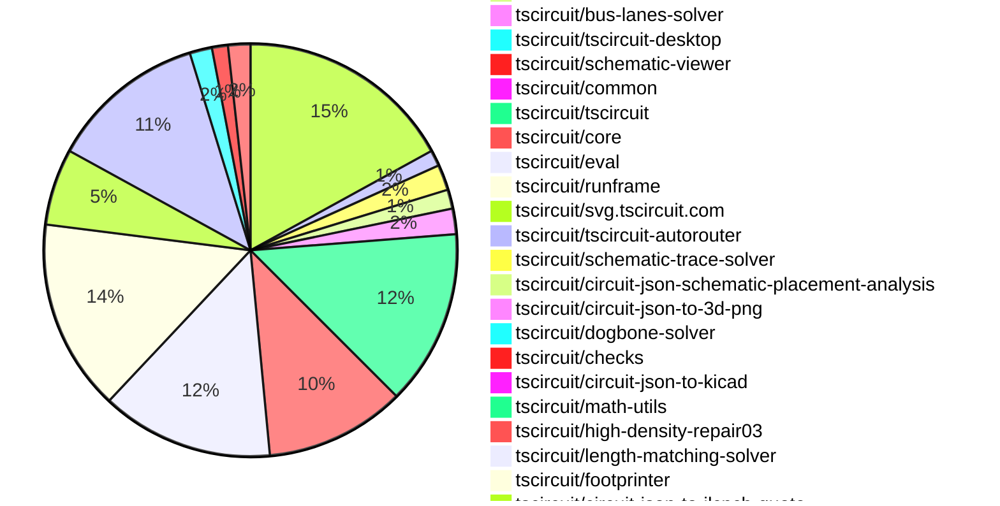

# contribution tracker

[contributions.tscircuit.com](https://contributions.tscircuit.com) ・ [tscircuit.com](https://tscircuit.com) ・ [Contribution Overviews](./contribution-overviews/) ・ [Changelogs](./changelogs/)

Generates weekly contribution overviews for tscircuit contributors. Check out all
the [contribution overviews here](./contribution-overviews/)
You can find AI-generated monthly changelogs in the [changelogs directory](./changelogs/)

- All PRs in the tscircuit org are scanned/summarized via an LLM
- The LLM classifies each Diff/PR as into a set of attributes for scoring
- All the PRs, summaries, and classifications are organized into charts and tables for [the website](https://contributions.tscircuit.com)

> Want to run locally? See the [Development Section](#development)

## Current Week

<!-- START_CURRENT_WEEK -->

# Contribution Overview 2026-11-10

The current week is shown below. There are 3 major sections:

- [Contributor Overview](#contributor-overview)
- [PRs by Repository](#prs-by-repository)
- [PRs by Contributor](#changes-by-contributor)
- [Scoring & Sponsorship Details](/docs/sponsorship-calculation-explanation.md)

## PRs by Repository

## Contributor Overview

| Contributor | 🐳 Major | 🐙 Minor | 🐌 Tiny | Score | ⭐ |
|-------------|---------|---------|---------|-------|-----|
| [ShiboSoftwareDev](#ShiboSoftwareDev) | 35 | 6 | 19 | 166 | 👑👑👑 |
| [seveibar](#seveibar) | 14 | 7 | 3 | 74 | ⭐⭐⭐ |
| [0hmX](#0hmX) | 9 | 4 | 1 | 46 | ⭐⭐ |
| [MustafaMulla29](#MustafaMulla29) | 5 | 6 | 16 | 45 | ⭐⭐ |
| [Abse2001](#Abse2001) | 5 | 4 | 4 | 34 | ⭐⭐ |
| [imrishabh18](#imrishabh18) | 1 | 6 | 3 | 20 | ⭐⭐ |
| [techmannih](#techmannih) | 3 | 2 | 3 | 19 | ⭐⭐ |
| [rushabhcodes](#rushabhcodes) | 2 | 3 | 1 | 15 | ⭐⭐ |
| [tscircuitbot](#tscircuitbot) | 0 | 0 | 272 | 14.5 | ⭐⭐ |
| [AnasSarkiz](#AnasSarkiz) | 0 | 4 | 0 | 8 | ⭐ |
| [GokulPandi-M](#GokulPandi-M) | 0 | 0 | 3 | 2.5 |  |
| [abdalraof-albarbar](#abdalraof-albarbar) | 0 | 0 | 1 | 1 |  |
| [hrithik18k](#hrithik18k) | 0 | 0 | 1 | 1 |  |

## Staff Pass Ratio (SPR)

| Contributor | Reviewed PRs | Rejections | Approvals | SPR |
|-------------|--------------|------------|-----------|-----|
| [0hmX](#0hmX) | 11 | 1 | 10 | 90.9% |
| [ShiboSoftwareDev](#ShiboSoftwareDev) | 8 | 0 | 8 | 100.0% |
| [rushabhcodes](#rushabhcodes) | 4 | 2 | 4 | 50.0% |
| [techmannih](#techmannih) | 4 | 0 | 5 | 100.0% |
| [Abse2001](#Abse2001) | 3 | 0 | 3 | 100.0% |
| [imrishabh18](#imrishabh18) | 3 | 0 | 3 | 100.0% |
| [MustafaMulla29](#MustafaMulla29) | 3 | 0 | 3 | 100.0% |
| [AnasSarkiz](#AnasSarkiz) | 1 | 0 | 1 | 100.0% |

0hmX SPR PRs (11)

- [#996](https://github.com/tscircuit/circuit-json/pull/996) fix: enforce ordered length-only differential pair buses
- [#5382](https://github.com/tscircuit/core/pull/5382) feat: include per-connection compute cost in autorouting events
- [#5413](https://github.com/tscircuit/core/pull/5413) fix: emit the ordered path of every multi-port trace
- [#5412](https://github.com/tscircuit/core/pull/5412) test: reproduce trace path order not emitted or routed
- [#5415](https://github.com/tscircuit/core/pull/5415) test: cover three-pad differential path routing data flow
- [#5760](https://github.com/tscircuit/cli/pull/5760) feat: capture per-connection compute cost in autorouter diagnostics
- [#3709](https://github.com/tscircuit/tscircuit-autorouter/pull/3709) fix: length-match ordered differential pair lanes
- [#3708](https://github.com/tscircuit/tscircuit-autorouter/pull/3708) fix: route connection path points in order
- [#3710](https://github.com/tscircuit/tscircuit-autorouter/pull/3710) fix: pass ordered differential lane hops to length matching
- [#3651](https://github.com/tscircuit/tscircuit-autorouter/pull/3651) Add a per-connection compute cost summary to the pipeline 9 solver
- [#315](https://github.com/tscircuit/tiny-hypergraph/pull/315) Report each connection's solo search iterations from DuplicateCongestedPortSolver

ShiboSoftwareDev SPR PRs (8)

- [#3733](https://github.com/tscircuit/tscircuit-autorouter/pull/3733) fix: preserve validated gaps in stitch paths
- [#3693](https://github.com/tscircuit/tscircuit-autorouter/pull/3693) repro: ButterStick bus wires ignore allowed layers
- [#3664](https://github.com/tscircuit/tscircuit-autorouter/pull/3664) Restore physically clear BGA via columns at the gap threshold
- [#3671](https://github.com/tscircuit/tscircuit-autorouter/pull/3671) Avoid repeated mesh scans during DDR port spacing
- [#3667](https://github.com/tscircuit/tscircuit-autorouter/pull/3667) Use faster DDR length-matching obstacle checks
- [#3660](https://github.com/tscircuit/tscircuit-autorouter/pull/3660) fix: retain H616 DDR repairs during final contact restoration
- [#201](https://github.com/tscircuit/high-density-repair03/pull/201) fix: preserve independent repairs during contact restoration
- [#90](https://github.com/tscircuit/length-matching-solver/pull/90) Skip distant pads before DDR meander clearance checks

rushabhcodes SPR PRs (4)

- [#5400](https://github.com/tscircuit/core/pull/5400) fix: preserve authored pad layers in mixed-side footprints
- [#5375](https://github.com/tscircuit/core/pull/5375) [2/2] Preserve unbroken inner copper planes in remote autorouting
- [#5404](https://github.com/tscircuit/core/pull/5404) fix: preserve plated-slot rotation on flipped footprints
- [#5402](https://github.com/tscircuit/core/pull/5402) fix: render pcbtrace coordinate routes

techmannih SPR PRs (4)

- [#5343](https://github.com/tscircuit/core/pull/5343) Fix named-net routing via a phase-selected pin
- [#5341](https://github.com/tscircuit/core/pull/5341) Fix plated-hole solder paste ownership
- [#557](https://github.com/tscircuit/checks/pull/557) Use the board via-to-pad clearance for routing DRC
- [#5750](https://github.com/tscircuit/cli/pull/5750) Fix autorouter worker count in tsci build

Abse2001 SPR PRs (3)

- [#5202](https://github.com/tscircuit/core/pull/5202) feat: implement panel tooling holes and fiducials (#5067)
- [#246](https://github.com/tscircuit/circuit-json-to-gerber/pull/246) Merge cutouts that are flush with the board edge into the board outline
- [#632](https://github.com/tscircuit/jlcsearch/pull/632) Expose JLCPCB's Standard-only mark on verified parts

imrishabh18 SPR PRs (3)

- [#638](https://github.com/tscircuit/jlcsearch/pull/638) Add a safe search-index-only rebuild action
- [#635](https://github.com/tscircuit/jlcsearch/pull/635) Fix JSON output after D1 stock-sync retries
- [#7](https://github.com/tscircuit/manufacturing-simulation/pull/7) Simulate the Amazon partnered carrier label at Ship-ready

MustafaMulla29 SPR PRs (3)

- [#5438](https://github.com/tscircuit/core/pull/5438) fix: keep board plane reservations independent of child groups
- [#5426](https://github.com/tscircuit/core/pull/5426) fix: preserve copper-plane connectivity at breakout endpoints
- [#268](https://github.com/tscircuit/fanout-solver/pull/268) fix: generate exact-angle dogbone sites for imported pad grids

AnasSarkiz SPR PRs (1)

- [#540](https://github.com/tscircuit/checks/pull/540) fix: recognize explicit pin role attributes as specified

> Note: AI evaluates PRs and assigns 1-3 star ratings automatically. 4 and 5 star ratings require manual staff review.

## Review Table

[reviews-received-hover]: ## "Number of reviews received for PRs for this contributor"
[approvals-received-hover]: ## "Number of approvals received for PRs this contributor authored"
[rejections-received-hover]: ## "Number of rejections received for PRs this contributor authored"
[prs-opened-hover]: ## "Number of PRs opened by this contributor"
[issues-created-hover]: ## "Number of issues created by this contributor"

| Contributor | Reviews Received | Approvals Received | Rejections Received | Approvals | Rejections Given | PRs Opened | PRs Merged | Issues Created |
|---|---|---|---|---|---|---|---|---|
| [0hmX](#0hmX) | 49 | 10 | 1 | 18 | 0 | 55 | 16 | 0 |
| [1932819331hy-debug](#1932819331hy-debug) | 0 | 0 | 0 | 0 | 0 | 33 | 0 | 0 |
| [abdalraof-albarbar](#abdalraof-albarbar) | 0 | 0 | 0 | 0 | 0 | 3 | 1 | 0 |
| [Abse2001](#Abse2001) | 4 | 3 | 0 | 4 | 0 | 19 | 13 | 0 |
| [AnasSarkiz](#AnasSarkiz) | 4 | 4 | 0 | 0 | 0 | 8 | 4 | 0 |
| [Andresdev14](#Andresdev14) | 0 | 0 | 0 | 0 | 0 | 1 | 0 | 0 |
| [aswadi](#aswadi) | 0 | 0 | 0 | 0 | 0 | 15 | 0 | 0 |
| [BHAWESHBHASKAR](#BHAWESHBHASKAR) | 0 | 0 | 0 | 0 | 0 | 2 | 0 | 0 |
| [Burapa-J](#Burapa-J) | 0 | 0 | 0 | 0 | 0 | 8 | 0 | 0 |
| [cocvn157](#cocvn157) | 0 | 0 | 0 | 0 | 0 | 26 | 0 | 0 |
| [deep-bhikadiya](#deep-bhikadiya) | 0 | 0 | 0 | 0 | 0 | 1 | 0 | 0 |
| [Devesh36](#Devesh36) | 1 | 0 | 0 | 0 | 0 | 4 | 0 | 0 |
| [ghost](#ghost) | 0 | 0 | 0 | 0 | 0 | 1 | 0 | 0 |
| [GokulPandi-M](#GokulPandi-M) | 5 | 3 | 1 | 0 | 0 | 6 | 3 | 0 |
| [hrithik18k](#hrithik18k) | 0 | 0 | 0 | 0 | 0 | 1 | 1 | 0 |
| [imrishabh18](#imrishabh18) | 8 | 5 | 0 | 8 | 3 | 22 | 10 | 0 |
| [imyelo](#imyelo) | 0 | 0 | 0 | 0 | 0 | 2 | 0 | 0 |
| [jeffrey-graham](#jeffrey-graham) | 0 | 0 | 0 | 0 | 0 | 2 | 0 | 0 |
| [LBCron](#LBCron) | 0 | 0 | 0 | 0 | 0 | 5 | 0 | 0 |
| [mohan-bee](#mohan-bee) | 1 | 0 | 0 | 0 | 0 | 4 | 0 | 0 |
| [MustafaMulla29](#MustafaMulla29) | 12 | 11 | 1 | 3 | 1 | 34 | 27 | 0 |
| [nolanntibi-dot](#nolanntibi-dot) | 0 | 0 | 0 | 0 | 0 | 4 | 0 | 0 |
| [OLuHneschastniy](#OLuHneschastniy) | 0 | 0 | 0 | 0 | 0 | 5 | 0 | 0 |
| [rushabhcodes](#rushabhcodes) | 14 | 4 | 2 | 0 | 0 | 30 | 6 | 0 |
| [sainath998](#sainath998) | 0 | 0 | 0 | 0 | 0 | 1 | 0 | 0 |
| [satoshinakamoto666666](#satoshinakamoto666666) | 0 | 0 | 0 | 0 | 0 | 1 | 0 | 0 |
| [seveibar](#seveibar) | 10 | 0 | 0 | 37 | 2 | 44 | 24 | 0 |
| [ShiboSoftwareDev](#ShiboSoftwareDev) | 25 | 25 | 0 | 2 | 0 | 100 | 61 | 0 |
| [techmannih](#techmannih) | 23 | 7 | 1 | 0 | 0 | 30 | 8 | 0 |
| [tscircuitbot](#tscircuitbot) | 0 | 0 | 0 | 0 | 0 | 321 | 272 | 0 |
| [tungnguyen84](#tungnguyen84) | 0 | 0 | 0 | 0 | 0 | 2 | 0 | 0 |
| [ulixes](#ulixes) | 0 | 0 | 0 | 0 | 0 | 4 | 0 | 0 |
| [Umutplvn](#Umutplvn) | 0 | 0 | 0 | 0 | 0 | 1 | 0 | 0 |
| [voropaevv](#voropaevv) | 0 | 0 | 0 | 0 | 0 | 3 | 0 | 0 |
| [xtruel](#xtruel) | 0 | 0 | 0 | 0 | 0 | 6 | 0 | 0 |

## Changes by Repository

### [tscircuit/circuit-json](https://github.com/tscircuit/circuit-json)

| PR # | Impact | Rating | Contributor | Description |
|------|--------|--------|-------------|-------------|
| [#1004](https://github.com/tscircuit/circuit-json/pull/1004) | 🐳 Major | ⭐⭐⭐ | seveibar | Add optional schematic_group.show_boundary, schematic_port.schematic_group_id, and schematic_port.boundary_position to define expanded subcircuit boundaries and public terminal geometry. |

🐌 Tiny Contributions (1)

| PR # | Impact | Contributor | Description |
|------|--------|-------------|-------------|
| [#1005](https://github.com/tscircuit/circuit-json/pull/1005) | 🐌 Tiny | tscircuitbot | Automated package update |

### [tscircuit/props](https://github.com/tscircuit/props)

| PR # | Impact | Rating | Contributor | Description |
|------|--------|--------|-------------|-------------|
| [#1009](https://github.com/tscircuit/props/pull/1009) | 🐳 Major | ⭐⭐⭐ | seveibar | Adds assembly drawing capabilities with explosion views and reusable stage definitions, enhancing the drawing functionality for parts and assemblies. |

🐌 Tiny Contributions (3)

| PR # | Impact | Contributor | Description |
|------|--------|-------------|-------------|
| [#1004](https://github.com/tscircuit/props/pull/1004) | 🐌 Tiny | 0hmX | Documents that trace paths should always be ordered, clarifying that the trace is routed as a chain from the first port to the last. |
| [#1000](https://github.com/tscircuit/props/pull/1000) | 🐌 Tiny | Abse2001 | Updates documentation to clarify that panel size limits now shape the grid layout, allowing auto-sized panels to grow and grids to rearrange based on specified limits. |
| [#999](https://github.com/tscircuit/props/pull/999) | 🐌 Tiny | Abse2001 | Changes the paneltab component to use center offsets from board edges instead of a single offset, introducing new properties for better tab placement and width specification. |

### [tscircuit/tscircuit.com](https://github.com/tscircuit/tscircuit.com)

| PR # | Impact | Rating | Contributor | Description |
|------|--------|--------|-------------|-------------|
| [#5851](https://github.com/tscircuit/tscircuit.com/pull/5851) | 🐳 Major | ⭐⭐⭐ | seveibar | Adds a copyable, syntax-highlighted TSX usage example beneath the customization preview, using the selected variants parameters and the packages published default or named component export. |
| [#5815](https://github.com/tscircuit/tscircuit.com/pull/5815) | 🐳 Major | ⭐⭐⭐ | seveibar | Adds a Reference designs button to the datasheet header that links to the curated catalog of designs using the chip. |
| [#5813](https://github.com/tscircuit/tscircuit.com/pull/5813) | 🐳 Major | ⭐⭐⭐ | seveibar | Adds a Customize link in the package About section for packages with a manifest, allowing users to navigate to the Customize page directly from the sidebar. |
| [#5812](https://github.com/tscircuit/tscircuit.com/pull/5812) | 🐳 Major | ⭐⭐⭐ | seveibar | Adds a new page for customizing package configurations, allowing users to interact with published configurations through controls generated from preview data. |
| [#5811](https://github.com/tscircuit/tscircuit.com/pull/5811) | 🐳 Major | ⭐⭐⭐ | seveibar | Adds the data layer for packages whose build publishes distpreview.json, including hooks for loading manifests and managing package configurations. |
| [#5852](https://github.com/tscircuit/tscircuit.com/pull/5852) | 🐙 Minor | ⭐⭐ | seveibar | Moves the TSX usage panel into the shared PackageConfigurationPreview to ensure both the datasheet reference-design pages and the package customize page display copyable code for the selected configuration. |
| [#5834](https://github.com/tscircuit/tscircuit.com/pull/5834) | 🐙 Minor | ⭐⭐ | seveibar | Draws dashed outlines around changed schematic parts on the Customize and reference-design pages for three seconds using the schematic viewers new props. |
| [#5814](https://github.com/tscircuit/tscircuit.com/pull/5814) | 🐙 Minor | ⭐⭐ | seveibar | Adds two new pages for displaying reference designs for specific chips, enhancing the datasheet functionality. |
| [#5810](https://github.com/tscircuit/tscircuit.com/pull/5810) | 🐙 Minor | ⭐⭐ | seveibar | Adds change tracking between two circuits, allowing the Customize page to identify which schematic parts a configuration switch added or changed. |
| [#5809](https://github.com/tscircuit/tscircuit.com/pull/5809) | 🐙 Minor | ⭐⭐ | seveibar | Adds PackagePreviewScope, an optional context that supplies the release, preview file, circuit JSON and GLB for an embedded preview, allowing hooks to resolve identity without a provider. |
| [#5808](https://github.com/tscircuit/tscircuit.com/pull/5808) | 🐙 Minor | ⭐⭐ | seveibar | Adds support for loading gzip-compressed Circuit JSON preview files, allowing package pages to preview large circuits efficiently. |

🐌 Tiny Contributions (57)

| PR # | Impact | Contributor | Description |
|------|--------|-------------|-------------|
| [#5874](https://github.com/tscircuit/tscircuit.com/pull/5874) | 🐌 Tiny | tscircuitbot | Updates the tscircuitrunframe package from version 0.0.3223 to 0.0.3224 |
| [#5873](https://github.com/tscircuit/tscircuit.com/pull/5873) | 🐌 Tiny | tscircuitbot | Updates the tscircuiteval package version from 0.0.1759 to 0.0.1760 in package.json |
| [#5872](https://github.com/tscircuit/tscircuit.com/pull/5872) | 🐌 Tiny | tscircuitbot | Updates the tscircuitrunframe package from version 0.0.3222 to 0.0.3223 |
| [#5871](https://github.com/tscircuit/tscircuit.com/pull/5871) | 🐌 Tiny | tscircuitbot | Automated package update |
| [#5870](https://github.com/tscircuit/tscircuit.com/pull/5870) | 🐌 Tiny | tscircuitbot | Updates the tscircuitrunframe package from version 0.0.3221 to 0.0.3222 |
| [#5869](https://github.com/tscircuit/tscircuit.com/pull/5869) | 🐌 Tiny | tscircuitbot | Updates the tscircuiteval package from version 0.0.1757 to 0.0.1758 |
| [#5868](https://github.com/tscircuit/tscircuit.com/pull/5868) | 🐌 Tiny | tscircuitbot | Updates the tscircuitrunframe package from version 0.0.3220 to 0.0.3221 |
| [#5867](https://github.com/tscircuit/tscircuit.com/pull/5867) | 🐌 Tiny | tscircuitbot | Updates the tscircuiteval package from version 0.0.1756 to 0.0.1757 |
| [#5866](https://github.com/tscircuit/tscircuit.com/pull/5866) | 🐌 Tiny | tscircuitbot | Updates the tscircuitrunframe package version from 0.0.3219 to 0.0.3220 |
| [#5865](https://github.com/tscircuit/tscircuit.com/pull/5865) | 🐌 Tiny | tscircuitbot | Updates the tscircuiteval package from version 0.0.1755 to 0.0.1756 |
| [#5864](https://github.com/tscircuit/tscircuit.com/pull/5864) | 🐌 Tiny | tscircuitbot | Updates the tscircuitrunframe package version from 0.0.3218 to 0.0.3219 in package.json |
| [#5863](https://github.com/tscircuit/tscircuit.com/pull/5863) | 🐌 Tiny | tscircuitbot | Updates the tscircuiteval package from version 0.0.1754 to 0.0.1755 |
| [#5861](https://github.com/tscircuit/tscircuit.com/pull/5861) | 🐌 Tiny | tscircuitbot | Updates the tscircuitrunframe package from version 0.0.3216 to 0.0.3218 |
| [#5860](https://github.com/tscircuit/tscircuit.com/pull/5860) | 🐌 Tiny | tscircuitbot | Updates the tscircuiteval package from version 0.0.1753 to 0.0.1754 |
| [#5859](https://github.com/tscircuit/tscircuit.com/pull/5859) | 🐌 Tiny | tscircuitbot | Updates the tscircuiteval package from version 0.0.1752 to 0.0.1753 |
| [#5857](https://github.com/tscircuit/tscircuit.com/pull/5857) | 🐌 Tiny | tscircuitbot | Updates the tscircuitrunframe package from version 0.0.3215 to 0.0.3216 |
| [#5856](https://github.com/tscircuit/tscircuit.com/pull/5856) | 🐌 Tiny | tscircuitbot | Updates the tscircuiteval package from version 0.0.1751 to 0.0.1752 |
| [#5855](https://github.com/tscircuit/tscircuit.com/pull/5855) | 🐌 Tiny | tscircuitbot | Updates the tscircuitrunframe package version from 0.0.3214 to 0.0.3215 |
| [#5854](https://github.com/tscircuit/tscircuit.com/pull/5854) | 🐌 Tiny | tscircuitbot | Updates the tscircuiteval package version from 0.0.1750 to 0.0.1751 in package.json |
| [#5850](https://github.com/tscircuit/tscircuit.com/pull/5850) | 🐌 Tiny | tscircuitbot | Updates the tscircuitrunframe package from version 0.0.3213 to 0.0.3214 |
| [#5849](https://github.com/tscircuit/tscircuit.com/pull/5849) | 🐌 Tiny | tscircuitbot | Updates the tscircuiteval package version from 0.0.1749 to 0.0.1750 in package.json |
| [#5848](https://github.com/tscircuit/tscircuit.com/pull/5848) | 🐌 Tiny | tscircuitbot | Updates the tscircuitrunframe package from version 0.0.3212 to 0.0.3213 |
| [#5847](https://github.com/tscircuit/tscircuit.com/pull/5847) | 🐌 Tiny | tscircuitbot | Updates the tscircuiteval package from version 0.0.1748 to 0.0.1749 |
| [#5846](https://github.com/tscircuit/tscircuit.com/pull/5846) | 🐌 Tiny | tscircuitbot | Automated package update |
| [#5845](https://github.com/tscircuit/tscircuit.com/pull/5845) | 🐌 Tiny | tscircuitbot | Updates the tscircuiteval package from version 0.0.1747 to 0.0.1748 in the package.json file. |
| [#5844](https://github.com/tscircuit/tscircuit.com/pull/5844) | 🐌 Tiny | tscircuitbot | Updates the tscircuitrunframe package from version 0.0.3210 to 0.0.3211 |
| [#5843](https://github.com/tscircuit/tscircuit.com/pull/5843) | 🐌 Tiny | tscircuitbot | Updates the tscircuiteval package from version 0.0.1746 to 0.0.1747 |
| [#5842](https://github.com/tscircuit/tscircuit.com/pull/5842) | 🐌 Tiny | tscircuitbot | Updates the tscircuitrunframe package from version 0.0.3209 to 0.0.3210 |
| [#5841](https://github.com/tscircuit/tscircuit.com/pull/5841) | 🐌 Tiny | tscircuitbot | Updates the tscircuiteval package from version 0.0.1745 to 0.0.1746 |
| [#5840](https://github.com/tscircuit/tscircuit.com/pull/5840) | 🐌 Tiny | tscircuitbot | Updates the tscircuitrunframe package from version 0.0.3208 to 0.0.3209 |
| [#5839](https://github.com/tscircuit/tscircuit.com/pull/5839) | 🐌 Tiny | tscircuitbot | Updates the tscircuiteval package version from 0.0.1744 to 0.0.1745 in package.json |
| [#5838](https://github.com/tscircuit/tscircuit.com/pull/5838) | 🐌 Tiny | tscircuitbot | Updates the tscircuitrunframe package from version 0.0.3207 to 0.0.3208 and the tscircuitschematic-viewer package from version 2.0.108 to 2.0.109 |
| [#5837](https://github.com/tscircuit/tscircuit.com/pull/5837) | 🐌 Tiny | tscircuitbot | Updates the tscircuiteval package from version 0.0.1743 to 0.0.1744 and the tscircuitschematic-viewer package from version 2.0.110 to 2.0.108 in package.json |
| [#5836](https://github.com/tscircuit/tscircuit.com/pull/5836) | 🐌 Tiny | tscircuitbot | Automated package update to version 0.0.227 |
| [#5818](https://github.com/tscircuit/tscircuit.com/pull/5818) | 🐌 Tiny | tscircuitbot | Updates the tscircuiteval package version from 0.0.1736 to 0.0.1737 in package.json |
| [#5816](https://github.com/tscircuit/tscircuit.com/pull/5816) | 🐌 Tiny | tscircuitbot | Updates the tscircuiteval package from version 0.0.1735 to 0.0.1736 |
| [#5835](https://github.com/tscircuit/tscircuit.com/pull/5835) | 🐌 Tiny | tscircuitbot | Automated package update |
| [#5832](https://github.com/tscircuit/tscircuit.com/pull/5832) | 🐌 Tiny | tscircuitbot | Updates the tscircuitrunframe package from version 0.0.3205 to 0.0.3206 |
| [#5831](https://github.com/tscircuit/tscircuit.com/pull/5831) | 🐌 Tiny | tscircuitbot | Automated package update |
| [#5830](https://github.com/tscircuit/tscircuit.com/pull/5830) | 🐌 Tiny | tscircuitbot | Updates the tscircuitrunframe package from version 0.0.3204 to 0.0.3205 |
| [#5829](https://github.com/tscircuit/tscircuit.com/pull/5829) | 🐌 Tiny | tscircuitbot | Updates the tscircuiteval package from version 0.0.1741 to 0.0.1742 |
| [#5828](https://github.com/tscircuit/tscircuit.com/pull/5828) | 🐌 Tiny | tscircuitbot | Updates the tscircuitrunframe package version from 0.0.3203 to 0.0.3204 |
| [#5827](https://github.com/tscircuit/tscircuit.com/pull/5827) | 🐌 Tiny | tscircuitbot | Updates the tscircuiteval package version from 0.0.1740 to 0.0.1741 in package.json |
| [#5825](https://github.com/tscircuit/tscircuit.com/pull/5825) | 🐌 Tiny | tscircuitbot | Updates the tscircuitrunframe package from version 0.0.3201 to 0.0.3202 |
| [#5823](https://github.com/tscircuit/tscircuit.com/pull/5823) | 🐌 Tiny | tscircuitbot | Updates the tscircuitrunframe package version from 0.0.3200 to 0.0.3201 in package.json |
| [#5822](https://github.com/tscircuit/tscircuit.com/pull/5822) | 🐌 Tiny | tscircuitbot | Updates the tscircuiteval package from version 0.0.1738 to 0.0.1739 |
| [#5821](https://github.com/tscircuit/tscircuit.com/pull/5821) | 🐌 Tiny | tscircuitbot | Updates the tscircuitrunframe package version from 0.0.3199 to 0.0.3200 in package.json |
| [#5820](https://github.com/tscircuit/tscircuit.com/pull/5820) | 🐌 Tiny | tscircuitbot | Updates the tscircuiteval package from version 0.0.1737 to 0.0.1738 |
| [#5819](https://github.com/tscircuit/tscircuit.com/pull/5819) | 🐌 Tiny | tscircuitbot | Updates the tscircuitrunframe package from version 0.0.3198 to 0.0.3199 |
| [#5817](https://github.com/tscircuit/tscircuit.com/pull/5817) | 🐌 Tiny | tscircuitbot | Updates the tscircuitrunframe package from version 0.0.3197 to 0.0.3198 |
| [#5807](https://github.com/tscircuit/tscircuit.com/pull/5807) | 🐌 Tiny | tscircuitbot | Updates the tscircuitrunframe package from version 0.0.3196 to 0.0.3197 |
| [#5806](https://github.com/tscircuit/tscircuit.com/pull/5806) | 🐌 Tiny | tscircuitbot | Updates the tscircuiteval package from version 0.0.1734 to 0.0.1735 in the package.json file. |
| [#5804](https://github.com/tscircuit/tscircuit.com/pull/5804) | 🐌 Tiny | tscircuitbot | Updates the tscircuitrunframe package version from 0.0.3195 to 0.0.3196 in package.json |
| [#5803](https://github.com/tscircuit/tscircuit.com/pull/5803) | 🐌 Tiny | tscircuitbot | Updates the tscircuiteval package from version 0.0.1733 to 0.0.1734 |
| [#5802](https://github.com/tscircuit/tscircuit.com/pull/5802) | 🐌 Tiny | tscircuitbot | Updates the tscircuitrunframe package from version 0.0.3194 to 0.0.3195 |
| [#5826](https://github.com/tscircuit/tscircuit.com/pull/5826) | 🐌 Tiny | tscircuitbot | Updates the tscircuitrunframe package from version 0.0.3202 to 0.0.3203 |
| [#5824](https://github.com/tscircuit/tscircuit.com/pull/5824) | 🐌 Tiny | tscircuitbot | Updates the tscircuiteval package from version 0.0.1739 to 0.0.1740 |

### [tscircuit/jlcsearch](https://github.com/tscircuit/jlcsearch)

| PR # | Impact | Rating | Contributor | Description |
|------|--------|--------|-------------|-------------|
| [#637](https://github.com/tscircuit/jlcsearch/pull/637) | 🐳 Major | ⭐⭐⭐ | seveibar | Adds a Buzzers link on the home page and buzzerslist with package, Basic, and Preferred filters, and exposes the same results through the API at buzzerslist.json. |
| [#638](https://github.com/tscircuit/jlcsearch/pull/638) | 🐙 Minor | ⭐⭐ | imrishabh18 | Adds a manual GitHub Action to rebuild only the search index, without changing the component catalogue or stock. |
| [#635](https://github.com/tscircuit/jlcsearch/pull/635) | 🐙 Minor | ⭐⭐ | imrishabh18 | Fixes JSON output handling in stock-sync job by separating successful and failed JSON attempts, ensuring valid JSON is returned to the stock job. |
| [#636](https://github.com/tscircuit/jlcsearch/pull/636) | 🐙 Minor | ⭐⭐ | imrishabh18 | Caches dropdown values for resistor and capacitor pages to reduce load by skipping dropdown queries for JSON requests and caching HTML dropdown values for 15 minutes. |
| [#632](https://github.com/tscircuit/jlcsearch/pull/632) | 🐙 Minor | ⭐⭐ | Abse2001 | Adds is_standard_only to the verified component that exact-part lookups return, indicating whether a part is marked as Standard only by JLCPCB, which affects the assembly service selection for PCBA. |

### [tscircuit/cli](https://github.com/tscircuit/cli)

| PR # | Impact | Rating | Contributor | Description |
|------|--------|--------|-------------|-------------|
| [#5773](https://github.com/tscircuit/cli/pull/5773) | 🐳 Major | ⭐⭐⭐ | seveibar | Only the first 10 errors (and warnings) of each type are logged; the rest are reported as a count, improving clarity in build error reporting. |
| [#5750](https://github.com/tscircuit/cli/pull/5750) | 🐳 Major | ⭐⭐⭐ | techmannih | Fixes the issue where the tsci build command rejected the --autorouter-threads option, allowing it to accept a positive integer to specify the number of solver workers for local autorouters. |
| [#5760](https://github.com/tscircuit/cli/pull/5760) | 🐙 Minor | ⭐⭐ | 0hmX | Captures optional per-connection compute cost from autorouter progress, end, and error events in the existing CLI diagnostics, preserving the single-active-phase design and enhancing diagnostic output. |

🐌 Tiny Contributions (5)

| PR # | Impact | Contributor | Description |
|------|--------|-------------|-------------|
| [#5772](https://github.com/tscircuit/cli/pull/5772) | 🐌 Tiny | tscircuitbot | Automated package update |
| [#5766](https://github.com/tscircuit/cli/pull/5766) | 🐌 Tiny | tscircuitbot | Automated package update |
| [#5762](https://github.com/tscircuit/cli/pull/5762) | 🐌 Tiny | tscircuitbot | Automated package update |
| [#5770](https://github.com/tscircuit/cli/pull/5770) | 🐌 Tiny | MustafaMulla29 | Updates the CLIs pinned dependencies for circuit-json-to-kicad and circuit-json-schematic-placement-analysis to their latest versions, ensuring compatibility and incorporating recent fixes. |
| [#5749](https://github.com/tscircuit/cli/pull/5749) | 🐌 Tiny | techmannih | Fixes the build parser rejection of the --autorouter-threads option, allowing independent configuration of solver worker count and file concurrency. |

### [tscircuit/fanout-solver](https://github.com/tscircuit/fanout-solver)

| PR # | Impact | Rating | Contributor | Description |
|------|--------|--------|-------------|-------------|
| [#272](https://github.com/tscircuit/fanout-solver/pull/272) | 🐳 Major | ⭐⭐⭐ | seveibar | Fixes routing failures for local HDMI escapes by ensuring proper handling of blind and buried vias, allowing for four pad-to-via escapes without clearance violations. |
| [#252](https://github.com/tscircuit/fanout-solver/pull/252) | 🐳 Major | ⭐⭐⭐ | seveibar | Adds routeLocalSignalDogbones for routing both package terminals to local signal-layer vias before a fixed-layer interconnect solve, preserving existing boundary-routing behavior. |
| [#268](https://github.com/tscircuit/fanout-solver/pull/268) | 🐳 Major | ⭐⭐⭐ | MustafaMulla29 | Fixes failure to assign valid dogbone sites for pads in imported STM32MP157DAB1 footprint, ensuring all pads have legal candidates for routing. |
| [#262](https://github.com/tscircuit/fanout-solver/pull/262) | 🐳 Major | ⭐⭐⭐ | ShiboSoftwareDev | Fixes endpoint connectivity to respect a vias physical layers, allowing connections through the barrel beyond logical layer transitions. |
| [#267](https://github.com/tscircuit/fanout-solver/pull/267) | 🐙 Minor | ⭐⭐ | MustafaMulla29 | Found while building our four-motor USB-PD motherboard with the JLCPCB C1236721 STM32MP157DAB1 footprint. The existing matcher drops non-45 midpoint candidates on the imported pad grid, but does not generate nearby exact-angle alternatives. Ten pads have no usable candidates, including A10, and the complete assignment fails. This follows the repositorys captured-input and SVG snapshot pattern: an explicit TSX generator retains all 354 imported pads, a native SRJ fixture captures A10, and one test requests a distinct local escape for every physical pad to exercise joint assignment. The snapshot shows the full pad field and an A10 close-up. These 354 test requests are a geometry regression, not the motherboard netlist. No solver changes, new dependencies, configuration changes, manual copper, or saved routes. Validation: focused snapshot test passes while asserting the current failure; all three repository typecheck commands pass. Fix PR 268 is stacked on this branch (267  268). Related: tscircuitdogbone-solver17 fixes the callers angle-mode mismatch. This repro exercises fanouts existing directplane matcher independently. The separate local-signal API work in 252 also addresses imported grids, but does not change this main-branch matcher. |

🐌 Tiny Contributions (1)

| PR # | Impact | Contributor | Description |
|------|--------|-------------|-------------|
| [#271](https://github.com/tscircuit/fanout-solver/pull/271) | 🐌 Tiny | seveibar | Reproduces the issue where HDMI blind escapes are blocked by bottom decoupling pads, providing comprehensive tests and validation without altering the solvers production. |

### [tscircuit/bus-lanes-solver](https://github.com/tscircuit/bus-lanes-solver)

| PR # | Impact | Rating | Contributor | Description |
|------|--------|--------|-------------|-------------|
| [#182](https://github.com/tscircuit/bus-lanes-solver/pull/182) | 🐳 Major | ⭐⭐⭐ | seveibar | Fits demand-sized tuning banks to a populated board by allowing kinks in routing paths and adjusting bank layouts to accommodate obstacles from other components. |
| [#181](https://github.com/tscircuit/bus-lanes-solver/pull/181) | 🐳 Major | ⭐⭐⭐ | seveibar | Fixes HDMI routing failure due to local blind-via escapes being rejected by bottom-layer decoupling pads, updating the fanout-solver to check physical via spans and source-trace layers. |
| [#188](https://github.com/tscircuit/bus-lanes-solver/pull/188) | 🐳 Major | ⭐⭐⭐ | ShiboSoftwareDev | Fixes issue where multi-terminal DDR branches close pending pad exits needed for later signals, ensuring proper routing and connectivity. |
| [#185](https://github.com/tscircuit/bus-lanes-solver/pull/185) | 🐳 Major | ⭐⭐⭐ | ShiboSoftwareDev | Fixes the issue where rotated rectangular pads block legal exits by accurately representing their geometry in the local pad frame while retaining the world bounding box for indexing. |
| [#179](https://github.com/tscircuit/bus-lanes-solver/pull/179) | 🐳 Major | ⭐⭐⭐ | ShiboSoftwareDev | Compares reachable via anchors with the existing multi-goal grid search before routing the branch to optimize the selection of trunk vias for RAM branches. |
| [#187](https://github.com/tscircuit/bus-lanes-solver/pull/187) | 🐙 Minor | ⭐⭐ | ShiboSoftwareDev | Fixes the routing issue where the LDQS_N strobe pad is blocked by the DDR byte in the ButterStick circuit. |

🐌 Tiny Contributions (2)

| PR # | Impact | Contributor | Description |
|------|--------|-------------|-------------|
| [#184](https://github.com/tscircuit/bus-lanes-solver/pull/184) | 🐌 Tiny | ShiboSoftwareDev | Captures the unchanged second-byte SRJ with eight completed routes retained, addressing the stall issue on the second CPU data byte of the A13 TSXCore board. |
| [#178](https://github.com/tscircuit/bus-lanes-solver/pull/178) | 🐌 Tiny | ShiboSoftwareDev | Adds a test for ButterStick RAM branches to ensure they leave the native UDM pin reachable without changing production code. |

### [tscircuit/tscircuit-desktop](https://github.com/tscircuit/tscircuit-desktop)

| PR # | Impact | Rating | Contributor | Description |
|------|--------|--------|-------------|-------------|
| [#1](https://github.com/tscircuit/tscircuit-desktop/pull/1) | 🐳 Major | ⭐⭐⭐ | seveibar | tscircuit desktop is T3 Code plus a small set of tscircuit changes. T3 Code lands about 180 commits a day, so this repo is not a fork: it holds only the difference and rebuilds the app from it. |

🐌 Tiny Contributions (1)

| PR # | Impact | Contributor | Description |
|------|--------|-------------|-------------|
| [#2](https://github.com/tscircuit/tscircuit-desktop/pull/2) | 🐌 Tiny | seveibar | The app is now called tscircuit desktop and carries tscircuits icon. It also has its own app ID, link scheme and data folders, so it can be installed beside T3 Code without sharing its data. |

### [tscircuit/schematic-viewer](https://github.com/tscircuit/schematic-viewer)

| PR # | Impact | Rating | Contributor | Description |
|------|--------|--------|-------------|-------------|
| [#312](https://github.com/tscircuit/schematic-viewer/pull/312) | 🐙 Minor | ⭐⭐ | seveibar | Adds two props to SchematicViewer to outline rendered schematic components and texts with a dashed blue outline based on provided IDs. |

### [tscircuit/common](https://github.com/tscircuit/common)

🐌 Tiny Contributions (1)

| PR # | Impact | Contributor | Description |
|------|--------|-------------|-------------|
| [#112](https://github.com/tscircuit/common/pull/112) | 🐌 Tiny | seveibar | Adds an exported TscircuitLogo  for placing the tscircuit tsdot mark on a PCBs silkscreen, with customizable properties for size, position, rotation, and layer. |

### [tscircuit/tscircuit](https://github.com/tscircuit/tscircuit)

🐌 Tiny Contributions (55)

| PR # | Impact | Contributor | Description |
|------|--------|-------------|-------------|
| [#6366](https://github.com/tscircuit/tscircuit/pull/6366) | 🐌 Tiny | tscircuitbot | Automated package update |
| [#6365](https://github.com/tscircuit/tscircuit/pull/6365) | 🐌 Tiny | tscircuitbot | Automated package update |
| [#6364](https://github.com/tscircuit/tscircuit/pull/6364) | 🐌 Tiny | tscircuitbot | Automated package update |
| [#6363](https://github.com/tscircuit/tscircuit/pull/6363) | 🐌 Tiny | tscircuitbot | Automated package update |
| [#6362](https://github.com/tscircuit/tscircuit/pull/6362) | 🐌 Tiny | tscircuitbot | Updates the package version from 0.0.3167 to 0.0.3168 in package.json |
| [#6361](https://github.com/tscircuit/tscircuit/pull/6361) | 🐌 Tiny | tscircuitbot | Automated package update |
| [#6360](https://github.com/tscircuit/tscircuit/pull/6360) | 🐌 Tiny | tscircuitbot | Automated package update |
| [#6359](https://github.com/tscircuit/tscircuit/pull/6359) | 🐌 Tiny | tscircuitbot | Automated package update |
| [#6343](https://github.com/tscircuit/tscircuit/pull/6343) | 🐌 Tiny | tscircuitbot | Updates the package version from 0.0.3158 to 0.0.3159 in package.json |
| [#6326](https://github.com/tscircuit/tscircuit/pull/6326) | 🐌 Tiny | tscircuitbot | Automated package update |
| [#6313](https://github.com/tscircuit/tscircuit/pull/6313) | 🐌 Tiny | tscircuitbot | Automated package update |
| [#6353](https://github.com/tscircuit/tscircuit/pull/6353) | 🐌 Tiny | tscircuitbot | Automated package update |
| [#6336](https://github.com/tscircuit/tscircuit/pull/6336) | 🐌 Tiny | tscircuitbot | Automated package update |
| [#6332](https://github.com/tscircuit/tscircuit/pull/6332) | 🐌 Tiny | tscircuitbot | Automated package update |
| [#6331](https://github.com/tscircuit/tscircuit/pull/6331) | 🐌 Tiny | tscircuitbot | Automated package update |
| [#6358](https://github.com/tscircuit/tscircuit/pull/6358) | 🐌 Tiny | tscircuitbot | Automated package update |
| [#6357](https://github.com/tscircuit/tscircuit/pull/6357) | 🐌 Tiny | tscircuitbot | Automated package update |
| [#6355](https://github.com/tscircuit/tscircuit/pull/6355) | 🐌 Tiny | tscircuitbot | Automated package update |
| [#6352](https://github.com/tscircuit/tscircuit/pull/6352) | 🐌 Tiny | tscircuitbot | Automated package update |
| [#6351](https://github.com/tscircuit/tscircuit/pull/6351) | 🐌 Tiny | tscircuitbot | Automated package update |
| [#6350](https://github.com/tscircuit/tscircuit/pull/6350) | 🐌 Tiny | tscircuitbot | Automated package update |
| [#6346](https://github.com/tscircuit/tscircuit/pull/6346) | 🐌 Tiny | tscircuitbot | Automated package update |
| [#6345](https://github.com/tscircuit/tscircuit/pull/6345) | 🐌 Tiny | tscircuitbot | Automated package update |
| [#6341](https://github.com/tscircuit/tscircuit/pull/6341) | 🐌 Tiny | tscircuitbot | Automated package update |
| [#6339](https://github.com/tscircuit/tscircuit/pull/6339) | 🐌 Tiny | tscircuitbot | Automated package update |
| [#6337](https://github.com/tscircuit/tscircuit/pull/6337) | 🐌 Tiny | tscircuitbot | Automated package update |
| [#6335](https://github.com/tscircuit/tscircuit/pull/6335) | 🐌 Tiny | tscircuitbot | Automated package update |
| [#6334](https://github.com/tscircuit/tscircuit/pull/6334) | 🐌 Tiny | tscircuitbot | Automated package update |
| [#6330](https://github.com/tscircuit/tscircuit/pull/6330) | 🐌 Tiny | tscircuitbot | Automated package update |
| [#6329](https://github.com/tscircuit/tscircuit/pull/6329) | 🐌 Tiny | tscircuitbot | Automated package update |
| [#6328](https://github.com/tscircuit/tscircuit/pull/6328) | 🐌 Tiny | tscircuitbot | Automated package update |
| [#6327](https://github.com/tscircuit/tscircuit/pull/6327) | 🐌 Tiny | tscircuitbot | Automated package update |
| [#6324](https://github.com/tscircuit/tscircuit/pull/6324) | 🐌 Tiny | tscircuitbot | Automated package update |
| [#6323](https://github.com/tscircuit/tscircuit/pull/6323) | 🐌 Tiny | tscircuitbot | Automated package update |
| [#6321](https://github.com/tscircuit/tscircuit/pull/6321) | 🐌 Tiny | tscircuitbot | Automated package update |
| [#6319](https://github.com/tscircuit/tscircuit/pull/6319) | 🐌 Tiny | tscircuitbot | Updates the version of the tscircuiteval and tscircuitrunframe packages in package.json |
| [#6317](https://github.com/tscircuit/tscircuit/pull/6317) | 🐌 Tiny | tscircuitbot | Automated package update |
| [#6316](https://github.com/tscircuit/tscircuit/pull/6316) | 🐌 Tiny | tscircuitbot | Automated package update |
| [#6315](https://github.com/tscircuit/tscircuit/pull/6315) | 🐌 Tiny | tscircuitbot | Updates the tscircuitcli package to version 0.1.2451 |
| [#6312](https://github.com/tscircuit/tscircuit/pull/6312) | 🐌 Tiny | tscircuitbot | Automated package update |
| [#6348](https://github.com/tscircuit/tscircuit/pull/6348) | 🐌 Tiny | tscircuitbot | Automated package update |
| [#6340](https://github.com/tscircuit/tscircuit/pull/6340) | 🐌 Tiny | tscircuitbot | Automated package update |
| [#6333](https://github.com/tscircuit/tscircuit/pull/6333) | 🐌 Tiny | tscircuitbot | Automated package update |
| [#6347](https://github.com/tscircuit/tscircuit/pull/6347) | 🐌 Tiny | tscircuitbot | Updates the tscircuitcli and tscircuitcore packages to their latest versions. |
| [#6318](https://github.com/tscircuit/tscircuit/pull/6318) | 🐌 Tiny | tscircuitbot | Automated package update |
| [#6322](https://github.com/tscircuit/tscircuit/pull/6322) | 🐌 Tiny | tscircuitbot | Automated package update |
| [#6314](https://github.com/tscircuit/tscircuit/pull/6314) | 🐌 Tiny | tscircuitbot | Automated package update |
| [#6320](https://github.com/tscircuit/tscircuit/pull/6320) | 🐌 Tiny | tscircuitbot | Automated package update |
| [#6354](https://github.com/tscircuit/tscircuit/pull/6354) | 🐌 Tiny | MustafaMulla29 | Updates the direct kicadts dependency from 0.0.53 to 0.0.65, the latest published release, and refreshes its Bun lockfile entries. |
| [#6349](https://github.com/tscircuit/tscircuit/pull/6349) | 🐌 Tiny | MustafaMulla29 | Update tscircuitcore from 0.0.2343 to 0.0.2346 and tscircuiteval from 0.0.1744 to 0.0.1748, synchronizing fanout-solver and props versions as well as regenerating the lockfile. |
| [#6325](https://github.com/tscircuit/tscircuit/pull/6325) | 🐌 Tiny | MustafaMulla29 | Update the published dependencies in package.json to versions 0.0.2334 for tscircuitcore and 0.0.1739 for tscircuiteval, along with regenerating the lockfile. |
| [#6338](https://github.com/tscircuit/tscircuit/pull/6338) | 🐌 Tiny | ShiboSoftwareDev | Deduplicates dependencies in the project after an autorouter update to reduce production-install size by removing redundant lock entries. |
| [#6342](https://github.com/tscircuit/tscircuit/pull/6342) | 🐌 Tiny | ShiboSoftwareDev | Reduces production-install size by deduplicating dependencies after an autorouter update, resolving peer version conflicts and removing redundant lock entries. |
| [#6344](https://github.com/tscircuit/tscircuit/pull/6344) | 🐌 Tiny | imrishabh18 | Removes the bundle size check and its Slack notification workflow, along with their scripts, configuration, and tests. |
| [#6292](https://github.com/tscircuit/tscircuit/pull/6292) | 🐌 Tiny | imrishabh18 | Adds a size-growth rule to alert when a change lands on main and any measured size increases by more than 2 MB, with specific CI checks and Slack notifications for large increases. |

### [tscircuit/core](https://github.com/tscircuit/core)

| PR # | Impact | Rating | Contributor | Description |
|------|--------|--------|-------------|-------------|
| [#5437](https://github.com/tscircuit/core/pull/5437) | 🐳 Major | ⭐⭐⭐ | MustafaMulla29 | Fixes incorrect board-level plane reservations caused by child groups affecting autorouting output. |
| [#5426](https://github.com/tscircuit/core/pull/5426) | 🐳 Major | ⭐⭐⭐ | MustafaMulla29 | Fixes copper-plane connectivity issues at breakout endpoints, preventing redundant routing requests in the autorouter. |
| [#5424](https://github.com/tscircuit/core/pull/5424) | 🐳 Major | ⭐⭐⭐ | MustafaMulla29 | After native copper-pour generation, the STM32s ground pads already connect through their escape vias and a shared ground plane. Core loses that physical connection when exporting breakout endpoints, so the native router requests redundant connections. This TSX repro uses U70s complete STM32MP157DAB1 footprint from our four-motor USB-CUSB-PD motherboard: All 354 literal pad definitions match the JLCPCB C1236721 import, including its original coordinates and sizes. All 104 motherboard GND assignments are retained, with semantic ball names from the board. The same six-layer arrangement, 20  20 mm breakout region, native dogbone settings and relevant tracevia rules are used. The chip remains at its motherboard position, (0, 20). A 24  24 mm inspection board contains the chip and one native inner1 ground pour. Other nets, other motherboard components and unused 3D assets are omitted. The test runs native dogbone routing  native ground-pour generation  core SRJ export  native point-pair generation. All 104 escape vias are generated afresh and checked geometrically against the same ground pour. Expected: 0 new routes; actual: 103 redundant requests. No patched solver, saved routes, injected copper or dependencyconfiguration changes. The snapshot separates existing copper from connection requests. The complete chip, TOP escape close-up and INNER1 plane close-up are pixel-identical before and after the fix. A separate aligned INNER3 panel shows the actual native requests as dashed pink lines. The written path follows F7 pad  short trace  F7 via  shared INNER1 plane  G6 via  short trace  G6 pad. Pink dashes mean connect these endpoints; they are neither copper nor a prescribed track shape. The test uses routeRemainingfalse: it skips full-board routing so native pour generation can complete, then tests the export of that existing copper. It does not reproduce or fix the motherboards initial routing iteration-limit failure, which occurs before the physical pours are generated. This defect was found when motherboard path search exhausted its budget on ground links before reaching DDR signals. The stacked fix is 5426; its matching full-STM32 snapshot changes 103 requests to 0. Validation: the updated native STM32 repro and full TypeScript check pass on both the repro and fix branches; changed-file formatting passes. Rendered beforeafter images were compared and all three physical-copper panels are pixel-identical. The existing copper-pour terminal-routing test passed in earlier verification. Every imported pad definition matches the motherboard source. The previously investigated full-suite failure is the existing AM62L direct-decoupling snapshot mismatch, also present on unchanged main: repro log(https:github.comtscircuitcoreactionsruns43183539146job131065071153), main log(https:github.comtscircuitcoreactionsruns43140285484job130925346524). That unrelated snapshot is unchanged. The full suite was not rerun locally for this fixture update. |
| [#5442](https://github.com/tscircuit/core/pull/5442) | 🐳 Major | ⭐⭐⭐ | ShiboSoftwareDev | Bumps capacity-autorouter from 0.0.1083 to 0.0.1084 to bring in the regional portfolio candidate-validation fix, allowing the H616 SVREF region to reject invalid candidates and keep searching for a legal route. |
| [#5388](https://github.com/tscircuit/core/pull/5388) | 🐳 Major | ⭐⭐⭐ | ShiboSoftwareDev | Bumps tscircuitcapacity-autorouter from 0.0.1071 to 0.0.1074, incorporating fixes for faster DDR length-matching obstacle checks, retaining H616 DDR repairs, and restoring physically clear BGA via columns at the gap threshold. |
| [#5384](https://github.com/tscircuit/core/pull/5384) | 🐳 Major | ⭐⭐⭐ | imrishabh18 | Adds an optional ordered path of point IDs to the existing SRJ connection for each explicitly declared multi-pad differential trace, preserving matching explicit paths attached to named nets as their own SRJ connections. |
| [#5413](https://github.com/tscircuit/core/pull/5413) | 🐳 Major | ⭐⭐⭐ | 0hmX | Fixes the emission of ordered paths for every multi-port trace, ensuring that paths with 3 or more ports are correctly represented in the autorouting system. |
| [#5412](https://github.com/tscircuit/core/pull/5412) | 🐳 Major | ⭐⭐⭐ | 0hmX | Reproduces a bug where trace paths are not emitted or routed in the correct order, specifically for paths involving multiple pins. |
| [#5380](https://github.com/tscircuit/core/pull/5380) | 🐳 Major | ⭐⭐⭐ | 0hmX | Fixes autorouting failure when differential pairs are connected to nets that are not routed, leading to ratsnest lines and port-not-connected errors. |
| [#5375](https://github.com/tscircuit/core/pull/5375) | 🐳 Major | ⭐⭐⭐ | rushabhcodes | Preserves unbroken inner copper planes in remote autorouting by ensuring that raw Circuit JSON requests maintain the intended copper pour intent during routing processes. |
| [#5399](https://github.com/tscircuit/core/pull/5399) | 🐳 Major | ⭐⭐⭐ | rushabhcodes | An explicit component layer collapses a mixed-side footprint onto one side. Centralize the duplicated SMT pad layer resolver without changing behavior, and capture the bug with a minimal four-pad example plus a real imported connector footprint. The real example is the Amphenol 132289 edge-mount SMA(https:github.comKiCadkicad-footprintsblob7ebfa6b23cc292a56f751b7b5f4a0e12eeef69ddConnector_Coaxial.prettySMA_Amphenol_132289_EdgeMount.kicad_modL39) from the pinned KiCad library: three SMT pads on F.Cu and two ground pads on B.Cu. This branch incorrectly emits all five pads on the components placement layer. A single three-pane image shows the PCB, 3D top, and 3D bottom, including the actual KiCad SMA STEP model(https:gitlab.comkicadlibrarieskicad-packages3D-blob77236890410eb655ba2e63e23f59a85cf45af290Connector_Coaxial.3dshapesSMA_Amphenol_132289_EdgeMount.step). The unmodified model is served locally during tests, and the connectors mount on opposite board edges. The real-component regression also exercises ordinary 0402 controls and cached placement once the dependent fix is applied. This work follows up on Jan Mrzeks November 9, 2026 email to Severin Ibarluzea, titled Re: mind.dump() Interest in work with tscircuit (new venture-backed EDA tool). Item 3 under Placement reported:  Setting layer on a component forces all of its pads onto that layer, so a mixed-side footprint loses its other-side pads. Both regressions use test.failing to record the known layer bug. Snapshot assertions run separately in beforeAll, so visual mismatches still fail CI. The dependent fix, 5400, removes the expected-failure markers and updates the snapshots. The minimal example uses a single redtop, bluebottom view with fixed pad positions; the real connectors three-pane image exposes the coincident ground pads on each face. !Broken baseline: PCB, 3D top, 3D bottom(https:raw.githubusercontent.comtscircuitcore4f7fd1c56ddcf9fd4a6bc95565ea237a0ffc2e52testsrepros__snapshots__amphenol-132289-mixed-side-pad-layers.snap.svg) Validation: both expected-failure regressions, all ten CI test shards, typecheck, build preview, and smoke checks pass. Part 1 of GitHub stack 5401(https:github.comtscircuitcorestack5401): main  5399  5400. |
| [#5343](https://github.com/tscircuit/core/pull/5343) | 🐳 Major | ⭐⭐⭐ | techmannih | Fixes autorouting failure when a phase-selected pin does not route a named net connection, resulting in zero routed traces on the PCB. |
| [#5341](https://github.com/tscircuit/core/pull/5341) | 🐳 Major | ⭐⭐⭐ | techmannih | Fixes the ownership assignment for solder paste records associated with circular plated holes in KiCad exports, ensuring correct PCB component IDs are applied. |
| [#5438](https://github.com/tscircuit/core/pull/5438) | 🐙 Minor | ⭐⭐ | MustafaMulla29 | Fixes incorrect board plane reservations by ensuring that child groups do not influence the boards routing dimensions when their subcircuit IDs match. |
| [#5455](https://github.com/tscircuit/core/pull/5455) | 🐙 Minor | ⭐⭐ | imrishabh18 | Updates the Footprinter to version 0.0.451 to ensure proper silkscreen placement for cathode-first LED footprints, fixing regression issues present in version 0.0.450. |
| [#5382](https://github.com/tscircuit/core/pull/5382) | 🐙 Minor | ⭐⭐ | 0hmX | Expose per-connection solo search compute cost on autorouting events, allowing for detailed performance metrics during routing processes. |
| [#5202](https://github.com/tscircuit/core/pull/5202) | 🐙 Minor | ⭐⭐ | Abse2001 | Implements panel tooling holes and fiducials only from issue 5067, updating the SVG output and allowing these elements in panels and subpanels. |
| [#5403](https://github.com/tscircuit/core/pull/5403) | 🐙 Minor | ⭐⭐ | rushabhcodes | A bottom-mounted USB-C connector rotated 30 currently has plated-slot long axes at 60, while its shell-hole centers and model mounting tabs require 120. Add real C165948 USB-C ports on opposite PCB faces and one three-pane snapshot showing the PCB, 3D from above, and 3D from below. Assert that the slot axes follow the connector and that every rendered mounting-tab tip fits inside a plated slot. Use the regenerated C165948 fixture from easyeda0.0.389 with OBJ metadata, including the corrected native model bounds and origin from easyeda-converter 540(https:github.comtscircuiteasyeda-converterpull540). Check in the OBJ for reproducible rendering and refresh the shared PCB snapshot to the converters current pill-shaped copper. The geometry regression uses test.failing to record the known rotation error. Snapshot validation runs separately in beforeAll, so snapshot mismatches still fail CI. The implementation fix, enabled regression, and corrected snapshots are in 5404. Local validation: All 25 related tests pass, including the expected failure and every test using the shared C165948 fixture. Running the regression as a regular test before the fix fails with expected 120 and received 60. Full TypeScript checking, Biome formatting, and git diff --check pass. Part 1 of GitHub stack 5405(https:github.comtscircuitcorestack5405). |
| [#5400](https://github.com/tscircuit/core/pull/5400) | 🐙 Minor | ⭐⭐ | rushabhcodes | Fixes the issue where an explicit component layer overwrites authored topbottom pad layers in mixed-side footprints, ensuring that pads without an explicit layer retain the component-layer default and preserving the correct pad layers during footprint flipping. |
| [#5404](https://github.com/tscircuit/core/pull/5404) | 🐙 Minor | ⭐⭐ | rushabhcodes | Fixes misalignment of plated-slot rotations for bottom-side components when flipped, ensuring correct alignment with the component. |
| [#5340](https://github.com/tscircuit/core/pull/5340) | 🐙 Minor | ⭐⭐ | techmannih | Fixes the issue where plated-hole solder paste ownership is not correctly assigned during the rendering process, leading to incorrect KiCad exports. |

🐌 Tiny Contributions (23)

| PR # | Impact | Contributor | Description |
|------|--------|-------------|-------------|
| [#5446](https://github.com/tscircuit/core/pull/5446) | 🐌 Tiny | tscircuitbot | Updates the version of the tscircuitchecks package from 0.0.276 to 0.0.277 in package.json |
| [#5433](https://github.com/tscircuit/core/pull/5433) | 🐌 Tiny | tscircuitbot | Updates the version of the tscircuitchecks package from 0.0.273 to 0.0.274 in package.json |
| [#5432](https://github.com/tscircuit/core/pull/5432) | 🐌 Tiny | tscircuitbot | Updates the tscircuitchecks package to version 0.0.274 in package.json |
| [#5416](https://github.com/tscircuit/core/pull/5416) | 🐌 Tiny | tscircuitbot | Updates the version of the tscircuitfanout-solver package from 0.0.81 to 0.0.84 in package.json |
| [#5436](https://github.com/tscircuit/core/pull/5436) | 🐌 Tiny | tscircuitbot | Updates the tscircuitchecks package from version 0.0.274 to 0.0.276 |
| [#5394](https://github.com/tscircuit/core/pull/5394) | 🐌 Tiny | MustafaMulla29 | Updates the tscircuitdogbone-solver dependency from version 0.0.1 to 0.0.2, which includes a fix for escape vias being incorrectly blocked by unbroken ground planes on other layers. |
| [#5408](https://github.com/tscircuit/core/pull/5408) | 🐌 Tiny | MustafaMulla29 | Updates the tscircuitdogbone-solver CDN dependency from 0.0.2 to 0.0.4, addressing native dogbone escape blockers found with the STM32MP157DAB1 in the four-motor USB-PD motherboard. |
| [#5474](https://github.com/tscircuit/core/pull/5474) | 🐌 Tiny | ShiboSoftwareDev | Bumps capacity-autorouter from 0.0.1086 to 0.0.1087 to preserve valid inner-layer crossing positions when centering a solitary port would overlap preloaded DDR copper, including the merged H616 ZQ1 crossing fix from autorouter PR 3752. |
| [#5459](https://github.com/tscircuit/core/pull/5459) | 🐌 Tiny | ShiboSoftwareDev | Bumps the capacity-autorouter version from 0.0.1085 to 0.0.1086, incorporating three merged fixes related to BGA pitch estimation, DDR copper checks, and topology layer reuse. |
| [#5443](https://github.com/tscircuit/core/pull/5443) | 🐌 Tiny | ShiboSoftwareDev | Bumps the capacity-autorouter version from 0.0.1084 to 0.0.1085 to ensure validated gaps are represented in stitch paths and the native H616 C3 route reaches its bottom-layer terminal, while rejecting output that misses a tagged PCB terminal layer. |
| [#5441](https://github.com/tscircuit/core/pull/5441) | 🐌 Tiny | ShiboSoftwareDev | Pins the native DDR benchmark correction to ensure imported net membership no longer prescribes pad order while maintaining checks on all native terminals, geometry, rules, and phase assignments. |
| [#5440](https://github.com/tscircuit/core/pull/5440) | 🐌 Tiny | ShiboSoftwareDev | Updates the capacity-autorouter and bus-lanes-solver packages to their latest versions, bringing in new features and fixes related to routing and connection paths. |
| [#5406](https://github.com/tscircuit/core/pull/5406) | 🐌 Tiny | ShiboSoftwareDev | Bumps the tscircuitcapacity-autorouter package from version 0.0.1077 to 0.0.1078, incorporating optimizations and fixes from previous pull requests. |
| [#5427](https://github.com/tscircuit/core/pull/5427) | 🐌 Tiny | ShiboSoftwareDev | Updates the tscircuitcapacity-autorouter and tscircuitbus-lanes-solver dependencies to their latest versions, ensuring compatibility and incorporating recent improvements in routing and board tuning. |
| [#5398](https://github.com/tscircuit/core/pull/5398) | 🐌 Tiny | ShiboSoftwareDev | Bumps the tscircuitcapacity-autorouter dependency from version 0.0.1076 to 0.0.1077, ensuring safe H616 DDR repairs after restoring a colliding connection through the updated repair03 dependency. |
| [#5397](https://github.com/tscircuit/core/pull/5397) | 🐌 Tiny | ShiboSoftwareDev | Updates the bus-lanes-solver dependency from version 0.0.51 to 0.0.52, ensuring compatibility and incorporating recent fixes. |
| [#5393](https://github.com/tscircuit/core/pull/5393) | 🐌 Tiny | ShiboSoftwareDev | Bumps tscircuitcapacity-autorouter from 0.0.1074 to 0.0.1075, improving DDR port spacing by reusing a node-ID index for ownership lookups instead of scanning the mesh repeatedly. |
| [#5395](https://github.com/tscircuit/core/pull/5395) | 🐌 Tiny | ShiboSoftwareDev | Bumps tscircuitcapacity-autorouter from 0.0.1075 to 0.0.1076, including the DDR intersection fix from tscircuitmath-utils69. |
| [#5396](https://github.com/tscircuit/core/pull/5396) | 🐌 Tiny | ShiboSoftwareDev | Pins math-utils to version 0.0.39 to resolve false overlap findings in the ButterStick contact checks. |
| [#5201](https://github.com/tscircuit/core/pull/5201) | 🐌 Tiny | Abse2001 | Reproduces the panel tooling holes and fiducials portion of issue 5067, providing a test that captures the rendering error when the panel is rejected by Core. |
| [#5411](https://github.com/tscircuit/core/pull/5411) | 🐌 Tiny | Abse2001 | Updates tscircuitprops from 0.0.724 to published 0.0.728, in the development dependency and the existing matching override. |
| [#5374](https://github.com/tscircuit/core/pull/5374) | 🐌 Tiny | rushabhcodes | Reproduces a bug where raw remote solve and job requests lose copperpour unbroken intent before copper pours render, affecting signal routing on inner planes. |
| [#5342](https://github.com/tscircuit/core/pull/5342) | 🐌 Tiny | techmannih | Reproduces the routing behavior of a named-net by selecting a specific pin phase for autorouting, ensuring that only the designated pins are routed while deferring unrelated connections. |

### [tscircuit/eval](https://github.com/tscircuit/eval)

🐌 Tiny Contributions (54)

| PR # | Impact | Contributor | Description |
|------|--------|-------------|-------------|
| [#5800](https://github.com/tscircuit/eval/pull/5800) | 🐌 Tiny | tscircuitbot | Automated package update |
| [#5799](https://github.com/tscircuit/eval/pull/5799) | 🐌 Tiny | tscircuitbot | Updates package dependencies to their latest versions as part of routine maintenance. |
| [#5797](https://github.com/tscircuit/eval/pull/5797) | 🐌 Tiny | tscircuitbot | Automated package update |
| [#5796](https://github.com/tscircuit/eval/pull/5796) | 🐌 Tiny | tscircuitbot | Automated package update |
| [#5794](https://github.com/tscircuit/eval/pull/5794) | 🐌 Tiny | tscircuitbot | Automated package update |
| [#5793](https://github.com/tscircuit/eval/pull/5793) | 🐌 Tiny | tscircuitbot | Automated package update |
| [#5791](https://github.com/tscircuit/eval/pull/5791) | 🐌 Tiny | tscircuitbot | Automated package update |
| [#5790](https://github.com/tscircuit/eval/pull/5790) | 🐌 Tiny | tscircuitbot | Updates the version of the tscircuitcore package from 0.0.2356 to 0.0.2357 in package.json |
| [#5788](https://github.com/tscircuit/eval/pull/5788) | 🐌 Tiny | tscircuitbot | Automated package update |
| [#5787](https://github.com/tscircuit/eval/pull/5787) | 🐌 Tiny | tscircuitbot | Automated package update |
| [#5785](https://github.com/tscircuit/eval/pull/5785) | 🐌 Tiny | tscircuitbot | Automated package update |
| [#5784](https://github.com/tscircuit/eval/pull/5784) | 🐌 Tiny | tscircuitbot | Updates package dependencies to their latest versions as part of routine maintenance. |
| [#5782](https://github.com/tscircuit/eval/pull/5782) | 🐌 Tiny | tscircuitbot | Automated package update |
| [#5781](https://github.com/tscircuit/eval/pull/5781) | 🐌 Tiny | tscircuitbot | Updates the versions of several dependencies in the package.json file. |
| [#5779](https://github.com/tscircuit/eval/pull/5779) | 🐌 Tiny | tscircuitbot | Automated package update |
| [#5778](https://github.com/tscircuit/eval/pull/5778) | 🐌 Tiny | tscircuitbot | Automated package update |
| [#5776](https://github.com/tscircuit/eval/pull/5776) | 🐌 Tiny | tscircuitbot | Automated package update |
| [#5775](https://github.com/tscircuit/eval/pull/5775) | 🐌 Tiny | tscircuitbot | Updates the version of tscircuitcore and tscircuitcore-ddr-benchmark in package.json |
| [#5773](https://github.com/tscircuit/eval/pull/5773) | 🐌 Tiny | tscircuitbot | Automated package update |
| [#5772](https://github.com/tscircuit/eval/pull/5772) | 🐌 Tiny | tscircuitbot | Updates various package dependencies to their latest versions. |
| [#5770](https://github.com/tscircuit/eval/pull/5770) | 🐌 Tiny | tscircuitbot | Automated package update |
| [#5769](https://github.com/tscircuit/eval/pull/5769) | 🐌 Tiny | tscircuitbot | Updates package dependencies to their latest versions as part of routine maintenance. |
| [#5767](https://github.com/tscircuit/eval/pull/5767) | 🐌 Tiny | tscircuitbot | Automated package update |
| [#5766](https://github.com/tscircuit/eval/pull/5766) | 🐌 Tiny | tscircuitbot | Automated package update |
| [#5764](https://github.com/tscircuit/eval/pull/5764) | 🐌 Tiny | tscircuitbot | Automated package update |
| [#5763](https://github.com/tscircuit/eval/pull/5763) | 🐌 Tiny | tscircuitbot | Automated package update |
| [#5761](https://github.com/tscircuit/eval/pull/5761) | 🐌 Tiny | tscircuitbot | Automated package update |
| [#5758](https://github.com/tscircuit/eval/pull/5758) | 🐌 Tiny | tscircuitbot | Automated package update |
| [#5757](https://github.com/tscircuit/eval/pull/5757) | 🐌 Tiny | tscircuitbot | Updates package dependencies to their latest versions as part of routine maintenance. |
| [#5755](https://github.com/tscircuit/eval/pull/5755) | 🐌 Tiny | tscircuitbot | Automated package update |
| [#5754](https://github.com/tscircuit/eval/pull/5754) | 🐌 Tiny | tscircuitbot | Updates the version of tscircuitcore and tscircuitdogbone-solver in package.json |
| [#5751](https://github.com/tscircuit/eval/pull/5751) | 🐌 Tiny | tscircuitbot | Automated package update |
| [#5750](https://github.com/tscircuit/eval/pull/5750) | 🐌 Tiny | tscircuitbot | Updates the versions of several dependencies in the package.json file. |
| [#5740](https://github.com/tscircuit/eval/pull/5740) | 🐌 Tiny | tscircuitbot | Updates the version of the tscircuitcore package from 0.0.2336 to 0.0.2337 in package.json |
| [#5744](https://github.com/tscircuit/eval/pull/5744) | 🐌 Tiny | tscircuitbot | Automated package update |
| [#5743](https://github.com/tscircuit/eval/pull/5743) | 🐌 Tiny | tscircuitbot | Updates package dependencies to their latest versions as part of routine maintenance. |
| [#5736](https://github.com/tscircuit/eval/pull/5736) | 🐌 Tiny | tscircuitbot | Automated package update |
| [#5735](https://github.com/tscircuit/eval/pull/5735) | 🐌 Tiny | tscircuitbot | Updates package dependencies to their latest versions in package.json |
| [#5733](https://github.com/tscircuit/eval/pull/5733) | 🐌 Tiny | tscircuitbot | Automated package update |
| [#5730](https://github.com/tscircuit/eval/pull/5730) | 🐌 Tiny | tscircuitbot | Automated package update |
| [#5729](https://github.com/tscircuit/eval/pull/5729) | 🐌 Tiny | tscircuitbot | Automated package update |
| [#5727](https://github.com/tscircuit/eval/pull/5727) | 🐌 Tiny | tscircuitbot | Automated package update |
| [#5726](https://github.com/tscircuit/eval/pull/5726) | 🐌 Tiny | tscircuitbot | Updates the version of tscircuitcapacity-autorouter from 0.0.1074 to 0.0.1075 and tscircuitcore from 0.0.2332 to 0.0.2333 in package.json |
| [#5724](https://github.com/tscircuit/eval/pull/5724) | 🐌 Tiny | tscircuitbot | Automated package update |
| [#5723](https://github.com/tscircuit/eval/pull/5723) | 🐌 Tiny | tscircuitbot | Automated package update |
| [#5721](https://github.com/tscircuit/eval/pull/5721) | 🐌 Tiny | tscircuitbot | Automated package update |
| [#5720](https://github.com/tscircuit/eval/pull/5720) | 🐌 Tiny | tscircuitbot | Updates various package dependencies to their latest versions in package.json |
| [#5718](https://github.com/tscircuit/eval/pull/5718) | 🐌 Tiny | tscircuitbot | Automated package update |
| [#5717](https://github.com/tscircuit/eval/pull/5717) | 🐌 Tiny | tscircuitbot | Updates the version of the tscircuitcore package from 0.0.2329 to 0.0.2330 in package.json |
| [#5715](https://github.com/tscircuit/eval/pull/5715) | 🐌 Tiny | tscircuitbot | Automated package update to version 0.0.1735 |
| [#5714](https://github.com/tscircuit/eval/pull/5714) | 🐌 Tiny | tscircuitbot | Updates the versions of several dependencies in the package.json file. |
| [#5732](https://github.com/tscircuit/eval/pull/5732) | 🐌 Tiny | tscircuitbot | Updates the versions of several dependencies in the package.json file. |
| [#5741](https://github.com/tscircuit/eval/pull/5741) | 🐌 Tiny | tscircuitbot | Automated package update |
| [#5760](https://github.com/tscircuit/eval/pull/5760) | 🐌 Tiny | MustafaMulla29 | Update tscircuitcore from 0.0.2345 to the published 0.0.2346 release and synchronize tscircuitprops from 0.0.724 to 0.0.728, matching cores release manifest and evals existing copy-core-versions logic. |

### [tscircuit/runframe](https://github.com/tscircuit/runframe)

🐌 Tiny Contributions (60)

| PR # | Impact | Contributor | Description |
|------|--------|-------------|-------------|
| [#6274](https://github.com/tscircuit/runframe/pull/6274) | 🐌 Tiny | tscircuitbot | Automated package update |
| [#6273](https://github.com/tscircuit/runframe/pull/6273) | 🐌 Tiny | tscircuitbot | Updates the tscircuiteval package from version 0.0.1759 to 0.0.1760 in the package.json file. |
| [#6272](https://github.com/tscircuit/runframe/pull/6272) | 🐌 Tiny | tscircuitbot | Automated package update |
| [#6271](https://github.com/tscircuit/runframe/pull/6271) | 🐌 Tiny | tscircuitbot | Updates the tscircuiteval package from version 0.0.1758 to 0.0.1759 in the package.json file. |
| [#6270](https://github.com/tscircuit/runframe/pull/6270) | 🐌 Tiny | tscircuitbot | Automated package update |
| [#6269](https://github.com/tscircuit/runframe/pull/6269) | 🐌 Tiny | tscircuitbot | Updates the tscircuiteval package from version 0.0.1757 to 0.0.1758 |
| [#6268](https://github.com/tscircuit/runframe/pull/6268) | 🐌 Tiny | tscircuitbot | Automated package update |
| [#6267](https://github.com/tscircuit/runframe/pull/6267) | 🐌 Tiny | tscircuitbot | Updates the tscircuiteval package from version 0.0.1756 to 0.0.1757 |
| [#6266](https://github.com/tscircuit/runframe/pull/6266) | 🐌 Tiny | tscircuitbot | Automated package update |
| [#6265](https://github.com/tscircuit/runframe/pull/6265) | 🐌 Tiny | tscircuitbot | Updates the tscircuiteval package from version 0.0.1755 to 0.0.1756 |
| [#6264](https://github.com/tscircuit/runframe/pull/6264) | 🐌 Tiny | tscircuitbot | Automated package update |
| [#6263](https://github.com/tscircuit/runframe/pull/6263) | 🐌 Tiny | tscircuitbot | Updates the tscircuiteval package from version 0.0.1754 to 0.0.1755 in the package.json file. |
| [#6262](https://github.com/tscircuit/runframe/pull/6262) | 🐌 Tiny | tscircuitbot | Automated package update |
| [#6261](https://github.com/tscircuit/runframe/pull/6261) | 🐌 Tiny | tscircuitbot | Updates the tscircuiteval package from version 0.0.1753 to 0.0.1754 |
| [#6260](https://github.com/tscircuit/runframe/pull/6260) | 🐌 Tiny | tscircuitbot | Automated package update |
| [#6259](https://github.com/tscircuit/runframe/pull/6259) | 🐌 Tiny | tscircuitbot | Updates the tscircuiteval package from version 0.0.1752 to 0.0.1753 |
| [#6258](https://github.com/tscircuit/runframe/pull/6258) | 🐌 Tiny | tscircuitbot | Automated package update |
| [#6257](https://github.com/tscircuit/runframe/pull/6257) | 🐌 Tiny | tscircuitbot | Updates the tscircuiteval package from version 0.0.1751 to 0.0.1752 |
| [#6256](https://github.com/tscircuit/runframe/pull/6256) | 🐌 Tiny | tscircuitbot | Automated package update |
| [#6255](https://github.com/tscircuit/runframe/pull/6255) | 🐌 Tiny | tscircuitbot | Updates the tscircuiteval package from version 0.0.1750 to 0.0.1751 |
| [#6254](https://github.com/tscircuit/runframe/pull/6254) | 🐌 Tiny | tscircuitbot | Automated package update |
| [#6253](https://github.com/tscircuit/runframe/pull/6253) | 🐌 Tiny | tscircuitbot | Updates the tscircuiteval package from version 0.0.1749 to 0.0.1750 |
| [#6252](https://github.com/tscircuit/runframe/pull/6252) | 🐌 Tiny | tscircuitbot | Automated package update |
| [#6251](https://github.com/tscircuit/runframe/pull/6251) | 🐌 Tiny | tscircuitbot | Updates the tscircuiteval package from version 0.0.1748 to 0.0.1749 |
| [#6250](https://github.com/tscircuit/runframe/pull/6250) | 🐌 Tiny | tscircuitbot | Automated package update |
| [#6249](https://github.com/tscircuit/runframe/pull/6249) | 🐌 Tiny | tscircuitbot | Updates the tscircuiteval package from version 0.0.1747 to 0.0.1748 |
| [#6248](https://github.com/tscircuit/runframe/pull/6248) | 🐌 Tiny | tscircuitbot | Automated package update |
| [#6247](https://github.com/tscircuit/runframe/pull/6247) | 🐌 Tiny | tscircuitbot | Updates the tscircuiteval package from version 0.0.1746 to 0.0.1747 |
| [#6246](https://github.com/tscircuit/runframe/pull/6246) | 🐌 Tiny | tscircuitbot | Automated package update |
| [#6245](https://github.com/tscircuit/runframe/pull/6245) | 🐌 Tiny | tscircuitbot | Updates the tscircuiteval package from version 0.0.1745 to 0.0.1746 |
| [#6244](https://github.com/tscircuit/runframe/pull/6244) | 🐌 Tiny | tscircuitbot | Automated package update |
| [#6243](https://github.com/tscircuit/runframe/pull/6243) | 🐌 Tiny | tscircuitbot | Updates the tscircuiteval package from version 0.0.1744 to 0.0.1745 |
| [#6242](https://github.com/tscircuit/runframe/pull/6242) | 🐌 Tiny | tscircuitbot | Automated package update |
| [#6241](https://github.com/tscircuit/runframe/pull/6241) | 🐌 Tiny | tscircuitbot | Updates the tscircuiteval package from version 0.0.1743 to 0.0.1744 |
| [#6236](https://github.com/tscircuit/runframe/pull/6236) | 🐌 Tiny | tscircuitbot | Updates the tscircuiteval package from version 0.0.1742 to 0.0.1743 |
| [#6234](https://github.com/tscircuit/runframe/pull/6234) | 🐌 Tiny | tscircuitbot | Updates the tscircuiteval package from version 0.0.1741 to 0.0.1742 |
| [#6229](https://github.com/tscircuit/runframe/pull/6229) | 🐌 Tiny | tscircuitbot | Updates the tscircuiteval package from version 0.0.1739 to 0.0.1740 |
| [#6226](https://github.com/tscircuit/runframe/pull/6226) | 🐌 Tiny | tscircuitbot | Updates the tscircuiteval package from version 0.0.1738 to 0.0.1739 |
| [#6225](https://github.com/tscircuit/runframe/pull/6225) | 🐌 Tiny | tscircuitbot | Automated package update |
| [#6224](https://github.com/tscircuit/runframe/pull/6224) | 🐌 Tiny | tscircuitbot | Updates the tscircuiteval package from version 0.0.1737 to 0.0.1738 |
| [#6223](https://github.com/tscircuit/runframe/pull/6223) | 🐌 Tiny | tscircuitbot | Automated package update |
| [#6222](https://github.com/tscircuit/runframe/pull/6222) | 🐌 Tiny | tscircuitbot | Updates the tscircuiteval package from version 0.0.1736 to 0.0.1737 |
| [#6220](https://github.com/tscircuit/runframe/pull/6220) | 🐌 Tiny | tscircuitbot | Updates the tscircuiteval package from version 0.0.1735 to 0.0.1736 |
| [#6219](https://github.com/tscircuit/runframe/pull/6219) | 🐌 Tiny | tscircuitbot | Automated package update |
| [#6218](https://github.com/tscircuit/runframe/pull/6218) | 🐌 Tiny | tscircuitbot | Updates the tscircuiteval package from version 0.0.1734 to 0.0.1735 |
| [#6214](https://github.com/tscircuit/runframe/pull/6214) | 🐌 Tiny | tscircuitbot | Updates the circuit-json-to-gerber package from version 0.0.121 to 0.0.122 |
| [#6235](https://github.com/tscircuit/runframe/pull/6235) | 🐌 Tiny | tscircuitbot | Automated package update |
| [#6231](https://github.com/tscircuit/runframe/pull/6231) | 🐌 Tiny | tscircuitbot | Automated package update |
| [#6230](https://github.com/tscircuit/runframe/pull/6230) | 🐌 Tiny | tscircuitbot | Automated package update |
| [#6227](https://github.com/tscircuit/runframe/pull/6227) | 🐌 Tiny | tscircuitbot | Automated package update |
| [#6221](https://github.com/tscircuit/runframe/pull/6221) | 🐌 Tiny | tscircuitbot | Automated package update |
| [#6217](https://github.com/tscircuit/runframe/pull/6217) | 🐌 Tiny | tscircuitbot | Automated package update |
| [#6216](https://github.com/tscircuit/runframe/pull/6216) | 🐌 Tiny | tscircuitbot | Automated package update |
| [#6215](https://github.com/tscircuit/runframe/pull/6215) | 🐌 Tiny | tscircuitbot | Automated package update |
| [#6239](https://github.com/tscircuit/runframe/pull/6239) | 🐌 Tiny | tscircuitbot | Updates the tscircuitschematic-viewer package from version 2.0.108 to 2.0.109 |
| [#6240](https://github.com/tscircuit/runframe/pull/6240) | 🐌 Tiny | tscircuitbot | Automated package update |
| [#6237](https://github.com/tscircuit/runframe/pull/6237) | 🐌 Tiny | tscircuitbot | Automated package update |
| [#6233](https://github.com/tscircuit/runframe/pull/6233) | 🐌 Tiny | tscircuitbot | Automated package update |
| [#6232](https://github.com/tscircuit/runframe/pull/6232) | 🐌 Tiny | tscircuitbot | Updates the tscircuiteval package from version 0.0.1740 to 0.0.1741 |
| [#6228](https://github.com/tscircuit/runframe/pull/6228) | 🐌 Tiny | GokulPandi-M | Moves schematic-symbols from devDependencies at 0.0.237 to runtime dependencies at 0.0.251 to ensure consumers receive the corrected dependency for four-pin crystal previews, fixing detached wires and overlapping labels. |

### [tscircuit/svg.tscircuit.com](https://github.com/tscircuit/svg.tscircuit.com)

🐌 Tiny Contributions (24)

| PR # | Impact | Contributor | Description |
|------|--------|-------------|-------------|
| [#2903](https://github.com/tscircuit/svg.tscircuit.com/pull/2903) | 🐌 Tiny | tscircuitbot | Updates the tscircuit package version from 0.0.3168 to 0.0.3169 in package.json |
| [#2902](https://github.com/tscircuit/svg.tscircuit.com/pull/2902) | 🐌 Tiny | tscircuitbot | Updates the tscircuit package version from 0.0.3167 to 0.0.3168 in package.json |
| [#2901](https://github.com/tscircuit/svg.tscircuit.com/pull/2901) | 🐌 Tiny | tscircuitbot | Updates the tscircuit package version from 0.0.3166 to 0.0.3167 in package.json |
| [#2900](https://github.com/tscircuit/svg.tscircuit.com/pull/2900) | 🐌 Tiny | tscircuitbot | Updates the tscircuit package version from 0.0.3165 to 0.0.3166 |
| [#2899](https://github.com/tscircuit/svg.tscircuit.com/pull/2899) | 🐌 Tiny | tscircuitbot | Updates the tscircuit package version from 0.0.3164 to 0.0.3165 in package.json |
| [#2898](https://github.com/tscircuit/svg.tscircuit.com/pull/2898) | 🐌 Tiny | tscircuitbot | Updates the tscircuit package version from 0.0.3163 to 0.0.3164 in package.json |
| [#2897](https://github.com/tscircuit/svg.tscircuit.com/pull/2897) | 🐌 Tiny | tscircuitbot | Updates the tscircuit package version from 0.0.3160 to 0.0.3163 in package.json |
| [#2894](https://github.com/tscircuit/svg.tscircuit.com/pull/2894) | 🐌 Tiny | tscircuitbot | Updates the tscircuit package version from 0.0.3159 to 0.0.3160 in package.json |
| [#2893](https://github.com/tscircuit/svg.tscircuit.com/pull/2893) | 🐌 Tiny | tscircuitbot | Updates the tscircuit package version from 0.0.3158 to 0.0.3159 in package.json |
| [#2889](https://github.com/tscircuit/svg.tscircuit.com/pull/2889) | 🐌 Tiny | tscircuitbot | Updates the tscircuit package version from 0.0.3154 to 0.0.3155 |
| [#2888](https://github.com/tscircuit/svg.tscircuit.com/pull/2888) | 🐌 Tiny | tscircuitbot | Updates the tscircuit package version from 0.0.3152 to 0.0.3154 in package.json |
| [#2877](https://github.com/tscircuit/svg.tscircuit.com/pull/2877) | 🐌 Tiny | tscircuitbot | Updates the tscircuit package version from 0.0.3142 to 0.0.3143 in package.json |
| [#2892](https://github.com/tscircuit/svg.tscircuit.com/pull/2892) | 🐌 Tiny | tscircuitbot | Updates the tscircuit package version from 0.0.3157 to 0.0.3158 in package.json |
| [#2883](https://github.com/tscircuit/svg.tscircuit.com/pull/2883) | 🐌 Tiny | tscircuitbot | Updates the tscircuit package version from 0.0.3148 to 0.0.3149 in package.json |
| [#2880](https://github.com/tscircuit/svg.tscircuit.com/pull/2880) | 🐌 Tiny | tscircuitbot | Updates the tscircuit package version from 0.0.3145 to 0.0.3146 in package.json |
| [#2879](https://github.com/tscircuit/svg.tscircuit.com/pull/2879) | 🐌 Tiny | tscircuitbot | Updates the tscircuit package version from 0.0.3144 to 0.0.3145 in package.json |
| [#2878](https://github.com/tscircuit/svg.tscircuit.com/pull/2878) | 🐌 Tiny | tscircuitbot | Updates the tscircuit package version from 0.0.3143 to 0.0.3144 in package.json |
| [#2891](https://github.com/tscircuit/svg.tscircuit.com/pull/2891) | 🐌 Tiny | tscircuitbot | Updates the tscircuit package version from 0.0.3156 to 0.0.3157 in package.json |
| [#2890](https://github.com/tscircuit/svg.tscircuit.com/pull/2890) | 🐌 Tiny | tscircuitbot | Updates the tscircuit package version from 0.0.3155 to 0.0.3156 in package.json |
| [#2887](https://github.com/tscircuit/svg.tscircuit.com/pull/2887) | 🐌 Tiny | tscircuitbot | Updates the tscircuit package version from 0.0.3150 to 0.0.3152 in package.json |
| [#2876](https://github.com/tscircuit/svg.tscircuit.com/pull/2876) | 🐌 Tiny | tscircuitbot | Updates the tscircuit package version from 0.0.3141 to 0.0.3142 in package.json |
| [#2884](https://github.com/tscircuit/svg.tscircuit.com/pull/2884) | 🐌 Tiny | tscircuitbot | Updates the tscircuit package version from 0.0.3149 to 0.0.3150 in package.json |
| [#2882](https://github.com/tscircuit/svg.tscircuit.com/pull/2882) | 🐌 Tiny | tscircuitbot | Updates the tscircuit package version from 0.0.3147 to 0.0.3148 |
| [#2881](https://github.com/tscircuit/svg.tscircuit.com/pull/2881) | 🐌 Tiny | tscircuitbot | Updates the tscircuit package version from 0.0.3146 to 0.0.3147 in package.json |

### [tscircuit/tscircuit-autorouter](https://github.com/tscircuit/tscircuit-autorouter)

| PR # | Impact | Rating | Contributor | Description |
|------|--------|--------|-------------|-------------|
| [#3752](https://github.com/tscircuit/tscircuit-autorouter/pull/3752) | 🐳 Major | ⭐⭐⭐ | ShiboSoftwareDev | Fixes autorouting failure by ensuring valid solitary inner-layer crossings do not overlap with preloaded copper, allowing routing in previously blocked regions. |
| [#3751](https://github.com/tscircuit/tscircuit-autorouter/pull/3751) | 🐳 Major | ⭐⭐⭐ | ShiboSoftwareDev | Redistribution moves H616s solitary ZQ1 crossing into existing SDQM1 copper, blocking detailed routing. |
| [#3737](https://github.com/tscircuit/tscircuit-autorouter/pull/3737) | 🐳 Major | ⭐⭐⭐ | ShiboSoftwareDev | Reduces layer calculation redundancy by reusing layer selections when neighboring X slices cover the same mesh regions, optimizing performance in topology merging. |
| [#3736](https://github.com/tscircuit/tscircuit-autorouter/pull/3736) | 🐳 Major | ⭐⭐⭐ | ShiboSoftwareDev | Captures twelve native ButterStick mesh regions where a bottom pad edge slices an unrelated eight-layer cell, ensuring accurate layer calculations across all input nodes. |
| [#3739](https://github.com/tscircuit/tscircuit-autorouter/pull/3739) | 🐳 Major | ⭐⭐⭐ | ShiboSoftwareDev | Fixes stitching validation to ensure that stitch bridges do not touch existing vias, preventing accidental trace contacts. |
| [#3738](https://github.com/tscircuit/tscircuit-autorouter/pull/3738) | 🐳 Major | ⭐⭐⭐ | ShiboSoftwareDev | Fixes clearance check issue in H616 stitcher that fails to account for preloaded DDR copper when routing SVREF bridge on inner1. |
| [#3743](https://github.com/tscircuit/tscircuit-autorouter/pull/3743) | 🐳 Major | ⭐⭐⭐ | ShiboSoftwareDev | Fixes incorrect BGA pitch estimation caused by off-grid fiducials, reducing unnecessary grid columns and improving mesh efficiency. |
| [#3718](https://github.com/tscircuit/tscircuit-autorouter/pull/3718) | 🐳 Major | ⭐⭐⭐ | ShiboSoftwareDev | Captures native DDR BGA grid and routing failures for the STMP157 CPU and i.MX6 board, addressing floating-point duplicates and clearance findings without production changes. |
| [#3733](https://github.com/tscircuit/tscircuit-autorouter/pull/3733) | 🐳 Major | ⭐⭐⭐ | ShiboSoftwareDev | Fixes failure to preserve existing stitches that reach both PCB terminals, ensuring complete path reconstruction with clearance-checked segments. |
| [#3732](https://github.com/tscircuit/tscircuit-autorouter/pull/3732) | 🐳 Major | ⭐⭐⭐ | ShiboSoftwareDev | Fixes the issue where the C3 stitch path incorrectly ends on the top copper layer instead of the bottom layer, ensuring accurate routing for the H616 PCB. |
| [#3727](https://github.com/tscircuit/tscircuit-autorouter/pull/3727) | 🐳 Major | ⭐⭐⭐ | ShiboSoftwareDev | Validates each regional portfolio candidate in board coordinates and through cleanup before choosing a winner, ensuring that the first completed candidate does not block SVREF routing in an H616 region. |
| [#3726](https://github.com/tscircuit/tscircuit-autorouter/pull/3726) | 🐳 Major | ⭐⭐⭐ | ShiboSoftwareDev | Reproduces the H616 SVREF routing failure with all 125 components and 264 nets, capturing the failure when the first candidate collides with a BGA pad. |
| [#3717](https://github.com/tscircuit/tscircuit-autorouter/pull/3717) | 🐳 Major | ⭐⭐⭐ | ShiboSoftwareDev | Fixes autorouting failure by reconstructing edge-touching promoted traces over the correct copper clearance envelope, preventing crashes during routing on H616. |
| [#3716](https://github.com/tscircuit/tscircuit-autorouter/pull/3716) | 🐳 Major | ⭐⭐⭐ | ShiboSoftwareDev | Fixes autorouting failure when promoting H616 boundary DDR copper due to neighboring trace issues. |
| [#3705](https://github.com/tscircuit/tscircuit-autorouter/pull/3705) | 🐳 Major | ⭐⭐⭐ | ShiboSoftwareDev | Fixes autorouting failure by measuring regional via clearance from the edge of circular pads instead of their bounding rectangles, ensuring complete connections in high-density routing regions. |
| [#3704](https://github.com/tscircuit/tscircuit-autorouter/pull/3704) | 🐳 Major | ⭐⭐⭐ | ShiboSoftwareDev | Captures circular-pad regional routing failures, including the incomplete C3U2 SVREF connection on the full H616 reference PCB. |
| [#3711](https://github.com/tscircuit/tscircuit-autorouter/pull/3711) | 🐳 Major | ⭐⭐⭐ | ShiboSoftwareDev | Fixes the ranking of pin repairs to ensure that a repair with fewer via errors cannot replace a lower-severity repair when total error counts tie. |
| [#3664](https://github.com/tscircuit/tscircuit-autorouter/pull/3664) | 🐳 Major | ⭐⭐⭐ | ShiboSoftwareDev | Fixes the BGA gap threshold so physically clear via sites reach the existing clearance check. |
| [#3689](https://github.com/tscircuit/tscircuit-autorouter/pull/3689) | 🐳 Major | ⭐⭐⭐ | ShiboSoftwareDev | Fixes the issue of forbidden pad drills being restored inside BGA pads due to contact rollback, ensuring routed DDR connections are preserved. |
| [#3688](https://github.com/tscircuit/tscircuit-autorouter/pull/3688) | 🐳 Major | ⭐⭐⭐ | ShiboSoftwareDev | Reduces the lookup work and retained state during DDR mesh construction, optimizing edge construction time and memory usage. |
| [#3671](https://github.com/tscircuit/tscircuit-autorouter/pull/3671) | 🐳 Major | ⭐⭐⭐ | ShiboSoftwareDev | Reduces the time taken for port-spacing stage by reusing a node-ID index instead of repeatedly scanning mesh nodes for port ownership. |
| [#3670](https://github.com/tscircuit/tscircuit-autorouter/pull/3670) | 🐳 Major | ⭐⭐⭐ | ShiboSoftwareDev | Fixes the issue of discarding safe repairs for H616 DDR peers after a colliding connection is restored. |
| [#3667](https://github.com/tscircuit/tscircuit-autorouter/pull/3667) | 🐳 Major | ⭐⭐⭐ | ShiboSoftwareDev | Changes the dependency pin to use a faster DDR length-matching obstacle check, resulting in a significant speedup in the autorouting process without altering the output copper or solver steps. |
| [#3655](https://github.com/tscircuit/tscircuit-autorouter/pull/3655) | 🐳 Major | ⭐⭐⭐ | ShiboSoftwareDev | Captures the real H616 DDR routing input alongside its completed data-byte copper, exposing clearance regression for visibility in snapshot diffs. |
| [#3663](https://github.com/tscircuit/tscircuit-autorouter/pull/3663) | 🐳 Major | ⭐⭐⭐ | ShiboSoftwareDev | Reproduces the remaining ButterStick DDR routing failure while preserving both completed data bytes. |
| [#3709](https://github.com/tscircuit/tscircuit-autorouter/pull/3709) | 🐳 Major | ⭐⭐⭐ | 0hmX | Fixes autorouting failure by ensuring USB DD lanes are length-matched while excluding TP1s branch, resolving previous lookup errors in differential pair connections. |
| [#3708](https://github.com/tscircuit/tscircuit-autorouter/pull/3708) | 🐳 Major | ⭐⭐⭐ | 0hmX | Fixes routing to ensure that trace paths follow the specified order of connection points, resolving issues with incorrect routing sequences. |
| [#3707](https://github.com/tscircuit/tscircuit-autorouter/pull/3707) | 🐳 Major | ⭐⭐⭐ | 0hmX | Fixes autorouting failure when the trace path order is ignored by the NetToPointPairsSolver, ensuring traces are routed in the specified order. |
| [#3710](https://github.com/tscircuit/tscircuit-autorouter/pull/3710) | 🐳 Major | ⭐⭐⭐ | 0hmX | Fixes autorouting failure by ensuring ordered USB DD lanes finish routing and matching while excluding TP1 from lane measurements. |
| [#3651](https://github.com/tscircuit/tscircuit-autorouter/pull/3651) | 🐳 Major | ⭐⭐⭐ | 0hmX | Adds getComputeCostSummary() to the pipeline 9 solver, providing a summary of compute costs for routing connections, aiding AI in identifying poorly placed components. |
| [#3690](https://github.com/tscircuit/tscircuit-autorouter/pull/3690) | 🐙 Minor | ⭐⭐ | ShiboSoftwareDev | Captures the pad-drill count of the H616 circuit after contact rollback to address a forbidden via drill issue. |

🐌 Tiny Contributions (18)

| PR # | Impact | Contributor | Description |
|------|--------|-------------|-------------|
| [#3758](https://github.com/tscircuit/tscircuit-autorouter/pull/3758) | 🐌 Tiny | tscircuitbot | Automated package update |
| [#3750](https://github.com/tscircuit/tscircuit-autorouter/pull/3750) | 🐌 Tiny | tscircuitbot | Automated package update |
| [#3735](https://github.com/tscircuit/tscircuit-autorouter/pull/3735) | 🐌 Tiny | tscircuitbot | Automated package update |
| [#3731](https://github.com/tscircuit/tscircuit-autorouter/pull/3731) | 🐌 Tiny | tscircuitbot | Automated package update |
| [#3724](https://github.com/tscircuit/tscircuit-autorouter/pull/3724) | 🐌 Tiny | tscircuitbot | Automated package update |
| [#3722](https://github.com/tscircuit/tscircuit-autorouter/pull/3722) | 🐌 Tiny | tscircuitbot | Automated package update |
| [#3721](https://github.com/tscircuit/tscircuit-autorouter/pull/3721) | 🐌 Tiny | tscircuitbot | Automated package update |
| [#3714](https://github.com/tscircuit/tscircuit-autorouter/pull/3714) | 🐌 Tiny | tscircuitbot | Automated package update |
| [#3713](https://github.com/tscircuit/tscircuit-autorouter/pull/3713) | 🐌 Tiny | tscircuitbot | Automated package update |
| [#3668](https://github.com/tscircuit/tscircuit-autorouter/pull/3668) | 🐌 Tiny | tscircuitbot | Automated package update |
| [#3695](https://github.com/tscircuit/tscircuit-autorouter/pull/3695) | 🐌 Tiny | tscircuitbot | Automated package update |
| [#3686](https://github.com/tscircuit/tscircuit-autorouter/pull/3686) | 🐌 Tiny | tscircuitbot | Automated package update |
| [#3683](https://github.com/tscircuit/tscircuit-autorouter/pull/3683) | 🐌 Tiny | tscircuitbot | Automated package update |
| [#3676](https://github.com/tscircuit/tscircuit-autorouter/pull/3676) | 🐌 Tiny | tscircuitbot | Automated package update |
| [#3659](https://github.com/tscircuit/tscircuit-autorouter/pull/3659) | 🐌 Tiny | tscircuitbot | Automated package update |
| [#3669](https://github.com/tscircuit/tscircuit-autorouter/pull/3669) | 🐌 Tiny | tscircuitbot | Automated package update |
| [#3687](https://github.com/tscircuit/tscircuit-autorouter/pull/3687) | 🐌 Tiny | ShiboSoftwareDev | Reproduces the dense native A64 DDR capacity-edge lookup graph preparation without altering the existing routing rules or connections. |
| [#3682](https://github.com/tscircuit/tscircuit-autorouter/pull/3682) | 🐌 Tiny | ShiboSoftwareDev | Pins tscircuitmath-utils to npm 0.0.39, which includes the merged DDR intersection fix. |

### [tscircuit/schematic-trace-solver](https://github.com/tscircuit/schematic-trace-solver)

🐌 Tiny Contributions (3)

| PR # | Impact | Contributor | Description |
|------|--------|-------------|-------------|
| [#1430](https://github.com/tscircuit/schematic-trace-solver/pull/1430) | 🐌 Tiny | tscircuitbot | Bumps the version number in package.json from 0.0.243 to 0.0.245 for jscdn publishing. |
| [#1431](https://github.com/tscircuit/schematic-trace-solver/pull/1431) | 🐌 Tiny | GokulPandi-M | Removes redundant terminal paths between the same junctions on a power rail to eliminate unintended loops in schematics. |
| [#1429](https://github.com/tscircuit/schematic-trace-solver/pull/1429) | 🐌 Tiny | GokulPandi-M | Motivation Automatically routed power wires can join the same net at two different points, leaving unnecessary closed loops. The connections remain electrically valid, but the extra paths and junction dots make the schematic difficult to follow. This reproduces two LED_5V loops using the captured Controls-sheet solver input from macro-six-usbc v0.1.16. The original chip, pin, label and net geometry is preserved. It also reproduces on current main |

### [tscircuit/circuit-json-schematic-placement-analysis](https://github.com/tscircuit/circuit-json-schematic-placement-analysis)

| PR # | Impact | Rating | Contributor | Description |
|------|--------|--------|-------------|-------------|
| [#450](https://github.com/tscircuit/circuit-json-schematic-placement-analysis/pull/450) | 🐙 Minor | ⭐⭐ | AnasSarkiz | Adds a guard to prevent incorrect rail orientation recommendations for floating chip-return capacitors in schematic analysis. |

🐌 Tiny Contributions (3)

| PR # | Impact | Contributor | Description |
|------|--------|-------------|-------------|
| [#453](https://github.com/tscircuit/circuit-json-schematic-placement-analysis/pull/453) | 🐌 Tiny | tscircuitbot | Automated package update |
| [#451](https://github.com/tscircuit/circuit-json-schematic-placement-analysis/pull/451) | 🐌 Tiny | tscircuitbot | Automated package update |
| [#452](https://github.com/tscircuit/circuit-json-schematic-placement-analysis/pull/452) | 🐌 Tiny | MustafaMulla29 | Updates the schematic-symbols package from version 0.0.248 to 0.0.251 to resolve dependency conflicts and refresh test snapshots for specific components. |

### [tscircuit/circuit-json-to-3d-png](https://github.com/tscircuit/circuit-json-to-3d-png)

| PR # | Impact | Rating | Contributor | Description |
|------|--------|--------|-------------|-------------|
| [#26](https://github.com/tscircuit/circuit-json-to-3d-png/pull/26) | 🐙 Minor | ⭐⭐ | AnasSarkiz | Fixes camera clipping issues for tall and off-board models in assembly previews by adjusting camera positioning and margins without altering model geometry or introducing new dependencies. |
| [#27](https://github.com/tscircuit/circuit-json-to-3d-png/pull/27) | 🐙 Minor | ⭐⭐ | AnasSarkiz | Reproduces the real NEMA11 assembly preview clipping issue by updating the camera fitting and verifying the output with the correct exporter version, ensuring proper handling of large OBJ models without distortion. |

🐌 Tiny Contributions (2)

| PR # | Impact | Contributor | Description |
|------|--------|-------------|-------------|
| [#30](https://github.com/tscircuit/circuit-json-to-3d-png/pull/30) | 🐌 Tiny | tscircuitbot | Automated package update |
| [#29](https://github.com/tscircuit/circuit-json-to-3d-png/pull/29) | 🐌 Tiny | tscircuitbot | Automated package update |

### [tscircuit/dogbone-solver](https://github.com/tscircuit/dogbone-solver)

| PR # | Impact | Rating | Contributor | Description |
|------|--------|--------|-------------|-------------|
| [#16](https://github.com/tscircuit/dogbone-solver/pull/16) | 🐙 Minor | ⭐⭐ | MustafaMulla29 | The native dogbone router stops on STM32MP157DAB1 pin W13 while building our four-motor USB-PD motherboard. It selects a pad-to-via candidate with XY offsets of 0.3999230.400050 mm, then rejects that same candidate at its straight45-degree guard. No escape copper is returned. Adds the complete explicit 354-pad JLCPCB C1236721 footprint in TSX, a capture script, the unedited native solver input, and one snapshot characterization test. The snapshot shows the full pad field, an enlarged W13 candidate, the numerical mismatch and zero accepted traces. All imported pad coordinates and radii are retained. There are no manual traces, saved routes, solver overrides, new dependencies or configuration changes. The fixture was captured with tscircuit 0.0.3150  core 0.0.2334 and matches the original failing motherboard isolation input exactly. Run bun test testsimported-grid.test.ts to reproduce without installing core. To recapture, copy the two examplesimported-grid files into an existing tscircuit project and run bun capture-imported-grid.mjs. This overlaps 89: the same candidateemitter contract mismatch, with coverage for a real imported STM32 grid. Fix 17 is stacked on top of this repro, with the accepted-route snapshot. Mergereview order: 16  17. Validation: all 15 tests pass (1047 assertions), typecheck and format checks pass; SVG rendered and inspected. The passing characterization test asserts the current failure. This covers one local signal escape with the full footprint retained, not all 260 MCU signals or whole-board routing. |
| [#17](https://github.com/tscircuit/dogbone-solver/pull/17) | 🐙 Minor | ⭐⭐ | MustafaMulla29 | Fixes angle-selection mismatch for dogbone candidates in STM32MP157DAB1 native escape, ensuring only valid 45-degree candidates are assigned. |

🐌 Tiny Contributions (5)

| PR # | Impact | Contributor | Description |
|------|--------|-------------|-------------|
| [#19](https://github.com/tscircuit/dogbone-solver/pull/19) | 🐌 Tiny | tscircuitbot | Automated package update |
| [#20](https://github.com/tscircuit/dogbone-solver/pull/20) | 🐌 Tiny | MustafaMulla29 | Updates the tscircuitfanout-solver dependency from version 0.0.82 to 0.0.83 to address a candidate-generation blocker for imported pad grids in the STM32MP157DAB1 four-motor USB-PD motherboard. |
| [#10](https://github.com/tscircuit/dogbone-solver/pull/10) | 🐌 Tiny | MustafaMulla29 | Reproduces a failure in the dogbone escape routing when a ground plane is reserved, confirming the defect with a comprehensive test. |
| [#14](https://github.com/tscircuit/dogbone-solver/pull/14) | 🐌 Tiny | MustafaMulla29 | Fixes the GitHub Packages configuration in the release workflow to ensure dependencies are installed correctly before publishing. |
| [#11](https://github.com/tscircuit/dogbone-solver/pull/11) | 🐌 Tiny | MustafaMulla29 | Updates the tscircuitfanout-solver dependency to version 0.0.82, ensuring that reserved inner1 GND cases produce the same native escape trace and via as ordinary-pour control. |

### [tscircuit/checks](https://github.com/tscircuit/checks)

| PR # | Impact | Rating | Contributor | Description |
|------|--------|--------|-------------|-------------|
| [#558](https://github.com/tscircuit/checks/pull/558) | 🐳 Major | ⭐⭐⭐ | MustafaMulla29 | Enables TraceSimplificationSolver and ConnectorPlacementSolver in the existing schematic-placement check, producing warnings for avoidable trace turns and connector detours without modifying the circuit. |
| [#559](https://github.com/tscircuit/checks/pull/559) | 🐙 Minor | ⭐⭐ | MustafaMulla29 | Enables detection of schematic net-label collisions and crossed branch orders, providing detailed warnings for component styling issues. |
| [#560](https://github.com/tscircuit/checks/pull/560) | 🐙 Minor | ⭐⭐ | MustafaMulla29 | Enables detection of schematic component overlaps and text collisions, producing styling warnings without modifying the circuit. |
| [#557](https://github.com/tscircuit/checks/pull/557) | 🐙 Minor | ⭐⭐ | techmannih | Adjusts routing DRC to utilize board-specific via-to-pad clearance values for accurate gap measurements. |
| [#540](https://github.com/tscircuit/checks/pull/540) | 🐙 Minor | ⭐⭐ | AnasSarkiz | Fixes the underspecified warning for pins annotated with explicit role attributes such as is_passive, is_input, is_output, and is_bidirectional. |

### [tscircuit/circuit-json-to-kicad](https://github.com/tscircuit/circuit-json-to-kicad)

🐌 Tiny Contributions (4)

| PR # | Impact | Contributor | Description |
|------|--------|-------------|-------------|
| [#894](https://github.com/tscircuit/circuit-json-to-kicad/pull/894) | 🐌 Tiny | MustafaMulla29 | Built-in and custom symbols can place electrical endpoints between KiCads 1.27 mm connection-grid points. This addresses the off-grid portion of 878 by placing pins, symbol origins, and attached electrical objects together on every schematic sheet. Stacked on 893; this PR targets repro878-custom-symbol-off-grid. Solve sheet connections and local pin positions together, subject to attachment bounds on the unchanged symbol bodies. Choosing fixed local pin offsets first could reject valid layouts, including the automotive mirror fixture. Preserve coordinate ordering, but require a grid interval only where electrical points or wires must remain distinct. Unrelated wiring can share a row instead of forcing extra rows between another components pins. Check every electrical points wire attachments before applying placement. This permits diagonal wires whose contacts survive and rejects placements that would introduce or remove a connection. Determine pin attachments to circular arcs from their geometry, retaining the original arc span and branch. Symbols with unrelated arcs export normally. Recognize slanted free-end strokes as leads. Identical duplicate strokes move together; ambiguous attachments to different strokes still fail. Move wire endpoints, junctions, global and inline labels, and no-connect markers consistently. Prefer shared symbol definitions where the wiring permits them, and preserve already-aligned connections, including fractional-origin cases. Keep body artwork and scale unchanged; adjust lead endpoints or native pin lengths to reach the body. Use the