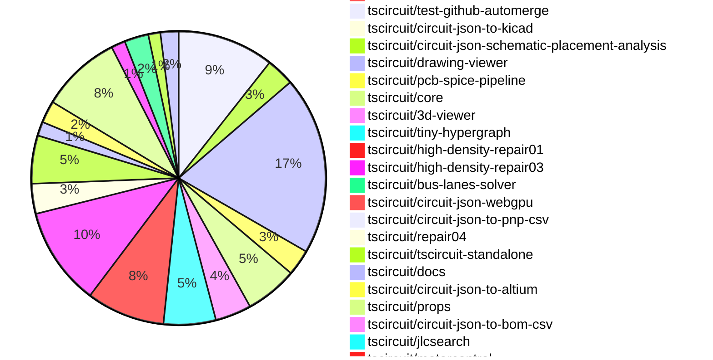

# contribution tracker

[contributions.tscircuit.com](https://contributions.tscircuit.com) ・ [tscircuit.com](https://tscircuit.com) ・ [Contribution Overviews](./contribution-overviews/) ・ [Changelogs](./changelogs/)

Generates weekly contribution overviews for tscircuit contributors. Check out all
the [contribution overviews here](./contribution-overviews/)
You can find AI-generated monthly changelogs in the [changelogs directory](./changelogs/)

- All PRs in the tscircuit org are scanned/summarized via an LLM
- The LLM classifies each Diff/PR as into a set of attributes for scoring
- All the PRs, summaries, and classifications are organized into charts and tables for [the website](https://contributions.tscircuit.com)

> Want to run locally? See the [Development Section](#development)

## Current Week

<!-- START_CURRENT_WEEK -->

# Contribution Overview 2026-11-03

The current week is shown below. There are 3 major sections:

- [Contributor Overview](#contributor-overview)
- [PRs by Repository](#prs-by-repository)
- [PRs by Contributor](#changes-by-contributor)
- [Scoring & Sponsorship Details](/docs/sponsorship-calculation-explanation.md)

## PRs by Repository

## Contributor Overview

| Contributor | 🐳 Major | 🐙 Minor | 🐌 Tiny | Score | ⭐ |
|-------------|---------|---------|---------|-------|-----|
| [ShiboSoftwareDev](#ShiboSoftwareDev) | 38 | 2 | 25 | 171 | 👑👑👑 |
| [seveibar](#seveibar) | 25 | 10 | 22 | 133 | 👑👑 |
| [0hmX](#0hmX) | 5 | 9 | 7 | 46 | ⭐⭐ |
| [MustafaMulla29](#MustafaMulla29) | 5 | 6 | 20 | 45 | ⭐⭐ |
| [imrishabh18](#imrishabh18) | 5 | 2 | 12 | 37 | ⭐⭐ |
| [Abse2001](#Abse2001) | 2 | 6 | 5 | 33 | ⭐⭐ |
| [techmannih](#techmannih) | 5 | 0 | 6 | 26 | ⭐⭐ |
| [AnasSarkiz](#AnasSarkiz) | 5 | 1 | 4 | 26 | ⭐⭐ |
| [rushabhcodes](#rushabhcodes) | 3 | 1 | 6 | 20 | ⭐⭐ |
| [tscircuitbot](#tscircuitbot) | 0 | 0 | 260 | 12 | ⭐⭐ |
| [mohan-bee](#mohan-bee) | 2 | 1 | 2 | 12 | ⭐⭐ |
| [GokulPandi-M](#GokulPandi-M) | 2 | 1 | 0 | 10 | ⭐ |
| [abdalraof-albarbar](#abdalraof-albarbar) | 1 | 1 | 1 | 7 | ⭐ |
| [danielshawellis](#danielshawellis) | 0 | 0 | 1 | 1 |  |

## Staff Pass Ratio (SPR)

| Contributor | Reviewed PRs | Rejections | Approvals | SPR |
|-------------|--------------|------------|-----------|-----|
| [ShiboSoftwareDev](#ShiboSoftwareDev) | 13 | 0 | 13 | 100.0% |
| [Abse2001](#Abse2001) | 6 | 0 | 6 | 100.0% |
| [techmannih](#techmannih) | 5 | 0 | 5 | 100.0% |
| [GokulPandi-M](#GokulPandi-M) | 4 | 1 | 3 | 75.0% |
| [AnasSarkiz](#AnasSarkiz) | 3 | 0 | 3 | 100.0% |
| [imrishabh18](#imrishabh18) | 3 | 0 | 3 | 100.0% |
| [mohan-bee](#mohan-bee) | 3 | 1 | 3 | 66.7% |
| [0hmX](#0hmX) | 2 | 0 | 2 | 100.0% |
| [rushabhcodes](#rushabhcodes) | 2 | 1 | 2 | 50.0% |
| [abdalraof-albarbar](#abdalraof-albarbar) | 1 | 0 | 1 | 100.0% |

ShiboSoftwareDev SPR PRs (13)

- [#1163](https://github.com/tscircuit/pcb-viewer/pull/1163) Speed up WebGPU copper pours by updating Earcut
- [#1095](https://github.com/tscircuit/3d-viewer/pull/1095) Release the 3D canvas WebGL context on teardown
- [#3547](https://github.com/tscircuit/tscircuit-autorouter/pull/3547) Repair Pipeline9 DDR routes beside completed copper
- [#3520](https://github.com/tscircuit/tscircuit-autorouter/pull/3520) Preserve fixed native traces throughout Pipeline 9
- [#3514](https://github.com/tscircuit/tscircuit-autorouter/pull/3514) Avoid full mesh-edge scans when connecting target regions
- [#3480](https://github.com/tscircuit/tscircuit-autorouter/pull/3480) Avoid retaining every temporary topology cell on DDR boards
- [#3471](https://github.com/tscircuit/tscircuit-autorouter/pull/3471) Fix DDR pad drills through the existing repair search
- [#308](https://github.com/tscircuit/tiny-hypergraph/pull/308) Preserve fixed native routes during hypergraph rerouting
- [#156](https://github.com/tscircuit/bus-lanes-solver/pull/156) Preserve escape gaps beside rotated rectangular pads
- [#147](https://github.com/tscircuit/bus-lanes-solver/pull/147) Route A64’s fourth DDR byte through available pad-edge escape sites
- [#136](https://github.com/tscircuit/bus-lanes-solver/pull/136) Fix STMP157 DDR byte routing with valid pad-to-via approaches
- [#102](https://github.com/tscircuit/circuit-json-webgpu/pull/102) Write WebGPU mesh arrays one chunk at a time
- [#101](https://github.com/tscircuit/circuit-json-webgpu/pull/101) perf: build WebGPU meshes in typed array chunks

Abse2001 SPR PRs (6)

- [#955](https://github.com/tscircuit/circuit-json/pull/955) feat: allow panel fabrication notes without fake footprints (core#5067)
- [#974](https://github.com/tscircuit/props/pull/974) fix: require at least three courtyard outline points
- [#5076](https://github.com/tscircuit/core/pull/5076) fix: use the requested tab span and wider mouse-bite webs (#5066)
- [#5071](https://github.com/tscircuit/core/pull/5071) fix: replace rounded panel slivers with continuous routing slots (#5065)
- [#5663](https://github.com/tscircuit/cli/pull/5663) fix: update STEP converter and preserve assembly ZIP exports (#5661)
- [#177](https://github.com/tscircuit/circuit-json-to-step/pull/177) fix: export round pill drills without non-finite STEP directions (#176)

techmannih SPR PRs (5)

- [#5182](https://github.com/tscircuit/core/pull/5182) fix: allow ground-plane routing past trace-length preflight
- [#5143](https://github.com/tscircuit/core/pull/5143) Skip redundant autorouting between copper-connected terminals
- [#3496](https://github.com/tscircuit/tscircuit-autorouter/pull/3496) fix: pin repair03 with physical copper contact protection
- [#190](https://github.com/tscircuit/high-density-repair03/pull/190) fix: prevent new trace-to-via shorts during repair
- [#187](https://github.com/tscircuit/high-density-repair03/pull/187) perf: reuse broad-force passes and avoid redundant DRC work

GokulPandi-M SPR PRs (4)

- [#5224](https://github.com/tscircuit/core/pull/5224) Fix false errors when importing split routed traces
- [#5223](https://github.com/tscircuit/core/pull/5223) fix: preserve BGA dogbone fanout when adding a ground pour
- [#5186](https://github.com/tscircuit/core/pull/5186) repro: ground pour prevents BGA dogbone fanout
- [#5137](https://github.com/tscircuit/core/pull/5137) Reproduce false connectivity errors for split via-to-via traces

AnasSarkiz SPR PRs (3)

- [#975](https://github.com/tscircuit/circuit-json/pull/975) Preserve custom KiCad properties in component metadata
- [#987](https://github.com/tscircuit/props/pull/987) Allow custom KiCad metadata property names
- [#5177](https://github.com/tscircuit/core/pull/5177) Fix split physical ports for custom schematic symbols

imrishabh18 SPR PRs (3)

- [#3477](https://github.com/tscircuit/tscircuit-autorouter/pull/3477) perf: reduce Pipeline9 clearance projection cost via repair04
- [#62](https://github.com/tscircuit/repair04/pull/62) perf: prune clearance pairs and simplify via-pad distances
- [#49](https://github.com/tscircuit/tscircuit-standalone/pull/49) refactor: preserve the normal standalone package graph

mohan-bee SPR PRs (3)

- [#290](https://github.com/tscircuit/circuit-json-util/pull/290) move brep copper pours with pcb transforms
- [#3442](https://github.com/tscircuit/tscircuit-autorouter/pull/3442) use upstream power trace expansion batching
- [#68](https://github.com/tscircuit/power-trace-expander/pull/68) batch power trace expansion while preserving work budgets

0hmX SPR PRs (2)

- [#5121](https://github.com/tscircuit/core/pull/5121) fix: default board thickness to 1.6mm
- [#5109](https://github.com/tscircuit/core/pull/5109) fix: warn when fabricatorPreset has no stackup template for the board

rushabhcodes SPR PRs (2)

- [#283](https://github.com/tscircuit/circuit-json-util/pull/283) fix: support position tolerance when matching route vias
- [#3](https://github.com/tscircuit/drawing-viewer/pull/3) Render engineering drawings from Circuit JSON

abdalraof-albarbar SPR PRs (1)

- [#6111](https://github.com/tscircuit/runframe/pull/6111) Fix Pipeline9 solver reconstruction in the Solvers tab

> Note: AI evaluates PRs and assigns 1-3 star ratings automatically. 4 and 5 star ratings require manual staff review.

## Review Table

[reviews-received-hover]: ## "Number of reviews received for PRs for this contributor"
[approvals-received-hover]: ## "Number of approvals received for PRs this contributor authored"
[rejections-received-hover]: ## "Number of rejections received for PRs this contributor authored"
[prs-opened-hover]: ## "Number of PRs opened by this contributor"
[issues-created-hover]: ## "Number of issues created by this contributor"

| Contributor | Reviews Received | Approvals Received | Rejections Received | Approvals | Rejections Given | PRs Opened | PRs Merged | Issues Created |
|---|---|---|---|---|---|---|---|---|
| [0hmX](#0hmX) | 6 | 3 | 0 | 10 | 0 | 38 | 22 | 0 |
| [1932819331hy-debug](#1932819331hy-debug) | 3 | 0 | 0 | 0 | 0 | 23 | 0 | 0 |
| [abdalraof-albarbar](#abdalraof-albarbar) | 3 | 3 | 0 | 0 | 0 | 6 | 3 | 0 |
| [Abse2001](#Abse2001) | 7 | 7 | 0 | 8 | 0 | 34 | 13 | 0 |
| [Albertito-AI](#Albertito-AI) | 0 | 0 | 0 | 0 | 0 | 2 | 0 | 0 |
| [alokudyogi](#alokudyogi) | 0 | 0 | 0 | 0 | 0 | 1 | 0 | 0 |
| [AnasSarkiz](#AnasSarkiz) | 7 | 7 | 0 | 0 | 0 | 16 | 10 | 0 |
| [balckwell](#balckwell) | 0 | 0 | 0 | 0 | 0 | 4 | 0 | 0 |
| [btctony1](#btctony1) | 0 | 0 | 0 | 0 | 0 | 1 | 0 | 0 |
| [cocvn157](#cocvn157) | 0 | 0 | 0 | 0 | 0 | 319 | 0 | 0 |
| [Crodify](#Crodify) | 0 | 0 | 0 | 0 | 0 | 13 | 0 | 0 |
| [danielshawellis](#danielshawellis) | 2 | 1 | 0 | 0 | 0 | 2 | 1 | 0 |
| [Devesh36](#Devesh36) | 0 | 0 | 0 | 0 | 0 | 1 | 0 | 0 |
| [DoctorLaplace](#DoctorLaplace) | 0 | 0 | 0 | 0 | 0 | 2 | 0 | 0 |
| [GokulPandi-M](#GokulPandi-M) | 6 | 4 | 2 | 0 | 0 | 5 | 3 | 0 |
| [HarsH-1877](#HarsH-1877) | 0 | 0 | 0 | 0 | 0 | 3 | 0 | 0 |
| [imrishabh18](#imrishabh18) | 5 | 5 | 0 | 6 | 1 | 29 | 20 | 0 |
| [KrishnaX12](#KrishnaX12) | 0 | 0 | 0 | 0 | 0 | 2 | 0 | 0 |
| [longdungai](#longdungai) | 3 | 0 | 0 | 0 | 0 | 3 | 0 | 0 |
| [mau16ro](#mau16ro) | 0 | 0 | 0 | 0 | 0 | 1 | 0 | 0 |
| [mohan-bee](#mohan-bee) | 3 | 3 | 0 | 0 | 0 | 7 | 5 | 0 |
| [MustafaMulla29](#MustafaMulla29) | 7 | 4 | 0 | 2 | 0 | 41 | 31 | 0 |
| [nhausmna](#nhausmna) | 0 | 0 | 0 | 0 | 0 | 1 | 0 | 0 |
| [Plugv3](#Plugv3) | 0 | 0 | 0 | 0 | 0 | 5 | 0 | 0 |
| [rafagil11](#rafagil11) | 0 | 0 | 0 | 0 | 0 | 1 | 0 | 0 |
| [rushabhcodes](#rushabhcodes) | 22 | 10 | 0 | 0 | 0 | 19 | 10 | 0 |
| [seveibar](#seveibar) | 28 | 0 | 0 | 50 | 1 | 79 | 57 | 0 |
| [ShiboSoftwareDev](#ShiboSoftwareDev) | 28 | 28 | 0 | 5 | 0 | 78 | 65 | 0 |
| [Shokun123](#Shokun123) | 0 | 0 | 0 | 0 | 0 | 5 | 0 | 0 |
| [techmannih](#techmannih) | 9 | 6 | 0 | 0 | 0 | 19 | 11 | 0 |
| [tscircuitbot](#tscircuitbot) | 0 | 0 | 0 | 0 | 0 | 362 | 260 | 0 |
| [zenoutlabs](#zenoutlabs) | 0 | 0 | 0 | 0 | 0 | 2 | 0 | 0 |

## Changes by Repository

### [tscircuit/runframe](https://github.com/tscircuit/runframe)

| PR # | Impact | Rating | Contributor | Description |
|------|--------|--------|-------------|-------------|
| [#6111](https://github.com/tscircuit/runframe/pull/6111) | 🐳 Major | ⭐⭐⭐ | abdalraof-albarbar | Fixes autorouting failure when selecting AutoroutingPipelineSolver9_PreloadedTraceGraph due to undefined properties in solver parameters. |
| [#6079](https://github.com/tscircuit/runframe/pull/6079) | 🐳 Major | ⭐⭐⭐ | seveibar | Add System to RunFrames More views dropdown and render System pages with tscircuitsystem-block-viewer. This displays the resolved geometry emitted by system block TSX. |
| [#6089](https://github.com/tscircuit/runframe/pull/6089) | 🐳 Major | ⭐⭐⭐ | rushabhcodes | Adds Drawing to More views, using a direct DrawingViewer import like the existing viewer integrations. Runframe forwards Circuit JSON and provides tab selectionavailability, shared panel sizing, the empty preview state, and an error boundary that resets when the circuit changes. |
| [#6109](https://github.com/tscircuit/runframe/pull/6109) | 🐙 Minor | ⭐⭐ | abdalraof-albarbar | Fixes stale solver debugger when switching between different solvers in the Solvers tab, ensuring the correct debugger state is displayed for the selected solver. |
| [#6085](https://github.com/tscircuit/runframe/pull/6085) | 🐙 Minor | ⭐⭐ | seveibar | Enables navigation from System block components to their corresponding schematic symbols, highlighting the selected symbol in the schematic view. |

🐌 Tiny Contributions (43)

| PR # | Impact | Contributor | Description |
|------|--------|-------------|-------------|
| [#6124](https://github.com/tscircuit/runframe/pull/6124) | 🐌 Tiny | tscircuitbot | Automated package update |
| [#6123](https://github.com/tscircuit/runframe/pull/6123) | 🐌 Tiny | tscircuitbot | Updates the tscircuiteval package from version 0.0.1703 to 0.0.1704 |
| [#6122](https://github.com/tscircuit/runframe/pull/6122) | 🐌 Tiny | tscircuitbot | Automated package update |
| [#6121](https://github.com/tscircuit/runframe/pull/6121) | 🐌 Tiny | tscircuitbot | Updates the tscircuiteval package from version 0.0.1702 to 0.0.1703 |
| [#6120](https://github.com/tscircuit/runframe/pull/6120) | 🐌 Tiny | tscircuitbot | Automated package update |
| [#6119](https://github.com/tscircuit/runframe/pull/6119) | 🐌 Tiny | tscircuitbot | Updates the tscircuiteval package from version 0.0.1701 to 0.0.1702 |
| [#6117](https://github.com/tscircuit/runframe/pull/6117) | 🐌 Tiny | tscircuitbot | Automated package update |
| [#6116](https://github.com/tscircuit/runframe/pull/6116) | 🐌 Tiny | tscircuitbot | Updates the tscircuiteval package from version 0.0.1700 to 0.0.1701 |
| [#6115](https://github.com/tscircuit/runframe/pull/6115) | 🐌 Tiny | tscircuitbot | Automated package update |
| [#6114](https://github.com/tscircuit/runframe/pull/6114) | 🐌 Tiny | tscircuitbot | Updates the tscircuitpcb-viewer package to version 1.11.449 in the package.json file. |
| [#6113](https://github.com/tscircuit/runframe/pull/6113) | 🐌 Tiny | tscircuitbot | Automated package update |
| [#6112](https://github.com/tscircuit/runframe/pull/6112) | 🐌 Tiny | tscircuitbot | Automated package update |
| [#6110](https://github.com/tscircuit/runframe/pull/6110) | 🐌 Tiny | tscircuitbot | Automated package update |
| [#6108](https://github.com/tscircuit/runframe/pull/6108) | 🐌 Tiny | tscircuitbot | Automated package update |
| [#6107](https://github.com/tscircuit/runframe/pull/6107) | 🐌 Tiny | tscircuitbot | Updates the tscircuitschematic-viewer package from version 2.0.106 to 2.0.107 |
| [#6103](https://github.com/tscircuit/runframe/pull/6103) | 🐌 Tiny | tscircuitbot | Automated package update |
| [#6102](https://github.com/tscircuit/runframe/pull/6102) | 🐌 Tiny | tscircuitbot | Updates the tscircuitpcb-viewer package to version 1.11.448 |
| [#6101](https://github.com/tscircuit/runframe/pull/6101) | 🐌 Tiny | tscircuitbot | Automated package update |
| [#6100](https://github.com/tscircuit/runframe/pull/6100) | 🐌 Tiny | tscircuitbot | Updates the tscircuitpcb-viewer package to version 1.11.447 |
| [#6099](https://github.com/tscircuit/runframe/pull/6099) | 🐌 Tiny | tscircuitbot | Automated package update |
| [#6096](https://github.com/tscircuit/runframe/pull/6096) | 🐌 Tiny | tscircuitbot | Automated package update |
| [#6095](https://github.com/tscircuit/runframe/pull/6095) | 🐌 Tiny | tscircuitbot | Updates the tscircuitpcb-viewer package to version 1.11.446 |
| [#6092](https://github.com/tscircuit/runframe/pull/6092) | 🐌 Tiny | tscircuitbot | Updates the tscircuitpcb-viewer package to version 1.11.445 |
| [#6090](https://github.com/tscircuit/runframe/pull/6090) | 🐌 Tiny | tscircuitbot | Automated package update |
| [#6088](https://github.com/tscircuit/runframe/pull/6088) | 🐌 Tiny | tscircuitbot | Automated package update |
| [#6087](https://github.com/tscircuit/runframe/pull/6087) | 🐌 Tiny | tscircuitbot | Updates the circuit-json-to-kicad package version from 0.0.265 to 0.0.267 in package.json |
| [#6083](https://github.com/tscircuit/runframe/pull/6083) | 🐌 Tiny | tscircuitbot | Automated package update |
| [#6082](https://github.com/tscircuit/runframe/pull/6082) | 🐌 Tiny | tscircuitbot | Updates the tscircuiteval package from version 0.0.1699 to 0.0.1700 |
| [#6081](https://github.com/tscircuit/runframe/pull/6081) | 🐌 Tiny | tscircuitbot | Automated package update |
| [#6080](https://github.com/tscircuit/runframe/pull/6080) | 🐌 Tiny | tscircuitbot | Updates the tscircuiteval package from version 0.0.1698 to 0.0.1699 |
| [#6078](https://github.com/tscircuit/runframe/pull/6078) | 🐌 Tiny | tscircuitbot | Automated package update |
| [#6077](https://github.com/tscircuit/runframe/pull/6077) | 🐌 Tiny | tscircuitbot | Updates the tscircuiteval package from version 0.0.1697 to 0.0.1698 |
| [#6076](https://github.com/tscircuit/runframe/pull/6076) | 🐌 Tiny | tscircuitbot | Automated package update |
| [#6075](https://github.com/tscircuit/runframe/pull/6075) | 🐌 Tiny | tscircuitbot | Updates the tscircuiteval package from version 0.0.1696 to 0.0.1697 |
| [#6073](https://github.com/tscircuit/runframe/pull/6073) | 🐌 Tiny | tscircuitbot | Automated package update |
| [#6072](https://github.com/tscircuit/runframe/pull/6072) | 🐌 Tiny | tscircuitbot | Updates the tscircuiteval package from version 0.0.1695 to 0.0.1696 |
| [#6068](https://github.com/tscircuit/runframe/pull/6068) | 🐌 Tiny | tscircuitbot | Automated package update |
| [#6067](https://github.com/tscircuit/runframe/pull/6067) | 🐌 Tiny | tscircuitbot | Updates the circuit-json-to-kicad package version from 0.0.263 to 0.0.265 in package.json |
| [#6065](https://github.com/tscircuit/runframe/pull/6065) | 🐌 Tiny | tscircuitbot | Automated package update |
| [#6064](https://github.com/tscircuit/runframe/pull/6064) | 🐌 Tiny | tscircuitbot | Updates the tscircuitpcb-viewer package to version 1.11.443 |
| [#6098](https://github.com/tscircuit/runframe/pull/6098) | 🐌 Tiny | ShiboSoftwareDev | Moves tscircuitsystem-block-viewer back to devDependencies to resolve npm-install audit failures caused by its previous placement in runtime dependencies. |
| [#6071](https://github.com/tscircuit/runframe/pull/6071) | 🐌 Tiny | imrishabh18 | Updates the tscircuitpcb-viewer dependency to version 1.11.444 to include a fix for hover label and outline clipping issues. |
| [#6094](https://github.com/tscircuit/runframe/pull/6094) | 🐌 Tiny | seveibar | Upgrades the System viewer to the published jscdn 0.0.5 release and declares it as a runtime dependency, ensuring curved routes work in standalone previews. |

### [tscircuit/schematic-viewer](https://github.com/tscircuit/schematic-viewer)

🐌 Tiny Contributions (1)

| PR # | Impact | Contributor | Description |
|------|--------|-------------|-------------|
| [#304](https://github.com/tscircuit/schematic-viewer/pull/304) | 🐌 Tiny | abdalraof-albarbar | Hides internal Circuit JSON IDs from the user-facing schematic component details popup, ensuring only meaningful fields are displayed. |

### [tscircuit/pcb-viewer](https://github.com/tscircuit/pcb-viewer)

| PR # | Impact | Rating | Contributor | Description |
|------|--------|--------|-------------|-------------|
| [#1163](https://github.com/tscircuit/pcb-viewer/pull/1163) | 🐳 Major | ⭐⭐⭐ | ShiboSoftwareDev | Updates the Earcut library to version 3.2.4 to improve the performance of triangulating copper pours in WebGPU, resulting in faster scene compilation and PCB painting times. |
| [#1191](https://github.com/tscircuit/pcb-viewer/pull/1191) | 🐙 Minor | ⭐⭐ | 0hmX | Fixes the issue of duplicated mm units in anchor offset labels by ensuring that mm is only appended when necessary, improving label clarity in the PCB viewer. |
| [#1153](https://github.com/tscircuit/pcb-viewer/pull/1153) | 🐙 Minor | ⭐⭐ | imrishabh18 | Fixes hover overlay overflow issue when zooming in on PCB pads, ensuring labels and outlines remain within the viewer bounds. |

🐌 Tiny Contributions (11)

| PR # | Impact | Contributor | Description |
|------|--------|-------------|-------------|
| [#1192](https://github.com/tscircuit/pcb-viewer/pull/1192) | 🐌 Tiny | tscircuitbot | Automated package update |
| [#1186](https://github.com/tscircuit/pcb-viewer/pull/1186) | 🐌 Tiny | tscircuitbot | Automated package update |
| [#1182](https://github.com/tscircuit/pcb-viewer/pull/1182) | 🐌 Tiny | tscircuitbot | Automated package update |
| [#1169](https://github.com/tscircuit/pcb-viewer/pull/1169) | 🐌 Tiny | tscircuitbot | Automated package update |
| [#1164](https://github.com/tscircuit/pcb-viewer/pull/1164) | 🐌 Tiny | tscircuitbot | Automated package update |
| [#1157](https://github.com/tscircuit/pcb-viewer/pull/1157) | 🐌 Tiny | tscircuitbot | Automated package update |
| [#1154](https://github.com/tscircuit/pcb-viewer/pull/1154) | 🐌 Tiny | tscircuitbot | Automated package update |
| [#1185](https://github.com/tscircuit/pcb-viewer/pull/1185) | 🐌 Tiny | ShiboSoftwareDev | Updates the WebGPU renderer to version 0.0.16, allowing the PCB viewer to write mesh buffers in batches, improving rendering performance. |
| [#1168](https://github.com/tscircuit/pcb-viewer/pull/1168) | 🐌 Tiny | ShiboSoftwareDev | Bump the WebGPU renderer bundled by the PCB viewer to 0.0.15 to pick up typed mesh buffers and lower peak PCB memory use |
| [#1181](https://github.com/tscircuit/pcb-viewer/pull/1181) | 🐌 Tiny | imrishabh18 | Fixes the height mismatch of the component search button in the pcb-viewer when embedded in runframe by setting the SVG display to inline-block to match the surrounding text controls height. |
| [#1156](https://github.com/tscircuit/pcb-viewer/pull/1156) | 🐌 Tiny | techmannih | Fixes unsupported color errors in WebGPU rendering by updating the circuit-json-webgpu package to support named colors and correct PCB note layout. |

### [tscircuit/tscircuit](https://github.com/tscircuit/tscircuit)

| PR # | Impact | Rating | Contributor | Description |
|------|--------|--------|-------------|-------------|
| [#6143](https://github.com/tscircuit/tscircuit/pull/6143) | 🐙 Minor | ⭐⭐ | seveibar | Adds support for system block diagrams and integrates the Dagre library as a runtime dependency, enabling enhanced layout capabilities for system blocks in the tscircuit package. |

🐌 Tiny Contributions (88)

| PR # | Impact | Contributor | Description |
|------|--------|-------------|-------------|
| [#6236](https://github.com/tscircuit/tscircuit/pull/6236) | 🐌 Tiny | tscircuitbot | Automated package update |
| [#6235](https://github.com/tscircuit/tscircuit/pull/6235) | 🐌 Tiny | tscircuitbot | Automated package update |
| [#6234](https://github.com/tscircuit/tscircuit/pull/6234) | 🐌 Tiny | tscircuitbot | Updates the package version from 0.0.3106 to 0.0.3107 in package.json |
| [#6233](https://github.com/tscircuit/tscircuit/pull/6233) | 🐌 Tiny | tscircuitbot | Automated package update |
| [#6232](https://github.com/tscircuit/tscircuit/pull/6232) | 🐌 Tiny | tscircuitbot | Automated package update |
| [#6231](https://github.com/tscircuit/tscircuit/pull/6231) | 🐌 Tiny | tscircuitbot | Automated package update |
| [#6230](https://github.com/tscircuit/tscircuit/pull/6230) | 🐌 Tiny | tscircuitbot | Automated package update |
| [#6229](https://github.com/tscircuit/tscircuit/pull/6229) | 🐌 Tiny | tscircuitbot | Automated package update |
| [#6228](https://github.com/tscircuit/tscircuit/pull/6228) | 🐌 Tiny | tscircuitbot | Automated package update |
| [#6227](https://github.com/tscircuit/tscircuit/pull/6227) | 🐌 Tiny | tscircuitbot | Updates the tscircuitcli package version from 0.1.2442 to 0.1.2443 |
| [#6226](https://github.com/tscircuit/tscircuit/pull/6226) | 🐌 Tiny | tscircuitbot | Automated package update |
| [#6225](https://github.com/tscircuit/tscircuit/pull/6225) | 🐌 Tiny | tscircuitbot | Automated package update |
| [#6224](https://github.com/tscircuit/tscircuit/pull/6224) | 🐌 Tiny | tscircuitbot | Automated package update |
| [#6222](https://github.com/tscircuit/tscircuit/pull/6222) | 🐌 Tiny | tscircuitbot | Automated package update |
| [#6221](https://github.com/tscircuit/tscircuit/pull/6221) | 🐌 Tiny | tscircuitbot | Automated package update |
| [#6220](https://github.com/tscircuit/tscircuit/pull/6220) | 🐌 Tiny | tscircuitbot | Automated package update |
| [#6219](https://github.com/tscircuit/tscircuit/pull/6219) | 🐌 Tiny | tscircuitbot | Automated package update |
| [#6216](https://github.com/tscircuit/tscircuit/pull/6216) | 🐌 Tiny | tscircuitbot | Automated package update |
| [#6215](https://github.com/tscircuit/tscircuit/pull/6215) | 🐌 Tiny | tscircuitbot | Automated package update |
| [#6211](https://github.com/tscircuit/tscircuit/pull/6211) | 🐌 Tiny | tscircuitbot | Automated package update |
| [#6210](https://github.com/tscircuit/tscircuit/pull/6210) | 🐌 Tiny | tscircuitbot | Automated package update |
| [#6209](https://github.com/tscircuit/tscircuit/pull/6209) | 🐌 Tiny | tscircuitbot | Automated package update |
| [#6208](https://github.com/tscircuit/tscircuit/pull/6208) | 🐌 Tiny | tscircuitbot | Automated package update |
| [#6207](https://github.com/tscircuit/tscircuit/pull/6207) | 🐌 Tiny | tscircuitbot | Automated package update |
| [#6206](https://github.com/tscircuit/tscircuit/pull/6206) | 🐌 Tiny | tscircuitbot | Automated package update |
| [#6205](https://github.com/tscircuit/tscircuit/pull/6205) | 🐌 Tiny | tscircuitbot | Automated package update |
| [#6202](https://github.com/tscircuit/tscircuit/pull/6202) | 🐌 Tiny | tscircuitbot | Updates the package version from 0.0.3092 to 0.0.3093 in package.json |
| [#6201](https://github.com/tscircuit/tscircuit/pull/6201) | 🐌 Tiny | tscircuitbot | Automated package update |
| [#6200](https://github.com/tscircuit/tscircuit/pull/6200) | 🐌 Tiny | tscircuitbot | Automated package update |
| [#6199](https://github.com/tscircuit/tscircuit/pull/6199) | 🐌 Tiny | tscircuitbot | Automated package update |
| [#6198](https://github.com/tscircuit/tscircuit/pull/6198) | 🐌 Tiny | tscircuitbot | Automated package update |
| [#6197](https://github.com/tscircuit/tscircuit/pull/6197) | 🐌 Tiny | tscircuitbot | Automated package update |
| [#6196](https://github.com/tscircuit/tscircuit/pull/6196) | 🐌 Tiny | tscircuitbot | Automated package update |
| [#6195](https://github.com/tscircuit/tscircuit/pull/6195) | 🐌 Tiny | tscircuitbot | Automated package update |
| [#6194](https://github.com/tscircuit/tscircuit/pull/6194) | 🐌 Tiny | tscircuitbot | Automated package update |
| [#6193](https://github.com/tscircuit/tscircuit/pull/6193) | 🐌 Tiny | tscircuitbot | Updates the tscircuitcli package version from 0.1.2436 to 0.1.2437 |
| [#6192](https://github.com/tscircuit/tscircuit/pull/6192) | 🐌 Tiny | tscircuitbot | Automated package update |
| [#6191](https://github.com/tscircuit/tscircuit/pull/6191) | 🐌 Tiny | tscircuitbot | Automated package update |
| [#6189](https://github.com/tscircuit/tscircuit/pull/6189) | 🐌 Tiny | tscircuitbot | Automated package update |
| [#6188](https://github.com/tscircuit/tscircuit/pull/6188) | 🐌 Tiny | tscircuitbot | Automated package update |
| [#6187](https://github.com/tscircuit/tscircuit/pull/6187) | 🐌 Tiny | tscircuitbot | Automated package update to version 0.0.3086 |
| [#6186](https://github.com/tscircuit/tscircuit/pull/6186) | 🐌 Tiny | tscircuitbot | Updates the tscircuitcli package version from 0.1.2435 to 0.1.2436 in package.json |
| [#6185](https://github.com/tscircuit/tscircuit/pull/6185) | 🐌 Tiny | tscircuitbot | Automated package update |
| [#6184](https://github.com/tscircuit/tscircuit/pull/6184) | 🐌 Tiny | tscircuitbot | Automated package update |
| [#6183](https://github.com/tscircuit/tscircuit/pull/6183) | 🐌 Tiny | tscircuitbot | Automated package update |
| [#6182](https://github.com/tscircuit/tscircuit/pull/6182) | 🐌 Tiny | tscircuitbot | Updates the tscircuitcli package to version 0.1.2435 in package.json |
| [#6181](https://github.com/tscircuit/tscircuit/pull/6181) | 🐌 Tiny | tscircuitbot | Automated package update |
| [#6180](https://github.com/tscircuit/tscircuit/pull/6180) | 🐌 Tiny | tscircuitbot | Automated package update |
| [#6179](https://github.com/tscircuit/tscircuit/pull/6179) | 🐌 Tiny | tscircuitbot | Automated package update |
| [#6178](https://github.com/tscircuit/tscircuit/pull/6178) | 🐌 Tiny | tscircuitbot | Updates the tscircuitcore package from version 0.0.2267 to 0.0.2268 |
| [#6177](https://github.com/tscircuit/tscircuit/pull/6177) | 🐌 Tiny | tscircuitbot | Automated package update |
| [#6176](https://github.com/tscircuit/tscircuit/pull/6176) | 🐌 Tiny | tscircuitbot | Updates the tscircuitcli package to version 0.1.2434 |
| [#6175](https://github.com/tscircuit/tscircuit/pull/6175) | 🐌 Tiny | tscircuitbot | Automated package update |
| [#6174](https://github.com/tscircuit/tscircuit/pull/6174) | 🐌 Tiny | tscircuitbot | Automated package update |
| [#6173](https://github.com/tscircuit/tscircuit/pull/6173) | 🐌 Tiny | tscircuitbot | Automated package update |
| [#6172](https://github.com/tscircuit/tscircuit/pull/6172) | 🐌 Tiny | tscircuitbot | Updates the tscircuitcli package to version 0.1.2433 |
| [#6171](https://github.com/tscircuit/tscircuit/pull/6171) | 🐌 Tiny | tscircuitbot | Automated package update |
| [#6170](https://github.com/tscircuit/tscircuit/pull/6170) | 🐌 Tiny | tscircuitbot | Automated package update |
| [#6169](https://github.com/tscircuit/tscircuit/pull/6169) | 🐌 Tiny | tscircuitbot | Automated package update |
| [#6167](https://github.com/tscircuit/tscircuit/pull/6167) | 🐌 Tiny | tscircuitbot | Automated package update |
| [#6168](https://github.com/tscircuit/tscircuit/pull/6168) | 🐌 Tiny | tscircuitbot | Automated package update |
| [#6166](https://github.com/tscircuit/tscircuit/pull/6166) | 🐌 Tiny | tscircuitbot | Automated package update |
| [#6165](https://github.com/tscircuit/tscircuit/pull/6165) | 🐌 Tiny | tscircuitbot | Automated package update |
| [#6163](https://github.com/tscircuit/tscircuit/pull/6163) | 🐌 Tiny | tscircuitbot | Automated package update |
| [#6162](https://github.com/tscircuit/tscircuit/pull/6162) | 🐌 Tiny | tscircuitbot | Automated package update |
| [#6160](https://github.com/tscircuit/tscircuit/pull/6160) | 🐌 Tiny | tscircuitbot | Automated package update |
| [#6159](https://github.com/tscircuit/tscircuit/pull/6159) | 🐌 Tiny | tscircuitbot | Updates the tscircuitcli package to version 0.1.2432 |
| [#6158](https://github.com/tscircuit/tscircuit/pull/6158) | 🐌 Tiny | tscircuitbot | Automated package update |
| [#6157](https://github.com/tscircuit/tscircuit/pull/6157) | 🐌 Tiny | tscircuitbot | Automated package update |
| [#6156](https://github.com/tscircuit/tscircuit/pull/6156) | 🐌 Tiny | tscircuitbot | Automated package update |
| [#6155](https://github.com/tscircuit/tscircuit/pull/6155) | 🐌 Tiny | tscircuitbot | Updates the tscircuitcli package to version 0.1.2431 in package.json |
| [#6154](https://github.com/tscircuit/tscircuit/pull/6154) | 🐌 Tiny | tscircuitbot | Updates the package version from 0.0.3069 to 0.0.3070 in package.json |
| [#6152](https://github.com/tscircuit/tscircuit/pull/6152) | 🐌 Tiny | tscircuitbot | Automated package update |
| [#6153](https://github.com/tscircuit/tscircuit/pull/6153) | 🐌 Tiny | tscircuitbot | Automated package update |
| [#6151](https://github.com/tscircuit/tscircuit/pull/6151) | 🐌 Tiny | tscircuitbot | Updates the version of tscircuitcore from 0.0.2261 to 0.0.2263 and tscircuitmodelprinter from 0.0.18 to 0.0.37 in package.json |
| [#6150](https://github.com/tscircuit/tscircuit/pull/6150) | 🐌 Tiny | tscircuitbot | Automated package update |
| [#6149](https://github.com/tscircuit/tscircuit/pull/6149) | 🐌 Tiny | tscircuitbot | Updates the tscircuitcli package to version 0.1.2430 in the package.json file |
| [#6148](https://github.com/tscircuit/tscircuit/pull/6148) | 🐌 Tiny | tscircuitbot | Automated package update |
| [#6147](https://github.com/tscircuit/tscircuit/pull/6147) | 🐌 Tiny | tscircuitbot | Automated package update |
| [#6146](https://github.com/tscircuit/tscircuit/pull/6146) | 🐌 Tiny | tscircuitbot | Automated package update |
| [#6145](https://github.com/tscircuit/tscircuit/pull/6145) | 🐌 Tiny | tscircuitbot | Updates the versions of the tscircuitrunframe and tscircuiteval packages in the project dependencies. |
| [#6144](https://github.com/tscircuit/tscircuit/pull/6144) | 🐌 Tiny | tscircuitbot | Automated package update |
| [#6142](https://github.com/tscircuit/tscircuit/pull/6142) | 🐌 Tiny | tscircuitbot | Automated package update |
| [#6214](https://github.com/tscircuit/tscircuit/pull/6214) | 🐌 Tiny | ShiboSoftwareDev | Excludes 11 CLI-only converters from core dependency synchronization to resolve package-update workflow failures caused by missing dependencies. |
| [#6203](https://github.com/tscircuit/tscircuit/pull/6203) | 🐌 Tiny | ShiboSoftwareDev | Fixes package update workflow failure by excluding the circuit-json-to-bom-csv converter from dependency sync as it is only used in assembly tests and a build smoke test. |
| [#6223](https://github.com/tscircuit/tscircuit/pull/6223) | 🐌 Tiny | seveibar | Updates the circuit-json-to-gltf package to version 0.0.165 to resolve an import failure related to the footprinter dependency. |
| [#6164](https://github.com/tscircuit/tscircuit/pull/6164) | 🐌 Tiny | MustafaMulla29 | Regenerates bun.lock to match the manifest and resolves the direct eval dependency to 0.0.1701, while retaining 0.0.1700 for the existing nested tscircuit dependency. |
| [#6161](https://github.com/tscircuit/tscircuit/pull/6161) | 🐌 Tiny | MustafaMulla29 | Updates tscircuiteval from 0.0.1700 to 0.0.1701 to bring in parts-engine 0.0.41  EasyEDA 0.0.389 update. |

### [tscircuit/circuit-json](https://github.com/tscircuit/circuit-json)

| PR # | Impact | Rating | Contributor | Description |
|------|--------|--------|-------------|-------------|
| [#962](https://github.com/tscircuit/circuit-json/pull/962) | 🐳 Major | ⭐⭐⭐ | seveibar | Adds optional cubic Bzier control points to system-block route endpoints for storing resolved curved routes in Circuit JSON. |
| [#958](https://github.com/tscircuit/circuit-json/pull/958) | 🐳 Major | ⭐⭐⭐ | seveibar | Add cad_assembly_bom_item as a first-class Circuit JSON element for physical assembly bills of materials, allowing for quantities, purchasing information, and nesting of materials without PCB footprints or CAD geometry. |
| [#959](https://github.com/tscircuit/circuit-json/pull/959) | 🐳 Major | ⭐⭐⭐ | seveibar | Add resolved Circuit JSON representation for system block properties, enabling drawing of block bounds, routes, and labels without layout algorithms. |
| [#979](https://github.com/tscircuit/circuit-json/pull/979) | 🐳 Major | ⭐⭐⭐ | AnasSarkiz | Adds optional metadata to schematic components to retain KiCad fields for components without a schematic symbol. |
| [#975](https://github.com/tscircuit/circuit-json/pull/975) | 🐳 Major | ⭐⭐⭐ | AnasSarkiz | Preserves custom KiCad property names in footprint and symbol metadata during Circuit JSON parsing, ensuring validation and TypeScript autocomplete are maintained. |
| [#955](https://github.com/tscircuit/circuit-json/pull/955) | 🐳 Major | ⭐⭐⭐ | Abse2001 | Allows panel-level fabrication paths and labels to carry pcb_panel_id without requiring an invented pcb_component_id, aligning with standalone silkscreen ownership conventions. |
| [#954](https://github.com/tscircuit/circuit-json/pull/954) | 🐳 Major | ⭐⭐⭐ | Abse2001 | Adds schema validation for panel-level fabrication annotations to ensure they do not require an invented component reference, aligning with existing ownership conventions. |

🐌 Tiny Contributions (6)

| PR # | Impact | Contributor | Description |
|------|--------|-------------|-------------|
| [#980](https://github.com/tscircuit/circuit-json/pull/980) | 🐌 Tiny | tscircuitbot | Automated package update |
| [#978](https://github.com/tscircuit/circuit-json/pull/978) | 🐌 Tiny | tscircuitbot | Automated package update |
| [#976](https://github.com/tscircuit/circuit-json/pull/976) | 🐌 Tiny | tscircuitbot | Automated package update |
| [#964](https://github.com/tscircuit/circuit-json/pull/964) | 🐌 Tiny | tscircuitbot | Automated package update |
| [#961](https://github.com/tscircuit/circuit-json/pull/961) | 🐌 Tiny | tscircuitbot | Automated package update |
| [#960](https://github.com/tscircuit/circuit-json/pull/960) | 🐌 Tiny | tscircuitbot | Automated package update |

### [tscircuit/tscircuit.com](https://github.com/tscircuit/tscircuit.com)

| PR # | Impact | Rating | Contributor | Description |
|------|--------|--------|-------------|-------------|
| [#5708](https://github.com/tscircuit/tscircuit.com/pull/5708) | 🐳 Major | ⭐⭐⭐ | seveibar | Upgrades the System viewer to support curved routes and enables navigation from components to their schematic representation, displaying associated reference designators and manufacturer part numbers. |
| [#5699](https://github.com/tscircuit/tscircuit.com/pull/5699) | 🐳 Major | ⭐⭐⭐ | seveibar | Adds a System view for packages with a system_block_page in Circuit JSON, and modifies the Download button to be more compact while preserving accessibility features. |

🐌 Tiny Contributions (24)

| PR # | Impact | Contributor | Description |
|------|--------|-------------|-------------|
| [#5726](https://github.com/tscircuit/tscircuit.com/pull/5726) | 🐌 Tiny | tscircuitbot | Automated package update |
| [#5720](https://github.com/tscircuit/tscircuit.com/pull/5720) | 🐌 Tiny | tscircuitbot | Updates the tscircuitrunframe package from version 0.0.3151 to 0.0.3152 |
| [#5719](https://github.com/tscircuit/tscircuit.com/pull/5719) | 🐌 Tiny | tscircuitbot | Updates the tscircuitrunframe package from version 0.0.3150 to 0.0.3151 |
| [#5718](https://github.com/tscircuit/tscircuit.com/pull/5718) | 🐌 Tiny | tscircuitbot | Updates the tscircuitrunframe package from version 0.0.3149 to 0.0.3150 and the tscircuitschematic-viewer package from version 2.0.106 to 2.0.107. |
| [#5717](https://github.com/tscircuit/tscircuit.com/pull/5717) | 🐌 Tiny | tscircuitbot | Automated package update |
| [#5715](https://github.com/tscircuit/tscircuit.com/pull/5715) | 🐌 Tiny | tscircuitbot | Updates the tscircuitrunframe package version from 0.0.3146 to 0.0.3148 and the tscircuitpcb-viewer package version from 1.11.446 to 1.11.447 in package.json |
| [#5711](https://github.com/tscircuit/tscircuit.com/pull/5711) | 🐌 Tiny | tscircuitbot | Automated package update |
| [#5710](https://github.com/tscircuit/tscircuit.com/pull/5710) | 🐌 Tiny | tscircuitbot | Updates the tscircuitrunframe package version from 0.0.3143 to 0.0.3144 |
| [#5707](https://github.com/tscircuit/tscircuit.com/pull/5707) | 🐌 Tiny | tscircuitbot | Updates the tscircuitrunframe package from version 0.0.3142 to 0.0.3143 |
| [#5704](https://github.com/tscircuit/tscircuit.com/pull/5704) | 🐌 Tiny | tscircuitbot | Updates the tscircuitrunframe package version from 0.0.3139 to 0.0.3142 in package.json |
| [#5698](https://github.com/tscircuit/tscircuit.com/pull/5698) | 🐌 Tiny | tscircuitbot | Updates the tscircuitrunframe package version from 0.0.3138 to 0.0.3139 in package.json |
| [#5694](https://github.com/tscircuit/tscircuit.com/pull/5694) | 🐌 Tiny | tscircuitbot | Automated package update |
| [#5693](https://github.com/tscircuit/tscircuit.com/pull/5693) | 🐌 Tiny | tscircuitbot | Automated package update |
| [#5692](https://github.com/tscircuit/tscircuit.com/pull/5692) | 🐌 Tiny | tscircuitbot | Updates the tscircuiteval package from version 0.0.1696 to 0.0.1697 and downgrades the tscircuitpcb-viewer package from version 1.11.444 to 1.11.443. |
| [#5691](https://github.com/tscircuit/tscircuit.com/pull/5691) | 🐌 Tiny | tscircuitbot | Updates the tscircuitrunframe package from version 0.0.3133 to 0.0.3134 |
| [#5688](https://github.com/tscircuit/tscircuit.com/pull/5688) | 🐌 Tiny | tscircuitbot | Automated package update |
| [#5687](https://github.com/tscircuit/tscircuit.com/pull/5687) | 🐌 Tiny | tscircuitbot | Updates the tscircuitrunframe package from version 0.0.3132 to 0.0.3133 and the tscircuitpcb-viewer package from version 1.11.442 to 1.11.443 in package.json |
| [#5686](https://github.com/tscircuit/tscircuit.com/pull/5686) | 🐌 Tiny | tscircuitbot | Updates the tscircuitrunframe package version from 0.0.3131 to 0.0.3132 in package.json |
| [#5689](https://github.com/tscircuit/tscircuit.com/pull/5689) | 🐌 Tiny | imrishabh18 | Updates the PCB viewer dependency to version 1.11.444 to fix overflowing hover labels and outlines in the PCB page rendering. |
| [#5706](https://github.com/tscircuit/tscircuit.com/pull/5706) | 🐌 Tiny | seveibar | Make two copy edits on the Verified Chips page: Replace Pin metadata for successful first revisions with Better Validation for AI-generated Circuit Boards. Replace help your semiconductor company decrease time to market with accelerate time to market. |
| [#5703](https://github.com/tscircuit/tscircuit.com/pull/5703) | 🐌 Tiny | seveibar | Aligns application headers with landing page typography using Geist font and modifies dropdown behavior to open immediately without animations or delays. |
| [#5701](https://github.com/tscircuit/tscircuit.com/pull/5701) | 🐌 Tiny | seveibar | Changes the order of views on package pages to Files  System  3D  PCB  Schematic when a package contains a System diagram. |
| [#5702](https://github.com/tscircuit/tscircuit.com/pull/5702) | 🐌 Tiny | seveibar | Add professional-support and verified-chips pages with details on services and email links for inquiries, along with navigation updates and SEO enhancements. |
| [#5716](https://github.com/tscircuit/tscircuit.com/pull/5716) | 🐌 Tiny | Abse2001 | Updates the PCB viewer dependency from version 1.11.447 to 1.11.449 and removes a CSS override for the search button as per user request. |

### [tscircuit/eval](https://github.com/tscircuit/eval)

🐌 Tiny Contributions (18)

| PR # | Impact | Contributor | Description |
|------|--------|-------------|-------------|
| [#5613](https://github.com/tscircuit/eval/pull/5613) | 🐌 Tiny | tscircuitbot | Automated package update |
| [#5612](https://github.com/tscircuit/eval/pull/5612) | 🐌 Tiny | tscircuitbot | Updates various package dependencies to their latest versions |
| [#5610](https://github.com/tscircuit/eval/pull/5610) | 🐌 Tiny | tscircuitbot | Automated package update |
| [#5609](https://github.com/tscircuit/eval/pull/5609) | 🐌 Tiny | tscircuitbot | Automated package update |
| [#5607](https://github.com/tscircuit/eval/pull/5607) | 🐌 Tiny | tscircuitbot | Automated package update |
| [#5606](https://github.com/tscircuit/eval/pull/5606) | 🐌 Tiny | tscircuitbot | Updates package dependencies to their latest versions as part of routine maintenance. |
| [#5604](https://github.com/tscircuit/eval/pull/5604) | 🐌 Tiny | tscircuitbot | Automated package update |
| [#5603](https://github.com/tscircuit/eval/pull/5603) | 🐌 Tiny | tscircuitbot | Automated package update |
| [#5559](https://github.com/tscircuit/eval/pull/5559) | 🐌 Tiny | tscircuitbot | Automated package update |
| [#5557](https://github.com/tscircuit/eval/pull/5557) | 🐌 Tiny | tscircuitbot | Automated package update |
| [#5556](https://github.com/tscircuit/eval/pull/5556) | 🐌 Tiny | tscircuitbot | Automated package update |
| [#5554](https://github.com/tscircuit/eval/pull/5554) | 🐌 Tiny | tscircuitbot | Automated package update |
| [#5553](https://github.com/tscircuit/eval/pull/5553) | 🐌 Tiny | tscircuitbot | Updates package dependencies in package.json to their latest versions. |
| [#5549](https://github.com/tscircuit/eval/pull/5549) | 🐌 Tiny | tscircuitbot | Automated package update |
| [#5548](https://github.com/tscircuit/eval/pull/5548) | 🐌 Tiny | tscircuitbot | Automated package update |
| [#5547](https://github.com/tscircuit/eval/pull/5547) | 🐌 Tiny | tscircuitbot | Automated package update |
| [#5546](https://github.com/tscircuit/eval/pull/5546) | 🐌 Tiny | tscircuitbot | Automated package update |
| [#5558](https://github.com/tscircuit/eval/pull/5558) | 🐌 Tiny | MustafaMulla29 | Updates tscircuitparts-engine from 0.0.39 to 0.0.41, fixing the issue of duplicate board cutouts for component mounting holes. |

### [tscircuit/cli](https://github.com/tscircuit/cli)

| PR # | Impact | Rating | Contributor | Description |
|------|--------|--------|-------------|-------------|
| [#5699](https://github.com/tscircuit/cli/pull/5699) | 🐙 Minor | ⭐⭐ | imrishabh18 | Changes the standalone dev and static-site builds to use the installed tscircuitbrowser export instead of the raw RunFrame bundle, ensuring proper worker integration and maintaining existing behaviors for project and UI overrides. |
| [#5698](https://github.com/tscircuit/cli/pull/5698) | 🐙 Minor | ⭐⭐ | seveibar | Adds support for exporting system diagrams and generating assembly SVGs, including new command options for system and assembly SVG exports, and updates to dependencies for enhanced functionality. |
| [#5671](https://github.com/tscircuit/cli/pull/5671) | 🐙 Minor | ⭐⭐ | seveibar | Adds support for an explicit Bun-compatible executable selection in the CLI, allowing users to specify a runtime without altering the PATH or requiring an alias. |
| [#5663](https://github.com/tscircuit/cli/pull/5663) | 🐙 Minor | ⭐⭐ | Abse2001 | Fixes NaN direction issues for pill pads with round drills in STEP exports by updating the circuit-json-to-step converter to version 0.0.63 and preserving assembly ZIP export behavior. |

🐌 Tiny Contributions (22)

| PR # | Impact | Contributor | Description |
|------|--------|-------------|-------------|
| [#5720](https://github.com/tscircuit/cli/pull/5720) | 🐌 Tiny | tscircuitbot | Automated package update |
| [#5717](https://github.com/tscircuit/cli/pull/5717) | 🐌 Tiny | tscircuitbot | Automated package update |
| [#5716](https://github.com/tscircuit/cli/pull/5716) | 🐌 Tiny | tscircuitbot | Updates the circuit-json-to-kicad package version from 0.0.267 to 0.0.269 in package.json |
| [#5713](https://github.com/tscircuit/cli/pull/5713) | 🐌 Tiny | tscircuitbot | Updates the easyeda package version from 0.0.388 to 0.0.389 in package.json |
| [#5711](https://github.com/tscircuit/cli/pull/5711) | 🐌 Tiny | tscircuitbot | Automated package update |
| [#5710](https://github.com/tscircuit/cli/pull/5710) | 🐌 Tiny | tscircuitbot | Automated package update |
| [#5704](https://github.com/tscircuit/cli/pull/5704) | 🐌 Tiny | tscircuitbot | Automated package update |
| [#5702](https://github.com/tscircuit/cli/pull/5702) | 🐌 Tiny | tscircuitbot | Automated package update |
| [#5700](https://github.com/tscircuit/cli/pull/5700) | 🐌 Tiny | tscircuitbot | Automated package update |
| [#5697](https://github.com/tscircuit/cli/pull/5697) | 🐌 Tiny | tscircuitbot | Automated package update |
| [#5695](https://github.com/tscircuit/cli/pull/5695) | 🐌 Tiny | tscircuitbot | Automated package update |
| [#5691](https://github.com/tscircuit/cli/pull/5691) | 🐌 Tiny | tscircuitbot | Automated package update |
| [#5689](https://github.com/tscircuit/cli/pull/5689) | 🐌 Tiny | tscircuitbot | Automated package update |
| [#5678](https://github.com/tscircuit/cli/pull/5678) | 🐌 Tiny | tscircuitbot | Automated package update |
| [#5673](https://github.com/tscircuit/cli/pull/5673) | 🐌 Tiny | tscircuitbot | Automated package update |
| [#5672](https://github.com/tscircuit/cli/pull/5672) | 🐌 Tiny | tscircuitbot | Automated package update |
| [#5719](https://github.com/tscircuit/cli/pull/5719) | 🐌 Tiny | 0hmX | Updates the bundled tscircuitpcb-spice-pipeline dependency from version 0.1.6 to 0.1.8, incorporating changes that allow for optional hand-written profiles in the straightened-stages mode. |
| [#5690](https://github.com/tscircuit/cli/pull/5690) | 🐌 Tiny | 0hmX | Updates the bundled PCB SPICE pipeline from version 0.1.3 to 0.1.6, ensuring compatibility with recent changes and improvements in the pipeline. |
| [#5688](https://github.com/tscircuit/cli/pull/5688) | 🐌 Tiny | 0hmX | Removes the detection and serialization of ImportedBoard from the generateCircuitJson function, simplifying the code and eliminating unnecessary imports. |
| [#5692](https://github.com/tscircuit/cli/pull/5692) | 🐌 Tiny | imrishabh18 | Updates the KiCad converter to version 0.0.267 to include panel fixes that were missing in the previous version 0.0.259. |
| [#5701](https://github.com/tscircuit/cli/pull/5701) | 🐌 Tiny | seveibar | Add SVG snapshots to ensure visual regressions in system diagrams, assembly SVGs, and assembly drawing pages fail the CLI tests. |
| [#5696](https://github.com/tscircuit/cli/pull/5696) | 🐌 Tiny | seveibar | Isolates the CLI compiler from project TypeScript 7 to prevent crashes during startup by bundling compatible TypeScript dependencies and adding CI checks for compatibility. |

### [tscircuit/svg.tscircuit.com](https://github.com/tscircuit/svg.tscircuit.com)

| PR # | Impact | Rating | Contributor | Description |
|------|--------|--------|-------------|-------------|
| [#2800](https://github.com/tscircuit/svg.tscircuit.com/pull/2800) | 🐳 Major | ⭐⭐⭐ | seveibar | Add support for rendering system block diagrams in SVG and PNG formats, including manifest generation and page selection. |

🐌 Tiny Contributions (38)

| PR # | Impact | Contributor | Description |
|------|--------|-------------|-------------|
| [#2842](https://github.com/tscircuit/svg.tscircuit.com/pull/2842) | 🐌 Tiny | tscircuitbot | Updates the tscircuit package version from 0.0.3106 to 0.0.3107 in package.json |
| [#2841](https://github.com/tscircuit/svg.tscircuit.com/pull/2841) | 🐌 Tiny | tscircuitbot | Updates the tscircuit package version from 0.0.3105 to 0.0.3106 in package.json |
| [#2840](https://github.com/tscircuit/svg.tscircuit.com/pull/2840) | 🐌 Tiny | tscircuitbot | Updates the tscircuit package version from 0.0.3104 to 0.0.3105 in package.json |
| [#2839](https://github.com/tscircuit/svg.tscircuit.com/pull/2839) | 🐌 Tiny | tscircuitbot | Updates the tscircuit package version from 0.0.3103 to 0.0.3104 in package.json |
| [#2838](https://github.com/tscircuit/svg.tscircuit.com/pull/2838) | 🐌 Tiny | tscircuitbot | Updates the tscircuit package version from 0.0.3102 to 0.0.3103 in package.json |
| [#2837](https://github.com/tscircuit/svg.tscircuit.com/pull/2837) | 🐌 Tiny | tscircuitbot | Updates the tscircuit package version from 0.0.3101 to 0.0.3102 in package.json |
| [#2836](https://github.com/tscircuit/svg.tscircuit.com/pull/2836) | 🐌 Tiny | tscircuitbot | Updates the tscircuit package version from 0.0.3100 to 0.0.3101 in package.json |
| [#2835](https://github.com/tscircuit/svg.tscircuit.com/pull/2835) | 🐌 Tiny | tscircuitbot | Updates the tscircuit package version from 0.0.3099 to 0.0.3100 in package.json |
| [#2834](https://github.com/tscircuit/svg.tscircuit.com/pull/2834) | 🐌 Tiny | tscircuitbot | Updates the tscircuit package version from 0.0.3097 to 0.0.3099 in package.json |
| [#2833](https://github.com/tscircuit/svg.tscircuit.com/pull/2833) | 🐌 Tiny | tscircuitbot | Updates the tscircuit package version from 0.0.3096 to 0.0.3097 in package.json |
| [#2832](https://github.com/tscircuit/svg.tscircuit.com/pull/2832) | 🐌 Tiny | tscircuitbot | Updates the tscircuit package version from 0.0.3096 to 0.0.3097 in package.json |
| [#2831](https://github.com/tscircuit/svg.tscircuit.com/pull/2831) | 🐌 Tiny | tscircuitbot | Updates the tscircuit package version from 0.0.3095 to 0.0.3096 in package.json |
| [#2830](https://github.com/tscircuit/svg.tscircuit.com/pull/2830) | 🐌 Tiny | tscircuitbot | Updates the tscircuit package version from 0.0.3094 to 0.0.3095 in package.json |
| [#2829](https://github.com/tscircuit/svg.tscircuit.com/pull/2829) | 🐌 Tiny | tscircuitbot | Updates the tscircuit package version from 0.0.3093 to 0.0.3094 in package.json |
| [#2828](https://github.com/tscircuit/svg.tscircuit.com/pull/2828) | 🐌 Tiny | tscircuitbot | Updates the tscircuit package version from 0.0.3092 to 0.0.3093 in package.json |
| [#2826](https://github.com/tscircuit/svg.tscircuit.com/pull/2826) | 🐌 Tiny | tscircuitbot | Updates the tscircuit package version from 0.0.3091 to 0.0.3092 in package.json |
| [#2825](https://github.com/tscircuit/svg.tscircuit.com/pull/2825) | 🐌 Tiny | tscircuitbot | Updates the tscircuit package version from 0.0.3090 to 0.0.3091 in package.json |
| [#2824](https://github.com/tscircuit/svg.tscircuit.com/pull/2824) | 🐌 Tiny | tscircuitbot | Updates the tscircuit package version from 0.0.3089 to 0.0.3090 in package.json |
| [#2823](https://github.com/tscircuit/svg.tscircuit.com/pull/2823) | 🐌 Tiny | tscircuitbot | Updates the tscircuit package version from 0.0.3088 to 0.0.3089 |
| [#2822](https://github.com/tscircuit/svg.tscircuit.com/pull/2822) | 🐌 Tiny | tscircuitbot | Updates the tscircuit package version from 0.0.3087 to 0.0.3088 in package.json |
| [#2821](https://github.com/tscircuit/svg.tscircuit.com/pull/2821) | 🐌 Tiny | tscircuitbot | Updates the tscircuit package version from 0.0.3086 to 0.0.3087 in package.json |
| [#2820](https://github.com/tscircuit/svg.tscircuit.com/pull/2820) | 🐌 Tiny | tscircuitbot | Updates the tscircuit package version from 0.0.3085 to 0.0.3086 in package.json |
| [#2819](https://github.com/tscircuit/svg.tscircuit.com/pull/2819) | 🐌 Tiny | tscircuitbot | Updates the tscircuit package version from 0.0.3084 to 0.0.3085 in package.json |
| [#2818](https://github.com/tscircuit/svg.tscircuit.com/pull/2818) | 🐌 Tiny | tscircuitbot | Updates the tscircuit package version from 0.0.3083 to 0.0.3084 in package.json |
| [#2817](https://github.com/tscircuit/svg.tscircuit.com/pull/2817) | 🐌 Tiny | tscircuitbot | Updates the tscircuit package version from 0.0.3082 to 0.0.3083 in package.json |
| [#2816](https://github.com/tscircuit/svg.tscircuit.com/pull/2816) | 🐌 Tiny | tscircuitbot | Updates the tscircuit package version from 0.0.3081 to 0.0.3082 in package.json |
| [#2815](https://github.com/tscircuit/svg.tscircuit.com/pull/2815) | 🐌 Tiny | tscircuitbot | Updates the tscircuit package version from 0.0.3080 to 0.0.3081 in package.json |
| [#2814](https://github.com/tscircuit/svg.tscircuit.com/pull/2814) | 🐌 Tiny | tscircuitbot | Updates the tscircuit package version from 0.0.3079 to 0.0.3080 in package.json |
| [#2813](https://github.com/tscircuit/svg.tscircuit.com/pull/2813) | 🐌 Tiny | tscircuitbot | Updates the tscircuit package version from 0.0.3078 to 0.0.3079 in package.json |
| [#2812](https://github.com/tscircuit/svg.tscircuit.com/pull/2812) | 🐌 Tiny | tscircuitbot | Updates the tscircuit package version from 0.0.3076 to 0.0.3078 in package.json |
| [#2810](https://github.com/tscircuit/svg.tscircuit.com/pull/2810) | 🐌 Tiny | tscircuitbot | Updates the tscircuit package version from 0.0.3074 to 0.0.3076 in package.json |
| [#2808](https://github.com/tscircuit/svg.tscircuit.com/pull/2808) | 🐌 Tiny | tscircuitbot | Updates the tscircuit package version from 0.0.3073 to 0.0.3074 in package.json |
| [#2807](https://github.com/tscircuit/svg.tscircuit.com/pull/2807) | 🐌 Tiny | tscircuitbot | Automated package update |
| [#2806](https://github.com/tscircuit/svg.tscircuit.com/pull/2806) | 🐌 Tiny | tscircuitbot | Updates the tscircuit package version from 0.0.3069 to 0.0.3072 in package.json |
| [#2804](https://github.com/tscircuit/svg.tscircuit.com/pull/2804) | 🐌 Tiny | tscircuitbot | Updates the tscircuit package version from 0.0.3067 to 0.0.3069 in package.json |
| [#2801](https://github.com/tscircuit/svg.tscircuit.com/pull/2801) | 🐌 Tiny | tscircuitbot | Updates the tscircuit package version from 0.0.3066 to 0.0.3067 in package.json |
| [#2799](https://github.com/tscircuit/svg.tscircuit.com/pull/2799) | 🐌 Tiny | tscircuitbot | Updates the tscircuit package version from 0.0.3065 to 0.0.3066 in package.json |
| [#2798](https://github.com/tscircuit/svg.tscircuit.com/pull/2798) | 🐌 Tiny | tscircuitbot | Updates the tscircuit package version from 0.0.3060 to 0.0.3065 in package.json |

### [tscircuit/tscircuit-autorouter](https://github.com/tscircuit/tscircuit-autorouter)

| PR # | Impact | Rating | Contributor | Description |
|------|--------|--------|-------------|-------------|
| [#3547](https://github.com/tscircuit/tscircuit-autorouter/pull/3547) | 🐳 Major | ⭐⭐⭐ | ShiboSoftwareDev | Fixes autorouting failure by repairing DDR routes adjacent to completed copper in Pipeline9, resulting in zero DRC findings and preserving existing copper integrity. |
| [#3548](https://github.com/tscircuit/tscircuit-autorouter/pull/3548) | 🐳 Major | ⭐⭐⭐ | ShiboSoftwareDev | Releases scratch memory after a large topology completes and validates its output, reducing retained JS heap significantly. |
| [#3546](https://github.com/tscircuit/tscircuit-autorouter/pull/3546) | 🐳 Major | ⭐⭐⭐ | ShiboSoftwareDev | Fixes the issue where the completed STM32MP157 mesh retains temporary cells after validating its output, ensuring that the mesh is cleaned up properly before final output. |
| [#3531](https://github.com/tscircuit/tscircuit-autorouter/pull/3531) | 🐳 Major | ⭐⭐⭐ | ShiboSoftwareDev | Stops retrying disconnected DDR planner graphs after proving no legal path exists, reducing iterations significantly and improving routing efficiency. |
| [#3524](https://github.com/tscircuit/tscircuit-autorouter/pull/3524) | 🐳 Major | ⭐⭐⭐ | ShiboSoftwareDev | Adds a test to reproduce the issue of the H3 DDR planner exhausting iterations on disconnected signals, along with captured board input and SVG output for analysis. |
| [#3529](https://github.com/tscircuit/tscircuit-autorouter/pull/3529) | 🐳 Major | ⭐⭐⭐ | ShiboSoftwareDev | Adjusts the boards clearance for fixed native copper from 0.150 mm to 0.089 mm, affecting the routing of 15 accepted route pieces. |
| [#3516](https://github.com/tscircuit/tscircuit-autorouter/pull/3516) | 🐳 Major | ⭐⭐⭐ | ShiboSoftwareDev | Fixes copper clearance issues in the Pipeline9 joint repair, resolving DRC errors from 1 to 0 for the Gliders LDQSN. |
| [#3520](https://github.com/tscircuit/tscircuit-autorouter/pull/3520) | 🐳 Major | ⭐⭐⭐ | ShiboSoftwareDev | Keeps completed bus and manual routes native, with optional isFixed policy carried through hypergraph assignments and detailed routing, ensuring fixed copper survives reripping, repair, simplification and power cleanup. |
| [#3519](https://github.com/tscircuit/tscircuit-autorouter/pull/3519) | 🐳 Major | ⭐⭐⭐ | ShiboSoftwareDev | Reproduces the native DDR copper trace policy and mesh expansion for the STM32MP157, ensuring that completed DDR traces are retained as native traces during routing. |
| [#3514](https://github.com/tscircuit/tscircuit-autorouter/pull/3514) | 🐳 Major | ⭐⭐⭐ | ShiboSoftwareDev | Reduces the time taken to connect target regions by reusing the node-edge map to check only incident edges instead of scanning all mesh edges. |
| [#3513](https://github.com/tscircuit/tscircuit-autorouter/pull/3513) | 🐳 Major | ⭐⭐⭐ | ShiboSoftwareDev | Replays the real A64 and STM32MP157 remaining-routing inputs through Pipeline9 edge construction, targeting handling that scans the complete edge array to check connectivity between regions. |
| [#3504](https://github.com/tscircuit/tscircuit-autorouter/pull/3504) | 🐳 Major | ⭐⭐⭐ | ShiboSoftwareDev | Preserves Glider DDR ADDR6s contact when force improvement moves its escape via and enables fixed topology-port anchors in Pipeline 9 and worker requests. |
| [#3503](https://github.com/tscircuit/tscircuit-autorouter/pull/3503) | 🐳 Major | ⭐⭐⭐ | ShiboSoftwareDev | Reduces validation time for DDR topology by using the Flatbush index to check nearby regions instead of all pairs, improving performance significantly. |
| [#3493](https://github.com/tscircuit/tscircuit-autorouter/pull/3493) | 🐳 Major | ⭐⭐⭐ | ShiboSoftwareDev | Restores conductive contacts for disconnected terminal pairs in DDR routing, resolving stalls in H3s DQS0 routing. |
| [#3492](https://github.com/tscircuit/tscircuit-autorouter/pull/3492) | 🐳 Major | ⭐⭐⭐ | ShiboSoftwareDev | Fixes autorouting failure for DQS0NP signals due to loss of net ownership in H3 DDR3 circuit routing. |
| [#3487](https://github.com/tscircuit/tscircuit-autorouter/pull/3487) | 🐳 Major | ⭐⭐⭐ | ShiboSoftwareDev | Fixes routing errors by treating round BGA pads as squares in DRC evaluation and repulsion, ensuring zero physical DRC findings and maintaining all connected nets. |
| [#3480](https://github.com/tscircuit/tscircuit-autorouter/pull/3480) | 🐳 Major | ⭐⭐⭐ | ShiboSoftwareDev | Reduces memory usage by preventing the retention of excessive temporary topology cells during DDR board processing, allowing for successful completion of mesh slices without memory exhaustion. |
| [#3479](https://github.com/tscircuit/tscircuit-autorouter/pull/3479) | 🐳 Major | ⭐⭐⭐ | ShiboSoftwareDev | Fixes memory retention issue in STMP157 DDR board routing by limiting retained cells during topology merging. |
| [#3473](https://github.com/tscircuit/tscircuit-autorouter/pull/3473) | 🐳 Major | ⭐⭐⭐ | ShiboSoftwareDev | Fixes the handling of copper pours as component pads and preserves existing plated-hole transitions as new vias, preventing extra escape vias from being created during routing. |
| [#3474](https://github.com/tscircuit/tscircuit-autorouter/pull/3474) | 🐳 Major | ⭐⭐⭐ | ShiboSoftwareDev | Fixes routing issues where copper pours cause overlapping escape vias and plated-hole transitions move outside their pads. |
| [#3471](https://github.com/tscircuit/tscircuit-autorouter/pull/3471) | 🐳 Major | ⭐⭐⭐ | ShiboSoftwareDev | Fixes the issue where repair skipped connected pads entirely, making forbidden drill overlaps invisible to its search. |
| [#3477](https://github.com/tscircuit/tscircuit-autorouter/pull/3477) | 🐳 Major | ⭐⭐⭐ | imrishabh18 | Reduces the clearance projection cost in Pipeline9 by optimizing the underlying calculations in repair04, resulting in significant performance improvements without altering the existing DRC utilities. |
| [#3496](https://github.com/tscircuit/tscircuit-autorouter/pull/3496) | 🐳 Major | ⭐⭐⭐ | techmannih | Fixes pin repair03 to prevent new physical trace-to-via shorts while preserving exact via anchors and existing repair search budgets. |
| [#3442](https://github.com/tscircuit/tscircuit-autorouter/pull/3442) | 🐳 Major | ⭐⭐⭐ | mohan-bee | Reduces routing time for power trace expansion from 20s to 1.5s by utilizing upstream batching in the powerTraceExpansionSolver. |

🐌 Tiny Contributions (25)

| PR # | Impact | Contributor | Description |
|------|--------|-------------|-------------|
| [#3552](https://github.com/tscircuit/tscircuit-autorouter/pull/3552) | 🐌 Tiny | tscircuitbot | Automated package update |
| [#3550](https://github.com/tscircuit/tscircuit-autorouter/pull/3550) | 🐌 Tiny | tscircuitbot | Automated package update |
| [#3545](https://github.com/tscircuit/tscircuit-autorouter/pull/3545) | 🐌 Tiny | tscircuitbot | Automated package update |
| [#3542](https://github.com/tscircuit/tscircuit-autorouter/pull/3542) | 🐌 Tiny | tscircuitbot | Automated package update |
| [#3535](https://github.com/tscircuit/tscircuit-autorouter/pull/3535) | 🐌 Tiny | tscircuitbot | Automated package update |
| [#3530](https://github.com/tscircuit/tscircuit-autorouter/pull/3530) | 🐌 Tiny | tscircuitbot | Automated package update |
| [#3526](https://github.com/tscircuit/tscircuit-autorouter/pull/3526) | 🐌 Tiny | tscircuitbot | Automated package update |
| [#3518](https://github.com/tscircuit/tscircuit-autorouter/pull/3518) | 🐌 Tiny | tscircuitbot | Automated package update |
| [#3510](https://github.com/tscircuit/tscircuit-autorouter/pull/3510) | 🐌 Tiny | tscircuitbot | Automated package update |
| [#3506](https://github.com/tscircuit/tscircuit-autorouter/pull/3506) | 🐌 Tiny | tscircuitbot | Automated package update |
| [#3499](https://github.com/tscircuit/tscircuit-autorouter/pull/3499) | 🐌 Tiny | tscircuitbot | Automated package update |
| [#3495](https://github.com/tscircuit/tscircuit-autorouter/pull/3495) | 🐌 Tiny | tscircuitbot | Automated package update |
| [#3491](https://github.com/tscircuit/tscircuit-autorouter/pull/3491) | 🐌 Tiny | tscircuitbot | Automated package update |
| [#3489](https://github.com/tscircuit/tscircuit-autorouter/pull/3489) | 🐌 Tiny | tscircuitbot | Automated package update |
| [#3484](https://github.com/tscircuit/tscircuit-autorouter/pull/3484) | 🐌 Tiny | tscircuitbot | Automated package update |
| [#3482](https://github.com/tscircuit/tscircuit-autorouter/pull/3482) | 🐌 Tiny | tscircuitbot | Automated package update |
| [#3476](https://github.com/tscircuit/tscircuit-autorouter/pull/3476) | 🐌 Tiny | tscircuitbot | Automated package update |
| [#3472](https://github.com/tscircuit/tscircuit-autorouter/pull/3472) | 🐌 Tiny | tscircuitbot | Automated package update |
| [#3543](https://github.com/tscircuit/tscircuit-autorouter/pull/3543) | 🐌 Tiny | ShiboSoftwareDev | Reproduces the i.MX6 DDR board with completed data-byte copper for a stacked fix. |
| [#3532](https://github.com/tscircuit/tscircuit-autorouter/pull/3532) | 🐌 Tiny | ShiboSoftwareDev | Reproduces the native circuit snapshot for OrangeCrabs detailed-routing clearance, addressing clearance issues and ensuring accurate representation of the routing phase. |
| [#3517](https://github.com/tscircuit/tscircuit-autorouter/pull/3517) | 🐌 Tiny | ShiboSoftwareDev | Reproduces Gliders LDQSN through-via touching the completed DATA4 trace on the bottom layer, including a board snapshot with 49 nets and 1 DRC error. |
| [#3502](https://github.com/tscircuit/tscircuit-autorouter/pull/3502) | 🐌 Tiny | ShiboSoftwareDev | Captures the real A64 and STM32MP157 remaining-routing inputs after 32 DQ signals complete through TSXcore. The runner reproduces slow topology validation and reports the completed mesh hash. |
| [#3486](https://github.com/tscircuit/tscircuit-autorouter/pull/3486) | 🐌 Tiny | ShiboSoftwareDev | Reproduces the issue of through-via shorts in the OrangeCrab DDR routing, capturing the core input and generating the board SVG while retaining the no-short assertion for a stacked fix. |
| [#3368](https://github.com/tscircuit/tscircuit-autorouter/pull/3368) | 🐌 Tiny | techmannih | Pins the repair03 broad-force performance fix to a specific commit to avoid repeated native DRC evaluations and common broad-force passes, while preserving existing geometries and including regression tests. |
| [#3441](https://github.com/tscircuit/tscircuit-autorouter/pull/3441) | 🐌 Tiny | mohan-bee | Motivation Reproduce slow uncached power-trace expansion on the four-gang WiFi controller(https:tscircuit.commohan-beefour-gang-wifi-switch-layoutblobcontroller.circuit.tsx).  Before The captured JOINT_LV workload takes 2,997,249 power-expansion wrapper steps. Matching the board runners 256 steps per yield produces 12,208 timer yields: two local runs on an Apple M5 took 23.123.7 seconds overall, with 20.321.0 seconds in power expansion. This is the low-voltage phase from published v0.0.9, replayed through native Pipeline9 at 0.0.1029. The five earlier mains traces are preloaded; those phases are not rerun.  After Add the exact solver-ready SRJ, uncropped 48  50 mm board context, a cache-disabled native debugger fixture, and a snapshot test. The test preserves the published adapters physical via policy; the full controller snapshot includes 37 new low-voltage traces, five mains traces, all 71 original obstacles, and 0 measured relaxed DRC errors. Snapshot verification passes with 13 assertions; type checking and the package build pass. This is a reproduction PR, with the batching fix kept separate. !Full controller board including preloaded mains routes(https:raw.githubusercontent.comtscircuittscircuit-autorouterceb0bbe039037d0aaa35ec959f55bc71c06d4607testsbugs__snapshots__controller-power-expansion.snap.svg) |

### [tscircuit/circuit-json-to-step](https://github.com/tscircuit/circuit-json-to-step)

| PR # | Impact | Rating | Contributor | Description |
|------|--------|--------|-------------|-------------|
| [#177](https://github.com/tscircuit/circuit-json-to-step/pull/177) | 🐙 Minor | ⭐⭐ | Abse2001 | Fixes export of round pill drills from oval pads to ensure valid STEP directions, resolving NaN issues and enabling downstream CLI functionality. |

🐌 Tiny Contributions (2)

| PR # | Impact | Contributor | Description |
|------|--------|-------------|-------------|
| [#181](https://github.com/tscircuit/circuit-json-to-step/pull/181) | 🐌 Tiny | tscircuitbot | Automated package update |
| [#179](https://github.com/tscircuit/circuit-json-to-step/pull/179) | 🐌 Tiny | Abse2001 | Reproduces the failure of round pill drills during STEP export, providing a test case and validation for the issue. |

### [tscircuit/schematic-trace-solver](https://github.com/tscircuit/schematic-trace-solver)

| PR # | Impact | Rating | Contributor | Description |
|------|--------|--------|-------------|-------------|
| [#1406](https://github.com/tscircuit/schematic-trace-solver/pull/1406) | 🐳 Major | ⭐⭐⭐ | MustafaMulla29 | Fixes placement of shared rail corners and ensures proper positioning of power labels to avoid overlaps and collisions in the schematic layout. |
| [#1382](https://github.com/tscircuit/schematic-trace-solver/pull/1382) | 🐳 Major | ⭐⭐⭐ | MustafaMulla29 | Fixes the VREF rail crossing the three VCC_CHG supply wires in 1385 by ensuring that the two-pin alignment preference checks for crossings and allows the existing placement search to use a local branch, preserving clear aligned placements and maintaining valid fallback options. |

🐌 Tiny Contributions (3)

| PR # | Impact | Contributor | Description |
|------|--------|-------------|-------------|
| [#1404](https://github.com/tscircuit/schematic-trace-solver/pull/1404) | 🐌 Tiny | tscircuitbot | Bumps the version number in package.json from 0.0.240 to 0.0.243 to reflect the latest release published to GitHub Packages for jscdn. |
| [#1385](https://github.com/tscircuit/schematic-trace-solver/pull/1385) | 🐌 Tiny | tscircuitbot | Adds a snapshot-only regression test and debugger page for the attached JSON solver input. |
| [#1403](https://github.com/tscircuit/schematic-trace-solver/pull/1403) | 🐌 Tiny | MustafaMulla29 | Adds a snapshot reproduction of the complete SOC sheet from seveibarrvboy-advance, preserving the current routing behavior. |

### [tscircuit/test-github-automerge](https://github.com/tscircuit/test-github-automerge)

🐌 Tiny Contributions (2)

| PR # | Impact | Contributor | Description |
|------|--------|-------------|-------------|
| [#111](https://github.com/tscircuit/test-github-automerge/pull/111) | 🐌 Tiny | tscircuitbot | Updates the tscircuitcircuit-json-util package from version 0.0.129 to 0.0.130 in the project dependencies. |
| [#109](https://github.com/tscircuit/test-github-automerge/pull/109) | 🐌 Tiny | tscircuitbot | Updates the tscircuitcircuit-json-util package from version 0.0.128 to 0.0.129 in the development dependencies. |

### [tscircuit/circuit-json-to-kicad](https://github.com/tscircuit/circuit-json-to-kicad)

🐌 Tiny Contributions (15)

| PR # | Impact | Contributor | Description |
|------|--------|-------------|-------------|
| [#866](https://github.com/tscircuit/circuit-json-to-kicad/pull/866) | 🐌 Tiny | tscircuitbot | Automated package update |
| [#850](https://github.com/tscircuit/circuit-json-to-kicad/pull/850) | 🐌 Tiny | tscircuitbot | Automated package update |
| [#848](https://github.com/tscircuit/circuit-json-to-kicad/pull/848) | 🐌 Tiny | tscircuitbot | Automated package update |
| [#843](https://github.com/tscircuit/circuit-json-to-kicad/pull/843) | 🐌 Tiny | tscircuitbot | Automated package update |
| [#849](https://github.com/tscircuit/circuit-json-to-kicad/pull/849) | 🐌 Tiny | imrishabh18 | Adds the CLI to the list of upstream repositories to ensure it is updated alongside converter releases, preventing stale dependencies. |
| [#837](https://github.com/tscircuit/circuit-json-to-kicad/pull/837) | 🐌 Tiny | MustafaMulla29 | Fixes repeated board-local net names by exporting them with the owning PCB board ID, ensuring KiCad keeps their electrical connections separate. |
| [#836](https://github.com/tscircuit/circuit-json-to-kicad/pull/836) | 🐌 Tiny | MustafaMulla29 | Reproduces a bug where nine independently routed RC boards have the same electrical net name in KiCad, leading to incorrect connections between boards that should be independent. |
| [#832](https://github.com/tscircuit/circuit-json-to-kicad/pull/832) | 🐌 Tiny | MustafaMulla29 | Fixes the issue where panel exports only retain the first boards outline, ensuring that the complete panel geometry, including boundaries and routing slots, is preserved during export. |
| [#830](https://github.com/tscircuit/circuit-json-to-kicad/pull/830) | 🐌 Tiny | MustafaMulla29 | Reproduces the issue of missing Edge.Cuts in KiCad exports for a 3x3 resistorcapacitor panel, while adding snapshots and an optional viewport to maintain visibility of all boards despite the missing outline. |
| [#833](https://github.com/tscircuit/circuit-json-to-kicad/pull/833) | 🐌 Tiny | MustafaMulla29 | Fixes polygon clipping issues by rounding coordinates to KiCads 1 nm precision, preventing crashes during cutout operations. |
| [#831](https://github.com/tscircuit/circuit-json-to-kicad/pull/831) | 🐌 Tiny | MustafaMulla29 | Reproduces polygon clipping failures in tab-routed panels with rectangular and rounded boards, asserting exceptions and absence of Edge.Cuts without modifying production code. |
| [#873](https://github.com/tscircuit/circuit-json-to-kicad/pull/873) | 🐌 Tiny | AnasSarkiz | Preserves KiCad symbol metadata in schematic and library exports by ensuring that the exporter reads component metadata for generated symbols and applies it to their library definitions, retaining distinct metadata across exports. |
| [#865](https://github.com/tscircuit/circuit-json-to-kicad/pull/865) | 🐌 Tiny | AnasSarkiz | Exports custom KiCad property names for PCB, schematic-instance, and footprint metadata, preserving explicit custom entries during extraction and allowing metadata to override generated fields without duplication. |
| [#846](https://github.com/tscircuit/circuit-json-to-kicad/pull/846) | 🐌 Tiny | rushabhcodes | Fixes the issue of duplicate KiCad vias being exported due to floating-point roundoff errors by ensuring that each physical via is exported only once, while maintaining electrical connectivity and geometry integrity. |
| [#845](https://github.com/tscircuit/circuit-json-to-kicad/pull/845) | 🐌 Tiny | rushabhcodes | Reproduces a bug where a route via and its physical pcb_via are emitted as separate KiCad vias due to floating-point coordinate differences. |

### [tscircuit/circuit-json-schematic-placement-analysis](https://github.com/tscircuit/circuit-json-schematic-placement-analysis)

| PR # | Impact | Rating | Contributor | Description |
|------|--------|--------|-------------|-------------|
| [#443](https://github.com/tscircuit/circuit-json-schematic-placement-analysis/pull/443) | 🐳 Major | ⭐⭐⭐ | MustafaMulla29 | Detects a scattered RCR junction where two resistor paths meet a grounded capacitor, ensuring they are grouped correctly for analysis. |
| [#442](https://github.com/tscircuit/circuit-json-schematic-placement-analysis/pull/442) | 🐳 Major | ⭐⭐⭐ | MustafaMulla29 | Detects crossed component branches whose order is reversed relative to their connected host pins, ensuring correct routing and preserving electrical connections. |
| [#406](https://github.com/tscircuit/circuit-json-schematic-placement-analysis/pull/406) | 🐳 Major | ⭐⭐⭐ | MustafaMulla29 | Adds ChipDiodeCapacitorNetworkNotGrouped with ChipDiodeCapacitorNetworkGroupingSolver to recognize and group diodes and capacitors sharing a junction with a chip, ensuring proper placement and visibility while preserving electrical connections. |
| [#428](https://github.com/tscircuit/circuit-json-schematic-placement-analysis/pull/428) | 🐙 Minor | ⭐⭐ | MustafaMulla29 | Detects when a resistor is placed behind its connectors connected pin, causing a wire detour around the connector body, and advises proper alignment. |
| [#411](https://github.com/tscircuit/circuit-json-schematic-placement-analysis/pull/411) | 🐙 Minor | ⭐⭐ | MustafaMulla29 | Adds ChipLedResistorGroupingSolver  LedResistorBranchSeparatedFromChipPin for a private wired chipLEDresistorrail branch stranded beyond the chips opposite edge, ensuring proper connectivity and layout for components. |
| [#413](https://github.com/tscircuit/circuit-json-schematic-placement-analysis/pull/413) | 🐙 Minor | ⭐⭐ | MustafaMulla29 | Extends ChipPinResistorPlacementSolver  ResistorSeparatedFromChipPin to private power and signal branches, allowing for improved resistor placement beside connected pins. |
| [#404](https://github.com/tscircuit/circuit-json-schematic-placement-analysis/pull/404) | 🐙 Minor | ⭐⭐ | MustafaMulla29 | Reports FuseMosfetNotAligned when a typed fuse has a private connection to a MOSFETs opposing-terminal pair, the pins are separated beyond the compact-layout tolerance, and the connection is misaligned. |
| [#398](https://github.com/tscircuit/circuit-json-schematic-placement-analysis/pull/398) | 🐙 Minor | ⭐⭐ | MustafaMulla29 | Adds CapacitorConnectorAlignmentSolver and CapacitorConnectorNotAligned for a signal capacitor whose entire body sits behind its connected connector pin, ensuring proper alignment and visibility of connections. |
| [#397](https://github.com/tscircuit/circuit-json-schematic-placement-analysis/pull/397) | 🐙 Minor | ⭐⭐ | MustafaMulla29 | Adds ChipPinTestPointAlignmentSolver and ChipPinTestPointNotAligned for a private, local chip-to-test-point connection that takes a long detour instead of meeting the connected pin directly. |

🐌 Tiny Contributions (15)

| PR # | Impact | Contributor | Description |
|------|--------|-------------|-------------|
| [#446](https://github.com/tscircuit/circuit-json-schematic-placement-analysis/pull/446) | 🐌 Tiny | tscircuitbot | Automated package update |
| [#431](https://github.com/tscircuit/circuit-json-schematic-placement-analysis/pull/431) | 🐌 Tiny | tscircuitbot | Automated package update |
| [#424](https://github.com/tscircuit/circuit-json-schematic-placement-analysis/pull/424) | 🐌 Tiny | tscircuitbot | Automated package update |
| [#423](https://github.com/tscircuit/circuit-json-schematic-placement-analysis/pull/423) | 🐌 Tiny | tscircuitbot | Automated package update |
| [#409](https://github.com/tscircuit/circuit-json-schematic-placement-analysis/pull/409) | 🐌 Tiny | tscircuitbot | Automated package update |
| [#402](https://github.com/tscircuit/circuit-json-schematic-placement-analysis/pull/402) | 🐌 Tiny | tscircuitbot | Automated package update |
| [#441](https://github.com/tscircuit/circuit-json-schematic-placement-analysis/pull/441) | 🐌 Tiny | MustafaMulla29 | R32, R35 and C22 share one three-way junction in the BOOSTXL-AUDIO microphone amplifier, but their placement splits that junction across separate blocks. Current analysis reports C22s inverted rails and misses the grouping problem. Source: abseboostxl-audio v1.0.9(https:tscircuit.comabseboostxl-audio?version1.0.9schematic). This repro retains the complete published Circuit JSON, an unchanged sheet snapshot, and a TSX extract checked against the original positions, symbols, values, pin geometry and connections. Connections outside the extract are recorded in provenance.json. !Original RCR junction repro(https:raw.githubusercontent.comtscircuitcircuit-json-schematic-placement-analysisreprorcr-junction-groupingtestscases__snapshots__rcr-junction-repro-extract.snap.svg) Complete original sheet snapshot(https:raw.githubusercontent.comtscircuitcircuit-json-schematic-placement-analysisreprorcr-junction-groupingtestscases__snapshots__rcr-junction-repro-published-sheet.snap.svg) Reference: TI BOOSTXL-AUDIO Users Guide, Figure 12, page 16, Microphone Amplifier(https:www.ti.comlitpdfslau670page16) draws these same R32R35C22 parts around a compact junction, with C22 returning to ground below. Validation: the repro test and type checking pass. This PR only records the missed case; the solver PR 443(https:github.comtscircuitcircuit-json-schematic-placement-analysispull443) is stacked above it. |
| [#440](https://github.com/tscircuit/circuit-json-schematic-placement-analysis/pull/440) | 🐌 Tiny | MustafaMulla29 | RS_M1 and RS_M2 are placed in the opposite order from their connected U_DRV12 pins, creating crossed sense wires. Current analysis reports zero issues for this three-component extract. Source: ShiboSoftwareDevusb-pd-quad-dc-motor-controller v1.0.0(https:tscircuit.comShiboSoftwareDevusb-pd-quad-dc-motor-controller?version1.0.0schematic). This repro retains the complete published Circuit JSON, an unchanged sheet snapshot, and a TSX extract checked against the original positions, symbols, values, pin geometry and connections. Connections outside the extract are recorded in provenance.json. !Original branch-order repro(https:raw.githubusercontent.comtscircuitcircuit-json-schematic-placement-analysisreprocomponent-branch-ordertestscases__snapshots__branch-order-repro-extract.snap.svg) Complete original sheet snapshot(https:raw.githubusercontent.comtscircuitcircuit-json-schematic-placement-analysisreprocomponent-branch-ordertestscases__snapshots__branch-order-repro-published-sheet.snap.svg) Reference: TI DRV8847 datasheet, Figure 8-1, page 51(https:www.ti.comlitdssymlinkdrv8847.pdfpage51) shows sense resistor branches following ISEN12ISEN34 pin order without crossing. The reference supports branch ordering; it does not require changing the native symbols or chip pin arrangement. Validation: the repro test and type checking pass. This PR only records the missed case; the solver PR 442(https:github.comtscircuitcircuit-json-schematic-placement-analysispull442) is stacked above it. |
| [#426](https://github.com/tscircuit/circuit-json-schematic-placement-analysis/pull/426) | 🐌 Tiny | MustafaMulla29 | On seveibarnema17-stepper-motor-driver-tmc2209-usb-pd v0.2.0(https:tscircuit.comseveibarnema17-stepper-motor-driver-tmc2209-usb-pd?version0.2.0schematic), R_CC2 is behind J_USB even though its connected pin faces right. The visible wire travels below and around the connector. The current ResistorConnectorAlignmentSolver skips the branch because the resistors other terminal is grounded. This repro includes the complete original published sheet and a three-component TSX extract. The test compares original centers, dimensions, symbols, every pin position, side and label against the published capture. It asserts zero ResistorConnectorNotAligned findings before the fix; the two existing box-widthpadding findings remain visible. !Grounded resistor behind its connector(https:raw.githubusercontent.comtscircuitcircuit-json-schematic-placement-analysisrefsheadsreproconnector-ground-resistortestscases__snapshots__connector-ground-resistor-repro-extract.snap.svg) Complete original sheet snapshot(https:github.comtscircuitcircuit-json-schematic-placement-analysisblobreproconnector-ground-resistortestscases__snapshots__connector-ground-resistor-repro-published-sheet.snap.svg) Reference: Microchip MCP2221A USB-C Breakout Board user guide, A.2, page 24(https:ww1.microchip.comdownloadsaemDocumentsdocumentsAPIDProductDocumentsUserGuidesMCP2221A-USB-C-Breakout-Board-User-Guide-DS50003654.pdfpage24) shows the two grounded 5.1 k CC resistors beside their connector pins. The references pins face opposite directions; this boards two CC pins face right, so the correction keeps that native arrangement. Fix stacked above: 428. Merge this repro first. Validation: the provenancerepro test passes. No production analyzer changes in this PR. |
| [#410](https://github.com/tscircuit/circuit-json-schematic-placement-analysis/pull/410) | 🐌 Tiny | MustafaMulla29 | Reproduces the separated CH552 LED and resistor branch to address chip-label collision and improve schematic clarity. |
| [#412](https://github.com/tscircuit/circuit-json-schematic-placement-analysis/pull/412) | 🐌 Tiny | MustafaMulla29 | Reproduces the misplaced CH224K VBUS resistor branch to correct the placement of the resistor R2 in relation to the chip CH224K, ensuring proper connectivity and compliance with the schematic rules. |
| [#405](https://github.com/tscircuit/circuit-json-schematic-placement-analysis/pull/405) | 🐌 Tiny | MustafaMulla29 | Reproduces the charger chip diode-capacitor separation for U2D2C7C5, preserving their positions and connections as per the published schematic. |
| [#403](https://github.com/tscircuit/circuit-json-schematic-placement-analysis/pull/403) | 🐌 Tiny | MustafaMulla29 | Reproduces the five-component input-protection block from huntiepradio v0.0.1, focusing on schematic placement and electrical connections. |
| [#396](https://github.com/tscircuit/circuit-json-schematic-placement-analysis/pull/396) | 🐌 Tiny | MustafaMulla29 | Reproduces the placement of capacitor C21 behind the right-facing connected pin of header JP1, ensuring proper connectivity and alignment as per the referenced schematic. |
| [#395](https://github.com/tscircuit/circuit-json-schematic-placement-analysis/pull/395) | 🐌 Tiny | MustafaMulla29 | Reproduces TP9 and TP10 above U1 even though they connect to RXD0TXD0 at its lower-left edge. Current main emits no placement finding for either long connection. |

### [tscircuit/drawing-viewer](https://github.com/tscircuit/drawing-viewer)

| PR # | Impact | Rating | Contributor | Description |
|------|--------|--------|-------------|-------------|
| [#4](https://github.com/tscircuit/drawing-viewer/pull/4) | 🐳 Major | ⭐⭐⭐ | rushabhcodes | Adds a Drawing dropdown for circuits with multiple drawing_page records, allowing users to select and view individual drawings instead of stacking all SVGs in one viewport. |
| [#3](https://github.com/tscircuit/drawing-viewer/pull/3) | 🐳 Major | ⭐⭐⭐ | rushabhcodes | Replaces the Hello world placeholder with DrawingViewer, rendering selected part geometry, dimensions, and title blocks from Circuit JSON. Scoped part views filter PCB geometry by component, board, group, or subcircuit ownership so other boards drill holes and cutouts cannot affect the selected board. Descendant selection follows both parent_source_group_id and parent_subcircuit_id, including mixed ancestry and child records preceding their parents. Adds wheel zoom toward the cursor, drag panning, touch gestures, and compact zoom in, zoom out, and Fit controls. Reuses use-mouse-matrix-transform and transformation-matrix, following the schematic viewer and PCB viewer. The complete drawing fits when loaded or resized. The engineering-drawing Cosmos example adapts the carrier inspection sheet from the docs into one A4 sheet with plan and isometric views, board dimensions, mounting hole spacing, and revision metadata. Its carrier-board-inspection.tsx JSX fixture is compiled with tscircuitcore supplied by the tscircuit dev dependency. Validation: 5 tests, type checking, formatting, and Cosmos production export pass. The two-board regression compares each selected board against an unfiltered single-board reference, covering drill holes, plated holes, and cutouts. Additional regressions compare nested-hole renders with an unfiltered reference for subcircuit-only and mixed ancestry in reverse document order. Browser checks cover zoom buttons, zooming toward the cursor, dragging, Fit, keyboard activation, mobile pinch zoom, and resizing, with no browser errors. GitHub Actions tests, formatting, and type checking pass. The Vercel preview currently reports a deployment failure; inspecting its logs requires Vercel credentials, which are unavailable in this environment. |

🐌 Tiny Contributions (5)

| PR # | Impact | Contributor | Description |
|------|--------|-------------|-------------|
| [#7](https://github.com/tscircuit/drawing-viewer/pull/7) | 🐌 Tiny | tscircuitbot | Automated package update |
| [#2](https://github.com/tscircuit/drawing-viewer/pull/2) | 🐌 Tiny | tscircuitbot | Automated package update |
| [#5](https://github.com/tscircuit/drawing-viewer/pull/5) | 🐌 Tiny | rushabhcodes | Adds a vercel.json configuration to use Bun for Vercel deployments, replacing npm to resolve dependency issues with React versions. |
| [#6](https://github.com/tscircuit/drawing-viewer/pull/6) | 🐌 Tiny | rushabhcodes | Fixes the dependency registry configuration in the release workflow to prevent 404 errors during package installation from GitHub Packages. |
| [#1](https://github.com/tscircuit/drawing-viewer/pull/1) | 🐌 Tiny | rushabhcodes | Bootstraps tscircuitdrawing-viewer following the handbook guidelines, with schematic-viewer as the reference for the React component layout, containerStyle convention, and CosmosVite setup. |

### [tscircuit/pcb-spice-pipeline](https://github.com/tscircuit/pcb-spice-pipeline)

| PR # | Impact | Rating | Contributor | Description |
|------|--------|--------|-------------|-------------|
| [#55](https://github.com/tscircuit/pcb-spice-pipeline/pull/55) | 🐳 Major | ⭐⭐⭐ | 0hmX | Fixes the inability to model a stripline between two ground planes by allowing wire-stage returns to be derived from the PCB stackup, enabling correct modeling of return paths for stages without explicit profiles. |
| [#39](https://github.com/tscircuit/pcb-spice-pipeline/pull/39) | 🐳 Major | ⭐⭐⭐ | 0hmX | Fixes routing failure by cutting channel nets that are split into per-subcircuit records, ensuring proper handling of net bindings across subcircuits. |
| [#36](https://github.com/tscircuit/pcb-spice-pipeline/pull/36) | 🐳 Major | ⭐⭐⭐ | 0hmX | Fixes schema validation errors for saved core pcb_group and pcb_silkscreen_text records by handling null values and formatting numeric display offsets correctly. |
| [#35](https://github.com/tscircuit/pcb-spice-pipeline/pull/35) | 🐳 Major | ⭐⭐⭐ | 0hmX | Fixes simulation failures caused by cross-subcircuit channels in sibling subcircuits by implementing a common subcircuit scoping mechanism. |
| [#29](https://github.com/tscircuit/pcb-spice-pipeline/pull/29) | 🐳 Major | ⭐⭐⭐ | 0hmX | Fixes ill-conditioning in FasterCaps collocation system by pre-shaping routed copper panels, improving solver performance and accuracy. |
| [#40](https://github.com/tscircuit/pcb-spice-pipeline/pull/40) | 🐙 Minor | ⭐⭐ | 0hmX | Fixes TypeError during copper extraction by ensuring boundary grading handles existing edge pieces correctly after T-junction repair. |
| [#37](https://github.com/tscircuit/pcb-spice-pipeline/pull/37) | 🐙 Minor | ⭐⭐ | 0hmX | Fixes ground net ambiguity by treating same-named per-subcircuit ground net records as a single ground, resolving extraction errors in subcircuits. |
| [#38](https://github.com/tscircuit/pcb-spice-pipeline/pull/38) | 🐙 Minor | ⭐⭐ | 0hmX | Allows board-level vias in pads of nested subcircuit parts to be recognized as direct contacts for routed-copper extraction, resolving issues with ground connections. |

🐌 Tiny Contributions (3)

| PR # | Impact | Contributor | Description |
|------|--------|-------------|-------------|
| [#43](https://github.com/tscircuit/pcb-spice-pipeline/pull/43) | 🐌 Tiny | 0hmX | Changes the release process to create GitHub release assets instead of publishing to npm, addressing the issue of the package not being available on npm. |
| [#41](https://github.com/tscircuit/pcb-spice-pipeline/pull/41) | 🐌 Tiny | 0hmX | Remove public export of ImportedBoard and serializeSimulation, mark ImportedBoard as internal, and update README to reflect changes in simulation declarations. |
| [#31](https://github.com/tscircuit/pcb-spice-pipeline/pull/31) | 🐌 Tiny | 0hmX | Changes circuit-json from a runtime dependency to a peer dependency, ensuring hosts supply their own version while maintaining a dev dependency for build and tests. |

### [tscircuit/core](https://github.com/tscircuit/core)

| PR # | Impact | Rating | Contributor | Description |
|------|--------|--------|-------------|-------------|
| [#5240](https://github.com/tscircuit/core/pull/5240) | 🐳 Major | ⭐⭐⭐ | ShiboSoftwareDev | Bumps tscircuitcapacity-autorouter from 0.0.1047 to 0.0.1049 to include the disconnected-graph retry fix |
| [#5122](https://github.com/tscircuit/core/pull/5122) | 🐳 Major | ⭐⭐⭐ | ShiboSoftwareDev | Bumps tscircuitcapacity-autorouter from 0.0.1035 to 0.0.1037, bringing in the DDR mesh-memory fix. |
| [#5182](https://github.com/tscircuit/core/pull/5182) | 🐳 Major | ⭐⭐⭐ | techmannih | Fixes ground-plane routing failure by allowing connections to a declared inner-layer GND pour to pass the trace-length preflight check. |
| [#5143](https://github.com/tscircuit/core/pull/5143) | 🐳 Major | ⭐⭐⭐ | techmannih | Fixes redundant autorouting requests for terminals already connected by a same-net copper pour by incorporating their physical connectivity into the autorouting process. |
| [#5113](https://github.com/tscircuit/core/pull/5113) | 🐳 Major | ⭐⭐⭐ | seveibar | Assembly TSX now emits cad_assembly_bom_item records for materials with or without CAD geometry, using released tscircuitprops0.0.718 from tscircuitprops973. |
| [#5161](https://github.com/tscircuit/core/pull/5161) | 🐳 Major | ⭐⭐⭐ | seveibar | Fixes the issue where saved routing phases expose through vias as obstacles only on specific layers, ensuring proper handling of physical via spans during autorouting. |
| [#5158](https://github.com/tscircuit/core/pull/5158) | 🐳 Major | ⭐⭐⭐ | seveibar | Adds rounded connections for system-block TSX after Dagre layout, with tighter layout spacing and improved self-loop handling. |
| [#5116](https://github.com/tscircuit/core/pull/5116) | 🐳 Major | ⭐⭐⭐ | seveibar | Fixes the positioning of JST plug tips inside board and motor sockets to ensure proper electrical contact, addressing issues with misalignment and contact row offsets. |
| [#5112](https://github.com/tscircuit/core/pull/5112) | 🐳 Major | ⭐⭐⭐ | seveibar | Adds systemblock.page, .group, .component, and .connection to core. TSX now produces resolved system_block_ Circuit JSON: page dimensions, block bounds, nested group membership, connection routes, and label_anchor_center. The render phase also resolves optional PCB componentsubcircuit associations without creating electrical connectivity. Uses dagrejsdagre 2.x for synchronous compound graph layout: one dependency, approximately 44 KB for its minified ESM module, and no DOM requirement. Supports all four page directions, parallel connections, cycles, self-loops, disconnected blocks, and empty groupspages. The existing props APIs kind maps to Circuit JSONs is_signal  is_power booleans. Invalid names, hierarchy, endpoints, and PCB references produce errors using readable names. The TSX fixtures(https:github.comtscircuitcoretreefeatsystem-blockstestsfeaturessystem-blocks) include 12 system SVG snapshots plus a PCB snapshot, rendered with published circuit-to-svg 0.0.455. Examples cover a nested wireless sensor system, four flow directions, motor-control power and feedback, multiple pages, long text, PCB associations, and updates. Usage documentation(https:github.comtscircuitcoreblobfeatsystem-blocksdocssystem-blocks.md). |
| [#5241](https://github.com/tscircuit/core/pull/5241) | 🐳 Major | ⭐⭐⭐ | AnasSarkiz | Preserves KiCad symbol metadata when inserting default schematic boxes, ensuring that metadata is retained for both default and custom symbols. |
| [#5176](https://github.com/tscircuit/core/pull/5176) | 🐳 Major | ⭐⭐⭐ | AnasSarkiz | Fixes the ambiguous source-port reference issue in the ESP32-S3-WROOM-1-N16 import by ensuring all ground pads are correctly mapped to their physical ports. |
| [#5223](https://github.com/tscircuit/core/pull/5223) | 🐳 Major | ⭐⭐⭐ | GokulPandi-M | Fixes autorouting failure when adding an inner-layer ground pour that prevents BGA dogbone fanout from functioning correctly. |
| [#5186](https://github.com/tscircuit/core/pull/5186) | 🐳 Major | ⭐⭐⭐ | GokulPandi-M | Fixes autorouting failure when adding a ground pour that prevents BGA dogbone fanout from routing correctly. |
| [#5231](https://github.com/tscircuit/core/pull/5231) | 🐙 Minor | ⭐⭐ | 0hmX | Fixes unsupported-component error when importing Circuit JSON with simple_fuse and corrects schema mismatches in PCBschematic output. |
| [#5157](https://github.com/tscircuit/core/pull/5157) | 🐙 Minor | ⭐⭐ | 0hmX | Fixes issue with schPortArrangement by ensuring side pins are stored as pin numbers instead of labels, resolving compatibility with circuit-json requirements. |
| [#5155](https://github.com/tscircuit/core/pull/5155) | 🐙 Minor | ⭐⭐ | 0hmX | Allows simulation declarations to reference pins in nested subcircuits, enabling board-level simulations without requiring all components to be in the same subcircuit. |
| [#5121](https://github.com/tscircuit/core/pull/5121) | 🐙 Minor | ⭐⭐ | 0hmX | Changes the default board thickness from 1.4mm to 1.6mm to align with JLCPCB standards, ensuring proper stackup generation for 2- and 4-layer boards. |
| [#5109](https://github.com/tscircuit/core/pull/5109) | 🐙 Minor | ⭐⭐ | 0hmX | Adds a warning when a fabricatorPreset is set but no matching stackup template exists for the specified board parameters, improving user feedback on stackup issues. |
| [#5162](https://github.com/tscircuit/core/pull/5162) | 🐙 Minor | ⭐⭐ | seveibar | Fixes the issue where multi-port power paths incorrectly inherit a capacitors local decoupling limit, preventing autorouting on longer paths. |
| [#5177](https://github.com/tscircuit/core/pull/5177) | 🐙 Minor | ⭐⭐ | AnasSarkiz | Fixes the issue where custom schematic symbols prevented the split-pad inference from creating and connecting separate physical source ports for repeated footprint pin hints. |
| [#5076](https://github.com/tscircuit/core/pull/5076) | 🐙 Minor | ⭐⭐ | Abse2001 | Fixes mouse-bite rows to fill the requested tab span and maintain appropriate material clearance between adjacent holes. |
| [#5071](https://github.com/tscircuit/core/pull/5071) | 🐙 Minor | ⭐⭐ | Abse2001 | Fixes routing of rounded panel corners to use continuous polygon slots instead of invalid rounded rectangles, ensuring valid geometry and improved routing for curved boards. |
| [#5069](https://github.com/tscircuit/core/pull/5069) | 🐙 Minor | ⭐⭐ | Abse2001 | Reproduces a bug where a 22 panel of 1418 mm boards with 2 mm rounded corners creates 1,024 invalid sliver rectangles, producing a comb of tiny routing slots. |
| [#5137](https://github.com/tscircuit/core/pull/5137) | 🐙 Minor | ⭐⭐ | GokulPandi-M | Reproduces false connectivity errors when split via-to-via traces are imported, demonstrating the loss of connection identity in the autorouting process. |

🐌 Tiny Contributions (16)

| PR # | Impact | Contributor | Description |
|------|--------|-------------|-------------|
| [#5106](https://github.com/tscircuit/core/pull/5106) | 🐌 Tiny | 0hmX | Reproduces the issue where the jlcpcb_standard preset with default board thickness of 1.4mm results in no pcb_stackup being emitted, highlighting the lack of user feedback regarding this behavior. |
| [#5243](https://github.com/tscircuit/core/pull/5243) | 🐌 Tiny | ShiboSoftwareDev | Updates the autorouter and bus-lanes-solver dependencies to their latest versions, addressing the A13 rotated-pad fix in the bus-lanes-solver. |
| [#5235](https://github.com/tscircuit/core/pull/5235) | 🐌 Tiny | ShiboSoftwareDev | Bump tscircuitcapacity-autorouter from 0.0.1044 to 0.0.1047 to include the Glider DDR fixed-copper clearance fix |
| [#5189](https://github.com/tscircuit/core/pull/5189) | 🐌 Tiny | ShiboSoftwareDev | Bump tscircuitcapacity-autorouter from 0.0.1043 to 0.0.1044 to pick up the DDR mesh-edge lookup optimization |
| [#5187](https://github.com/tscircuit/core/pull/5187) | 🐌 Tiny | ShiboSoftwareDev | Bum