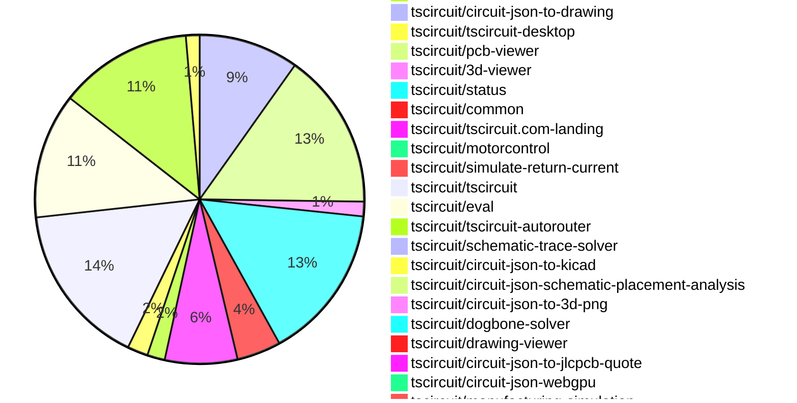

# contribution tracker

[contributions.tscircuit.com](https://contributions.tscircuit.com) ・ [tscircuit.com](https://tscircuit.com) ・ [Contribution Overviews](./contribution-overviews/) ・ [Changelogs](./changelogs/)

Generates weekly contribution overviews for tscircuit contributors. Check out all
the [contribution overviews here](./contribution-overviews/)
You can find AI-generated monthly changelogs in the [changelogs directory](./changelogs/)

- All PRs in the tscircuit org are scanned/summarized via an LLM
- The LLM classifies each Diff/PR as into a set of attributes for scoring
- All the PRs, summaries, and classifications are organized into charts and tables for [the website](https://contributions.tscircuit.com)

> Want to run locally? See the [Development Section](#development)

## Current Week

<!-- START_CURRENT_WEEK -->

# Contribution Overview 2026-11-10

The current week is shown below. There are 3 major sections:

- [Contributor Overview](#contributor-overview)
- [PRs by Repository](#prs-by-repository)
- [PRs by Contributor](#changes-by-contributor)
- [Scoring & Sponsorship Details](/docs/sponsorship-calculation-explanation.md)

## PRs by Repository

## Contributor Overview

| Contributor | 🐳 Major | 🐙 Minor | 🐌 Tiny | Score | ⭐ |
|-------------|---------|---------|---------|-------|-----|
| [ShiboSoftwareDev](#ShiboSoftwareDev) | 103 | 18 | 55 | 461 | 👑👑👑 |
| [seveibar](#seveibar) | 37 | 19 | 21 | 199 | 👑👑👑 |
| [Abse2001](#Abse2001) | 12 | 22 | 23 | 105 | 👑 |
| [imrishabh18](#imrishabh18) | 7 | 19 | 7 | 74 | ⭐⭐⭐ |
| [0hmX](#0hmX) | 11 | 5 | 4 | 59 | ⭐⭐⭐ |
| [MustafaMulla29](#MustafaMulla29) | 7 | 7 | 18 | 55 | ⭐⭐⭐ |
| [AnasSarkiz](#AnasSarkiz) | 6 | 5 | 7 | 42 | ⭐⭐ |
| [rushabhcodes](#rushabhcodes) | 3 | 9 | 5 | 35 | ⭐⭐ |
| [techmannih](#techmannih) | 3 | 2 | 3 | 19 | ⭐⭐ |
| [tscircuitbot](#tscircuitbot) | 0 | 0 | 749 | 15.5 | ⭐⭐ |
| [mohan-bee](#mohan-bee) | 1 | 0 | 3 | 7 | ⭐ |
| [GokulPandi-M](#GokulPandi-M) | 0 | 0 | 5 | 4.5 | ⭐ |
| [KrishnaX12](#KrishnaX12) | 0 | 0 | 1 | 1 |  |
| [anil08607](#anil08607) | 0 | 0 | 1 | 1 |  |
| [hrithik18k](#hrithik18k) | 0 | 0 | 1 | 1 |  |
| [abdalraof-albarbar](#abdalraof-albarbar) | 0 | 0 | 1 | 1 |  |

## Staff Pass Ratio (SPR)

| Contributor | Reviewed PRs | Rejections | Approvals | SPR |
|-------------|--------------|------------|-----------|-----|
| [ShiboSoftwareDev](#ShiboSoftwareDev) | 23 | 0 | 23 | 100.0% |
| [0hmX](#0hmX) | 15 | 2 | 15 | 86.7% |
| [Abse2001](#Abse2001) | 13 | 2 | 13 | 84.6% |
| [rushabhcodes](#rushabhcodes) | 8 | 3 | 8 | 62.5% |
| [MustafaMulla29](#MustafaMulla29) | 7 | 1 | 6 | 85.7% |
| [AnasSarkiz](#AnasSarkiz) | 4 | 1 | 3 | 75.0% |
| [imrishabh18](#imrishabh18) | 4 | 0 | 4 | 100.0% |
| [techmannih](#techmannih) | 4 | 0 | 5 | 100.0% |
| [Asymtode712](#Asymtode712) | 1 | 1 | 0 | 0.0% |
| [mohan-bee](#mohan-bee) | 1 | 0 | 1 | 100.0% |
| [mukesh-dev-git](#mukesh-dev-git) | 1 | 1 | 0 | 0.0% |

ShiboSoftwareDev SPR PRs (23)

- [#5524](https://github.com/tscircuit/core/pull/5524) Honor explicit fanout layers and staggered edge capacity
- [#5523](https://github.com/tscircuit/core/pull/5523) Handle plated-hole passages in supplied bus routing copper
- [#75](https://github.com/tscircuit/circuit-json-to-spice/pull/75) fix: let custom SPICE subcircuits replace built-in components
- [#3873](https://github.com/tscircuit/tscircuit-autorouter/pull/3873) Preserve copper clearance during port redistribution
- [#3880](https://github.com/tscircuit/tscircuit-autorouter/pull/3880) Pin tiny-hypergraph final-routing recovery fix
- [#3868](https://github.com/tscircuit/tscircuit-autorouter/pull/3868) Reproduce iCE/Pi plane-via rejection after coordinate rounding
- [#3795](https://github.com/tscircuit/tscircuit-autorouter/pull/3795) fix: preserve regional repair progress across error priorities
- [#3796](https://github.com/tscircuit/tscircuit-autorouter/pull/3796) Fix through-via clearance across the physical board stack
- [#3783](https://github.com/tscircuit/tscircuit-autorouter/pull/3783) fix: pass the board via copper minimum to node repair
- [#3770](https://github.com/tscircuit/tscircuit-autorouter/pull/3770) fix: preserve preloaded vias at routing cell boundaries
- [#3765](https://github.com/tscircuit/tscircuit-autorouter/pull/3765) fix: honor explicit via clearance in regional repair guard
- [#3760](https://github.com/tscircuit/tscircuit-autorouter/pull/3760) fix: honor declared via clearance when validating projection
- [#3733](https://github.com/tscircuit/tscircuit-autorouter/pull/3733) fix: preserve validated gaps in stitch paths
- [#3671](https://github.com/tscircuit/tscircuit-autorouter/pull/3671) Avoid repeated mesh scans during DDR port spacing
- [#3667](https://github.com/tscircuit/tscircuit-autorouter/pull/3667) Use faster DDR length-matching obstacle checks
- [#3664](https://github.com/tscircuit/tscircuit-autorouter/pull/3664) Restore physically clear BGA via columns at the gap threshold
- [#3693](https://github.com/tscircuit/tscircuit-autorouter/pull/3693) repro: ButterStick bus wires ignore allowed layers
- [#3660](https://github.com/tscircuit/tscircuit-autorouter/pull/3660) fix: retain H616 DDR repairs during final contact restoration
- [#201](https://github.com/tscircuit/high-density-repair03/pull/201) fix: preserve independent repairs during contact restoration
- [#90](https://github.com/tscircuit/length-matching-solver/pull/90) Skip distant pads before DDR meander clearance checks
- [#207](https://github.com/tscircuit/bus-lanes-solver/pull/207) fix: price complete DDR escapes and prefer grid-centered vias
- [#198](https://github.com/tscircuit/bus-lanes-solver/pull/198) Avoid repeated pad-alias expansion during pending exit search
- [#28](https://github.com/tscircuit/tscircuit-desktop/pull/28) Generate chips from the chat composer

0hmX SPR PRs (15)

- [#1000](https://github.com/tscircuit/circuit-json/pull/1000) refactor!: align IBIS and eye records with channel simulation props
- [#999](https://github.com/tscircuit/circuit-json/pull/999) feat: add PCB transient channel simulation records (RFC #28)
- [#996](https://github.com/tscircuit/circuit-json/pull/996) fix: enforce ordered length-only differential pair buses
- [#5549](https://github.com/tscircuit/core/pull/5549) refactor: remove archived infgrid and soup-util dependencies (blocked migration)
- [#5382](https://github.com/tscircuit/core/pull/5382) feat: include per-connection compute cost in autorouting events
- [#5413](https://github.com/tscircuit/core/pull/5413) fix: emit the ordered path of every multi-port trace
- [#5412](https://github.com/tscircuit/core/pull/5412) test: reproduce trace path order not emitted or routed
- [#5415](https://github.com/tscircuit/core/pull/5415) test: cover three-pad differential path routing data flow
- [#5760](https://github.com/tscircuit/cli/pull/5760) feat: capture per-connection compute cost in autorouter diagnostics
- [#3710](https://github.com/tscircuit/tscircuit-autorouter/pull/3710) fix: pass ordered differential lane hops to length matching
- [#3709](https://github.com/tscircuit/tscircuit-autorouter/pull/3709) fix: length-match ordered differential pair lanes
- [#3651](https://github.com/tscircuit/tscircuit-autorouter/pull/3651) Add a per-connection compute cost summary to the pipeline 9 solver
- [#3708](https://github.com/tscircuit/tscircuit-autorouter/pull/3708) fix: route connection path points in order
- [#1441](https://github.com/tscircuit/schematic-trace-solver/pull/1441) feat: opt into interior-channel recovery for wire-only consumers
- [#315](https://github.com/tscircuit/tiny-hypergraph/pull/315) Report each connection's solo search iterations from DuplicateCongestedPortSolver

Abse2001 SPR PRs (13)

- [#1011](https://github.com/tscircuit/props/pull/1011) Add defaultSolderPasteMargin to board props
- [#5500](https://github.com/tscircuit/core/pull/5500) Apply board defaultSolderPasteMargin to its SMT pads (#4800)
- [#5217](https://github.com/tscircuit/core/pull/5217) feat: V-score panel tabs with vScore (#5067)
- [#5214](https://github.com/tscircuit/core/pull/5214) feat: implement finished panel size limits (#5067)
- [#5211](https://github.com/tscircuit/core/pull/5211) feat: implement tooling rail elements (#5067)
- [#5208](https://github.com/tscircuit/core/pull/5208) feat: implement panel tab child elements (#5067)
- [#5205](https://github.com/tscircuit/core/pull/5205) feat: implement panel silkscreen (#5067)
- [#5202](https://github.com/tscircuit/core/pull/5202) feat: implement panel tooling holes and fiducials (#5067)
- [#256](https://github.com/tscircuit/circuit-json-to-gerber/pull/256) Skip soldermask for inner-layer copper pours (#127)
- [#246](https://github.com/tscircuit/circuit-json-to-gerber/pull/246) Merge cutouts that are flush with the board edge into the board outline
- [#632](https://github.com/tscircuit/jlcsearch/pull/632) Expose JLCPCB's Standard-only mark on verified parts
- [#5805](https://github.com/tscircuit/cli/pull/5805) feat: `tsci add-provider`/`remove-provider circuithub` and `tsci quote create --circuithub`
- [#5771](https://github.com/tscircuit/cli/pull/5771) Implement tsci quote estimate with the JLCPCB quote estimator

rushabhcodes SPR PRs (8)

- [#1002](https://github.com/tscircuit/circuit-json/pull/1002) feat: preserve nominal board trace width in Circuit JSON
- [#5400](https://github.com/tscircuit/core/pull/5400) fix: preserve authored pad layers in mixed-side footprints
- [#5375](https://github.com/tscircuit/core/pull/5375) [2/2] Preserve unbroken inner copper planes in remote autorouting
- [#5404](https://github.com/tscircuit/core/pull/5404) fix: preserve plated-slot rotation on flipped footprints
- [#5402](https://github.com/tscircuit/core/pull/5402) fix: render pcbtrace coordinate routes
- [#5962](https://github.com/tscircuit/tscircuit.com/pull/5962) Add the Drawing tab to package previews
- [#108](https://github.com/tscircuit/circuit-json-webgpu/pull/108) Show Classic F1 ground traces when copper pours are hidden
- [#12](https://github.com/tscircuit/drawing-viewer/pull/12) Render assembly stages and exploded views in Drawing Viewer

MustafaMulla29 SPR PRs (7)

- [#5614](https://github.com/tscircuit/core/pull/5614) fix: round-trip saved routes with junctions and shared pads
- [#5426](https://github.com/tscircuit/core/pull/5426) fix: preserve copper-plane connectivity at breakout endpoints
- [#5438](https://github.com/tscircuit/core/pull/5438) fix: keep board plane reservations independent of child groups
- [#580](https://github.com/tscircuit/checks/pull/580) Report schematic box width and pin-padding warnings
- [#3748](https://github.com/tscircuit/tscircuit-autorouter/pull/3748) fix: reuse existing vias for planned copper-plane access
- [#464](https://github.com/tscircuit/circuit-json-schematic-placement-analysis/pull/464) fix: only report inverted rails between positive supply and ground
- [#268](https://github.com/tscircuit/fanout-solver/pull/268) fix: generate exact-angle dogbone sites for imported pad grids

AnasSarkiz SPR PRs (4)

- [#540](https://github.com/tscircuit/checks/pull/540) fix: recognize explicit pin role attributes as specified
- [#5780](https://github.com/tscircuit/cli/pull/5780) fix: warn when imports omit an explicit 3D model
- [#3877](https://github.com/tscircuit/tscircuit-autorouter/pull/3877) Search regional repairs at the board's declared trace clearance
- [#15](https://github.com/tscircuit/tscircuit-desktop/pull/15) feat(circuit): stack two Circuit views vertically

imrishabh18 SPR PRs (4)

- [#646](https://github.com/tscircuit/jlcsearch/pull/646) Keep stock cleanup scans small and resume them between runs
- [#635](https://github.com/tscircuit/jlcsearch/pull/635) Fix JSON output after D1 stock-sync retries
- [#638](https://github.com/tscircuit/jlcsearch/pull/638) Add a safe search-index-only rebuild action
- [#7](https://github.com/tscircuit/manufacturing-simulation/pull/7) Simulate the Amazon partnered carrier label at Ship-ready

techmannih SPR PRs (4)

- [#5343](https://github.com/tscircuit/core/pull/5343) Fix named-net routing via a phase-selected pin
- [#5341](https://github.com/tscircuit/core/pull/5341) Fix plated-hole solder paste ownership
- [#557](https://github.com/tscircuit/checks/pull/557) Use the board via-to-pad clearance for routing DRC
- [#5750](https://github.com/tscircuit/cli/pull/5750) Fix autorouter worker count in tsci build

Asymtode712 SPR PRs (1)

- [#30](https://github.com/tscircuit/tscircuit-desktop/pull/30) feat(order): export STEP and GLB from the Order tab

mohan-bee SPR PRs (1)

- [#75](https://github.com/tscircuit/power-trace-expander/pull/75) Straighten doglegs in narrow power traces

mukesh-dev-git SPR PRs (1)

- [#5544](https://github.com/tscircuit/core/pull/5544) fix: support pinLabels on mosfet to match physical package pins

> Note: AI evaluates PRs and assigns 1-3 star ratings automatically. 4 and 5 star ratings require manual staff review.

## Review Table

[reviews-received-hover]: ## "Number of reviews received for PRs for this contributor"
[approvals-received-hover]: ## "Number of approvals received for PRs this contributor authored"
[rejections-received-hover]: ## "Number of rejections received for PRs this contributor authored"
[prs-opened-hover]: ## "Number of PRs opened by this contributor"
[issues-created-hover]: ## "Number of issues created by this contributor"

| Contributor | Reviews Received | Approvals Received | Rejections Received | Approvals | Rejections Given | PRs Opened | PRs Merged | Issues Created |
|---|---|---|---|---|---|---|---|---|
| [0hmX](#0hmX) | 67 | 17 | 2 | 40 | 0 | 78 | 22 | 0 |
| [1932819331hy-debug](#1932819331hy-debug) | 0 | 0 | 0 | 0 | 0 | 35 | 0 | 0 |
| [abdalraof-albarbar](#abdalraof-albarbar) | 0 | 0 | 0 | 0 | 0 | 3 | 1 | 0 |
| [Abse2001](#Abse2001) | 18 | 17 | 0 | 14 | 0 | 82 | 57 | 0 |
| [ameenalqershi](#ameenalqershi) | 0 | 0 | 0 | 0 | 0 | 9 | 0 | 0 |
| [AnasSarkiz](#AnasSarkiz) | 14 | 13 | 1 | 2 | 0 | 35 | 18 | 0 |
| [Andresdev14](#Andresdev14) | 0 | 0 | 0 | 0 | 0 | 11 | 0 | 0 |
| [anil08607](#anil08607) | 0 | 0 | 0 | 0 | 0 | 1 | 1 | 0 |
| [aswadi](#aswadi) | 0 | 0 | 0 | 0 | 0 | 204 | 0 | 0 |
| [Asymtode712](#Asymtode712) | 1 | 0 | 1 | 0 | 0 | 3 | 0 | 0 |
| [BHAWESHBHASKAR](#BHAWESHBHASKAR) | 0 | 0 | 0 | 0 | 0 | 2 | 0 | 0 |
| [Burapa-J](#Burapa-J) | 0 | 0 | 0 | 0 | 0 | 8 | 0 | 0 |
| [cocvn157](#cocvn157) | 0 | 0 | 0 | 0 | 0 | 28 | 0 | 0 |
| [contactmelvinlevard](#contactmelvinlevard) | 0 | 0 | 0 | 0 | 0 | 2 | 0 | 0 |
| [CrowAleksito](#CrowAleksito) | 0 | 0 | 0 | 0 | 0 | 1 | 0 | 0 |
| [deep-bhikadiya](#deep-bhikadiya) | 0 | 0 | 0 | 0 | 0 | 1 | 0 | 0 |
| [Devesh36](#Devesh36) | 1 | 0 | 0 | 0 | 0 | 6 | 0 | 0 |
| [ghost](#ghost) | 0 | 0 | 0 | 0 | 0 | 1 | 0 | 0 |
| [GokulPandi-M](#GokulPandi-M) | 7 | 5 | 1 | 0 | 0 | 9 | 5 | 0 |
| [hrithik18k](#hrithik18k) | 0 | 0 | 0 | 0 | 0 | 1 | 1 | 0 |
| [imrishabh18](#imrishabh18) | 10 | 7 | 0 | 16 | 4 | 46 | 33 | 0 |
| [imyelo](#imyelo) | 3 | 0 | 0 | 0 | 0 | 4 | 0 | 0 |
| [jeffrey-graham](#jeffrey-graham) | 0 | 0 | 0 | 0 | 0 | 2 | 0 | 0 |
| [KrishnaX12](#KrishnaX12) | 1 | 1 | 0 | 0 | 0 | 2 | 1 | 0 |
| [LBCron](#LBCron) | 0 | 0 | 0 | 0 | 0 | 14 | 0 | 0 |
| [mohan-bee](#mohan-bee) | 5 | 3 | 0 | 0 | 0 | 21 | 4 | 0 |
| [mukesh-dev-git](#mukesh-dev-git) | 1 | 0 | 1 | 0 | 0 | 1 | 0 | 0 |
| [MustafaMulla29](#MustafaMulla29) | 20 | 17 | 1 | 4 | 2 | 48 | 37 | 0 |
| [nitina-ariveguru](#nitina-ariveguru) | 0 | 0 | 0 | 0 | 0 | 1 | 0 | 0 |
| [nolanntibi-dot](#nolanntibi-dot) | 0 | 0 | 0 | 0 | 0 | 4 | 0 | 0 |
| [OLuHneschastniy](#OLuHneschastniy) | 0 | 0 | 0 | 0 | 0 | 6 | 0 | 0 |
| [peteking](#peteking) | 0 | 0 | 0 | 0 | 0 | 2 | 0 | 0 |
| [rafagil11](#rafagil11) | 0 | 0 | 0 | 0 | 0 | 2 | 0 | 0 |
| [rushabhcodes](#rushabhcodes) | 29 | 11 | 4 | 0 | 0 | 57 | 18 | 0 |
| [sainath998](#sainath998) | 0 | 0 | 0 | 0 | 0 | 1 | 0 | 0 |
| [satoshinakamoto666666](#satoshinakamoto666666) | 0 | 0 | 0 | 0 | 0 | 1 | 0 | 0 |
| [seveibar](#seveibar) | 18 | 1 | 0 | 84 | 6 | 99 | 80 | 0 |
| [ShiboSoftwareDev](#ShiboSoftwareDev) | 76 | 76 | 0 | 15 | 0 | 265 | 183 | 0 |
| [singhaditya21](#singhaditya21) | 0 | 0 | 0 | 0 | 0 | 9 | 0 | 0 |
| [sumitrevolt](#sumitrevolt) | 0 | 0 | 0 | 0 | 0 | 7 | 0 | 0 |
| [techmannih](#techmannih) | 23 | 7 | 1 | 0 | 0 | 30 | 8 | 0 |
| [tirumallaharish0200](#tirumallaharish0200) | 0 | 0 | 0 | 0 | 0 | 1 | 0 | 0 |
| [trixie010](#trixie010) | 0 | 0 | 0 | 0 | 0 | 4 | 0 | 0 |
| [tscircuitbot](#tscircuitbot) | 0 | 0 | 0 | 0 | 0 | 879 | 749 | 0 |
| [tungnguyen84](#tungnguyen84) | 0 | 0 | 0 | 0 | 0 | 2 | 0 | 0 |
| [ulixes](#ulixes) | 0 | 0 | 0 | 0 | 0 | 4 | 0 | 0 |
| [Umutplvn](#Umutplvn) | 0 | 0 | 0 | 0 | 0 | 1 | 0 | 0 |
| [VB-Blue](#VB-Blue) | 0 | 0 | 0 | 0 | 0 | 10 | 0 | 0 |
| [voropaevv](#voropaevv) | 0 | 0 | 0 | 0 | 0 | 3 | 0 | 0 |
| [xtruel](#xtruel) | 0 | 0 | 0 | 0 | 0 | 13 | 0 | 0 |
| [yan0lovesha](#yan0lovesha) | 0 | 0 | 0 | 0 | 0 | 4 | 0 | 0 |

## Changes by Repository

### [tscircuit/schematic-viewer](https://github.com/tscircuit/schematic-viewer)

| PR # | Impact | Rating | Contributor | Description |
|------|--------|--------|-------------|-------------|
| [#317](https://github.com/tscircuit/schematic-viewer/pull/317) | 🐳 Major | ⭐⭐⭐ | seveibar | Clicking a chip in the schematic viewer now adds a description row to the component details popup, between manufacturer_part_number and the supplier rows. |
| [#312](https://github.com/tscircuit/schematic-viewer/pull/312) | 🐙 Minor | ⭐⭐ | seveibar | Adds two props to SchematicViewer to outline rendered schematic components and texts with a dashed blue outline based on provided IDs. |

### [tscircuit/circuit-json](https://github.com/tscircuit/circuit-json)

| PR # | Impact | Rating | Contributor | Description |
|------|--------|--------|-------------|-------------|
| [#1003](https://github.com/tscircuit/circuit-json/pull/1003) | 🐳 Major | ⭐⭐⭐ | seveibar | Adds assembly-stage drawings with a dedicated drawing_explosion_view record, allowing for independent explosion views with configurable moves, factors, and trails. |
| [#1004](https://github.com/tscircuit/circuit-json/pull/1004) | 🐳 Major | ⭐⭐⭐ | seveibar | Add optional schematic_group.show_boundary, schematic_port.schematic_group_id, and schematic_port.boundary_position to define expanded subcircuit boundaries and public terminal geometry. |
| [#1000](https://github.com/tscircuit/circuit-json/pull/1000) | 🐳 Major | ⭐⭐⭐ | 0hmX | Aligns IBIS and eye records with channel simulation properties by updating and removing obsolete records, impacting consumers who must adapt to the changes. |
| [#999](https://github.com/tscircuit/circuit-json/pull/999) | 🐳 Major | ⭐⭐⭐ | 0hmX | Adds circuit-json records for PCB transient channel simulation, including driverreceiver channels and waveform results. |
| [#1002](https://github.com/tscircuit/circuit-json/pull/1002) | 🐙 Minor | ⭐⭐ | rushabhcodes | Adds the optional pcb_board.default_nominal_trace_width field to the canonical schema to store the boards preferred routing width for connections without an explicit width, addressing issues with SRJ conversion. |

🐌 Tiny Contributions (4)

| PR # | Impact | Contributor | Description |
|------|--------|-------------|-------------|
| [#1016](https://github.com/tscircuit/circuit-json/pull/1016) | 🐌 Tiny | tscircuitbot | Automated package update |
| [#1009](https://github.com/tscircuit/circuit-json/pull/1009) | 🐌 Tiny | tscircuitbot | Automated package update |
| [#1007](https://github.com/tscircuit/circuit-json/pull/1007) | 🐌 Tiny | tscircuitbot | Automated package update |
| [#1005](https://github.com/tscircuit/circuit-json/pull/1005) | 🐌 Tiny | tscircuitbot | Automated package update |

### [tscircuit/props](https://github.com/tscircuit/props)

| PR # | Impact | Rating | Contributor | Description |
|------|--------|--------|-------------|-------------|
| [#1010](https://github.com/tscircuit/props/pull/1010) | 🐳 Major | ⭐⭐⭐ | seveibar | Refactors the drawing explosion view to inherit moves from assembly explosion stages, removing the need for inline moves and standalone drawing explosions. |
| [#1009](https://github.com/tscircuit/props/pull/1009) | 🐳 Major | ⭐⭐⭐ | seveibar | Adds assembly drawing capabilities with explosion views and reusable stage definitions, enhancing the drawing functionality for parts and assemblies. |
| [#1024](https://github.com/tscircuit/props/pull/1024) | 🐙 Minor | ⭐⭐ | 0hmX | Adds simulation.eyediagram linked to a transient channel simulation, allowing for the visualization of driven channels in a PCB transient channel simulation. |
| [#1011](https://github.com/tscircuit/props/pull/1011) | 🐙 Minor | ⭐⭐ | Abse2001 | Adds defaultSolderPasteMargin to board for setting a uniform solder paste margin across all pads on the board, allowing for more consistent solder paste application without altering individual pad settings. |

🐌 Tiny Contributions (6)

| PR # | Impact | Contributor | Description |
|------|--------|-------------|-------------|
| [#1006](https://github.com/tscircuit/props/pull/1006) | 🐌 Tiny | 0hmX | Removes superseded SI properties and suggestions for the pcb_spice engine, including the removal of tests and documentation for these elements. |
| [#1005](https://github.com/tscircuit/props/pull/1005) | 🐌 Tiny | 0hmX | Stack: circuit-json999(https:github.comtscircuitcircuit-jsonpull999)  props1005(https:github.comtscircuitpropspull1005)  core5423(https:github.comtscircuitcorepull5423) (this PR is 2 of 3) Additions only, split out of 995. The removals are in the stacked PR on top of this one. Adds the authoring props from RFC 28(https:github.comtscircuitrfcpull28): simulation.pcbtransientchannelsimulation: PcbTransientChannelSimulationProps  pcbTransientChannelSimulationProps. simulation.pcbdriverreceiverchannel: PcbDriverReceiverChannelProps  pcbDriverReceiverChannelProps. It takes driverRef  receiverRef selectors, including multi-drop arrays and differential per-leg IBIS overrides. libcommonsignal-integrity.ts: bit-rate and timeUI parsing. Times become seconds; UI offsets and durations stay normalized strings (0.5UI) for core to resolve at the bit rate. Generated README, COMPONENT_TYPES and PROPS_OVERVIEW sections for the new props; the README documents simulation.pcbtransientchannelsimulation  and simulation.pcbdriverreceiverchannel  with matching anchors, and both validators are exposed through simulationProps. No existing code changes: everything existing stays as it is, including ibismodel, analogeyediagram and the pcb_spice suggestion. Unit strings are parsed by suffix lookup, without a regex. Verified locally: tsc --noEmit passes, bun test 779 pass  0 fail (existing tests; this PR adds none), and biome format is clean on the touched files.  Example This follows the current tscircuitsignal-integrity-pipeline usage on featsi-25d-pipeline: explicit routed pcbPath plus a simulation block and channel. Inside a board with a stackup, generic .TX  .RX chips and their simulation.ibismodel declarations: tsx import  simulation  from tscircuitcore  trace from.TX  .IO to.RX  .IO width0.2 pcbPath.TX  .IO, .RX  .IO  simulation.pcbtransientchannelsimulation nameLINK bitRate50Mbps duration40e-9 simulation.pcbdriverreceiverchannel nameDATA driverRef pin: .TX  .IO, model: GENERIC_OUT  receiverRef pin: .RX  .IO, model: GENERIC_IN  pattern01  simulation.pcbtransientchannelsimulation   GENERIC_OUT and GENERIC_IN are synthetic model names. The endpoint form  pin, model  selects a model for this test; a plain selector also works. SignalEndpoint also accepts  p, n  or  pin:  p, n , model: string   p, n  . An array in receiverRef means multiple receivers. Key inputs from pcbTransientChannelSimulationProps and pcbDriverReceiverChannelProps:  Element  prop  Input type  Meaning   ---  ---  ---   block name  string, optional  Run name; core requires it when the board has multiple blocks.   block bitRate  string  number  Required default rate; numbers are bits, e.g. 50Mbps  50000000.   block duration  string  number, optional  Positive seconds or UI; 40e-9 is 40 ns. Omitted stays absent for downstream selection.   block allowUnroutedTraces  boolean, optional  Defaults to false; true permits ideal unrouted connections.   channel name  string  Required nonempty signal name, unique within its block.   channel driverRef  receiverRef  SignalEndpoint  SignalEndpoint  SignalEndpoint  Required driving endpoint and one or more receiving endpoints.   channel bitRate  string  number, optional  Overrides the blocks rate.   channel pattern  string, optional  Nonempty; defaults to prbs7. The example repeats literal bits 01.   channel seed  number, optional  Positive integer; PRBS71531 seeds must fit 1..2n-1. Core resolves omitted PRBS seeds.   channel offset  string  number, optional  Nonnegative seconds or UI; defaults to 0UI. UI stays a normalized string until core knows the signal rate.   channel driverDisabled  boolean, optional  Defaults to false; true requests high impedance and requires a disable-capable driver model.  The downstream consumer is tscircuitsignal-integrity-pipeline. This example uses the current pipeline authoring style and the schemas in this diff.  Generated with Claude Code(https:claude.comclaude-code) |
| [#1022](https://github.com/tscircuit/props/pull/1022) | 🐌 Tiny | 0hmX | Adds pinLabels to mosfetProps, allowing users to specify physical package pins mapped to terminal names for MOSFET components. |
| [#1004](https://github.com/tscircuit/props/pull/1004) | 🐌 Tiny | 0hmX | Documents that trace paths should always be ordered, clarifying that the trace is routed as a chain from the first port to the last. |
| [#999](https://github.com/tscircuit/props/pull/999) | 🐌 Tiny | Abse2001 | Changes the paneltab component to use center offsets from board edges instead of a single offset, introducing new properties for better tab placement and width specification. |
| [#1000](https://github.com/tscircuit/props/pull/1000) | 🐌 Tiny | Abse2001 | Updates documentation to clarify that panel size limits now shape the grid layout, allowing auto-sized panels to grow and grids to rearrange based on specified limits. |

### [tscircuit/core](https://github.com/tscircuit/core)

| PR # | Impact | Rating | Contributor | Description |
|------|--------|--------|-------------|-------------|
| [#5497](https://github.com/tscircuit/core/pull/5497) | 🐳 Major | ⭐⭐⭐ | seveibar | Connects the merged drawing propsschema to core: assembly.drawing.explosionview stageReflift-cover now emits an exploded drawing from the referenced assembly.explosion.stage and its assembly.explosion.move children. Authors do not supply a drawing moves prop. Core reuses existing ordered explosion evaluation through the selected stage, including preceding moves, overlapping parentchild targets and mounted owner frames. It emits one final CAD-world translation per source component, preserving assembled geometry. Each view has independent factorshowTrails; factor 0 restores assembled placement. Qualified references select nested stages. Also registers drawing membership stages, part labels and pageview notes. Assembled views can select reusable stages, including PCB substrates and fitted components. Labels follow their targets, notes support per-axis view offsets, and page anchors use anchorAlignment. References are validated before committing a page; dimensions are computed from the displayed pose, including factor and section cuts. Labeled legacy board views get explicit membership for the identity-preserving renderer path. Uses published props 0.0.731, Circuit JSON 0.0.550 and drawing renderer 0.0.6. The snapshot adapter converts the existing glTF export frame to the renderers canonical CAD-to-scene frame; native dimensions use the paired camera transform. Validation: 139 assemblynamespaced tests pass across the suite and focused runs, including 24 drawing tests; typecheck, build, built-package drawing smoke test, class-export check, dependency check and formatting pass. Six new committed SVG snapshots cover inherited cumulative moves, independent view factors, rotated owner frames, displayed-pose section dimensions, PCB membership, labelspage anchors and invalid references. Existing drawing snapshots are unchanged. !Inherited moves, independent drawing factors(https:raw.githubusercontent.comtscircuitcorefeatassembly-drawing-explosion-viewstestsassembly__snapshots__assembly-drawing-explosionview.snap.svg) !Qualified stages in mounted owner frames(https:raw.githubusercontent.comtscircuitcorefeatassembly-drawing-explosion-viewstestsassembly__snapshots__assembly-drawing-explosion-frames.snap.svg) Existing assembly playback restrictions remain: moving PCBcable geometry is unsupported, while stationary boards can be shown. Geometry loading for dimensions retains the existing native-model support boundary. Authoring and emission documentation(https:github.comtscircuitcoreblobfeatassembly-drawing-explosion-viewsdocsassembly-drawings.mdexplosion-views-and-assembly-stages). |
| [#5507](https://github.com/tscircuit/core/pull/5507) | 🐳 Major | ⭐⭐⭐ | seveibar | Problem System diagrams drew hooks, 12 mm S-bends and angular corners. Four causes: Every labelled wire was routed through a label slot Dagre picked before routing, so wires detoured to reach their own text. Port slots on facing blocks rarely lined up, which put a short jog into wires that should be straight. When two parallel wires turned together, the outer one was left angular. The slot-swap optimizer could move a port to the far side of its block to remove a crossing, wrapping the wire around the block.  Change Route each wire directly, then place its label on the finished wire: inline on a horizontal run, otherwise beside it. Only self-loops still reserve their label first. Slide an attachment along its block face, without passing a neighbor, when that straightens the wire. A port never starts on, or is swapped to, a face that looks away from the block it connects to. Wires that double back are penalized in the diagram score. The path search counts turns at the port stubs as bends, and stubs are a full 6 mm so the first fillet and the arrowhead have room. Rounding compares neighboring wires in their rounded form, so nested corners keep concentric fillets.  Results   Before  After  ---------  Flip-phone fixture (23 wires): bends  105  46   Flip-phone fixture: sharp or under 3 mm radius  62  1   250 random diagrams (1,917 wires): bends  8,705  3,320   250 random: sharp corners  566  4   250 random: fillets under 1.5 mm  2,849  27   250 random: crossing wire pairs  501  350   250 random: layout time  63 s  12 s  The random-diagram numbers come from a throwaway script that is not part of this PR.  Tests New system-blocks-flip-phone test and fixture, with an assertSystemWireSmoothness helper. It fails on the previous router. The existing no-crossing and 3 mm separation checks on both RVBoy pages pass unchanged. Two tests asserted that every wire contains a curve. Some wires are now straight, so they assert that every bend is a fillet instead. Nine existing snapshots are regenerated.  Known limits In tight downup diagrams a label can land beside the wrong wire. In the power-feedback snapshot, Feedback sits left of the dashed 3.3 V wire. Very dense graphs still produce long detours where the router avoids crossings. docssystem-blocks.md is edited only where this change made existing sentences false. |
| [#5559](https://github.com/tscircuit/core/pull/5559) | 🐳 Major | ⭐⭐⭐ | rushabhcodes | Store the boards authored defaultTraceWidth in pcb_board.default_nominal_trace_width using circuit-json0.0.551. Restore the saved value through defaultTraceWidth when loading boards and use each owning boards default for SRJ connections without an explicit width. |
| [#5399](https://github.com/tscircuit/core/pull/5399) | 🐳 Major | ⭐⭐⭐ | rushabhcodes | An explicit component layer collapses a mixed-side footprint onto one side. Centralize the duplicated SMT pad layer resolver without changing behavior, and capture the bug with a minimal four-pad example plus a real imported connector footprint. The real example is the Amphenol 132289 edge-mount SMA(https:github.comKiCadkicad-footprintsblob7ebfa6b23cc292a56f751b7b5f4a0e12eeef69ddConnector_Coaxial.prettySMA_Amphenol_132289_EdgeMount.kicad_modL39) from the pinned KiCad library: three SMT pads on F.Cu and two ground pads on B.Cu. This branch incorrectly emits all five pads on the components placement layer. A single three-pane image shows the PCB, 3D top, and 3D bottom, including the actual KiCad SMA STEP model(https:gitlab.comkicadlibrarieskicad-packages3D-blob77236890410eb655ba2e63e23f59a85cf45af290Connector_Coaxial.3dshapesSMA_Amphenol_132289_EdgeMount.step). The unmodified model is served locally during tests, and the connectors mount on opposite board edges. The real-component regression also exercises ordinary 0402 controls and cached placement once the dependent fix is applied. This work follows up on Jan Mrzeks November 9, 2026 email to Severin Ibarluzea, titled Re: mind.dump() Interest in work with tscircuit (new venture-backed EDA tool). Item 3 under Placement reported:  Setting layer on a component forces all of its pads onto that layer, so a mixed-side footprint loses its other-side pads. Both regressions use test.failing to record the known layer bug. Snapshot assertions run separately in beforeAll, so visual mismatches still fail CI. The dependent fix, 5400, removes the expected-failure markers and updates the snapshots. The minimal example uses a single redtop, bluebottom view with fixed pad positions; the real connectors three-pane image exposes the coincident ground pads on each face. !Broken baseline: PCB, 3D top, 3D bottom(https:raw.githubusercontent.comtscircuitcore4f7fd1c56ddcf9fd4a6bc95565ea237a0ffc2e52testsrepros__snapshots__amphenol-132289-mixed-side-pad-layers.snap.svg) Validation: both expected-failure regressions, all ten CI test shards, typecheck, build preview, and smoke checks pass. Part 1 of GitHub stack 5401(https:github.comtscircuitcorestack5401): main  5399  5400. |
| [#5375](https://github.com/tscircuit/core/pull/5375) | 🐳 Major | ⭐⭐⭐ | rushabhcodes | Preserves unbroken inner copper planes in remote autorouting by ensuring that raw Circuit JSON requests maintain the intended copper pour intent during routing processes. |
| [#5384](https://github.com/tscircuit/core/pull/5384) | 🐳 Major | ⭐⭐⭐ | imrishabh18 | Adds an optional ordered path of point IDs to the existing SRJ connection for each explicitly declared multi-pad differential trace, preserving matching explicit paths attached to named nets as their own SRJ connections. |
| [#5424](https://github.com/tscircuit/core/pull/5424) | 🐳 Major | ⭐⭐⭐ | MustafaMulla29 | After native copper-pour generation, the STM32s ground pads already connect through their escape vias and a shared ground plane. Core loses that physical connection when exporting breakout endpoints, so the native router requests redundant connections. This TSX repro uses U70s complete STM32MP157DAB1 footprint from our four-motor USB-CUSB-PD motherboard: All 354 literal pad definitions match the JLCPCB C1236721 import, including its original coordinates and sizes. All 104 motherboard GND assignments are retained, with semantic ball names from the board. The same six-layer arrangement, 20  20 mm breakout region, native dogbone settings and relevant tracevia rules are used. The chip remains at its motherboard position, (0, 20). A 24  24 mm inspection board contains the chip and one native inner1 ground pour. Other nets, other motherboard components and unused 3D assets are omitted. The test runs native dogbone routing  native ground-pour generation  core SRJ export  native point-pair generation. All 104 escape vias are generated afresh and checked geometrically against the same ground pour. Expected: 0 new routes; actual: 103 redundant requests. No patched solver, saved routes, injected copper or dependencyconfiguration changes. The snapshot separates existing copper from connection requests. The complete chip, TOP escape close-up and INNER1 plane close-up are pixel-identical before and after the fix. A separate aligned INNER3 panel shows the actual native requests as dashed pink lines. The written path follows F7 pad  short trace  F7 via  shared INNER1 plane  G6 via  short trace  G6 pad. Pink dashes mean connect these endpoints; they are neither copper nor a prescribed track shape. The test uses routeRemainingfalse: it skips full-board routing so native pour generation can complete, then tests the export of that existing copper. It does not reproduce or fix the motherboards initial routing iteration-limit failure, which occurs before the physical pours are generated. This defect was found when motherboard path search exhausted its budget on ground links before reaching DDR signals. The stacked fix is 5426; its matching full-STM32 snapshot changes 103 requests to 0. Validation: the updated native STM32 repro and full TypeScript check pass on both the repro and fix branches; changed-file formatting passes. Rendered beforeafter images were compared and all three physical-copper panels are pixel-identical. The existing copper-pour terminal-routing test passed in earlier verification. Every imported pad definition matches the motherboard source. The previously investigated full-suite failure is the existing AM62L direct-decoupling snapshot mismatch, also present on unchanged main: repro log(https:github.comtscircuitcoreactionsruns43183539146job131065071153), main log(https:github.comtscircuitcoreactionsruns43140285484job130925346524). That unrelated snapshot is unchanged. The full suite was not rerun locally for this fixture update. |
| [#5426](https://github.com/tscircuit/core/pull/5426) | 🐳 Major | ⭐⭐⭐ | MustafaMulla29 | Fixes copper-plane connectivity issues at breakout endpoints, preventing redundant routing requests in the autorouter. |
| [#5437](https://github.com/tscircuit/core/pull/5437) | 🐳 Major | ⭐⭐⭐ | MustafaMulla29 | Fixes incorrect board-level plane reservations caused by child groups affecting autorouting output. |
| [#5624](https://github.com/tscircuit/core/pull/5624) | 🐳 Major | ⭐⭐⭐ | ShiboSoftwareDev | Bumps the tscircuitcapacity-autorouter dependency from version 0.0.1117 to 0.0.1119, improving routing capabilities and fixing trace clearance errors in the ECP5 repair region. |
| [#5606](https://github.com/tscircuit/core/pull/5606) | 🐳 Major | ⭐⭐⭐ | ShiboSoftwareDev | Caches port selectors per subcircuit and each traces connected ports for one phase-planning pass, resulting in 59.0 less fanout setup time and 90.2 fewer selector searches during autorouting. |
| [#5524](https://github.com/tscircuit/core/pull/5524) | 🐳 Major | ⭐⭐⭐ | ShiboSoftwareDev | Fixes autorouting failure by honoring explicit fanout layers for unbused connections and adjusting edge capacity to accommodate staggered layer assignments. |
| [#5523](https://github.com/tscircuit/core/pull/5523) | 🐳 Major | ⭐⭐⭐ | ShiboSoftwareDev | Fixes autorouting failure when handling plated-hole passages in bus routing, enabling successful routing of DQ signals. |
| [#5556](https://github.com/tscircuit/core/pull/5556) | 🐳 Major | ⭐⭐⭐ | ShiboSoftwareDev | Fixes autorouting failure for ButterStick power input by updating checks to version 0.0.279, allowing proper routing without placement or connectivity errors. |
| [#5552](https://github.com/tscircuit/core/pull/5552) | 🐳 Major | ⭐⭐⭐ | ShiboSoftwareDev | Bumps the tscircuitcapacity-autorouter dependency from version 0.0.1101 to 0.0.1102 to include fixes for movable preload ports and enhance reachability in autorouting. |
| [#5486](https://github.com/tscircuit/core/pull/5486) | 🐳 Major | ⭐⭐⭐ | ShiboSoftwareDev | Bumps the tscircuitcapacity-autorouter dependency from 0.0.1090 to 0.0.1092, incorporating fixes for same-net negotiation and board clearance propagation, while ensuring compatibility with native iMX6. |
| [#5442](https://github.com/tscircuit/core/pull/5442) | 🐳 Major | ⭐⭐⭐ | ShiboSoftwareDev | Bumps capacity-autorouter from 0.0.1083 to 0.0.1084 to bring in the regional portfolio candidate-validation fix, allowing the H616 SVREF region to reject invalid candidates and keep searching for a legal route. |
| [#5388](https://github.com/tscircuit/core/pull/5388) | 🐳 Major | ⭐⭐⭐ | ShiboSoftwareDev | Bumps tscircuitcapacity-autorouter from 0.0.1071 to 0.0.1074, incorporating fixes for faster DDR length-matching obstacle checks, retaining H616 DDR repairs, and restoring physically clear BGA via columns at the gap threshold. |
| [#5413](https://github.com/tscircuit/core/pull/5413) | 🐳 Major | ⭐⭐⭐ | 0hmX | Fixes the emission of ordered paths for every multi-port trace, ensuring that paths with 3 or more ports are correctly represented in the autorouting system. |
| [#5380](https://github.com/tscircuit/core/pull/5380) | 🐳 Major | ⭐⭐⭐ | 0hmX | Fixes autorouting failure when differential pairs are connected to nets that are not routed, leading to ratsnest lines and port-not-connected errors. |
| [#5412](https://github.com/tscircuit/core/pull/5412) | 🐳 Major | ⭐⭐⭐ | 0hmX | Reproduces a bug where trace paths are not emitted or routed in the correct order, specifically for paths involving multiple pins. |
| [#5343](https://github.com/tscircuit/core/pull/5343) | 🐳 Major | ⭐⭐⭐ | techmannih | Fixes autorouting failure when a phase-selected pin does not route a named net connection, resulting in zero routed traces on the PCB. |
| [#5341](https://github.com/tscircuit/core/pull/5341) | 🐳 Major | ⭐⭐⭐ | techmannih | Fixes the ownership assignment for solder paste records associated with circular plated holes in KiCad exports, ensuring correct PCB component IDs are applied. |
| [#5445](https://github.com/tscircuit/core/pull/5445) | 🐙 Minor | ⭐⭐ | seveibar | When a subcircuit is rendered as the sole root element, show its internal schematic inside a boundary with public terminals wired to internal pins. Reuse direct port children and existing exposedNets  exposeNets declarations; no new TSX prop is required. Core assigns frame and terminal geometry after internal layout and before routing. schPinArrangement supplies sideorder, with each ports direction as fallback. Terminals align with connected internal pins when space permits. Public source ports retain group ownership and electrical connectivity; exposed nets produce public ports deduplicated against explicit declarations. Boundary terminals get explicit connections to internal pins in the targets schematic section. This prevents section splitting from replacing their wires with disconnected labels. Boundary wires retain their actual source trace IDs. Other inter-section connections keep their net-label representation. Standalone section layout and solver membership use the root subcircuit when there is no board. The integration fixture adapts the real ShiboSoftwareDev CC2340R5 reference design, release bff7bbb1-c0df-4b3e-8cb2-5f5c706caa87. It retains all 27 components, values, and all 16 original nets, including RFantenna, crystals, DCDCdecoupling, reset and SWD circuitry. The module exports VDDS, GND, RESET_N, SWDIO, SWCLK and eight GPIOs: DIO8, DIO11, DIO12, DIO13, DIO20_A11, DIO21_A10, DIO24_A7 and DIO6_A1. Those GPIOs were marked unconnected in the published board; this adaptation removes their NC declarations and adds eight named nets. The result has 13 public terminals and 24 nets. U1s schematic pin arrangement aligns the interface on the left; the physical pin mappings are preserved. Tests compare the emitted electrical signature to the immutable published signature plus the explicit eight-net addition. They also traverse actual wire edges from every boundary terminal to its MCU pin, without using net labels as edges, for both direct-port and exposed-net modes. Four inspected visual snapshots cover direct ports, exposed nets with translation, board-nested use, and the collapsed module. The converter fixture is generated from actual core output. Initial scope: one standalone root subcircuit on one schematic sheet. Multi-sheet interface placement, arbitrary drawing primitives as layout inputs, and manual public-port coordinates are deferred. Routing respects the configured trace-distance limit. Schema 1004 and renderer 932 are merged. This PR now uses published circuit-json0.0.550 (including the override) and circuit-to-svg0.0.460; no local companion links or preview dependencies are required. The renderer upgrade also includes its simulation-legend sizing fix. Refresh 15 existing simulation snapshots for the expanded graph canvas and centered titles; plotted data, axes and legend text are unchanged. All 15 affected tests pass without update mode. Validation against those npm packages: all four CC2340R5 integration tests pass, including their actual wire-path assertions and visual snapshots. The remaining targeted subcircuit, group-port and schematic-section checks pass (one existing skip). Three snapshots were refreshed for the crystal symbol from cores installed symbol library, visually inspected, and rerun without update mode. TypeScript check and build pass. |
| [#5483](https://github.com/tscircuit/core/pull/5483) | 🐙 Minor | ⭐⭐ | seveibar | Enables the use of a string cadModel as a footprinter model for normal components, allowing for procedural generation of 3D models based on the cadModel string, independent of the PCB footprint. |
| [#5558](https://github.com/tscircuit/core/pull/5558) | 🐙 Minor | ⭐⭐ | rushabhcodes | Fixes the issue where regenerating Simple Route JSON (SRJ) does not apply the boards default trace width correctly, ensuring that the intended 0.35 mm width is used instead of the minimum width of 0.10 mm. |
| [#5403](https://github.com/tscircuit/core/pull/5403) | 🐙 Minor | ⭐⭐ | rushabhcodes | A bottom-mounted USB-C connector rotated 30 currently has plated-slot long axes at 60, while its shell-hole centers and model mounting tabs require 120. Add real C165948 USB-C ports on opposite PCB faces and one three-pane snapshot showing the PCB, 3D from above, and 3D from below. Assert that the slot axes follow the connector and that every rendered mounting-tab tip fits inside a plated slot. Use the regenerated C165948 fixture from easyeda0.0.389 with OBJ metadata, including the corrected native model bounds and origin from easyeda-converter 540(https:github.comtscircuiteasyeda-converterpull540). Check in the OBJ for reproducible rendering and refresh the shared PCB snapshot to the converters current pill-shaped copper. The geometry regression uses test.failing to record the known rotation error. Snapshot validation runs separately in beforeAll, so snapshot mismatches still fail CI. The implementation fix, enabled regression, and corrected snapshots are in 5404. Local validation: All 25 related tests pass, including the expected failure and every test using the shared C165948 fixture. Running the regression as a regular test before the fix fails with expected 120 and received 60. Full TypeScript checking, Biome formatting, and git diff --check pass. Part 1 of GitHub stack 5405(https:github.comtscircuitcorestack5405). |
| [#5400](https://github.com/tscircuit/core/pull/5400) | 🐙 Minor | ⭐⭐ | rushabhcodes | Fixes the issue where an explicit component layer overwrites authored topbottom pad layers in mixed-side footprints, ensuring that pads without an explicit layer retain the component-layer default and preserving the correct pad layers during footprint flipping. |
| [#5404](https://github.com/tscircuit/core/pull/5404) | 🐙 Minor | ⭐⭐ | rushabhcodes | Fixes misalignment of plated-slot rotations for bottom-side components when flipped, ensuring correct alignment with the component. |
| [#5611](https://github.com/tscircuit/core/pull/5611) | 🐙 Minor | ⭐⭐ | imrishabh18 | Adds a new schematic example for the RP2040 motor controller, including tests for rendering the schematic and its components. |
| [#5455](https://github.com/tscircuit/core/pull/5455) | 🐙 Minor | ⭐⭐ | imrishabh18 | Updates the Footprinter to version 0.0.451 to ensure proper silkscreen placement for cathode-first LED footprints, fixing regression issues present in version 0.0.450. |
| [#5438](https://github.com/tscircuit/core/pull/5438) | 🐙 Minor | ⭐⭐ | MustafaMulla29 | Fixes incorrect board plane reservations by ensuring that child groups do not influence the boards routing dimensions when their subcircuit IDs match. |
| [#5382](https://github.com/tscircuit/core/pull/5382) | 🐙 Minor | ⭐⭐ | 0hmX | Expose per-connection solo search compute cost on autorouting events, allowing for detailed performance metrics during routing processes. |
| [#5503](https://github.com/tscircuit/core/pull/5503) | 🐙 Minor | ⭐⭐ | Abse2001 | Fixes the incorrect emission of inner-layer copper pours as covered with soldermask, ensuring they are always emitted as false. |
| [#5504](https://github.com/tscircuit/core/pull/5504) | 🐙 Minor | ⭐⭐ | Abse2001 | Fixes rendering of inner-layer copper pours to ensure they are never covered with soldermask, addressing a critical issue in Gerber export. |
| [#5491](https://github.com/tscircuit/core/pull/5491) | 🐙 Minor | ⭐⭐ | Abse2001 | Fixes the issue where the boards defaultSolderPasteMargin is ignored for pads that do not set their own solderPasteMargin, ensuring correct paste margins are applied during PCB rendering. |
| [#5500](https://github.com/tscircuit/core/pull/5500) | 🐙 Minor | ⭐⭐ | Abse2001 | Changes the solder paste margin resolution for SMT pads to include the boards default solder paste margin if not specified, affecting paste size calculations for components. |
| [#5217](https://github.com/tscircuit/core/pull/5217) | 🐙 Minor | ⭐⭐ | Abse2001 | Implements V-scored panel tabs that replace mouse bites with score lines along the board edge for panels using tab-routing and vScore. |
| [#5214](https://github.com/tscircuit/core/pull/5214) | 🐙 Minor | ⭐⭐ | Abse2001 | Implements finished panel size limits that enforce minimum and maximum dimensions for panels, affecting layout and error reporting. |
| [#5211](https://github.com/tscircuit/core/pull/5211) | 🐙 Minor | ⭐⭐ | Abse2001 | Implements tooling rail elements only from issue 5067, allowing for the addition of a toolingrail component within a panel with specified dimensions and positioning constraints. |
| [#5208](https://github.com/tscircuit/core/pull/5208) | 🐙 Minor | ⭐⭐ | Abse2001 | Implements panel tab child elements only from issue 5067, allowing for better control of panel tab placements and interactions within the circuit design. |
| [#5216](https://github.com/tscircuit/core/pull/5216) | 🐙 Minor | ⭐⭐ | Abse2001 | Reproduces the V-scored panel tabs portion of issue 5067, ensuring correct rendering of V-score lines in the panel layout. |
| [#5205](https://github.com/tscircuit/core/pull/5205) | 🐙 Minor | ⭐⭐ | Abse2001 | Implements panel silkscreen functionality, allowing silkscreen text to be placed in the panel frame of the PCB design. |
| [#5202](https://github.com/tscircuit/core/pull/5202) | 🐙 Minor | ⭐⭐ | Abse2001 | Implements panel tooling holes and fiducials only from issue 5067, updating the SVG output and allowing these elements in panels and subpanels. |
| [#5340](https://github.com/tscircuit/core/pull/5340) | 🐙 Minor | ⭐⭐ | techmannih | Fixes the issue where plated-hole solder paste ownership is not correctly assigned during the rendering process, leading to incorrect KiCad exports. |

🐌 Tiny Contributions (57)

| PR # | Impact | Contributor | Description |
|------|--------|-------------|-------------|
| [#5501](https://github.com/tscircuit/core/pull/5501) | 🐌 Tiny | tscircuitbot | Updates the tscircuitchecks package from version 0.0.277 to 0.0.278 |
| [#5446](https://github.com/tscircuit/core/pull/5446) | 🐌 Tiny | tscircuitbot | Updates the version of the tscircuitchecks package from 0.0.276 to 0.0.277 in package.json |
| [#5432](https://github.com/tscircuit/core/pull/5432) | 🐌 Tiny | tscircuitbot | Updates the tscircuitchecks package to version 0.0.274 in package.json |
| [#5416](https://github.com/tscircuit/core/pull/5416) | 🐌 Tiny | tscircuitbot | Updates the version of the tscircuitfanout-solver package from 0.0.81 to 0.0.84 in package.json |
| [#5433](https://github.com/tscircuit/core/pull/5433) | 🐌 Tiny | tscircuitbot | Updates the version of the tscircuitchecks package from 0.0.273 to 0.0.274 in package.json |
| [#5436](https://github.com/tscircuit/core/pull/5436) | 🐌 Tiny | tscircuitbot | Updates the tscircuitchecks package from version 0.0.274 to 0.0.276 |
| [#5374](https://github.com/tscircuit/core/pull/5374) | 🐌 Tiny | rushabhcodes | Reproduces a bug where raw remote solve and job requests lose copperpour unbroken intent before copper pours render, affecting signal routing on inner planes. |
| [#5408](https://github.com/tscircuit/core/pull/5408) | 🐌 Tiny | MustafaMulla29 | Updates the tscircuitdogbone-solver CDN dependency from 0.0.2 to 0.0.4, addressing native dogbone escape blockers found with the STM32MP157DAB1 in the four-motor USB-PD motherboard. |
| [#5394](https://github.com/tscircuit/core/pull/5394) | 🐌 Tiny | MustafaMulla29 | Updates the tscircuitdogbone-solver dependency from version 0.0.1 to 0.0.2, which includes a fix for escape vias being incorrectly blocked by unbroken ground planes on other layers. |
| [#5621](https://github.com/tscircuit/core/pull/5621) | 🐌 Tiny | ShiboSoftwareDev | Bumps the bundled tscircuitbus-lanes-solver CDN package from 0.0.60 to 0.0.61, ensuring compatibility and performance improvements without introducing new functionality. |
| [#5605](https://github.com/tscircuit/core/pull/5605) | 🐌 Tiny | ShiboSoftwareDev | Reproduces the issue of excessive selector searches during the planning of a routed 16-bit memory bus, measuring 984 searches and checking both byte phases with pin-label aliases. |
| [#5600](https://github.com/tscircuit/core/pull/5600) | 🐌 Tiny | ShiboSoftwareDev | Updates the tscircuitcapacity-autorouter and tscircuitbus-lanes-solver dependencies to their latest versions, ensuring compatibility and incorporating recent fixes without introducing new functionality. |
| [#5597](https://github.com/tscircuit/core/pull/5597) | 🐌 Tiny | ShiboSoftwareDev | Bumps the tscircuitcapacity-autorouter package version from 0.0.1111 to 0.0.1112, incorporating fixes for via merging issues related to near-coincident layer coordinates. |
| [#5590](https://github.com/tscircuit/core/pull/5590) | 🐌 Tiny | ShiboSoftwareDev | Bumps the tscircuitcapacity-autorouter package version from 0.0.1110 to 0.0.1111, incorporating performance improvements and optimizations from upstream changes. |
| [#5589](https://github.com/tscircuit/core/pull/5589) | 🐌 Tiny | ShiboSoftwareDev | Bumps the tscircuitcapacity-autorouter dependency from version 0.0.1109 to 0.0.1110, incorporating changes that add a layer-change tie-break cost to autorouting. |
| [#5527](https://github.com/tscircuit/core/pull/5527) | 🐌 Tiny | ShiboSoftwareDev | Records current fanout boundary-planning failures in PCB snapshots without production code changes. |
| [#5587](https://github.com/tscircuit/core/pull/5587) | 🐌 Tiny | ShiboSoftwareDev | Bumps the tscircuitcapacity-autorouter package version from 0.0.1107 to 0.0.1109, incorporating indexed fixed-copper checks in DDR repair and earlier rejection of malformed differential-pair declarations. |
| [#5578](https://github.com/tscircuit/core/pull/5578) | 🐌 Tiny | ShiboSoftwareDev | Bumps the tscircuitcapacity-autorouter package from version 0.0.1106 to 0.0.1107, incorporating fixes for copper repair defaults and ensuring compatibility with ECP5s clearance rules. |
| [#5574](https://github.com/tscircuit/core/pull/5574) | 🐌 Tiny | ShiboSoftwareDev | Bumps the tscircuitcapacity-autorouter dependency from version 0.0.1104 to 0.0.1106, incorporating various fixes and improvements from upstream. |
| [#5568](https://github.com/tscircuit/core/pull/5568) | 🐌 Tiny | ShiboSoftwareDev | Bumps the versions of the autorouter and bus solver dependencies in the project. |
| [#5555](https://github.com/tscircuit/core/pull/5555) | 🐌 Tiny | ShiboSoftwareDev | Reproduces the ButterStick r1.0 power-input placement error with the native C165U18 footprints and connections, demonstrating that the overlap error stops autorouting. |
| [#5553](https://github.com/tscircuit/core/pull/5553) | 🐌 Tiny | ShiboSoftwareDev | Bumps the tscircuitcapacity-autorouter dependency from version 0.0.1102 to 0.0.1103, incorporating updates from upstream repositories and ensuring compatibility with existing tests. |
| [#5550](https://github.com/tscircuit/core/pull/5550) | 🐌 Tiny | ShiboSoftwareDev | Updates the circuit-json-to-spice package from version 0.0.45 to 0.0.47, incorporating a parseable spicemodel for parts SPICE output. |
| [#5548](https://github.com/tscircuit/core/pull/5548) | 🐌 Tiny | ShiboSoftwareDev | Updates the capacity-autorouter to version 0.0.1101 and the bus-lanes-solver to version 0.0.57, ensuring compatibility and performance improvements in routing and bus lane solving. |
| [#5528](https://github.com/tscircuit/core/pull/5528) | 🐌 Tiny | ShiboSoftwareDev | Reproduces a bug where bus routing fails due to an existing plated-hole passage being rejected by the autorouter. |
| [#5536](https://github.com/tscircuit/core/pull/5536) | 🐌 Tiny | ShiboSoftwareDev | Bumps the tscircuitcapacity-autorouter dependency from version 0.0.1099 to 0.0.1100 to include the Repair02 pin and improve solver functionality. |
| [#5533](https://github.com/tscircuit/core/pull/5533) | 🐌 Tiny | ShiboSoftwareDev | Bumps the tscircuitcapacity-autorouter package version from 0.0.1097 to 0.0.1098 to enable staged routing repairs for clearance beside earlier copper. |
| [#5535](https://github.com/tscircuit/core/pull/5535) | 🐌 Tiny | ShiboSoftwareDev | Bumps the tscircuitcapacity-autorouter dependency from version 0.0.1098 to 0.0.1099 to retain clearance-projection progress when clearing prioritized Circuit JSON errors. |
| [#5521](https://github.com/tscircuit/core/pull/5521) | 🐌 Tiny | ShiboSoftwareDev | Updates the capacity-autorouter to version 0.0.1097 and the bus-lanes-solver to version 0.0.56, incorporating various bug fixes and improvements from the respective releases. |
| [#5494](https://github.com/tscircuit/core/pull/5494) | 🐌 Tiny | ShiboSoftwareDev | Bumps the tscircuitcapacity-autorouter dependency from 0.0.1093 to 0.0.1094 to include updates related to node repair and copper queries. |
| [#5482](https://github.com/tscircuit/core/pull/5482) | 🐌 Tiny | ShiboSoftwareDev | Bumps tscircuitcapacity-autorouter from 0.0.1088 to 0.0.1089 to include tscircuittscircuit-autorouter3765, allowing regional repair to use the boards explicit via-to-pad clearance for ECP5 repairs. |
| [#5480](https://github.com/tscircuit/core/pull/5480) | 🐌 Tiny | ShiboSoftwareDev | Bumps capacity-autorouter from 0.0.1087 to 0.0.1088 to honor the boards declared via-to-pad clearance during projection validation, allowing the native ECP5 DDR repair to retain legal moved vias on its 0.089 mm board instead of being rejected by the implicit 0.1 mm guard. |
| [#5487](https://github.com/tscircuit/core/pull/5487) | 🐌 Tiny | ShiboSoftwareDev | Bumps the tscircuitcapacity-autorouter dependency from 0.0.1092 to 0.0.1093 to include fixes for width regression and improvements in DDR routing. |
| [#5484](https://github.com/tscircuit/core/pull/5484) | 🐌 Tiny | ShiboSoftwareDev | Bumps tscircuitcapacity-autorouter from 0.0.1089 to 0.0.1090 to include fixes for routing issues with neighboring wire sections while preserving original DDR via connectivity. |
| [#5474](https://github.com/tscircuit/core/pull/5474) | 🐌 Tiny | ShiboSoftwareDev | Bumps capacity-autorouter from 0.0.1086 to 0.0.1087 to preserve valid inner-layer crossing positions when centering a solitary port would overlap preloaded DDR copper, including the merged H616 ZQ1 crossing fix from autorouter PR 3752. |
| [#5459](https://github.com/tscircuit/core/pull/5459) | 🐌 Tiny | ShiboSoftwareDev | Bumps the capacity-autorouter version from 0.0.1085 to 0.0.1086, incorporating three merged fixes related to BGA pitch estimation, DDR copper checks, and topology layer reuse. |
| [#5443](https://github.com/tscircuit/core/pull/5443) | 🐌 Tiny | ShiboSoftwareDev | Bumps the capacity-autorouter version from 0.0.1084 to 0.0.1085 to ensure validated gaps are represented in stitch paths and the native H616 C3 route reaches its bottom-layer terminal, while rejecting output that misses a tagged PCB terminal layer. |
| [#5441](https://github.com/tscircuit/core/pull/5441) | 🐌 Tiny | ShiboSoftwareDev | Pins the native DDR benchmark correction to ensure imported net membership no longer prescribes pad order while maintaining checks on all native terminals, geometry, rules, and phase assignments. |
| [#5427](https://github.com/tscircuit/core/pull/5427) | 🐌 Tiny | ShiboSoftwareDev | Updates the tscircuitcapacity-autorouter and tscircuitbus-lanes-solver dependencies to their latest versions, ensuring compatibility and incorporating recent improvements in routing and board tuning. |
| [#5398](https://github.com/tscircuit/core/pull/5398) | 🐌 Tiny | ShiboSoftwareDev | Bumps the tscircuitcapacity-autorouter dependency from version 0.0.1076 to 0.0.1077, ensuring safe H616 DDR repairs after restoring a colliding connection through the updated repair03 dependency. |
| [#5395](https://github.com/tscircuit/core/pull/5395) | 🐌 Tiny | ShiboSoftwareDev | Bumps tscircuitcapacity-autorouter from 0.0.1075 to 0.0.1076, including the DDR intersection fix from tscircuitmath-utils69. |
| [#5406](https://github.com/tscircuit/core/pull/5406) | 🐌 Tiny | ShiboSoftwareDev | Bumps the tscircuitcapacity-autorouter package from version 0.0.1077 to 0.0.1078, incorporating optimizations and fixes from previous pull requests. |
| [#5397](https://github.com/tscircuit/core/pull/5397) | 🐌 Tiny | ShiboSoftwareDev | Updates the bus-lanes-solver dependency from version 0.0.51 to 0.0.52, ensuring compatibility and incorporating recent fixes. |
| [#5396](https://github.com/tscircuit/core/pull/5396) | 🐌 Tiny | ShiboSoftwareDev | Pins math-utils to version 0.0.39 to resolve false overlap findings in the ButterStick contact checks. |
| [#5440](https://github.com/tscircuit/core/pull/5440) | 🐌 Tiny | ShiboSoftwareDev | Updates the capacity-autorouter and bus-lanes-solver packages to their latest versions, bringing in new features and fixes related to routing and connection paths. |
| [#5393](https://github.com/tscircuit/core/pull/5393) | 🐌 Tiny | ShiboSoftwareDev | Bumps tscircuitcapacity-autorouter from 0.0.1074 to 0.0.1075, improving DDR port spacing by reusing a node-ID index for ownership lookups instead of scanning the mesh repeatedly. |
| [#5499](https://github.com/tscircuit/core/pull/5499) | 🐌 Tiny | Abse2001 | Bumps tscircuitprops to 0.0.732, which adds board defaultSolderPasteMargin (tscircuitprops1011). No code changes; the board-margin repro and fix for 4800 build on this. |
| [#5213](https://github.com/tscircuit/core/pull/5213) | 🐌 Tiny | Abse2001 | Reproduces the finished panel size limits portion of issue 5067 by adding a test that verifies the grid layout constraints for panel size limits. |
| [#5210](https://github.com/tscircuit/core/pull/5210) | 🐌 Tiny | Abse2001 | Reproduces the tooling rail elements portion of a previous issue, ensuring the test renders correctly and captures the expected output. |
| [#5207](https://github.com/tscircuit/core/pull/5207) | 🐌 Tiny | Abse2001 | Reproduces the panel tab child elements portion of issue 5067, ensuring the test renders correctly and captures the expected output. |
| [#5204](https://github.com/tscircuit/core/pull/5204) | 🐌 Tiny | Abse2001 | Reproduces the panel silkscreen portion of issue 5067, ensuring the test renders correctly and captures the expected output. |
| [#5411](https://github.com/tscircuit/core/pull/5411) | 🐌 Tiny | Abse2001 | Updates tscircuitprops from 0.0.724 to published 0.0.728, in the development dependency and the existing matching override. |
| [#5201](https://github.com/tscircuit/core/pull/5201) | 🐌 Tiny | Abse2001 | Reproduces the panel tooling holes and fiducials portion of issue 5067, providing a test that captures the rendering error when the panel is rejected by Core. |
| [#5543](https://github.com/tscircuit/core/pull/5543) | 🐌 Tiny | AnasSarkiz | Moves tscircuitcore-ddr-benchmark from 7b05251 to 24dc44c, updating the A13 fixtures clearance from 0.2 mm to 0.1249 mm without any core code changes. |
| [#5509](https://github.com/tscircuit/core/pull/5509) | 🐌 Tiny | KrishnaX12 | Reproduces a bug where the reference-divider wire doubles back through the resistor in a specific circuit schematic. |
| [#5460](https://github.com/tscircuit/core/pull/5460) | 🐌 Tiny | GokulPandi-M | Updates the schematic-trace-solver dependency from version 0.0.238 to 0.0.246 to remove redundant terminal paths in generated schematics. |
| [#5342](https://github.com/tscircuit/core/pull/5342) | 🐌 Tiny | techmannih | Reproduces the routing behavior of a named-net by selecting a specific pin phase for autorouting, ensuring that only the designated pins are routed while deferring unrelated connections. |

### [tscircuit/circuit-to-svg](https://github.com/tscircuit/circuit-to-svg)

| PR # | Impact | Rating | Contributor | Description |
|------|--------|--------|-------------|-------------|
| [#932](https://github.com/tscircuit/circuit-to-svg/pull/932) | 🐳 Major | ⭐⭐⭐ | seveibar | Render expanded subcircuits with a dashed labeled frame and persistent public terminals. Read resolved group and port coordinates from Circuit JSON, draw each stem and square boundary marker, and place exported names outside the frame. Internal connections do not hide public terminals. Include frames and labels in automatic bounds, preserve sourcegroup IDs in SVG attributes, and respect schematic sheet selection. Existing groups without show_boundary and component-owned ports retain their rendering. Both visual tests use actual core output from the real ShiboSoftwareDev CC2340R5 reference design(https:tscircuit.comShiboSoftwareDevcc2340r5-reference-designcustomize?package_release_idbff7bbb1-c0df-4b3e-8cb2-5f5c706caa87preview_filedist2Findex2Fcircuit.jsonschematic), release bff7bbb1-c0df-4b3e-8cb2-5f5c706caa87. The fixture preserves all 27 components and 16 original nets, and adapts eight formerly unconnected GPIO pins into named module nets. It exports those eight GPIOs plus VDDS, GND, RESET_N, SWDIO and SWCLK: 13 terminals, each with a wire to its real MCU pin. RFantenna, clock, DCDCdecoupling, reset and debug circuitry remains intact. The core companion checks the published electrical signature plus this explicit addition and verifies every terminals wire path. Provenance and regeneration are documented; schematic geometry is not postprocessed. Schema 1004(https:github.comtscircuitcircuit-jsonpull1004) is merged and published in circuit-json0.0.549. This PR updates the devDependency to 0.0.549 and the Bun lockfile to that published version. Core companion 5445(https:github.comtscircuitcorepull5445) can follow once this renderer is published. Validation against the installed npm release circuit-json0.0.549 (no local schema link): all 485 tests pass, one existing todo; TypeScript check and build pass. Snapshots were visually inspected and rerun without update mode, covering all 13 terminals, automatic bounds and sheet selection. !CC2340R5 with 13 wired public terminals(https:raw.githubusercontent.comtscircuitcircuit-to-svgdecededtestssch__snapshots__expanded-group-boundary-ports.snap.svg) |
| [#936](https://github.com/tscircuit/circuit-to-svg/pull/936) | 🐙 Minor | ⭐⭐ | ShiboSoftwareDev | Fixes the issue where simulation SVGs did not contain full legends when label text extended beyond the canvas, ensuring legends are fully visible without altering plot coordinates or layout behavior. |

### [tscircuit/tscircuit.com](https://github.com/tscircuit/tscircuit.com)

| PR # | Impact | Rating | Contributor | Description |
|------|--------|--------|-------------|-------------|
| [#5910](https://github.com/tscircuit/tscircuit.com/pull/5910) | 🐳 Major | ⭐⭐⭐ | seveibar | Adds Windows download option for tscircuit-desktop on the desktop page and prepares for future Linux support by indicating availability once a build is released. |
| [#5898](https://github.com/tscircuit/tscircuit.com/pull/5898) | 🐳 Major | ⭐⭐⭐ | seveibar | Package maintainers can select chips under General settings to publish their package as a reference design. Settings reads selections from packageslist_datasheet_references and saves them through packagesupdate_datasheet_references. |
| [#5813](https://github.com/tscircuit/tscircuit.com/pull/5813) | 🐳 Major | ⭐⭐⭐ | seveibar | Adds a Customize link in the package About section for packages with a manifest, allowing users to navigate to the Customize page directly from the sidebar. |
| [#5812](https://github.com/tscircuit/tscircuit.com/pull/5812) | 🐳 Major | ⭐⭐⭐ | seveibar | Adds a new page for customizing package configurations, allowing users to interact with published configurations through controls generated from preview data. |
| [#5851](https://github.com/tscircuit/tscircuit.com/pull/5851) | 🐳 Major | ⭐⭐⭐ | seveibar | Adds a copyable, syntax-highlighted TSX usage example beneath the customization preview, using the selected variants parameters and the packages published default or named component export. |
| [#5815](https://github.com/tscircuit/tscircuit.com/pull/5815) | 🐳 Major | ⭐⭐⭐ | seveibar | Adds a Reference designs button to the datasheet header that links to the curated catalog of designs using the chip. |
| [#5811](https://github.com/tscircuit/tscircuit.com/pull/5811) | 🐳 Major | ⭐⭐⭐ | seveibar | Adds the data layer for packages whose build publishes distpreview.json, including hooks for loading manifests and managing package configurations. |
| [#5907](https://github.com/tscircuit/tscircuit.com/pull/5907) | 🐙 Minor | ⭐⭐ | seveibar | Fixes broken URL issue during sign-in redirect by ensuring the query string retains the leading ? character. |
| [#5814](https://github.com/tscircuit/tscircuit.com/pull/5814) | 🐙 Minor | ⭐⭐ | seveibar | Adds two new pages for displaying reference designs for specific chips, enhancing the datasheet functionality. |
| [#5810](https://github.com/tscircuit/tscircuit.com/pull/5810) | 🐙 Minor | ⭐⭐ | seveibar | Adds change tracking between two circuits, allowing the Customize page to identify which schematic parts a configuration switch added or changed. |
| [#5852](https://github.com/tscircuit/tscircuit.com/pull/5852) | 🐙 Minor | ⭐⭐ | seveibar | Moves the TSX usage panel into the shared PackageConfigurationPreview to ensure both the datasheet reference-design pages and the package customize page display copyable code for the selected configuration. |
| [#5834](https://github.com/tscircuit/tscircuit.com/pull/5834) | 🐙 Minor | ⭐⭐ | seveibar | Draws dashed outlines around changed schematic parts on the Customize and reference-design pages for three seconds using the schematic viewers new props. |
| [#5809](https://github.com/tscircuit/tscircuit.com/pull/5809) | 🐙 Minor | ⭐⭐ | seveibar | Adds PackagePreviewScope, an optional context that supplies the release, preview file, circuit JSON and GLB for an embedded preview, allowing hooks to resolve identity without a provider. |
| [#5808](https://github.com/tscircuit/tscircuit.com/pull/5808) | 🐙 Minor | ⭐⭐ | seveibar | Adds support for loading gzip-compressed Circuit JSON preview files, allowing package pages to preview large circuits efficiently. |

🐌 Tiny Contributions (146)

| PR # | Impact | Contributor | Description |
|------|--------|-------------|-------------|
| [#5975](https://github.com/tscircuit/tscircuit.com/pull/5975) | 🐌 Tiny | seveibar | Updates tscircuitschematic-viewer to version 2.0.111, adding a description row to the chip details popup in the schematic viewer. |
| [#5897](https://github.com/tscircuit/tscircuit.com/pull/5897) | 🐌 Tiny | seveibar | Removes the note about the app not being signed by Apple from the desktop page, simplifying the message for users. |
| [#5891](https://github.com/tscircuit/tscircuit.com/pull/5891) | 🐌 Tiny | seveibar | Replaces the screenshot on desktop with a dark mode conversation interface alongside the PCB view of the rp2040-motor-controller. |
| [#5890](https://github.com/tscircuit/tscircuit.com/pull/5890) | 🐌 Tiny | seveibar | Adds a new page at desktop for the tscircuit Desktop app, providing information about the app, download options, and features. |
| [#5984](https://github.com/tscircuit/tscircuit.com/pull/5984) | 🐌 Tiny | tscircuitbot | Updates the tscircuitrunframe package version from 0.0.3272 to 0.0.3273 in package.json |
| [#5983](https://github.com/tscircuit/tscircuit.com/pull/5983) | 🐌 Tiny | tscircuitbot | Updates the tscircuiteval package from version 0.0.1796 to 0.0.1797 |
| [#5982](https://github.com/tscircuit/tscircuit.com/pull/5982) | 🐌 Tiny | tscircuitbot | Updates the tscircuitrunframe package from version 0.0.3271 to 0.0.3272 |
| [#5981](https://github.com/tscircuit/tscircuit.com/pull/5981) | 🐌 Tiny | tscircuitbot | Updates the tscircuiteval package from version 0.0.1795 to 0.0.1796 |
| [#5980](https://github.com/tscircuit/tscircuit.com/pull/5980) | 🐌 Tiny | tscircuitbot | Updates the tscircuitrunframe package from version 0.0.3270 to 0.0.3271 |
| [#5979](https://github.com/tscircuit/tscircuit.com/pull/5979) | 🐌 Tiny | tscircuitbot | Updates the tscircuiteval package from version 0.0.1794 to 0.0.1795 |
| [#5978](https://github.com/tscircuit/tscircuit.com/pull/5978) | 🐌 Tiny | tscircuitbot | Updates the tscircuitrunframe package version from 0.0.3269 to 0.0.3270 in package.json |
| [#5977](https://github.com/tscircuit/tscircuit.com/pull/5977) | 🐌 Tiny | tscircuitbot | Updates the tscircuiteval package version from 0.0.1793 to 0.0.1794 in package.json |
| [#5976](https://github.com/tscircuit/tscircuit.com/pull/5976) | 🐌 Tiny | tscircuitbot | Updates the tscircuitrunframe package from version 0.0.3268 to 0.0.3269 and downgrades the tscircuitschematic-viewer package from version 2.0.111 to 2.0.110. |
| [#5974](https://github.com/tscircuit/tscircuit.com/pull/5974) | 🐌 Tiny | tscircuitbot | Updates the tscircuitrunframe package version from 0.0.3267 to 0.0.3268 |
| [#5973](https://github.com/tscircuit/tscircuit.com/pull/5973) | 🐌 Tiny | tscircuitbot | Automated package update |
| [#5972](https://github.com/tscircuit/tscircuit.com/pull/5972) | 🐌 Tiny | tscircuitbot | Updates the tscircuiteval package from version 0.0.1792 to 0.0.1793 |
| [#5971](https://github.com/tscircuit/tscircuit.com/pull/5971) | 🐌 Tiny | tscircuitbot | Updates the tscircuitrunframe package from version 0.0.3265 to 0.0.3266 |
| [#5970](https://github.com/tscircuit/tscircuit.com/pull/5970) | 🐌 Tiny | tscircuitbot | Updates the tscircuitrunframe package from version 0.0.3264 to 0.0.3265 |
| [#5969](https://github.com/tscircuit/tscircuit.com/pull/5969) | 🐌 Tiny | tscircuitbot | Updates the tscircuiteval package from version 0.0.1791 to 0.0.1792 |
| [#5967](https://github.com/tscircuit/tscircuit.com/pull/5967) | 🐌 Tiny | tscircuitbot | Updates the tscircuitrunframe package from version 0.0.3262 to 0.0.3264 |
| [#5966](https://github.com/tscircuit/tscircuit.com/pull/5966) | 🐌 Tiny | tscircuitbot | Automated package update |
| [#5940](https://github.com/tscircuit/tscircuit.com/pull/5940) | 🐌 Tiny | tscircuitbot | Updates the tscircuitrunframe package from version 0.0.3251 to 0.0.3252 |
| [#5965](https://github.com/tscircuit/tscircuit.com/pull/5965) | 🐌 Tiny | tscircuitbot | Updates the tscircuiteval package from version 0.0.1789 to 0.0.1790 |
| [#5958](https://github.com/tscircuit/tscircuit.com/pull/5958) | 🐌 Tiny | tscircuitbot | Updates the tscircuitrunframe package version from 0.0.3259 to 0.0.3260 in package.json |
| [#5957](https://github.com/tscircuit/tscircuit.com/pull/5957) | 🐌 Tiny | tscircuitbot | Updates the tscircuiteval package from version 0.0.1788 to 0.0.1789 |
| [#5951](https://github.com/tscircuit/tscircuit.com/pull/5951) | 🐌 Tiny | tscircuitbot | Updates the tscircuitrunframe package version from 0.0.3257 to 0.0.3258 in package.json |
| [#5949](https://github.com/tscircuit/tscircuit.com/pull/5949) | 🐌 Tiny | tscircuitbot | Updates the tscircuitrunframe package from version 0.0.3256 to 0.0.3257 |
| [#5947](https://github.com/tscircuit/tscircuit.com/pull/5947) | 🐌 Tiny | tscircuitbot | Updates the tscircuitrunframe package version from 0.0.3255 to 0.0.3256 in package.json |
| [#5946](https://github.com/tscircuit/tscircuit.com/pull/5946) | 🐌 Tiny | tscircuitbot | Updates the tscircuiteval package from version 0.0.1784 to 0.0.1785 |
| [#5945](https://github.com/tscircuit/tscircuit.com/pull/5945) | 🐌 Tiny | tscircuitbot | Updates the tscircuitrunframe package from version 0.0.3254 to 0.0.3255 |
| [#5941](https://github.com/tscircuit/tscircuit.com/pull/5941) | 🐌 Tiny | tscircuitbot | Updates the tscircuitrunframe package from version 0.0.3252 to 0.0.3253 |
| [#5938](https://github.com/tscircuit/tscircuit.com/pull/5938) | 🐌 Tiny | tscircuitbot | Updates the tscircuitrunframe package version from 0.0.3250 to 0.0.3251 in package.json |
| [#5937](https://github.com/tscircuit/tscircuit.com/pull/5937) | 🐌 Tiny | tscircuitbot | Updates the tscircuiteval package from version 0.0.1780 to 0.0.1781 |
| [#5936](https://github.com/tscircuit/tscircuit.com/pull/5936) | 🐌 Tiny | tscircuitbot | Updates the tscircuitrunframe package from version 0.0.3249 to 0.0.3250 |
| [#5933](https://github.com/tscircuit/tscircuit.com/pull/5933) | 🐌 Tiny | tscircuitbot | Updates the tscircuiteval package from version 0.0.1778 to 0.0.1779 |
| [#5964](https://github.com/tscircuit/tscircuit.com/pull/5964) | 🐌 Tiny | tscircuitbot | Updates the tscircuitrunframe package from version 0.0.3261 to 0.0.3262 |
| [#5959](https://github.com/tscircuit/tscircuit.com/pull/5959) | 🐌 Tiny | tscircuitbot | Updates the tscircuitrunframe package version from 0.0.3260 to 0.0.3261 |
| [#5953](https://github.com/tscircuit/tscircuit.com/pull/5953) | 🐌 Tiny | tscircuitbot | Updates the tscircuitrunframe package version from 0.0.3258 to 0.0.3259 in package.json |
| [#5948](https://github.com/tscircuit/tscircuit.com/pull/5948) | 🐌 Tiny | tscircuitbot | Updates the tscircuiteval package version from 0.0.1785 to 0.0.1786 in package.json |
| [#5939](https://github.com/tscircuit/tscircuit.com/pull/5939) | 🐌 Tiny | tscircuitbot | Automated package update |
| [#5935](https://github.com/tscircuit/tscircuit.com/pull/5935) | 🐌 Tiny | tscircuitbot | Updates the tscircuiteval package version from 0.0.1779 to 0.0.1780 in package.json |
| [#5952](https://github.com/tscircuit/tscircuit.com/pull/5952) | 🐌 Tiny | tscircuitbot | Updates the tscircuiteval package from version 0.0.1787 to 0.0.1788 |
| [#5950](https://github.com/tscircuit/tscircuit.com/pull/5950) | 🐌 Tiny | tscircuitbot | Updates the tscircuiteval package from version 0.0.1786 to 0.0.1787 |
| [#5944](https://github.com/tscircuit/tscircuit.com/pull/5944) | 🐌 Tiny | tscircuitbot | Updates the tscircuitrunframe package from version 0.0.3253 to 0.0.3254 |
| [#5943](https://github.com/tscircuit/tscircuit.com/pull/5943) | 🐌 Tiny | tscircuitbot | Automated package update |
| [#5942](https://github.com/tscircuit/tscircuit.com/pull/5942) | 🐌 Tiny | tscircuitbot | Updates the tscircuiteval package from version 0.0.1782 to 0.0.1783 |
| [#5934](https://github.com/tscircuit/tscircuit.com/pull/5934) | 🐌 Tiny | tscircuitbot | Updates the tscircuitrunframe package version from 0.0.3248 to 0.0.3249 |
| [#5919](https://github.com/tscircuit/tscircuit.com/pull/5919) | 🐌 Tiny | tscircuitbot | Updates the tscircuiteval package from version 0.0.1776 to 0.0.1777 |
| [#5920](https://github.com/tscircuit/tscircuit.com/pull/5920) | 🐌 Tiny | tscircuitbot | Updates the tscircuitrunframe package version from 0.0.3246 to 0.0.3247 in package.json |
| [#5904](https://github.com/tscircuit/tscircuit.com/pull/5904) | 🐌 Tiny | tscircuitbot | Updates the tscircuitrunframe package version from 0.0.3237 to 0.0.3239 in package.json |
| [#5903](https://github.com/tscircuit/tscircuit.com/pull/5903) | 🐌 Tiny | tscircuitbot | Updates the tscircuiteval package from version 0.0.1771 to 0.0.1772 |
| [#5901](https://github.com/tscircuit/tscircuit.com/pull/5901) | 🐌 Tiny | tscircuitbot | Updates the tscircuiteval package version from 0.0.1770 to 0.0.1771 in package.json |
| [#5922](https://github.com/tscircuit/tscircuit.com/pull/5922) | 🐌 Tiny | tscircuitbot | Updates the tscircuitrunframe package from version 0.0.3247 to 0.0.3248 |
| [#5921](https://github.com/tscircuit/tscircuit.com/pull/5921) | 🐌 Tiny | tscircuitbot | Updates the tscircuiteval package from version 0.0.1777 to 0.0.1778 |
| [#5918](https://github.com/tscircuit/tscircuit.com/pull/5918) | 🐌 Tiny | tscircuitbot | Updates the version of the tscircuitrunframe package from 0.0.3245 to 0.0.3246 in the package.json file. |
| [#5917](https://github.com/tscircuit/tscircuit.com/pull/5917) | 🐌 Tiny | tscircuitbot | Updates the tscircuiteval package from version 0.0.1775 to 0.0.1776 |
| [#5916](https://github.com/tscircuit/tscircuit.com/pull/5916) | 🐌 Tiny | tscircuitbot | Updates the tscircuitrunframe package from version 0.0.3244 to 0.0.3245 |
| [#5915](https://github.com/tscircuit/tscircuit.com/pull/5915) | 🐌 Tiny | tscircuitbot | Updates the tscircuitrunframe package from version 0.0.3243 to 0.0.3244 in the package.json file. |
| [#5914](https://github.com/tscircuit/tscircuit.com/pull/5914) | 🐌 Tiny | tscircuitbot | Updates the tscircuiteval package from version 0.0.1774 to 0.0.1775 in the package.json file. |
| [#5913](https://github.com/tscircuit/tscircuit.com/pull/5913) | 🐌 Tiny | tscircuitbot | Automated package update |
| [#5912](https://github.com/tscircuit/tscircuit.com/pull/5912) | 🐌 Tiny | tscircuitbot | Updates the tscircuiteval package from version 0.0.1773 to 0.0.1774 |
| [#5911](https://github.com/tscircuit/tscircuit.com/pull/5911) | 🐌 Tiny | tscircuitbot | Updates the tscircuitrunframe package from version 0.0.3241 to 0.0.3242 |
| [#5909](https://github.com/tscircuit/tscircuit.com/pull/5909) | 🐌 Tiny | tscircuitbot | Updates the tscircuitrunframe package from version 0.0.3240 to 0.0.3241 |
| [#5906](https://github.com/tscircuit/tscircuit.com/pull/5906) | 🐌 Tiny | tscircuitbot | Updates the tscircuiteval package from version 0.0.1772 to 0.0.1773 |
| [#5905](https://github.com/tscircuit/tscircuit.com/pull/5905) | 🐌 Tiny | tscircuitbot | Updates the tscircuitrunframe package version from 0.0.3239 to 0.0.3240 |
| [#5902](https://github.com/tscircuit/tscircuit.com/pull/5902) | 🐌 Tiny | tscircuitbot | Updates the tscircuitrunframe package version from 0.0.3236 to 0.0.3237 |
| [#5900](https://github.com/tscircuit/tscircuit.com/pull/5900) | 🐌 Tiny | tscircuitbot | Updates the tscircuitrunframe package version from 0.0.3235 to 0.0.3236 |
| [#5899](https://github.com/tscircuit/tscircuit.com/pull/5899) | 🐌 Tiny | tscircuitbot | Updates the tscircuiteval package from version 0.0.1769 to 0.0.1770 |
| [#5908](https://github.com/tscircuit/tscircuit.com/pull/5908) | 🐌 Tiny | tscircuitbot | Automated package update |
| [#5896](https://github.com/tscircuit/tscircuit.com/pull/5896) | 🐌 Tiny | tscircuitbot | Updates the tscircuitrunframe package from version 0.0.3234 to 0.0.3235 |
| [#5894](https://github.com/tscircuit/tscircuit.com/pull/5894) | 🐌 Tiny | tscircuitbot | Updates the tscircuiteval package version from 0.0.1768 to 0.0.1769 in package.json |
| [#5893](https://github.com/tscircuit/tscircuit.com/pull/5893) | 🐌 Tiny | tscircuitbot | Updates the tscircuitrunframe package version from 0.0.3232 to 0.0.3233 |
| [#5892](https://github.com/tscircuit/tscircuit.com/pull/5892) | 🐌 Tiny | tscircuitbot | Automated package update |
| [#5889](https://github.com/tscircuit/tscircuit.com/pull/5889) | 🐌 Tiny | tscircuitbot | Automated package update |
| [#5888](https://github.com/tscircuit/tscircuit.com/pull/5888) | 🐌 Tiny | tscircuitbot | Updates the tscircuiteval package from version 0.0.1766 to 0.0.1767 |
| [#5887](https://github.com/tscircuit/tscircuit.com/pull/5887) | 🐌 Tiny | tscircuitbot | Updates the tscircuitrunframe package from version 0.0.3230 to 0.0.3231 |
| [#5886](https://github.com/tscircuit/tscircuit.com/pull/5886) | 🐌 Tiny | tscircuitbot | Updates the tscircuitrunframe package version from 0.0.3229 to 0.0.3230 |
| [#5885](https://github.com/tscircuit/tscircuit.com/pull/5885) | 🐌 Tiny | tscircuitbot | Updates the tscircuiteval package from version 0.0.1765 to 0.0.1766 |
| [#5884](https://github.com/tscircuit/tscircuit.com/pull/5884) | 🐌 Tiny | tscircuitbot | Updates the tscircuitrunframe package version from 0.0.3228 to 0.0.3229 in package.json |
| [#5883](https://github.com/tscircuit/tscircuit.com/pull/5883) | 🐌 Tiny | tscircuitbot | Updates the tscircuiteval package from version 0.0.1764 to 0.0.1765 |
| [#5882](https://github.com/tscircuit/tscircuit.com/pull/5882) | 🐌 Tiny | tscircuitbot | Updates the tscircuitrunframe package from version 0.0.3227 to 0.0.3228 |
| [#5881](https://github.com/tscircuit/tscircuit.com/pull/5881) | 🐌 Tiny | tscircuitbot | Updates the tscircuiteval package from version 0.0.1763 to 0.0.1764 |
| [#5880](https://github.com/tscircuit/tscircuit.com/pull/5880) | 🐌 Tiny | tscircuitbot | Updates the tscircuitrunframe package from version 0.0.3226 to 0.0.3227 |
| [#5879](https://github.com/tscircuit/tscircuit.com/pull/5879) | 🐌 Tiny | tscircuitbot | Updates the tscircuiteval package version from 0.0.1762 to 0.0.1763 in package.json |
| [#5878](https://github.com/tscircuit/tscircuit.com/pull/5878) | 🐌 Tiny | tscircuitbot | Updates the tscircuitrunframe package version from 0.0.3225 to 0.0.3226 in package.json |
| [#5877](https://github.com/tscircuit/tscircuit.com/pull/5877) | 🐌 Tiny | tscircuitbot | Updates the tscircuiteval package from version 0.0.1761 to 0.0.1762 |
| [#5876](https://github.com/tscircuit/tscircuit.com/pull/5876) | 🐌 Tiny | tscircuitbot | Updates the tscircuitrunframe package from version 0.0.3224 to 0.0.3225 |
| [#5875](https://github.com/tscircuit/tscircuit.com/pull/5875) | 🐌 Tiny | tscircuitbot | Updates the tscircuiteval package from version 0.0.1760 to 0.0.1761 in the package.json file. |
| [#5895](https://github.com/tscircuit/tscircuit.com/pull/5895) | 🐌 Tiny | tscircuitbot | Updates the tscircuitrunframe package from version 0.0.3233 to 0.0.3234 |
| [#5869](https://github.com/tscircuit/tscircuit.com/pull/5869) | 🐌 Tiny | tscircuitbot | Updates the tscircuiteval package from version 0.0.1757 to 0.0.1758 |
| [#5866](https://github.com/tscircuit/tscircuit.com/pull/5866) | 🐌 Tiny | tscircuitbot | Updates the tscircuitrunframe package version from 0.0.3219 to 0.0.3220 |
| [#5861](https://github.com/tscircuit/tscircuit.com/pull/5861) | 🐌 Tiny | tscircuitbot | Updates the tscircuitrunframe package from version 0.0.3216 to 0.0.3218 |
| [#5829](https://github.com/tscircuit/tscircuit.com/pull/5829) | 🐌 Tiny | tscircuitbot | Updates the tscircuiteval package from version 0.0.1741 to 0.0.1742 |
| [#5816](https://github.com/tscircuit/tscircuit.com/pull/5816) | 🐌 Tiny | tscircuitbot | Updates the tscircuiteval package from version 0.0.1735 to 0.0.1736 |
| [#5864](https://github.com/tscircuit/tscircuit.com/pull/5864) | 🐌 Tiny | tscircuitbot | Updates the tscircuitrunframe package version from 0.0.3218 to 0.0.3219 in package.json |
| [#5822](https://github.com/tscircuit/tscircuit.com/pull/5822) | 🐌 Tiny | tscircuitbot | Updates the tscircuiteval package from version 0.0.1738 to 0.0.1739 |
| [#5818](https://github.com/tscircuit/tscircuit.com/pull/5818) | 🐌 Tiny | tscircuitbot | Updates the tscircuiteval package version from 0.0.1736 to 0.0.1737 in package.json |
| [#5873](https://github.com/tscircuit/tscircuit.com/pull/5873) | 🐌 Tiny | tscircuitbot | Updates the tscircuiteval package version from 0.0.1759 to 0.0.1760 in package.json |
| [#5872](https://github.com/tscircuit/tscircuit.com/pull/5872) | 🐌 Tiny | tscircuitbot | Updates the tscircuitrunframe package from version 0.0.3222 to 0.0.3223 |
| [#5870](https://github.com/tscircuit/tscircuit.com/pull/5870) | 🐌 Tiny | tscircuitbot | Updates the tscircuitrunframe package from version 0.0.3221 to 0.0.3222 |
| [#5867](https://github.com/tscircuit/tscircuit.com/pull/5867) | 🐌 Tiny | tscircuitbot | Updates the tscircuiteval package from version 0.0.1756 to 0.0.1757 |
| [#5860](https://github.com/tscircuit/tscircuit.com/pull/5860) | 🐌 Tiny | tscircuitbot | Updates the tscircuiteval package from version 0.0.1753 to 0.0.1754 |
| [#5857](https://github.com/tscircuit/tscircuit.com/pull/5857) | 🐌 Tiny | tscircuitbot | Updates the tscircuitrunframe package from version 0.0.3215 to 0.0.3216 |
| [#5856](https://github.com/tscircuit/tscircuit.com/pull/5856) | 🐌 Tiny | tscircuitbot | Updates the tscircuiteval package from version 0.0.1751 to 0.0.1752 |
| [#5854](https://github.com/tscircuit/tscircuit.com/pull/5854) | 🐌 Tiny | tscircuitbot | Updates the tscircuiteval package version from 0.0.1750 to 0.0.1751 in package.json |
| [#5849](https://github.com/tscircuit/tscircuit.com/pull/5849) | 🐌 Tiny | tscircuitbot | Updates the tscircuiteval package version from 0.0.1749 to 0.0.1750 in package.json |
| [#5848](https://github.com/tscircuit/tscircuit.com/pull/5848) | 🐌 Tiny | tscircuitbot | Updates the tscircuitrunframe package from version 0.0.3212 to 0.0.3213 |
| [#5846](https://github.com/tscircuit/tscircuit.com/pull/5846) | 🐌 Tiny | tscircuitbot | Automated package update |
| [#5845](https://github.com/tscircuit/tscircuit.com/pull/5845) | 🐌 Tiny | tscircuitbot | Updates the tscircuiteval package from version 0.0.1747 to 0.0.1748 in the package.json file. |
| [#5844](https://github.com/tscircuit/tscircuit.com/pull/5844) | 🐌 Tiny | tscircuitbot | Updates the tscircuitrunframe package from version 0.0.3210 to 0.0.3211 |
| [#5843](https://github.com/tscircuit/tscircuit.com/pull/5843) | 🐌 Tiny | tscircuitbot | Updates the tscircuiteval package from version 0.0.1746 to 0.0.1747 |
| [#5842](https://github.com/tscircuit/tscircuit.com/pull/5842) | 🐌 Tiny | tscircuitbot | Updates the tscircuitrunframe package from version 0.0.3209 to 0.0.3210 |
| [#5840](https://github.com/tscircuit/tscircuit.com/pull/5840) | 🐌 Tiny | tscircuitbot | Updates the tscircuitrunframe package from version 0.0.3208 to 0.0.3209 |
| [#5832](https://github.com/tscircuit/tscircuit.com/pull/5832) | 🐌 Tiny | tscircuitbot | Updates the tscircuitrunframe package from version 0.0.3205 to 0.0.3206 |
| [#5830](https://github.com/tscircuit/tscircuit.com/pull/5830) | 🐌 Tiny | tscircuitbot | Updates the tscircuitrunframe package from version 0.0.3204 to 0.0.3205 |
| [#5828](https://github.com/tscircuit/tscircuit.com/pull/5828) | 🐌 Tiny | tscircuitbot | Updates the tscircuitrunframe package version from 0.0.3203 to 0.0.3204 |
| [#5825](https://github.com/tscircuit/tscircuit.com/pull/5825) | 🐌 Tiny | tscircuitbot | Updates the tscircuitrunframe package from version 0.0.3201 to 0.0.3202 |
| [#5824](https://github.com/tscircuit/tscircuit.com/pull/5824) | 🐌 Tiny | tscircuitbot | Updates the tscircuiteval package from version 0.0.1739 to 0.0.1740 |
| [#5817](https://github.com/tscircuit/tscircuit.com/pull/5817) | 🐌 Tiny | tscircuitbot | Updates the tscircuitrunframe package from version 0.0.3197 to 0.0.3198 |
| [#5806](https://github.com/tscircuit/tscircuit.com/pull/5806) | 🐌 Tiny | tscircuitbot | Updates the tscircuiteval package from version 0.0.1734 to 0.0.1735 in the package.json file. |
| [#5874](https://github.com/tscircuit/tscircuit.com/pull/5874) | 🐌 Tiny | tscircuitbot | Updates the tscircuitrunframe package from version 0.0.3223 to 0.0.3224 |
| [#5871](https://github.com/tscircuit/tscircuit.com/pull/5871) | 🐌 Tiny | tscircuitbot | Automated package update |
| [#5868](https://github.com/tscircuit/tscircuit.com/pull/5868) | 🐌 Tiny | tscircuitbot | Updates the tscircuitrunframe package from version 0.0.3220 to 0.0.3221 |
| [#5865](https://github.com/tscircuit/tscircuit.com/pull/5865) | 🐌 Tiny | tscircuitbot | Updates the tscircuiteval package from version 0.0.1755 to 0.0.1756 |
| [#5863](https://github.com/tscircuit/tscircuit.com/pull/5863) | 🐌 Tiny | tscircuitbot | Updates the tscircuiteval package from version 0.0.1754 to 0.0.1755 |
| [#5859](https://github.com/tscircuit/tscircuit.com/pull/5859) | 🐌 Tiny | tscircuitbot | Updates the tscircuiteval package from version 0.0.1752 to 0.0.1753 |
| [#5850](https://github.com/tscircuit/tscircuit.com/pull/5850) | 🐌 Tiny | tscircuitbot | Updates the tscircuitrunframe package from version 0.0.3213 to 0.0.3214 |
| [#5847](https://github.com/tscircuit/tscircuit.com/pull/5847) | 🐌 Tiny | tscircuitbot | Updates the tscircuiteval package from version 0.0.1748 to 0.0.1749 |
| [#5841](https://github.com/tscircuit/tscircuit.com/pull/5841) | 🐌 Tiny | tscircuitbot | Updates the tscircuiteval package from version 0.0.1745 to 0.0.1746 |
| [#5836](https://github.com/tscircuit/tscircuit.com/pull/5836) | 🐌 Tiny | tscircuitbot | Automated package update to version 0.0.227 |
| [#5831](https://github.com/tscircuit/tscircuit.com/pull/5831) | 🐌 Tiny | tscircuitbot | Automated package update |
| [#5827](https://github.com/tscircuit/tscircuit.com/pull/5827) | 🐌 Tiny | tscircuitbot | Updates the tscircuiteval package version from 0.0.1740 to 0.0.1741 in package.json |
| [#5823](https://github.com/tscircuit/tscircuit.com/pull/5823) | 🐌 Tiny | tscircuitbot | Updates the tscircuitrunframe package version from 0.0.3200 to 0.0.3201 in package.json |
| [#5821](https://github.com/tscircuit/tscircuit.com/pull/5821) | 🐌 Tiny | tscircuitbot | Updates the tscircuitrunframe package version from 0.0.3199 to 0.0.3200 in package.json |
| [#5819](https://github.com/tscircuit/tscircuit.com/pull/5819) | 🐌 Tiny | tscircuitbot | Updates the tscircuitrunframe package from version 0.0.3198 to 0.0.3199 |
| [#5803](https://github.com/tscircuit/tscircuit.com/pull/5803) | 🐌 Tiny | tscircuitbot | Updates the tscircuiteval package from version 0.0.1733 to 0.0.1734 |
| [#5802](https://github.com/tscircuit/tscircuit.com/pull/5802) | 🐌 Tiny | tscircuitbot | Updates the tscircuitrunframe package from version 0.0.3194 to 0.0.3195 |
| [#5855](https://github.com/tscircuit/tscircuit.com/pull/5855) | 🐌 Tiny | tscircuitbot | Updates the tscircuitrunframe package version from 0.0.3214 to 0.0.3215 |
| [#5839](https://github.com/tscircuit/tscircuit.com/pull/5839) | 🐌 Tiny | tscircuitbot | Updates the tscircuiteval package version from 0.0.1744 to 0.0.1745 in package.json |
| [#5820](https://github.com/tscircuit/tscircuit.com/pull/5820) | 🐌 Tiny | tscircuitbot | Updates the tscircuiteval package from version 0.0.1737 to 0.0.1738 |
| [#5804](https://github.com/tscircuit/tscircuit.com/pull/5804) | 🐌 Tiny | tscircuitbot | Updates the tscircuitrunframe package version from 0.0.3195 to 0.0.3196 in package.json |
| [#5838](https://github.com/tscircuit/tscircuit.com/pull/5838) | 🐌 Tiny | tscircuitbot | Updates the tscircuitrunframe package from version 0.0.3207 to 0.0.3208 and the tscircuitschematic-viewer package from version 2.0.108 to 2.0.109 |
| [#5837](https://github.com/tscircuit/tscircuit.com/pull/5837) | 🐌 Tiny | tscircuitbot | Updates the tscircuiteval package from version 0.0.1743 to 0.0.1744 and the tscircuitschematic-viewer package from version 2.0.110 to 2.0.108 in package.json |
| [#5835](https://github.com/tscircuit/tscircuit.com/pull/5835) | 🐌 Tiny | tscircuitbot | Automated package update |
| [#5807](https://github.com/tscircuit/tscircuit.com/pull/5807) | 🐌 Tiny | tscircuitbot | Updates the tscircuitrunframe package from version 0.0.3196 to 0.0.3197 |
| [#5826](https://github.com/tscircuit/tscircuit.com/pull/5826) | 🐌 Tiny | tscircuitbot | Updates the tscircuitrunframe package from version 0.0.3202 to 0.0.3203 |

### [tscircuit/jlcsearch](https://github.com/tscircuit/jlcsearch)

| PR # | Impact | Rating | Contributor | Description |
|------|--------|--------|-------------|-------------|
| [#643](https://github.com/tscircuit/jlcsearch/pull/643) | 🐳 Major | ⭐⭐⭐ | seveibar | Serve the last good copy when D1 fails, optimize cache key handling, and improve query efficiency with new indexes for resistors and capacitors. |
| [#637](https://github.com/tscircuit/jlcsearch/pull/637) | 🐳 Major | ⭐⭐⭐ | seveibar | Adds a Buzzers link on the home page and buzzerslist with package, Basic, and Preferred filters, and exposes the same results through the API at buzzerslist.json. |
| [#648](https://github.com/tscircuit/jlcsearch/pull/648) | 🐳 Major | ⭐⭐⭐ | imrishabh18 | Reduces redundant D1 reads and cache writes by sharing lookups among overlapping requests, and implements a backoff mechanism for retries after D1 overloads. |
| [#646](https://github.com/tscircuit/jlcsearch/pull/646) | 🐳 Major | ⭐⭐⭐ | imrishabh18 | Stock cleanup can scan almost the entire catalog to find unverified quantities, even when nothing needs clearing. This keeps the shared database busy and can make website requests queue up. |
| [#647](https://github.com/tscircuit/jlcsearch/pull/647) | 🐳 Major | ⭐⭐⭐ | imrishabh18 | This reduces repeated work in text searches by replacing LIKE checks on the FTS table with MATCH. The old query already used the text index; the improvement avoids extra reads and checks of the text stored in that index. Catalog matching, aliases and stock ordering remain. No index rebuild is needed. It also bounds expensive requests and handles invalid input consistently: Result limits must be 11,000 (default 100), and search text is limited to 256 characters. limit-1 no longer allows unlimited results. Searches need a term the index can use. DC, IC and 8MHz alone return 400 with examples such as dc connector, IC amplifier and 8MHz crystal. Adding another term preserves the existing 8MHz8M matching. Exact lookups such as C1 still work. Repeated parameters consistently use the last value for validation, caching, exact-part lookups and execution. This fixes the 500 from limit100limit1001. NUL characters (00) return 400 before database access, preventing an FTS parser error. The compatibility changes and error responses are documented in Search API input rules. Validation: 585 local tests passed (91 skipped), 57 Cloudflare simulator tests passed, and both TypeScript checks passed. Regression tests cover the reported errors, duplicate parameters, cache behavior, exact-part requests and index recovery. All testing used local data. Production data and settings were not changed. Broad searches can still read and sort many matches; local results do not establish production latency savings. |
| [#649](https://github.com/tscircuit/jlcsearch/pull/649) | 🐳 Major | ⭐⭐⭐ | imrishabh18 | Enables logging for a 10 sample of requests to track route timing, cache results, slow database queries, and database errors, improving visibility for diagnosing D1 overloads without reducing database load. |
| [#642](https://github.com/tscircuit/jlcsearch/pull/642) | 🐳 Major | ⭐⭐⭐ | imrishabh18 | This PR changes the search index rebuild process to retain completed entries, repair only missing or changed parts, and remove obsolete index entries in small batches, improving efficiency and reliability during rebuilds. |
| [#652](https://github.com/tscircuit/jlcsearch/pull/652) | 🐙 Minor | ⭐⭐ | imrishabh18 | Normalizes cache keys for equivalent JSON searches by standardizing capitalization, whitespace, and limits, allowing shared cache entries and reducing redundant database queries. |
| [#641](https://github.com/tscircuit/jlcsearch/pull/641) | 🐙 Minor | ⭐⭐ | imrishabh18 | When the search index is unavailable, text searches currently scan the full catalog and compete with the rebuild for database resources. This change keeps serving usable ca