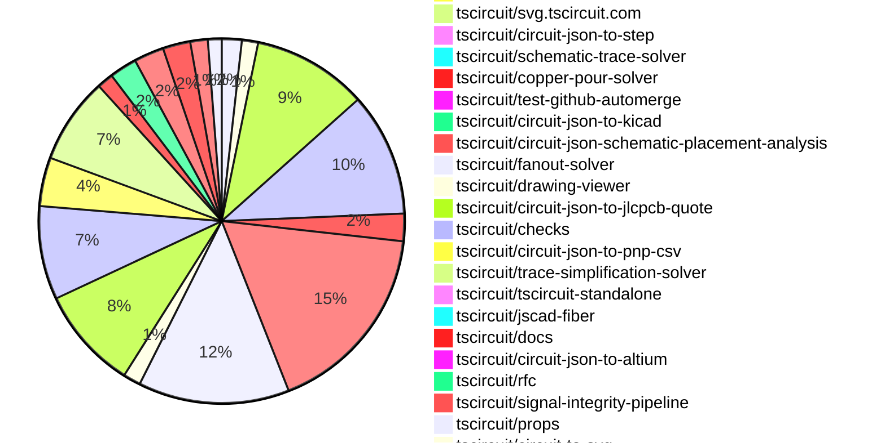

# contribution tracker

[contributions.tscircuit.com](https://contributions.tscircuit.com) ・ [tscircuit.com](https://tscircuit.com) ・ [Contribution Overviews](./contribution-overviews/) ・ [Changelogs](./changelogs/)

Generates weekly contribution overviews for tscircuit contributors. Check out all
the [contribution overviews here](./contribution-overviews/)
You can find AI-generated monthly changelogs in the [changelogs directory](./changelogs/)

- All PRs in the tscircuit org are scanned/summarized via an LLM
- The LLM classifies each Diff/PR as into a set of attributes for scoring
- All the PRs, summaries, and classifications are organized into charts and tables for [the website](https://contributions.tscircuit.com)

> Want to run locally? See the [Development Section](#development)

## Current Week

<!-- START_CURRENT_WEEK -->

# Contribution Overview 2026-11-03

The current week is shown below. There are 3 major sections:

- [Contributor Overview](#contributor-overview)
- [PRs by Repository](#prs-by-repository)
- [PRs by Contributor](#changes-by-contributor)
- [Scoring & Sponsorship Details](/docs/sponsorship-calculation-explanation.md)

## PRs by Repository

## Contributor Overview

| Contributor | 🐳 Major | 🐙 Minor | 🐌 Tiny | Score | ⭐ |
|-------------|---------|---------|---------|-------|-----|
| [ShiboSoftwareDev](#ShiboSoftwareDev) | 69 | 14 | 57 | 323 | 👑👑👑 |
| [seveibar](#seveibar) | 43 | 20 | 42 | 225 | 👑👑👑 |
| [Abse2001](#Abse2001) | 3 | 13 | 20 | 64 | ⭐⭐⭐ |
| [0hmX](#0hmX) | 8 | 9 | 10 | 61 | ⭐⭐⭐ |
| [imrishabh18](#imrishabh18) | 8 | 5 | 16 | 55 | ⭐⭐⭐ |
| [MustafaMulla29](#MustafaMulla29) | 5 | 10 | 28 | 53 | ⭐⭐⭐ |
| [rushabhcodes](#rushabhcodes) | 6 | 3 | 6 | 36 | ⭐⭐ |
| [techmannih](#techmannih) | 5 | 1 | 11 | 33 | ⭐⭐ |
| [AnasSarkiz](#AnasSarkiz) | 5 | 1 | 6 | 28 | ⭐⭐ |
| [GokulPandi-M](#GokulPandi-M) | 2 | 3 | 1 | 15 | ⭐⭐ |
| [tscircuitbot](#tscircuitbot) | 0 | 0 | 573 | 13 | ⭐⭐ |
| [mohan-bee](#mohan-bee) | 2 | 1 | 3 | 13 | ⭐⭐ |
| [abdalraof-albarbar](#abdalraof-albarbar) | 1 | 1 | 1 | 7 | ⭐ |
| [danielshawellis](#danielshawellis) | 0 | 0 | 1 | 1 |  |
| [Devesh36](#Devesh36) | 0 | 0 | 1 | 1 |  |
| [trixie010](#trixie010) | 0 | 0 | 1 | 1 |  |
| [KrishnaX12](#KrishnaX12) | 0 | 0 | 1 | 1 |  |

## Staff Pass Ratio (SPR)

| Contributor | Reviewed PRs | Rejections | Approvals | SPR |
|-------------|--------------|------------|-----------|-----|
| [ShiboSoftwareDev](#ShiboSoftwareDev) | 28 | 1 | 27 | 96.4% |
| [Abse2001](#Abse2001) | 18 | 3 | 17 | 83.3% |
| [techmannih](#techmannih) | 8 | 0 | 8 | 100.0% |
| [GokulPandi-M](#GokulPandi-M) | 6 | 2 | 5 | 66.7% |
| [imrishabh18](#imrishabh18) | 6 | 1 | 5 | 83.3% |
| [rushabhcodes](#rushabhcodes) | 5 | 3 | 3 | 40.0% |
| [0hmX](#0hmX) | 4 | 0 | 5 | 100.0% |
| [AnasSarkiz](#AnasSarkiz) | 4 | 0 | 4 | 100.0% |
| [mohan-bee](#mohan-bee) | 3 | 1 | 3 | 66.7% |
| [abdalraof-albarbar](#abdalraof-albarbar) | 1 | 0 | 1 | 100.0% |
| [Devesh36](#Devesh36) | 1 | 1 | 0 | 0.0% |
| [MustafaMulla29](#MustafaMulla29) | 1 | 0 | 1 | 100.0% |

ShiboSoftwareDev SPR PRs (28)

- [#308](https://github.com/tscircuit/schematic-viewer/pull/308) Fit schematics to the selected sheet frame
- [#1163](https://github.com/tscircuit/pcb-viewer/pull/1163) Speed up WebGPU copper pours by updating Earcut
- [#1095](https://github.com/tscircuit/3d-viewer/pull/1095) Release the 3D canvas WebGL context on teardown
- [#5348](https://github.com/tscircuit/core/pull/5348) fix: perforate both ends of panel support tabs
- [#5309](https://github.com/tscircuit/core/pull/5309) fix: preserve panel support tabs across neighboring routes
- [#5293](https://github.com/tscircuit/core/pull/5293) Preserve completed routing phases when a later phase fails
- [#5746](https://github.com/tscircuit/cli/pull/5746) Build TSX presets into separate package artifacts
- [#3594](https://github.com/tscircuit/tscircuit-autorouter/pull/3594) fix: keep fine repair grids after region reordering
- [#3588](https://github.com/tscircuit/tscircuit-autorouter/pull/3588) fix: reduce allocations in DDR path planning
- [#3584](https://github.com/tscircuit/tscircuit-autorouter/pull/3584) fix: preserve required terminal paths when pruning cramped ports
- [#3564](https://github.com/tscircuit/tscircuit-autorouter/pull/3564) Preserve regional DDR repairs for exact search
- [#3555](https://github.com/tscircuit/tscircuit-autorouter/pull/3555) fix: preserve via space beside trapped BGA targets
- [#3547](https://github.com/tscircuit/tscircuit-autorouter/pull/3547) Repair Pipeline9 DDR routes beside completed copper
- [#3520](https://github.com/tscircuit/tscircuit-autorouter/pull/3520) Preserve fixed native traces throughout Pipeline 9
- [#3480](https://github.com/tscircuit/tscircuit-autorouter/pull/3480) Avoid retaining every temporary topology cell on DDR boards
- [#3471](https://github.com/tscircuit/tscircuit-autorouter/pull/3471) Fix DDR pad drills through the existing repair search
- [#3514](https://github.com/tscircuit/tscircuit-autorouter/pull/3514) Avoid full mesh-edge scans when connecting target regions
- [#312](https://github.com/tscircuit/tiny-hypergraph/pull/312) fix: reduce allocations in large DDR routing searches
- [#308](https://github.com/tscircuit/tiny-hypergraph/pull/308) Preserve fixed native routes during hypergraph rerouting
- [#175](https://github.com/tscircuit/bus-lanes-solver/pull/175) fix: reuse board occupancy across copper grid changes
- [#165](https://github.com/tscircuit/bus-lanes-solver/pull/165) Complete ButterStick's shared DDR branches through existing vias
- [#159](https://github.com/tscircuit/bus-lanes-solver/pull/159) fix: avoid exhaustive surface-site search for untimed A13 buses
- [#147](https://github.com/tscircuit/bus-lanes-solver/pull/147) Route A64’s fourth DDR byte through available pad-edge escape sites
- [#156](https://github.com/tscircuit/bus-lanes-solver/pull/156) Preserve escape gaps beside rotated rectangular pads
- [#136](https://github.com/tscircuit/bus-lanes-solver/pull/136) Fix STMP157 DDR byte routing with valid pad-to-via approaches
- [#104](https://github.com/tscircuit/circuit-json-webgpu/pull/104) Reuse large copper-pour triangulations across PCB presets
- [#102](https://github.com/tscircuit/circuit-json-webgpu/pull/102) Write WebGPU mesh arrays one chunk at a time
- [#101](https://github.com/tscircuit/circuit-json-webgpu/pull/101) perf: build WebGPU meshes in typed array chunks

Abse2001 SPR PRs (18)

- [#955](https://github.com/tscircuit/circuit-json/pull/955) feat: allow panel fabrication notes without fake footprints (core#5067)
- [#988](https://github.com/tscircuit/props/pull/988) feat: express panel tab controls as child elements (#5067)
- [#991](https://github.com/tscircuit/props/pull/991) feat: define finished panel size limits (#5067)
- [#990](https://github.com/tscircuit/props/pull/990) feat: add panel vScore boolean alongside mouseBites (#5067)
- [#974](https://github.com/tscircuit/props/pull/974) fix: require at least three courtyard outline points
- [#5211](https://github.com/tscircuit/core/pull/5211) feat: implement tooling rail elements (#5067)
- [#5214](https://github.com/tscircuit/core/pull/5214) feat: implement finished panel size limits (#5067)
- [#5202](https://github.com/tscircuit/core/pull/5202) feat: implement panel tooling holes and fiducials (#5067)
- [#5205](https://github.com/tscircuit/core/pull/5205) feat: implement panel silkscreen (#5067)
- [#5217](https://github.com/tscircuit/core/pull/5217) feat: V-score panel tabs with vScore (#5067)
- [#5208](https://github.com/tscircuit/core/pull/5208) feat: implement panel tab child elements (#5067)
- [#5076](https://github.com/tscircuit/core/pull/5076) fix: use the requested tab span and wider mouse-bite webs (#5066)
- [#5071](https://github.com/tscircuit/core/pull/5071) fix: replace rounded panel slivers with continuous routing slots (#5065)
- [#246](https://github.com/tscircuit/circuit-json-to-gerber/pull/246) Merge cutouts that are flush with the board edge into the board outline
- [#5722](https://github.com/tscircuit/cli/pull/5722) feat: synchronize CLI converter versions from core
- [#5663](https://github.com/tscircuit/cli/pull/5663) fix: update STEP converter and preserve assembly ZIP exports (#5661)
- [#177](https://github.com/tscircuit/circuit-json-to-step/pull/177) fix: export round pill drills without non-finite STEP directions (#176)
- [#142](https://github.com/tscircuit/copper-pour-solver/pull/142) fix: select owning PCB board for panel copper pours

techmannih SPR PRs (8)

- [#5341](https://github.com/tscircuit/core/pull/5341) Fix plated-hole solder paste ownership
- [#5343](https://github.com/tscircuit/core/pull/5343) Fix named-net routing via a phase-selected pin
- [#5182](https://github.com/tscircuit/core/pull/5182) fix: allow ground-plane routing past trace-length preflight
- [#5143](https://github.com/tscircuit/core/pull/5143) Skip redundant autorouting between copper-connected terminals
- [#5750](https://github.com/tscircuit/cli/pull/5750) Fix autorouter worker count in tsci build
- [#3496](https://github.com/tscircuit/tscircuit-autorouter/pull/3496) fix: pin repair03 with physical copper contact protection
- [#190](https://github.com/tscircuit/high-density-repair03/pull/190) fix: prevent new trace-to-via shorts during repair
- [#187](https://github.com/tscircuit/high-density-repair03/pull/187) perf: reuse broad-force passes and avoid redundant DRC work

GokulPandi-M SPR PRs (6)

- [#5291](https://github.com/tscircuit/core/pull/5291) Fix missing components when schFlex contains text-only groups
- [#5287](https://github.com/tscircuit/core/pull/5287) Reproduce invalid schematic positions from text-only groups in schFlex
- [#5224](https://github.com/tscircuit/core/pull/5224) Fix false errors when importing split routed traces
- [#5137](https://github.com/tscircuit/core/pull/5137) Reproduce false connectivity errors for split via-to-via traces
- [#5223](https://github.com/tscircuit/core/pull/5223) fix: preserve BGA dogbone fanout when adding a ground pour
- [#5186](https://github.com/tscircuit/core/pull/5186) repro: ground pour prevents BGA dogbone fanout

imrishabh18 SPR PRs (6)

- [#3643](https://github.com/tscircuit/tscircuit-autorouter/pull/3643) Route differential pairs through inline pads
- [#3477](https://github.com/tscircuit/tscircuit-autorouter/pull/3477) perf: reduce Pipeline9 clearance projection cost via repair04
- [#146](https://github.com/tscircuit/copper-pour-solver/pull/146) Remove copper spikes between adjacent rounded SMT pins
- [#87](https://github.com/tscircuit/length-matching-solver/pull/87) Allow differential pair sections to meet at inline pads
- [#62](https://github.com/tscircuit/repair04/pull/62) perf: prune clearance pairs and simplify via-pad distances
- [#49](https://github.com/tscircuit/tscircuit-standalone/pull/49) refactor: preserve the normal standalone package graph

rushabhcodes SPR PRs (5)

- [#283](https://github.com/tscircuit/circuit-json-util/pull/283) fix: support position tolerance when matching route vias
- [#997](https://github.com/tscircuit/props/pull/997) fix: align pcbtrace props with coordinate and explicit routes
- [#3596](https://github.com/tscircuit/tscircuit-autorouter/pull/3596) feat: enforce per-connection minimum widths in Pipeline9
- [#61](https://github.com/tscircuit/skill/pull/61) Fix pcbtrace skill example with complete route points
- [#3](https://github.com/tscircuit/drawing-viewer/pull/3) Render engineering drawings from Circuit JSON

0hmX SPR PRs (4)

- [#28](https://github.com/tscircuit/rfc/pull/28) RFC: PCB transient channel simulation (<simulation.pcbtransientchannelsimulation>, <simulation.pcbchannel>)
- [#5109](https://github.com/tscircuit/core/pull/5109) fix: warn when fabricatorPreset has no stackup template for the board
- [#5121](https://github.com/tscircuit/core/pull/5121) fix: default board thickness to 1.6mm
- [#315](https://github.com/tscircuit/tiny-hypergraph/pull/315) Report each connection's solo search iterations from DuplicateCongestedPortSolver

AnasSarkiz SPR PRs (4)

- [#975](https://github.com/tscircuit/circuit-json/pull/975) Preserve custom KiCad properties in component metadata
- [#987](https://github.com/tscircuit/props/pull/987) Allow custom KiCad metadata property names
- [#5177](https://github.com/tscircuit/core/pull/5177) Fix split physical ports for custom schematic symbols
- [#540](https://github.com/tscircuit/checks/pull/540) fix: recognize explicit pin role attributes as specified

mohan-bee SPR PRs (3)

- [#290](https://github.com/tscircuit/circuit-json-util/pull/290) move brep copper pours with pcb transforms
- [#3442](https://github.com/tscircuit/tscircuit-autorouter/pull/3442) use upstream power trace expansion batching
- [#68](https://github.com/tscircuit/power-trace-expander/pull/68) batch power trace expansion while preserving work budgets

abdalraof-albarbar SPR PRs (1)

- [#6111](https://github.com/tscircuit/runframe/pull/6111) Fix Pipeline9 solver reconstruction in the Solvers tab

Devesh36 SPR PRs (1)

- [#5283](https://github.com/tscircuit/core/pull/5283) repro: rectangular mounting holes ignore footprint rotation

MustafaMulla29 SPR PRs (1)

- [#264](https://github.com/tscircuit/fanout-solver/pull/264) fix: allow dogbone vias through reserved pours on other layers

> Note: AI evaluates PRs and assigns 1-3 star ratings automatically. 4 and 5 star ratings require manual staff review.

## Review Table

[reviews-received-hover]: ## "Number of reviews received for PRs for this contributor"
[approvals-received-hover]: ## "Number of approvals received for PRs this contributor authored"
[rejections-received-hover]: ## "Number of rejections received for PRs this contributor authored"
[prs-opened-hover]: ## "Number of PRs opened by this contributor"
[issues-created-hover]: ## "Number of issues created by this contributor"

| Contributor | Reviews Received | Approvals Received | Rejections Received | Approvals | Rejections Given | PRs Opened | PRs Merged | Issues Created |
|---|---|---|---|---|---|---|---|---|
| [0hmX](#0hmX) | 13 | 6 | 0 | 20 | 0 | 63 | 30 | 0 |
| [1932819331hy-debug](#1932819331hy-debug) | 3 | 0 | 0 | 0 | 0 | 47 | 0 | 0 |
| [abdalraof-albarbar](#abdalraof-albarbar) | 3 | 3 | 0 | 0 | 0 | 12 | 3 | 0 |
| [Abse2001](#Abse2001) | 23 | 21 | 2 | 14 | 0 | 66 | 37 | 0 |
| [Albertito-AI](#Albertito-AI) | 0 | 0 | 0 | 0 | 0 | 2 | 0 | 0 |
| [alokudyogi](#alokudyogi) | 0 | 0 | 0 | 0 | 0 | 1 | 0 | 0 |
| [AnasSarkiz](#AnasSarkiz) | 9 | 9 | 0 | 0 | 0 | 21 | 13 | 0 |
| [aswadi](#aswadi) | 0 | 0 | 0 | 0 | 0 | 8 | 0 | 0 |
| [bacourosp](#bacourosp) | 0 | 0 | 0 | 0 | 0 | 3 | 0 | 0 |
| [balckwell](#balckwell) | 0 | 0 | 0 | 0 | 0 | 4 | 0 | 0 |
| [btctony1](#btctony1) | 0 | 0 | 0 | 0 | 0 | 1 | 0 | 0 |
| [Burapa-J](#Burapa-J) | 0 | 0 | 0 | 0 | 0 | 5 | 0 | 0 |
| [cocvn157](#cocvn157) | 0 | 0 | 0 | 0 | 0 | 338 | 0 | 0 |
| [Crodify](#Crodify) | 0 | 0 | 0 | 0 | 0 | 15 | 0 | 0 |
| [CrowAleksito](#CrowAleksito) | 0 | 0 | 0 | 0 | 0 | 1 | 0 | 0 |
| [cyczzhao-lab](#cyczzhao-lab) | 0 | 0 | 0 | 0 | 0 | 15 | 0 | 0 |
| [cyzcz](#cyzcz) | 0 | 0 | 0 | 0 | 0 | 12 | 0 | 0 |
| [danielshawellis](#danielshawellis) | 2 | 1 | 0 | 0 | 0 | 2 | 1 | 0 |
| [Devesh36](#Devesh36) | 2 | 1 | 1 | 0 | 0 | 3 | 1 | 0 |
| [DNL5555](#DNL5555) | 0 | 0 | 0 | 0 | 0 | 3 | 0 | 0 |
| [DoctorLaplace](#DoctorLaplace) | 0 | 0 | 0 | 0 | 0 | 2 | 0 | 0 |
| [FranprzDev](#FranprzDev) | 0 | 0 | 0 | 0 | 0 | 6 | 0 | 0 |
| [frds3445](#frds3445) | 2 | 0 | 0 | 0 | 0 | 2 | 0 | 0 |
| [GokulPandi-M](#GokulPandi-M) | 11 | 8 | 3 | 0 | 0 | 9 | 6 | 0 |
| [HarsH-1877](#HarsH-1877) | 0 | 0 | 0 | 0 | 0 | 3 | 0 | 0 |
| [imrishabh18](#imrishabh18) | 14 | 10 | 1 | 11 | 4 | 46 | 30 | 0 |
| [jeffrey-graham](#jeffrey-graham) | 0 | 0 | 0 | 0 | 0 | 86 | 0 | 0 |
| [khuxaiphi-stack](#khuxaiphi-stack) | 0 | 0 | 0 | 0 | 0 | 1 | 0 | 0 |
| [KrishnaX12](#KrishnaX12) | 1 | 1 | 0 | 0 | 0 | 6 | 1 | 0 |
| [krosLyao](#krosLyao) | 0 | 0 | 0 | 0 | 0 | 1 | 0 | 0 |
| [LBCron](#LBCron) | 0 | 0 | 0 | 0 | 0 | 10 | 0 | 0 |
| [longdungai](#longdungai) | 3 | 0 | 0 | 0 | 0 | 3 | 0 | 0 |
| [mau16ro](#mau16ro) | 0 | 0 | 0 | 0 | 0 | 1 | 0 | 0 |
| [Mekdou23](#Mekdou23) | 0 | 0 | 0 | 0 | 0 | 1 | 0 | 0 |
| [mohan-bee](#mohan-bee) | 3 | 3 | 0 | 0 | 0 | 8 | 6 | 0 |
| [MustafaMulla29](#MustafaMulla29) | 10 | 7 | 0 | 3 | 0 | 59 | 43 | 0 |
| [nhausmna](#nhausmna) | 0 | 0 | 0 | 0 | 0 | 1 | 0 | 0 |
| [OLuHneschastniy](#OLuHneschastniy) | 0 | 0 | 0 | 0 | 0 | 6 | 0 | 0 |
| [Plugv3](#Plugv3) | 0 | 0 | 0 | 0 | 0 | 5 | 0 | 0 |
| [rafagil11](#rafagil11) | 0 | 0 | 0 | 0 | 0 | 1 | 0 | 0 |
| [rushabhcodes](#rushabhcodes) | 34 | 14 | 2 | 0 | 0 | 50 | 15 | 0 |
| [seveibar](#seveibar) | 36 | 1 | 0 | 92 | 9 | 151 | 106 | 0 |
| [ShiboSoftwareDev](#ShiboSoftwareDev) | 51 | 50 | 1 | 7 | 0 | 178 | 140 | 0 |
| [Shokun123](#Shokun123) | 0 | 0 | 0 | 0 | 0 | 5 | 0 | 0 |
| [siddikmallik1999-design](#siddikmallik1999-design) | 0 | 0 | 0 | 0 | 0 | 1 | 0 | 0 |
| [techmannih](#techmannih) | 50 | 11 | 2 | 0 | 0 | 56 | 17 | 0 |
| [trixie010](#trixie010) | 2 | 1 | 1 | 0 | 0 | 5 | 1 | 0 |
| [tscircuitbot](#tscircuitbot) | 0 | 0 | 0 | 0 | 0 | 746 | 574 | 0 |
| [tungnguyen84](#tungnguyen84) | 0 | 0 | 0 | 0 | 0 | 4 | 0 | 0 |
| [Umutplvn](#Umutplvn) | 0 | 0 | 0 | 0 | 0 | 1 | 0 | 0 |
| [voropaevv](#voropaevv) | 0 | 0 | 0 | 0 | 0 | 14 | 0 | 0 |
| [zenoutlabs](#zenoutlabs) | 0 | 0 | 0 | 0 | 0 | 2 | 0 | 0 |

## Changes by Repository

### [tscircuit/pcb-viewer](https://github.com/tscircuit/pcb-viewer)

| PR # | Impact | Rating | Contributor | Description |
|------|--------|--------|-------------|-------------|
| [#1163](https://github.com/tscircuit/pcb-viewer/pull/1163) | 🐳 Major | ⭐⭐⭐ | ShiboSoftwareDev | Updates the Earcut library to version 3.2.4 to improve the performance of triangulating copper pours in WebGPU, resulting in faster scene compilation and PCB painting times. |
| [#1153](https://github.com/tscircuit/pcb-viewer/pull/1153) | 🐙 Minor | ⭐⭐ | imrishabh18 | Fixes hover overlay overflow issue when zooming in on PCB pads, ensuring labels and outlines remain within the viewer bounds. |
| [#1191](https://github.com/tscircuit/pcb-viewer/pull/1191) | 🐙 Minor | ⭐⭐ | 0hmX | Fixes the issue of duplicated mm units in anchor offset labels by ensuring that mm is only appended when necessary, improving label clarity in the PCB viewer. |

🐌 Tiny Contributions (13)

| PR # | Impact | Contributor | Description |
|------|--------|-------------|-------------|
| [#1194](https://github.com/tscircuit/pcb-viewer/pull/1194) | 🐌 Tiny | ShiboSoftwareDev | Updates the WebGPU renderer to version 0.0.17, allowing for the reuse of large copper-pour triangulations when switching PCB presets, resulting in improved load times for specific presets. |
| [#1185](https://github.com/tscircuit/pcb-viewer/pull/1185) | 🐌 Tiny | ShiboSoftwareDev | Updates the WebGPU renderer to version 0.0.16, allowing the PCB viewer to write mesh buffers in batches, improving rendering performance. |
| [#1168](https://github.com/tscircuit/pcb-viewer/pull/1168) | 🐌 Tiny | ShiboSoftwareDev | Bump the WebGPU renderer bundled by the PCB viewer to 0.0.15 to pick up typed mesh buffers and lower peak PCB memory use |
| [#1195](https://github.com/tscircuit/pcb-viewer/pull/1195) | 🐌 Tiny | tscircuitbot | Automated package update |
| [#1192](https://github.com/tscircuit/pcb-viewer/pull/1192) | 🐌 Tiny | tscircuitbot | Automated package update |
| [#1186](https://github.com/tscircuit/pcb-viewer/pull/1186) | 🐌 Tiny | tscircuitbot | Automated package update |
| [#1169](https://github.com/tscircuit/pcb-viewer/pull/1169) | 🐌 Tiny | tscircuitbot | Automated package update |
| [#1157](https://github.com/tscircuit/pcb-viewer/pull/1157) | 🐌 Tiny | tscircuitbot | Automated package update |
| [#1182](https://github.com/tscircuit/pcb-viewer/pull/1182) | 🐌 Tiny | tscircuitbot | Automated package update |
| [#1164](https://github.com/tscircuit/pcb-viewer/pull/1164) | 🐌 Tiny | tscircuitbot | Automated package update |
| [#1154](https://github.com/tscircuit/pcb-viewer/pull/1154) | 🐌 Tiny | tscircuitbot | Automated package update |
| [#1156](https://github.com/tscircuit/pcb-viewer/pull/1156) | 🐌 Tiny | techmannih | Fixes unsupported color errors in WebGPU rendering by updating the circuit-json-webgpu package to support named colors and correct PCB note layout. |
| [#1181](https://github.com/tscircuit/pcb-viewer/pull/1181) | 🐌 Tiny | imrishabh18 | Fixes the height mismatch of the component search button in the pcb-viewer when embedded in runframe by setting the SVG display to inline-block to match the surrounding text controls height. |

### [tscircuit/3d-viewer](https://github.com/tscircuit/3d-viewer)

| PR # | Impact | Rating | Contributor | Description |
|------|--------|--------|-------------|-------------|
| [#1132](https://github.com/tscircuit/3d-viewer/pull/1132) | 🐳 Major | ⭐⭐⭐ | ShiboSoftwareDev | Fixes initial camera framing for CAD assemblies without a PCB, ensuring proper geometry bounds are respected during rendering. |
| [#1121](https://github.com/tscircuit/3d-viewer/pull/1121) | 🐳 Major | ⭐⭐⭐ | ShiboSoftwareDev | Keeps the active GLB on screen while its replacement loads, swapping models on the existing canvas and preserving the camera. |
| [#1095](https://github.com/tscircuit/3d-viewer/pull/1095) | 🐳 Major | ⭐⭐⭐ | ShiboSoftwareDev | Releases the old WebGL context after disposing the renderer, ensuring the old context is lost and the replacement canvas works correctly. |
| [#1094](https://github.com/tscircuit/3d-viewer/pull/1094) | 🐳 Major | ⭐⭐⭐ | ShiboSoftwareDev | Fixes the issue where a detached WebGL canvas retains its context after unmounting, leading to unexpected behavior in rendering. |
| [#1131](https://github.com/tscircuit/3d-viewer/pull/1131) | 🐳 Major | ⭐⭐⭐ | seveibar | Adds a Play In Reverse button to the explosion menu and a Show guidelines checkbox to control the visibility of explosion lines during playback. |
| [#1134](https://github.com/tscircuit/3d-viewer/pull/1134) | 🐳 Major | ⭐⭐⭐ | seveibar | Adds an overhead Game Boy Advance dual RP2350 explosion example with a 180 front-cover flip and separate analog-stick, speaker, and button removal stages. The thirteen-stage sequence removes user accessories first, parks each assembly on the left, flips the cleared front assembly inside-up, then removes its internal modules. Reverse playback reassembles the modules and flips the cover closed. The viewer now accepts optional assemblyExplosionRotations cues: axis, signed angle, and a world-space pivot attached to an authored move. Absolute transforms support scrubbing, reverse playback, late-loaded models, and Reset without rebuilding geometry or accumulating orientation drift. Guide lines follow the rotation arc. The rotation API is documented; it is a viewer extension supplied alongside cores translation-only circuit JSON. The example is pinned to absegameboy-advance-dual-rp23500.3.0-review.8. It preserves the routed PCB and model transforms, includes native TSX, serialized rotation cues, reproducible exporters and clearance checks, and loads assets from the public registry. This PR does not republish the registry package. Remaining extraction limitations: the initial battery-doorrear-shell and front-shellpower-switch collisions remain. Continuous bounds checks clear all parking paths and the full cover flip. A rendered-mesh audit at 0.25 mm travel intervals found no additional collisions in the added motions. The speaker comes out before the Select button to clear its retainer; the volume wheel stays with the cover because its extraction catches on the cover. Existing model contacts and findings are recorded in the fixture; this is not a fully collision-free assembly procedure. Validation: 15 unit tests covering pivot rotation, subsequent world-space motion, geometry sharing, arc anchoring, late loads, reset, source regeneration, complete group motions, PCB invariance, and swept clearance; three Chromium tests covering existing playback, guidelines, reverse, the halffull cover flip, subsequent module removal, backward scrubbing, and reset; TypeScript and library build. |
| [#1124](https://github.com/tscircuit/3d-viewer/pull/1124) | 🐳 Major | ⭐⭐⭐ | seveibar | Explosion stages can now play continuously, defaulting to two seconds per stage. The explosion menu includes a seconds-per-stage setting, PlayPauseReplay, previousnext stage buttons, and Reset. Scrubbing or stepping pauses playback, and closing the menu cancels animation. Playback evaluates a lightweight copy of the movement program and component poses, sharing immutable model geometry rather than cloning it each frame. The viewer also memoizes its serialized model identity. A local FLEX17 CPU benchmark measured pose evaluation at about 4 ms instead of 325 ms, and removes approximately 78 ms of repeated serialization per update. These timings are not an end-to-end FPS measurement. Adds the FLEX17 adjustable spur assembly as a self-contained Storybook sample with its 18 authored stages, based on https:flex17-tsx-adjustable-spur.seveibar.chatgpt.site. Validation: package build, full TypeScript check, five unit tests (including equivalence with core at 90 FLEX17 poses and geometry-sharing checks), and all five Playwright explosion tests pass. Local browser verification uses system Chromium and circuit-to-svg 0.0.454 to avoid the latest transitive packages incompatibility with the repositorys circuit-json override. |
| [#1091](https://github.com/tscircuit/3d-viewer/pull/1091) | 🐳 Major | ⭐⭐⭐ | seveibar | Right-clicking an object now offers Isolate name, which hides every other object. Unhide All (renamed from Unhide All Components) restores everything. The PCB board can now be picked, so right-clicking it offers Hide Board  Isolate Board (Panel when a panel is rendered). Before this change the board had no id, so only CAD components could be hidden. Cables (cad_cable) can be picked, hidden and isolated the same way. |
| [#1092](https://github.com/tscircuit/3d-viewer/pull/1092) | 🐳 Major | ⭐⭐⭐ | seveibar | Right-clicking a model and choosing Download GLTF now downloads a GLTF of just that model, named after it (e.g. USBC.gltf). Right-clicking the board or empty space still downloads the whole scene as scene.gltf. |
| [#1133](https://github.com/tscircuit/3d-viewer/pull/1133) | 🐙 Minor | ⭐⭐ | seveibar | Load Manifold and circuit-generation code only when needed to optimize performance by importing geometry code on demand based on user input. |
| [#1127](https://github.com/tscircuit/3d-viewer/pull/1127) | 🐙 Minor | ⭐⭐ | seveibar | Fixes explosion guide lines detaching from components when geometry is offset from CAD origin by anchoring movement paths to rendered component bounds and updating guides accordingly. |
| [#1093](https://github.com/tscircuit/3d-viewer/pull/1093) | 🐙 Minor | ⭐⭐ | seveibar | Fixes the issue where boards in GLB mode could not be hidden or isolated due to missing identifiers, enabling proper visibility controls for board components. |

🐌 Tiny Contributions (1)

| PR # | Impact | Contributor | Description |
|------|--------|-------------|-------------|
| [#1122](https://github.com/tscircuit/3d-viewer/pull/1122) | 🐌 Tiny | seveibar | Removes incorrect PD-StepperGPL attribution and license from the RP2040 assembly fixture, ensuring proper identification of the board as the RP2040 motor-controller design. |

### [tscircuit/core](https://github.com/tscircuit/core)

| PR # | Impact | Rating | Contributor | Description |
|------|--------|--------|-------------|-------------|
| [#5362](https://github.com/tscircuit/core/pull/5362) | 🐳 Major | ⭐⭐⭐ | ShiboSoftwareDev | Resolves named-net router tags to the matching source trace, including split pieces when the net has one owner, allowing connectivity checks and source-trace constraints to find all 16 DDR data routes while shared branches retain net ownership. |
| [#5360](https://github.com/tscircuit/core/pull/5360) | 🐳 Major | ⭐⭐⭐ | ShiboSoftwareDev | Captures a full 163-component reference circuit where all 16 DDR data routes retain net aliases instead of their matching source traces, preventing checks keyed to those source traces from finding the copper. |
| [#5349](https://github.com/tscircuit/core/pull/5349) | 🐳 Major | ⭐⭐⭐ | ShiboSoftwareDev | Bumps the tscircuitcapacity-autorouter package from version 0.0.1066 to 0.0.1067, incorporating fixes for multi-head seed work and preserving copper identity and clearance information. |
| [#5306](https://github.com/tscircuit/core/pull/5306) | 🐳 Major | ⭐⭐⭐ | ShiboSoftwareDev | Bump tscircuitcapacity-autorouter from 0.0.1061 to 0.0.1063 to include tscircuittscircuit-autorouter3594, preserving fine repair grids after region reordering and fixing H3 DDR bank-address clearance repair. |
| [#5300](https://github.com/tscircuit/core/pull/5300) | 🐳 Major | ⭐⭐⭐ | ShiboSoftwareDev | Preserves circular copper when converting fixed vias into routing obstacles, removing a false clearance conflict on the H616 DDR crop. |
| [#5293](https://github.com/tscircuit/core/pull/5293) | 🐳 Major | ⭐⭐⭐ | ShiboSoftwareDev | Preserves completed routing phases in the autorouter when a later phase fails, preventing loss of routing progress for signals. |
| [#5299](https://github.com/tscircuit/core/pull/5299) | 🐳 Major | ⭐⭐⭐ | ShiboSoftwareDev | Reproduces a completed H616 DDR via becoming a square routing obstacle, comparing native copper with Cores emitted geometry. |
| [#5240](https://github.com/tscircuit/core/pull/5240) | 🐳 Major | ⭐⭐⭐ | ShiboSoftwareDev | Bumps tscircuitcapacity-autorouter from 0.0.1047 to 0.0.1049 to include the disconnected-graph retry fix |
| [#5122](https://github.com/tscircuit/core/pull/5122) | 🐳 Major | ⭐⭐⭐ | ShiboSoftwareDev | Bumps tscircuitcapacity-autorouter from 0.0.1035 to 0.0.1037, bringing in the DDR mesh-memory fix. |
| [#5182](https://github.com/tscircuit/core/pull/5182) | 🐳 Major | ⭐⭐⭐ | techmannih | Fixes ground-plane routing failure by allowing connections to a declared inner-layer GND pour to pass the trace-length preflight check. |
| [#5143](https://github.com/tscircuit/core/pull/5143) | 🐳 Major | ⭐⭐⭐ | techmannih | Fixes redundant autorouting requests for terminals already connected by a same-net copper pour by incorporating their physical connectivity into the autorouting process. |
| [#5219](https://github.com/tscircuit/core/pull/5219) | 🐳 Major | ⭐⭐⭐ | seveibar | Fixes the issue where named differential sections were lost when combining shared nets, resulting in zero traces on boards; this fix preserves those sections and routes the intended connections. |
| [#5281](https://github.com/tscircuit/core/pull/5281) | 🐳 Major | ⭐⭐⭐ | seveibar | Adjusts the positioning of watchdog labels for system self-loops, moving them closer to their respective blocks to improve clarity and avoid overlap with neighboring elements. |
| [#5247](https://github.com/tscircuit/core/pull/5247) | 🐳 Major | ⭐⭐⭐ | seveibar | Dense system diagrams braid neighboring wires when block faces and connection landing order follow coarse group geometry. Lay out subsystem contents independently, route around blocks and labels, and optimize adjacent landing slotsincluding swaps around block cornersagainst the complete diagrams crossings, shared segments, spacing, bends, and length. Bound the search to 64 swaps and one final rerouting sweep. Keep clear straight arrows and same-face return loops simple by placing their labels beside the wire. Horizontal connections retain inline labels when text fits. Regression assertions cover straight arrows and compact semicircular loops in all four page directions. Round after optimization, letting curves use label padding while protecting the text. Preserve neighboring wire clearance without rejecting curves that move away from an already close wire. Check tangent continuity in the nested fixture, and use zero image-difference allowance for system snapshots so small routing changes cannot leave stale images. Emit optional connection colors and line styles. The RVBoy console and power fixtures check CPU landing order, wire intersections (including sampled cubic curves), and 3 mm separation between overlapping parallel runs. Dense graphs can still have crossings. Use the released companion packages: tscircuitprops0.0.721, circuit-json0.0.548, and circuit-to-svg0.0.457. Their PRs are merged: https:github.comtscircuitpropspull992, https:github.comtscircuitcircuit-jsonpull981, and https:github.comtscircuitcircuit-to-svgpull913. Remove the temporary Git dependency and build-script trust entry. The props update requires complete courtyard polygons. Join legacy KiCad imports that store separate two-point courtyard edges into closed polygons before constructing components, preserving componentlayer boundaries and leaving input records unchanged. Add a visual regression test for shuffled and reversed edges and reject disconnected chains. Validation: 30 targeted tests pass across 28 files, covering all prior CI failure cases, system-block features, and courtyard import regression. TypeScript checking, dependency checking, and the ESMdeclaration build pass locally. Browser checks find no overlaps among the 23 RVBoy connection labels, blocks, and headings. Existing schematic snapshots pass unchanged with the registry renderer and shared symbol definitions. |
| [#5158](https://github.com/tscircuit/core/pull/5158) | 🐳 Major | ⭐⭐⭐ | seveibar | Adds rounded connections for system-block TSX after Dagre layout, with tighter layout spacing and improved self-loop handling. |
| [#5113](https://github.com/tscircuit/core/pull/5113) | 🐳 Major | ⭐⭐⭐ | seveibar | Assembly TSX now emits cad_assembly_bom_item records for materials with or without CAD geometry, using released tscircuitprops0.0.718 from tscircuitprops973. |
| [#5116](https://github.com/tscircuit/core/pull/5116) | 🐳 Major | ⭐⭐⭐ | seveibar | Fixes the positioning of JST plug tips inside board and motor sockets to ensure proper electrical contact, addressing issues with misalignment and contact row offsets. |
| [#5112](https://github.com/tscircuit/core/pull/5112) | 🐳 Major | ⭐⭐⭐ | seveibar | Adds systemblock.page, .group, .component, and .connection to core. TSX now produces resolved system_block_ Circuit JSON: page dimensions, block bounds, nested group membership, connection routes, and label_anchor_center. The render phase also resolves optional PCB componentsubcircuit associations without creating electrical connectivity. Uses dagrejsdagre 2.x for synchronous compound graph layout: one dependency, approximately 44 KB for its minified ESM module, and no DOM requirement. Supports all four page directions, parallel connections, cycles, self-loops, disconnected blocks, and empty groupspages. The existing props APIs kind maps to Circuit JSONs is_signal  is_power booleans. Invalid names, hierarchy, endpoints, and PCB references produce errors using readable names. The TSX fixtures(https:github.comtscircuitcoretreefeatsystem-blockstestsfeaturessystem-blocks) include 12 system SVG snapshots plus a PCB snapshot, rendered with published circuit-to-svg 0.0.455. Examples cover a nested wireless sensor system, four flow directions, motor-control power and feedback, multiple pages, long text, PCB associations, and updates. Usage documentation(https:github.comtscircuitcoreblobfeatsystem-blocksdocssystem-blocks.md). |
| [#5161](https://github.com/tscircuit/core/pull/5161) | 🐳 Major | ⭐⭐⭐ | seveibar | Fixes the issue where saved routing phases expose through vias as obstacles only on specific layers, ensuring proper handling of physical via spans during autorouting. |
| [#5176](https://github.com/tscircuit/core/pull/5176) | 🐳 Major | ⭐⭐⭐ | AnasSarkiz | Fixes the ambiguous source-port reference issue in the ESP32-S3-WROOM-1-N16 import by ensuring all ground pads are correctly mapped to their physical ports. |
| [#5241](https://github.com/tscircuit/core/pull/5241) | 🐳 Major | ⭐⭐⭐ | AnasSarkiz | Preserves KiCad symbol metadata when inserting default schematic boxes, ensuring that metadata is retained for both default and custom symbols. |
| [#5352](https://github.com/tscircuit/core/pull/5352) | 🐳 Major | ⭐⭐⭐ | rushabhcodes | Reproduces the missing GND trace sections on the public desk-fidget-counter v6.0.3 PCB. Stacked fix: 5353 in GitHub stack 5354. The fixture preserves every sourcePCB record, including all traces, vias and pour polygons. The snapshot shows the whole board with pour fills hidden. The test checks both physical junctions and verifies that classification leaves copper geometry unchanged. No autorouter or external service is called. Two cases make connected copper appear disconnected: Five-point sampling misses a roughly 0.5 mm pour notch and hides the long vertical continuation. C1s short pad connection is saved separately from its exposed neighbour. Checking neighbours only within each trace record hides that connection. This PR records the original incorrect display. It also contains twelve smaller visibility cases, including exposed and fully covered neighbours split across separate PCB and source trace records. The fix layer adds expected-visibility assertions and updates the same snapshots. Validation: both reproduction tests pass on unmodified core (19 assertions); focused Biome checks pass. |
| [#5223](https://github.com/tscircuit/core/pull/5223) | 🐳 Major | ⭐⭐⭐ | GokulPandi-M | Fixes autorouting failure when adding an inner-layer ground pour that prevents BGA dogbone fanout from functioning correctly. |
| [#5186](https://github.com/tscircuit/core/pull/5186) | 🐳 Major | ⭐⭐⭐ | GokulPandi-M | Fixes autorouting failure when adding a ground pour that prevents BGA dogbone fanout from routing correctly. |
| [#5348](https://github.com/tscircuit/core/pull/5348) | 🐙 Minor | ⭐⭐ | ShiboSoftwareDev | Adds drill rows at both ends of panel support tabs to allow breakaway functionality, addressing a review comment from a previous pull request. |
| [#5309](https://github.com/tscircuit/core/pull/5309) | 🐙 Minor | ⭐⭐ | ShiboSoftwareDev | Fixes the issue where adjacent boards with offset edge midpoints sever each others support tabs, leaving interior boards floating, by preserving tab bridges across overlapping routing bands. |
| [#5307](https://github.com/tscircuit/core/pull/5307) | 🐙 Minor | ⭐⭐ | ShiboSoftwareDev | Stack: main  5307 (repro)  5309 (fix). Merge 5307 first, then 5309. Neighboring boards independent routing slots can cut through their edge-midpoint support tabs. Adds two offline reproductions: A minimal five-board panel and substrate snapshot showing the center board detached from its frame. A native PCB SVG using Seves basic-usbc-devices panel4, v0.0.7(https:tscircuit.comseveibarbasic-usbc-devices?version0.0.7): 10 boards, 1,426 trace records, and 1,068 pads. The displays route removes the dial boards left support bridge. A yellow review box and label mark that tab in the native PCB snapshot. The real-panel fixture preserves the published placements, copper, components, holes, and silkscreen. The published project uses custom machining; the reproduction replaces its hand-authored panel slotsdrills with core-generated tab routing. Source URLs, release ID, SHA-256 hashes, retained types, and extraction notes are recorded in testsreprosassetsseveibar-basic-usbc-panel4source.json. Tests never fetch the registry. Physical support assertions use test.failing until the stacked fix in 5309 lands. Snapshot and setup assertions run separately so their failures cannot satisfy the expected failure. Unmarked assertions fail with zero attached center area  zero remaining bridge material. Validation: both expected-failure reproductions, Biome, and bunx tsc --noEmit pass. All GitHub CI checks pass on cfd59466. Run bun test --timeout 30000 testsreprosrepro-panel-tabs-cut-by-neighbor.test.tsx testsreprosrepro-seveibar-usbc-panel-offset-tabs.test.ts. |
| [#5292](https://github.com/tscircuit/core/pull/5292) | 🐙 Minor | ⭐⭐ | ShiboSoftwareDev | The real H3 DDR3 circuit routes both data bytes, then fails while planning the remaining signals. Core discards the completed copper, leaving 053 signals connected in the saved board. This TSX repro records that failure. Stacked fix: 5293 retains the 16 completed data signals while keeping the remaining-phase error. |
| [#5251](https://github.com/tscircuit/core/pull/5251) | 🐙 Minor | ⭐⭐ | ShiboSoftwareDev | Fixes HTTP 403 error when posting benchmark results to PR conversation due to insufficient permissions for the reporting job. |
| [#5231](https://github.com/tscircuit/core/pull/5231) | 🐙 Minor | ⭐⭐ | 0hmX | Fixes unsupported-component error when importing Circuit JSON with simple_fuse and corrects schema mismatches in PCBschematic output. |
| [#5109](https://github.com/tscircuit/core/pull/5109) | 🐙 Minor | ⭐⭐ | 0hmX | Adds a warning when a fabricatorPreset is set but no matching stackup template exists for the specified board parameters, improving user feedback on stackup issues. |
| [#5155](https://github.com/tscircuit/core/pull/5155) | 🐙 Minor | ⭐⭐ | 0hmX | Allows simulation declarations to reference pins in nested subcircuits, enabling board-level simulations without requiring all components to be in the same subcircuit. |
| [#5121](https://github.com/tscircuit/core/pull/5121) | 🐙 Minor | ⭐⭐ | 0hmX | Changes the default board thickness from 1.4mm to 1.6mm to align with JLCPCB standards, ensuring proper stackup generation for 2- and 4-layer boards. |
| [#5157](https://github.com/tscircuit/core/pull/5157) | 🐙 Minor | ⭐⭐ | 0hmX | Fixes issue with schPortArrangement by ensuring side pins are stored as pin numbers instead of labels, resolving compatibility with circuit-json requirements. |
| [#5162](https://github.com/tscircuit/core/pull/5162) | 🐙 Minor | ⭐⭐ | seveibar | Fixes the issue where multi-port power paths incorrectly inherit a capacitors local decoupling limit, preventing autorouting on longer paths. |
| [#5177](https://github.com/tscircuit/core/pull/5177) | 🐙 Minor | ⭐⭐ | AnasSarkiz | Fixes the issue where custom schematic symbols prevented the split-pad inference from creating and connecting separate physical source ports for repeated footprint pin hints. |
| [#5277](https://github.com/tscircuit/core/pull/5277) | 🐙 Minor | ⭐⭐ | Abse2001 | Updates the copper-pour solver dependency to version 0.0.72 and integrates board selection for copper pours while retaining existing Circuit JSON structure. |
| [#5076](https://github.com/tscircuit/core/pull/5076) | 🐙 Minor | ⭐⭐ | Abse2001 | Fixes mouse-bite rows to fill the requested tab span and maintain appropriate material clearance between adjacent holes. |
| [#5071](https://github.com/tscircuit/core/pull/5071) | 🐙 Minor | ⭐⭐ | Abse2001 | Fixes routing of rounded panel corners to use continuous polygon slots instead of invalid rounded rectangles, ensuring valid geometry and improved routing for curved boards. |
| [#5069](https://github.com/tscircuit/core/pull/5069) | 🐙 Minor | ⭐⭐ | Abse2001 | Reproduces a bug where a 22 panel of 1418 mm boards with 2 mm rounded corners creates 1,024 invalid sliver rectangles, producing a comb of tiny routing slots. |
| [#5353](https://github.com/tscircuit/core/pull/5353) | 🐙 Minor | ⭐⭐ | rushabhcodes | Fixes the visibility of GND traces on the desk fidget counter that appeared disconnected when copper pours were hidden by ensuring segments crossing or touching a polygon boundary remain visible and checking neighbours across trace records on the same net and layer. |
| [#5291](https://github.com/tscircuit/core/pull/5291) | 🐙 Minor | ⭐⭐ | GokulPandi-M | Fixes issue where text-only groups inside schFlex cause neighboring components to have invalid positions, resulting in their disappearance from the schematic. |
| [#5287](https://github.com/tscircuit/core/pull/5287) | 🐙 Minor | ⭐⭐ | GokulPandi-M | Fixes invalid schematic positions caused by adding a child group containing only a schematic note inside schFlex, preventing surrounding components positions from becoming NaN. |
| [#5137](https://github.com/tscircuit/core/pull/5137) | 🐙 Minor | ⭐⭐ | GokulPandi-M | Reproduces false connectivity errors when split via-to-via traces are imported, demonstrating the loss of connection identity in the autorouting process. |

🐌 Tiny Contributions (48)

| PR # | Impact | Contributor | Description |
|------|--------|-------------|-------------|
| [#5378](https://github.com/tscircuit/core/pull/5378) | 🐌 Tiny | ShiboSoftwareDev | Bumps tscircuitcapacity-autorouter from 0.0.1069 to 0.0.1071, updating the autorouter to reject candidates that introduce via-clearance violations against completed DDR copper. |
| [#5363](https://github.com/tscircuit/core/pull/5363) | 🐌 Tiny | ShiboSoftwareDev | Bumps tscircuitcapacity-autorouter from 0.0.1068 to 0.0.1069 to enable independent pad-size group checks for BGA detection, allowing hollow arrays alongside larger fiducials. |
| [#5359](https://github.com/tscircuit/core/pull/5359) | 🐌 Tiny | ShiboSoftwareDev | Bumps the tscircuitbus-lanes-solver dependency from version 0.0.50 to 0.0.51 to include improvements in board-outline occupancy handling and clearance checks, verified with passing tests and no regressions. |
| [#5350](https://github.com/tscircuit/core/pull/5350) | 🐌 Tiny | ShiboSoftwareDev | Bumps tscircuitcapacity-autorouter from 0.0.1067 to 0.0.1068 to include a fix for the bounded finishing pass after the regional search budget is exhausted. |
| [#5320](https://github.com/tscircuit/core/pull/5320) | 🐌 Tiny | ShiboSoftwareDev | Updates the tscircuitbus-lanes-solver dependency from version 0.0.49 to 0.0.50, incorporating upstream reproduction updates without altering production solver behavior. |
| [#5318](https://github.com/tscircuit/core/pull/5318) | 🐌 Tiny | ShiboSoftwareDev | Bumps tscircuitcapacity-autorouter from 0.0.1065 to 0.0.1066 to restore physically clear through-via access between round BGA pads and eliminate DRC errors in the H616 reproduction. |
| [#5308](https://github.com/tscircuit/core/pull/5308) | 🐌 Tiny | ShiboSoftwareDev | Updates dependencies to remove sharp and ensure compatibility with the latest graphics-debug version, resolving potential installation issues with older versions. |
| [#5317](https://github.com/tscircuit/core/pull/5317) | 🐌 Tiny | ShiboSoftwareDev | Bumps tscircuitcapacity-autorouter from 0.0.1064 to 0.0.1065 to include a fix for routed wires against earlier copper and maintain native H616 DDR connections. |
| [#5312](https://github.com/tscircuit/core/pull/5312) | 🐌 Tiny | ShiboSoftwareDev | Bumps the tscircuitcapacity-autorouter package version from 0.0.1063 to 0.0.1064 to include performance improvements from the latest implementation. |
| [#5290](https://github.com/tscircuit/core/pull/5290) | 🐌 Tiny | ShiboSoftwareDev | Bump tscircuitcapacity-autorouter to 0.0.1061 to include the DDR planner memory fix from https:github.comtscircuittscircuit-autorouterpull3588. |
| [#5285](https://github.com/tscircuit/core/pull/5285) | 🐌 Tiny | ShiboSoftwareDev | Updates the autorouter and bus-lanes-solver dependencies to their latest versions, incorporating routing fixes and enhancements. |
| [#5274](https://github.com/tscircuit/core/pull/5274) | 🐌 Tiny | ShiboSoftwareDev | Updates the DDR benchmark to ensure the complete 22-signal byte section routes cleanly when both byte groups share a phase. |
| [#5248](https://github.com/tscircuit/core/pull/5248) | 🐌 Tiny | ShiboSoftwareDev | Add a full TSXCore DDR benchmark for H3, A64, STMP157, OrangeCrab, A13, H616, ButterStick, Glider, i.MX6 and iCEPi. |
| [#5246](https://github.com/tscircuit/core/pull/5246) | 🐌 Tiny | ShiboSoftwareDev | Bump tscircuitbus-lanes-solver from 0.0.46 to 0.0.47 to include the A13 routing search optimization |
| [#5273](https://github.com/tscircuit/core/pull/5273) | 🐌 Tiny | ShiboSoftwareDev | Bump tscircuitcapacity-autorouter to 0.0.1059 to include the BGA via-space fix from https:github.comtscircuittscircuit-autorouterpull3555. |
| [#5272](https://github.com/tscircuit/core/pull/5272) | 🐌 Tiny | ShiboSoftwareDev | Updates the tscircuitcapacity-autorouter dependency from version 0.0.1054 to 0.0.1058, including improvements related to regional DDR repair as noted in tscircuittscircuit-autorouter3564, and updates the affected PCB snapshots accordingly. |
| [#5252](https://github.com/tscircuit/core/pull/5252) | 🐌 Tiny | ShiboSoftwareDev | Bumps the tscircuitbus-lanes-solver package from version 0.0.47 to 0.0.48 to include the H616 second-byte BGA escape fix. |
| [#5153](https://github.com/tscircuit/core/pull/5153) | 🐌 Tiny | ShiboSoftwareDev | Pins tscircuitbus-lanes-solver to 0.0.43 to include the A64 DDR escape-site fix from the related pull request. |
| [#5120](https://github.com/tscircuit/core/pull/5120) | 🐌 Tiny | ShiboSoftwareDev | Bump cores tscircuitbus-lanes-solver pin from 0.0.40 to 0.0.41 to include the STMP157 DDR pad-to-via approach fix |
| [#5243](https://github.com/tscircuit/core/pull/5243) | 🐌 Tiny | ShiboSoftwareDev | Updates the autorouter and bus-lanes-solver dependencies to their latest versions, addressing the A13 rotated-pad fix in the bus-lanes-solver. |
| [#5235](https://github.com/tscircuit/core/pull/5235) | 🐌 Tiny | ShiboSoftwareDev | Bump tscircuitcapacity-autorouter from 0.0.1044 to 0.0.1047 to include the Glider DDR fixed-copper clearance fix |
| [#5189](https://github.com/tscircuit/core/pull/5189) | 🐌 Tiny | ShiboSoftwareDev | Bump tscircuitcapacity-autorouter from 0.0.1043 to 0.0.1044 to pick up the DDR mesh-edge lookup optimization |
| [#5187](https://github.com/tscircuit/core/pull/5187) | 🐌 Tiny | ShiboSoftwareDev | Bumps tscircuitcapacity-autorouter from 0.0.1041 to 0.0.1043 to include the Glider DDR via-contact fix |
| [#5168](https://github.com/tscircuit/core/pull/5168) | 🐌 Tiny | ShiboSoftwareDev | Updates the tscircuitcapacity-autorouter and tscircuitbus-lanes-solver dependencies to their latest versions to incorporate recent routing fixes and refreshes the PCB snapshot for improved alignment of via placement and inner-layer lanes. |
| [#5146](https://github.com/tscircuit/core/pull/5146) | 🐌 Tiny | ShiboSoftwareDev | Pins tscircuitbus-lanes-solver to version 0.0.42 to include the DDR escape-site fix from a previous pull request. |
| [#5110](https://github.com/tscircuit/core/pull/5110) | 🐌 Tiny | ShiboSoftwareDev | Bumps the version of tscircuitcapacity-autorouter to 0.0.1035 to include DDR pad-drill fix and copper-pourplated-hole corrections. |
| [#5129](https://github.com/tscircuit/core/pull/5129) | 🐌 Tiny | ShiboSoftwareDev | Bumps the tscircuitcapacity-autorouter dependency to version 0.0.1038, addressing the circular-pad DDR routing fix and tightening clearance limits for A13. |
| [#5368](https://github.com/tscircuit/core/pull/5368) | 🐌 Tiny | tscircuitbot | Updates the tscircuitchecks package from version 0.0.270 to 0.0.272 |
| [#5276](https://github.com/tscircuit/core/pull/5276) | 🐌 Tiny | tscircuitbot | Updates the version of the tscircuitchecks package from 0.0.269 to 0.0.270 in package.json |
| [#5275](https://github.com/tscircuit/core/pull/5275) | 🐌 Tiny | tscircuitbot | Updates the version of the tscircuitchecks package from 0.0.268 to 0.0.269 in package.json |
| [#5369](https://github.com/tscircuit/core/pull/5369) | 🐌 Tiny | techmannih | Updates the tscircuitchecks development dependency from version 0.0.272 to 0.0.273, incorporating a board-edge diagnostic fix for rotated rounded pads. |
| [#5365](https://github.com/tscircuit/core/pull/5365) | 🐌 Tiny | techmannih | Update Cores circuit-json-to-kicad dev dependency from 0.0.267 to 0.0.272, incorporating a circular board cutout fix. |
| [#5179](https://github.com/tscircuit/core/pull/5179) | 🐌 Tiny | techmannih | Reproduces a bug where a declared GND pour is not considered during trace-length preflight checks, preventing autorouting. |
| [#5142](https://github.com/tscircuit/core/pull/5142) | 🐌 Tiny | techmannih | Reproduces a bug where the autorouter requests redundant routes between terminals that are already connected by a continuous copper pour, including comprehensive tests and snapshots to validate the behavior. |
| [#5289](https://github.com/tscircuit/core/pull/5289) | 🐌 Tiny | imrishabh18 | Bumps the tscircuitcopper-pour-solver dependency to version 0.0.72 to fix copper spikes between rounded SMT pins and ensures proper rendering of multiple board pours by passing the owning PCB board ID to the solver. |
| [#5106](https://github.com/tscircuit/core/pull/5106) | 🐌 Tiny | 0hmX | Reproduces the issue where the jlcpcb_standard preset with default board thickness of 1.4mm results in no pcb_stackup being emitted, highlighting the lack of user feedback regarding this behavior. |
| [#5221](https://github.com/tscircuit/core/pull/5221) | 🐌 Tiny | seveibar | Reproduces lost differential pair sections on ESD nets by adding tests that capture failed renders and assert missing connections in the autorouting system. |
| [#5279](https://github.com/tscircuit/core/pull/5279) | 🐌 Tiny | seveibar | Removes incorrect PD-Stepper and GPL-3.0 license attribution from the RP2040 assembly fixture, ensuring accurate identification of the board as the RP2040 motor-controller design. |
| [#5253](https://github.com/tscircuit/core/pull/5253) | 🐌 Tiny | seveibar | Bump Cores tscircuitcapacity-autorouter development dependency from 0.0.1051 to 0.0.1054. |
| [#5319](https://github.com/tscircuit/core/pull/5319) | 🐌 Tiny | MustafaMulla29 | Updates the tscircuitcopper-pour-solver dependency to version 0.0.74, fixing board-edge clearance errors and cleaning up near-duplicate vertices. |
| [#5315](https://github.com/tscircuit/core/pull/5315) | 🐌 Tiny | AnasSarkiz | Fixes minimum width calculation for schematic boxes by measuring displayed pin labels instead of counting aliases, resolving label overlap issues in chip designs. |
| [#5316](https://github.com/tscircuit/core/pull/5316) | 🐌 Tiny | AnasSarkiz | Reproduces a bug where PWM_OUT and VMM labels collide inside an undersized automatic chip box without changing production code. |
| [#5322](https://github.com/tscircuit/core/pull/5322) | 🐌 Tiny | Abse2001 | Updates tscircuitprops from 0.0.721 to published 0.0.724, in the development dependency and the existing matching override. |
| [#5321](https://github.com/tscircuit/core/pull/5321) | 🐌 Tiny | Abse2001 | Updates the dependency tscircuitcircuit-json-util from version 0.0.128 to 0.0.131 to fix a crash in KiCad PCB export. |
| [#5278](https://github.com/tscircuit/core/pull/5278) | 🐌 Tiny | Abse2001 | Updates dependencies for kicad-to-circuit-json and tscircuitprops, ensuring validation fixes and improved courtyard polygon handling. |
| [#5188](https://github.com/tscircuit/core/pull/5188) | 🐌 Tiny | Abse2001 | Add 12 missing converter packages to devDependencies in package.json for version tracking. |
| [#5073](https://github.com/tscircuit/core/pull/5073) | 🐌 Tiny | Abse2001 | Reproduces a bug where a requested 3 mm tab results in undersized mouse-bite holes, leading to insufficient web clearance. |
| [#5104](https://github.com/tscircuit/core/pull/5104) | 🐌 Tiny | danielshawellis | Fixes the issue where a redundant ground trace is drawn between pads A and B, which are already connected by a copper pour, while only the connection from the pour to pad C should be routed. |

### [tscircuit/tscircuit-autorouter](https://github.com/tscircuit/tscircuit-autorouter)

| PR # | Impact | Rating | Contributor | Description |
|------|--------|--------|-------------|-------------|
| [#3646](https://github.com/tscircuit/tscircuit-autorouter/pull/3646) | 🐳 Major | ⭐⭐⭐ | ShiboSoftwareDev | Reject force-improvement candidates that introduce new via-to-via clearance violations against completed DDR copper. Later routing must respect vias created by earlier phases. |
| [#3642](https://github.com/tscircuit/tscircuit-autorouter/pull/3642) | 🐳 Major | ⭐⭐⭐ | ShiboSoftwareDev | Fixes DDR signal routing errors by repairing routes around circular BGA pads, reducing physical findings from 14 to 0. |
| [#3630](https://github.com/tscircuit/tscircuit-autorouter/pull/3630) | 🐳 Major | ⭐⭐⭐ | ShiboSoftwareDev | Fixes BGA detection failure caused by overlapping fiducials in A64s 396-ball CPU, ensuring proper recognition of BGA regions without altering pads or fiducials. |
| [#3629](https://github.com/tscircuit/tscircuit-autorouter/pull/3629) | 🐳 Major | ⭐⭐⭐ | ShiboSoftwareDev | Fixes BGA detection failure for the A64 CPU on the OLIMEX A64 DDR board, ensuring the CPU is recognized alongside RAM packages. |
| [#3619](https://github.com/tscircuit/tscircuit-autorouter/pull/3619) | 🐳 Major | ⭐⭐⭐ | ShiboSoftwareDev | Fixes the issue where exhausting the regional search budget skips the finishing pass for routes already found, ensuring that existing bounded passes are run even after budget exhaustion. |
| [#3615](https://github.com/tscircuit/tscircuit-autorouter/pull/3615) | 🐳 Major | ⭐⭐⭐ | ShiboSoftwareDev | Stops generating seed layouts once the existing multi-head node solver fails, optimizing the use of the attempt budget and improving processing times for H616 diagnostics. |
| [#3617](https://github.com/tscircuit/tscircuit-autorouter/pull/3617) | 🐳 Major | ⭐⭐⭐ | ShiboSoftwareDev | Fixes the issue where clearance repairs could incorrectly move new vias into completed copper areas due to missing obstacle identity and clearance requirements, ensuring safer autorouting. |
| [#3616](https://github.com/tscircuit/tscircuit-autorouter/pull/3616) | 🐳 Major | ⭐⭐⭐ | ShiboSoftwareDev | Fixes clearance violations caused by overlapping vias in the iCEPi DDR routing. |
| [#3593](https://github.com/tscircuit/tscircuit-autorouter/pull/3593) | 🐳 Major | ⭐⭐⭐ | ShiboSoftwareDev | Fixes clearance errors in H3 DDR bank address routing by adding native TSXCore circuit and captured routing input for SVG diff generation. |
| [#3604](https://github.com/tscircuit/tscircuit-autorouter/pull/3604) | 🐳 Major | ⭐⭐⭐ | ShiboSoftwareDev | Reduces the time taken for H616 DDR force repair by optimizing checks for distant copper and pairs, resulting in significant performance improvements in routing times. |
| [#3594](https://github.com/tscircuit/tscircuit-autorouter/pull/3594) | 🐳 Major | ⭐⭐⭐ | ShiboSoftwareDev | Fixes the issue where sorting repair regions changed the reference size used to refine the search grid, resulting in expanded searches being too coarse. |
| [#3592](https://github.com/tscircuit/tscircuit-autorouter/pull/3592) | 🐳 Major | ⭐⭐⭐ | ShiboSoftwareDev | Restores legal through-via access between round BGA pads in the existing solver, eliminating DRC errors in the native H616 DDR repro while maintaining unchanged data traces. |
| [#3608](https://github.com/tscircuit/tscircuit-autorouter/pull/3608) | 🐳 Major | ⭐⭐⭐ | ShiboSoftwareDev | Fixes autorouting failure by checking routed wires against earlier copper to prevent shorts on the native H616 board. |
| [#3588](https://github.com/tscircuit/tscircuit-autorouter/pull/3588) | 🐳 Major | ⭐⭐⭐ | ShiboSoftwareDev | Reduces memory allocations in DDR path planning by optimizing buffer usage and improving performance metrics. |
| [#3584](https://github.com/tscircuit/tscircuit-autorouter/pull/3584) | 🐳 Major | ⭐⭐⭐ | ShiboSoftwareDev | Preserves required terminal escapes when pruning would disconnect them, ensuring complete routing for signals and improving autorouting efficiency. |
| [#3564](https://github.com/tscircuit/tscircuit-autorouter/pull/3564) | 🐳 Major | ⭐⭐⭐ | ShiboSoftwareDev | Preserve accepted regional work as a private input to Pipeline9s existing exact repair, optimizing the repair process and maintaining data integrity. |
| [#3555](https://github.com/tscircuit/tscircuit-autorouter/pull/3555) | 🐳 Major | ⭐⭐⭐ | ShiboSoftwareDev | Fixes autorouting failure by preserving via space beside trapped BGA targets, ensuring connectivity for all signals in the routing process. |
| [#3474](https://github.com/tscircuit/tscircuit-autorouter/pull/3474) | 🐳 Major | ⭐⭐⭐ | ShiboSoftwareDev | Fixes routing issues where copper pours cause overlapping escape vias and plated-hole transitions move outside their pads. |
| [#3547](https://github.com/tscircuit/tscircuit-autorouter/pull/3547) | 🐳 Major | ⭐⭐⭐ | ShiboSoftwareDev | Fixes autorouting failure by repairing DDR routes adjacent to completed copper in Pipeline9, resulting in zero DRC findings and preserving existing copper integrity. |
| [#3519](https://github.com/tscircuit/tscircuit-autorouter/pull/3519) | 🐳 Major | ⭐⭐⭐ | ShiboSoftwareDev | Reproduces the native DDR copper trace policy and mesh expansion for the STM32MP157, ensuring that completed DDR traces are retained as native traces during routing. |
| [#3504](https://github.com/tscircuit/tscircuit-autorouter/pull/3504) | 🐳 Major | ⭐⭐⭐ | ShiboSoftwareDev | Preserves Glider DDR ADDR6s contact when force improvement moves its escape via and enables fixed topology-port anchors in Pipeline 9 and worker requests. |
| [#3503](https://github.com/tscircuit/tscircuit-autorouter/pull/3503) | 🐳 Major | ⭐⭐⭐ | ShiboSoftwareDev | Reduces validation time for DDR topology by using the Flatbush index to check nearby regions instead of all pairs, improving performance significantly. |
| [#3492](https://github.com/tscircuit/tscircuit-autorouter/pull/3492) | 🐳 Major | ⭐⭐⭐ | ShiboSoftwareDev | Fixes autorouting failure for DQS0NP signals due to loss of net ownership in H3 DDR3 circuit routing. |
| [#3520](https://github.com/tscircuit/tscircuit-autorouter/pull/3520) | 🐳 Major | ⭐⭐⭐ | ShiboSoftwareDev | Keeps completed bus and manual routes native, with optional isFixed policy carried through hypergraph assignments and detailed routing, ensuring fixed copper survives reripping, repair, simplification and power cleanup. |
| [#3480](https://github.com/tscircuit/tscircuit-autorouter/pull/3480) | 🐳 Major | ⭐⭐⭐ | ShiboSoftwareDev | Reduces memory usage by preventing the retention of excessive temporary topology cells during DDR board processing, allowing for successful completion of mesh slices without memory exhaustion. |
| [#3479](https://github.com/tscircuit/tscircuit-autorouter/pull/3479) | 🐳 Major | ⭐⭐⭐ | ShiboSoftwareDev | Fixes memory retention issue in STMP157 DDR board routing by limiting retained cells during topology merging. |
| [#3471](https://github.com/tscircuit/tscircuit-autorouter/pull/3471) | 🐳 Major | ⭐⭐⭐ | ShiboSoftwareDev | Fixes the issue where repair skipped connected pads entirely, making forbidden drill overlaps invisible to its search. |
| [#3546](https://github.com/tscircuit/tscircuit-autorouter/pull/3546) | 🐳 Major | ⭐⭐⭐ | ShiboSoftwareDev | Fixes the issue where the completed STM32MP157 mesh retains temporary cells after validating its output, ensuring that the mesh is cleaned up properly before final output. |
| [#3516](https://github.com/tscircuit/tscircuit-autorouter/pull/3516) | 🐳 Major | ⭐⭐⭐ | ShiboSoftwareDev | Fixes copper clearance issues in the Pipeline9 joint repair, resolving DRC errors from 1 to 0 for the Gliders LDQSN. |
| [#3513](https://github.com/tscircuit/tscircuit-autorouter/pull/3513) | 🐳 Major | ⭐⭐⭐ | ShiboSoftwareDev | Replays the real A64 and STM32MP157 remaining-routing inputs through Pipeline9 edge construction, targeting handling that scans the complete edge array to check connectivity between regions. |
| [#3493](https://github.com/tscircuit/tscircuit-autorouter/pull/3493) | 🐳 Major | ⭐⭐⭐ | ShiboSoftwareDev | Restores conductive contacts for disconnected terminal pairs in DDR routing, resolving stalls in H3s DQS0 routing. |
| [#3487](https://github.com/tscircuit/tscircuit-autorouter/pull/3487) | 🐳 Major | ⭐⭐⭐ | ShiboSoftwareDev | Fixes routing errors by treating round BGA pads as squares in DRC evaluation and repulsion, ensuring zero physical DRC findings and maintaining all connected nets. |
| [#3473](https://github.com/tscircuit/tscircuit-autorouter/pull/3473) | 🐳 Major | ⭐⭐⭐ | ShiboSoftwareDev | Fixes the handling of copper pours as component pads and preserves existing plated-hole transitions as new vias, preventing extra escape vias from being created during routing. |
| [#3531](https://github.com/tscircuit/tscircuit-autorouter/pull/3531) | 🐳 Major | ⭐⭐⭐ | ShiboSoftwareDev | Stops retrying disconnected DDR planner graphs after proving no legal path exists, reducing iterations significantly and improving routing efficiency. |
| [#3529](https://github.com/tscircuit/tscircuit-autorouter/pull/3529) | 🐳 Major | ⭐⭐⭐ | ShiboSoftwareDev | Adjusts the boards clearance for fixed native copper from 0.150 mm to 0.089 mm, affecting the routing of 15 accepted route pieces. |
| [#3524](https://github.com/tscircuit/tscircuit-autorouter/pull/3524) | 🐳 Major | ⭐⭐⭐ | ShiboSoftwareDev | Adds a test to reproduce the issue of the H3 DDR planner exhausting iterations on disconnected signals, along with captured board input and SVG output for analysis. |
| [#3514](https://github.com/tscircuit/tscircuit-autorouter/pull/3514) | 🐳 Major | ⭐⭐⭐ | ShiboSoftwareDev | Reduces the time taken to connect target regions by reusing the node-edge map to check only incident edges instead of scanning all mesh edges. |
| [#3548](https://github.com/tscircuit/tscircuit-autorouter/pull/3548) | 🐳 Major | ⭐⭐⭐ | ShiboSoftwareDev | Releases scratch memory after a large topology completes and validates its output, reducing retained JS heap significantly. |
| [#3496](https://github.com/tscircuit/tscircuit-autorouter/pull/3496) | 🐳 Major | ⭐⭐⭐ | techmannih | Fixes pin repair03 to prevent new physical trace-to-via shorts while preserving exact via anchors and existing repair search budgets. |
| [#3541](https://github.com/tscircuit/tscircuit-autorouter/pull/3541) | 🐳 Major | ⭐⭐⭐ | imrishabh18 | Speeds up index updates during route replacement in the trace simplification process. |
| [#3477](https://github.com/tscircuit/tscircuit-autorouter/pull/3477) | 🐳 Major | ⭐⭐⭐ | imrishabh18 | Reduces the clearance projection cost in Pipeline9 by optimizing the underlying calculations in repair04, resulting in significant performance improvements without altering the existing DRC utilities. |
| [#3568](https://github.com/tscircuit/tscircuit-autorouter/pull/3568) | 🐳 Major | ⭐⭐⭐ | seveibar | RVboys native reroute exposed two routing-input errors after 3565 fixed the cleanup crash. A ground escape via ending logically at inner1 was reserved only on topinner1 despite through-hole manufacturing, allowing a bottom-layer signal to cross its pad. Reserving its full physical span then exposed a ground-pad escape incorrectly discarded because a two-step search found free space inside a closed pocket. Reserve and place through-hole escape vias against all copper layers. Explicit blindburied-via support retains the limited span. Check numerical bridges and cramped exits against actual point-pair destinations, including generated escape vias. Preserve explicitly selected terminal bridges through the later filter; keep the component planners exits and older pipelines filtering unchanged. Add the exact full native RVboy input, cropped visual regressions, and focused tests for opposite-side pad clearance, blind-via behavior, and closed-pocket connectivity. |
| [#3572](https://github.com/tscircuit/tscircuit-autorouter/pull/3572) | 🐳 Major | ⭐⭐⭐ | seveibar | Fixes RVboys native reroute issue where the entering-layer endpoint of a via is lost during path simplification, causing disconnected transitions and errors in crossing-via reduction. |
| [#3565](https://github.com/tscircuit/tscircuit-autorouter/pull/3565) | 🐳 Major | ⭐⭐⭐ | seveibar | Fixes native routing crash during trace simplification by preserving plated-hole boundary precision and ensuring proper cleanup of routes. |
| [#3558](https://github.com/tscircuit/tscircuit-autorouter/pull/3558) | 🐳 Major | ⭐⭐⭐ | seveibar | Fixes autorouting failure by restoring necessary terminal escapes across numerical mesh gaps in RVboys LCD pad regions, ensuring traversable port points are generated correctly. |
| [#3557](https://github.com/tscircuit/tscircuit-autorouter/pull/3557) | 🐳 Major | ⭐⭐⭐ | seveibar | RVboys native Pipeline9 search fails because accepted capacity edges at the LCD pads have no port points. This repro preserves the exact saved phase input byte-for-byte: 197 connections, 1,066 obstacles and 28 previous traces. SHA-256: 51be0b31f378d8feb9577d351f8e8aa8164624012e31fb968e2346ad3f0c15d9. The test runs the entire input through native port-point generation, snapshots fixed viewboxes around LCD pins 30 and 43, then reproduces the native No path failure. Only the drawing is cropped. The fixture also exposes the same close-ups and the full interactive pipeline debugger. Red lines are capacity edges with missing ports; green dots are actual top-layer port points. They depict topology, not copper. Fix PR 3558 is stacked on this repro and uses the same snapshots, input and camera. Its image diff shows the restored pad escapes: LCD pin 30 changes from 02 to 22 usable side edges, and pin 43 from 01 to 11. Validation: repro test passes (13 assertions); tsc --noEmit passes with an 8 GB Node heap. Both rendered snapshots inspected. |
| [#3442](https://github.com/tscircuit/tscircuit-autorouter/pull/3442) | 🐳 Major | ⭐⭐⭐ | mohan-bee | Reduces routing time for power trace expansion from 20s to 1.5s by utilizing upstream batching in the powerTraceExpansionSolver. |

🐌 Tiny Contributions (52)

| PR # | Impact | Contributor | Description |
|------|--------|-------------|-------------|
| [#3645](https://github.com/tscircuit/tscircuit-autorouter/pull/3645) | 🐌 Tiny | ShiboSoftwareDev | Reproduces DDR via-clearance violations on the full reference circuit, with the completed data bytes preserved. |
| [#3641](https://github.com/tscircuit/tscircuit-autorouter/pull/3641) | 🐌 Tiny | ShiboSoftwareDev | Repairs DDR clearance issues beside circular BGA pads on the iCEPi board while retaining existing pads and rules. |
| [#3607](https://github.com/tscircuit/tscircuit-autorouter/pull/3607) | 🐌 Tiny | ShiboSoftwareDev | Reproduces five physical DRC errors on the native H616 DDR board after all 53 signals connect, including an SCASDQ5 short. Includes runnable TSXCore and an SVG regression using Cores captured routing input. |
| [#3590](https://github.com/tscircuit/tscircuit-autorouter/pull/3590) | 🐌 Tiny | ShiboSoftwareDev | Reproduces H616s source_trace_43 via gap using four actual U1 pads, addressing a specific issue with the round pads and their clearance. |
| [#3583](https://github.com/tscircuit/tscircuit-autorouter/pull/3583) | 🐌 Tiny | ShiboSoftwareDev | Reproduces a bug where the A64 DDR clock cannot reach its bottom-layer termination resistor despite clear through-via space, without making any routing changes. |
| [#3554](https://github.com/tscircuit/tscircuit-autorouter/pull/3554) | 🐌 Tiny | ShiboSoftwareDev | The real H3 DDR3 circuit routes its two data bytes, then fails to find a path for DQS1. Core buffers the phases, leaving 017 accepted signals. Adds the native TSX board, captured routing inputs and generated SVGs. The same repro runs unchanged on the stacked fix, 3555.  Board  request  Initial result  goal  Latest verified progress   ---  ---  ---   H3: 16 DQ  DQS1  017 accepted; goal 1717  Both DQ phases route, then DQS1 fails path planning |
| [#3532](https://github.com/tscircuit/tscircuit-autorouter/pull/3532) | 🐌 Tiny | ShiboSoftwareDev | Reproduces the native circuit snapshot for OrangeCrabs detailed-routing clearance, addressing clearance issues and ensuring accurate representation of the routing phase. |
| [#3486](https://github.com/tscircuit/tscircuit-autorouter/pull/3486) | 🐌 Tiny | ShiboSoftwareDev | Reproduces the issue of through-via shorts in the OrangeCrab DDR routing, capturing the core input and generating the board SVG while retaining the no-short assertion for a stacked fix. |
| [#3543](https://github.com/tscircuit/tscircuit-autorouter/pull/3543) | 🐌 Tiny | ShiboSoftwareDev | Reproduces the i.MX6 DDR board with completed data-byte copper for a stacked fix. |
| [#3517](https://github.com/tscircuit/tscircuit-autorouter/pull/3517) | 🐌 Tiny | ShiboSoftwareDev | Reproduces Gliders LDQSN through-via touching the completed DATA4 trace on the bottom layer, including a board snapshot with 49 nets and 1 DRC error. |
| [#3502](https://github.com/tscircuit/tscircuit-autorouter/pull/3502) | 🐌 Tiny | ShiboSoftwareDev | Captures the real A64 and STM32MP157 remaining-routing inputs after 32 DQ signals complete through TSXcore. The runner reproduces slow topology validation and reports the completed mesh hash. |
| [#3652](https://github.com/tscircuit/tscircuit-autorouter/pull/3652) | 🐌 Tiny | tscircuitbot | Automated package update |
| [#3650](https://github.com/tscircuit/tscircuit-autorouter/pull/3650) | 🐌 Tiny | tscircuitbot | Automated package update |
| [#3632](https://github.com/tscircuit/tscircuit-autorouter/pull/3632) | 🐌 Tiny | tscircuitbot | Automated package update |
| [#3627](https://github.com/tscircuit/tscircuit-autorouter/pull/3627) | 🐌 Tiny | tscircuitbot | Automated package update |
| [#3626](https://github.com/tscircuit/tscircuit-autorouter/pull/3626) | 🐌 Tiny | tscircuitbot | Automated package update |
| [#3613](https://github.com/tscircuit/tscircuit-autorouter/pull/3613) | 🐌 Tiny | tscircuitbot | Automated package update |
| [#3611](https://github.com/tscircuit/tscircuit-autorouter/pull/3611) | 🐌 Tiny | tscircuitbot | Automated package update |
| [#3606](https://github.com/tscircuit/tscircuit-autorouter/pull/3606) | 🐌 Tiny | tscircuitbot | Automated package update |
| [#3603](https://github.com/tscircuit/tscircuit-autorouter/pull/3603) | 🐌 Tiny | tscircuitbot | Automated package update |
| [#3600](https://github.com/tscircuit/tscircuit-autorouter/pull/3600) | 🐌 Tiny | tscircuitbot | Automated package update |
| [#3591](https://github.com/tscircuit/tscircuit-autorouter/pull/3591) | 🐌 Tiny | tscircuitbot | Automated package update |
| [#3586](https://github.com/tscircuit/tscircuit-autorouter/pull/3586) | 🐌 Tiny | tscircuitbot | Automated package update |
| [#3579](https://github.com/tscircuit/tscircuit-autorouter/pull/3579) | 🐌 Tiny | tscircuitbot | Automated package update |
| [#3570](https://github.com/tscircuit/tscircuit-autorouter/pull/3570) | 🐌 Tiny | tscircuitbot | Automated package update |
| [#3556](https://github.com/tscircuit/tscircuit-autorouter/pull/3556) | 🐌 Tiny | tscircuitbot | Automated package update |
| [#3578](https://github.com/tscircuit/tscircuit-autorouter/pull/3578) | 🐌 Tiny | tscircuitbot | Automated package update |
| [#3573](https://github.com/tscircuit/tscircuit-autorouter/pull/3573) | 🐌 Tiny | tscircuitbot | Automated package update |
| [#3563](https://github.com/tscircuit/tscircuit-autorouter/pull/3563) | 🐌 Tiny | tscircuitbot | Automated package update |
| [#3567](https://github.com/tscircuit/tscircuit-autorouter/pull/3567) | 🐌 Tiny | tscircuitbot | Automated package update |
| [#3562](https://github.com/tscircuit/tscircuit-autorouter/pull/3562) | 🐌 Tiny | tscircuitbot | Automated package update |
| [#3495](https://github.com/tscircuit/tscircuit-autorouter/pull/3495) | 🐌 Tiny | tscircuitbot | Automated package update |
| [#3552](https://github.com/tscircuit/tscircuit-autorouter/pull/3552) | 🐌 Tiny | tscircuitbot | Automated package update |
| [#3526](https://github.com/tscircuit/tscircuit-autorouter/pull/3526) | 🐌 Tiny | tscircuitbot | Automated package update |
| [#3506](https://github.com/tscircuit/tscircuit-autorouter/pull/3506) | 🐌 Tiny | tscircuitbot | Automated package update |
| [#3499](https://github.com/tscircuit/tscircuit-autorouter/pull/3499) | 🐌 Tiny | tscircuitbot | Automated package update |
| [#3491](https://github.com/tscircuit/tscircuit-autorouter/pull/3491) | 🐌 Tiny | tscircuitbot | Automated package update |
| [#3550](https://github.com/tscircuit/tscircuit-autorouter/pull/3550) | 🐌 Tiny | tscircuitbot | Automated package update |
| [#3542](https://github.com/tscircuit/tscircuit-autorouter/pull/3542) | 🐌 Tiny | tscircuitbot | Automated package update |
| [#3530](https://github.com/tscircuit/tscircuit-autorouter/pull/3530) | 🐌 Tiny | tscircuitbot | Automated package update |
| [#3518](https://github.com/tscircuit/tscircuit-autorouter/pull/3518) | 🐌 Tiny | tscircuitbot | Automated package update |
| [#3489](https://github.com/tscircuit/tscircuit-autorouter/pull/3489) | 🐌 Tiny | tscircuitbot | Automated package update |
| [#3484](https://github.com/tscircuit/tscircuit-autorouter/pull/3484) | 🐌 Tiny | tscircuitbot | Automated package update |
| [#3476](https://github.com/tscircuit/tscircuit-autorouter/pull/3476) | 🐌 Tiny | tscircuitbot | Automated package update |
| [#3472](https://github.com/tscircuit/tscircuit-autorouter/pull/3472) | 🐌 Tiny | tscircuitbot | Automated package update |
| [#3510](https://github.com/tscircuit/tscircuit-autorouter/pull/3510) | 🐌 Tiny | tscircuitbot | Automated package update |
| [#3545](https://github.com/tscircuit/tscircuit-autorouter/pull/3545) | 🐌 Tiny | tscircuitbot | Automated package update |
| [#3535](https://github.com/tscircuit/tscircuit-autorouter/pull/3535) | 🐌 Tiny | tscircuitbot | Automated package update |
| [#3482](https://github.com/tscircuit/tscircuit-autorouter/pull/3482) | 🐌 Tiny | tscircuitbot | Automated package update |
| [#3368](https://github.com/tscircuit/tscircuit-autorouter/pull/3368) | 🐌 Tiny | techmannih | Pins the repair03 broad-force performance fix to a specific commit to avoid repeated native DRC evaluations and common broad-force passes, while preserving existing geometries and including regression tests. |
| [#3599](https://github.com/tscircuit/tscircuit-autorouter/pull/3599) | 🐌 Tiny | Abse2001 | Adds explicit preview deployment requests now that automatic previews are managed in the Vercel dashboard, allowing authorized users to request previews for open PRs without modifying existing Vercel configurations. |
| [#3441](https://github.com/tscircuit/tscircuit-autorouter/pull/3441) | 🐌 Tiny | mohan-bee | Motivation Reproduce slow uncached power-trace expansion on the four-gang WiFi controller(https:tscircuit.commohan-beefour-gang-wifi-switch-layoutblobcontroller.circuit.tsx).  Before The captured JOINT_LV workload takes 2,997,249 power-expansion wrapper steps. Matching the board runners 256 steps per yield produces 12,208 timer yields: two local runs on an Apple M5 took 23.123.7 seconds overall, with 20.321.0 seconds in power expansion. This is the low-voltage phase from published v0.0.9, replayed through native Pipeline9 at 0.0.1029. The five earlier mains traces are preloaded; those phases are not rerun.  After Add the exact solver-ready SRJ, uncropped 48  50 mm board context, a cache-disabled native debugger fixture, and a snapshot test. The test preserves the published adapters physical via policy; the full controller snapshot includes 37 new low-voltage traces, five mains traces, all 71 original obstacles, and 0 measured relaxed DRC errors. Snapshot verification passes with 13 assertions; type checking and the package build pass. This is a reproduction PR, with the batching fix kept separate. !Full controller board including preloaded mains routes(https:raw.githubusercontent.comtscircuittscircuit-autorouterceb0bbe039037d0aaa35ec959f55bc71c06d4607testsbugs__snapshots__controller-power-expansion.snap.svg) |

### [tscircuit/tiny-hypergraph](https://github.com/tscircuit/tiny-hypergraph)

| PR # | Impact | Rating | Contributor | Description |
|------|--------|--------|-------------|-------------|
| [#309](https://github.com/tscircuit/tiny-hypergraph/pull/309) | 🐳 Major | ⭐⭐⭐ | ShiboSoftwareDev | Stops the selective reripping of routing graphs when a route has been proven to have no path, optimizing the rerip process by avoiding unnecessary retries. |
| [#308](https://github.com/tscircuit/tiny-hypergraph/pull/308) | 🐳 Major | ⭐⭐⭐ | ShiboSoftwareDev | Preserves fixed native routes during hypergraph rerouting by retaining their initial assignments and excluding them from rip sets, while allowing same-net reuse of their occupied ports. |
| [#312](https://github.com/tscircuit/tiny-hypergraph/pull/312) | 🐙 Minor | ⭐⭐ | ShiboSoftwareDev | Reduces memory allocations during large DDR routing searches by removing the expanded-transition cache and sharing empty buffers, while maintaining the integrity of the search path visualization. |

🐌 Tiny Contributions (1)

| PR # | Impact | Contributor | Description |
|------|--------|-------------|-------------|
| [#311](https://github.com/tscircuit/tiny-hypergraph/pull/311) | 🐌 Tiny | ShiboSoftwareDev | Captures the expensive blocker search from the real OLIMEX STM32MP157 DDR board, rendered through tscircuit 0.0.3120. No routing changes. Stacked on 309, matching the dependency already pinned in the autorouter. |

### [tscircuit/high-density-repair01](https://github.com/tscircuit/high-density-repair01)

| PR # | Impact | Rating | Contributor | Description |
|------|--------|--------|-------------|-------------|
| [#52](https://github.com/tscircuit/high-density-repair01/pull/52) | 🐳 Major | ⭐⭐⭐ | ShiboSoftwareDev | Skips redundant checks for distant segment pairs and pairs where neither route can move during H616 DDR force repair, improving performance significantly while retaining necessary checks. |
| [#44](https://github.com/tscircuit/high-density-repair01/pull/44) | 🐳 Major | ⭐⭐⭐ | ShiboSoftwareDev | Add opt-in anchors for endpoint vias to prevent copper disconnection in neighboring nodes during force improvement. |
| [#49](https://github.com/tscircuit/high-density-repair01/pull/49) | 🐳 Major | ⭐⭐⭐ | seveibar | Fixes clearance regression in autorouter by preserving coordinates of through-obstacle anchors while maintaining existing grid quantization for ordinary routing anchors. |
| [#48](https://github.com/tscircuit/high-density-repair01/pull/48) | 🐳 Major | ⭐⭐⭐ | seveibar | Fixes routing failure by preserving fixed-point precision at plated-hole boundaries, preventing unintended layer transitions. |
| [#43](https://github.com/tscircuit/high-density-repair01/pull/43) | 🐙 Minor | ⭐⭐ | ShiboSoftwareDev | Fixes Glider DDR escape via placement issue by adjusting its position to separate it from neighboring topology fragments. |

🐌 Tiny Contributions (1)

| PR # | Impact | Contributor | Description |
|------|--------|-------------|-------------|
| [#51](https://github.com/tscircuit/high-density-repair01/pull/51) | 🐌 Tiny | ShiboSoftwareDev | H616 DDR routing hits the 120-second limit in force repair. This captures its real 33-route, 3,844-vertex region from native TSX  Core, alongside the source board with all 384 pads and physical rules preserved. The isolated region takes 251 seconds on current main. The SVG shows the actual region output; it is not a completed or DRC-clean DDR board. |

### [tscircuit/high-density-repair03](https://github.com/tscircuit/high-density-repair03)

| PR # | Impact | Rating | Contributor | Description |
|------|--------|--------|-------------|-------------|
| [#199](https://github.com/tscircuit/high-density-repair03/pull/199) | 🐳 Major | ⭐⭐⭐ | ShiboSoftwareDev | Fixes DRC evaluation and repulsion for circular SMT pads by treating them correctly as circles instead of rectangles, leading to a reduction in DRC findings. |
| [#198](https://github.com/tscircuit/high-density-repair03/pull/198) | 🐳 Major | ⭐⭐⭐ | ShiboSoftwareDev | Fixes the issue where existing plated-hole transitions were converted into new vias, ensuring that these transitions are preserved during the repair DRC process. |
| [#196](https://github.com/tscircuit/high-density-repair03/pull/196) | 🐳 Major | ⭐⭐⭐ | ShiboSoftwareDev | Fixes the issue where repair skips connected pads and trades away cleared drills while improving copper clearance when an SRJ disallows vias in pads. |
| [#190](https://github.com/tscircuit/high-density-repair03/pull/190) | 🐳 Major | ⭐⭐⭐ | techmannih | Repair could reduce reported DRC errors while creating a physical trace-to-via short because publication checks omitted via annuli. Check via copper across its physical drill layers, include via-to-via contacts, and invalidate prepared geometry when via diameter changes. Contact identities distinguish wire crossings from annulus contacts; same-net copper remains allowed. Preserve exact via anchors and circular pad geometry. The deferred final owner prioritizes wire crossings, tries local wire displacements and coupled moves of up to two via stacks, and validates each candidate against the whole board. It can restore affected connections while retaining independent repairs, within the existing search budgets. The portfolios early-exit heuristic remains wire-only; publication checks all copper. Reduce work and allocations in this path: prune board edges with conservative coordinate bounds, use numeric spatial-grid columns and allocate contact keys only after overlap. Native contact repair first rejects proven pad overlaps on changed or already-overlapping connections. Geometry is built only for selected owners while preserving global via ownership and numbering. Surviving proposals receive complete DRC and rejected proposals consume the original budget. Retain a bounded prefix of exact primitive geometry from the last full DRC evaluation to avoid serializing unchanged inputs. Compare coordinates, ownership, ports, widths, via dimensions and layers explicitly, including in-place mutations. Geometry shares the existing cache accounting budget with primitive keys. Engine-owned query errors are copied once at the public-result boundary, preserving caller mutation isolation. At 8ec1f3acf1c5f2b228e6f6d8c8972d4ee2045962, official standalone SRJ18(https:github.comtscircuithigh-density-repair03actionsruns42032055563) is 2.84 total time, DRC 1,079  1,078; DRC14(https:github.comtscircuithigh-density-repair03actionsruns42032060529) is -11.83, DRC 5  5. Both compare stacked base 892ddb1 on one Ubuntu runner, two basePR pairs in opposite orders, concurrency 2, Bun 1.4.4 x64. No per-case DRC increases. A separate fixed Blacksmith comparison(https:github.comtscircuittscircuit-autorouteractionsruns42031516576), using Bun 1.4.2 arm64 and copied dependencies, measures SRJ18 1.30  -1.54 and DRC14 -11.49  -12.18 against the same stacked base. Against the previous published repair 6ec16dc, isolated cases 6 and 13 are 10.2113.35 and 7.4810.44 faster with identical output hashes. Case 13 memory is mixed. Full-pipeline measurements, including all slower repeats and identical-main memory controls, are in the consumer PR(https:github.comtscircuittscircuit-autorouterpull3496). All 186 repair tests pass (50,526 assertions) and both TypeScript projects pass. Tests cover 3,606 exhaustive board-distance pairs, 3,200 spatial-order oracle cases, obstacle-filter parity, duplicate-via ownership, mutation isolation, cache eviction and bounded geometry reuse. Consumer integration passes six tests  637 assertions and typecheck. Hosted CI is green; the branch is conflict-free. Stacked on 189; merge 189 first. The six-route output gap becomes 0.05572 mm instead of -0.06523 mm; the real Game Boy replay retains 0.08638 mm clearance instead of publishing -0.00107 mm overlap. |
| [#187](https://github.com/tscircuit/high-density-repair03/pull/187) | 🐳 Major | ⭐⭐⭐ | techmannih | Reduces redundant DRC evaluations by reusing broad-force passes and optimizing candidate evaluations in the autorouting process. |

🐌 Tiny Contributions (2)

| PR # | Impact | Contributor | Description |
|------|--------|-------------|-------------|
| [#189](https://github.com/tscircuit/high-density-repair03/pull/189) | 🐌 Tiny | techmannih | Reproduces a repair scenario that introduces a trace-to-via short in a Game Boy circuit, validating DRC errors and providing visual snapshots of the output. |
| [#186](https://github.com/tscircuit/high-density-repair03/pull/186) | 🐌 Tiny | techmannih | Adds a regression test to reproduce duplicate native DRC evaluations across different force scales without changing production code. |

### [tscircuit/repair04](https://github.com/tscircuit/repair04)

| PR # | Impact | Rating | Contributor | Description |
|------|--------|--------|-------------|-------------|
| [#70](https://github.com/tscircuit/repair04/pull/70) | 🐳 Major | ⭐⭐⭐ | ShiboSoftwareDev | Fixes clearance calculation for circular BGA pads by accurately treating their physical outlines and enabling channel sampling between pads. |
| [#62](https://github.com/tscircuit/repair04/pull/62) | 🐳 Major | ⭐⭐⭐ | imrishabh18 | Reduces computational overhead by pruning clearance pairs and simplifying distance calculations for point-shaped vias while maintaining exact geometry and projection order. |
| [#68](https://github.com/tscircuit/repair04/pull/68) | 🐙 Minor | ⭐⭐ | ShiboSoftwareDev | Exports the existing createFixedObstacleViolationEvaluator to reuse prepared obstacle geometry instead of rebuilding it for every candidate in the autorouting process. |

### [tscircuit/bus-lanes-solver](https://github.com/tscircuit/bus-lanes-solver)

| PR # | Impact | Rating | Contributor | Description |
|------|--------|--------|-------------|-------------|
| [#162](https://github.com/tscircuit/bus-lanes-solver/pull/162) | 🐳 Major | ⭐⭐⭐ | ShiboSoftwareDev | Fixes routing issues for the H616 second DDR byte by utilizing a legal BGA escape that was previously missed, ensuring all signals are accepted and DRC clean. |
| [#159](https://github.com/tscircuit/bus-lanes-solver/pull/159) | 🐳 Major | ⭐⭐⭐ | ShiboSoftwareDev | Avoids exhaustive surface-site search for untimed A13 buses by attempting ordinary lane routing first, retaining surface-site search on the first retry for timing-constrained buses. |
| [#147](https://github.com/tscircuit/bus-lanes-solver/pull/147) | 🐳 Major | ⭐⭐⭐ | ShiboSoftwareDev | Adds drill-clear positions beside round pads and broadens blocked site domains for A64s fourth data byte routing, enabling connection of all data lines with zero physical findings. |
| [#141](https://github.com/tscircuit/bus-lanes-solver/pull/141) | 🐳 Major | ⭐⭐⭐ | ShiboSoftwareDev | Preserves successful allocations while allowing negotiation of generated signal sites when routing fails due to blocked DDR copper. |
| [#136](https://github.com/tscircuit/bus-lanes-solver/pull/136) | 🐳 Major | ⭐⭐⭐ | ShiboSoftwareDev | Fixes routing issues for STMP157 DDR byte connections by implementing valid pad-to-via approaches, ensuring all connections pass DRC checks. |
| [#151](https://github.com/tscircuit/bus-lanes-solver/pull/151) | 🐳 Major | ⭐⭐⭐ | ShiboSoftwareDev | Fixes routing issues by connecting shared DDR RAM and test-point branches to ensure all endpoints are preserved and connected correctly. |
| [#135](https://github.com/tscircuit/bus-lanes-solver/pull/135) | 🐳 Major | ⭐⭐⭐ | seveibar | Stacked on 134. The exact native core MT8395 LPDDR4X board now routes and exports 138138 signals, 18 buses and 12 differential pairs, preserving its original layer, timing, coupling, obstacle and via constraints. The completed Circuit JSON contains 138 PCB traces and 276 physical vias, with zero core circuit errors. No core input fix or normalization is required. !Completed native core board(https:raw.githubusercontent.comtscircuitbus-lanes-solver375ca9df3f8a31f7634fe2bb506c712488ec57a7reprosmt8395-lpddr4xcore-board.snap.png) Annotated routing snapshot(https:github.comtscircuitbus-lanes-solverblob375ca9df3f8a31f7634fe2bb506c712488ec57a7reprosmt8395-lpddr4xboard.snap.svg)  Circuit JSON(https:github.comtscircuitbus-lanes-solverblob375ca9df3f8a31f7634fe2bb506c712488ec57a7reprosmt8395-lpddr4xroutedcore-full.circuit.json.gz)  SRJ copper(https:github.comtscircuitbus-lanes-solverblob375ca9df3f8a31f7634fe2bb506c712488ec57a7reprosmt8395-lpddr4xroutedfull.srj.json.gz)  Coreexport validation report(https:github.comtscircuitbus-lanes-solverblob375ca9df3f8a31f7634fe2bb506c712488ec57a7reprosmt8395-lpddr4xroutedcore-full-report.json) The solver reserves coupled pairs first, routes commandaddress carriers before data escapes become fixed, and preserves and extends clear command paths during matching. Adaptive repair remains scoped to the pinned-bus strategy. Final acceptance checks connectivity, copper DRC, joined self-clearance, whole-signal buspair lengths, coupling and forbidden via-in-pad holes. Native core rendering exposed two additional failures at bf1bd6e that the earlier solver-only validator missed: tuning on EMI0_CK_T and EMI1_DQS0_T touched its own via land. Pinned-bus pair tuning now uses the terminal-via guard and checks the joined result again. Small fixtures preserve both rejected approaches, and regressions agree with cores self-short checker. The full retained copper and overview are replaced by the corrected, accepted result; existing native strategies keep their previous tuning options.  Reproduction and validation Fresh native core render at solver revision 220b7949bbdef8e4d58fec539cd6da12bb6a582e: 138138 accepted, all 18 bus constraints and 12 paircoupling checks pass, no invalid geometry, terminal-via approaches or via-in-pad holes. Core reports no circuit errors. The export audit verifies each physical trace and plated via against accepted solver copper. Core render and checks: 791.35 seconds with the default routing budget; independent validation ran afterward. Bun 1.4.4, Linux x64, 2 GiB JSC heap hint. This is not a controlled performance comparison. Original input SHA-256: be7707c9188ba888fc551fcc341b424eefdb5c65e2ab9e593c3a9829b1fe4221. Accepted SRJ: 34ecb9dc4ba22b9cf6cb8c17fe63b18e56da1e0daff1d81bc7780591edb490a6. Circuit JSON: 4211deedc11e6ecaa408abfab2cdd9b0b6524cde6e6e936a9fde28dc9fa4a097. Targeted fresh pairbyte routing, native-pair behavior, input constraints, via regressions, retained snapshots and board-export tests pass. Export regressions reject missingduplicate traces, changed copper and moved drill holes. Typecheck, formatting, build and isolated NodebrowserTypeScript package consumers pass. The saved full-board images were independently revalidated, rendered and visually inspected. Retained-output tests are separate from the fresh core solve. Artifact commit 375ca9df3f8a31f7634fe2bb506c712488ec57a7 has the same library tree as 220b794. The pinned published core bundles an older solver. The end-to-end harness substitutes only that dependency binding in memory using a guarded Bun loader; it retains cores native adapter, SRJ construction, render lifecycle, circuit checks and export. It does not use algorithmFn or change solver options. The published package alone does not yet contain this fix. See the repro instructions(https:github.comtscircuitbus-lanes-solvertree375ca9df3f8a31f7634fe2bb506c712488ec57a7reprosmt8395-lpddr4x). sh bun install (cd reprosmt8395-lpddr4xsource  bun install --frozen-lockfile --ignore-scripts) BUN_JSC_forceRAMSize2147483648 BUN_JSC_miniVMHeapGrowthFactor1.05  bun reprosmt8395-lpddr4xsourceroute.tsx full bun reprosmt8395-lpddr4xboard-export.ts full  This completes the DDR routing research fixture. Power, reference planes, decoupling, boot circuitry and hardware SI qualification remain outside its scope.  AM3352 benchmark effect Final-revision Blacksmith comparison passed: 1111  1111, with no lost completions, failures or timeouts. Both revisions passed 4747 connectivity, DRC, buspair matching, couplinggeometry quality and fixed-copper preservation on every sample. Input hashes and reported skews agree. Timings are mixed: P50 76.069  58.912 s (22.6), P90 612.712  533.177 s (13.0), P95 716.283  718.257 s (0.3). Observed regressions include outer-layers 612.712  903.337 s (47.4), left 20.810  32.192 s (54.7), and inner-layers 52.291  58.912 s (12.7). No uniform speedup is claimed. The via guard is enabled for pinned native buses; existing native strategies retain their tuning options. The final head and pinned basecontroller revisions are listed in the comparison below. Both used identical fixtures, harness and 3,600-second per-solversample budgets, Bun 1.4.0 on Blacksmith 4-vCPU Linux runners, with dependency installation before timing. For each of the 11 entries in scriptspr-benchmarksamples.json, CI ran bun basescriptspr-benchmarkrun-pair.ts --sample sample --timeout-seconds 3600 --main baselibindex.ts --pr headlibindex.ts --main-sha base --pr-sha head --controller-sha base --output resultssample.json. This launches the same fresh worker entry point as .benchmark.sh; saved routes are not counted as solves. Raw reports and the analysis are retained in the linked workflow artifacts. details summaryComplete final-revision measurements and provenancesummary AM3352 benchmark for PR 135  workflow artifacts(https:github.comtscircuitbus-lanes-solveractionsruns41898205718) Main: 023bc220e55905d5141599ad6a0d7a219c64c699  PR: 375ca9df3f8a31f7634fe2bb506c712488ec57a7  timeout budget: 3600 s per sample. Controller: 023bc220e55905d5141599ad6a0d7a219c64c699. Lost completions (main accepted, PR not accepted): none. Gained completions: none. Budgeted time to valid completion  all 11 canonical samples Acceptance requires solving strictly before the timeout budget. An accepted sample contributes min(actual solve time, timeout budget). Every failure, timeout, crash, missing artifact, or invalid result contributes the full budget. These are completion-aware budgeted values, not percentiles of actual elapsed durations.  Metric  Main  PR  Change   ---  ---:  ---:  ---:   Completion  1111 (100.0)  1111 (100.0)  0.0 pp   Timeouts  0  0  0   Other failures  0  0  0   P50 time  76.069 s  58.912 s  -22.6   P80 time  224.250 s  196.935 s  -12.2   P90 time  612.712 s  533.177 s  -13.0   P95 time  716.283 s  718.257 s  0.3  Completion changes are percentage points (pp); timing changes are relative percentages, with negative values faster. Other failures include crashes, invalid results, and missing artifacts. Actual solve time on the same 11 samples accepted on both revisions  Metric  Main  PR  Change   ---  ---:  ---:  ---:   P50 time  76.069 s  58.912 s  -22.6   P80 time  224.250 s  196.935 s  -12.2   P90 time  612.712 s  533.177 s  -13.0   P95 time  716.283 s  718.257 s  0.3  Percentiles use linear interpolation at (n  1)  p. A PR change has no percentage when the main value is zero.  Sample  Main status  actual elapsed  PR status  actual elapsed  Completion   ---  ---  ---  ---   control  accepted (4747 signals; DRC passed)  solve 36.296 s  wall 37.817 s  accepted (4747 signals; DRC passed)  solve 29.127 s  wall 30.536 s  both accepted   control-inner1  accepted (4747 signals; DRC passed)  solve 819.854 s  wall 821.782 s  accepted (4747 signals; DRC passed)  solve 533.177 s  wall 535.092 s  both accepted   right  accepted (4747 signals; DRC passed)  solve 21.310 s  wall 23.498 s  accepted (4747 signals; DRC passed)  solve 16.418 s  wall 17.710 s  both accepted   left  accepted (4747 signals; DRC passed)  solve 20.810 s  wall 23.102 s  accepted (4747 signals; DRC passed)  solve 32.192 s  wall 34.922 s  both accepted   above  accepted (4747 signals; DRC passed)  solve 33.353 s  wall 35.475 s  accepted (4747 signals; DRC passed)  solve 29.551 s  wall 31.366 s  both accepted   inner-layers  accepted (4747 signals; DRC passed)  solve 52.291 s  wall 54.657 s  accepted (4747 signals; DRC passed)  solve 58.912 s  wall 60.838 s  both accepted   inner-layers-right  accepted (4747 signals; DRC passed)  solve 76.069 s  wall 78.943 s  accepted (4747 signals; DRC passed)  solve 53.427 s  wall 54.822 s  both accepted   inner-layers-left  accepted (4747 signals; DRC passed)  solve 196.458 s  wall 202.745 s  accepted (4747 signal